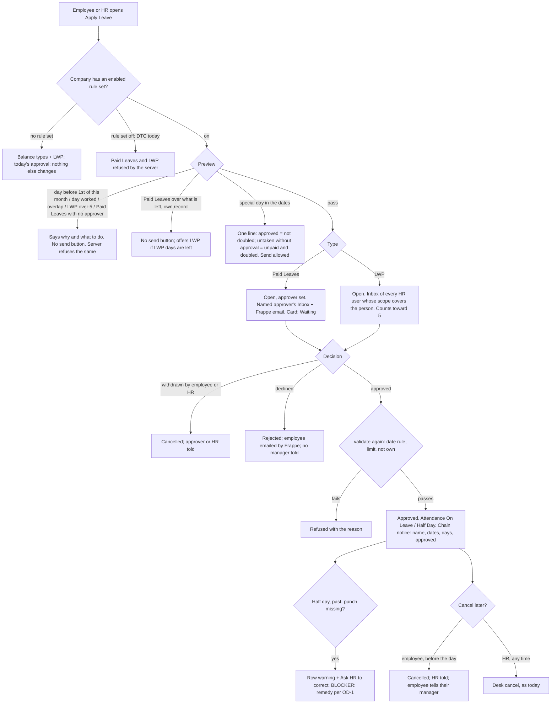

# 063 · Functional spec v3: Paid Leaves given on the 1st, leave without pay approved by HR

## What changed in version 3.0

Surbhi's final answers (brief, last section), two addenda (01d half day, 01e credits on the 1st),
security revision 3 and prototype v3 replaced most of version 2.1. **Version 2.1's parity table is
void; this one is walked row by row against prototype-v3.**

| Change | Effect on this spec |
|---|---|
| **Credits are given on the 1st** (A 4, B 3, C 2), the 15-day minimum stays | The card shows "Paid Leaves this month 4" from day one; "earned so far", the "So far" chip and every accrual sentence are gone. The credit change is a **settings change on the DTC rule set** (new US-23), proven in a **rehearsal on a local copy** (new US-24) |
| **E6: approved Paid Leaves days count toward the 15** | The one small engine change (new US-25) |
| **Half-day leave** counts 0.5, the other half is judged by punches, no green mark (01d, D1-D5) | An engine change (new US-26). The half-day box now says it uses half a day of Paid Leaves |
| **A missed punch on a half-day leave day** goes through the existing correction flow | **Blocker.** Security found the existing flow writes nothing on such a day. New US-27 carries it with three remedies as an **open decision** (OD-1) |
| **HR approves leave without pay** - any HR user whose scope covers the person; Paid Leaves keep the named approver | US-10 rewritten: a change to `_can_action_leave` for LWP only (SEC-3 rev. 3). The "HR named as approver by data" default of v2 is gone |
| **Special days: leave is allowed if approved** | The Leave Block List, SEC-5 and the "special day" stop are **dropped**. The preview says what an approved leave costs on a special day (US-12) |
| **Chain notice: name, dates, days, "approved"** - never type, approver, job title or reason; none on decline or cancel | Now matches the prototype. Version 2.1's conflicts X-1..X-4 are closed |
| **Everything is DTC only** | One test everywhere: the company has an **enabled** rule set (SEC-15) |
| v2 open decisions | OD-1 (limit) answered: 5 a calendar month. OD-2 (who approves): answered as above. OD-3 (notice): answered. OD-4 (rules bind HR on the desk): answered yes |

**Counts:** 27 stories (was 22), 75 points, 118 acceptance criteria, 75 parity rows.

---

## 0 · Bad news first

1. **BLOCKER: a missed punch on a half-day leave day cannot be fixed by the flow Surbhi named.**
   Security read the code (`01c` rev. 3 box): Frappe's Attendance Request writes nothing on a date
   that already carries an approved half-day leave, and the engine judges by punches, not by status.
   So "ask HR to approve the regularisation" would leave that half **absent - unpaid, and doubled on
   a special day** - with no way to fix it. Three remedies are on the table (OD-1); I recommend (iii)
   **HR adds the missing punch by hand on the desk**. Rehearsal item 9 (US-24) must prove the chosen
   remedy works **before the DTC rule set is switched on**. Not verified by running; security may be
   wrong, and the rehearsal settles it.
2. **Three changes move money:** credits on the 1st (settings), E6 (code) and the half-day rule
   (code). None reaches DTC until the rehearsal on a local copy passes and Surbhi has seen **the
   extra October cost against the old accrual rule** (01e §5 says nobody is paid less and anyone
   with a part month is paid more).
3. **The portal never fills in the leave approver when it files a request** (`hr_api.py:2392-2403`;
   no hook fills it; the Inbox lists only rows whose `leave_approver` is the user,
   `inbox_api.py:386`). For Paid Leaves at DTC, `apply_leave` must set it (AC-35). *Confirmed in
   code, not on a bench.* Other tenants: finding F-1.
4. **Five places where the prototype and a security rule or the truth disagree** (§6.3, X-1..X-5).
   None is resolved here; each has a cautious interim.
5. **`07-devops-inputs.md` §3 does not exist** (I use OPS-1..8 from the first look). One Ready box
   fails (§21).
6. **01c revision 3 still carries two stale lines:** SEC-1 still allows "held-day count and dates"
   (the v3 card no longer shows them), and SEC-10 (c)/(d) still describe the old half-day treatment
   (a full worked day / held). This spec follows 01d and the prototype; security should update them.
7. **Not a lawyer.** Nothing here settles a legal question.

---

## 1 · What this slice does

At DTC, once the pay rule set is switched on: the Leave page card shows "Paid Leaves - {Month}": the
class's days given on the 1st, used, waiting and to be paid out. Staff ask for Paid Leaves (their
named leave approver decides) or Leave Without Pay (any HR person who looks after them decides, up
to 5 days a calendar month). Past days in the current month are allowed; earlier months are not. A
special day may be taken if the leave is approved. A half day uses 0.5. On approval, every manager up
the Reports To chain gets a four-fact notice. The employee can cancel a waiting request, or an
approved leave before its day. Every other tenant: unchanged, except Leave Without Pay appears in
their Apply list and follows their normal approval.

## 2 · Cross-module reach and HRMS domains

| App | Touched? | How |
|---|---|---|
| `alvoraa_portal` | **Yes** | `hr_api.py` (card block, type list, `apply_leave`, `preview_leave_request`, `_can_action_leave` for LWP, new cancel endpoint), `inbox_api.py` (HR's LWP rows; two lines on every leave row), `portal.js` + leave page parts, Leave Application hooks (`validate`: date rule and limit; `on_submit`: chain notice), Leave Type lock hooks, **the pay engine**: `payroll_rules.py` (half-day verdict), `payroll_rules_apply.py` (`judge` passes the half-day flag), `payroll_month.py` (halves; E6), `payroll_slip.py` (`month_summary` reads `leave_application`/`leave_type` and counts approved Paid Leaves days), `payroll_reprocess.py` (fields read), the desk report *Salary Components and Workings* (halves shown) |
| `hrms` (our copy) | **No change** | `refuse_own_submit`, `refuse_own_decision` unchanged |
| `hrms` Frappe HR code | **No edits** | Leave Application, Leave Type, Attendance, Attendance Request used as shipped |
| `erpnext`, `frappe`, `alvoraa_goals`, `alvox_compensation` | No | |

**Domains:** leaves, attendance (Half Day rows; the correction flow), **payroll** (paid days move -
rehearsed), org structure (Reports To chain picks who is told; **not** the seat tree, which disagrees
at DTC - slice 064).

**Personas:** Employee (Priya, frontline, phone) · Contract / zero-class (Manoj, no login) · HR
Manager (Ritika: approves LWP, applies for staff with no login) · leave approver / store manager
(Sunil: approves Paid Leaves) · managers up the chain (Sunil, Kavita: told) · System Manager (changes
and switches on the rule set) · CXO (no change).

## 3 · Is this the real problem?

The cause is confirmed in code (Apply list built only from balances, `portal.js:4472`; DTC has no
allocations by design). The card answers "what will I be paid for"; the approval and chain notice
answer "does management know". Reach: 10 of 476 DTC staff have a login; HR files for the rest
(US-17).

---

## 4 · Gap analysis

| # | Requirement | What exists (read in source) | Verdict | Cost |
|---|---|---|---|---|
| G-1 | LWP needing no allocation | Frappe's "Leave Without Pay" (`is_lwp = 1`); exists at DTC, no maximum | **Configure** (already there) | - |
| G-2 | "Paid Leaves" type (D1) | Leave Type; needs `allow_negative = 1`, `is_lwp = 0` | **Configure** (one record, DTC, by hand) | S |
| G-3 | Paid Leaves locked (D1) | No per-record lock in Frappe | **Extend** - Leave Type `validate` / `on_trash` / `before_rename`, only where a rule set is enabled | S |
| G-4 | Credits 4/3/2 on the 1st, 15-day minimum | `leave_credits_for_month` with the rule set's cadence fields | **Configure** - rule set values (01e §3): `accrual_month_days` 15; A 15/4/4, B 15/3/3, C 15/2/2. No engine code | S |
| G-5 | E6: approved Paid Leaves count toward the 15 | Gate tests `days_worked` only (`payroll_month.py:145-148`); `summarise_month` already accepts `approved_leave_days` | **Extend** - `month_summary` counts approved Paid Leaves days (half 0.5) and the gate uses worked + that count | S |
| G-6 | Half-day leave: 0.5; other half by punches against half the shift; ≤ 2 quarters; no late/early/late window; no green; no punches → absent (doubled on a special day); 0.5 toward 15 | Engine treats "Half Day" as a short working day (`payroll_rules_apply.py:399`) | **Extend** - engine change per 01d §3 | M |
| G-7 | Missed punch on a half-day leave day fixed by HR | Attendance Request writes nothing on that date (`01c` rev. 3); held-day confirmation covers a missing check-out only | **Blocked - OD-1** | S-M |
| G-8 | Card from the engine and the rule set | `month_summary`, rule set `monthly_credits` | **Extend** - block inside `get_leave_summary` | M |
| G-9 | HR approves LWP; named approver approves Paid Leaves | Only the named approver may act (`_can_action_leave`) | **Extend** - LWP branch per SEC-3 rev. 3 + an Inbox part for HR | M |
| G-10 | LWP limit 5 a calendar month; current month only - every door | No Frappe setting | **Extend** - one function on Leave Application `validate` (SEC-6, SEC-13) | S |
| G-11 | Chain told on approval | Frappe emails only the employee | **Extend** - fixed-field notice from code on `on_submit` (PRIV-1) | M |
| G-12 | Employee and HR cancel | Employee: write, no cancel. `discard` needs write | **Extend** - one endpoint; +1 `ignore_permissions` (SEC-8) | M |
| G-13 | "Who was told" messages on withdraw and cancel (prototype) | Frappe's `discard` / `cancel` notify nobody but the employee | **Extend** - one small notice to the approver / HR (N-5, N-6) | S |
| G-14 | Special days: allowed if approved, line in preview and Inbox | Engine: an "On Leave" day returns before doubling (`payroll_rules.py` evaluate_day, `marked_on_leave` branch) | **Already there** (pay) + **Extend** (words) | S |
| G-15 | On-behalf: HR only, branch-scoped | Non-HR `on_behalf_of` silently ignored | **Extend** (SEC-7) | S |
| G-16 | Report shows halves and Paid-Leaves-only "used" | Report reads `month_summary` | **Extend** - follows G-5, G-6 | S |
| G-17 | HR's view of everyone's credits; Team View | Desk report; Team View (no type) | **Already there** | - |
| G-18 | Leave Block List, SEC-5 | - | **Drop** - Surbhi, final answers | - |
| G-19 | Leave Encashment requests; "rehearsed" tick | - | **Drop** | - |

**Single sources of truth:** "Paid Leaves this month" = the rule set's `monthly_credits` for the
class (never typed). Gate count = the engine's days worked + approved Paid Leaves days. Special days =
the rule set's `special_day_holiday_list`. Who is told = `Employee.reports_to`.

**Rung:** configuration (rule set values, two records, approver data) + rung 4 (code in existing
endpoints, hooks and the engine). No new DocType, field, page, report, job, cache, setting or app.

---

## 5 · Process flow

---

## 6 · Screens

### 6.1 Screens

| ID | Screen (prototype-v3 / design v3 §) |
|---|---|
| P-1 | Leave page and the card, 15 days reached (Priya) - §6.1 |
| P-2 | Card under 15 days (Rohit) - §6.1 |
| P-3 | Card, Contract / zero class (Manoj) - §6.1 |
| P-4 | Card loading / could not be shown - §6.1 |
| P-5 | Apply Leave: types, previews, limit, buttons - §6.2 |
| P-6 | Apply Leave: half day and special days - §6.3 |
| P-7 | Result in the pop-up, failed send - §6.4 |
| P-8 | Leave Applications: status, told line, Cancel, missed-punch warning, cancel confirms - §6.3, §6.5 |
| P-9 | HR applying for someone (Ritika → Manoj) - §6.2 |
| P-10 | HR Inbox (LWP) and the leave approver's Inbox (Paid Leaves) - §6.6 |
| P-11 | Team View and the chain notice (Sunil) - §6.6 |

**Status of the contract:** prototype v3 is the current design. Surbhi reviews it with the Positions
page after everything is fixed; **V1-V4 and S1-S5 (design §10, §12) are hers to confirm** (§19).

### 6.2 Layout rules

Card replaces `#leave-rings`. Four figures one row on desktop, 2 × 2 on a phone. Only "To be paid
out" tinted; "Waiting" dashed and worded. Days, never "credits"; never "held". No greyed buttons. The
Apply pop-up's own button is **Close**, so "Cancel" only ever means cancelling leave. Destructive
confirms are `alertdialog`s with "Keep" first.

### 6.3 Where prototype v3 meets a security rule or the truth - Surbhi decides

**Standing rule:** the prototype is built as it is. Where it cannot be without breaking a security
rule, or without telling the user something untrue, the row is listed here, **not resolved**. The
build does the cautious interim until she answers.

| # | Prototype v3 shows | What it meets | Interim the build does | Parity rows |
|---|---|---|---|---|
| **X-1** | A half day with a missed punch: "Until HR approves a correction, that half counts as absent. Ask for the correction on Attendance and HR will approve it." + **Ask HR to correct 19 Oct** | **Security finding (01c rev. 3):** the existing correction writes nothing on a half-day leave date; the half would stay absent. The message would promise a fix that does not happen | Builds the warning and link as drawn, **but the DTC rule set is not switched on until OD-1 is decided and rehearsal item 9 proves the chosen remedy**. If OD-1 = (ii), the second sentence changes to "That half counts as absent and cannot be corrected." | R-27 |
| **X-2** | HR applying for Rohit sees "Paid Leaves - {n} days left" and the "not enough" figures for that person ("The types, figures and the 5-day limit follow the person you pick") | **SEC-1(c):** HR passing another person gets **no** credit block | Types and the person's LWP "N of 5" shown; **Paid Leaves figure not shown**; Paid Leaves preview on behalf has no "left" check | R-29, R-30, R-36 |
| **X-3** | Under 15 days: "You have attended 10 so far **(up to 22 Oct)**" | **SEC-1 rev. 3 key list dropped the "up to" date** (01e §7 kept it under 15; security's list did not) | Shows the sentence **without** the bracket until security adds `attended_up_to` (under 15 only) to SEC-1 | R-9 |
| **X-4** | After approve: "{first} has been told too." After decline: "{first} has been told." | **Truth check.** "Told" is Frappe's status email to the employee. 466 of 476 DTC staff have no login; how many have an email on the Employee record is not known | Says "has been told too" only when Frappe queued the status email; otherwise "{first} has no email on record, so please tell them." | R-58, R-59 |
| **X-5** | A Hindi version of every screen | Deferred, not forbidden: a machine draft needing a native reviewer; whether the portal loads the user's language is unverified (Q-4) | Every string translatable; Hindi file supplied; **not switched on** until a native reviewer signs off | R-74 |

**Closed since v2.1** (prototype v3 now draws the safe way): chain notice type, approver and job
title (S1); cancellation notice to the chain (S2); Team View type column (S3); job title in the HR
row (S4); "Only HR can read this" (S5 rewords it). S1-S5 still need Surbhi's yes (§19), but there is
no conflict between the prototype and the rules on them.

**Not drawn, but specified** (real cases the prototype does not show; flagged so nobody reads them
as parity): empty leave class (AC-14), a day already worked and an overlap (AC-71), a Paid Leaves
request with no approver (AC-37), the limit refusal at approval (AC-44), approval after the month has
turned (AC-69), "only HR can cancel a leave that has started" (AC-85), the lock messages (AC-96, 97).

### 6.4 Prototype parity table (source: prototype-v3.html + 02-design.md v3)

One row per screen, state, control, message and rule the prototype shows **in the product**. Left
out: the review bar (person, device, language, theme, card state, "Next send fails", the "Try"
buttons), "Sample" tags, the v3 badge, the explanatory grey notes that describe the prototype
itself, and invented names and numbers. `{…}` is a value the server fills.

**Status:** **As drawn** · **As drawn, engine note** (how the data is found) · **Conflict X-n** (§6.3)
· **Existing** (already in the product).

| # | Screen | What prototype v3 shows | Story | Test | Status |
|---|---|---|---|---|---|
| R-1 | Leave page | Title "Leave"; subtitle "Your Paid Leaves this month and your leave requests"; "+ Apply Leave" | US-15 | AC-81 | As drawn |
| R-2 | Card | Title "Paid Leaves - {Month}" | US-1 | AC-1 | As drawn |
| R-3 | Card | "Class {c} · {n} days of Paid Leaves for {Month}" | US-1 | AC-1 | As drawn, engine note: `monthly_credits` |
| R-4 | Card | Figure "Paid Leaves this month" {n}; note "given on 1 {Mon}" | US-1 | AC-1, AC-3 | As drawn, engine note: `monthly_credits` |
| R-5 | Card | Figure "Used" {n}; note the dates, a half as "19 Oct (half)", or "none yet" | US-1 | AC-1, AC-4 | As drawn |
| R-6 | Card | Figure "Waiting for approval" {n}; note "set aside for now" / "none" | US-1 | AC-1, AC-5 | As drawn |
| R-7 | Card | Figure "To be paid out" {n}; note "with {Month} salary", or under 15 "once you reach 15 days" | US-1, US-2 | AC-1, AC-6, AC-9 | As drawn |
| R-8 | Card | Look: only "To be paid out" tinted, "Waiting" dashed, 2 × 2 on phone, no red | US-1 | AC-8 | As drawn |
| R-9 | Card, under 15 | "(i) These count once you have attended 15 days in {Month}. You have attended {n} so far (up to {date})." | US-2 | AC-9..AC-11 | **Conflict X-3** (the bracket) |
| R-10 | Card | "(i) {n} day is set aside for your {date} request until {approver} approves or declines it. If it is declined or you cancel it, the day comes back." | US-1 | AC-2 | As drawn |
| R-11 | Card | "Paid with your {Month} salary. Nothing carries over." | US-1 | AC-3 | As drawn |
| R-12 | Card | Rule box "How Paid Leaves work - class {c}" + "{n} days of Paid Leaves on the 1st of every month. They count once you have attended 15 days that month; approved Paid Leaves days count toward the 15. Days you do not use are paid with that month's salary. Nothing carries over." | US-1 | AC-3 | As drawn, engine note: `monthly_credits`, `leave_threshold_days` |
| R-13 | Card, loading | Skeleton + "Getting your Paid Leaves..." | US-4 | AC-15 | As drawn |
| R-14 | Card, error | "(!) Your Paid Leaves figures could not be shown just now. Your leave requests below are not affected, and you can still apply." + "Try again" | US-4 | AC-16 | As drawn |
| R-15 | Card, Contract | "Contract staff do not get monthly Paid Leaves." + "You can still ask for Leave Without Pay, up to 5 days a month. HR approves it. You have {n} of 5 days waiting or approved in {Month}." | US-3 | AC-12 | As drawn ("Contract" = category name) |
| R-16 | Card, zero class (design §6.1) | "Your leave class (No Leave) does not get monthly Paid Leaves." + the same second sentence | US-3 | AC-13 | As drawn |
| R-17 | Applications | Card "Leave Applications": table (Type, Dates, Days, Status) on desktop, stacked on phone; a half day labelled "{type} (half day)" | US-15 | AC-81 | As drawn |
| R-18 | Applications, empty | "No leave asked for yet. Use Apply Leave above." | US-15 | AC-81 | As drawn |
| R-19 | Applications | Badge "Waiting for HR" (LWP) / "Waiting for {approver}" (Paid Leaves), amber | US-15 | AC-77 | As drawn |
| R-20 | Applications | Badge "Approved by HR" / "Approved by {approver}", green | US-15 | AC-77 | As drawn |
| R-21 | Applications | "Declined" (red), "Cancelled" (grey) | US-15 | AC-77 | As drawn |
| R-22 | Applications, approved | "Your managers up to {top} have been told ({n} people)." | US-15 | AC-78 | As drawn, from notices actually created |
| R-23 | Applications, approved | "No manager is set above you, so only HR knows." | US-15 | AC-78 | As drawn |
| R-24 | Applications, waiting | "Cancel request" | US-16 | AC-83 | As drawn |
| R-25 | Applications, approved not started | "Cancel this leave" | US-16 | AC-84 | As drawn |
| R-26 | Applications, approved started/past | "This day has started or passed. To change it, speak to HR." No button | US-16 | AC-79 | As drawn |
| R-27 | Applications, approved half day with a missed punch | "(!) **Your {check-out / check-in} for the other half of {date} is missing.** Until HR approves a correction, that half counts as absent [and, as it is a special day, is charged double]. Ask for the correction on Attendance and HR will approve it." + "Ask HR to correct {date}" | US-27 | AC-116..AC-118 | **Conflict X-1 - BLOCKER** |
| R-28 | Apply pop-up | Title "Apply for leave"; Leave type ("Choose..."), From, To, Half day (To hidden, From → "Date"), Reason (optional); dates start at the 1st of the month; focus to title | US-15 | AC-80 | As drawn |
| R-29 | Apply pop-up, HR | "Who is this leave for?" - "Myself ({name})", people with "· no login" where true; help "For staff without a login. The types, figures and the 5-day limit follow the person you pick." | US-17 | AC-93 | As drawn **except "figures" - Conflict X-2** |
| R-30 | Apply pop-up | Options "Paid Leaves - {n} days left", "Leave Without Pay - {u} of 5 used" | US-7 | AC-29 | As drawn (on behalf: X-2) |
| R-31 | Apply pop-up, Contract | Only LWP + "Your work type does not get Paid Leaves, so only Leave Without Pay is offered." | US-7 | AC-30 | As drawn |
| R-32 | Apply pop-up | Reason help "Only the person who approves it and HR can read this. Managers are never sent it." | US-15 | AC-82 | As drawn (truth check RC-11) |
| R-33 | Apply pop-up | Buttons "Close" and "Choose a leave type" → "Send to {approver}" / "Send to HR"; errors "Choose a leave type first.", "Choose the date the leave starts." | US-15 | AC-80 | As drawn |
| R-34 | Apply pop-up | "The end date is before the start date. Change one of them." No send | US-15 | AC-80 | As drawn |
| R-35 | Preview, Paid Leaves | "**Asking for {n} day of Paid Leaves.** Until {approver} decides, {n} day is set aside from your {credited}. The leave is paid[, and approved Paid Leaves days count toward your 15 days]." | US-8 | AC-33 | As drawn |
| R-36 | Preview, Paid Leaves short | "**{n} days asked for, but you have {left} days of Paid Leaves left for {Month}.** Days already used or waiting for approval are taken off the {credited}. You can ask for Leave Without Pay instead ({u} of 5 used this month)." + "Ask for Leave Without Pay instead" (only if LWP days are left). No send | US-8 | AC-34 | As drawn (on behalf: X-2) |
| R-37 | Preview, LWP | "**Asking for {n} day of Leave Without Pay.** If approved, you are not paid for this day; your Paid Leaves for {Month} are still paid out[ once you reach 15 days]." (Contract: no Paid Leaves clause; half: "this half day") + "This will be {u+n} of 5 days of Leave Without Pay in {Month}." | US-9 | AC-39 | As drawn |
| R-38 | Preview, LWP over, something waiting | "**Only {left} days of Leave Without Pay left in {Month}; these dates need {n} days.** Up to 5 days a month, counting requests that are waiting or approved ({u} of 5 so far). Shorten the dates to {left} days. A request that is still waiting counts too: {dates} ({n} days). If it is not approved yet, you can cancel it from the list to free its days, or remind HR to approve it." No send | US-9 | AC-40 | As drawn (V2: words, no button) |
| R-39 | Preview, LWP over, all approved | "**You have used all 5 days of Leave Without Pay for {Month}.** Up to 5 days a month… All of them are approved. If you need more time off, speak to {HR name} (HR)." No send | US-9 | AC-41 | As drawn |
| R-40 | Preview, every allowed request | "{approver or HR name (HR)} decides. Once it is approved, your managers up to {top} are told." / no manager: "Once it is approved, only HR knows; no manager is set above you." | US-8, US-9 | AC-33, AC-78 | As drawn |
| R-41 | Preview, earlier month | "**Leave can only be asked for days in {Month}.** {Prev} is closed. If a {Prev} day needs changing, speak to {HR name} (HR)." No send | US-13 | AC-68 | As drawn |
| R-42 | Preview, past day | "This includes a past day. Past days in {Month} can be asked for until {month end}." | US-13 | AC-67 | As drawn |
| R-43 | Preview, half day | "**Half day:** it uses half a day of Paid Leaves. / it counts as 0.5 of the 5 days. You must check in and check out for the other half; it is measured against half the shift. Arriving late or leaving early does not count against you that day, and there is no green mark on a half-day leave day. If a punch is missed, ask HR to approve an attendance correction; until then the other half counts as absent[ and, on this special day, is charged double]." | US-14 | AC-72 | As drawn (the "correction" sentence depends on OD-1, like X-1) |
| R-44 | Preview, special day | "**{date} is a special day ({name}).** If this leave is approved, the day is not charged double. A day taken without approved leave is unpaid and charged double." Send still offered | US-12 | AC-63 | As drawn, engine note: name from the rule set's special-day list |
| R-45 | Preview, HR on behalf | The same sentences in the third person ("Manoj has used all 5 days…", "it can be cancelled to free its days, or approved by HR") | US-17 | AC-94 | As drawn |
| R-46 | Send | "Sending..." while sending; result titled "Sent" | US-15 | AC-80 | As drawn |
| R-47 | Result | "**Sent to HR**" / "**Sent to {approver}**" · "**{type} · {dates} · {n} day(s)[ (half day)]**[ · {person}]" · "{approver} will approve or decline it. You will see the answer here, under Leave Applications." (on behalf: "{first} will be told the answer.") · will-tell line · LWP: "If approved, you are not paid for this day. {u} of 5 days of Leave Without Pay are now waiting or approved in {Month}." / Paid Leaves: "{n} day is set aside from your Paid Leaves until {approver} decides." · half: "Check in and check out for the other half as usual." · "Changed your mind? It can be cancelled from the list." · Done | US-15 | AC-75 | As drawn |
| R-48 | Failed send | "Not sent: the connection dropped. Nothing was saved. Your choices are still here - try again." Form kept | US-15 | AC-76 | As drawn |
| R-49 | Cancel confirm, waiting | "Cancel this request?" · "{type} · {dates} · {n}" · "{approver / HR} will no longer see this request." · LWP: "{n} goes back on your 5-day Leave Without Pay limit for {Month}." / Paid Leaves: "The {n} set aside comes back to your Paid Leaves." · [Keep the request] [Cancel request] | US-16 | AC-83 | As drawn |
| R-50 | Cancel result, waiting | "Request cancelled" · dates · "{approver / HR} has been told." · Done | US-16 | AC-83 | As drawn (notice N-5) |
| R-51 | Cancel confirm, approved | "Cancel this approved leave?" · "You will be expected at work on this day." · "HR is told it is cancelled. Your managers are not sent a message about it, so if {first manager} is expecting you to be away, tell him yourself." · LWP: "You are paid for this day if you work it." / Paid Leaves: "The day comes back to your Paid Leaves." · [Keep the leave] [Cancel leave] | US-16 | AC-84 | As drawn (S2) |
| R-52 | Cancel result, approved | "Leave cancelled" · dates · "HR has been told. You are expected at work." | US-16 | AC-84 | As drawn (notice N-6) |
| R-53 | Cancel confirms | `alertdialog`; "Keep" first; × and Escape keep | US-16 | AC-83 | As drawn |
| R-54 | HR Inbox, LWP row | "**{name}**" (no job title, S4) · "Leave Without Pay[ (half day)] · {dates} · **{n}**" · "{k} other person in this team is away on those days" | US-10 | AC-47 | As drawn |
| R-55 | HR Inbox, LWP row | "{u} of 5 Leave Without Pay days in {Month}, counting this one" | US-10 | AC-47 | As drawn |
| R-56 | Inbox row, special day | "{date} is a special day. Approved, it is not charged double." | US-12 | AC-64 | As drawn |
| R-57 | Inbox row | "Once it is approved, {first}'s managers up to {top} are told." / no-manager variant | US-10 | AC-47, AC-53 | As drawn |
| R-58 | Inbox, after Approve | "Approved · {type} · {dates}. {first}'s managers up to {top} have been told ({n} people). {first} has been told too." | US-10 | AC-54 | As drawn **except "has been told too" - Conflict X-4** |
| R-59 | Inbox, after Decline | "Declined. {first} has been told. Managers are not told about a declined request." | US-10 | AC-54 | **Conflict X-4** for "has been told" |
| R-60 | Inbox, withdrawn request | "{first} cancelled this request." | US-10 | AC-55 | As drawn |
| R-61 | Leave approver's Inbox (Paid Leaves) | Row as today (name, type, dates, days, away line) + will-tell line; Approve / Decline | US-10 | AC-53 | As drawn (V1) |
| R-62 | Team View | "Team Leaves This Month": Employee, From, To, Days - **no type column**; a half day shows 0.5; stacked on phone | US-18 | AC-95 | As drawn (S3) |
| R-63 | Team View | Stats Direct Reports / Present Today / On Leave / Pending Approvals | - | - | Existing, unchanged |
| R-64 | Chain notice | Subject "{name} will be away on {date}"; "{name}'s leave for {date} ({n} day) has been approved."; "You are told because {first} is in your team. There is nothing for you to do."; "You can see your team's leave on the Team View page." | US-11 | AC-58 | As drawn (S1) |
| R-65 | Chain notice | Email and desk bell; each manager above the person in Reports To; once, on approval; none on decline or cancel | US-11 | AC-57, AC-60, AC-61 | As drawn (S2) |
| R-66 | Rule | Days given on the 1st by class; count once 15 days attended; approved Paid Leaves days count toward 15 | US-23, US-25 | AC-105..AC-110 | As drawn |
| R-67 | Rule | Paid Leaves left = given − used − waiting (U3) | US-8 | AC-34 | As drawn |
| R-68 | Rule | LWP up to 5 a calendar month, waiting + approved, half 0.5 | US-9 | AC-42..AC-46 | As drawn |
| R-69 | Rule | A half day uses 0.5 (Paid Leaves or of the 5) and sets 0.5 aside while waiting | US-14 | AC-73 | As drawn |
| R-70 | Rule | LWP → HR; Paid Leaves → named approver | US-10 | AC-48..AC-53 | As drawn (V1) |
| R-71 | Rule | Cancel only a waiting request or an approved one not started | US-16 | AC-83..AC-85 | As drawn |
| R-72 | Rule | Current month only (date pickers start at the 1st) | US-13 | AC-68 | As drawn |
| R-73 | Rule | HR's own leave goes to her own approver; nobody approves their own | US-10 | AC-50 | As drawn |
| R-74 | Every screen | Hindi (machine draft) | all UI stories | §16 | **Conflict X-5** |
| R-75 | Every screen | `role="status"` previews, `role="alert"` errors, labelled dialogs, Escape closes, targets ≥ 44 px on phone / 24 px desktop, field text 16 px, nothing under 12 px | US-15 | AC-8, AC-80 | As drawn |

**Count: 75 rows** - 67 as drawn (some with an engine note), 1 existing, **7 rows touched by
conflicts X-1..X-5** (R-9, R-27, R-29, R-58, R-59, R-74; R-30 and R-36 only on behalf). **R-27 is a
blocker.**

---

## 7 · Data model

### 7.1 No new field, no new DocType

### 7.2 Leave Application - fields written (standard)

| Field | At filing (DTC) |
|---|---|
| `status` | Open, always (SEC-3) |
| `leave_approver` | **Paid Leaves:** the resolved named approver (AC-35). **LWP:** left blank - HR in scope decide (SEC-3); setting it would list a single person as approver in the activity feed |
| `half_day`, `half_day_date`, `description` | as chosen |
| On approve | Approved, submitted, `modified_by` = decider |
| On withdraw | `discard` → status Cancelled, docstatus 0 |
| On cancel | docstatus 2, status Cancelled |

### 7.3 Leave Type "Paid Leaves" - one record, DTC, by hand (SEC-11)

`is_lwp` **0** · `allow_negative` **1** · `include_holiday` 1 `[ASSUMPTION - matches LWP; OPS-4 test]`
· `allow_encashment` 0 · `is_carry_forward` 0 · `is_earned_leave` 0 · maximums 0. Found by its exact
name `[ASSUMPTION]`.

### 7.4 DTC rule set - values changed (01e §3; US-23)

| Field | Today | New |
|---|---|---|
| `leave_threshold_days` | 15 | 15 |
| `accrual_month_days` | 30 | **15** |
| Class A `period_days` / `credit_per_period` / `monthly_credits` | 7.5 / 1 / 4 | **15 / 4 / 4** |
| Class B | 10 / 1 / 3 | **15 / 3 / 3** |
| Class C | 7.5 / 0.5 / 2 | **15 / 2 / 2** |

With these values one 15-day block gives the whole class figure; under 15 gives 0. The rule set's own
validation passes (01e §3). Rollback = the old values, from the Version row.

### 7.5 Card block - exact key list (SEC-1 rev. 3)

`paid_leaves`, only for the caller's own record at an enabled-rule-set company:

| Key | Source |
|---|---|
| `month` | current month |
| `class` | employee's value in `rule_set.leave_class_field` (or the category name for a non-earning category) |
| `earns` | class row's `monthly_credits` > 0 **and** the category's `earns_leave_credits` |
| `credited` | class row's `monthly_credits` |
| `used` | approved Paid Leaves days in the month, half = 0.5, with their dates |
| `waiting` | Open Paid Leaves days in the month, half = 0.5, counted day by day |
| `to_be_paid_out` | max(0, credited − used − waiting) |
| `attended_so_far`, `gate` | **only while under the gate:** the engine's days worked (halves included) + approved Paid Leaves days (E6); `leave_threshold_days` |
| `approver` | full name of the approver of the earliest waiting Paid Leaves request |
| `error` | true when the block failed; then no figure keys |

**Not in the list any more:** `earned`, `period`, `gain`, the "up to" date (see X-3), held-day count
and dates (the v3 card no longer shows them - security to remove from SEC-1). **Never:** any rupee
field, `paid_days`, `reds`, `greens`, `notes`, the Basic.

### 7.6 Other response additions

| Endpoint | Adds |
|---|---|
| `get_leave_summary` | `types_offered`: `{leave_type, left?, lwp_in_play, lwp_limit, approver_label}`; `left` (Paid Leaves) **own record only** (X-2) |
| `get_leave_summary` → `applications[]` | `approver_label` ("HR" or the approver's name), `told_count`, `told_top_name` (from Notification Log rows created for it), `can_cancel`, `half_day`, `missing_punch` (`check-in` / `check-out` / none, for an approved past half-day leave) |
| `preview_leave_request` | `verdict`, `reason_code`, and values the words need (special day date and name, LWP counts and waiting requests, approver label, chain top) |
| Inbox leave rows | LWP: `lwp_in_play_with_this`; any: `special_day`, `chain_top_name` |

### 7.7 Rule set fields read

`enabled`, `company`, `leave_class_field`, `category_field`, `leave_threshold_days`,
`leave_classes.leave_class`, `leave_classes.monthly_credits`, `categories.category`,
`categories.earns_leave_credits`, `special_day_holiday_list`. The card no longer reads
`period_days` or `credit_per_period` (the engine still does).

### 7.8 The LWP limit (SEC-13)

Per employee, per calendar month: LWP days Open or Approved + the request being checked ≤ **5**. Half
= 0.5. Days counted as Frappe counts them for the type (`include_holiday`). A request across two
months counts each day in its own month. Rejected and Cancelled free their days. Paid Leaves never
count. A constant with the date of her decision; no setting.

### 7.9 Engine changes (US-25, US-26) - in the order 01d §3 gives

| Where | Change |
|---|---|
| `payroll_rules.evaluate_day` / `DayVerdict` | New input "half-day leave": 0.5 on leave; other half measured against half the shift; quarters lost ≤ 2; no late, early or late-window charge; **no greens**; reds only from the slab; no punches → the other half absent (doubled on a special day) |
| `payroll_rules_apply.judge` | Half-day leave = status "Half Day" **and** `leave_application` filled (a "Half Day" with no leave keeps today's treatment) |
| `payroll_slip.month_summary`, `evaluate_attendance`, `payroll_reprocess.py` | Read `leave_application`, `leave_type` |
| `payroll_month.summarise_month` | Halves: a half-day leave adds 0.5 worked and 0.5 on leave. **E6:** the gate compares days worked + approved Paid Leaves days with the threshold |
| `payroll_slip.month_summary` | Counts approved Paid Leaves days (Attendance On Leave or Half Day with `leave_type` "Paid Leaves"; half 0.5) and passes them to `summarise_month` - for E6 **and** for the "used" split (U1), so the **slip** gets E6 too, not only the card |
| `on_salary_slip_validate` | No change (check `absent_days` copes with a half) |

---

## 8 · States - Leave Application

| State | Reached by | Who | Next | Notified |
|---|---|---|---|---|
| **Open** / 0 | Filed | Employee (own), HR (in scope) | Approved, Rejected, Cancelled (withdrawn) | Paid Leaves: approver (Frappe email). LWP: HR Inbox (no email `[ASSUMPTION]`) |
| **Cancelled** / 0 | Withdrawn | Employee (own), HR (in scope) | - | Approver, or HR users in scope for LWP (N-5) |
| **Approved** / 1 | Approved; `validate` re-runs date rule and limit | Paid Leaves: named approver. LWP: HR Manager / HR User in scope. Never the subject | Cancelled / 2 | Employee (Frappe status email); **chain** (N-1) |
| **Rejected** / 1 | Declined | as above | - | Employee (Frappe status email); no manager |
| **Cancelled** / 2 | Employee before the first day; HR on the desk any time | Employee (own), HR | - | Employee (Frappe); HR users in scope (N-6); **no chain notice** |

---

## 9 · Permission and visibility matrix

### 9.1 Role × DocType (no standard right changes)

| Role | Leave Application | "Paid Leaves" type | Rule set |
|---|---|---|---|
| Employee | create, read, write (as today); **no submit, no cancel** | read | - |
| Leave Approver / Location Manager (DTC) | as today | read | - |
| HR User / HR Manager | full (as today); **portal approval of LWP only for people in `permitted_employees()`** | read; edits refused by the lock | read (HR Manager) |
| System Manager | full | create once; edits refused by the lock | **write**: change values, switch on/off |
| Administrator | full | full (rollback) | full |
| Guest | nothing | nothing | nothing |

### 9.2 Portal actions × persona

| Action | Employee (own) | Another employee | HR in scope | HR out of scope | Named approver (store manager) | Managers up the chain | CXO / System Manager |
|---|---|---|---|---|---|---|---|
| See the card | **Yes** | **No** | own only | own only | own only | own only | own only |
| File Paid Leaves / LWP | Yes | **No - refused** | Yes, on behalf | **No - refused** | - | - | as HR |
| Approve / decline **LWP** | **Never own** | - | **Yes**, never own | **No** | **No** (unless also HR in scope) | No | if HR in scope |
| Approve / decline **Paid Leaves** | Never own | - | Only if named approver | - | **Yes**, never own | No | only if named approver |
| Withdraw an Open request | Yes | **No** | Yes | No | No | No | as HR |
| Cancel an approved leave | Before the first day | **No** | Yes (desk) | No | desk, as today (role) | No | Yes |
| Get the chain notice | - | - | - | - | if in the chain | **Yes** | if in the chain |

### 9.3 Must NOT

| Who | Must not |
|---|---|
| Any employee | See another person's card or leave; get any rupee figure; act for anyone else; submit or cancel through REST |
| A non-HR login with no User Permission on its own Employee | Withdraw or cancel anyone else's leave through our endpoint |
| Managers up the chain | Get the type, the approver, a job title, the reason, credits or pay; hear of a declined or cancelled leave |
| HR out of scope | Approve LWP or file for people outside their companies **and** branches |
| HR on behalf | Get the person's Paid Leaves figures (X-2) |
| Anyone | Approve their own leave, any role, any door |
| System Manager | Switch the rule set on at DTC before the rehearsal passes and Surbhi says so (process control) |
| Leaver with a live login; Guest | Anything here |

---

## 10 · Epic and stories

**Epic E-063:** At DTC an employee sees the month's Paid Leaves from the 1st, asks for time off on her
phone, the right person decides, her managers are told - and the pay that follows is proven before it
is switched on.

| ID | Story | Persona | Pts | Screen | Carries | ACs |
|---|---|---|---|---|---|---|
| US-1 | *As* Priya, *I want* to see the month's Paid Leaves - given, used, waiting, to be paid out - *so that* I know what I will be paid for | Employee | 5 | P-1 | 01e §4, D3, D8, U1 | AC-1..AC-8 |
| US-2 | *As* Rohit, under 15 days, *I want* the card to say why my days do not count yet | Employee | 1 | P-2 | E1 | AC-9..AC-11 |
| US-3 | *As* Manoj (Contract), *I want* one honest sentence and my LWP count | Zero-class employee | 1 | P-3 | D7, E8 | AC-12..AC-14 |
| US-4 | *As* an employee on a slow phone, *I want* loading and failure states that still let me apply | Employee | 1 | P-4 | nfr §2 | AC-15, AC-16 |
| US-5 | *As* an employee, *I must not* see anyone's figures but mine, nor any rupees | Employee (must-not) | 3 | P-1 | SEC-1, PRIV-3, PRIV-5, OPS-2, OPS-6 | AC-17..AC-23 |
| US-6 | *As* the System Manager, *I want* nothing reachable unless DTC's rule set is enabled | System Manager | 3 | P-1, P-5 | SEC-2, SEC-15, OPS-1 | AC-24..AC-28 |
| US-7 | *As* Priya, *I want* the Apply list to offer Paid Leaves and LWP | Employee | 3 | P-5 | D5 | AC-29..AC-32 |
| US-8 | *As* Priya, *I want* to ask my approver for Paid Leaves and see the days set aside | Employee | 3 | P-5, P-7 | D3, U3, SEC-3, SEC-12 | AC-33..AC-38 |
| US-9 | *As* Priya, *I want* to ask for LWP and know where I stand against the 5 days - and what to do when I am stopped | Employee | 5 | P-5 | Limit, SEC-13, V2 | AC-39..AC-46 |
| US-10 | *As* Ritika (HR), *I want* LWP requests of the people I look after in my Inbox, and *as* Sunil, Paid Leaves requests as today - never my own | HR Manager, approver | 5 | P-10 | SEC-3 rev. 3, V1 | AC-47..AC-56 |
| US-11 | *As* Kavita, up the chain, *I want* a four-fact notice when someone below me has leave approved | Manager up the chain | 3 | P-11 | PRIV-1, S1, S2 | AC-57..AC-62 |
| US-12 | *As* Priya, *I want* to know what an approved leave on a special day costs - and to be allowed to take it | Employee + HR | 2 | P-6, P-10 | Special days (final answers) | AC-63..AC-66 |
| US-13 | *As* DTC, *I want* leave only for this month's days, on every door | Employee + HR | 2 | P-5 | SEC-6 | AC-67..AC-71 |
| US-14 | *As* Priya, *I want* a half day to use half a day, and the form to say what that means | Employee | 2 | P-6 | 01d, E7 | AC-72..AC-74 |
| US-15 | *As* Priya on a phone, *I want* a clear form, result, status words and who was told | Employee | 3 | P-7, P-8 | LV-5, S5 | AC-75..AC-82 |
| US-16 | *As* Priya, *I want* to cancel a waiting request or an approved leave before it starts; *as* Ritika, to cancel any | Employee, HR | 5 | P-8 | SEC-8, SEC-9 | AC-83..AC-90 |
| US-17 | *As* Ritika, *I want* to file for staff with no login, inside my scope | HR Manager | 3 | P-9 | SEC-7, SEC-1(c) | AC-91..AC-94 |
| US-18 | *As* an employee, *I must not* have my leave type on my team's screens | Employee (must-not) | 1 | P-11 | PRIV-2, S3 | AC-95 |
| US-19 | *As* the System Manager, *I want* "Paid Leaves" created once with the right settings and locked | System Manager | 2 | - | D1, SEC-11, OPS-7 | AC-96..AC-98 |
| US-20 | *As* HR, *I want* slip paid days to equal the engine's, whatever leave was taken | HR Manager | 3 | - | SEC-10 (a, b, e), OPS-4 | AC-99..AC-101 |
| US-21 | *As* HR, *I want* the desk report to count only Paid Leaves as "used", and show halves | HR Manager | 2 | - | U1, 01d | AC-102 |
| US-22 | *As* the System Manager, *I want* a written DTC rollout and a one-move rollback | System Manager | 2 | - | OPS-1, 3, 7; SEC-2, 8, 11 | AC-103, AC-104 |
| US-23 | *As* the System Manager, *I want* to change DTC's rule set to "given on the 1st" from a written list, with a rollback, *so that* credits follow DTC's rule with no engine code | System Manager | 2 | - | 01e §3, SEC-14 | AC-105..AC-107 |
| US-24 | *As* Surbhi, *I want* every pay-affecting change proven on a local copy, with the extra cost shown to me, before DTC is switched on | Owner | 3 | - | SEC-14 items 1-10, 01d §3, 01e §5 | AC-108 |
| US-25 | *As* Priya, *I want* my approved Paid Leaves days to count toward the 15 *so that* taking my own leave properly never costs me all of it | Employee | 2 | - | E6 | AC-109, AC-110 |
| US-26 | *As* Priya, *I want* a half-day leave counted as half leave and my other half judged fairly by punches | Employee | 5 | - | 01d D1-D5, final answers, SEC-16 | AC-111..AC-115 |
| US-27 | *As* Priya, *I want* to be warned when I missed a punch on a half-day leave day - and HR to be able to fix it | Employee, HR | 3 | P-8 | SEC-16, Q7, **OD-1 (blocker)** | AC-116..AC-118 |

**Total: 27 stories, 75 points.** US-23 and US-24 are the **release stories** for the settings change
and the rehearsal.

### YouTrack-ready table (do not import until Surbhi says so)

| Summary | Persona | Pts | ACs | Requirements |
|---|---|---|---|---|
| 063 US-1 Paid Leaves card, given on the 1st | Employee | 5 | 1-8 | 01e §4 |
| 063 US-2 Under 15 days line | Employee | 1 | 9-11 | E1 |
| 063 US-3 Contract / zero class | Employee | 1 | 12-14 | D7 |
| 063 US-4 Loading and error | Employee | 1 | 15-16 | nfr |
| 063 US-5 Own record, days only | Employee | 3 | 17-23 | SEC-1 PRIV-3 PRIV-5 |
| 063 US-6 DTC only (rule set enabled) | System Manager | 3 | 24-28 | SEC-2 SEC-15 |
| 063 US-7 Apply list | Employee | 3 | 29-32 | D5 |
| 063 US-8 Ask for Paid Leaves | Employee | 3 | 33-38 | SEC-3 SEC-12 |
| 063 US-9 LWP limit of 5 | Employee | 5 | 39-46 | SEC-13 |
| 063 US-10 HR approves LWP; approver approves Paid Leaves | HR | 5 | 47-56 | SEC-3 |
| 063 US-11 Chain notice | Manager | 3 | 57-62 | PRIV-1 |
| 063 US-12 Special days allowed if approved | Employee | 2 | 63-66 | final answers |
| 063 US-13 Current month only | Employee | 2 | 67-71 | SEC-6 |
| 063 US-14 Half day on the form | Employee | 2 | 72-74 | 01d |
| 063 US-15 Form, result, statuses | Employee | 3 | 75-82 | - |
| 063 US-16 Cancel | Employee | 5 | 83-90 | SEC-8 SEC-9 |
| 063 US-17 HR on behalf | HR | 3 | 91-94 | SEC-7 |
| 063 US-18 Team screens | Employee | 1 | 95 | PRIV-2 |
| 063 US-19 Paid Leaves locked | System Manager | 2 | 96-98 | SEC-11 |
| 063 US-20 Slip equals engine | HR | 3 | 99-101 | SEC-10 |
| 063 US-21 Report "used" and halves | HR | 2 | 102 | U1 |
| 063 US-22 DTC rollout and rollback | System Manager | 2 | 103-104 | OPS |
| 063 US-23 Rule-set settings change | System Manager | 2 | 105-107 | 01e SEC-14 |
| 063 US-24 Rehearsal on a local copy | Owner | 3 | 108 | SEC-14 |
| 063 US-25 E6 engine change | Employee | 2 | 109-110 | E6 |
| 063 US-26 Half-day engine change | Employee | 5 | 111-115 | 01d SEC-16 |
| 063 US-27 Missed punch on a half day (BLOCKED) | Employee | 3 | 116-118 | SEC-16 OD-1 |

---

## 11 · Acceptance criteria

**Fixture ("DTC fixture").** A company with an **enabled** rule set: `leave_threshold_days` 15,
`accrual_month_days` 15, classes A 15/4/4, B 15/3/3, C 15/2/2; category "Contract" with
`earns_leave_credits` 0; a "No Leave" class with `monthly_credits` 0; special-day list holding **Sun 25
Oct 2026**, description "Festive sale"; Leave Types "Paid Leaves" (§7.3) and "Leave Without Pay"
(`is_lwp` 1, `include_holiday` 1). Priya: class A, `leave_approver` Sunil, Reports To Priya → Sunil →
Kavita. Ritika: HR Manager, company-wide scope, her own approver Kavita. Anil: HR User with a Branch
User Permission that **excludes** Priya's branch. A submitted Salary Structure Assignment and real
Employee Checkins where pay is tested. Today **Fri 23 Oct 2026**. Self-approval tests run as the
person's own user, never Administrator.

### US-1 · The card

**AC-1** *Given* Priya with 20 days attended, approved Paid Leaves on 6 Oct (full) and 19 Oct (half),
and an Open full-day Paid Leaves request for 27 Oct · *When* she opens Leave · *Then* the card reads
"Paid Leaves - October", "Class A · 4 days of Paid Leaves for October", and: Paid Leaves this month **4**
("given on 1 Oct"); Used **1.5** ("19 Oct (half), 6 Oct"); Waiting for approval **1** ("set aside for
now"); To be paid out **1.5** ("with October salary").

**AC-2** *Then* the line reads "1 day is set aside for your 27 Oct request until Sunil Mehra approves or
declines it. If it is declined or you cancel it, the day comes back." (approver of the earliest
waiting request).

**AC-3** *Then* below: "Paid with your October salary. Nothing carries over." and the box "How Paid
Leaves work - class A" with "4 days of Paid Leaves on the 1st of every month. They count once you have
attended 15 days that month; approved Paid Leaves days count toward the 15. Days you do not use are
paid with that month's salary. Nothing carries over." *Given* the fixture's class A `monthly_credits`
changed to 5 · *Then* the card shows 5 everywhere with no code change; *given* `leave_threshold_days`
16 · *then* "16 days" / "toward the 16".

**AC-4** *Given* an approved LWP day and no Paid Leaves · *Then* Used = 0 and To be paid out = 4.

**AC-5** *Given* an Open half-day Paid Leaves request · *Then* Waiting rises by 0.5. *Given* an Open
Paid Leaves request 30 Oct - 2 Nov · *Then* Waiting counts only 30 and 31 Oct. Open LWP never counts.

**AC-6** *Given* used + waiting ≥ 4 · *Then* To be paid out shows 0, never negative.

**AC-7** *Given* 15 or more days attended, on the same day · *Then* the desk report's "Leave earned"
equals "Paid Leaves this month" and "Leave used" equals Used (up to the given figure). (Kill
criterion: card = payslip.)

**AC-8** On a 390 px phone: no sideways scroll; figures 2 × 2; nothing under 12 px; only "To be paid
out" tinted; "Waiting" dashed and worded; nothing red.

### US-2 · Under 15 days

**AC-9** *Given* Rohit, class A, 10 days attended (E6 count) · *Then* the same four figures (4 / used /
waiting / left), "To be paid out" note "once you reach 15 days", and the line "These count once you
have attended 15 days in October. You have attended 10 so far." *(Drawn with "(up to 22 Oct)" - X-3:
added when security adds the key.)*

**AC-10** *Given* 1 November, no attendance yet · *Then* "You have attended 0 so far."

**AC-11** *(E6)* *Given* 13 worked days + 2 approved Paid Leaves days · *Then* no under-15 line and the
note reads "with October salary".

### US-3 · Contract and zero class

**AC-12** *Given* Manoj (Contract) with 5 LWP days waiting or approved · *Then* "Contract staff do not
get monthly Paid Leaves." and "You can still ask for Leave Without Pay, up to 5 days a month. HR
approves it. You have 5 of 5 days waiting or approved in October." No figures, no rule box.

**AC-13** *Given* class "No Leave" · *Then* "Your leave class (No Leave) does not get monthly Paid
Leaves." and the same second sentence.

**AC-14** *(not drawn)* *Given* an empty leave class · *Then* "No leave class is set for you, so you do
not get monthly Paid Leaves. Ask HR if this is wrong." and the same second sentence.

### US-4 · Loading and error

**AC-15** On a 3G profile: skeleton + "Getting your Paid Leaves..." within 300 ms; card p95 ≤ 2.5 s.

**AC-16** *Given* the card block raises · *Then* "Your Paid Leaves figures could not be shown just now.
Your leave requests below are not affected, and you can still apply." + "Try again"; the list loads;
Apply works.

### US-5 · Own record, days only

**AC-17** *(SEC-1a)* The `paid_leaves` keys **equal** §7.5 exactly (with and without the under-15 keys).

**AC-18** *(SEC-1b, OPS-2)* Enabled rule set, base 31,000 → the response contains neither "31000" nor
the daily-rate string.

**AC-19** *(SEC-1c)* HR passing `employee_id` → no `paid_leaves` and no `left`.

**AC-20** *(SEC-1d, e)* A non-HR caller with a colleague's id gets their own; a leaver gets
`no_employee`.

**AC-21** *(PRIV-3)* Review: no DocType, stored figure, cache, report, export or print format.

**AC-22** *(PRIV-5)* Forced exception → no fixture number in the response; Error Log title = employee
id only; no rupee, no reason.

**AC-23** *(OPS-6)* `prepare()` gets `employee=`; one card load's query count is **equal** at 20 and
400 employees; the number is recorded in `04`.

### US-6 · DTC only

**AC-24** *(SEC-2)* Enabled rule set → card shown; Paid Leaves offered (if `earns`); LWP offered, Open,
HR approves, limit applies.

**AC-25** *(SEC-2)* Rule set present, `enabled` 0 → today's card ("No leave allocations found for the
current period."); neither type offered; `apply_leave` refuses both through `refuse()` (rule
`063-SEC-2`): "This leave type is not available. Ask HR."; nothing written.

**AC-26** No rule set → no card; LWP offered with today's approval; no limit, date rule, HR approval
change, chain notice or half-day treatment.

**AC-27** *(SEC-15)* One table-driven test: card, offer, HR approval of LWP, date rule, limit, chain
notice, half-day treatment - each fires **only** with an enabled rule set. Review: no company or site
name in code; every rule asks `rule_set_for(company)`.

**AC-28** Switching the rule set off → AC-25 on the next load; Version row names who and when.

### US-7 · Apply list

**AC-29** Priya (2.5 left, 3 LWP in play) → "Paid Leaves - 2.5 days left", "Leave Without Pay - 3 of 5
used", plus her balance types as today.

**AC-30** Manoj → only "Leave Without Pay - 5 of 5 used" and "Your work type does not get Paid Leaves,
so only Leave Without Pay is offered."

**AC-31** A tenant with no rule set → its types as today plus "Leave Without Pay" with no note.

**AC-32** *(SEC-2)* `apply_leave` with "Paid Leaves" for Manoj → refused as AC-25.

### US-8 · Paid Leaves

**AC-33** Priya, 2.5 left, 1 day on Tue 27 Oct → "**Asking for 1 day of Paid Leaves.** Until Sunil
Mehra decides, 1 day is set aside from your 4. The leave is paid." then "Sunil Mehra decides. Once it
is approved, your managers up to Kavita Arora are told." Button "Send to Sunil Mehra". Under 15 the
second sentence ends "…, and approved Paid Leaves days count toward your 15 days."

**AC-34** *(U3)* 2 days asked, 0.5 left → "**2 days asked for, but you have 0.5 days of Paid Leaves left
for October.** Days already used or waiting for approval are taken off the 4. You can ask for Leave
Without Pay instead (1 of 5 used this month)." + "Ask for Leave Without Pay instead" (only if LWP days
are left; it switches the type). No send. The server does not enforce this cap.

**AC-35** Send → status Open, docstatus 0, `leave_approver` = Employee's approver, else the
department's first; appears in Sunil's Inbox; one Frappe approver email queued (notifications on).

**AC-36** *(SEC-3a)* `apply_leave` accepts no status; a body with `status: "Approved"` → filed Open.

**AC-37** *(SEC-12)* No named approver (or a disabled one) → Paid Leaves refused: "Your request could not
be sent because nobody is set to approve your Paid Leaves. Ask HR to name someone, or ask for Leave
Without Pay, which HR approves." Nothing written. LWP for the same person → filed; an HR user in scope
can approve it.

**AC-38** Sunil approves → Approved, Attendance "On Leave" (`leave_type` Paid Leaves); Waiting −1, Used
+1. Declines → Rejected; Waiting −1.

### US-9 · LWP limit

**AC-39** Priya, 3 in play, 1 day → "**Asking for 1 day of Leave Without Pay.** If approved, you are not
paid for this day; your Paid Leaves for October are still paid out." (under 15: "…still paid out once
you reach 15 days."; Contract: no Paid Leaves clause; a half day: "this half day") + "This will be 4 of
5 days of Leave Without Pay in October." + "Ritika (HR) decides. Once it is approved, your managers up
to Kavita Arora are told." Button "Send to HR".

**AC-40** Rohit, 4 in play (1 waiting: Tue 20 Oct), asks 2 → "**Only 1 day of Leave Without Pay left in
October; these dates need 2 days.** Up to 5 days a month, counting requests that are waiting or approved
(4 of 5 so far). Shorten the dates to 1 day. A request that is still waiting counts too: Tue 20 Oct (1
day). If it is not approved yet, you can cancel it from the list to free its days, or remind HR to
approve it." No send. No "Remind" button (V2).

**AC-41** All 5 approved → "**You have used all 5 days of Leave Without Pay for October.** Up to 5 days a
month, counting requests that are waiting or approved (5 of 5 so far). All of them are approved. If you
need more time off, speak to Ritika (HR)." No send.

**AC-42** *(SEC-13a)* 4.5 Open + a half day → allowed; another half day → refused.

**AC-43** *(SEC-13b)* 5 Approved + 1 → refused through `apply_leave` **and** a REST insert: "This leave
would take Leave Without Pay in {Month} to {n} days. The limit is 5 days a month, counting requests
that are waiting or approved."

**AC-44** *(SEC-13c, not drawn)* Two Open 3-day requests put in directly → the first approval is
refused with the same message.

**AC-45** *(SEC-13d, U10)* 30 Oct, 31 Oct, 1 Nov → 2 in October, 1 in November.

**AC-46** *(SEC-13e, f)* Rejected / Cancelled days do not count; Paid Leaves days never count.

### US-10 · Who approves

**AC-47** *Given* Manoj's Open LWP for Tue 27 Oct · *Then* it appears in the Inbox of every HR Manager /
HR User whose `permitted_employees()` holds Manoj, as: "**Manoj Singh**" (no job title) · "Leave Without
Pay · Tue 27 Oct · **1 day**" · "1 other person in this team is away on those days" · "5 of 5 Leave
Without Pay days in October, counting this one" · "Once it is approved, Manoj's managers up to Kavita
Arora are told." · [Approve] [Decline]. The scope filter stays in the database (no id list shipped
back as `IN`, nfr §2).

**AC-48** *(SEC-3b)* Ritika approves → Approved, Attendance written.

**AC-49** *(SEC-3c)* Anil (out of scope) → refused on the portal; nothing written. *(Observable only
with Anil's narrowing permission.)*

**AC-50** *(SEC-3d, U13)* Ritika approves her **own** LWP → refused (rule SEC-9) on the portal and the
desk. Her own requests go to Kavita (Paid Leaves) / another HR user in scope (LWP).

**AC-51** *(SEC-3e, f)* An HR user who is not Priya's named approver cannot approve her Paid Leaves; a
non-HR named approver cannot approve LWP.

**AC-52** *(SEC-3g)* At a tenant without an enabled rule set, LWP follows the named-approver rule.

**AC-53** *(V1)* Priya's Paid Leaves appear in Sunil's Inbox as today, plus "Once it is approved,
Priya's managers up to Kavita Arora are told."

**AC-54** After Approve: "Approved · {type} · {dates}. {first}'s managers up to {top} have been told
({n} people). {first} has been told too." After Decline: "Declined. {first} has been told. Managers are
not told about a declined request." *(X-4: "has been told" only when Frappe queued the status email;
otherwise "{first} has no email on record, so please tell them.")*

**AC-55** A request withdrawn while on an approver's open page → pressing Approve or Decline writes
nothing and the row reads "{first} cancelled this request."

**AC-56** `access.py` 0 `ignore_permissions`; `refuse_own_submit` and `refuse_own_decision` unchanged;
`_can_action_leave` keeps `is_own_record` as its first check.

### US-11 · Chain notice

**AC-57** Priya → Sunil → Kavita → Arun: on approval each of the three gets one email and one desk bell.

**AC-58** Subject "Priya Sharma will be away on Fri 30 Oct"; body "Priya Sharma's leave for Fri 30 Oct
(1 day) has been approved." / "You are told because Priya is in your team. There is nothing for you to
do." / "You can see your team's leave on the Team View page." Nothing else.

**AC-59** `SECRET-REASON-063` absent from Email Queue, Notification Log, security log, Error Log; the
type, approver and job title absent from the body.

**AC-60** Loop → stops, one security-log line, no repeat; 12 levels → 10 told; a non-Active manager →
walk stops; no login or disabled user → skipped, the one above told; never the employee; once per person;
Reports To, not the seat tree.

**AC-61** No chain notice on decline, withdraw or cancel.

**AC-62** Review: built in code on `on_submit`, DTC only; no Frappe `Notification` record.

### US-12 · Special days

**AC-63** Paid Leaves for Sun 25 Oct → preview line "**Sun 25 Oct is a special day (Festive sale).** If
this leave is approved, the day is not charged double. A day taken without approved leave is unpaid and
charged double." and the send button **is** offered. The name is the Holiday's description in the rule
set's special-day list (tags stripped; none → "…is a special day.").

**AC-64** The approver's Inbox row adds "Sun 25 Oct is a special day. Approved, it is not charged double."

**AC-65** *(engine, CI)* An approved full-day leave on 25 Oct → not doubled; an absence on 25 Oct →
doubled.

**AC-66** No Leave Block List is created or read; filing and approving a leave on 25 Oct both succeed.

### US-13 · Current month only

**AC-67** Mon 19 Oct (past) → "This includes a past day. Past days in October can be asked for until 31
Oct."

**AC-68** *(SEC-6a)* 28 Sep → "**Leave can only be asked for days in October.** September is closed. If a
September day needs changing, speak to Ritika (HR)." No send; date pickers start at 1 Oct; `apply_leave`
and a REST insert refuse with the first sentence.

**AC-69** *(SEC-6b, not drawn)* Filed 31 Oct for 31 Oct, approved 2 Nov → refused: "This leave is for a
day before 1 November, so it can no longer be approved."

**AC-70** *(OD-4 answered)* The same rule refuses HR on the desk.

**AC-71** *(not drawn)* A day already marked Present / Half Day / Work From Home → "{date} is already
marked as a day you worked, so leave cannot be added for it."; an overlap → "You already have leave on
{date}. Change the dates." No send.

### US-14 · Half day on the form

**AC-72** Half day ticked → under the lead sentence: "**Half day:** it uses half a day of Paid Leaves."
(LWP: "it counts as 0.5 of the 5 days.") "You must check in and check out for the other half; it is
measured against half the shift. Arriving late or leaving early does not count against you that day,
and there is no green mark on a half-day leave day. If a punch is missed, ask HR to approve an
attendance correction; until then the other half counts as absent." On a special day the last clause
ends "…and, on this special day, is charged double." *(The correction sentence follows OD-1.)*

**AC-73** A half-day Paid Leaves request sets 0.5 aside, and 0.5 is used once approved; a half-day LWP
counts 0.5 toward 5; approval writes Attendance "Half Day" with `leave_application` filled.

**AC-74** The result adds "Check in and check out for the other half as usual."

### US-15 · Form, result, status

**AC-75** LWP result: "**Sent to HR**" · "**Leave Without Pay · Thu 29 Oct · 1 day**" · "Ritika (HR) will
approve or decline it. You will see the answer here, under Leave Applications." · will-tell line · "If
approved, you are not paid for this day. 4 of 5 days of Leave Without Pay are now waiting or approved in
October." · "Changed your mind? It can be cancelled from the list." · Done. Paid Leaves: "**Sent to Sunil
Mehra**" and "1 day is set aside from your Paid Leaves until Sunil Mehra decides." On behalf: "· {person}"
after the dates and "{first} will be told the answer." No toast.

**AC-76** Lost connection → "Not sent: the connection dropped. Nothing was saved. Your choices are still
here - try again."; every field kept.

**AC-77** Badges: Open → "Waiting for HR" (LWP) / "Waiting for {approver}" (Paid Leaves), amber;
Approved → "Approved by HR" / "Approved by {approver}", green; "Declined" red; "Cancelled" grey. A half
day's type reads "{type} (half day)".

**AC-78** Approved row: "Your managers up to Kavita Arora have been told (2 people)." from the Notification
Log rows actually created; none → "No manager is set above you, so only HR knows." The preview's
no-manager line: "Once it is approved, only HR knows; no manager is set above you."

**AC-79** Approved, first day today or earlier → "This day has started or passed. To change it, speak to
HR." and no button.

**AC-80** Pop-up: title "Apply for leave"; fields as R-28; pickers start at the 1st; the button reads
"Choose a leave type" until a type is chosen, then "Send to HR" / "Send to {approver}"; pressing with no
type → "Choose a leave type first."; no start date → "Choose the date the leave starts."; end before start
→ "The end date is before the start date. Change one of them." and no send; while sending "Sending..."
(disabled); result title "Sent"; "Close", × and Escape close; focus to the title; preview `role="status"`,
errors `role="alert"`; targets ≥ 44 px on the phone.

**AC-81** Page: "Leave", "Your Paid Leaves this month and your leave requests", "+ Apply Leave"; list
"Leave Applications" as a table on desktop and stacked on a phone; empty → "No leave asked for yet. Use
Apply Leave above."

**AC-82** Reason help: "Only the person who approves it and HR can read this. Managers are never sent it."
(Release check RC-11 confirms no other role reads DTC reasons.)

### US-16 · Cancel (SEC-8)

**AC-83** *(SEC-8a)* Own Open request → "Cancel request" → `alertdialog` "Cancel this request?" ·
"{type} · {dates} · {n}" · "{Sunil Mehra / HR} will no longer see this request." · LWP: "1 day goes back on
your 5-day Leave Without Pay limit for October." / Paid Leaves: "The 1 day set aside comes back to your
Paid Leaves." · [Keep the request] [Cancel request] (Keep first; × and Escape keep) → `discard()` **as
the employee**; status Cancelled; record kept; result "Request cancelled" · dates · "{Sunil Mehra / HR}
has been told." Notice N-5 goes to the approver (Paid Leaves) or the HR users in scope (LWP).

**AC-84** *(SEC-8b)* Own Approved LWP for tomorrow → "Cancel this approved leave?" · "You will be expected
at work on this day." · "HR is told it is cancelled. Your managers are not sent a message about it, so if
Sunil Mehra is expecting you to be away, tell him yourself." · "You are paid for this day if you work it."
(Paid Leaves: "The day comes back to your Paid Leaves.") · [Keep the leave] [Cancel leave] → docstatus 2,
Attendance cancelled, record kept; result "Leave cancelled" · dates · "HR has been told. You are expected
at work." Notice N-6 to HR users in scope; **no chain notice**.

**AC-85** *(SEC-8c, not drawn)* Own Approved leave starting today or earlier, through the endpoint →
refused "This leave has started, so only HR can cancel it."

**AC-86** *(SEC-8d)* `frappe.client.cancel` by the employee on an approved past Paid Leaves day →
`PermissionError`.

**AC-87** *(SEC-8e)* A non-HR login **with no User Permission row** on someone else's Open request →
refused "You can only cancel your own leave."

**AC-88** *(SEC-8f, SEC-9)* Counter reads **70** for `hr_api.py`, the comment names the endpoint;
`access.py` 0; no new `allow_guest`; the bypass is set on that one document only after the own-record and
future-date checks.

**AC-89** HR withdraws for someone in scope through the same endpoint; HR cancels approved leave on the
desk, any time, as today.

**AC-90** A withdrawn LWP frees its days at once (next preview shows the lower count).

### US-17 · HR on behalf (SEC-7)

**AC-91** *(SEC-7a)* A non-HR caller passing `on_behalf_of` (any value) to `apply_leave` or
`preview_leave_request` → `PermissionError` "You can only apply for leave for yourself."; nothing written;
`refuse()` rule `063-SEC-7`.

**AC-92** *(SEC-7b, c)* Anil filing for Priya (other branch) → refused "You can only file leave for
employees in the branches you look after."; for his own branch → filed.

**AC-93** Ritika's pop-up shows "Who is this leave for?" with "Myself (Ritika)" and people in scope, those
without a login marked "· no login"; help "For staff without a login. The types, figures and the 5-day
limit follow the person you pick." Picking Manoj: only LWP, "5 of 5 used". Picking Rohit: "Paid Leaves"
**with no "left" figure** (X-2) and "Leave Without Pay - 4 of 5 used".

**AC-94** On behalf, the previews read in the third person ("Manoj has used all 5 days of Leave Without
Pay for October.", "If it is not approved yet, it can be cancelled to free its days, or approved by HR.");
the limit and the date rule bind; the result shows "· Manoj Singh" and "Manoj will be told the answer."

### US-18 · Team screens

**AC-95** *(PRIV-2, S3)* Team Leaves This Month has columns Employee, From, To, Days - no type; a half day
shows 0.5; the payload rows for an approved LWP and an approved Paid Leaves have identical keys and no
`leave_type`.

### US-19 · Lock

**AC-96** *(not drawn)* With an enabled rule set, creating "Paid Leaves" with the §7.3 flags saves; any
other value of `is_lwp`, `allow_negative`, `allow_encashment`, `is_carry_forward`, `is_earned_leave` →
"Paid Leaves must be created with: not leave without pay, negative balance allowed, no encashment, no
carry forward, not earned leave."

**AC-97** *(not drawn)* Edit, delete or rename by HR Manager or System Manager → "Paid Leaves is set up for
the pay rules and cannot be changed or deleted."; Administrator allowed.

**AC-98** No enabled rule set on the site → no lock.

### US-20 · Slip equals engine (SEC-10)

**AC-99** *(10a)* 2 approved LWP + 1 approved Paid Leaves + 1 absence → `payment_days` = engine
`paid_days`; nothing added on top.

**AC-100** *(10b, OPS-4)* 3 approved LWP days over a Sunday, `include_holiday` 1 → `payment_days` = engine;
weekly off neither lost nor paid twice.

**AC-101** *(10e)* Same month with "Paid Leaves" `is_lwp` 0 then 1 → identical `payment_days`. *(SEC-10
c/d are superseded by 01d - see AC-111..115.)*

### US-21 · Report

**AC-102** For a person with 4 given, 1.5 approved Paid Leaves days (one half) and 1 approved LWP day, at
15+ days: Leave earned 4, Leave used 1.5, Leave encashed 2.5; the "Worked" and "On leave" columns show
halves.

### US-22 · Rollout

**AC-103** The release checklist (`07` §5) holds RC-1..RC-12 (§15), each with read-only evidence.

**AC-104** Go-live day: for two named DTC staff with logins, the card equals the desk report (AC-7).

### US-23 · Rule-set settings change (release story)

**AC-105** On the **local copy first**, a System Manager changes the DTC rule set from the written list
(§7.4) in the desk; it saves (validation passes); the Version row shows each old and new value; a comment
on the record quotes Surbhi's decision and its date. No patch, no script on production.

**AC-106** The rollback - the old values from the Version row - is applied and timed on the local copy;
the time is recorded in `07` §5. If the rule set is already on, switching it off is the faster rollback.

**AC-107** *(engine, CI and local copy)* With the new values: 15 to 31 days attended → 4 / 3 / 2; 14 → 0;
Contract and zero classes → 0.

### US-24 · Rehearsal on a local copy (release story)

**AC-108** On a local copy of DTC data with the rule set switched on **there only**, the rehearsal output
is kept as release evidence for every SEC-14 item: (1-6) 01d §3's six half-day checks; (7) 01e §5's six
checks, **including the extra October cost against accrual, shown to Surbhi before switch-on**; (8) E6;
(9) **the half-day missed-punch remedy chosen in OD-1** - a half-day leave day with the other half's punch
missing, put right by that remedy and approved by HR → the engine counts the other half; (10) special days
(AC-65). **The DTC rule set is not switched on until all ten pass and Surbhi says so.**

### US-25 · E6

**AC-109** *(SEC-14 item 8)* Class A, 13 attended + 2 **approved** Paid Leaves days → reaches 15, given 4;
13 attended + 2 **Open** Paid Leaves days → does not, 0.

**AC-110** `month_summary` itself counts approved Paid Leaves days (half 0.5), so the slip, the report and
the card all get E6 and the Paid-Leaves-only "used" (U1). Paid days for a person with no Paid Leaves are
unchanged.

### US-26 · Half-day engine (01d)

**AC-111** A day is half-day leave only when the Attendance status is "Half Day" **and** `leave_application`
is filled. An automatic "Half Day" with no leave is judged exactly as before.

**AC-112** Half-day leave, other half fully worked → 0.5 leave, no quarters lost; the worked half is measured
against half the shift; quarters lost never exceed 2; no late, early or late-window charge; **no green mark
even when the punches would earn one** (D4); reds only from the slab.

**AC-113** *(D5)* Half-day leave, no punches → 0.5 leave + 0.5 absent; on a special day the absent half is
doubled.

**AC-114** *(D2)* A half-day leave counts 0.5 toward the 15: 14.5 → under; 15 → met.

**AC-115** A half-day LWP gives the same answer as a half-day Paid Leaves; saving a slip twice gives the same
paid days; an Absent day later changed by a half-day leave is judged correctly when the slip is saved.

### US-27 · Missed punch on a half-day leave day - **BLOCKED (OD-1)**

**AC-116** *Given* an approved half-day leave on a past date with fewer than two punches · *Then* the request
row shows "**Your check-out for the other half of Mon 19 Oct is missing.** Until HR approves a correction,
that half counts as absent. Ask for the correction on Attendance and HR will approve it." with "Ask HR to
correct 19 Oct", which opens the existing attendance correction for that date. One punch → "check-out"; none
→ "check-in" `[ASSUMPTION: DTC punches carry no log type; an odd count means the check-in is there - memory
dtc-log-type-empty]`. On a special day the second sentence adds "…and, as it is a special day, is charged
double."

**AC-117** *(the blocker, proven by AC-108 item 9)* After the remedy chosen in OD-1 and HR's approval, the
engine counts the other half (paid, not doubled) on the next slip save or reprocess. **Default remedy (iii),
recommended:** the employee's correction request reaches HR as today; HR adds the missing Employee Checkin on
the desk, then approves the request; no new endpoint, role or bypass (SEC-16).

**AC-118** Until AC-117 passes on the local copy, the DTC rule set is not switched on. If Surbhi picks (ii),
the row's sentence becomes "That half counts as absent and cannot be corrected." and the link is not shown.

---

## 12 · Notifications

| # | What | Trigger | Recipient | Channel | Never carries |
|---|---|---|---|---|---|
| N-1 | Chain notice (AC-58) | Approved, DTC | Each manager up Reports To | Email + desk bell | Type, approver, job title, reason, credits, pay |
| N-2 | Frappe approver email (existing) | Open Paid Leaves with `leave_approver` set | Named approver | Email | Reason (confirmed absent) |
| N-3 | Frappe status email (existing) | Approve, decline, cancel | Employee (if an email exists - X-4) | Email | - |
| N-4 | New LWP request | Filed | HR users in scope | **Inbox only** `[ASSUMPTION - no email]` | - |
| N-5 | Withdrawn | Employee or HR withdraws | Approver (Paid Leaves) / HR users in scope (LWP) | Email + desk bell: "{name} cancelled a leave request" / "{name} cancelled the request for {dates} ({n} days). There is nothing for you to do." | Type, reason |
| N-6 | Approved leave cancelled | Employee cancels before the day | HR users in scope | Email + desk bell: "{name} cancelled approved leave" / "{name} cancelled their approved leave for {dates} ({n} days) and is expected at work." | Type, reason |

Production email is muted until DTC's go-live (memory). Desk bells still appear.

## 13 · Edge cases

| # | Case | What happens | AC |
|---|---|---|---|
| E-1 | Half day | Uses 0.5; other half by punches; no green; no punches → half absent (doubled on special day) | 72-74, 111-115 |
| E-2 | Half day with a missed punch | Row warning; remedy per OD-1 - **blocker** | 116-118 |
| E-3 | Special day | Allowed if approved, not doubled; untaken without approval doubled | 63-66 |
| E-4 | Past day this month | Allowed | 67 |
| E-5 | Day in an earlier month | Refused at filing and approval, every door, HR too | 68-70 |
| E-6 | Zero class / Contract / empty class | Sentence; only LWP | 12-14, 30 |
| E-7 | Under 15 days | Figures shown with "once you reach 15 days" (V4) | 9-11 |
| E-8 | Approved Paid Leaves near the 15 | Count toward it (E6) | 11, 109 |
| E-9 | Pending counted | Paid Leaves: Waiting, set aside. LWP: toward 5 | 1, 5, 39 |
| E-10 | Rule set off / absent | Nothing reachable / today's behaviour | 25, 26 |
| E-11 | Own leave | Never approved by the subject | 50, 56 |
| E-12 | On behalf from non-HR | Refused | 91 |
| E-13 | LWP over 5; two filed at once | Refused at filing; second check at approval | 40-44 |
| E-14 | Joiner mid-month (E2) | Same 15-day rule: full class figure if 15 reached that month, else 0; no pro-rata | 107 |
| E-15 | Leaver mid-month (E3) | Same rule, paid in the last salary; leaver's login gets nothing on these screens | 20, 107 |
| E-16 | Absent most of the month (E4) | Under 15 → 0 | 107 |
| E-17 | Absence nobody applied for (E5) | Unpaid; credits still paid if 15 reached; doubled on a special day | 65 |
| E-18 | No named approver (51 at DTC) | Paid Leaves refused with a way out; LWP unaffected (HR) | 37 |
| E-19 | HR's own leave | Her approver / another HR user in scope | 50 |
| E-20 | Chain loop, leaver, no login, 12 levels | Stop, stop, skip, cap 10 | 60 |
| E-21 | No Reports To | Nobody told; "only HR knows" | 78 |
| E-22 | Paid Leaves beyond what is left | No send (own); on behalf no check (X-2) | 34, 93 |
| E-23 | Day worked / overlap | Refused, plain words | 71 |
| E-24 | Cancel after the day started | Employee refused; HR on the desk | 79, 85 |
| E-25 | Withdrawn while the approver has it open | Approve writes nothing; "cancelled this request" | 55 |
| E-26 | Back-dated approval over an Absent | Frappe overwrites by `db_set`; slip re-judges | 115 |
| E-27 | Weekly off inside LWP (`include_holiday` 1) | Counted as leave and toward 5; pay proven | 45, 100 |
| E-28 | Slip hook fails | Frappe's own figures stay (pre-existing) - residual risk | §19 |
| E-29 | Time zone | Server date, Asia/Kolkata `[ASSUMPTION]` | 67 |
| E-30 | Rollback with Open requests | Stay Open; HR declines them | §15 |
| E-31 | Bulk import / REST insert | `validate` applies the date rule and the limit | 43, 68 |
| E-32 | Concurrent approval of one request | One transaction wins, as today | existing |

## 14 · Non-functional requirements

| Item | Number | Source |
|---|---|---|
| Volume | DTC 476 active, 10 logins, 7 HR users | `01b` |
| Card API | p95 ≤ 500 ms; measure; if over, one checkin query per month - no cache | nfr §2, OPS-6 |
| Queries | Card and HR Inbox: **equal count at 20 and 400 employees**; HR scope stays in the database (join / subquery, never a shipped id list) | nfr §2 |
| Leave page, 3G | skeleton ≤ 300 ms, p95 ≤ 2.5 s | nfr §2 |
| File, approve, cancel | p95 ≤ 1.5 s each; chain walk ≤ 10 reads (2 at DTC) | nfr §2 |
| Engine | Per-day cost unchanged in kind; the reprocess and slip run times on the local copy recorded in the rehearsal | SEC-14 |
| Jobs, cache | None | |
| Retention | Unchanged | PRIV-6 |
| Accessibility | WCAG 2.2 AA; ≥ 44 px phone / 24 px desktop; 16 px fields | design §9 |

## 15 · Migration and DTC rollout

**Every tenant, on migrate:** nothing - no field, no patch, no data.

**DTC, in this order** (evidence into `07` §5):

| Step | Who | What | Evidence |
|---|---|---|---|
| RC-1 | Engineer | Code deployed with the rule set **off** - AC-25 holds | AC-25 on the site |
| RC-2 | **Surbhi** | Decides OD-1 (missed-punch remedy) | decision recorded |
| RC-3 | Engineer | **Local copy**: rule-set values changed (US-23), rule set on there only, rehearsal (US-24) all ten items; rollback timed | rehearsal note, cost figure |
| RC-4 | **Surbhi** | Sees the extra October cost and the rehearsal; says "switch on" | her word, dated |
| RC-5 | System Manager | On DTC: the same rule-set value change from the written list, then switch on | Version rows |
| RC-6 | System Manager | Create "Paid Leaves" (§7.3; lock checks flags) | flags read back |
| RC-7 | Engineer | "Leave Without Pay" exists, `is_lwp` 1; `allow_encashment` 0 everywhere; no Leave Encashment records | query |
| RC-8 | DTC HR | Name Paid Leaves approvers for the 51 with none (OPS-3) - otherwise their Paid Leaves requests are refused (AC-37) | count |
| RC-9 | Engineer | Every Active non-HR DTC login has a User Permission on its own Employee (SEC-8) | query |
| RC-10 | Engineer | Reports To chain: no loops, no non-Active links | query |
| RC-11 | Engineer | No non-HR role (Leave Approver, Location Manager) reads DTC Leave Application reasons on the desk - else the reason help text (AC-82) is untrue | User Permission read |
| RC-12 | Engineer | AC-104 on two named staff | screenshots outside the repo |

**Rollback - one move:** switch the rule set off (card gone; both types refused; no limit, date rule,
HR-approval change, chain notice or half-day treatment). Then, if wanted, restore the old rule-set values
from the Version row (US-23). Submitted records stay. HR declines Open requests (E-30). Code rollback is
DevOps's, timed.

## 16 · Localisation and accessibility

Every new string translatable (`_()` on the server; `drT` in `portal.js`). Days in 0.5 steps; no currency.
`alvoraa_portal` has only `translations/en.csv`; whether the page loads the user's language is
**unverified** (Q-4). Hindi below is the prototype's **machine draft** (mine where marked) and **needs a
native reviewer** before it is switched on (X-5).

| Key | English | Hindi (machine draft) |
|---|---|---|
| H-1 | Paid Leaves - {month} | Paid Leaves - {month} |
| H-2 | Class {c} · {n} days of Paid Leaves for {month} | क्लास {c} · {month} के लिए {n} दिन की Paid Leaves |
| H-3 | Paid Leaves this month / Used / Waiting for approval / To be paid out | इस महीने की Paid Leaves / ली गईं / मंज़ूरी बाकी / पैसे में मिलेंगी |
| H-4 | given on 1 {Mon} / none yet / set aside for now / none / with {month} salary / once you reach 15 days | 1 {Mon} को मिलीं / अभी कोई नहीं / अभी अलग रखी / कोई नहीं / {month} की सैलरी में / 15 दिन पूरे होने पर |
| H-5 | These count once you have attended 15 days in {month}. You have attended {n} so far. | ये तब गिनी जाती हैं जब {month} में आपकी 15 दिन की हाज़िरी हो जाए। अब तक आपकी {n} दिन की हाज़िरी है। |
| H-6 | Paid with your {month} salary. Nothing carries over. | {month} की सैलरी के साथ मिलेगा। कुछ भी अगले महीने नहीं जाता। |
| H-7 | Rule box (R-12) | prototype-v3 line 304 |
| H-8 | Set-aside line (R-10) | prototype-v3 line 299 |
| H-9 | Getting your Paid Leaves... / could-not-be-shown sentence / Try again | prototype-v3 lines 273-276 |
| H-10 | Contract and LWP sentences (R-15) | prototype-v3 lines 280-282 |
| H-11 | Your leave class ({class}) does not get monthly Paid Leaves. *(mine)* | आपकी लीव क्लास ({class}) में हर महीने Paid Leaves नहीं मिलती। |
| H-12 | No leave class is set for you, so you do not get monthly Paid Leaves. Ask HR if this is wrong. *(mine)* | आपकी कोई लीव क्लास तय नहीं है, इसलिए हर महीने Paid Leaves नहीं मिलती। अगर यह गलत है तो HR से पूछें। |
| H-13 | Every preview, limit, half-day, special-day, past-day, earlier-month, result, failed-send, badge, told, cancel and missed-punch string | prototype-v3 lines 241-252, 309-339, 406-555 |
| H-14 | This leave would take Leave Without Pay in {month} to {n} days. The limit is 5 days a month, counting requests that are waiting or approved. *(mine)* | इस छुट्टी से {month} में Leave Without Pay {n} दिन हो जाएगी। सीमा महीने में 5 दिन है, जिसमें इंतज़ार वाली और मंज़ूर अर्ज़ियाँ गिनी जाती हैं। |
| H-15 | This leave is for a day before 1 {month}, so it can no longer be approved. *(mine)* | यह छुट्टी 1 {month} से पहले के दिन की है, इसलिए अब मंज़ूर नहीं की जा सकती। |
| H-16 | Your request could not be sent because nobody is set to approve your Paid Leaves. Ask HR to name someone, or ask for Leave Without Pay, which HR approves. *(mine)* | आपकी अर्ज़ी नहीं भेजी जा सकी क्योंकि आपकी Paid Leaves मंज़ूर करने के लिए कोई तय नहीं है। HR से किसी को तय करने को कहें, या Leave Without Pay माँगें, जिसे HR मंज़ूर करता है। |
| H-17 | Day worked / overlap / not available / only for yourself / only your own leave / has started *(mine)* | {date} को आपकी हाज़िरी पहले से दर्ज है, इसलिए उस दिन की छुट्टी नहीं जोड़ी जा सकती। / {date} को आपकी छुट्टी पहले से है। तारीखें बदलें। / यह छुट्टी का प्रकार उपलब्ध नहीं है। HR से पूछें। / आप सिर्फ़ अपने लिए छुट्टी की अर्ज़ी दे सकते हैं। / आप सिर्फ़ अपनी छुट्टी रद्द कर सकते हैं। / यह छुट्टी शुरू हो चुकी है, इसलिए सिर्फ़ HR इसे रद्द कर सकता है। |

Not translated: desk-only lock messages, the chain notice and N-5/N-6 (English `[ASSUMPTION]`).

## 17 · Audit

| Question a year later | Answered by |
|---|---|
| Who filed, when; back-dated? | `owner`, `creation` vs `from_date` |
| Who approved or declined LWP / Paid Leaves? | `modified_by` at submit; `leave_approver` for Paid Leaves |
| Who was told? | Notification Log / Email Queue rows for that Leave Application |
| Withdrawn or cancelled by whom? | status, docstatus, `modified_by` |
| When did DTC's credit rule change, and by whom? | Rule set Version rows + the comment quoting Surbhi |
| Who switched the engine on? | Rule set Version row |
| Who added a missing punch (OD-1 iii)? | Employee Checkin `owner`, `creation` |
| Refusals | Security log via `refuse()`, ids and rule only (`063-SEC-2`, `-7`, `-8`, chain loop; existing `SEC-9`, `SEC-13`). Limit and date refusals are business rules (`frappe.throw`); previews never logged |

**Findings outside this slice:** F-1 `apply_leave` never sets `leave_approver` at any tenant. F-2
`month_summary` ignores `alvoraa_held_confirmed`. F-3 `_hr_target_employee` is company-scoped only. F-4
"only my own leave" rests on a User Permission row. F-5 01c's SEC-1 still lists held-day keys and SEC-10
(c)/(d) describe the old half-day rule.

---

## 18 · Compliance-impact sub-analysis

*I am not a lawyer. Built on 01c revision 3.*

**1 · Data touched**

| Object | Class | Purpose | New collection? |
|---|---|---|---|
| Card figures (given, used, waiting, to be paid out, days attended under 15) | sensitive (pay-derived) | What this month's leave is worth in days | No - worked out per load; **less** than v2 |
| Leave Application, reason | sensitive, health-adjacent | Approval | No |
| Chain notice (name, dates, days, approved) | sensitive, via Brevo | Managers plan | No new data; new recipients |
| Employee Checkin added by HR (OD-1 iii) | sensitive | Correct pay | No new kind of record |

**2 · Obligations engaged:** DPDP safeguards, purpose limitation, minimisation (SEC-1, PRIV-1, PRIV-3);
OWASP ASVS access control on every door (SEC-2, 3, 6, 7, 8, 13, 15); segregation of duties (nobody approves
their own; SEC-3); `ignore_permissions` register +1 justified (SEC-8, 9); Code on Wages records kept as
today (PRIV-6; period Q-C1).

**3 · Visibility delta:** the employee sees their own month in days; **all 7 DTC HR users** (in scope) now
see LWP requests and reasons, where one named approver did; every manager up the chain learns of every
approved absence below them (**the top learns of all** - Q6a). Nobody sees type, reason or pay who did not
before.

**4 · Decision automation:** none. A named human approves every leave; the engine applies the client's
stated rules, set by a named System Manager, proven and shown to Surbhi before switch-on. Contest route: HR.

**5 · Retention:** nothing changes.

**6 · ⚠ Open compliance questions:** Q-C1 retention period (counsel; blocks A6, not this); DTC's state
(Surbhi); Q6a top of chain (Surbhi).

**7 · AI:** none. **Prohibitions:** none engaged.

---

## 19 · Open decisions, open questions, blockers, residual risk

### Blocker

| # | Decision | Options | Recommended | Blocks |
|---|---|---|---|---|
| **OD-1** (01c Q7) | How is a missed punch on a half-day leave day put right? The existing correction writes nothing there | (i) extend the held-day confirmation (ATT-06) to a missing **check-in** too - code; (ii) that half stays unpaid (absent; doubled on a special day) - no build, row wording changes; **(iii) HR adds the missing punch by hand on the desk** after the employee's correction request - no build, a written HR step | **(iii)**: no new path, uses HR's existing rights, and the engine already reads punches | US-27; switching the DTC rule set on (rehearsal item 9) |

### Open for Surbhi to confirm (each has the drawn default)

| # | Question | Drawn default |
|---|---|---|
| OD-2 (V1) | Who approves Paid Leaves? | The named leave approver, as today |
| OD-3 (V2) | "Remind HR" - words or a button? | Words only |
| OD-4 (V4) | Under 15, show "To be paid out 4 … once you reach 15 days"? | Show it with the note |
| OD-5 (S1-S5) | The five safe-way choices in design §12 | As drawn |
| OD-6 (X-2..X-4) | On-behalf Paid Leaves figures; the "(up to date)" bracket; "has been told" when there is no email | Interims in §6.3 |
| OD-7 (Q6a) | The top of the chain learns of every approved absence | As asked |
| OD-8 | Lock "Paid Leaves" by code (D1)? DevOps advised no lock | Lock (US-19) |

V3 (calendar month) is **answered** by her final answers.

### Open questions

| # | Question | Owner | Blocks |
|---|---|---|---|
| Q-1 | Security: add `attended_up_to` (under 15) to SEC-1; drop held-day keys; update SEC-10 c/d | `hrms-security-privacy-engineer` | X-3, F-5 |
| Q-2 | Does `discard()` as the employee run end to end? | Engineer (bench) | US-16 |
| Q-3 | Does `insert` leave `leave_approver` empty on portal requests (bad news 3)? | Engineer (bench) | AC-35 |
| Q-4 | Does the portal page load the user's language? | Engineer | Hindi |
| Q-5 | How many DTC staff have an email on the Employee record? | Engineer (read-only) | X-4 |
| Q-6 | F-1..F-5 as separate tickets? | Surbhi | Nothing here |
| Q-7 | `07-devops-inputs.md` §3 | DevOps | Ready box |

### Residual risk (01c rev. 3)

| Risk | Level | Who accepts |
|---|---|---|
| Missed half-day punch cannot be fixed (OD-1) | **P1 for the half-day rule - dangerous until proven** | Surbhi |
| Top of the chain learns of every approved absence | P3 | Surbhi - to confirm |
| An approved leave on a special day avoids the double charge, even approved after the day (this month) | P3 | Surbhi, 21 Oct 2026 |
| LWP approval widens to every HR user in scope | P3 | Surbhi, 21 Oct 2026 |
| "Only my own leave" rests on a User Permission row | P2 | engineer to propose |
| "Rehearsed" is a process step | P2 | Surbhi - to confirm |
| Slip hook fails open | P2 | unowned |
| No retention rule for leave records | P3 | unowned |

## 20 · Traceability

| Source | Item | Story | ACs | Status |
|---|---|---|---|---|
| Brief | Job: "see my leave this month" | US-1 | 1-8 | covered |
| Brief | Job: "apply so management knows" | US-9, US-10, US-11 | 39, 47, 57 | covered |
| Brief | Nobody can apply today | US-7 | 29-31 | covered |
| Brief | Kill criterion: card = payslip | US-1, US-21, US-22 | 7, 102, 104 | covered |
| Brief | D1 Paid Leaves, locked | US-19 | 96-98 | covered (OD-8) |
| Brief | D2 refined: current month only | US-13 | 67-70 | covered |
| Brief | D3 pending counts | US-1, US-8, US-9 | 1, 5, 39 | covered |
| Brief | D4 half day offered | US-14, US-26 | 72-74, 111-115 | covered |
| Brief | D5 LWP for every tenant | US-6, US-7 | 26, 31 | covered |
| Brief | D6 block special days | - | - | **not adopted - Surbhi's final answers (allowed if approved)** |
| Brief | D7 zero class | US-3 | 12-14 | covered |
| Brief | D8 days only | US-5 | 17, 18 | covered |
| Brief | D9 no approval | - | - | **not adopted - reversed by Surbhi** |
| Final answers | HR approves LWP; chain told | US-10, US-11 | 47-62 | covered |
| Final answers | Special days allowed if approved | US-12 | 63-66 | covered |
| Final answers | Limit 5 / calendar month, warn to cancel or remind | US-9 | 39-46 | covered |
| Final answers | E5, E6, E7, E8 | US-25, US-14, US-3, E-17 | 109, 73, 12, 65 | covered |
| Final answers | Credits on the 1st, 15 stays, settings change, rehearsed | **US-23, US-24** | 105-108 | covered (release stories) |
| Final answers | Half-day D1, D2, D4; punches rule | US-26 | 111-115 | covered |
| Final answers | Missed punch via correction flow | US-27 | 116-118 | **blocked - OD-1** |
| Final answers | Review before any push; build locally | §15 | RC-1..4 | covered |
| 01d | D1-D5, rehearsal items 1-6 | US-26, US-24 | 108, 111-115 | covered |
| 01d | D6 "in a row" vs month; D7 first/second half | - | - | D6 superseded (month); D7 not now |
| 01e | §3 settings; §4 card; §5 rehearsal; §7 spec rows | US-23, US-1, US-24 | 1-11, 105-108 | covered |
| 01e | E2, E3, E4 | E-14..16 | 107 | covered |
| Design v3 | V1, V2, V4, S1-S5 | US-10, US-9, US-2, US-11, US-18, US-15 | 53, 40, 9, 58, 95, 82 | as drawn; **Surbhi to confirm** |
| Design v3 | V3 | US-9 | 42-46 | answered (calendar month) |
| Design | U1, U3, U5, U7, U10, U13 | US-21, US-8, US-15, US-16, US-9, US-10 | 102, 34, 78, 84, 45, 50 | covered |
| Prototype v3 | **Every row** | per row | per row | **parity table §6.4: 75 rows, all mapped; 7 touched by X-1..X-5; R-27 blocked** |
| Security | SEC-1 | US-5 | 17-20 | covered (key list per §7.5; Q-1) |
| Security | SEC-2 | US-6, US-7 | 24-28, 32 | covered |
| Security | SEC-3 (rev. 3) | US-8, US-10 | 36, 47-52 | covered |
| Security | SEC-4 | - | - | removed in rev. 2 - Surbhi's change |
| Security | SEC-5 | - | - | **dropped in rev. 3 - Surbhi's final answers**; pay rule kept in AC-65 |
| Security | SEC-6 | US-13 | 68-70 | covered |
| Security | SEC-7 | US-17 | 91, 92 | covered |
| Security | SEC-8 | US-16 | 83-89 | covered |
| Security | SEC-9 | US-16, US-10 | 88, 56 | covered |
| Security | SEC-10 (a, b, e) | US-20 | 99-101 | covered; (c, d) superseded by 01d → 111-115 |
| Security | SEC-11 | US-19, US-22 | 96-98, 103 | covered |
| Security | SEC-12 (Paid Leaves) | US-8 | 37 | covered |
| Security | SEC-13 | US-9 | 42-46 | covered |
| Security | **SEC-14** | **US-23, US-24, US-25, US-26** | 105-115 | covered |
| Security | **SEC-15** | US-6 | 27 | covered |
| Security | **SEC-16** | US-26, US-27 | 111-118 | covered; **blocked by OD-1** |
| Privacy | PRIV-1 | US-11 | 57-62 | covered |
| Privacy | PRIV-2 | US-18 | 95 | covered |
| Privacy | PRIV-3 | US-5 | 21 | covered (review) |
| Privacy | PRIV-4 | - | - | removed in rev. 2 |
| Privacy | PRIV-5 | US-5 | 22 | covered |
| Privacy | PRIV-6 | - | §18 | review at `06` |
| DevOps | OPS-1 | US-6, US-24 | 25, 108 | covered |
| DevOps | OPS-2 | US-5 | 17, 18 | covered |
| DevOps | OPS-3 | US-8, US-22 | 37, 103 (RC-8) | covered |
| DevOps | OPS-4 | US-20 | 100 | covered |
| DevOps | OPS-5 | - | - | **not adopted - block list dropped (Surbhi)** |
| DevOps | OPS-6 | US-5 | 23 | covered |
| DevOps | OPS-7 | US-19, US-22 | 98, 103 (RC-6) | covered |
| DevOps | OPS-8 | - | - | moot - no block |

**Gaps:** none unmapped. Not adopted items each cite Surbhi's decision.

## 21 · Is it Ready? (Definition of Ready)

**The brief**
- [x] One user, one outcome; job in her words; competition; Kano (proxy); WOW; out of scope.
- [~] Persona enhancements - `01a` never written; the brief's §7 stands in.
- [x] Approved - D1-D9 and every later answer, 21 Oct 2026.

**The prototype**
- [~] Parity table present (§6.4, **75 rows**, every row → story and test). **Five conflicts (X-1..X-5)
  touch 7 rows and wait for Surbhi; X-1 is a blocker.** Ticked only when her decisions are recorded.

**The design**
- [~] Prototype v3 exists; **Surbhi has not yet reviewed it** (she reviews after all fixes, with the
  Positions page). V1, V2, V4, S1-S5 to confirm.
- [~] Feedback logged in `ux-learnings.md` - not confirmed for v3.
- [x] Every state designed (empty, loading, error, under 15, zero class, limit, cancel, missed punch).

**The requirements**
- [x] `01c` revision 3 with SEC and PRIV.
- [ ] **`07-devops-inputs.md` §1-3 - not written.** Only the first look. **Fails.**
- [x] Gap analysis, stories (named personas, INVEST, sized, must-not US-5 and US-18, release stories US-23
  and US-24), Given/When/Then with oracles, traceability, permission matrix with negatives, edge cases, NFR,
  migration ("nothing" on every tenant), compliance, named deciders, no prohibited capability, no app.
- [ ] **Open questions do not block the first day of work** - **one does**: OD-1 blocks US-27 and the DTC
  switch-on. It does **not** block the impact analysis or building the other 26 stories locally.

**Verdict: Ready for the engineer's impact analysis and a local build of 26 of 27 stories. Not ready to
switch anything on at DTC.** Two boxes fail (`07` §3; an open decision that blocks part of the work) and
four are partial. Before any switch-on: Surbhi decides OD-1, rehearsal item 9 passes, she sees the cost, and
she reviews prototype v3 with the Positions page.

## Subtract pass

Removed in 3.0: the Leave Block List and every special-day stop; the "not counted yet (missing check-out)"
card line (not drawn in v3); the held-day keys; `earned`, `period`, `gain`, the cadence fields on the card;
the "approved beyond earned" line (not drawn); the "HR named as approver by data" default (superseded); the
cancellation notice to the chain; the notice's type, approver and job title; the cross-month refusal; v2.1's
withdraw-notice wording X-items now closed by v3.

Kept, and why: the lock (D1); the not-drawn refusals (§6.3 list - each is a case that happens and the server
must say something); N-5/N-6 (the prototype says "has been told", which must be true).

---

## Open questions

§19: OD-1 (blocker), OD-2..OD-8, Q-1..Q-7.

## Assumptions

- `[ASSUMPTION]` U1, U3, U5, U7, U10, U13 accepted as recommended.
- `[ASSUMPTION]` "Paid Leaves" found by exact name; `include_holiday` 1 until OPS-4 says otherwise.
- `[ASSUMPTION]` New LWP requests reach HR through the Inbox only, no email.
- `[ASSUMPTION]` DTC punches carry no log type; one punch on a half-day leave day means the check-out is missing.
- `[ASSUMPTION]` Site time zone Asia/Kolkata. Frappe HR's PWA not used at DTC. Notices English only.
- `[ASSUMPTION]` Names and numbers in examples are the prototypes' invented data.

## Handoff note

To the engineer: build the 26 unblocked stories locally; **do not build a new correction path for US-27
before Surbhi answers OD-1** (01c SEC-16). Bench-check bad news 3 and Q-2 first. The pay changes (US-25, US-26)
and the rule-set values (US-23) are proven only on a local copy with the rule set on there - never on
dtc.alvoraa.co. Keep `refuse_own_submit` and `refuse_own_decision` untouched; `_can_action_leave` gains the
LWP branch after `is_own_record`. `hr_api.py` goes to exactly 70. Walk §6.4 row by row against the running
screens before `05`. To security: Q-1 (SEC-1 keys, SEC-10 c/d). To the test engineer: SEC-3(c) needs Anil's
narrowing permission; SEC-8(e) a non-HR login with no User Permission row; SEC-13 through REST as well as the
portal; SEC-14 items in a month with a special day; the half-day tests with real checkins.
