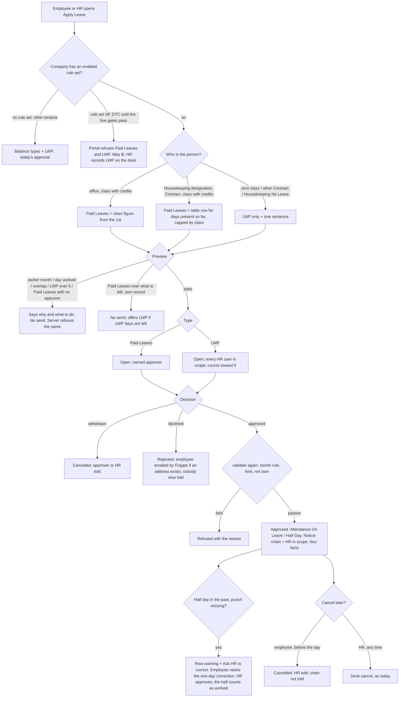

# 063 · Functional spec v4: Paid Leaves at DTC - flat on the 1st for office staff, earned by days present for Housekeeping - and leave without pay approved by HR

*I am not a lawyer. Nothing here settles a legal question.*

## What changed in version 4.0

| Change (source) | Effect on this spec |
|---|---|
| **Housekeeping earn leave from days actually present, through a table on the rule set** (Surbhi, 24-25 Oct; 01f "Update" and her answers) | New stories US-28..US-32. One new child table on the rule set (the only new DocType). Office staff are unchanged |
| **All 42 Housekeeping staff are Contract and paid by an agency** (Surbhi; 01c rev. 4b) | Their card shows no payout. A Housekeeping credit never becomes DTC pay (SEC-20). DTC payroll leaves them out; their Salary Structure Assignments stay as they are (US-35) |
| **Round down; 12.5 days gives 1; 20 days in a 30-day month gives 3; 31 days gives the class figure** (Surbhi, 25 Oct) | W1 / Q10 / Q-H6 answered. ACs AC-119..AC-121 |
| **A Permanent Housekeeping person (none today) gets the office rule** (Surbhi) | Q9 answered. AC-125 |
| **The agency gets attendance by an Excel report made outside Alvoraa. Alvoraa produces nothing. HR must not send the desk salary report** (Surbhi; PRIV-7) | No export is built. A release instruction and a residual risk |
| **Every approved leave is told up the Reports To chain AND to HR** (Surbhi, 25 Oct) | New US-33. Not drawn in the prototype - wording needs her yes (X-6) |
| **OD-1 answered: remedy (iv), a half-day attendance correction HR approves, no punch needed** (brief, "OD-1 answered"); built and passed on synthetic data (04b §9a, Test-905) | The v3 blocker is gone. US-27 is unblocked; X-1 closed |
| **Employees can apply sooner: Way A** (proper release, create "Paid Leaves", rehearse, switch on), **with Way B as a bridge** (HR records leave without pay on the desk). **Way C (a monthly allocation script) is not chosen** (Surbhi) | New US-34 (Way B, no code). Section 15 |
| **The rule set stays OFF until five gates pass** (Surbhi): field rights ALV-215 everywhere; synthetic rehearsal passes; Surbhi checks the table rows; a checked DTC backup; her word | Section 15.3, AC-150 |
| **Slice 066 grooming has its own switch** (the Grooming Red Value component) | Leave is not tied to it. But note: slice 067's red and green lines DO share the one rule-set switch (bad news 4) |
| Build facts from 04b (what was built differs from the prototype in eight places) | Listed as D-1..D-8 in section 6.3. Each needs Surbhi's yes |

**Counts:** 35 stories (was 27), 96 points, 151 acceptance criteria, 98 parity rows.

---

## 0 · Bad news first

1. **No DTC employee can apply for leave on production today, and that will stay true until Way A is released.** The leave code is on `dev` (commit 24ee6549) but not on `main`. Until then the only way to record leave without pay is Way B: HR enters it on the desk by hand, with no 5-day limit, no month rule and no notice enforced by the system (section 15.2).
2. **Nobody can see the Housekeeping card today.** 0 of the 42 Housekeeping staff have a portal login (01c rev. 4). The only person who will see a Housekeeping person's figures is HR filing on their behalf - and security rule SEC-1(c) hides those figures from HR on behalf (difference X-2). **If X-2 stays as it is, the Housekeeping card is built for nobody.** I recommend Surbhi allows HR in scope to see the figure, because HR already sees it in the desk report (Q-S2).
3. **DTC payroll has no setting that leaves Housekeeping out.** All 42 have a submitted Salary Structure Assignment, so Frappe's Payroll Entry picks them up (`payroll_entry.py:1388-1401`; its only optional filters are branch, department, designation and grade, each an "equals", never "not"). Leaving them out without touching their assignments means HR removes 42 rows from every month's Payroll Entry by hand, or a small new check. **A slip made by mistake pays an agency worker's days from DTC's payroll.** Decision Q-S1.
4. **One switch turns on leave and marks together.** The DTC pay rule set's `enabled` box also switches on slice 067's red and green lines. So 067 cannot go live before 063's five gates pass. Slice 066 grooming is separate (its own component). Decision Q-S7.
5. **The "who was told" counter will lie once HR is told too.** Today it counts every chain notice row (`leave_rules.told_for`, line 281). When HR also gets the notice (US-33), the line "Your managers up to Kavita Arora have been told (2 people)" would count HR users as managers. AC-146 fixes the rule: count managers only.
6. **Eight places where the build differs from the prototype, and five where the prototype meets a rule or the truth** (section 6.3). None is resolved here. Each needs Surbhi's yes.
7. **`07-devops-inputs.md` §3 was never written.** I used the OPS items in 01b, 07 (§4/§5) and 07a. One Ready box fails (section 21).

---

## 1 · What this slice does

At DTC, once the pay rule set is switched on:

| Who | What they get |
|---|---|
| **Office staff** (every A/B/C person who is not Housekeeping-on-Contract) | Paid Leaves given on the 1st: class A 4, B 3, C 2. They count once the person has 15 days present in the month; approved Paid Leaves days count toward the 15 (E6); a half-day leave counts 0.5. Days not used are paid with that month's salary. Nothing carries over |
| **Housekeeping on Contract** (42 people, agency-paid) | Paid Leaves earned by days actually present, from a table on the rule set (30/31-day month: 6-12 gives 1, 13-18 gives 2, 19-25 gives 3, 26-31 gives 4; 28/29-day month starts one day earlier). Approved Paid Leaves days count as present; a half day counts 0.5; the total is rounded down; capped at the class figure. No 15-day minimum. The 6 in class "No Leave" get nothing. No pay effect at DTC - the agency pays them |
| **Zero classes and other Contract staff** | No Paid Leaves; one honest sentence; leave without pay only |
| **Everyone at DTC** | Leave without pay: up to 5 days a calendar month, counting waiting and approved, half day 0.5; HR approves; current month only; employee and HR can cancel. On every approval the managers up the Reports To chain and HR are told four facts |
| **Every other tenant** | Unchanged, except Leave Without Pay appears in their Apply list with their normal approval (D5), and a non-HR `on_behalf_of` is refused (SEC-7) |

## 2 · Cross-module reach, HRMS domains, personas

| App | Touched? | How |
|---|---|---|
| `alvoraa_portal` | **Yes** | Already built for office staff (04b §2). This version adds: the Housekeeping credit table (new child DocType + one Table field on `Alvoraa Payroll Rule Set`, validated on save), the engine reading it (`payroll_slip.month_summary`, `payroll_month.summarise_month`), the Housekeeping card and Apply facts (`leave_rules.py`), the desk report's "Why" note, the HR notice (`leave_rules.notify_chain_on_approval`), `portal.js` Housekeeping block |
| `hrms` (our copy) | **No change in this slice.** ALV-215 (field rights, 04c) changes Employee permissions and adds one check on Employee - a separate slice and a gate for this one | |
| `hrms` Frappe HR code | **No edits** | Leave Application, Leave Type, Attendance, Attendance Request, Payroll Entry used as shipped |
| `erpnext`, `frappe` | No | |
| `alvoraa_goals`, `alvox_compensation` | No | Nothing reads leave or the pay engine |
| Slice 066 (grooming) | **Not coupled** | Grooming has its own switch (the Grooming Red Value component). Nothing in 063 reads it, and nothing in 066 reads the leave rules |
| Slice 067 (pay-slip marks) | **Shares the switch** | Same `enabled` box (bad news 4) |

**Domains:** leaves; attendance (half days; the half-day correction; days present for Housekeeping); **payroll** (office paid days move; Housekeeping must not be in DTC payroll at all); org structure (Reports To chain picks who is told; designation picks the Housekeeping table - so designation becomes a pay-and-leave field, locked by ALV-215).

**Personas used in every story** (invented sample names from the prototype):

| Persona | Who |
|---|---|
| Priya | Office employee, class A, frontline, phone, has a login |
| Rohit | Office employee, class A, under 15 days present |
| Manoj | Contract, not Housekeeping, no login |
| **Geeta** | **Housekeeping, Contract, class A, agency-paid, no login** |
| **Sushila** | **Housekeeping, Contract, class No Leave, no login** |
| Ritika | HR Manager: approves LWP, files for staff with no login, now told of every approval |
| Sunil | Store manager, named leave approver: approves Paid Leaves |
| Kavita | Manager up the chain: told |
| System Manager | Changes the rule set and its table; switches it on |
| CXO | No change |

## 3 · Is this the real problem?

- **Office staff:** cause confirmed in code (the Apply list was built only from balances; DTC has no allocations by design). Unchanged since v3.
- **Housekeeping:** the stated need is "earn leave after completing a duration" (Surbhi, 24 Oct). The outcome is a correct leave record that DTC passes to the agency. **What decision does the figure drive?** The agency's pay. **Who acts on it?** The agency, from an Excel report DTC makes outside Alvoraa. So the card is a convenience; the records that matter are the approved Leave Applications and the attendance. Two consequences:
  - With 0 logins, the card is only useful through HR's on-behalf view (bad news 2).
  - The figure the agency receives is the desk report's "Leave earned" for that person, or a hand count. PRIV-7 forbids sending the report itself.
- **I did not cut the Housekeeping card**, because it is in the prototype Surbhi is reviewing (parity rule) and costs little beside the office card. If she answers Q-S2 "no", I recommend cutting it (subtract pass).

---

## 4 · Gap analysis

**Frappe HR first.** What the standard leave and payroll features already do, read in the source:

| # | Requirement | Standard Frappe HR / ERPNext / installed behaviour today | Verdict | Cost |
|---|---|---|---|---|
| G-1 | A leave type for leave without pay, no allocation needed | Leave Type `is_lwp` = 1 needs no allocation and skips the balance check (`leave_application.py:235, 451`). "Leave Without Pay" exists at DTC | **Configure** (already there) | - |
| G-2 | A "Paid Leaves" type that draws on the month's credit | Leave Type with `allow_negative` = 1 passes the balance check with no allocation (`leave_application.py:240, 471`) | **Configure** - one record on DTC, by hand (SEC-11) | S |
| G-3 | Monthly credit given on the 1st (office) | **Leave Policy + Leave Policy Assignment + Earned Leave** (`is_earned_leave`, `earned_leave_frequency` Monthly, `allocate_on_day` First Day, `rounding`) allocate a calendar share on the 1st | **Not used.** Earned Leave accrues by calendar, has no 15-day minimum, carries a balance across months, and needs allocations - which Surbhi ruled out (16 Oct). Unused days would also be paid twice (the engine already pays them). The rule set does it: `accrual_month_days` 15, classes 15/4/4, 15/3/3, 15/2/2 (01e §3) | **Configure** (rule set values) | S |
| G-4 | Housekeeping earn by days present from a table | Earned Leave cannot read attendance. `applicable_after` counts working days since joining, not days present in a month. `max_leaves_allowed` is a yearly cap. The rule set's `slabs` table means "percent of a shift worked", not days present. `leave_classes` holds one cadence per class | **Build new** - one child table on the rule set (SEC-19). Rejected cheaper: a text box of ranges (a typo goes straight into the figure, no check); numbers in code (the engine holds no numbers); the attendance slabs (wrong meaning) | M |
| G-5 | Days present feeding the table: worked + approved Paid Leaves, half 0.5, round down | `month_summary` already counts `days_for_gate` = days worked + approved Paid Leaves days, halves included (`payroll_month.py:164`) | **Extend** - reuse that one number; floor it; look up the row | S |
| G-6 | A Housekeeping credit never becomes DTC pay | `paid_days = day_credits + leave_credits_earned` (`payroll_month.py:198`) | **Extend** - the table credit is reported, never added to paid days (SEC-20) | S |
| G-7 | Approved Paid Leaves count toward the 15 (E6) | Built (`days_for_gate`) | **Already there** (this slice, on dev) | - |
| G-8 | Half-day leave counts 0.5; other half by punches | Built (01d engine change) | **Already there** (this slice, on dev) | - |
| G-9 | Missed punch on a half-day leave day fixed by HR | Attendance Request alone writes nothing on such a day; remedy (iv) built: raising the correction marks the other half Absent, copies the row's shift, makes it half-day; HR's approval sets it Present and links it (`leave_rules.prepare_half_day_correction`, 405) | **Already there** (this slice, on dev). Proven on synthetic data (Test-905) | - |
| G-10 | Leave approval and status | Leave Application Open → Approved / Rejected / Cancelled; attendance written on approval | **Already there** | - |
| G-11 | HR approves LWP; named approver approves Paid Leaves | Frappe: only the named approver (our `_can_action_leave`) | **Extend** - built (LWP branch) | - |
| G-12 | LWP limit 5 a calendar month; current month only, every door | Frappe has "Max Continuous Days Allowed" (in a row, not per month) and `validate_salary_processed_days` (only LWP, only if a slip exists) | **Extend** - built (`validate_leave_application`, 147) | - |
| G-13 | Chain told on approval | Frappe emails only the employee and the named approver | **Extend** - built (`notify_chain_on_approval`) | - |
| G-14 | **HR told on every approval** | Nothing in Frappe | **Extend** - add HR users in scope to the same notice (`hr_users_in_scope`, 327, already exists for N-5/N-6) | S |
| G-15 | Employee and HR cancel | Frappe `discard` for Open; Employee role has no cancel | **Extend** - built (`cancel_leave`, `hr_api.py` 70) | - |
| G-16 | Card on the Leave page | Frappe's balance comes from allocations only | **Extend** - built for office; add the Housekeeping version | M |
| G-17 | HR's view of everyone's figures | Desk report *Salary Components and Workings* | **Already there**; add the Housekeeping "Why" note | S |
| G-18 | DTC payroll leaves Housekeeping out | Payroll Entry includes every employee with a submitted assignment; optional filters only narrow to one branch/department/designation/grade; HR can delete rows from its employee table before making slips | **Configure (process)** - HR removes them; a read-only release check proves none got a slip. Code only if Surbhi asks (Q-S1) | S |
| G-19 | The agency's monthly record | Nothing in Alvoraa; DTC makes an Excel outside | **Drop** - Surbhi: Alvoraa produces nothing. PRIV-7 instruction only | - |
| G-20 | Employees cannot change the fields that set their leave | ESS has write on Employee at level 0 | **Separate slice ALV-215** (04c step A) - a gate, not built here | - |
| G-21 | Leave Block List, SEC-5; Leave Encashment requests; a monthly allocation script (Way C) | Frappe has them | **Drop** - Surbhi's answers (special days allowed if approved; encashment is automatic; Way C not chosen) | - |
| G-22 | Leave on special days | Engine: an "On Leave" day is never doubled | **Already there** (pay) + words (built) | - |

**Single sources of truth:**

| Number | Comes from | Never from |
|---|---|---|
| Office "Paid Leaves this month" | rule set `leave_classes.monthly_credits` for the class | typed into the page |
| Housekeeping "Earned so far" and "Next at" | the new table rows for the person's designation and the month's length, capped by `monthly_credits` | a second calculation in the page |
| Days present (office gate and Housekeeping table) | `month_summary(...).days_for_gate` | a separate count |
| Who is told | `Employee.reports_to` (not the seat tree) + `hr_users_in_scope` | a Frappe Notification record |
| Whether the rules apply | `rule_set_for(company)` - an enabled rule set (SEC-15) | a company or site name |

**Rung for this version:** configuration (rule set values, two records, approver data, the Payroll Entry step) + rung 4 (code in the engine, `leave_rules.py`, the card) + **rung 5 for one child DocType** (G-4). No new page, report, setting, job, cache or app.

---

## 5 · Process flow

**Unhappy paths in words:** a Housekeeping person whose designation is changed mid-month gets the rule for the designation held when the figures are worked out (W4). A Housekeeping slip made by mistake pays worked days only, never the credit (SEC-20) - but HR must still delete it (Q-S1). A wrong table row reports wrong credits to the agency and nothing fails, which is why Surbhi checks every row before switch-on (SEC-19).

---

## 6 · Screens and prototype parity

### 6.1 Screens

| ID | Screen (prototype-v4 / design §) |
|---|---|
| P-1 | Leave page, office card, 15 days reached (Priya) - design v3 §6.1 |
| P-2 | Office card under 15 days (Rohit) |
| P-3 | Card, Contract / zero class (Manoj; Sushila) |
| P-4 | Card loading / could not be shown |
| P-5 | Apply Leave: types, previews, limit, buttons - §6.2 |
| P-6 | Apply Leave: half day and special days - §6.3 |
| P-7 | Result in the pop-up, failed send - §6.4 |
| P-8 | Leave Applications: status, told line, Cancel, missed-punch warning, cancel confirms - §6.3, §6.5 |
| P-9 | HR applying for someone (Ritika → Manoj, Geeta, Rohit) |
| P-10 | HR approval rows (LWP) and the leave approver's rows (Paid Leaves) - §6.6 |
| P-11 | Team View and the chain notice (Sunil) |
| **P-12** | **Housekeeping card (Geeta): day 1, mid-month, late month, February** - design v4 W.1 |
| **P-13** | **Apply Leave for Housekeeping** - design v4 W.2 |

**Status of the contract:** prototype-v4 is the current design and is waiting for Surbhi's review (she reviews after everything is fixed, with the Positions page). W1 is now answered (round down). W2-W4, V1, V2, V4 and S1-S5 are hers to confirm (section 19).

### 6.2 Layout rules (unchanged from v3, plus Housekeeping)

Card replaces the empty balance rings. Four figures in one row on desktop, 2 × 2 on a phone; **Housekeeping shows three** (no "To be paid out"). Only "To be paid out" is tinted; "Waiting" is dashed and worded. Days, never "credits"; never "held". The Apply pop-up's own button is **Close**, so "Cancel" only ever means cancelling leave. Destructive confirms are `alertdialog`s with "Keep" first. Housekeeping card carries the "So far" chip (its figure really grows during the month); office cards never do.

### 6.3 Differences that need Surbhi's yes

**Standing rule:** the product is built as the prototype draws it. Every difference below is listed, not resolved. The build keeps the cautious interim until she answers.

**(a) Where the prototype meets a security rule or the truth**

| # | Prototype v4 shows | What it meets | Interim the build does | Rows |
|---|---|---|---|---|
| X-1 | ~~Missed punch: "Ask HR to correct"~~ | **Closed:** OD-1 (iv) built and passed on synthetic data | As drawn | R-27 |
| **X-2** | HR applying for Rohit or **Geeta** sees "Paid Leaves - {n} days left", the not-enough figures and (Geeta) "has earned 2 so far" | **SEC-1(c):** HR passing another person gets no figure | Types and the person's "N of 5" shown; **no Paid Leaves figure on behalf**; no "left" check on behalf. **Recommend changing SEC-1(c)** for HR in scope: they already see the same number in the desk report (Q-S2) | R-29, R-30, R-36, R-96 |
| X-3 | ~~"(up to 22 Oct)" under 15 days~~ | **Closed in the build** (04b §8.2). Security must still add `attended_up_to` and `gate` to SEC-1 list one (Q-1) | As drawn | R-9 |
| **X-4** | After approve: "{first} has been told too." After decline: "{first} has been told." | **Truth:** 0 of 445 DTC staff have an email on the Employee record (04 bad news 3). Only people with a login and an address get Frappe's status email | "{first} has no email on record, so please tell them." whenever no email was queued - at DTC that is every time | R-58, R-59 |
| X-5 | A Hindi version of every screen | Machine draft, needs a native reviewer; installing a Hindi file switches Hindi on for Hindi users. **Also wrong in three Housekeeping places** (section 16) | Every string translatable; no Hindi file installed | R-74 |
| **X-6** | **Not drawn:** HR being told of every approval | Surbhi's decision of 25 Oct | Built with the wording in N-1b (section 12), pending her yes | - |
| **X-8** | Housekeeping at the cap: "**You have earned the most your class allows (4).** This goes up as you attend more days in October." | **Truth:** at the cap it does not go up. Design v4 W.1 ("Late month") has only the first sentence | First sentence only | R-84 |
| **X-9** | A No Leave person (Sushila) in Apply Leave: "Your work type does not get Paid Leaves, so only Leave Without Pay is offered." | **Truth:** it is her leave class, not her work type | "Your leave class (No Leave) does not get Paid Leaves, so only Leave Without Pay is offered." Contract staff keep the drawn sentence | R-31 |

**(b) Where the build differs from the prototype (04b §6)**

| # | Rows | Prototype | Built | Why the engineer did it |
|---|---|---|---|---|
| D-1 | R-13 | Skeleton + "Getting your Paid Leaves..." on every load | From the second load; the very first visit shows the page's existing "Loading..." | The page learns it is a DTC company from the server |
| D-2 | R-22 | "(2 people)" in the example | The count of notices really created; the approver is not sent his own notice | "Told" must be true |
| D-3 | R-28 | Half day box above the preview | Below it, where the existing form has it | Existing form |
| D-4 | R-29 | A select list of people | The existing search box, with "Who is this leave for?", "Myself ({name})", "· no login" and the help sentence | 445 people |
| D-5 | R-51 | "tell him yourself" | "tell them yourself" | The manager may be a woman |
| D-6 | R-54, R-55, R-57, R-61 | An Inbox with "1 other person in this team is away" and Approve / Decline | The live Team page and Home card (the portal has no Inbox page); no "other person away" line; buttons stay "Approve" / "Reject" | Where approvals really happen |
| D-7 | R-58, R-59 | Badge "Approved" / "Declined" in the row | Badge "Approved" / "Rejected", and a toast too | Existing control |
| D-8 | R-60 | Row reads "{first} cancelled this request." | A toast with that sentence; nothing written | Existing control |

**(c) Not drawn, but specified** (cases that happen; listed so nobody reads them as parity): empty leave class (AC-14), a day already worked and an overlap (AC-71), Paid Leaves with no approver (AC-37), the limit refusal at approval (AC-44), approval after the month has turned (AC-69), "only HR can cancel a leave that has started" (AC-85), the lock messages (AC-96, 97), a Housekeeping half day giving a fraction of days present (AC-139), a Permanent Housekeeping person (AC-125), the HR notice (AC-145).

### 6.4 Prototype parity table (source: prototype-v4.html + 02-design.md v4 and v3)

One row per screen, state, control, message and rule the prototype shows **in the product**. Left out: the review bar (person, device, language, theme, card state, Housekeeping date, "Next send fails", the "Try" buttons), "Sample" tags, the version badge, grey notes describing the prototype itself, invented names and numbers. `{…}` is a value the server fills.

**Status:** **As drawn** · **As drawn, engine note** (where the number comes from) · **X-n / D-n** (section 6.3) · **Existing**.

| # | Screen | What prototype v4 shows | Story | Test | Status |
|---|---|---|---|---|---|
| R-1 | Leave page | Title "Leave"; subtitle "Your Paid Leaves this month and your leave requests"; "+ Apply Leave" | US-15 | AC-81 | As drawn |
| R-2 | Office card | Title "Paid Leaves - {Month}" | US-1 | AC-1 | As drawn |
| R-3 | Office card | "Class {c} · {n} days of Paid Leaves for {Month}" | US-1 | AC-1 | As drawn, engine note: `monthly_credits` |
| R-4 | Office card | "Paid Leaves this month" {n}; note "given on 1 {Mon}" | US-1 | AC-1, AC-3 | As drawn, engine note |
| R-5 | Office card | "Used" {n}; note the dates, a half as "19 Oct (half)", or "none yet" | US-1 | AC-1, AC-4 | As drawn |
| R-6 | Office card | "Waiting for approval" {n}; note "set aside for now" / "none" | US-1 | AC-1, AC-5 | As drawn |
| R-7 | Office card | "To be paid out" {n}; note "with {Month} salary", or under 15 "once you reach 15 days" | US-1, US-2 | AC-1, AC-6, AC-9 | As drawn |
| R-8 | Office card | Only "To be paid out" tinted, "Waiting" dashed, 2 × 2 on phone, no red | US-1 | AC-8 | As drawn |
| R-9 | Office card, under 15 | "(i) These count once you have attended 15 days in {Month}. You have attended {n} so far (up to {date})." | US-2 | AC-9..AC-11 | As drawn (X-3 closed; Q-1) |
| R-10 | Office card | "(i) {n} day is set aside for your {date} request until {approver} approves or declines it. If it is declined or you cancel it, the day comes back." | US-1 | AC-2 | As drawn |
| R-11 | Office card | "Paid with your {Month} salary. Nothing carries over." | US-1 | AC-3 | As drawn |
| R-12 | Office card | Rule box "How Paid Leaves work - class {c}" + "{n} days of Paid Leaves on the 1st of every month. They count once you have attended 15 days that month; approved Paid Leaves days count toward the 15. Days you do not use are paid with that month's salary. Nothing carries over." | US-1 | AC-3 | As drawn, engine note: `monthly_credits`, `leave_threshold_days` |
| R-13 | Card, loading | Skeleton + "Getting your Paid Leaves..." | US-4 | AC-15 | **D-1** |
| R-14 | Card, error | "(!) Your Paid Leaves figures could not be shown just now. Your leave requests below are not affected, and you can still apply." + "Try again" | US-4 | AC-16 | As drawn |
| R-15 | Card, Contract (not Housekeeping) | "Contract staff do not get monthly Paid Leaves." + "You can still ask for Leave Without Pay, up to 5 days a month. HR approves it. You have {n} of 5 days waiting or approved in {Month}." | US-3 | AC-12 | As drawn. **Note:** today every DTC Contract person is Housekeeping (42 of 42), so nobody at DTC sees this card yet |
| R-16 | Card, zero class | "Your leave class (No Leave) does not earn monthly Paid Leaves." + the same second sentence | US-3, US-29 | AC-13, AC-137 | As drawn (v4 wording "earn" replaces v3 "get") |
| R-17 | Applications | Card "Leave Applications": Type, Dates, Days, Status on desktop, stacked on phone; a half day "{type} (half day)" | US-15 | AC-81 | As drawn |
| R-18 | Applications, empty | "No leave asked for yet. Use Apply Leave above." | US-15 | AC-81 | As drawn |
| R-19 | Applications | "Waiting for HR" (LWP) / "Waiting for {approver}" (Paid Leaves), amber | US-15 | AC-77 | As drawn |
| R-20 | Applications | "Approved by HR" / "Approved by {approver}", green | US-15 | AC-77 | As drawn |
| R-21 | Applications | "Declined" (red), "Cancelled" (grey) | US-15 | AC-77 | As drawn |
| R-22 | Applications, approved | "Your managers up to {top} have been told ({n} people)." | US-15 | AC-78, AC-146 | **D-2**; managers only (AC-146) |
| R-23 | Applications, approved | "No manager is set above you, so only HR knows." | US-15 | AC-78 | As drawn |
| R-24 | Applications, waiting | "Cancel request" | US-16 | AC-83 | As drawn |
| R-25 | Applications, approved not started | "Cancel this leave" | US-16 | AC-84 | As drawn |
| R-26 | Applications, approved started/past | "This day has started or passed. To change it, speak to HR." No button | US-16 | AC-79 | As drawn |
| R-27 | Applications, approved half day, missed punch | "(!) **Your {check-out / check-in} for the other half of {date} is missing.** Until HR approves a correction, that half counts as absent[ and, as it is a special day, is charged double]. Ask for the correction on Attendance and HR will approve it." + "Ask HR to correct {date}" | US-27 | AC-116..AC-118 | As drawn (X-1 closed) |
| R-28 | Apply pop-up | Title "Apply for leave"; Leave type ("Choose..."), From, To, Half day (To hidden, From → "Date"), Reason (optional); pickers start at the 1st; focus to title | US-15 | AC-80 | **D-3** |
| R-29 | Apply pop-up, HR | "Who is this leave for?" - "Myself ({name})", people "· no login"; help "For staff without a login. The types, figures and the 5-day limit follow the person you pick." | US-17 | AC-93 | **D-4; X-2** ("figures") |
| R-30 | Apply pop-up | "Paid Leaves - {n} days left", "Leave Without Pay - {u} of 5 used" | US-7 | AC-29 | As drawn (on behalf: X-2) |
| R-31 | Apply pop-up, no Paid Leaves | "Your work type does not get Paid Leaves, so only Leave Without Pay is offered." | US-7 | AC-30 | As drawn for Contract; **X-9** for a zero class |
| R-32 | Apply pop-up | Reason help "Only the person who approves it and HR can read this. Managers are never sent it." | US-15 | AC-82 | As drawn (release check RC-11) |
| R-33 | Apply pop-up | "Close"; "Choose a leave type" → "Send to {approver}" / "Send to HR"; "Choose a leave type first.", "Choose the date the leave starts." | US-15 | AC-80 | As drawn |
| R-34 | Apply pop-up | "The end date is before the start date. Change one of them." No send | US-15 | AC-80 | As drawn |
| R-35 | Preview, Paid Leaves (office) | "**Asking for {n} day of Paid Leaves.** Until {approver} decides, {n} day is set aside from your {credited}. The leave is paid[, and approved Paid Leaves days count toward your 15 days]." | US-8 | AC-33 | As drawn |
| R-36 | Preview, Paid Leaves short (office) | "**{n} days asked for, but you have {left} days of Paid Leaves left for {Month}.** Days already used or waiting for approval are taken off the {credited}. You can ask for Leave Without Pay instead ({u} of 5 used this month)." + "Ask for Leave Without Pay instead" (only if LWP days left). No send | US-8 | AC-34 | As drawn (on behalf: X-2) |
| R-37 | Preview, LWP (office) | "**Asking for {n} day of Leave Without Pay.** If approved, you are not paid for this day; your Paid Leaves for {Month} are still paid out[ once you reach 15 days]." + "This will be {u+n} of 5 days of Leave Without Pay in {Month}." | US-9 | AC-39 | As drawn |
| R-38 | Preview, LWP over, something waiting | "**Only {left} days of Leave Without Pay left in {Month}; these dates need {n} days.** Up to 5 days a month, counting requests that are waiting or approved ({u} of 5 so far). Shorten the dates to {left} days. A request that is still waiting counts too: {dates} ({n} days). If it is not approved yet, you can cancel it from the list to free its days, or remind HR to approve it." No send | US-9 | AC-40 | As drawn (V2: words, no button) |
| R-39 | Preview, LWP over, all approved | "**You have used all 5 days of Leave Without Pay for {Month}.** Up to 5 days a month… All of them are approved. If you need more time off, speak to {HR name} (HR)." No send | US-9 | AC-41 | As drawn |
| R-40 | Preview, every allowed request | "{approver or HR name (HR)} decides. Once it is approved, your managers up to {top} are told." / "Once it is approved, only HR knows; no manager is set above you." | US-8, US-9 | AC-33, AC-78 | As drawn |
| R-41 | Preview, earlier month | "**Leave can only be asked for days in {Month}.** {Prev} is closed. If a {Prev} day needs changing, speak to {HR name} (HR)." No send | US-13 | AC-68 | As drawn |
| R-42 | Preview, past day | "This includes a past day. Past days in {Month} can be asked for until {month end}." | US-13 | AC-67 | As drawn |
| R-43 | Preview, half day | "**Half day:** it uses half a day of Paid Leaves. / it counts as 0.5 of the 5 days. You must check in and check out for the other half; it is measured against half the shift. Arriving late or leaving early does not count against you that day, and there is no green mark on a half-day leave day. If a punch is missed, ask HR to approve an attendance correction; until then the other half counts as absent[ and, on this special day, is charged double]." | US-14 | AC-72 | As drawn |
| R-44 | Preview, special day (not Housekeeping) | "**{date} is a special day ({name}).** If this leave is approved, the day is not charged double. A day taken without approved leave is unpaid and charged double." Send still offered | US-12 | AC-63 | As drawn, engine note |
| R-45 | Preview, HR on behalf | Same sentences in the third person | US-17 | AC-94 | As drawn |
| R-46 | Send | "Sending..."; result titled "Sent" | US-15 | AC-80 | As drawn |
| R-47 | Result | "**Sent to HR**" / "**Sent to {approver}**" · "**{type} · {dates} · {n} day(s)[ (half day)]**[ · {person}]" · "{approver} will approve or decline it. You will see the answer here, under Leave Applications." (on behalf: "{first} will be told the answer.") · will-tell line · LWP (office): "If approved, you are not paid for this day. {u} of 5 days of Leave Without Pay are now waiting or approved in {Month}." / Paid Leaves: "{n} day is set aside from your Paid Leaves until {approver} decides." · half: "Check in and check out for the other half as usual." · "Changed your mind? It can be cancelled from the list." · Done | US-15 | AC-75 | As drawn |
| R-48 | Failed send | "Not sent: the connection dropped. Nothing was saved. Your choices are still here - try again." Form kept | US-15 | AC-76 | As drawn |
| R-49 | Cancel confirm, waiting | "Cancel this request?" · "{type} · {dates} · {n}" · "{approver / HR} will no longer see this request." · LWP: "{n} goes back on your 5-day Leave Without Pay limit for {Month}." / Paid Leaves: "The {n} set aside comes back to your Paid Leaves." · [Keep the request] [Cancel request] | US-16 | AC-83 | As drawn |
| R-50 | Cancel result, waiting | "Request cancelled" · dates · "{approver / HR} has been told." · Done | US-16 | AC-83 | As drawn |
| R-51 | Cancel confirm, approved | "Cancel this approved leave?" · "You will be expected at work on this day." · "HR is told it is cancelled. Your managers are not sent a message about it, so if {first manager} is expecting you to be away, tell him yourself." · LWP: "You are paid for this day if you work it." / Paid Leaves: "The day comes back to your Paid Leaves." · [Keep the leave] [Cancel leave] | US-16 | AC-84 | **D-5** |
| R-52 | Cancel result, approved | "Leave cancelled" · dates · "HR has been told. You are expected at work." | US-16 | AC-84 | As drawn |
| R-53 | Cancel confirms | `alertdialog`; "Keep" first; × and Escape keep | US-16 | AC-83 | As drawn |
| R-54 | HR row, LWP | "**{name}**" (no job title) · "Leave Without Pay[ (half day)] · {dates} · **{n}**" · "{k} other person in this team is away on those days" | US-10 | AC-47 | **D-6** |
| R-55 | HR row, LWP | "{u} of 5 Leave Without Pay days in {Month}, counting this one" | US-10 | AC-47 | As drawn (on the Team page, D-6) |
| R-56 | Approval row, special day | "{date} is a special day. Approved, it is not charged double." | US-12 | AC-64 | As drawn |
| R-57 | Approval row | "Once it is approved, {first}'s managers up to {top} are told." / no-manager variant | US-10 | AC-47, AC-53 | As drawn (D-6 placement) |
| R-58 | After Approve | "Approved · {type} · {dates}. {first}'s managers up to {top} have been told ({n} people). {first} has been told too." | US-10 | AC-54 | **X-4, D-7** |
| R-59 | After Decline | "Declined. {first} has been told. Managers are not told about a declined request." | US-10 | AC-54 | **X-4, D-7** |
| R-60 | Withdrawn request | "{first} cancelled this request." | US-10 | AC-55 | **D-8** |
| R-61 | Leave approver's row (Paid Leaves) | Row as today + will-tell line; Approve / Decline | US-10 | AC-53 | **D-6** |
| R-62 | Team View | "Team Leaves This Month": Employee, From, To, Days - no type column; a half day 0.5; stacked on phone | US-18 | AC-95 | As drawn (column removed for every tenant - it was always empty) |
| R-63 | Team View | Stats Direct Reports / Present Today / On Leave / Pending Approvals | - | - | Existing |
| R-64 | Chain notice | Subject "{name} will be away on {date}"; "{name}'s leave for {date} ({n} day) has been approved."; "You are told because {first} is in your team. There is nothing for you to do."; "You can see your team's leave on the Team View page." | US-11 | AC-58 | As drawn (S1) |
| R-65 | Chain notice | Email and desk bell; each manager above in Reports To; once, on approval; none on decline or cancel | US-11 | AC-57, AC-60, AC-61 | As drawn (S2) |
| R-66 | Rule (office) | Given on the 1st by class; count once 15 days present; approved Paid Leaves count toward 15 | US-23, US-25 | AC-105..AC-110 | As drawn |
| R-67 | Rule (office) | Paid Leaves left = given − used − waiting (U3) | US-8 | AC-34 | As drawn |
| R-68 | Rule | LWP up to 5 a calendar month, waiting + approved, half 0.5 | US-9 | AC-42..AC-46 | As drawn |
| R-69 | Rule | A half day uses 0.5 and sets 0.5 aside while waiting | US-14 | AC-73 | As drawn |
| R-70 | Rule | LWP → HR; Paid Leaves → named approver | US-10 | AC-48..AC-53 | As drawn (V1) |
| R-71 | Rule | Cancel only a waiting request or an approved one not started | US-16 | AC-83..AC-85 | As drawn |
| R-72 | Rule | Current month only (pickers start at the 1st) | US-13 | AC-68 | As drawn |
| R-73 | Rule | HR's own leave goes to her own approver; nobody approves their own | US-10 | AC-50 | As drawn |
| R-74 | Every screen | Hindi (machine draft) | all UI stories | §16 | **X-5** |
| R-75 | Every screen | `role="status"` previews, `role="alert"` errors, labelled dialogs, Escape closes, targets ≥ 44 px phone / 24 px desktop, field text 16 px, nothing under 12 px | US-15 | AC-8, AC-80 | As drawn |
| R-76 | Housekeeping card - who gets it | Designation Housekeeping + Contract + a class with credits → Housekeeping card; Housekeeping + No Leave → R-16 | US-29 | AC-133, AC-137 | As drawn, engine note: table rows name the designation |
| R-77 | Housekeeping card | Title "Paid Leaves - {Month}" + chip "So far" | US-29 | AC-133 | As drawn |
| R-78 | Housekeeping card | "Housekeeping · Class {c} · up to {cap} days a month · {n} days attended up to {date}" (no attendance yet: "… · 0 days attended so far") | US-29 | AC-133, AC-134 | As drawn |
| R-79 | Housekeeping card | "Earned so far" {e} "of {cap} days"; note "from {n} days attended" | US-29 | AC-133 | As drawn, engine note: table row |
| R-80 | Housekeeping card | "Used" {n}; dates or "none yet" | US-29 | AC-133 | As drawn (a half shows "(half)" as on the office card - not drawn) |
| R-81 | Housekeeping card | "Waiting for approval" {n}; "set aside for now" / "none" | US-29 | AC-133 | As drawn |
| R-82 | Housekeeping card | **No "To be paid out" figure** | US-29, US-32 | AC-133, AC-138 | As drawn (SEC-20) |
| R-83 | Housekeeping card | "(i) **Next Paid Leaves day at {row start} days attended** ({k} more). This goes up as you attend more days in {Month}." | US-29 | AC-133 | As drawn, engine note: same rows |
| R-84 | Housekeeping card, at cap | "**You have earned the most your class allows ({cap}).**" [+ "This goes up as you attend more days in {Month}."] | US-29 | AC-135 | **X-8** |
| R-85 | Housekeeping card | "Your leave is recorded for DTC's attendance. Your agency pays you, so this page shows no payout. Nothing carries over to next month." | US-29 | AC-133 | As drawn |
| R-86 | Housekeeping card | Rule box "How Housekeeping earns Paid Leaves - class {c}" + "In a 30- or 31-day month like {Month}: 6 to 12 days attended earns 1, 13 to 18 days attended earns 2, 19 to 25 days attended earns 3, 26 or more days attended earns 4, never more than {cap}. In a 28- or 29-day month the rows start one day earlier (5, 12, 18, 25). Approved Paid Leaves days count as days attended. A half day counts as half, and the total is rounded down to whole days. Nothing carries over." | US-29 | AC-133 | As drawn, engine note: built from the rows |
| R-87 | Housekeeping card, short month | "Paid Leaves - February"; rule box "In a 28- or 29-day month like February: 5 to 11 … 25 or more … In a 30- or 31-day month the rows start one day later (6, 13, 19, 26)." | US-29 | AC-136 | As drawn |
| R-88 | Housekeeping card | No 15-day line, no red/green wording | US-29 | AC-133 | As drawn |
| R-89 | Housekeeping No Leave (Sushila) | R-16's two sentences, "0 of 5" | US-29 | AC-137 | As drawn |
| R-90 | Apply, Housekeeping | "Paid Leaves - {left} day(s) left" (earned so far − used − waiting) · "Leave Without Pay - {u} of 5 used" | US-30 | AC-140 | As drawn |
| R-91 | Preview, Paid Leaves, Housekeeping | "**Asking for {n} day of Paid Leaves.** Until {approver} decides, {n} day is set aside from the {e} you have earned so far. Approved Paid Leaves days count as days attended." (no "The leave is paid") | US-30 | AC-141 | As drawn |
| R-92 | Preview, Paid Leaves short, Housekeeping | "**{n} days asked for, but you have {left} day of Paid Leaves left for {Month}.** You have earned {e} so far; the next day comes at {row start} days attended. Days already used or waiting are taken off. You can ask for Leave Without Pay instead ({u} of 5 used this month)." + "Ask for Leave Without Pay instead". No send | US-30 | AC-142 | As drawn |
| R-93 | Preview, LWP, Housekeeping | "**Asking for {n} days of Leave Without Pay.** If approved, it is recorded as leave without pay on DTC's attendance." + "This will be {u+n} of 5 …" + approver line | US-30 | AC-143 | As drawn |
| R-94 | Preview, Housekeeping | No special-day line; the half-day block without "charged double" | US-30 | AC-143 | As drawn |
| R-95 | Result, LWP, Housekeeping | "If approved, it is recorded as leave without pay on DTC's attendance. {u} of 5 days of Leave Without Pay are now waiting or approved in {Month}." | US-30 | AC-143 | As drawn |
| R-96 | Apply pop-up, HR | Picker adds "Geeta Devi · Housekeeping · no login"; third person ("Geeta has earned 2 so far…") | US-30 | AC-144 | **D-4, X-2** |
| R-97 | Rule (Housekeeping) | Earned = the row for whole days present (approved Paid Leaves included, halves counted, rounded down), never above the class figure; 31 days = class figure; next from the same rows | US-28 | AC-119..AC-126 | As drawn |
| R-98 | Rule (Housekeeping) | Paid Leaves left = earned so far − used − waiting | US-30 | AC-140, AC-142 | As drawn |

**Count: 98 rows** - 75 carried from v3 (R-15 and R-16 updated), 23 new for Housekeeping. **Not as drawn:** X-2 (R-29, R-30, R-36, R-96), X-4 (R-58, R-59), X-5 (R-74), X-8 (R-84), X-9 (R-31), D-1..D-8 (R-13, R-22, R-28, R-29, R-51, R-54, R-55, R-57..R-61, R-96). Every one waits for Surbhi's yes.

---

## 7 · Data model and field map

### 7.1 New: the Housekeeping credit table - the one new DocType

**Why a new child DocType and not an existing field** (G-4): `leave_classes` has one row per class and a fixed cadence; `slabs` means percent of a shift; a text field has no check. DTC's rows are uneven (6, 13, 19, 26) and change with month length.

**Child DocType** `Alvoraa Leave Credit Row` `[proposed name - engineer may rename]`, `istable` 1, no permissions of its own (inherits the rule set's), no personal data.

| Fieldname | Label | Type | Mandatory | Default | Options | Why this field |
|---|---|---|---|---|---|---|
| `designation` | Designation | Link | Yes | - | Designation | Names who the rows are for, so the rule set needs no separate "which designations" field |
| `month_length` | Month Length | Select | Yes | - | `28-29`, `30-31` | DTC's two tables |
| `days_from` | Days Present From | Int | Yes | 0 | - | Whole days (SEC-19) |
| `days_to` | Days Present To | Int | Yes | - | - | Whole days |
| `credits` | Paid Leaves Earned | Float | Yes | 0 | - | Days of Paid Leaves for this row |

**Parent field on `Alvoraa Payroll Rule Set`** `[proposed]`: `leave_credit_rows`, label "Leave Earned by Days Present (by Designation)", Table → `Alvoraa Leave Credit Row`, in the existing leave section, description: "Used only for staff whose category earns no leave credit (Contract at DTC). The class figure caps every row."

**Checked on save** (SEC-19; beside the existing `_check_slabs`), per designation and month length: `days_from` ≤ `days_to`; rows start at 0; no gap, no overlap; the last row ends at 31 (`30-31`) or 29 (`28-29`); `credits` ≥ 0 and never lower than the row before. The message names the rows, as `_check_slabs` does.

**DTC's rows** (typed by a System Manager in the desk, from DTC's own document; checked row by row by Surbhi):

| Designation | Month length | From | To | Credits |
|---|---|---|---|---|
| Housekeeping | 30-31 | 0 | 5 | 0 |
| Housekeeping | 30-31 | 6 | 12 | 1 |
| Housekeeping | 30-31 | 13 | 18 | 2 |
| Housekeeping | 30-31 | 19 | 25 | 3 |
| Housekeeping | 30-31 | 26 | **31** | 4 |
| Housekeeping | 28-29 | 0 | 4 | 0 |
| Housekeeping | 28-29 | 5 | 11 | 1 |
| Housekeeping | 28-29 | 12 | 17 | 2 |
| Housekeeping | 28-29 | 18 | 24 | 3 |
| Housekeeping | 28-29 | 25 | 29 | 4 |

DTC's document says "26-30"; it is entered as 26-31 because Surbhi said 31 days gives the class figure (Q-H6).

### 7.2 Who gets the table (SEC-18), decided on the server from data

All four true: (1) the company has an **enabled** rule set; (2) the person's category row says **earns no leave credits** (Contract at DTC - a Permanent Housekeeping person stays on the office rule, Surbhi); (3) the rule set has rows for the person's `designation`; (4) the class row's `monthly_credits` > 0. Otherwise: today's path. No company, site or designation name in code (SEC-15).

### 7.3 The calculation (one source: `month_summary`)

1. Days present = `days_for_gate` (days worked + approved Paid Leaves days; a half-day leave adds 0.5 worked and, if Paid Leaves, 0.5 approved).
2. Whole days = round down (12.5 → 12).
3. Row = the row for the month's length (28/29 → `28-29`; 30/31 → `30-31`) whose range holds the whole days.
4. Earned = min(row credits, class `monthly_credits`).
5. Next at = `days_from` of the first row whose credits are higher than earned, if that is still under the class figure; none at the cap. Days to next = next at − days present (the real figure, so 14.5 → 4.5).
6. **Earned is reported, never added to paid days, never put on a slip line or an Additional Salary** (SEC-20).

### 7.4 Leave Application - fields written (standard, unchanged)

| Field | At filing (DTC) |
|---|---|
| `status` | Open, always (SEC-3) |
| `leave_approver` | Paid Leaves: the resolved named approver. LWP: blank (HR in scope decide) |
| `half_day`, `half_day_date`, `description` | as chosen |
| On approve | Approved, submitted |
| On withdraw | `discard` → Cancelled, docstatus 0 |
| On cancel | docstatus 2, Cancelled |

### 7.5 Leave Type "Paid Leaves" - one record, DTC, by hand (SEC-11)

`is_lwp` 0 · `allow_negative` 1 · `include_holiday` 1 · `allow_encashment` 0 · `is_carry_forward` 0 · `is_earned_leave` 0 · maximums 0. One type for office and Housekeeping (W2: name kept, Surbhi to confirm). **The lock only checks the flags while some rule set is enabled** (`lock_paid_leaves`, 389), so the release check reads the flags back after creation (RC-6).

### 7.6 DTC rule set - office values (01e §3; US-23)

| Field | Today | New | Rollback |
|---|---|---|---|
| `leave_threshold_days` | 15 | 15 | - |
| `accrual_month_days` | 30 | **15** | 30 |
| Class A `period_days` / `credit_per_period` / `monthly_credits` | 7.5 / 1 / 4 | **15 / 4 / 4** | 7.5 / 1 / 4 |
| Class B | 10 / 1 / 3 | **15 / 3 / 3** | 10 / 1 / 3 |
| Class C | 7.5 / 0.5 / 2 | **15 / 2 / 2** | 7.5 / 0.5 / 2 |
| `leave_credit_rows` | (field does not exist) | the 10 rows in 7.1 | delete the rows |
| `enabled` | 0 | 1 **last, on Surbhi's word** | 0 |

### 7.7 Card block - two fixed key lists (SEC-1)

**List one - office** (built): `month`, `class`, `category`, `earns`, `credited`, `used`, `used_dates`, `waiting`, `waiting_from`, `approver`, `to_be_paid_out`, `gate`, `lwp_in_play`, `lwp_limit`; under the gate only: `attended_so_far`, `attended_up_to`. *(`gate`, `attended_up_to`, `used_dates`, `waiting_from`, `lwp_in_play`, `lwp_limit` are not in SEC-1's written list - Q-1 to security.)*

**List two - Housekeeping** (new): `month`, `class`, `earns`, `housekeeping` (true), `earned`, `cap`, `attended_so_far`, `attended_up_to`, `next_at`, `days_to_next` (both absent at the cap), `used`, `used_dates`, `waiting`, `waiting_from`, `approver`, `month_length`, `rows` (this month's rows and the other length's starting days - rule-set facts, no personal data), `lwp_in_play`, `lwp_limit`. **Never** `to_be_paid_out`.

**Never in either:** any rupee field, `paid_days`, `reds`, `greens`, `notes`, the Basic, `daily_rate`, `gross`, `net`.

### 7.8 Other response additions (built; Housekeeping adds two)

| Endpoint | Adds |
|---|---|
| `get_leave_summary` → `types_offered` | Paid Leaves `left` (own record only, X-2) - for Housekeeping = earned − used − waiting |
| `preview_leave_request` | For Housekeeping: `housekeeping`, `earned`, `next_at` (the not-enough sentence); no special-day key |
| `get_leave_summary` → `applications[]`, approval rows | as built (04b) |

### 7.9 Rule set fields read

`enabled`, `company`, `leave_class_field`, `category_field`, `leave_threshold_days`, `accrual_month_days`, `leave_classes.*`, `categories.category`, `categories.earns_leave_credits`, `special_day_holiday_list`, **`leave_credit_rows.*`**. Employee fields read: the class field, the category field, **`designation`**, `reports_to`, `user_id`, `company`.

### 7.10 Engine changes in this version (Housekeeping only; office engine unchanged)

| Where | Change |
|---|---|
| `payroll_slip.month_summary` | Also reads `designation`; when 7.2 holds, passes this month's rows to `summarise_month` |
| `payroll_month.summarise_month` | With rows: earned from 7.3; **not** added to `paid_days`; the "Why" note: "Housekeeping table: {n} days present in a {d}-day month gives {e}. Reported to the agency; not paid by DTC." Without rows: unchanged |
| `leave_credits_for_month` | Unchanged |
| Desk report *Salary Components and Workings* | No new column. For a Housekeeping row: "Leave earned" = earned; "Leave used" = approved Paid Leaves (up to earned); **"Leave encashed" = 0** `[ASSUMPTION - Q-S5]`; paid days exclude the credit; the Why note above |

---

## 8 · States - Leave Application (unchanged in shape)

| State | Reached by | Who | Next | Notified |
|---|---|---|---|---|
| **Open** / 0 | Filed | Employee (own), HR (in scope) | Approved, Rejected, Cancelled | Paid Leaves: approver (Frappe email). LWP: HR rows on Team page / Home card |
| **Cancelled** / 0 | Withdrawn | Employee (own), HR (in scope) | - | Approver, or HR users in scope for LWP (N-5) |
| **Approved** / 1 | Approved; `validate` re-runs month rule and limit | Paid Leaves: named approver. LWP: HR in scope. Never the subject | Cancelled / 2 | Employee (Frappe, if an email exists); **chain + HR in scope** (N-1, N-1b) |
| **Rejected** / 1 | Declined | as above | - | Employee (Frappe, if an email exists); nobody else |
| **Cancelled** / 2 | Employee before the first day; HR on the desk any time | Employee (own), HR | - | HR users in scope (N-6); **no chain notice** |

Terminal: Rejected, Cancelled. Nothing is reopened; a new request is filed instead.

---

## 9 · Permission and visibility matrix

### 9.1 Role × DocType (no standard right changes in this slice)

| Role | Leave Application | "Paid Leaves" type | Rule set (incl. the new table) | Employee `designation`, class, category, `reports_to`, `leave_approver` |
|---|---|---|---|---|
| Employee / Employee Self Service | create, read, write (own, via User Permission); **no submit, no cancel** | read | - | **read only after ALV-215** (today: write own - the gate) |
| Leave Approver / Location Manager | as today | read | - | read |
| HR User / HR Manager | full; portal LWP approval only for `permitted_employees()` | read; edits refused by the lock | **read** (HR Manager) | write (level 2, ALV-215) |
| System Manager | full | create once; edits refused by the lock | **write**: values, rows, switch | write |
| Administrator | full | full (rollback) | full | full |
| Guest; the agency | nothing | nothing | nothing | nothing |

### 9.2 Portal actions × persona

| Action | Employee (own) | Another employee | HR in scope | HR out of scope | Named approver | Managers up the chain | CXO / System Manager |
|---|---|---|---|---|---|---|---|
| See the card (office or Housekeeping) | **Yes** | **No** | own only (on behalf: per X-2) | own only | own only | own only | own only |
| File Paid Leaves / LWP | Yes | **No - refused** | Yes, on behalf | **No** | - | - | as HR |
| Approve / decline LWP | **Never own** | - | **Yes**, never own | **No** | **No** (unless HR in scope) | No | if HR in scope |
| Approve / decline Paid Leaves | Never own | - | Only if named approver | - | **Yes**, never own | No | only if named approver |
| Withdraw an Open request | Yes | **No** | Yes | No | No | No | as HR |
| Cancel an approved leave | Before the first day | **No** | Yes (desk) | No | desk, as today | No | Yes |
| Get the approval notice | - | - | **Yes (new)** | No | if in the chain | **Yes** | if in the chain or HR in scope |
| Edit the Housekeeping rows | - | - | No | No | No | No | **System Manager only** |

### 9.3 Must NOT

| Who | Must not |
|---|---|
| Any employee | See another person's card or leave; get any rupee figure; act for anyone else; submit or cancel through REST; **change their own designation, class, category, approver or Reports To (ALV-215 - a gate)** |
| A Housekeeping person | See a payout or a salary sentence on their card (SEC-20) |
| Managers up the chain | Get the type, the approver, a job title, the reason, credits, class or pay; hear of a declined or cancelled leave |
| HR out of scope | Approve LWP, file, or be told of approvals for people outside their companies **and** branches |
| HR in scope, on behalf | Get the person's Paid Leaves figure - **until Surbhi answers Q-S2** |
| Anyone | Approve their own leave, any role, any door |
| The agency | Receive anything from Alvoraa; receive another agency's people, DTC staff, any rupee figure, marks or the leave reason (PRIV-7). **HR must not send the desk report** |
| HR / System Manager | Make a DTC Salary Slip for an agency-paid Housekeeping person (US-35) |
| System Manager | Switch the rule set on before the five gates pass and Surbhi says so |
| Leaver with a live login; Guest | Anything here |

---

## 10 · Epic and stories

**Epic E-063:** At DTC an employee sees the month's Paid Leaves - given on the 1st for office staff, earned by days present for Housekeeping - asks for time off, the right person decides, her managers and HR are told, and nothing that moves pay is switched on until it is proven.

| ID | Story | Persona | Pts | Screen | Carries | ACs |
|---|---|---|---|---|---|---|
| US-1 | *As* Priya, *I want* the month's Paid Leaves - given, used, waiting, to be paid out - *so that* I know what I will be paid for | Employee | 5 | P-1 | 01e §4, D3, D8, U1 | AC-1..AC-8 |
| US-2 | *As* Rohit, under 15 days, *I want* the card to say why my days do not count yet | Employee | 1 | P-2 | E1 | AC-9..AC-11 |
| US-3 | *As* Manoj (Contract), *I want* one honest sentence and my LWP count | Zero-class employee | 1 | P-3 | D7, E8 | AC-12..AC-14 |
| US-4 | *As* an employee on a slow phone, *I want* loading and failure states that still let me apply | Employee | 1 | P-4 | nfr §2 | AC-15, AC-16 |
| US-5 | *As* an employee, *I must not* see anyone's figures but mine, nor any rupees | Employee (must-not) | 3 | P-1 | SEC-1, PRIV-3, PRIV-5, 01b·OPS-2, 01b·OPS-6 | AC-17..AC-23 |
| US-6 | *As* the System Manager, *I want* nothing reachable unless DTC's rule set is enabled | System Manager | 3 | P-1, P-5 | SEC-2, SEC-15, 01b·OPS-1 | AC-24..AC-28 |
| US-7 | *As* Priya, *I want* the Apply list to offer Paid Leaves and LWP | Employee | 3 | P-5 | D5 | AC-29..AC-32 |
| US-8 | *As* Priya, *I want* to ask my approver for Paid Leaves and see the days set aside | Employee | 3 | P-5, P-7 | D3, U3, SEC-3, SEC-12 | AC-33..AC-38 |
| US-9 | *As* Priya, *I want* to ask for LWP and know where I stand against the 5 days | Employee | 5 | P-5 | Limit, SEC-13, V2 | AC-39..AC-46 |
| US-10 | *As* Ritika, *I want* LWP requests of the people I look after where I approve; *as* Sunil, Paid Leaves as today - never my own | HR Manager, approver | 5 | P-10 | SEC-3, V1 | AC-47..AC-56 |
| US-11 | *As* Kavita, up the chain, *I want* a four-fact notice when someone below me has leave approved | Manager up the chain | 3 | P-11 | PRIV-1, S1, S2 | AC-57..AC-62 |
| US-12 | *As* Priya, *I want* to know what an approved leave on a special day costs, and to be allowed it | Employee + HR | 2 | P-6, P-10 | Final answers | AC-63..AC-66 |
| US-13 | *As* DTC, *I want* leave only for this month's days, on every door | Employee + HR | 2 | P-5 | SEC-6 | AC-67..AC-71 |
| US-14 | *As* Priya, *I want* a half day to use half a day, and the form to say what that means | Employee | 2 | P-6 | 01d, E7 | AC-72..AC-74 |
| US-15 | *As* Priya on a phone, *I want* a clear form, result, status words and who was told | Employee | 3 | P-7, P-8 | LV-5, S5 | AC-75..AC-82 |
| US-16 | *As* Priya, *I want* to cancel a waiting request or an approved leave before it starts; *as* Ritika, any | Employee, HR | 5 | P-8 | SEC-8, SEC-9 | AC-83..AC-90 |
| US-17 | *As* Ritika, *I want* to file for staff with no login, inside my scope | HR Manager | 3 | P-9 | SEC-7, SEC-1(c) | AC-91..AC-94 |
| US-18 | *As* an employee, *I must not* have my leave type on my team's screens | Employee (must-not) | 1 | P-11 | PRIV-2, S3 | AC-95 |
| US-19 | *As* the System Manager, *I want* "Paid Leaves" created once with the right settings and locked | System Manager | 2 | - | D1, SEC-11, 01b·OPS-7 | AC-96..AC-98 |
| US-20 | *As* HR, *I want* office slip paid days to equal the engine's, whatever leave was taken | HR Manager | 3 | - | SEC-10 (a, b, e), 01b·OPS-4 | AC-99..AC-101 |
| US-21 | *As* HR, *I want* the desk report to count only Paid Leaves as "used", and show halves | HR Manager | 2 | - | U1, 01d | AC-102 |
| US-22 | *As* the System Manager, *I want* a written DTC rollout behind five gates and a one-move rollback | System Manager | 3 | - | 01b·OPS-1, 3, 7; 07·OPS-1, 3, 4; 07a·OPS-10; SEC-2, 8, 11, 17 | AC-103, AC-104, AC-150, AC-151 |
| US-23 | *As* the System Manager, *I want* to set DTC's office values and the Housekeeping rows from a written list, with a rollback | System Manager | 2 | - | 01e §3, SEC-14, SEC-19 | AC-105..AC-107 |
| US-24 | *As* Surbhi, *I want* every pay- and leave-affecting change proven on synthetic DTC-shaped data, with the extra cost shown, before DTC is switched on | Owner | 3 | - | SEC-14 items 1-10, SEC-18, SEC-19, SEC-20, 07a·OPS-14 | AC-108 |
| US-25 | *As* Priya, *I want* my approved Paid Leaves days to count toward the 15 | Employee | 2 | - | E6 | AC-109, AC-110 |
| US-26 | *As* Priya, *I want* a half-day leave counted as half, and the other half judged fairly by punches | Employee | 5 | - | 01d D1-D5, SEC-16 | AC-111..AC-115 |
| US-27 | *As* Priya, *I want* to be warned when I missed a punch on a half-day leave day, and HR to be able to fix it | Employee, HR | 3 | P-8 | SEC-16, OD-1 (iv) | AC-116..AC-118 |
| **US-28** | *As* Geeta (Housekeeping), *I want* Paid Leaves earned from the days I am actually present, by DTC's table, *so that* my leave follows the rule DTC agreed with my agency | Housekeeping employee | 5 | - | 01f H1-H3, Surbhi 24-25 Oct, SEC-18 | AC-119..AC-132 |
| **US-29** | *As* Geeta, *I want* to see what I have earned so far and when the next day comes, with no pay promise, *so that* I am not misled about who pays me | Housekeeping employee | 3 | P-12 | design W.1, SEC-1 list two, SEC-20 | AC-133..AC-139 |
| **US-30** | *As* Ritika filing for Geeta, *I want* the Apply form to offer Paid Leaves up to what Geeta has earned and to say nothing about pay | HR Manager | 2 | P-13, P-9 | design W.2 | AC-140..AC-144 |
| **US-31** | *As* the System Manager, *I want* the Housekeeping rows refused on save if they have a gap or an overlap, *so that* a typo cannot reach the agency's figures | System Manager | 3 | - | SEC-19 | AC-130, AC-131 |
| **US-32** | *As* DTC, *I must not* pay a Housekeeping credit, *and* the agency *must not* get anything beyond its own people's days | DTC (must-not) | 3 | - | SEC-20, PRIV-7 | AC-128, AC-129, AC-138 |
| **US-33** | *As* Ritika, *I want* to be told of every approved leave of the people I look after, *so that* HR always knows who is away | HR Manager | 2 | - | Surbhi 25 Oct, PRIV-1 | AC-145, AC-146 |
| **US-34** | *As* Ritika, *I want* to record leave without pay on the desk now, *so that* management knows of an absence before Way A is live | HR Manager | 1 | - | Way B (Surbhi) | AC-148, AC-149 |
| **US-35** | *As* DTC, *I want* the agency-paid Housekeeping staff left out of DTC's payroll without touching their salary assignments | HR Manager | 1 | - | Surbhi 25 Oct, 01c Q12 | AC-147 |

**Total: 35 stories, 96 points.** US-22, US-23, US-24, US-34 and US-35 are process and release stories. INVEST: every story is testable alone; US-28 (5) is the largest new one and is not split because its ACs share one fixture and one function.

### YouTrack-ready table (do not import until Surbhi says so)

| Summary | Description | Persona | Pts | ACs | Requirements |
|---|---|---|---|---|---|
| 063 US-1 Paid Leaves card, given on the 1st | Office card from the rule set | Employee | 5 | 1-8 | 01e §4 |
| 063 US-2 Under 15 days line | Why days do not count yet | Employee | 1 | 9-11 | E1 |
| 063 US-3 Contract / zero class | One sentence, LWP count | Employee | 1 | 12-14 | D7 |
| 063 US-4 Loading and error | States that still allow apply | Employee | 1 | 15-16 | nfr |
| 063 US-5 Own record, days only | Fixed key list | Employee | 3 | 17-23 | SEC-1 PRIV-3 PRIV-5 |
| 063 US-6 DTC only (rule set enabled) | One switch | System Manager | 3 | 24-28 | SEC-2 SEC-15 |
| 063 US-7 Apply list | Paid Leaves + LWP | Employee | 3 | 29-32 | D5 |
| 063 US-8 Ask for Paid Leaves | Named approver, set aside | Employee | 3 | 33-38 | SEC-3 SEC-12 |
| 063 US-9 LWP limit of 5 | Every door | Employee | 5 | 39-46 | SEC-13 |
| 063 US-10 Who approves | HR for LWP | HR | 5 | 47-56 | SEC-3 |
| 063 US-11 Chain notice | Four facts | Manager | 3 | 57-62 | PRIV-1 |
| 063 US-12 Special days | Allowed if approved | Employee | 2 | 63-66 | final answers |
| 063 US-13 Current month only | Every door | Employee | 2 | 67-71 | SEC-6 |
| 063 US-14 Half day on the form | 0.5 | Employee | 2 | 72-74 | 01d |
| 063 US-15 Form, result, statuses | Words | Employee | 3 | 75-82 | - |
| 063 US-16 Cancel | Employee and HR | Employee | 5 | 83-90 | SEC-8 SEC-9 |
| 063 US-17 HR on behalf | Scoped | HR | 3 | 91-94 | SEC-7 |
| 063 US-18 Team screens | No type | Employee | 1 | 95 | PRIV-2 |
| 063 US-19 Paid Leaves locked | Flags | System Manager | 2 | 96-98 | SEC-11 |
| 063 US-20 Slip equals engine | Office | HR | 3 | 99-101 | SEC-10 |
| 063 US-21 Report "used" and halves | Report | HR | 2 | 102 | U1 |
| 063 US-22 Rollout behind five gates | Release | System Manager | 3 | 103-104, 150-151 | OPS, SEC-17 |
| 063 US-23 Rule-set values and rows | Release | System Manager | 2 | 105-107 | 01e SEC-14 SEC-19 |
| 063 US-24 Synthetic rehearsal | Release | Owner | 3 | 108 | SEC-14 |
| 063 US-25 E6 | Engine | Employee | 2 | 109-110 | E6 |
| 063 US-26 Half-day engine | Engine | Employee | 5 | 111-115 | 01d SEC-16 |
| 063 US-27 Missed punch on a half day | OD-1 (iv) | Employee | 3 | 116-118 | SEC-16 |
| 063 US-28 Housekeeping earn by days present | Table on the rule set | Housekeeping | 5 | 119-132 | 01f SEC-18 |
| 063 US-29 Housekeeping card | Earned so far, next at, no payout | Housekeeping | 3 | 133-139 | W.1 SEC-1 SEC-20 |
| 063 US-30 Housekeeping apply | Up to earned; no pay words | HR | 2 | 140-144 | W.2 |
| 063 US-31 Housekeeping rows checked on save | No gaps or overlaps | System Manager | 3 | 130-131 | SEC-19 |
| 063 US-32 Credit is never DTC pay; agency gets days only | Must-not | DTC | 3 | 128-129, 138 | SEC-20 PRIV-7 |
| 063 US-33 HR told of every approval | Notice | HR | 2 | 145-146 | Surbhi 25 Oct |
| 063 US-34 Way B: HR records LWP on the desk | Bridge, no code | HR | 1 | 148-149 | Surbhi |
| 063 US-35 Housekeeping out of DTC payroll | Process | HR | 1 | 147 | Surbhi, Q12 |

---

## 11 · Acceptance criteria

**Fixture ("DTC fixture").** A company with an **enabled** rule set: `leave_threshold_days` 15, `accrual_month_days` 15, classes A 15/4/4, B 15/3/3, C 15/2/2, "No Leave" `monthly_credits` 0; category field `employment_type`, category "Contract" with `earns_leave_credits` 0 and `earns_marks` 0; **`leave_credit_rows` = the 10 rows of 7.1 for designation "Housekeeping"**; special-day list holding Sun 25 Oct 2026 ("Festive sale"); Leave Types "Paid Leaves" (7.5) and "Leave Without Pay" (`is_lwp` 1, `include_holiday` 1). People: Priya (Permanent, A, approver Sunil, chain Priya → Sunil → Kavita); Rohit (Permanent, A); Manoj (Contract, designation Driver); **Geeta (Contract, Housekeeping, A, approver Sunil, same chain); Sushila (Contract, Housekeeping, No Leave); Hari (Permanent, Housekeeping, A); Pooja (Contract, Pantry, A)**; Ritika (HR Manager, company-wide, approver Kavita); Anil (HR User, Branch permission excluding Priya's branch); Meena (HR User, company-wide). A submitted Salary Structure Assignment with a non-zero Basic for Priya and Geeta, and real Employee Checkins where pay is tested. Today **Fri 23 Oct 2026**. Self-approval tests run as the person's own user, never Administrator.

ACs AC-1..AC-46, AC-48..AC-53, AC-55..AC-58, AC-60..AC-73, AC-75..AC-115 are **unchanged from v3.0** except where marked "(v4)". They are repeated in full so a tester needs only this file.

### US-1 · The office card

**AC-1** *Given* Priya with 20 days present, approved Paid Leaves on 6 Oct (full) and 19 Oct (half), and an Open full-day Paid Leaves request for 27 Oct · *When* she opens Leave · *Then* the card reads "Paid Leaves - October", "Class A · 4 days of Paid Leaves for October", and: Paid Leaves this month **4** ("given on 1 Oct"); Used **1.5** ("19 Oct (half), 6 Oct"); Waiting for approval **1** ("set aside for now"); To be paid out **1.5** ("with October salary").

**AC-2** *Then* the line reads "1 day is set aside for your 27 Oct request until Sunil Mehra approves or declines it. If it is declined or you cancel it, the day comes back."

**AC-3** *Then* below: "Paid with your October salary. Nothing carries over." and the box "How Paid Leaves work - class A" with "4 days of Paid Leaves on the 1st of every month. They count once you have attended 15 days that month; approved Paid Leaves days count toward the 15. Days you do not use are paid with that month's salary. Nothing carries over." *Given* class A `monthly_credits` changed to 5 · *Then* the card shows 5 everywhere with no code change; *given* `leave_threshold_days` 16 · *then* "16 days" / "toward the 16".

**AC-4** *Given* an approved LWP day and no Paid Leaves · *Then* Used = 0 and To be paid out = 4.

**AC-5** *Given* an Open half-day Paid Leaves request · *Then* Waiting rises by 0.5. *Given* an Open request 30 Oct - 2 Nov · *Then* Waiting counts only 30 and 31 Oct. Open LWP never counts.

**AC-6** *Given* used + waiting ≥ 4 · *Then* To be paid out shows 0, never negative.

**AC-7** *Given* 15 or more days present · *Then* the desk report's "Leave earned" equals "Paid Leaves this month" and "Leave used" equals Used. (Kill criterion: card = payslip.)

**AC-8** On a 390 px phone: no sideways scroll; figures 2 × 2; nothing under 12 px; only "To be paid out" tinted; "Waiting" dashed and worded; nothing red.

### US-2 · Under 15 days

**AC-9** *Given* Rohit, class A, 10 days present · *Then* the same four figures, the "To be paid out" note "once you reach 15 days", and "These count once you have attended 15 days in October. You have attended 10 so far (up to 22 Oct)." (v4: the bracket is built, X-3 closed.)

**AC-10** *Given* 1 November, no attendance yet · *Then* "You have attended 0 so far." with no bracket.

**AC-11** *(E6)* *Given* 13 worked days + 2 approved Paid Leaves days · *Then* no under-15 line and the note reads "with October salary".

### US-3 · Contract and zero class

**AC-12** *Given* Manoj (Contract, not Housekeeping) with 5 LWP days waiting or approved · *Then* "Contract staff do not get monthly Paid Leaves." and "You can still ask for Leave Without Pay, up to 5 days a month. HR approves it. You have 5 of 5 days waiting or approved in October." No figures, no rule box.

**AC-13** (v4) *Given* class "No Leave" (office or Housekeeping) · *Then* "Your leave class (No Leave) does not earn monthly Paid Leaves." and the same second sentence.

**AC-14** *(not drawn)* *Given* an empty leave class · *Then* "No leave class is set for you, so you do not get monthly Paid Leaves. Ask HR if this is wrong." and the same second sentence.

### US-4 · Loading and error

**AC-15** (v4, D-1) On a 3G profile, from the second load: skeleton + "Getting your Paid Leaves..." within 300 ms; card p95 ≤ 2.5 s. First visit: the page's existing "Loading...".

**AC-16** *Given* the card block raises · *Then* "Your Paid Leaves figures could not be shown just now. Your leave requests below are not affected, and you can still apply." + "Try again"; the list loads; Apply works.

### US-5 · Own record, days only

**AC-17** *(SEC-1a)* The `paid_leaves` keys **equal** list one in 7.7 exactly for an office person (with and without the under-gate keys) and list two for a Housekeeping person (AC-138).

**AC-18** *(SEC-1b, 01b·OPS-2)* Enabled rule set, Basic 31,000 → the response contains neither "31000" nor the daily-rate string. *(The fixture must carry the salary; 04b dropped this test because its fixture had none - restore it.)*

**AC-19** *(SEC-1c)* HR passing `employee_id` → no `paid_leaves` and no `left` - **until Q-S2 is answered**.

**AC-20** *(SEC-1d, e)* A non-HR caller with a colleague's id gets their own; a leaver gets `no_employee`.

**AC-21** *(PRIV-3)* Review: no DocType holding a figure, no stored figure, cache, report, export or print format. (The new child table holds rules, not figures.)

**AC-22** *(PRIV-5)* Forced exception → no fixture number in the response; Error Log title = employee id only; no rupee, no reason.

**AC-23** *(01b·OPS-6)* `prepare()` gets `employee=`; one card load's query count is **equal** at 20 and 400 employees, for an office and a Housekeeping person; the number is recorded in `04`/`05`.

### US-6 · DTC only

**AC-24** *(SEC-2)* Enabled rule set → card shown; Paid Leaves offered (if `earns` or the table applies); LWP offered, Open, HR approves, limit applies.

**AC-25** *(SEC-2)* Rule set present, `enabled` 0 → today's card ("No leave allocations found for the current period."); neither type offered; `apply_leave` refuses both through `refuse()` (rule `063-SEC-2`): "This leave type is not available. Ask HR."; nothing written. **The desk is not refused** (Way B, AC-148).

**AC-26** No rule set → no card; LWP offered with today's approval; no limit, date rule, HR approval change, notice, half-day or table treatment.

**AC-27** *(SEC-15)* One table-driven test: card, offer, HR approval of LWP, date rule, limit, chain and HR notice, half-day treatment, **Housekeeping table** - each fires **only** with an enabled rule set. Review: no company, site or designation name in code.

**AC-28** Switching the rule set off → AC-25 on the next load; Version row names who and when.

### US-7 · Apply list

**AC-29** Priya (2.5 left, 3 LWP in play) → "Paid Leaves - 2.5 days left", "Leave Without Pay - 3 of 5 used", plus her balance types as today.

**AC-30** Manoj → only "Leave Without Pay - 5 of 5 used" and "Your work type does not get Paid Leaves, so only Leave Without Pay is offered." (v4, X-9) Sushila → "Leave Without Pay - 0 of 5 used" and "Your leave class (No Leave) does not get Paid Leaves, so only Leave Without Pay is offered."

**AC-31** A tenant with no rule set → its types as today plus "Leave Without Pay" with no note.

**AC-32** *(SEC-2)* `apply_leave` with "Paid Leaves" for Manoj or Sushila → refused as AC-25.

### US-8 · Paid Leaves

**AC-33** Priya, 2.5 left, 1 day on Tue 27 Oct → "**Asking for 1 day of Paid Leaves.** Until Sunil Mehra decides, 1 day is set aside from your 4. The leave is paid." then "Sunil Mehra decides. Once it is approved, your managers up to Kavita Arora are told." Button "Send to Sunil Mehra". Under 15 the sentence ends "…, and approved Paid Leaves days count toward your 15 days."

**AC-34** *(U3)* 2 days asked, 0.5 left → "**2 days asked for, but you have 0.5 days of Paid Leaves left for October.** Days already used or waiting for approval are taken off the 4. You can ask for Leave Without Pay instead (1 of 5 used this month)." + "Ask for Leave Without Pay instead" (only if LWP days are left; it switches the type). No send. The server does not enforce this cap.

**AC-35** Send → Open, docstatus 0, `leave_approver` = the Employee's approver, else the department's first; appears in Sunil's approval rows; one Frappe approver email queued (notifications on).

**AC-36** *(SEC-3a)* `apply_leave` accepts no status; a body with `status: "Approved"` → filed Open.

**AC-37** *(SEC-12)* No named approver (or a disabled one) → Paid Leaves refused: "Your request could not be sent because nobody is set to approve your Paid Leaves. Ask HR to name someone, or ask for Leave Without Pay, which HR approves." Nothing written. LWP for the same person → filed; HR in scope can approve it.

**AC-38** Sunil approves → Approved, Attendance "On Leave" (`leave_type` Paid Leaves); Waiting −1, Used +1. Declines → Rejected; Waiting −1.

### US-9 · LWP limit

**AC-39** Priya, 3 in play, 1 day → "**Asking for 1 day of Leave Without Pay.** If approved, you are not paid for this day; your Paid Leaves for October are still paid out." (under 15: "…once you reach 15 days."; Contract: no Paid Leaves clause; half day: "this half day") + "This will be 4 of 5 days of Leave Without Pay in October." + "Ritika (HR) decides. Once it is approved, your managers up to Kavita Arora are told." Button "Send to HR".

**AC-40** Rohit, 4 in play (1 waiting: Tue 20 Oct), asks 2 → "**Only 1 day of Leave Without Pay left in October; these dates need 2 days.** Up to 5 days a month, counting requests that are waiting or approved (4 of 5 so far). Shorten the dates to 1 day. A request that is still waiting counts too: Tue 20 Oct (1 day). If it is not approved yet, you can cancel it from the list to free its days, or remind HR to approve it." No send. No "Remind" button (V2).

**AC-41** All 5 approved → "**You have used all 5 days of Leave Without Pay for October.** Up to 5 days a month, counting requests that are waiting or approved (5 of 5 so far). All of them are approved. If you need more time off, speak to Ritika (HR)." No send.

**AC-42** *(SEC-13a)* 4.5 Open + a half day → allowed; another half day → refused.

**AC-43** *(SEC-13b)* 5 Approved + 1 → refused through `apply_leave` **and** a REST insert **and** the desk: "This leave would take Leave Without Pay in {Month} to {n} days. The limit is 5 days a month, counting requests that are waiting or approved."

**AC-44** *(SEC-13c, not drawn)* Two Open 3-day requests put in directly → the first approval is refused with the same message.

**AC-45** *(SEC-13d, U10)* 30 Oct, 31 Oct, 1 Nov → 2 in October, 1 in November.

**AC-46** *(SEC-13e, f)* Rejected / Cancelled days do not count; Paid Leaves days never count.

### US-10 · Who approves

**AC-47** (v4, D-6) *Given* Manoj's Open LWP for Tue 27 Oct · *Then* it appears for every HR Manager / HR User whose `permitted_employees()` holds Manoj, on the Team page "Pending Leave Approvals" and the Home card, as: "**Manoj Singh**" (no job title) · "Leave Without Pay · Tue 27 Oct · **1 day**" · "5 of 5 Leave Without Pay days in October, counting this one" · "Once it is approved, Manoj's managers up to Kavita Arora are told." · Approve / Reject. The prototype's Inbox and "1 other person … away" line wait for D-6. The scope filter stays in the database.

**AC-48** *(SEC-3b)* Ritika approves → Approved, Attendance written.

**AC-49** *(SEC-3c)* Anil (out of scope) → refused; nothing written.

**AC-50** *(SEC-3d, U13)* Ritika approves her **own** LWP → refused (rule SEC-9) on the portal and the desk.

**AC-51** *(SEC-3e, f)* An HR user who is not Priya's named approver cannot approve her Paid Leaves; a non-HR named approver cannot approve LWP.

**AC-52** *(SEC-3g)* At a tenant without an enabled rule set, LWP follows the named-approver rule.

**AC-53** *(V1)* Priya's Paid Leaves appear in Sunil's approval rows as today, plus "Once it is approved, Priya's managers up to Kavita Arora are told."

**AC-54** (v4, X-4, D-7) After Approve: "Approved · {type} · {dates}. {first}'s managers up to {top} have been told ({n} people)." then "{first} has been told too." **only if** Frappe queued the status email, otherwise "{first} has no email on record, so please tell them." After Reject: "Declined. {first} has been told. Managers are not told about a declined request." with the same email rule. Badge "Approved" / "Rejected" and a toast (D-7).

**AC-55** (v4, D-8) A request withdrawn while the approver's page is open → pressing Approve or Reject writes nothing and a toast reads "{first} cancelled this request."

**AC-56** `access.py` 0 `ignore_permissions`; `refuse_own_submit` and `refuse_own_decision` unchanged; `_can_action_leave` keeps `is_own_record` first.

### US-11 · Chain notice

**AC-57** Priya → Sunil → Kavita → Arun: on approval each manager in the chain who did not make the approval gets one desk bell (and the email their settings allow).

**AC-58** Subject "Priya Sharma will be away on Fri 30 Oct"; body "Priya Sharma's leave for Fri 30 Oct (1 day) has been approved." / "You are told because Priya is in your team. There is nothing for you to do." / "You can see your team's leave on the Team View page." Nothing else.

**AC-59** `SECRET-REASON-063` absent from Email Queue, Notification Log, security log, Error Log; the type, approver, job title, class and credits absent from the body - **for chain and HR notices alike**.

**AC-60** Loop → stops, one security-log line, no repeat; 12 levels → 10 told; a non-Active manager → walk stops; no login or disabled user → skipped, the one above told; never the employee; once per person; Reports To, not the seat tree.

**AC-61** No chain or HR approval notice on decline, withdraw or cancel (N-5 and N-6 are separate).

**AC-62** Review: built in code on `on_submit`, DTC only; no Frappe `Notification` record.

### US-12 · Special days

**AC-63** Paid Leaves for Sun 25 Oct (office) → "**Sun 25 Oct is a special day (Festive sale).** If this leave is approved, the day is not charged double. A day taken without approved leave is unpaid and charged double." and the send button **is** offered.

**AC-64** The approval row adds "Sun 25 Oct is a special day. Approved, it is not charged double."

**AC-65** *(engine)* An approved full-day leave on 25 Oct → not doubled; an absence on 25 Oct → doubled (for a person whose category doubles).

**AC-66** No Leave Block List is created or read; filing and approving a leave on 25 Oct both succeed.

### US-13 · Current month only

**AC-67** Mon 19 Oct (past) → "This includes a past day. Past days in October can be asked for until 31 Oct."

**AC-68** *(SEC-6a)* 28 Sep → "**Leave can only be asked for days in October.** September is closed. If a September day needs changing, speak to Ritika (HR)." No send; pickers start at 1 Oct; `apply_leave`, a REST insert and the desk refuse with "Leave can only be asked for days in October."

**AC-69** *(SEC-6b, not drawn)* Filed 31 Oct for 31 Oct, approved 2 Nov → refused: "This leave is for a day before 1 November, so it can no longer be approved."

**AC-70** The same rule refuses HR on the desk.

**AC-71** *(not drawn)* A day already marked Present / Half Day / Work From Home → "{date} is already marked as a day you worked, so leave cannot be added for it."; an overlap → "You already have leave on {date}. Change the dates." No send.

### US-14 · Half day on the form

**AC-72** Half day ticked → "**Half day:** it uses half a day of Paid Leaves." (LWP: "it counts as 0.5 of the 5 days.") "You must check in and check out for the other half; it is measured against half the shift. Arriving late or leaving early does not count against you that day, and there is no green mark on a half-day leave day. If a punch is missed, ask HR to approve an attendance correction; until then the other half counts as absent." On a special day (office only) it ends "…and, on this special day, is charged double."

**AC-73** A half-day Paid Leaves request sets 0.5 aside, and 0.5 is used once approved; a half-day LWP counts 0.5 toward 5; approval writes Attendance "Half Day" with `leave_application` filled.

**AC-74** The result adds "Check in and check out for the other half as usual."

### US-15 · Form, result, status

**AC-75** LWP result: "**Sent to HR**" · "**Leave Without Pay · Thu 29 Oct · 1 day**" · "Ritika (HR) will approve or decline it. You will see the answer here, under Leave Applications." · will-tell line · "If approved, you are not paid for this day. 4 of 5 days of Leave Without Pay are now waiting or approved in October." · "Changed your mind? It can be cancelled from the list." · Done. Paid Leaves: "**Sent to Sunil Mehra**" and "1 day is set aside from your Paid Leaves until Sunil Mehra decides." On behalf: "· {person}" and "{first} will be told the answer." No toast.

**AC-76** Lost connection → "Not sent: the connection dropped. Nothing was saved. Your choices are still here - try again."; every field kept.

**AC-77** Badges: Open → "Waiting for HR" / "Waiting for {approver}", amber; Approved → "Approved by HR" / "Approved by {approver}", green; "Declined" red; "Cancelled" grey. A half day's type reads "{type} (half day)".

**AC-78** Approved row: "Your managers up to Kavita Arora have been told (2 people)." from the manager notices really created (AC-146); none → "No manager is set above you, so only HR knows."; preview: "Once it is approved, only HR knows; no manager is set above you."

**AC-79** Approved, first day today or earlier → "This day has started or passed. To change it, speak to HR." and no button.

**AC-80** (v4, D-3) Pop-up: title "Apply for leave"; fields as R-28 with the Half day box below the preview; pickers start at the 1st; the button reads "Choose a leave type" until a type is chosen, then "Send to HR" / "Send to {approver}"; with no type → "Choose a leave type first."; no start date → "Choose the date the leave starts."; end before start → "The end date is before the start date. Change one of them." and no send; while sending "Sending..." (disabled); result title "Sent"; "Close", × and Escape close; focus to the title; preview `role="status"`, errors `role="alert"`; targets ≥ 44 px on the phone.

**AC-81** Page: "Leave", "Your Paid Leaves this month and your leave requests", "+ Apply Leave"; list "Leave Applications" as a table on desktop, stacked on a phone; empty → "No leave asked for yet. Use Apply Leave above."

**AC-82** Reason help: "Only the person who approves it and HR can read this. Managers are never sent it." (RC-11 confirms no other role reads DTC reasons.)

### US-16 · Cancel (SEC-8)

**AC-83** *(SEC-8a)* Own Open request → "Cancel request" → `alertdialog` "Cancel this request?" · "{type} · {dates} · {n}" · "{Sunil Mehra / HR} will no longer see this request." · LWP: "1 day goes back on your 5-day Leave Without Pay limit for October." / Paid Leaves: "The 1 day set aside comes back to your Paid Leaves." · [Keep the request] [Cancel request] (Keep first; × and Escape keep) → `discard()` as the employee; Cancelled; record kept; result "Request cancelled" · dates · "{Sunil Mehra / HR} has been told." (only when N-5 reached someone). N-5 to the approver (Paid Leaves) or HR in scope (LWP).

**AC-84** (v4, D-5) *(SEC-8b)* Own Approved LWP for tomorrow → "Cancel this approved leave?" · "You will be expected at work on this day." · "HR is told it is cancelled. Your managers are not sent a message about it, so if Sunil Mehra is expecting you to be away, tell them yourself." · "You are paid for this day if you work it." (Paid Leaves: "The day comes back to your Paid Leaves.") · [Keep the leave] [Cancel leave] → docstatus 2, Attendance cancelled, record kept; "Leave cancelled" · dates · "HR has been told. You are expected at work." N-6 to HR in scope; no chain notice.

**AC-85** *(SEC-8c)* Own Approved leave starting today or earlier → refused "This leave has started, so only HR can cancel it."

**AC-86** *(SEC-8d)* `frappe.client.cancel` by the employee on an approved past Paid Leaves day → `PermissionError`.

**AC-87** *(SEC-8e)* A non-HR login with no User Permission row on someone else's Open request → refused "You can only cancel your own leave."

**AC-88** *(SEC-8f, SEC-9)* Counter reads **70** for `hr_api.py` with the endpoint named; `access.py` 0; `leave_rules.py` 0; no new `allow_guest`.

**AC-89** HR withdraws for someone in scope through the same endpoint; HR cancels approved leave on the desk, any time.

**AC-90** A withdrawn LWP frees its days at once (next preview shows the lower count).

### US-17 · HR on behalf (SEC-7)

**AC-91** *(SEC-7a)* A non-HR caller passing `on_behalf_of` to `apply_leave` or `preview_leave_request` → `PermissionError` "You can only apply for leave for yourself."; nothing written; `refuse()` rule `063-SEC-7`. Every tenant.

**AC-92** *(SEC-7b, c)* Anil filing for Priya (other branch) → refused "You can only file leave for employees in the branches you look after."; for his own branch → filed.

**AC-93** (v4, D-4, X-2) Ritika's pop-up: the search box labelled "Who is this leave for?", "Myself (Ritika)", people in scope only, "· no login" where true; help "For staff without a login. The types, figures and the 5-day limit follow the person you pick." Picking Manoj: only LWP, "5 of 5 used". Picking Rohit: "Paid Leaves" with **no "left" figure** (until Q-S2) and "Leave Without Pay - 4 of 5 used".

**AC-94** On behalf, the previews read in the third person ("Manoj has used all 5 days of Leave Without Pay for October.", "If it is not approved yet, it can be cancelled to free its days, or approved by HR."); the limit and the date rule bind; the result shows "· Manoj Singh" and "Manoj will be told the answer."

### US-18 · Team screens

**AC-95** *(PRIV-2, S3)* Team Leaves This Month: Employee, From, To, Days - no type; a half day 0.5; payload rows for an approved LWP and an approved Paid Leaves have identical keys and no `leave_type`.

### US-19 · Lock

**AC-96** *(not drawn)* With an enabled rule set, creating "Paid Leaves" with the 7.5 flags saves; any other value of `is_lwp`, `allow_negative`, `allow_encashment`, `is_carry_forward`, `is_earned_leave` → "Paid Leaves must be created with: not leave without pay, negative balance allowed, no encashment, no carry forward, not earned leave."

**AC-97** *(not drawn)* Edit, delete or rename by HR Manager or System Manager → "Paid Leaves is set up for the pay rules and cannot be changed or deleted."; Administrator allowed.

**AC-98** No enabled rule set on the site → no lock (so RC-6 reads the flags back after creation).

### US-20 · Office slip equals engine (SEC-10)

**AC-99** *(10a)* 2 approved LWP + 1 approved Paid Leaves + 1 absence → `payment_days` = engine `paid_days`; nothing added on top.

**AC-100** *(10b, 01b·OPS-4)* 3 approved LWP days over a Sunday, `include_holiday` 1 → `payment_days` = engine; weekly off neither lost nor paid twice.

**AC-101** *(10e)* Same month with "Paid Leaves" `is_lwp` 0 then 1 → identical `payment_days`.

### US-21 · Report

**AC-102** A person with 4 given, 1.5 approved Paid Leaves days (one half) and 1 approved LWP day, at 15+ days: Leave earned 4, Leave used 1.5, Leave encashed 2.5; "Worked" and "On leave" show halves.

### US-22 · Rollout behind five gates

**AC-103** The release checklist (07 §5) holds RC-1..RC-16 (section 15.4), each with read-only evidence.

**AC-104** Go-live day: for two named DTC staff with logins, the card equals the desk report (AC-7).

**AC-150** (new) *Given* the DTC rule set is off · *When* someone proposes to tick `enabled` · *Then* the release record shows, dated: (1) ALV-215 released at every tenant and RC-14 read back on DTC; (2) the synthetic rehearsal note with every AC-108 item passed; (3) Surbhi's written "rows checked" against DTC's document, with the photo kept as evidence; (4) a DTC backup taken, verified (gzip test, size, `-- Dump completed`, the site config JSON in the set) and copied off the server, **after** the last desk data change and before the tick; (5) Surbhi's dated word. Any item missing → the box stays unticked.

**AC-151** (new, SEC-17) *Given* ALV-215 is released · *When* a user with only Employee Self Service and a User Permission on their own Employee sends `PUT /api/resource/Employee/<own id>` changing `designation` to "Housekeeping", `dtc_leave_class` to "A", `employment_type`, `leave_approver` or `reports_to` · *Then* every stored value is unchanged; changing their own `cell_number` saves.

### US-23 · Rule-set values and rows (release story)

**AC-105** (v4) On the synthetic site first, a System Manager changes the rule set from the written list (7.6) in the desk and types the 10 rows of 7.1; it saves; the Version row shows each old and new value and each row added; a comment quotes Surbhi's decisions and dates. On DTC the same, by hand in the desk - no patch, no script.

**AC-106** The rollback - old values from the Version row, rows deleted - is applied and timed on the synthetic site; the time goes in 07 §5. If the rule set is already on, switching it off is the faster rollback.

**AC-107** With the new values: 15 to 31 days present → 4 / 3 / 2 for office classes; 14 → 0; Contract (not Housekeeping) and zero classes → 0.

### US-24 · Synthetic rehearsal (release story)

**AC-108** (v4) On a throwaway synthetic DTC-shaped site (07a §3; never a copy of production, never `hrlocal-bench`'s shared sites, never dev's DTC), with the rule set on there only, the output is kept for: (1-6) 01d §3's six half-day checks; (7) 01e §5's six checks, **including the extra October cost against accrual, shown to Surbhi**; (8) E6; (9) OD-1 (iv): a past half-day leave day with a punch missing, the employee raises the one-day correction, HR approves, the next slip save counts the half as worked, not doubled - and what happens if HR then cancels the approved correction is written down; (10) special days; **(11) every Housekeeping row edge, both month lengths (AC-119..AC-121), 12.5 → 1, 31 → 4; (12) SEC-18 cases a-g (AC-122..AC-127); (13) SEC-20 cases a-e (AC-128); (14) the shape count read-only from DTC: 42 Housekeeping, of whom 36 would get the table and 6 get 0, and no Permanent Housekeeping; (15) a Payroll Entry on the synthetic site with Housekeeping rows removed makes no Housekeeping slip (AC-147).** Already passed on 22 Oct for items 1-10 (30 of 30, 04b §9a); items 11-15 are new.

### US-25 · E6

**AC-109** Class A, 13 present + 2 **approved** Paid Leaves days → reaches 15, given 4; 13 + 2 **Open** → does not, 0.

**AC-110** `month_summary` counts approved Paid Leaves days (half 0.5), so the slip, the report and the card all get E6 and the Paid-Leaves-only "used". Paid days for a person with no Paid Leaves are unchanged.

### US-26 · Half-day engine (01d)

**AC-111** A day is half-day leave only when the Attendance status is "Half Day" **and** `leave_application` is filled. An automatic "Half Day" with no leave is judged as before.

**AC-112** Half-day leave, other half fully worked → 0.5 leave, no quarters lost; measured against half the shift; quarters lost never exceed 2; no late, early or late-window charge; **no green mark** (D4); reds only from the slab.

**AC-113** *(D5)* Half-day leave, no punches → 0.5 leave + 0.5 absent; on a special day the absent half is doubled.

**AC-114** *(D2)* A half-day leave counts 0.5 toward the 15: 14.5 → under; 15 → met.

**AC-115** A half-day LWP gives the same answer as a half-day Paid Leaves; saving a slip twice gives the same paid days; an Absent day later changed by a half-day leave is judged correctly when the slip is saved.

### US-27 · Missed punch on a half-day leave day (OD-1 iv - unblocked)

**AC-116** *Given* an approved half-day leave on a past date with fewer than two punches · *Then* the row shows "**Your check-out for the other half of Mon 19 Oct is missing.** Until HR approves a correction, that half counts as absent. Ask for the correction on Attendance and HR will approve it." with "Ask HR to correct 19 Oct", which opens the Attendance page at that day. One punch → "check-out"; none → "check-in" (DTC punches carry no log type). On a special day (office) the second sentence adds "…and, as it is a special day, is charged double."

**AC-117** *When* the employee raises the ordinary one-day correction for that date · *Then* before Frappe's checks the request becomes a half-day request for that date, takes the attendance row's shift, and the row's other half reads Absent; *when* HR approves · *then* Frappe sets the other half Present and links the request to the row, and the next slip save counts the half as worked (paid, not doubled). No second attendance row exists for that day. If the request fails for any other reason, the row is as it was.

**AC-118** *Given* the approved correction · *Then* the row's warning is gone. The raiser is never the decider (060 rules unchanged); no new endpoint, role or bypass (SEC-16).

### US-28 · Housekeeping earn by days present

**AC-119** *Given* Geeta (Contract, Housekeeping, A), October 2026 (31 days) · *Then* days present → earned: 0 → 0, 5 → 0, 6 → 1, 12 → 1, **12.5 → 1**, 13 → 2, 18 → 2, 19 → 3, **20 → 3**, 25 → 3, 25.5 → 3, 26 → 4, 30 → 4, **31 → 4**.

**AC-120** *Given* November 2026 (30 days) · *Then* **20 → 3**, 26 → 4, 30 → 4 (the `30-31` rows).

**AC-121** *Given* February 2027 (28 days) · *Then* 4 → 0, 5 → 1, 11 → 1, 12 → 2, 17 → 2, 18 → 3, 24 → 3, 25 → 4, 28 → 4 (the `28-29` rows). A 29-day February uses the same rows.

**AC-122** *(SEC-18f, Q-H5)* 24 worked + 2 **approved** Paid Leaves days → 26 present → 4; 24 worked + 2 **Open** Paid Leaves → 24 → 3; 24 worked + 2 approved LWP → 24 → 3 (LWP is not present).

**AC-123** A half-day Paid Leaves with the other half worked adds 1 present (0.5 worked + 0.5 approved Paid Leaves); a half-day LWP with the other half worked adds 0.5; a half-day leave with no punches for the other half adds 0.5 (Paid Leaves) or 0 (LWP). The total is rounded down before the row is read.

**AC-124** *(SEC-18b)* Sushila (Housekeeping, No Leave) with 31 present → 0 and the No Leave card (AC-137). A fixture Housekeeping person in class B with 31 present → 3 (class cap). Empty class → 0 and the AC-14 sentence.

**AC-125** *(SEC-18a, c, d, e)* Hari (**Permanent**, Housekeeping, A) with 20 present → the office rule: 4 given, 15-day minimum, To be paid out shown, credit in paid days. Pooja (Contract, Pantry, A) → 0 and the Contract card. Geeta with the rule set's Housekeeping rows deleted → 0 and the Contract card.

**AC-126** No 15-day minimum for the table: Geeta with 6 present on 8 Oct → 1.

**AC-127** *(SEC-18g)* Geeta earns no red and no green mark whatever her punches; her grace minutes are the Contract category's; quarters lost apply as for any Contract person.

**AC-128** *(SEC-20 a-e)* *Given* Geeta with a submitted Salary Structure Assignment (Basic 12,000) and 26 days present · *When* a Salary Slip is worked out for her · *Then* (a) the card's keys equal list two and the payload holds none of `to_be_paid_out`, `paid_days`, `daily_rate`, `earning_basic`, `gross`, `net`; (b) `payment_days` equals her worked days only (no +4); (c) zero Additional Salary rows exist for her that month; (d) with the Housekeeping rows deleted, `payment_days` is identical; (e) Priya on the same day count still gets her credit in paid days.

**AC-129** The desk report row for Geeta, October, 14 present: Leave earned 2, Leave used 1, Leave encashed 0 `[Q-S5]`, paid days without the credit, and Why: "Housekeeping table: 14 days present in a 31-day month gives 2. Reported to the agency; not paid by DTC."

**AC-130** *(SEC-19)* Saving the rule set is refused, with the rows named, when for one designation and month length: a row has `days_from` > `days_to`; rows do not start at 0; there is a gap (0-5, 7-12); an overlap (0-6, 6-12); the last row ends before 31 (`30-31`) or 29 (`28-29`); `credits` is negative; credits go down as days go up (13-18: 2, 19-25: 1). The 10 rows of 7.1 save.

**AC-131** HR Manager opens the rule set → read only, the table included; System Manager edits a row → saved, and the rule set's Version row shows the old and new row.

**AC-132** *(W4)* Geeta's designation changed from Housekeeping to Pantry on 20 Oct · *Then* October's figures, whenever worked out after 20 Oct, use Pantry (0) for the whole month; worked out before, Housekeeping. Not drawn.

### US-29 · Housekeeping card

**AC-133** *Given* Geeta on Fri 23 Oct, attendance up to Thu 22 Oct, 14 days present (13 worked + approved Paid Leaves on 9 Oct) · *When* she opens Leave · *Then*: title "Paid Leaves - October" with chip "So far"; "Housekeeping · Class A · up to 4 days a month · 14 days attended up to 22 Oct"; Earned so far **2** "of 4 days", note "from 14 days attended"; Used **1** "9 Oct"; Waiting for approval **0** "none"; **no "To be paid out"**; "(i) **Next Paid Leaves day at 19 days attended** (5 more). This goes up as you attend more days in October."; "Your leave is recorded for DTC's attendance. Your agency pays you, so this page shows no payout. Nothing carries over to next month."; rule box "How Housekeeping earns Paid Leaves - class A" with "In a 30- or 31-day month like October: 6 to 12 days attended earns 1, 13 to 18 days attended earns 2, 19 to 25 days attended earns 3, 26 or more days attended earns 4, never more than 4. In a 28- or 29-day month the rows start one day earlier (5, 12, 18, 25). Approved Paid Leaves days count as days attended. A half day counts as half, and the total is rounded down to whole days. Nothing carries over." No 15-day line; nothing about marks or salary.

**AC-134** *Given* Thu 1 Oct, no attendance · *Then* "… · 0 days attended so far"; "0 of 4 days · from 0 days attended"; "Next Paid Leaves day at 6 days attended (6 more)."

**AC-135** *(X-8)* *Given* 27 days present · *Then* "4 of 4" and "**You have earned the most your class allows (4).**" with no "This goes up…" sentence and no "next" line.

**AC-136** *Given* Mon 15 Feb 2027, 12 present up to 14 Feb · *Then* "Paid Leaves - February", "2 of 4", "Next Paid Leaves day at 18 days attended (6 more).", rule box "In a 28- or 29-day month like February: 5 to 11 days attended earns 1, 12 to 17 days attended earns 2, 18 to 24 days attended earns 3, 25 or more days attended earns 4, never more than 4. In a 30- or 31-day month the rows start one day later (6, 13, 19, 26). …" (Words around the numbers are fixed; the numbers come from the rows.)

**AC-137** *Given* Sushila · *Then* "Your leave class (No Leave) does not earn monthly Paid Leaves." / "You can still ask for Leave Without Pay, up to 5 days a month. HR approves it. You have 0 of 5 days waiting or approved in October."

**AC-138** *(SEC-1 list two, SEC-20)* Geeta's `paid_leaves` keys **equal** list two of 7.7; `to_be_paid_out` is absent; at the cap `next_at` and `days_to_next` are absent.

**AC-139** *(not drawn)* *Given* 14.5 days present · *Then* "14.5 days attended", "2 of 4", "Next Paid Leaves day at 19 days attended (4.5 more)."

### US-30 · Housekeeping apply

**AC-140** Geeta (earned 2, 1 used, 0 waiting) → "Paid Leaves - 1 day left" and "Leave Without Pay - 0 of 5 used".

**AC-141** Paid Leaves, 1 day → "**Asking for 1 day of Paid Leaves.** Until Sunil Mehra decides, 1 day is set aside from the 2 you have earned so far. Approved Paid Leaves days count as days attended." No "The leave is paid". Button "Send to Sunil Mehra".

**AC-142** Paid Leaves, 2 days, 1 left → "**2 days asked for, but you have 1 day of Paid Leaves left for October.** You have earned 2 so far; the next day comes at 19 days attended. Days already used or waiting are taken off. You can ask for Leave Without Pay instead (0 of 5 used this month)." + "Ask for Leave Without Pay instead". No send. At the cap the clause "; the next day comes at …" is left out.

**AC-143** LWP, 2 days → "**Asking for 2 days of Leave Without Pay.** If approved, it is recorded as leave without pay on DTC's attendance." + "This will be 2 of 5 days of Leave Without Pay in October." + "Ritika (HR) decides. Once it is approved, Geeta's managers up to Kavita Arora are told." On Sun 25 Oct: **no** special-day line; a half day's block ends "…until then the other half counts as absent." with no "charged double". Result: "If approved, it is recorded as leave without pay on DTC's attendance. 2 of 5 days of Leave Without Pay are now waiting or approved in October."

**AC-144** *(D-4, X-2)* Ritika's search finds "Geeta Devi · Housekeeping · no login"; picking her offers Paid Leaves and LWP; sentences are in the third person ("Geeta has earned 2 so far…"); until Q-S2 is answered, no Paid Leaves "left" figure and no "has earned" figure is shown on behalf, and the server does not check "left".

### US-33 · HR told of every approval

**AC-145** *Given* Priya's Paid Leaves approved by Sunil · *Then* every enabled HR Manager / HR User whose `permitted_employees()` holds Priya - except Priya and except the person who approved - gets one desk bell (and the email their settings allow), once each even if also in the chain, with subject "Priya Sharma will be away on Fri 30 Oct", first line "Priya Sharma's leave for Fri 30 Oct (1 day) has been approved." and second line "You are told because you look after Priya's records in HR. There is nothing for you to do." `[wording proposed - X-6]`. Same for LWP approved by Ritika: Meena is told, Ritika is not. Anil (out of scope) is not told. Same fixed fields and exclusions as AC-59.

**AC-146** The employee's "told" line counts **managers in the chain only**: with Sunil approving and Kavita above him, "Your managers up to Kavita Arora have been told (1 person)." although Ritika and Meena were also told.

### US-35 · Housekeeping out of DTC payroll

**AC-147** *Given* a DTC payroll month · *When* HR makes the Payroll Entry, presses "Get Employees", deletes every row whose designation is Housekeeping and whose employment type is Contract, then creates slips · *Then* a read-only query finds **zero** Salary Slips (draft or submitted) for the month for anyone with `dtc_agency` set; their Salary Structure Assignments are unchanged (same name, docstatus 1). *(Default mechanism - Q-S1 may replace it with a check in code.)*

### US-34 · Way B: HR records leave without pay on the desk (bridge, no code)

**AC-148** *Given* production before Way A, or after it with the rule set still off · *When* an HR user creates a Leave Application in the desk for an employee in their scope, type "Leave Without Pay", a date in the current month, status Approved, and submits · *Then* it saves; Attendance for those days reads "On Leave" with `leave_type` "Leave Without Pay"; no Leave Allocation and no "Paid Leaves" record is created; nobody approves their own (existing `refuse_own_submit`). HR follows by hand, from the Way B note (15.2): current month only, at most 5 days a calendar month per person, never their own.

**AC-149** *Given* a Way B request still Open when the rule set is switched on · *When* it is approved · *Then* the month rule and the limit of 5 apply (it counts with every other waiting or approved LWP of that month).

---

## 12 · Notifications

| # | What | Trigger | Recipient | Channel | Exact copy | Never carries |
|---|---|---|---|---|---|---|
| N-1 | Chain notice | Approved, DTC | Each manager up Reports To (cap 10), not the approver, not the employee | Desk bell + email per user settings | Subject "{name} will be away on {dates}"; "{name}'s leave for {dates} ({n} day/days) has been approved." / "You are told because {first} is in your team. There is nothing for you to do." / "You can see your team's leave on the Team View page." | Type, approver, job title, reason, class, credits, pay |
| **N-1b** | **HR notice (new)** | Approved, DTC | Every HR Manager / HR User in scope, not the approver, not the employee, once each | Desk bell + email per user settings | Subject as N-1; "{name}'s leave for {dates} ({n} day/days) has been approved." / "You are told because you look after {first}'s records in HR. There is nothing for you to do." `[proposed - X-6, needs Surbhi's yes]` | Same as N-1 |
| N-2 | Frappe approver email (existing) | Open Paid Leaves with `leave_approver` | Named approver | Email | Frappe's | Reason |
| N-3 | Frappe status email (existing) | Approve, decline, cancel | Employee, **only if an email exists** (0 of 445 at DTC) | Email | Frappe's | - |
| N-4 | New LWP request | Filed | HR in scope | Approval rows on Team page / Home card; no email `[ASSUMPTION]` | - | - |
| N-5 | Withdrawn | Employee or HR withdraws | Approver (Paid Leaves) / HR in scope (LWP) | Desk bell + email | "{name} cancelled a leave request" / "{name} cancelled the request for {dates} ({n} days). There is nothing for you to do." | Type, reason |
| N-6 | Approved leave cancelled | Employee cancels before the day | HR in scope | Desk bell + email | "{name} cancelled approved leave" / "{name} cancelled their approved leave for {dates} ({n} days) and is expected at work." | Type, reason |

**Volume (N-1b), Risk:** at DTC 7 HR users see the whole company, so each approval sends up to 6 HR bells besides the chain. Production email is muted until DTC's go-live; bells still appear. If HR finds it noisy, narrowing it is Surbhi's call (not specified).

**Nothing goes to the agency** from Alvoraa (PRIV-7).

## 13 · Edge cases

| # | Case | What happens | AC |
|---|---|---|---|
| E-1 | Half day (office) | Uses 0.5; other half by punches; no green; no punches → half absent (doubled on special day) | 72-74, 111-115 |
| E-2 | Half day with a missed punch | Row warning; one-day correction; HR approves; half counts as worked | 116-118 |
| E-3 | Special day | Allowed if approved, not doubled; untaken without approval doubled. Not mentioned to Housekeeping | 63-66, 143 |
| E-4 | Past day this month | Allowed | 67 |
| E-5 | Day in an earlier month | Refused at filing and approval, every door, HR too | 68-70 |
| E-6 | Zero class / Contract / empty class | Sentence; only LWP | 12-14, 30 |
| E-7 | Office, under 15 days | Figures with "once you reach 15 days" | 9-11 |
| E-8 | Approved Paid Leaves near the 15 | Count toward it (E6) | 11, 109 |
| E-9 | Pending counted | Paid Leaves: set aside. LWP: toward 5 | 1, 5, 39 |
| E-10 | Rule set off / absent | Portal: nothing reachable / today's behaviour. Desk: Way B works | 25, 26, 148 |
| E-11 | Own leave | Never approved by the subject | 50, 56 |
| E-12 | On behalf from non-HR | Refused | 91 |
| E-13 | LWP over 5; two filed at once | Refused at filing; second check at approval | 40-44 |
| E-14 | Office joiner / leaver mid-month | Same 15-day rule, no share | 107 |
| E-15 | **Housekeeping joiner mid-month** | Table by days present; no minimum: joins 20 Oct, 8 present → 1 | 119, 126 |
| E-16 | **Housekeeping leaver mid-month** | Same; the figure is reported for the days present | 119 |
| E-17 | Absence nobody applied for | Unpaid (office); credits still paid if 15 reached; doubled on a special day. Housekeeping: not present, so lowers the table figure | 65, 122 |
| E-18 | No named approver (OPS-9: count to refresh) | Paid Leaves refused with a way out; LWP unaffected | 37 |
| E-19 | HR's own leave | Her approver / another HR user in scope | 50 |
| E-20 | Chain loop, leaver, no login, 12 levels | Stop, stop, skip, cap 10 | 60 |
| E-21 | No Reports To | Managers: nobody. HR: still told (N-1b). "only HR knows" | 78, 145 |
| E-22 | Paid Leaves beyond what is left | No send (own); on behalf no check (X-2) | 34, 93, 142, 144 |
| E-23 | Day worked / overlap | Refused, plain words | 71 |
| E-24 | Cancel after the day started | Employee refused; HR on the desk | 79, 85 |
| E-25 | Withdrawn while the approver has it open | Approve writes nothing; toast | 55 |
| E-26 | Back-dated approval over an Absent | Frappe rewrites the status; slip re-judges | 115 |
| E-27 | Weekly off inside LWP (`include_holiday` 1) | Counted as leave and toward 5; pay proven | 45, 100 |
| E-28 | Slip hook fails | Frappe's own figures stay (pre-existing) | §19 risk |
| E-29 | Time zone | Server date, Asia/Kolkata `[ASSUMPTION]` | 67 |
| E-30 | Rollback with Open requests | Stay Open; HR declines them | §15 |
| E-31 | Bulk import / REST insert | `validate` applies the month rule and the limit | 43, 68 |
| E-32 | Concurrent approval of one request | One transaction wins, as today | existing |
| E-33 | **Housekeeping half day on a row edge (12.5, 18.5, 25.5)** | Round down | 119, 123 |
| E-34 | **Housekeeping 31 days present** | Class figure (row 26-31) | 119 |
| E-35 | **28 or 29-day month** | `28-29` rows | 121 |
| E-36 | **Permanent Housekeeping (none today)** | Office rule | 125 |
| E-37 | **Housekeeping No Leave (6 people) / class B or C (none today)** | 0 / capped 3 or 2 | 124 |
| E-38 | **Designation changed mid-month** | Designation when the figures are worked out applies to the whole month | 132 |
| E-39 | **Housekeeping held day (missing check-out)** | Not present until confirmed, as for the office gate | 119 `[ASSUMPTION]` |
| E-40 | **Automatic "Half Day" with no leave for a Housekeeping person** | Counts as the engine counts it today: 1 day worked with quarters lost `[ASSUMPTION - Q-S6]` | - |
| E-41 | **Housekeeping slip made by mistake** | Pays worked days only, never the credit (SEC-20); HR deletes it (US-35) | 128, 147 |
| E-42 | **Way B LWP made before switch-on, in the switch-on month** | Counts toward that month's 5 | 149 |
| E-43 | **Housekeeping rows edited mid-month** | Next working-out uses the new rows; Version row records it | 131 |
| E-44 | **HR user also in the chain** | Told once (N-1 wording) | 145 |

## 14 · Non-functional requirements

| Item | Number | Source |
|---|---|---|
| Volume | DTC 445 active (24 Oct), 10 logins, 7 HR users; 42 Housekeeping (36 table, 6 at 0); 10 table rows | 01f count; 04 |
| Card API | p95 ≤ 500 ms per call, office and Housekeeping; measured 24 queries / 52 ms empty (04b), about 3 more per attendance day; the table adds **no query** (rows come with the rule set; designation joins the existing Employee read) | nfr §2; 07 Performance |
| Queries | Card and HR approval rows: equal count at 20 and 400 employees | AC-23 |
| Leave page, 3G | skeleton ≤ 300 ms, p95 ≤ 2.5 s | nfr §2 |
| File, approve, cancel | p95 ≤ 1.5 s; chain walk ≤ 10 reads (2 at DTC); HR scope check one query per HR user (7 at DTC) | nfr §2 |
| Month close | 445 staff ≈ 63 s on synthetic data (04b §9a); target < 10 min per 1,000 | nfr §2 |
| Rule set save | Table check is in memory, 10 rows | - |
| Jobs, cache | None | no-over-engineering |
| Backup / RPO | Fresh, verified backup before each DTC data step (07a·OPS-10); RPO 1 h is not met by the nightly job (07a·OPS-13, Surbhi's call) | 07a |
| Rollback | Untick `enabled`: one request later everything is off. Code rollback ≈ 35 min (07·OPS-4) | 07 |
| Retention | Unchanged | PRIV-6 |
| Personal data | Card figures sensitive (pay-derived), own only; the new table holds none | 01c |
| Accessibility | WCAG 2.2 AA; ≥ 44 px phone / 24 px desktop; 16 px fields | design §9 |

## 15 · Data migration and release

### 15.1 Migration

**On production today: nothing exists** - no 063 code, no "Paid Leaves", no rows, the rule set off.

**What the release creates:**

| By | Where | What |
|---|---|---|
| `bench migrate` (every tenant) | All sites | The new child DocType `Alvoraa Leave Credit Row` and the empty Table field on the rule set. No rows anywhere. No patch, no backfill, nothing recomputed |
| ALV-215 (separate slice, before this one is switched on) | All sites | Field permission levels on Employee and one own-record check (04c step A) |
| A System Manager, in the desk | DTC only | Office values (7.6) + a comment quoting Surbhi; the 10 Housekeeping rows (7.1); Leave Type "Paid Leaves" (7.5) |
| DTC HR, in the desk | DTC only | Leave approvers for staff with none (count to refresh, 07·OPS-9) |

No Leave Allocation, no Leave Policy, no Salary Structure Assignment change, no attendance change. **Way C (a monthly allocation script) is not built.**

**Rollback:** untick `enabled` (one move). Then, if wanted, put back the old values from the Version row and delete the rows. "Paid Leaves" stays as harmless data (Frappe refuses to delete a used type). Submitted leave stays. Open requests stay Open; HR declines them. Code rollback is DevOps's (≈ 35 min).

### 15.2 Way B - the bridge, now until switch-on (no code)

**What it is:** DTC HR records leave without pay on the desk so management knows of an absence before staff can apply themselves.

| Step | HR does |
|---|---|
| 1 | Desk → Leave Application → New |
| 2 | Employee (in your scope), Leave Type "Leave Without Pay", From / To (current month only), half day if asked |
| 3 | Status Approved, Save, Submit. Never for yourself |
| 4 | Keep each person to 5 days a calendar month, counting waiting and approved - **the system does not check this before switch-on** |

**What it does:** writes "On Leave" attendance. **What it does not do:** no card, no notice up the chain or to HR, no limit, no month rule, no "Paid Leaves" (it does not exist yet). With the rule set off, DTC has no engine-priced slips, so nothing is paid twice; once switched on, these days are simply leave without pay. **Stop using Way B** once Way A is switched on (staff and HR then use the portal; the desk stays checked by `validate`).

**Risk:** a Way B mistake (wrong month, over 5) is not caught until switch-on. Owner: DTC HR.

### 15.3 Way A - the five gates (Surbhi), then the switch

The DTC pay rule set stays OFF until **all five** hold, in this order:

| Gate | Evidence |
|---|---|
| G-A1 · ALV-215 field rights released at every tenant | RC-14 read on DTC; AC-151 passes |
| G-A2 · Synthetic rehearsal passes (AC-108 items 1-15) | The rehearsal note, cost line shown to Surbhi |
| G-A3 · Surbhi checks every Housekeeping row against DTC's document | Her written "checked", dated; photo of the document kept with the evidence |
| G-A4 · A checked DTC backup | Taken, verified (07a §1.2), copied off the server - **after** the last desk data change. One was taken 25 Oct 2026 14:41; whether it was verified and copied I could not check (Q-S10). It does not cover data steps made after it |
| G-A5 · Surbhi's word | Dated |

### 15.4 Release order and checks (each step on Surbhi's word; evidence into 07 §5)

| Step | Who | What | Evidence |
|---|---|---|---|
| RC-1 | Engineer | Build the Housekeeping part locally; full suite once (both batch summaries); integrity check | test output |
| RC-2 | Engineer | Synthetic rehearsal items 1-15 (G-A2); rollback timed | rehearsal note |
| RC-3 | **Surbhi** | Reviews prototype-v4 and every X-n / D-n; sees the cost | her answers |
| RC-4 | Engineer | Push to dev on her word; prove it landed (07 step 4); AC-25 holds on dev | Deploy run, file in container |
| RC-5 | Engineer | Push to main on her word; production deploy with the rule set **off** (AC-25) | Deploy run |
| RC-6 | System Manager | On DTC: create "Paid Leaves"; read the flags back | flags query |
| RC-7 | Engineer | "Leave Without Pay" exists, `is_lwp` 1; `allow_encashment` 0 everywhere; no Leave Encashment records | query |
| RC-8 | DTC HR | Approvers for staff with none, or Surbhi accepts the refusals | count |
| RC-9 | Engineer | Every Active non-HR DTC login has a User Permission on its own Employee | query |
| RC-10 | Engineer | Reports To: no loops, no non-Active links | query |
| RC-11 | Engineer | No non-HR role reads DTC Leave Application reasons on the desk | User Permission read |
| RC-12 | System Manager | Office values + comment; 10 Housekeeping rows | Version row |
| RC-13 | **Surbhi** | Checks the 10 rows (G-A3) | her note |
| RC-14 | Engineer | ALV-215 on DTC: the 13 job/pay fields at level 2, ESS read only (G-A1) | query |
| RC-15 | Engineer | Shape count: 42 Housekeeping, 36 would get the table, 6 at 0, 0 Permanent Housekeeping | counts only |
| RC-16 | User | Backup taken, verified, copied (G-A4) | 07a §1.2 output |
| Switch | System Manager | **Tick `enabled` on Surbhi's dated word (G-A5)** | Version row |
| After | Engineer | AC-104 on two named staff; first Payroll Entry without Housekeeping (AC-147); slips stay draft until HR compares five | screenshots outside the repo |

**Tell DTC HR, in writing, at switch-on:** never send the desk report *Salary Components and Workings* to an agency (PRIV-7); the agency's Excel comes from outside Alvoraa; take Housekeeping out of every Payroll Entry (US-35).

## 16 · Localisation and accessibility

Every new string translatable (`_()` on the server; `drT` in `portal.js`). Days in 0.5 steps; no currency anywhere on these screens. Dates "Fri 23 Oct" style. No Hindi file installed (X-5): installing one switches Hindi on. Frontline staff on a phone: card, Apply, cancel and the warning work at 360-390 px (AC-8, R-75); Housekeeping staff have no login today, so HR reads their figures on a laptop.

| Key | English | Hindi (machine draft, needs a native reviewer) |
|---|---|---|
| H-1..H-17 | As v3.0 (office strings) | prototype-v4 lines 299-333, 400-586 |
| H-18 | Earned so far / of {cap} days / from {n} days attended | अब तक मिलीं / {cap} में से / {n} दिन की हाज़िरी से |
| H-19 | Housekeeping · Class {c} · up to {cap} days a month · {n} days attended up to {date} | prototype-v4 line 344 |
| H-20 | Next Paid Leaves day at {n} days attended ({k} more). This goes up as you attend more days in {month}. | prototype-v4 lines 351, 353 |
| H-21 | You have earned the most your class allows ({cap}). | prototype-v4 line 352 |
| H-22 | Your leave is recorded for DTC's attendance. Your agency pays you, so this page shows no payout. Nothing carries over to next month. | prototype-v4 line 355 |
| H-23 | Housekeeping rule box | prototype-v4 lines 357-362 |
| H-24 | Your leave class (No Leave) does not get Paid Leaves, so only Leave Without Pay is offered. *(mine, X-9)* | आपकी लीव क्लास (No Leave) में Paid Leaves नहीं मिलती, इसलिए सिर्फ़ Leave Without Pay है। |
| H-25 | You are told because you look after {first}'s records in HR. There is nothing for you to do. *(mine, X-6; English only - notices are not translated)* | - |

**Three Hindi drafts in prototype-v4 are wrong for Housekeeping and must be fixed before native review:** (1) the Paid Leaves preview keeps "इन दिनों का पैसा मिलेगा" ("these days will be paid", line 496); (2) the half-day block keeps "और ख़ास दिन होने से दोगुना कटेगा" ("charged double on this special day", line 505); (3) the LWP result for Housekeeping drops the "{u} of 5" sentence (line 583).

## 17 · Audit

| Question a year later | Answered by |
|---|---|
| Who filed, when; back-dated? | `owner`, `creation` vs `from_date` |
| Who approved or declined? | `modified_by` at submit; `leave_approver` for Paid Leaves |
| Who was told? | Notification Log / Email Queue rows for that Leave Application (chain and HR) |
| Withdrawn or cancelled by whom? | status, docstatus, `modified_by` |
| When did DTC's office values or **Housekeeping rows** change, and by whom? | Rule set Version rows (child rows included, verified in Frappe) + the comment quoting Surbhi |
| Who checked the rows before switch-on? | Surbhi's dated note in the release evidence |
| Who switched the engine on? | Rule set Version row |
| Who changed a person's designation, class or category? | Employee Version row (`track_changes` 1 at DTC, verified) - and after ALV-215 only HR can |
| Who approved a half-day correction? | Attendance Request `modified_by` at submit; the attendance row's link |
| Refusals | Security log via `refuse()`, ids and rule only. Limit and month refusals are business rules (`frappe.throw`) |

**Findings outside this slice** (separate tickets, Surbhi to decide): F-1 `apply_leave` never sets `leave_approver` at other tenants; F-2 `month_summary` ignores `alvoraa_held_confirmed`; F-3 `_hr_target_employee` is company-scoped only; F-4 "only my own leave" rests on a User Permission row; F-5 01c SEC-1's written list and SEC-10 (c)/(d) are stale; **F-6 Position Assignment writes `leave_approver` with no Version row (01g); F-7 `get_employee_field_property` returns any Employee field ignoring levels (01g, P2)**.

---

## 18 · Compliance-impact sub-analysis

*I am not a lawyer. Built on 01c revision 4b; nothing here contradicts it except where marked.*

**1 · Data touched**

| Field / object | Class | Purpose | Lawful basis (as recorded) | New collection? |
|---|---|---|---|---|
| Card figures (office and Housekeeping) | sensitive (pay-derived) | Tell a person their month's leave in days | employment (01c) | No - worked out per load |
| Leave Application, reason | sensitive, health-adjacent | Approval | employment | No |
| Approval notice (name, dates, days, approved) | sensitive | Managers and HR plan | employment | No new data; new recipients (HR) |
| `designation` | internal (job fact) | Now also picks the Housekeeping table | employment | No - existing field, new use |
| `dtc_agency` | internal | Which agency a person belongs to (read only in the release check) | employment | No |
| Housekeeping rows on the rule set | internal, no personal data | DTC's rule | - | Yes - rules, not people |

**2 · Obligations engaged** (from `security-compliance-baseline.md`; checked against `compliance-feature-map.md` - access control, minimisation and audit are already mechanised there by `refuse()`, Version history and the fixed-field patterns; nothing respecified)

| Obligation | Source | What this slice must do | Feature that does it |
|---|---|---|---|
| Purpose limitation, minimisation | DPDP s.4-6 | Days only; own record only; fixed notice fields | SEC-1, PRIV-1, PRIV-3 |
| Reasonable security safeguards | DPDP s.8(5) | Every door checked; field rights | SEC-2, 3, 6, 7, 8, 13, 15, **17 (ALV-215)** |
| Third-party disclosure | DPDP s.8 (processor / disclosure) | Agency gets its own people, days only; Alvoraa sends nothing | **PRIV-7** (instruction) |
| Segregation of duties | ISO 27001 5.3 | Nobody approves own; rows checked by a second person | SEC-3, SEC-19 |
| Wage records | Code on Wages 2019 | Keep as today | PRIV-6 (Q-C1 counsel) |
| Change audit | SOC 2 CC8 | Version rows on rule set and Employee | existing |

**3 · Visibility delta**

| Who | Sees after this slice | Did not before |
|---|---|---|
| Employee | Own month in days (office or Housekeeping) | Yes - new, own only |
| HR in scope | **Is told of every approval** (N-1b) | They could already read every leave on the desk - no new data, new push |
| Managers up the chain | Four facts per approved leave below them; the top hears of all | New (Surbhi) |

**Must NOT (negative cases):** no employee sees a colleague's figures or leave; managers never see type, reason, class, credits or pay; HR out of scope sees nothing new; **the agency gets nothing from Alvoraa, and never another agency's people, DTC staff, rupees, marks or reasons**; nobody sees a Housekeeping payout because none exists.

**4 · Decision automation:** the engine applies DTC's written rules (class figure, 15-day minimum, the Housekeeping table) to attendance - a calculation, not a judgement. A named person approves every leave; a System Manager sets the rules; Surbhi checks the rows and switches it on. The employee sees how the figure is worked out on the card. Contest route: HR, who can correct attendance or the record. Nothing decides about a person without a human able to step in.

**5 · Retention and deletion:** nothing changes. Leave and attendance kept as today (wage records; period Q-C1 for counsel). The rows hold no personal data. Backups expire after 14 days once 07a §2 is installed.

**6 · ⚠ Open compliance questions**

| Question | Who must decide | What it blocks |
|---|---|---|
| Q-C1 How long are leave and attendance kept as wage records? | Counsel | The retention slice (A6), not this one |
| How does DTC send the agency its Excel, and is it limited to that agency's people, days only? (PRIV-7, 01c Q11) | Surbhi with DTC | Nothing in the build; a residual risk while it rests on instruction |
| Is HR being told of every approval proportionate? (HR can already read it all) | Surbhi | Nothing; X-6 wording |

**7 · AI:** none. **Prohibitions:** none engaged.

---

## 19 · Open questions, decisions and residual risk

### 19.1 For Surbhi - must answer before switch-on

| # | Question | My recommended default | Blocks |
|---|---|---|---|
| **Q-S1** | How is Housekeeping kept out of DTC payroll, given their Salary Structure Assignments stay? (a) HR deletes their rows from each Payroll Entry by hand + a read-only check that no slip exists; (b) a small check in code that refuses a DTC slip for anyone with an agency named | **(a)** for now - no build. If it is missed once, (b) | US-35, the first Payroll Entry |
| **Q-S2** | May HR in scope see a person's Paid Leaves figure when filing on their behalf? (Without it nobody ever sees the Housekeeping figures - 0 of 42 have logins) | **Yes** - HR already sees it in the desk report. Needs the security agent to change SEC-1(c). If **no**, cut the Housekeeping card (subtract pass) | X-2, US-29/30 value |
| **Q-S3** | HR notice wording (N-1b), not drawn: "You are told because you look after {first}'s records in HR. There is nothing for you to do." | As written | X-6 |
| **Q-S4** | Yes or no to each difference: X-4, X-8, X-9, D-1..D-8 | Accept each as built / as specified | Prototype parity box |
| **Q-S7** | The one `enabled` box also switches on 067's red and green lines. Accept that 067 waits for 063's five gates? | **Accept** - separating them needs a second switch, which no-over-engineering bans unless required | 067 go-live |
| **Q-S10** | Was the 25 Oct 14:41 DTC backup verified (07a §1.2) and copied off the server? A fresh one is still needed after the last desk step | Take a fresh one on the switch-on day | G-A4 |

### 19.2 For Surbhi - confirm the drawn default

| # | Question | Default |
|---|---|---|
| Q-S5 | Desk report "Leave encashed" for Housekeeping: 0 (DTC pays nothing), with the Why note | 0 |
| Q-S6 | An automatic short "Half Day" with no leave, for a Housekeeping person: 1 day present (as the engine counts it today) or 0.5? | 1, as for the office gate |
| Q-S8 | V1: Paid Leaves approved by the named leave approver (also for Housekeeping) | Yes |
| Q-S9 | Q6a: the top of the chain hears of every approved absence | Yes, as asked |
| Q-S11 | V2 words-only "remind HR"; V4 "To be paid out" under 15 with its note; S1-S5 | As drawn |
| Q-S12 | W2: keep the name "Paid Leaves" for agency-paid staff; W3: show Used and Waiting to Housekeeping | Yes, yes |

### 19.3 For others

| # | Question | Owner | Blocks |
|---|---|---|---|
| Q-1 | Update SEC-1: list one gains `gate`, `attended_up_to`, `used_dates`, `waiting_from`, `lwp_in_play`, `lwp_limit`; list two gains `housekeeping`, `attended_up_to`, `used_dates`, `waiting_from`, `approver`, `month_length`, `rows`, `lwp_in_play`, `lwp_limit`; SEC-1(c) per Q-S2; SEC-10 c/d stale; SEC-14 item 9 is now remedy (iv); SEC-18 point 2 worded as "category earns no leave credits" (same effect at DTC, no name in code) | `hrms-security-privacy-engineer` | AC-17, AC-138 |
| Q-2 | Write `07-devops-inputs.md` §3 for this folder; copy 07 and 07a into it from worktree 060-manager-review | `hrms-devops-engineer` | Ready box |
| Q-3 | Refresh the "no leave approver" count (51 of 476 is stale; 445 active) | Engineer (read-only) | RC-8 |
| Q-4 | Does the portal load the user's language? | Engineer | Hindi |
| Q-5 | F-1..F-7 as separate tickets? | Surbhi | Nothing here |

### 19.4 Residual risk

| Risk | Level | Who accepts |
|---|---|---|
| Employees can edit their own pay- and leave-setting fields until ALV-215 ships | **P1 - blocks switch-on (G-A1)** | Surbhi |
| A Housekeeping slip made by mistake pays an agency worker from DTC (manual exclusion) | **P2** | Surbhi (Q-S1) |
| HR sends the desk report to an agency (PRIV-7 rests on instruction) | P2 | Surbhi |
| A wrong Housekeeping row reports wrong credits to the agency; nothing fails | P3 after G-A3 | Surbhi |
| Way B entries are not checked before switch-on | P3 | DTC HR |
| The one switch couples 063 and 067 | P3 | Surbhi (Q-S7) |
| Top of the chain and every HR user hear of every approved absence | P3 | Surbhi |
| An approved leave on a special day avoids the double charge | P3 | Surbhi, 21 Oct 2026 |
| LWP approval widens to every HR user in scope | P3 | Surbhi, 21 Oct 2026 |
| "Only my own leave" rests on a User Permission row | P2 | engineer to propose |
| "Rehearsed" is a process step | P2 | Surbhi |
| Slip hook fails open | P2 | unowned |
| No retention rule for leave records | P3 | unowned |
| Nightly backup does not meet RPO 1 h | P2 | Surbhi (07a·OPS-13) |

---

## 20 · Traceability

| Source | Item | Story | ACs | Status |
|---|---|---|---|---|
| Brief | Job: "see my leave this month" | US-1, US-29 | 1-8, 133 | covered |
| Brief | Job: "apply so management knows" | US-9, US-10, US-11, US-33 | 39, 47, 57, 145 | covered |
| Brief | Nobody can apply today | US-7, US-34 | 29-31, 148 | covered |
| Brief | Kill criterion: card = payslip | US-1, US-21, US-22 | 7, 102, 104 | covered |
| Brief | D1 Paid Leaves, locked | US-19 | 96-98 | covered |
| Brief | D2 current month only | US-13 | 67-70 | covered |
| Brief | D3 pending counts | US-1, US-8, US-9 | 1, 5, 39 | covered |
| Brief | D4 half day offered | US-14, US-26 | 72-74, 111-115 | covered |
| Brief | D5 LWP for every tenant | US-6, US-7 | 26, 31 | covered |
| Brief | D6 block special days | - | - | **not adopted - Surbhi (allowed if approved)** |
| Brief | D7 zero class | US-3 | 12-14 | covered |
| Brief | D8 days only | US-5 | 17, 18 | covered |
| Brief | D9 no approval | - | - | **not adopted - reversed by Surbhi** |
| Final answers | HR approves LWP; chain told | US-10, US-11 | 47-62 | covered |
| Final answers | Limit 5 / calendar month | US-9 | 39-46 | covered |
| Final answers | E5-E8 | US-25, US-14, US-3, E-17 | 109, 73, 12, 65 | covered |
| Final answers | Credits on the 1st, 15 stays | US-23, US-24 | 105-108 | covered |
| OD-1 answered | Half-day regularisation (iv) | US-27 | 116-118 | covered |
| 01f / Surbhi 24-25 Oct | Housekeeping earn by days present, table on the rule set | US-28, US-31 | 119-132 | covered |
| Surbhi 25 Oct | Approved paid leave counts as present; half 0.5; round down; 12.5 → 1; 20 → 3 in 30 days; 31 → class | US-28 | 119-123 | covered |
| Surbhi | 6 No Leave Housekeeping get nothing; table not for other groups; Contract limits kept | US-28 | 124, 125, 127 | covered |
| Surbhi | Permanent Housekeeping → office rule | US-28 | 125 | covered |
| Surbhi | Agency-paid; DTC payroll excludes them; assignments untouched | US-32, US-35 | 128, 147 | covered (mechanism Q-S1) |
| Surbhi | Agency Excel, nothing from Alvoraa; HR must not send desk report | US-32 | §15.4 instruction | **untested control** (PRIV-7) |
| Surbhi | Notice to chain AND HR, fixed fields, cap 10 | US-11, US-33 | 57-62, 145-146 | covered (X-6 wording) |
| Surbhi | Card "2 of 4 earned so far, next at 19 days" | US-29 | 133 | covered |
| Surbhi | Rule set off until five gates | US-22 | 150, 151 | covered |
| Surbhi | Way A with Way B as bridge; Way C not chosen | US-22, US-34 | 148-150 | covered; Way C **not adopted - Surbhi** |
| Surbhi | Do not couple leave to 066 grooming | §2 | 27 (review) | covered |
| 01d | D1-D5, rehearsal 1-6 | US-26, US-24 | 108, 111-115 | covered |
| 01e | §3-§5 | US-23, US-1, US-24 | 1-11, 105-108 | covered |
| Design v4 | W1 | US-28 | 119 | answered (round down) |
| Design v4 | W2, W3, W4 | US-29, US-28 | 133, 132 | as drawn; **Surbhi to confirm** |
| Design v3 | V1, V2, V4, S1-S5 | US-10, US-9, US-2, US-11, US-18, US-15 | 53, 40, 9, 58, 95, 82 | as drawn; **Surbhi to confirm** |
| Prototype v4 | **Every row R-1..R-98** | per row | per row | **mapped; 13 differences wait for Surbhi (X-2, 4, 5, 8, 9; D-1..8)** |
| Security | SEC-1 | US-5, US-29 | 17-20, 138 | covered (Q-1) |
| Security | SEC-2 | US-6, US-7 | 24-28, 32 | covered |
| Security | SEC-3 | US-8, US-10 | 36, 47-52 | covered |
| Security | SEC-4, SEC-5 | - | - | removed / dropped by Surbhi |
| Security | SEC-6 | US-13 | 68-70 | covered |
| Security | SEC-7 | US-17 | 91, 92 | covered |
| Security | SEC-8, SEC-9 | US-16 | 83-89 | covered |
| Security | SEC-10 | US-20 | 99-101 | covered (c, d superseded by 01d) |
| Security | SEC-11 | US-19, US-22 | 96-98, RC-6 | covered |
| Security | SEC-12 | US-8 | 37 | covered |
| Security | SEC-13 | US-9 | 42-46 | covered |
| Security | SEC-14 | US-23..US-26 | 105-115 | covered |
| Security | SEC-15 | US-6 | 27 | covered |
| Security | SEC-16 | US-26, US-27 | 111-118 | covered |
| Security | **SEC-17** | US-22 | 151 (ALV-215 builds it) | covered as a gate |
| Security | **SEC-18** | US-28 | 122-127 | covered |
| Security | **SEC-19** | US-31, US-23 | 130, 131, 105 | covered |
| Security | **SEC-20** | US-32 | 128, 129, 138 | covered |
| Privacy | PRIV-1 | US-11, US-33 | 57-62, 145 | covered |
| Privacy | PRIV-2 | US-18 | 95 | covered |
| Privacy | PRIV-3 | US-5 | 21 | covered (review) |
| Privacy | PRIV-4 | - | - | removed in rev. 2 |
| Privacy | PRIV-5 | US-5 | 22 | covered |
| Privacy | PRIV-6 | - | §18 | review at `06` |
| Privacy | **PRIV-7** | US-32 | §15.4 | **untested control - instruction only** |
| DevOps 01b | OPS-1, 2, 3, 4, 6, 7 | US-6, US-5, US-8, US-20, US-19 | 25, 17-18, 37, 100, 23, 98 | covered |
| DevOps 01b | OPS-5, OPS-8 | - | - | not adopted - block list dropped (Surbhi) |
| DevOps 07 | OPS-1 (backup), OPS-3 (order), OPS-4 (rollback), OPS-6 (timing) | US-22, US-24 | 150, 106, 23 | covered |
| DevOps 07 | OPS-2 (copy of production) | US-24 | 108 | superseded - synthetic data (Surbhi, 22 Oct) |
| DevOps 07 | OPS-5 (land order), OPS-7 (fixed Error Log title), OPS-8, OPS-9 | - | - | engineer / release notes; OPS-7 **not decided** |
| DevOps 07a | OPS-10 (backup each step), OPS-14 (synthetic seed) | US-22, US-24 | 150, 108 | covered |
| DevOps 07a | OPS-11, 12, 13 (nightly job, offsite, hourly) | - | - | outside this slice; Surbhi's decisions |

**Gaps:** none unmapped. PRIV-7 and the "do not send the desk report" instruction are **untested controls** and are listed as such. Not-adopted items each cite Surbhi's decision.

## 21 · Is it Ready? (Definition of Ready)

**The brief**
- [x] One user, one outcome; job in her words; competition; Kano (proxy); WOW; out of scope.
- [~] Persona enhancements - `01a` never written; brief §7 stands in.
- [x] Approved - D1-D9 and every later answer up to 25 Oct 2026.

**The prototype**
- [~] Prototype v4 exists; **Surbhi has not reviewed it yet** (she reviews after all fixes). Parity table present (98 rows, each → story and test). **13 differences wait for her** (Q-S4).
- [~] Feedback in `ux-learnings.md` - not confirmed for v4.
- [x] Every state designed: empty, loading, error, under 15, zero class, Housekeeping day 1 / mid / cap / short month, limit, cancel, missed punch.

**The requirements**
- [x] `01c` revision 4b with SEC-1..20 and PRIV-1..7.
- [ ] **`07-devops-inputs.md` §1-3 not written for this folder** (07 has §4/§5 only, in another worktree). **Fails.**
- [x] Gap analysis with Frappe HR first; stories (named personas, INVEST, sized, must-nots US-5, US-18, US-32); Given/When/Then with oracles; traceability; permission matrix with negatives; edge cases incl. Housekeeping; NFR; migration (what the release creates); compliance; no prohibited capability; no new app.
- [~] Open questions do not block the first day of work: **none blocks the local build.** Q-S1, Q-S2, Q-S4, Q-S7, Q-S10 block switch-on, not building.

**Verdict: Ready for the engineer's impact analysis (Housekeeping part) and a local build. Not ready to switch anything on at DTC.** One box fails (`07` §3) and four are partial. Switch-on needs the five gates (15.3).

## Subtract pass

**Removed in 4.0:**
- The OD-1 blocker sections, X-1 and their interim wording (answered and built).
- A separate "which designations" field on the rule set - the rows name the designation.
- Any export, report or print format for the agency (Surbhi: Alvoraa produces nothing).
- A code-level payroll exclusion as the default - a manual step plus a check covers it until it fails once (Q-S1).
- The "Contract" name in the Housekeeping condition - the category's own "earns no leave credits" flag does it, with no name in code.
- A Housekeeping special-day line and every pay sentence for Housekeeping.
- A second leave type for Housekeeping (one "Paid Leaves", W2).
- A switch to separate 067 from 063 (Q-S7: accept the coupling).
- A Hindi file and a "Remind HR" button (unchanged from v3).

**Kept, and why:** the Housekeeping card (in the prototype under review; cut it if Q-S2 is "no"); the not-drawn refusals (each is a case that happens); the HR notice (Surbhi's decision); SEC-20's "never pay" guard although payroll excludes Housekeeping (a slip made by mistake must still not pay the credit).

---

## Assumptions

- `[ASSUMPTION]` Names in examples are the prototypes' invented data.
- `[ASSUMPTION]` Proposed field and DocType names in 7.1 may be renamed by the engineer; the labels and rules may not.
- `[ASSUMPTION]` "Leave encashed" for Housekeeping is 0 (Q-S5).
- `[ASSUMPTION]` An automatic short "Half Day" counts as the engine counts it today (Q-S6); a held day is not present until confirmed (E-39).
- `[ASSUMPTION]` The designation held when the figures are worked out applies to the whole month (W4).
- `[ASSUMPTION]` New LWP requests reach HR on the Team page and Home card only, no email.
- `[ASSUMPTION]` Site time zone Asia/Kolkata. Notices English only.
- `[ASSUMPTION]` The rule set is still off at DTC (25 Oct).

## Handoff note

To the engineer: the office part is built and on `dev`. Write the impact analysis for the Housekeeping part only: one child DocType, one Table field, the save check (SEC-19), the engine path that reports but never pays (7.3, SEC-20), the card's list two, the Apply facts, the report's Why note, the HR notice and the managers-only "told" count. Ask `rule_set_for(company)` everywhere; no designation or company name in code. Prove it on the synthetic site (AC-108 items 11-15) - never on DTC. Walk section 6.4 row by row before `05`. Do not tick `enabled` anywhere but the synthetic site.

To security: Q-1 (both SEC-1 lists, SEC-1(c) per Q-S2, SEC-18 point 2 wording).

To the test engineer: Housekeeping fixtures need a Contract category with `earns_leave_credits` 0, real rows, a salary on Geeta (or SEC-20 proves nothing), a Permanent Housekeeping person and a Pantry person; run the row edges in October, November and February; run AC-145 with two HR users in scope and one out.
