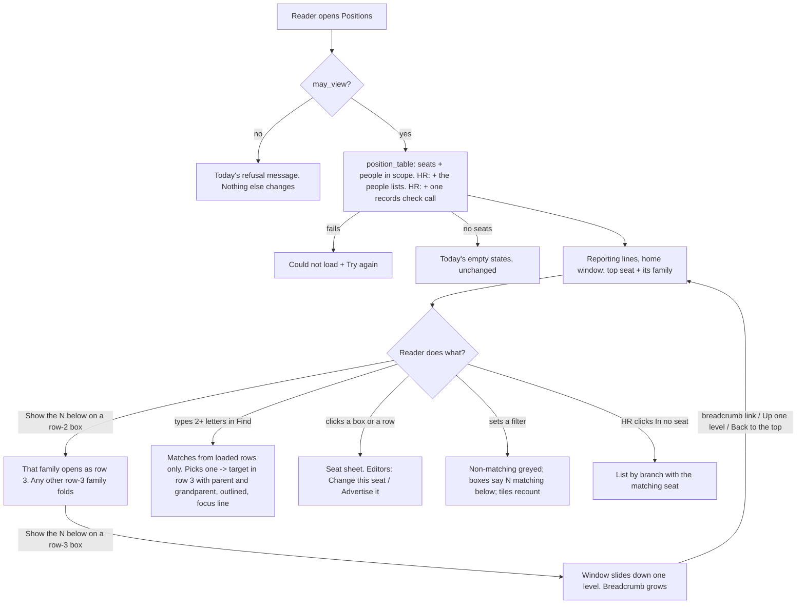

# 064 · Functional spec: the Positions organogram at 90 seats

## 0 · Bad news first

1. **After slice 061 reaches `main`, DTC's 6 HR Managers cannot open Positions at all.** DTC has its
   own permission rows on Alvoraa Position (System Manager and Org Structure Editor). Under 061 those
   rows decide who opens the page (`register.py:63-81`). Today, on `main`, a setting lets HR Manager
   in (`01d` §0.1). So the main user of this slice loses the page on the day 061 ships, unless
   somebody adds one Read row. **Open decision OD-3.** This spec does not change any permission
   (SEC-11).
2. **The people lists ("In no seat", "No reporting manager") go to HR only, so at DTC the owners will
   not see them.** The prototype shows them to the Owner (CXO). DTC's owners are Org Structure
   Editors with no HR role. `01d` SEC-2 gives named lists only to readers with HR scope, and fails
   closed. **Conflict X-2. Surbhi decides.**
3. **The prototype's "nobody approves their leave" sentence is not true.** Frappe HR picks the leave
   approver from the Employee's *Leave Approver* field, or else the department's first approver
   (`leave_application.py:1553-1570`). It never reads *Reports To*. A person with no manager can
   still have a leave approver. **Conflict X-5**: until Surbhi rewords it, the build leaves out the
   leave clause.
4. **The "records disagree" chip needs a rewrite of `reporting_mismatches` first.** Today that report
   runs about 3 to 5 database queries per seated person (about 1,100 to 1,800 at DTC), and it reads
   every company and branch. The prototype draws the chip, so under the parity rule it is built, and
   the rewrite (SEC-5) is **in scope, not optional**. If the rewrite cannot be done, the chip cannot
   ship, and that is Surbhi's call, not the engineer's.
5. **Most of the new behaviour cannot be seen on DTC's real data.** DTC has 0 people on notice,
   0 employees who came through Frappe hiring, 1 company and no HR user tied to a branch. Tests must
   build their own data (§11 fixtures).
6. **`07-devops-inputs.md` does not exist for this slice, so there are no OPS items.** One Ready box
   fails (§21). DevOps should time Find and the roll-ups at 900 seats.
7. **The design changed once more on 21 Oct 2026 (v4), and this spec follows it.** The band "Also
   under Owner: 17 seats with nobody under them" is gone. Five or more seats with nobody under them
   are now **one dashed box inside the manager's row**, which opens the side panel - the same box and
   panel as "No reporting manager". At DTC every team lead's family is all childless seats, so **at
   DTC the third row never appears**: "Show the 20 seats below" opens the panel straight away. The
   v4 rows are group B (§6.5). Two new questions for Surbhi: **Q18** (the group starts at 5 seats)
   and **Q19** (a red tone on the group box when someone inside has a plan - **conflict X-8**, it
   hints at plans through an aggregate, which v3 removed on purpose).
8. **I am not a lawyer.** Nothing here settles a legal question.

---

## 1 · What this slice does, in one paragraph

On Positions, the chart opens on "Reporting lines" and can never grow wider than the screen. It shows
at most three rows: the current top, its family, and one opened family. Going deeper slides the
window down, and a breadcrumb always shows the way back. Every box with seats under it says how many
seats and people are below it, and what needs somebody ("Below: 2 to fill · 1 leaving"). A Find box
locates any seat or person. One View control replaces the two dropdowns. HR sees who is in no seat
and who has no manager. New seats are blue, places to fill in existing seats are amber, always with a
word. When someone is hired through a Job Opening linked to a seat, they are put in that seat on
their joining date by themselves. When the opening's places are all filled, it closes.

## 2 · Cross-module reach and HRMS domains

| App | Touched? | How |
|---|---|---|
| `alvoraa_portal` | **Yes** | `portal.js` Positions section (window, roll-ups, Find, View control, tiles, sheets, list, phone outline), `positions.html`, panel CSS; `org_job_link.py` (seat link made editable on the desk; Job Opening change history switched on) |
| `hrms` (our org-structure code) | **Yes** | `register.py` `position_table` (people lists, per-person hire date, seat creation date); a rewritten `reporting_mismatches` (SEC-5); a new Employee `after_insert` placement hook; a Job Opening `validate` check on the seat link (SEC-8); the SEC-16 counter test |
| `hrms` (Frappe HR's own code) | **No edits** | Employee, Job Applicant, Job Offer, Job Opening used as shipped. The hook is registered from our code |
| `erpnext`, `frappe` | No | |
| `alvoraa_goals`, `alvox_compensation` | No | Nothing reads seats |

**Domains:** org structure (core); recruitment (Job Opening, Job Applicant: read, and Job Opening
closed); leaves (only as a *fact check* on one sentence, X-5 - nothing changes); appraisals: not
touched (`reports_to` is never written - SEC-9). Payroll, attendance, goals, compensation, learning:
not touched.

**Cover delegation knock-on (existing, stated so nobody is surprised):** a placed hire becomes one of
the people under the parent seat (`_people_under`). A **later** cover of that parent with "also move
approvals" moves theirs too. A cover already running does not (SEC-9).

**Personas:** HR Manager (Ritika, DTC HR - the main user), CXO / Owner (Vikas, who reads the chart,
often on a phone), Store head (Delhi manager, if a tenant gives them Positions), HR User without
Positions edit (creates employees from applicants), System Manager (releases, permissions). Employee
and frontline employee: **no change on Positions** - they never open it. One knock-on for them: a new
joiner shows in their seat on the Organisation chart from their first day.

## 3 · Is this the real problem? (check, not redo)

- **Symptom vs cause.** Surbhi's complaint was "too big to use" and, on v2, "the design breaks when a
  lot of hierarchies are open". The design measured the cause: DTC is **wide, not deep** (22 seats
  under the Owner, three rows), and opening everything made a chart 5,326 px wide. The window plus
  the group box for childless seats (v4) target that cause, not a symptom. Confirmed in the design's measurements; not seen
  on the real page.
- **What happens after?** Each new number drives an action: "to fill" → Advertise it; "in no seat" →
  put them in a seat; "no manager" → set the manager on the Employee record; "records disagree" →
  move the seats (bug 3). No screen here exists only to be looked at.
- **Item 6 (hire placed by itself) helps DTC only once they hire through Frappe.** DTC has 2 openings,
  1 applicant, 0 offers, 0 employees from hiring. The PM's kill criterion ("no openings and no plan to
  use them") does not fire, but nobody at DTC will see it work yet. Open question Q-2.

---

## 4 · Gap analysis

| # | Requirement | What exists today (read in source) | Verdict | Cost |
|---|---|---|---|---|
| G-1 | Open on the chart (D2) | View dropdown defaults to "As a list" (`positions.html`, `posPaint`) | **Extend** - one View control, default Reporting lines | S |
| G-2 | One control for View and Arrange-by (bug 1, design Q3) | Two dropdowns; Arrange-by hidden on the list (`portal.js:519-520`) | **Extend** - replace both with one 4-option control. The engineer's two-line fix is **not** used; the design's control replaces it | S |
| G-3 | Fold so the chart fits (item 2, D1) | `POS_OPEN_DEPTH = 2` opens two layers; at DTC that is everything (`portal.js:276, 693-695`) | **Extend** - the three-row window (v3) replaces depth folding | M |
| G-4 | Counts on boxes (brief WOW) | "N more below" counts direct seats only (`portal.js:240`) | **Extend** - roll-up over rows already loaded (SEC-1). `_descendant_count` is **not** reused (company-only scope) | S |
| G-5 | Find on Positions | Organisation page has `search_people`; Positions has nothing | **Extend** - in the browser over the loaded rows (SEC-3). `search_people` **not** reused (different scope) | M |
| G-6 | Seats with nothing under them gathered (v4: one group box in the manager's row, opening the side panel) | No (identical siblings are grouped, `posGroupSiblings`) | **Extend** - client code; the side panel is the seat sheet's own component (US-11), no new component | M |
| G-7 | "No reporting manager" (item 5) | Nothing. The seat tree has 1 parentless seat at DTC; 19 people have no manager and no seat | **Extend** - people + parentless non-top seats (design Q1 overrides PM D3); same group box and panel as G-6 | M |
| G-8 | "In no seat" list (design Q2) | Nothing. 82 of 445 at DTC | **Extend** - one scoped query inside `position_table` (SEC-2) | M |
| G-9 | "Records disagree" chip (design §6.4 #7) | `reporting_mismatches`: role check only, queries in a loop (`api.py:405-439`) | **Extend** - rewrite to grouped reads with scope (SEC-5) | M |
| G-10 | "Holds people of N managers" chip | Nothing | **Extend** - same rewritten call returns the per-seat manager counts | S |
| G-11 | Colour code: new seat, to fill (v2) | Amber "to fill" exists; no "new seat" | **Extend** - "new seat" from the seat's own `creation` date (no new field). Needs a blue colour pair in the design system (Q12) | S |
| G-12 | Seat sheet readable by every reader | Editors' click opens the edit dialog; a reader's click folds (`portal.js:1066-1072`) | **Extend** - one read-only side sheet; "Change this seat" opens today's dialog unchanged | M |
| G-13 | Hire placed in the seat (item 6, D5) | Nothing creates the assignment (brief §3) | **Build new code** - one Employee `after_insert` hook. Cheaper rungs rejected in the brief: a Server Script (not in the repo, not tested); "put somebody in it" by hand (the step people forget) | M |
| G-14 | Hand-made openings linkable (brief) | `alvoraa_position` is `read_only` on Job Opening (`org_job_link.py:39-41`), but the server does not enforce `read_only` (`01d` §0.3) | **Configure** (drop `read_only`) **+ Extend** (SEC-8 `validate` on Job Opening, on link change only) | S |
| G-15 | Who linked the opening to the seat | Job Opening has no change history (`track_changes` off) | **Configure** - Property Setter from `org_job_link.after_migrate` (PRIV-3) | S |
| G-16 | Close the opening when filled (D6) | Frappe HR closes only on `closes_on` (`job_opening.py:141-153`) | **Extend** - in the same hook, as the user, no bypass (SEC-10) | S |
| G-17 | Phone reading mode (design §6.4 #12, Q9) | Positions phone view shows one level at a time (design §2.3) | **Extend** - outline with breadcrumb. Drawn in the prototype, so built (parity rule); Q9's "should" is superseded | M |
| G-18 | Print this view (Q8) | No | **Drop for 064** - Q8 "later", PRIV-2. **But drawn - conflict X-4** | - |
| G-19 | Setup tool gives a group's head a seat of their own (engineer Q4) | `propose_positions` keys by job role + department + branch | **Drop from 064** - not in the design. Stays a separate small change, Surbhi's call (OD-6) | - |
| G-20 | Bugs 3 and 4 (DTC data) | Data faults, code draws them correctly | **Drop from 064** - data work on a live tenant, needs Surbhi's word (engineer Q2). The new chips make the next such fault visible | - |
| G-21 | "Plan a replacement" note, red flag, plan filter | Nothing | **Not in 064** - slice 065 (D7-D11 open). Group C rows, "built with 065" | - |
| G-22 | Hindi on this screen (Q10) | - | **Drop for now** (Q10). Strings marked translatable | - |

**Single sources of truth:**
- Who sits where → **Alvoraa Position Assignment** (current rows). The new lists and roll-ups read it; nothing copies it.
- Who manages whom → **Employee.reports_to**. The seat tree is drawn as it is stored; where the two disagree the chip says so. **Nothing reconciles them automatically** (`api.py:409-414`).
- Who is leaving → the per-person `leaving` value `position_table` already suppresses (SEC-4). No new read of `relieving_date`.
- A seat is "new" → the seat's own `creation` timestamp (Frappe keeps it). No new field.

**Rung for the slice:** customisation and new code inside existing endpoints and one hook; one
property change on our own custom field; one Property Setter. No new DocType, page, report, setting,
cache, job or app.

---

## 5 · Process flow

### 5.1 Reading the chart

### 5.2 A hire placed in the seat

1. Ritika (HR Manager) presses **Advertise it** on "Store Manager · Noida" (exists today) - or a Job
   Opening made by hand gets its **Position** set on the desk (new: editable, SEC-8 checks the right).
2. Applicants apply. One gets an offer. HR presses **Create Employee** on the offer (Frappe HR).
3. The Employee is saved with `job_applicant` and `date_of_joining` = 2 Nov.
4. The hook checks the six conditions (SEC-6). All hold → a Permanent, 100% assignment from 2 Nov is
   written. HR sees "Ramesh Kumar is now in the seat Store Manager · Noida from 2 Nov."
5. The opening had 1 place → it is closed. "Job Opening HR-OPN-2026-0007 is now closed: its 1 place is
   filled. It is off the careers page."
6. From 2 Nov, Positions shows Ramesh in the seat, with "New hire placed" for 30 days.

**Unhappy paths:** seat full on the joining date or today → not placed, HR told why and when it
frees (if an occupant's end date is known) · person already holds a seat · seat closed · seat in
another company · a second Employee from the same applicant · Employee edited later (never places) ·
opening with no seat link (silent) · the user cannot close the opening (stays open, told) · any
unexpected refusal (nothing half-written, the Employee is still saved, HR told).

---

## 6 · Screens and the prototype

### 6.1 Screens referenced by stories

| ID | Screen (prototype-v4; v4 changed only P-10, P-11 and the focus rule) | Group |
|---|---|---|
| P-1 | Positions, Reporting lines, home window (desktop) | A |
| P-2 | Window with one family open (row 3), and after sliding down (Shape: deep) | A |
| P-3 | By branch / By department (holder boxes, window) | A |
| P-4 | Tiles, View control, Find, filter bar, colour key | A |
| P-5 | Seat sheet (incl. "records disagree", "holds people of 3 managers", new seat, new hire) | A |
| P-6 | "In no seat" sheet | A |
| P-7 | List view | A |
| P-8 | Phone outline (390 px) | A |
| P-9 | Loading, could not load, nothing matches | A |
| P-10 | prototype-v4: "Seats with nobody under them" dashed group box in the manager's row, and its side panel | **B (v4)** |
| P-11 | prototype-v4: "No reporting manager" dashed group box, tile, panel, phone row | **B (v4)** |
| P-12 | Red flag, red tone, plan filter, key entry, hide link, plan and offer sheets | **C - built with 065** |

### 6.2 Decisions treated as accepted - each an OPEN DECISION for Surbhi to confirm

Surbhi will review after the build. So the designer's Q1-Q17 and the PM's D1-D6 are **assumed
accepted** and built. Where the design (v3) and the brief differ, **the design wins**, as instructed.

| # | Decision | Built as | Where design and brief differ |
|---|---|---|---|
| D1 | Fold after the second level | The v3 window: top + its family at home | Brief: "top + one layer". v3 goes further (never more than three rows). **Design wins** |
| D2 | Open as the chart | Opens on Reporting lines | Same |
| D3 | "No reporting manager" = seats? | **People** with no manager and no seat, plus any parentless seat other than the top (design Q1) | **Brief said seats. Design wins** (the seat version is empty at DTC) |
| D4 | The real top | Parentless seat with the most seats under it | Same |
| D5 | Place a hire automatically | Yes | Same |
| D6 | Close the opening when filled | Yes, when Employees from its applicants reach `vacancies` (≥ 1) | Same |
| Q1 | People-based "No reporting manager" | Yes | (D3 above) |
| Q2 | "In no seat" in 064 | Yes, tile and list, no auto-placement | **Brief said later. Design wins** |
| Q3 | One View control | Yes (bug 1 fixed by it) | - |
| Q4 / Q18 | Seats with nobody under them grouped from **5 or more** under one manager (v3 card; v4 group box) | Yes, 5 (a fixed number, no setting) | - |
| Q19 | Group box takes the red tone for HR when someone inside has a plan | **Not in 064** (group C) → **conflict X-8** | - |
| Q5 | "Seat" = the record; capacity "31 of 31 filled" | Yes | - |
| Q6 | Who sees the records chip | Design: HR and CXO → **conflict X-3** | - |
| Q7 | Plan: HR Manager only | 065 | - |
| Q8 | Print this view later | Not built → **conflict X-4** (it is drawn) | - |
| Q9 | Phone reading mode | **Built** - drawn, so the parity rule applies | - |
| Q10 | No Hindi now | Strings translatable, English only | - |
| Q11 | Merge the two Pitampura branch records | Data work by DTC HR; the screen says so (R-59) | - |
| Q12 | Add a blue colour pair; darken `--amber` | Built as one token change - **touches every page** (risk RK-4) | - |
| Q13 | Leaving: today's rule | Today's rule → **conflict X-1** (v3 draws HR-only) | - |
| Q14 | Plans shown by default with a hide link | 065 | - |
| Q15 | "New seat" rule | Created in the last 30 days **and** after the company's first seat was created | - |
| Q16 | Filters no longer open every match; "N matching below" | Yes | - |
| Q17 | Filter bar visible for everyone | Yes | - |
| OD-6 | Setup-tool fix (engineer Q4) | **Out** of 064 - the design does not include it | - |

### 6.3 Where the prototype meets a security, privacy or engine rule - Surbhi decides each

**Standing rule (21 Oct 2026):** what the approved prototype shows is built as it is. None of these is
resolved here. Each row says what the build does **until she answers** - the fail-closed choice, so
the engineer is not blocked. It is not a decision.

| # | The prototype shows | The rule it meets | Until Surbhi decides, the build… | Parity rows |
|---|---|---|---|---|
| **X-1** | "Leaving" (tile, filter option, chips, roll-ups, sheet) for the **HR Manager only**; the Owner and the store head see none | Today's rule (`register.py:179-229`): full-reach roles and the leaver's own reporting line. `01d` SEC-4: every "leaving" comes from the server's existing value. Design Q13 recommends today's rule | follows **today's rule** - the server decides. So a CXO in a full-reach role, and a store head whose own report is leaving, **do** see it | R-12, R-26, R-40, R-41, R-49, R-60, B-2, B-4 |
| **X-2** | The Owner (CXO) gets the "In no seat" tile and list, Find hits for unseated people, and (group B) the "No reporting manager" box, tile and sheet | `01d` SEC-2: the people lists only for readers with HR scope (`permitted_employee_filters`), fail closed. DTC's owners hold no HR role | gives the lists to HR scope only. A reader without it gets **no tile and no box** (never "0") | R-13, R-20, B-10..B-13 |
| **X-3** | "18 report here on their records" and "Holds people of 3 managers" for HR **and the Owner** | `01d` SEC-5(d): same readers as SEC-2 | shows both chips and notes to HR scope only | R-52..R-55, B-4 |
| **X-4** | "Print this view" button (desktop) and a print header "… · Confidential, for management · Showing: …" | Design Q8 "later"; `01d` PRIV-2: not built in 064 | **does not build** the button or the print header. Nothing stops it later: every private mark already carries the print-hide class rule (§16) | R-24 |
| **X-5** | "Until they have one, **nobody approves their leave**, and they appear nowhere on this chart." | Fact check (design §6.2 asked for it): Frappe HR's leave approver is *Leave Approver* or the department's first approver, never *Reports To* (`leave_application.py:1553-1570`) | shows "These people have no reporting manager on their employee record, and no seat. They appear nowhere on this chart." | B-12 |
| **X-6** | "Set manager" for anyone who may **edit Positions** | Setting a manager is a write on **Employee**, which a Positions editor may not have | shows "Set manager" when the reader may write Employee (server sends the flag) | B-12 |
| **X-8** (065, Q19) | The **group box** ("Seats with nobody under them", 17 seats) turns red for the HR Manager when **any one person inside** has a replacement plan (v4 `groupTone`, PV-10) | `01d` §8.2 and the design's own v3 rule (§6.5b, AC 18 of design §11): nothing may read as a count of plans or point at plans through an aggregate. A red group box says "someone among these 17 seats is planned to be replaced" - the same reading Surbhi rejected in v3 ("seems like the replacements are planned for that specific position"). It is also visible to anyone looking at HR's screen | **nothing in 064** - group C is not built. Recorded so 065's spec and security file decide it. My recommendation: the group box never takes the red tone; the flag shows only on the person's row inside the panel | C-12 |
| **X-7** | Reporting lines always opens on **one** top box (the biggest root). Any other root is never drawn | Not a security rule - a data-loss rule: a reader whose rows have two or more seats reporting above their view (a store HR person with two stores) would lose seats from the chart | when the reader's rows have more than one root, the home window has **no row-1 box**; row 2 holds every root, the breadcrumb starts "Your part of the organisation". This is the holder views' own top, reused. One root: as drawn | R-31 |

Not conflicts, recorded so nobody guesses (engine notes in the parity table): the second-branch-record
chip and note need a rule (R-45, R-59); "Advertise it" follows today's conditions (R-50); the
department view stays a real tree (R-46); "leaving in the next 60 days" (R-12, OD-5).

### 6.4 Prototype parity table - group A (stable in v4)

One row per screen, state, control, message and rule prototype-v4 shows **in the product** (re-walked
against v4 on 21 Oct 2026: R-23, R-28, R-32, R-33, R-35, R-40, R-50, R-51 changed; the rest are the
same in v3 and v4). Left out on
purpose: the review bar (Person, Device, Theme, Shape, State), the "Sample" tag and the words "Names
are Sample", the invented names and numbers, and the toasts that say a button "opens today's screen
unchanged". `{…}` is a value the page fills.

**Status key:** **As drawn** · **As drawn, engine note** (built as shown; how the value is found is
noted) · **Conflict X-n** (§6.3 interim applies) · **Existing** (in the product today, kept).

| # | Screen | What the prototype shows | Story | Test | Status |
|---|---|---|---|---|---|
| R-1 | Header | "Positions"; subtitle "Every seat in the organisation, who is in it, and which are empty." | US-1 | AC-1 | As drawn |
| R-2 | Header, scoped reader | "Your part of the organisation: {seat} · {branch} and the seats under it." | US-23 | AC-80 | As drawn, engine note: shown when the reader's top seat has a parent outside their rows |
| R-3 | Header, editor | "+ Add a seat" → today's dialog | US-1 | AC-1 | Existing |
| R-4 | Data line | "Figures as at {d Mon yyyy}, {HH:MM}." (time of the load) | US-8 | AC-25 | As drawn |
| R-5 | Loading | "Loading the seats…" (`role="status"`), skeleton tiles and chart | US-17 | AC-60 | As drawn |
| R-6 | Could not load | "We could not load the seats." / "Check your connection, then try again. Nothing you changed is lost." / "Try again" (`role="alert"`) | US-17 | AC-61 | As drawn |
| R-7 | Nothing matches | "No seat matches those filters." / "Try another branch, or show every seat." / "Show every seat" | US-17 | AC-62 | As drawn (replaces today's "Clear the filters") |
| R-8 | No seats yet, first time, no permission | Not drawn in v3 | US-17 | AC-63 | Existing, unchanged (design K8) |
| R-9 | Tile | "{n} seats" / "{p} people in them" (not a button) | US-8 | AC-25 | As drawn (replaces "SEATS") |
| R-10 | Tile | "{f} to fill" / "{x} in existing seats, {y} in new", amber, button → Show = places to fill. Zero: "None to fill" / "Every seat is filled", not a button | US-8 | AC-26 | As drawn |
| R-11 | Tile | "{n} new seat(s)" / "Made in the last 30 days", blue, button → Show = new seats. Zero: "No new seats" | US-8 | AC-27 | As drawn |
| R-12 | Tile | "{l} leaving" / "in the next 60 days", amber, button → Show = leaving. Zero: "Nobody leaving". Absent (never "Nobody leaving") for a reader who may not see leavers | US-8 | AC-28 | **X-1** (who); 60 days = today's tile rule (OD-5) |
| R-13 | Tile | "{u} in no seat" / "Not on this chart yet", amber, button → In no seat sheet | US-12 | AC-41 | **X-2** |
| R-15 | Tiles | Counted over the rows matching the filters; ignore the plan filter | US-8 | AC-29 | As drawn (the plan filter is group C) |
| R-16 | Toolbar | "View": Reporting lines · By branch · By department · List; labelled group, `aria-pressed`; always visible, outside the filters. Phone: 2 × 2, 44 px | US-2 | AC-4, AC-5 | As drawn |
| R-17 | Toolbar | Opens on Reporting lines; changing View resets the window to its home | US-1, US-2 | AC-2, AC-6 | As drawn |
| R-18 | Find | Label "Find a person or a seat"; placeholder "Type a name or a seat, e.g. RSO"; search field, 16 px text | US-7 | AC-18 | As drawn |
| R-19 | Find | From 2 characters; seat hit "{title}" / "{branch} · {f} of {s} filled"; person hit "{name}" / "{seat} · {branch}"; at most 12; then "{n} more. Type more of the name." | US-7 | AC-19, AC-20 | As drawn |
| R-20 | Find | Unseated person hit "{name}" / "In no seat yet · {job role} · {branch}" → opens the In no seat sheet | US-7, US-12 | AC-21 | **X-2** (HR scope only) |
| R-21 | Find | "No seat or person called that." / scoped: "No seat or person called that in your part of the organisation." | US-7 | AC-22 | As drawn |
| R-22 | Find | Escape clears; a click outside closes the list | US-7 | AC-22 | As drawn |
| R-23 | Find | Choosing: List switches to Reporting lines; target placed in sight with parent and grandparent; outlined; scrolled into view; focus line "Showing {name or seat} in {seat} · {branch}. Clear" (`role="status"`). Phone: the outline opens at the target's parent. A seat that sits inside a group box: see B-8 | US-7 | AC-23, AC-24 | As drawn (v4 adds B-8) |
| R-24 | Toolbar | "Print this view" (desktop only) + print header | - | AC-79 (absent) | **X-4** - not built |
| R-25 | Filters | One visible bar, labelled "Filters": Branch ("All branches" + the reader's branches) | US-10 | AC-34 | As drawn. Today's Department and Job role filters, which narrow each other, are kept (Existing) |
| R-26 | Filters | Show: "Every seat", "Only seats with places to fill", "Only new seats", "Only seats where somebody is leaving" (last only for readers who see leavers) | US-10 | AC-35 | As drawn; **X-1** for who gets "leaving". Today's "key seats" option kept (Existing) |
| R-27 | Filters | "Reset view" only while a filter is set; "Seats that do not match are greyed. A box says how many matching seats are below it." | US-10 | AC-36 | As drawn |
| R-28 | Filters | Non-matching seats greyed, never dropped; a box with matches below is not greyed and carries "{n} matching below"; filters no longer open the path to every match (Q16). Group boxes say "{n} matching inside" (B-9) | US-10 | AC-37, AC-38 | As drawn |
| R-29 | Key | "New seat (made in the last 30 days)" · "To fill (existing seat)" swatches; "Hide the key" / "Show the colour key"; not remembered between visits | US-9 | AC-32 | As drawn |
| R-30 | Breadcrumb | Sticky "You are here:" path, each step a link, current step bold, "›" between; "Up one level" and "Back to the top" when not at home; holder views start "All branches" / "All departments" | US-4 | AC-12..AC-14 | As drawn |
| R-31 | Window | Row 1 = current top box (outlined at home); home = parentless seat with most seats below | US-1 | AC-2, AC-3 | As drawn - **X-7** when the reader has several roots |
| R-32 | Window | Row 2 = its family; a box with seats under it gets "Show the {n} below" / "Fold the {n} below" (`aria-expanded`, `aria-controls`) - **except** a box whose family is all childless seats, 5 or more: B-6 | US-3 | AC-7, AC-8 | As drawn |
| R-33 | Window | Row 3 = at most one opened family (only families that hold at least one seat with seats under it - v4), in a band "Under {seat · branch} · {n} seats below · {p} people" + "Fold"; opening a second folds the first; opened box outlined | US-3 | AC-9, AC-10 | As drawn |
| R-34 | Window | In row 3, "Show the {n} below" slides the window down one level; page scrolls to the breadcrumb | US-4 | AC-11 | As drawn |
| R-35 | Window | A row wider than the frame wraps: "{n} boxes under {title}. Shown in rows so they fit the screen." (v4 wording; the group box counts as one box) (holder top: "{n} groups. Shown in rows so they fit the screen."); boxes per row from the frame width | US-5 | AC-15, AC-16 | As drawn |
| R-36 | Window | Never more than three rows; neither page nor chart frame scrolls sideways; no boxes overlap | US-3, US-5 | AC-17 | As drawn |
| R-37 | Window | Seats under a parent sorted by title A-Z | US-3 | AC-7 | As drawn (today's order) |
| R-38 | Box | Title; "{branch} · {department or 'No department'}"; scoped top adds " · reports above your view" | US-6 | AC-30 | As drawn (K7 existing) |
| R-39 | Box | "Nobody in this seat" / one name / "{f} of {s} filled · {name} +{n}" | US-6 | AC-30 | As drawn |
| R-40 | Box | Roll-up on every box with seats under it: "{n} seat(s) below · {p} people"; then "Below: {f} to fill ({k} new) · {m} new seat(s) filled · {l} leaving" - only the non-zero parts. Every count line starts "Below:" on a seat and "Inside:" on a group box (B-2) - never neither (PV-9) | US-6 | AC-31 | As drawn; **X-1** for "leaving" |
| R-41 | Box | Chips: "New seat · {d Mon}" (blue outline); "{n} to fill" (blue on a new seat, else amber); "{n} leaving"; "{n} matching below" | US-6, US-9 | AC-31, AC-33 | As drawn; **X-1** |
| R-42 | Box | Tones: blue = new seat, amber = place to fill in an existing seat; 4 px left bar + tint + always a word; new beats fill | US-9 | AC-33 | As drawn |
| R-43 | Box | A box is a button for every reader → the seat sheet | US-11 | AC-39 | As drawn (today a reader's click folds) |
| R-44 | Holder views | Holder box: title, "Branch"/"Department", roll-up + Below line; "No branch"/"No department" last; click opens its family band; in the band, slides | US-3 | AC-10 | As drawn |
| R-45 | By branch | Chip "Second branch record for {name}" | US-12 | AC-45 | As drawn, engine note: shown on a branch whose name equals another branch's when case, spaces and punctuation are ignored, and the two differ in which one holds seats and which holds people |
| R-46 | By department | Departments drawn as groups | US-3 | AC-10 | As drawn, engine note: today's department **tree** (parent departments) is kept; the window walks it like any tree. Not seen on a nested tenant `[UNVERIFIED]` |
| R-47 | Seat sheet | Heading = seat title; "{branch} · {department} · reports to {parent · branch}" or "reports to nobody (top of the chart)"; facts "{f} of {s}" filled, "{n}" or "None" to fill | US-11 | AC-39 | As drawn |
| R-48 | Seat sheet | New seat: "New seat · {d Mon} Made in the last 30 days, after the chart was first set up." + " Its place to fill is a new job, not a replacement." when empty | US-9 | AC-33 | As drawn |
| R-49 | Seat sheet | "Who is in it"; "Nobody is in this seat."; per person "Joined {d Mon}, hired for this seat" (green), "Leaving {d Mon}" (amber); list scrolls past 340 px | US-11, US-22 | AC-40, AC-75 | As drawn; **X-1** |
| R-50 | Seat sheet | Editors: "Advertise it" (when places to fill), "Change this seat" (today's dialog). Desktop, not in List, not opened from a group panel: "Show it on the chart" (acts as a Find pick). Opened from a group panel: "Back to the {n} seats" instead (B-5) | US-11 | AC-40 | As drawn, engine note: "Advertise it" follows today's rule - a job role on the seat and no open opening; when an opening is open, today's "Job opening {id}" link shows instead |
| R-51 | Seat sheet | `role="dialog"`, `aria-modal`; focus to the heading on open; Escape, Close and a click outside close it, and **focus returns to the control that opened it** (v4, PV-6 - every panel on the page); phone: a bottom sheet, Close ≥ 44 px | US-11 | AC-39 | As drawn |
| R-52 | Box | Chip "{n} report here on their records" | US-13 | AC-47 | **X-3** |
| R-53 | Seat sheet | "{n} people report to this person on their employee records" / "Their seats sit under other seats on this chart, so nobody shows under this box:" / "{seat}: {count}" list / editor: "To fix it, open each seat and set Reports to to this seat. A seat shared with another manager's people needs splitting first." / others: "HR can move these seats under this one." | US-13 | AC-48 | **X-3**; engine note: when some do show under the box, "so nobody shows under this box" reads "so they do not show under this box" |
| R-54 | Box + sheet | Chip "Holds people of {n} managers"; note "This seat holds the people of {n} managers" / "{c} report to {manager}" (", who is in this seat too" where true) / "That is why it reads like one person with {o} others in their seat." / editor: "Give the head a seat of their own, then move each group under its own manager." | US-14 | AC-52, AC-53 | **X-3** |
| R-55 | Box | The two chips never show for the store head | US-13, US-14 | AC-49 | As drawn |
| R-56 | Box / list | "New hire placed" chip (box), "new hire" (list) | US-22 | AC-75 | As drawn, engine note: a person whose assignment was written by the hook, for 30 days from its start |
| R-57 | In no seat sheet | "In no seat · {n} people" / "{n} of {a} active people hold no seat, so they are not on this chart and not in the counts above." + " Most joined in the last two months." when more than half joined in the last 60 days | US-12 | AC-42 | As drawn, engine note on the last sentence |
| R-58 | In no seat sheet | By branch "{branch} · {n}"; "{c} {job role} · matching seat: {seat · branch} ({f} of {s})" (link → shows it on the chart) or "· no matching seat" | US-12 | AC-43, AC-44 | As drawn, engine note: matching seat = same job role (designation) and branch and company; several → the first by title |
| R-59 | In no seat sheet | "There is no seat at {branch}. The {branch} seats use a second branch record, "{other}". HR should merge the two branch records, or move these people." | US-12 | AC-45 | As drawn, engine note: R-45's rule; with no look-alike record, only "There is no seat at {branch}." |
| R-60 | List | Columns Seat (+ "New seat" chip), Reports to ("Top of the chart"), Branch, Department ("None"), Who is in it (two names, "leaving {d Mon}", "new hire", "and {n} more", "Nobody in this seat"), Filled "{f} of {s}", To fill (bold, or "None"), "Open" (editors) → seat sheet | US-15 | AC-56 | As drawn (replaces today's columns); **X-1** |
| R-61 | List | Caption "{n} of {m} seats"; row tones; sticky header | US-15 | AC-57 | As drawn |
| R-62 | List | Rows that do not match the filters are dropped | US-15 | AC-57 | Existing |
| R-63 | Phone | Tree views drawn as an outline; breadcrumb "You are here: Top › …" ("All branches"/"All departments"); "Tap a row to see what is under it." at the top | US-16 | AC-58 | As drawn |
| R-64 | Phone | Current card: title, "{branch} · {department}", roll-up + Below line, "Who is in this seat"; then "Up one level" | US-16 | AC-58 | As drawn |
| R-65 | Phone | Rows: title; "{branch} · {roll-up or who}" + bold "new seat, {n} to fill, {n} leaving, {n} matching below"; "›" when it has seats under it; tap → down a level, or the seat sheet | US-16 | AC-59 | As drawn |
| R-67 | Phone | Tiles in two columns; controls ≥ 44 px; no Print | US-16 | AC-59 | As drawn |
| R-68 | Every screen | Every box, row, fold and tile a `button`; colour never alone; text ≥ 12 px; targets ≥ 24 px desktop, ≥ 44 px phone; contrast ≥ 4.5:1 incl. the new blue pair and the darker amber (Q12) | US-9, US-17 | AC-17, AC-33, AC-59 | As drawn |
| R-69 | Every screen | Light and dark themes | US-17 | AC-17 | As drawn |
| R-70 | Rule | No "Open every level"; List is the everything view | US-3 | AC-17 | As drawn (removed) |
| R-71 | Rule | No separate View and Arrange-by dropdowns (bug 1) | US-2 | AC-4 | As drawn (removed) |
| R-72 | Rule | Identical leaf siblings grouped into one box (K3), "Group them again"; circle and depth notices | US-3 | AC-17 | Existing, kept. Not drawn in v3 |

(R-14 and R-66 moved to group B.) **Group A: 70 rows.** 56 as drawn (some with engine notes), 5
existing, **12 touched by conflicts** (X-1: R-12, R-26, R-40, R-41, R-49, R-60; X-2: R-13, R-20;
X-3: R-52, R-53, R-54; X-4: R-24; X-7: R-31 - R-31 counted once).

### 6.5 Group B - the group box and its side panel (prototype-v4, 02-design §6.5c, PV-1..PV-11)

Rebuilt from v4. v3's band "Also under Owner: 17 seats with nobody under them" and its "more than 12
spreads across the frame" rule are **gone** (PV-1, PV-4) and are not built. The side panel is the
seat sheet's own component (R-47..R-51) - no new component.

**What it means at DTC:** row 2 at home = the 5 team leads + one group box "Seats with nobody under
them / Report to Owner / 17 seats · {p} people". Every team lead's family is all childless seats, so
each one's "Show the {n} seats below" opens the panel. **No row-3 band ever appears on DTC's shape**;
the band (R-33) is only seen on deeper tenants (F-DEEP).

| # | Screen | What prototype-v4 shows | Story | Test | Status |
|---|---|---|---|---|---|
| B-1 | Window | Five or more seats with nobody under them, under one manager, are **one dashed box in that manager's row**, beside the team leads, on the same connectors. Four or fewer stay ordinary boxes. Applies in every tree view (under a branch or department group too) | US-26 | AC-85 | As drawn (PV-1; **Q18** confirms 5) |
| B-2 | Group box | "Seats with nobody under them" / "Report to {manager title}" / "{n} seats · {p} people" / "Inside: {f} to fill ({k} new) · {m} new seat(s) filled · {l} leaving" (non-zero parts only) / "Select to see the {n}". A `button` with `aria-haspopup="dialog"` | US-26 | AC-86 | As drawn (PV-9); **X-1** for "leaving" |
| B-3 | Group box | Public tone over its members: blue if any member is a new seat, else amber if any has a place to fill, else plain; dashed border always | US-26 | AC-86 | As drawn (PV-10, public part). Red part → C-12, **X-8** |
| B-4 | Group panel | Desktop right-hand panel, phone bottom sheet. Heading "{n} seats with nobody under them"; "Seats that report to {manager} · {branch} and have nobody under them. {p} people."; one row per seat (title A-Z): "{title}" / "{branch} · {who}" + bold "new seat, {n} to fill, {n} leaving, new hire placed, {n} report here on records"; each row keeps its tone | US-26 | AC-87 | As drawn (PV-2); **X-1**, **X-3** |
| B-5 | Group panel | A row opens the seat panel, whose footer starts with "Back to the {n} seats" (back to the same group panel) and has no "Show it on the chart" | US-26 | AC-88 | As drawn (PV-2) |
| B-6 | Window | A manager whose **whole** family is childless seats (5 or more): its button reads "Show the {n} seats below" (`aria-haspopup="dialog"`) and opens the group panel **directly**. No band; the window does not move | US-26 | AC-89 | As drawn (PV-3) |
| B-7 | Every panel | Focus to the heading on open; Close, Escape or a click outside closes; **focus returns to the box that opened it** | US-26 | AC-90 | As drawn (PV-6; also R-51) |
| B-8 | Find | Picking a seat that lives in a group shows its manager's family in the window, then opens the group panel with that row outlined, scrolled into view and focused | US-26 | AC-91 | As drawn (PV-7) |
| B-9 | Filters | Group box greyed when nothing inside matches, otherwise chip "{n} matching inside". In the panel: "Greyed rows do not match the filters." and each non-matching row greyed with "· does not match the filters". Nothing dropped | US-26 | AC-92 | As drawn (PV-8) |
| B-10 | Window | "No reporting manager": the same dashed group box, **no amber tint**, beside the top seat, home window, Reporting lines, not for a scoped reader: "No reporting manager" / "Not in any seat, and no manager on their record" / "{n} people" / chip "Needs a manager" / "Select to see the {n}" | US-27 | AC-93 | **X-2** (PV-5) |
| B-11 | Tile | "{m} no manager" / "No reporting manager", amber, opens the same panel | US-27 | AC-94 | **X-2** |
| B-12 | No-manager panel | Heading "No reporting manager · {n} people"; sentence; table Name, Job role, Branch, Joined, "Set manager" → the Employee record | US-27 | AC-95, AC-96 | **X-2, X-5, X-6** |
| B-13 | Phone | No group row (every seat is already a row in the outline). Top level: dashed row "No reporting manager" / "{n} people · not in any seat" opening the bottom sheet. Panel rows and Close ≥ 44 px | US-27, US-16 | AC-97 | As drawn (PV-11); **X-2** |
| B-14 | Rule (design §6.2; not drawn - 0 at DTC) | Parentless seats other than the top also go in the no-manager box: "{n} people · {s} seats"; the panel lists them under "Seats with no seat above them", each with "Show it on the chart" (re-roots the window there) | US-27 | AC-100..102 | Design rule |

**Group B: 14 rows** (v3 had 9). Removed from v3 and not built: the band, its "Also under {title}:"
heading, its two-column card, its "more than 12 spreads" rule, the amber tint on the no-manager box.

### 6.6 Group C - **built with 065** (switched off in 064)

These are drawn for the HR Manager only, from slice 065's private "Plan a replacement" note. 065 is
**not decided** (D8-D11 open). **Reading of "switched off":** 064 builds **none** of it, because the
data it draws from does not exist. Building a renderer for a note nobody can write is code with no
use (no-over-engineering §2). 065 builds these rows together with the note. 064's only duty is the
negative test AC-81: **no plan element, word or filter appears anywhere**. *If Surbhi wants the
drawing code shipped dormant in 064, that is a change to this spec - say so (OD-8).*

| # | What prototype-v4 shows | Built with | 064 test |
|---|---|---|---|
| C-1 | Red flag icon before a name (spoken "Replacement planned"); the flagged person named first in a multi-person seat and in the list | 065 | AC-81 (absent) |
| C-2 | Red tone (bar + tint) on a box or row with a plan; beats blue and amber; screen only | 065 | AC-81 |
| C-3 | Filter "⚑ Replacement plans": "Show every seat" / "Only seats with a replacement planned"; greys; "{n} matching below"; tiles ignore it | 065 | AC-81 |
| C-4 | Key entry "⚑ Replacement planned for this person · only HR Managers see this" | 065 | AC-81 |
| C-5 | "Hide replacement plans (before you share your screen)" / "Show replacement plans"; hiding clears the filter | 065 | AC-81 |
| C-6 | Seat sheet per person: "Plan a replacement" / "Remove the plan"; chip "Replacement planned until {date}" | 065 | AC-81 |
| C-7 | Plan sheet: heading, "A private note…", four lines, "Why (optional)" list, "A short list on purpose…", Cancel / Save the plan | 065 | AC-81 |
| C-8 | Offer sheet "Start hiring now?", warning, Not now / Make an opening, not advertised; "Opening made: {id}, not advertised. Open it" | 065 | AC-81 |
| C-9 | "Plan removed. It is erased, not hidden." | 065 | AC-81 |
| C-10 | Print strips every private mark | 065 | AC-81 |
| C-11 | For anyone not HR Manager: no element and no word "replacement" or "planned" | 065 | AC-81 |
| C-12 | (v4, PV-10, **Q19**) The group box takes the red tone for the HR Manager when any member has a plan; red beats blue and amber | 065 - **conflict X-8** | AC-81 |

**Group C: 12 rows.** **Parity total: 70 + 14 + 12 = 96 rows.**

---

## 7 · Data model and field map

### 7.1 No new DocType. No new field on any DocType.

| DocType | Change | Why no existing field or cheaper rung |
|---|---|---|
| Job Opening (custom field `alvoraa_position`, ours) | `read_only` 1 → 0, description updated: "The seat on the organisation chart this opening is filling. Only someone who may place people in that seat can set it." | Already ours; one property. The server check is SEC-8 |
| Job Opening | Property Setter `track_changes = 1`, from `org_job_link.after_migrate` (PRIV-3) | Configuration; a Comment can be deleted, a log doctype is more surface |
| Alvoraa Position Assignment | **No change.** The hook writes `employee`, `position`, `weight` 100, `assignment_type` "Permanent", `from_date` = joining date, `is_primary` 1 `[ASSUMPTION - engineer to confirm the one-primary rule allows it; the person holds no other seat]`, `delegate_authority` 0, `reason` = "Placed on joining from Job Opening {opening} (applicant {applicant})" | `reason` (Small Text) and `owner` already answer "who and why" |
| Alvoraa Position | **No change.** "New seat" reads the standard `creation` timestamp | `effective_from` is empty on all 90 DTC seats |

### 7.2 `position_table` response - keys added (SEC-1, SEC-2, PRIV-1)

Existing keys stay as they are. Added, each named, never a whole row:

| Where | Key | Value | Who gets it |
|---|---|---|---|
| each seat row | `created` | the seat's `creation` date (`YYYY-MM-DD`) | every reader of the row |
| response | `first_seat_created` | earliest `creation` among the company's seats, per company: `{company: date}` | every reader |
| each person | `hired_on` | the assignment's `from_date` when its `reason` starts "Placed on joining from Job Opening", else null | every reader of the row |
| response | `unseated` | list of `{employee, name, job_role, branch, joined, no_manager}` - Active Employees in `permitted_employee_filters()` with **no current assignment** (a `NOT EXISTS` in the query). `no_manager` = `reports_to` empty | **HR scope only.** When the helper returns `NO_EMPLOYEES` the key is **absent** |
| response | `active_people` | count of Active Employees in the same filter (for "{n} of {a} active people") | same as `unseated` |
| response | `may_edit_employee` | `frappe.has_permission("Employee", "write")` | every reader (drives "Set manager", X-6) |

PRIV-1: the keys of each `unseated` item **equal** `{employee, name, job_role, branch, joined, no_manager}`.
`no_manager` is a yes/no, never the manager's name. The matching seat is worked out in the browser from
the loaded seats. Never sent: `user_id`, email, phone, date of birth, gender, image, `relieving_date`,
status, salary, grade, `reports_to`.

### 7.3 The rewritten records check (SEC-5)

`reporting_mismatches` is rewritten (same name, or a new name next to it - engineer's call) so that:
- it starts with `may_view()` and returns **nothing** (no key, not an empty list) when
  `permitted_employee_filters()` is `NO_EMPLOYEES`;
- seats come from `_scope()`, people from `permitted_employee_filters()`;
- it reads current assignments, seats and Employee `reports_to` / `employee_name` in **a fixed number of
  grouped reads**, joined in Python - the same count at 20 and 1,000 people;
- it returns two lists with fixed keys:
  - `mismatches`: `{employee, employee_name, position, parent_position, chart_says, chart_says_name, reports_to_says, reports_to_says_name}` (today's keys);
  - `mixed`: per seat whose current occupants report (on record) to two or more different managers: `{position, manager, manager_name, manager_position, count}`.
- the page calls it **once per load**, after `position_table`, only when `unseated` came back.

The chip "{n} report here on their records" on seat S = number of `mismatches` rows whose
`reports_to_says` holds S (primary, current). The sheet groups them by their own seat.

### 7.4 Client-side rules (no server change)

| Rule | Exact definition |
|---|---|
| To fill | `open` = seats − filled, shown when ≥ 0.5 (today's rule) |
| New seat | `created` ≥ today − 30 days **and** `created` > `first_seat_created[company]` |
| Leaving (counts, chips, roll-ups, filter) | a person whose `leaving` is set (server-suppressed). Tile: `leaving` ≤ today + 60 days (today's tile rule). OD-5 |
| Roll-up of box X | over the rows **in the payload** under X, however deep: seats, people (sum of filled), to fill (+ how many in new seats), new seats filled, leaving |
| Real top | among the reader's roots, the one with most seats below; tie → title A-Z. X-7 when more than one root has a parent outside the rows |
| Fits | boxes per row = max(2, floor((frame width − 80) / 222)); a group box counts as one box |
| Group box (v4) | under one parent (a seat, or a branch/department group), the children with no seats under them, when there are **5 or more**. Fewer than 5 → ordinary boxes. Not used on the phone outline, nor for the top level of the holder views |
| Family opens as a panel (v4) | a box whose children are **all** childless and number 5 or more → "Show the {n} seats below" opens the group panel; otherwise "Show the {n} below" opens the band |
| Group tone (v4, public part) | blue if any member is a new seat; else amber if any has a place to fill |
| Matching seat | same `designation` = person's job role, same branch, same company; first by title |
| Look-alike branch | lower-case, remove spaces and punctuation; equal strings, different records |
| New hire mark | `hired_on` within the last 30 days |

---

## 8 · States and transitions

No workflow. **Page window states** (client only, not stored, not remembered between visits):

| State | Row 1 | Row 2 | Row 3 | Breadcrumb | Leaves by |
|---|---|---|---|---|---|
| Home (Reporting lines) | the real top | its family | none | "You are here: {top}" (no buttons) | Show the N below → Family open |
| Home (holder views; X-7 several roots) | none | every group / root | none | "All branches" / "All departments" / "Your part of the organisation" | click a group → Family open |
| Family open | R | R's family | O's family (band) | "… › R › O" + Up one level + Back to the top | Fold → back; another row-2 box → swap; Show the N below in the band → Slid |
| Slid | O (old row 3's parent) | O's family | the chosen box's family | longer path | Up one level, a breadcrumb link, Back to the top |
| Focused (Find) | grandparent | parent's family | the target, in the band of its parent | path to the parent | Clear removes the outline only |
| Focused in a group (v4) | as Home or Family open, so the target's manager's family is visible | - | - | unchanged | the group panel opens at the target row; closing it returns focus |
| Panel open (v4) | unchanged | unchanged | unchanged | unchanged | Close / Escape / click outside → focus back to the opener; a panel row → seat panel with "Back to the {n} seats" |

**Job Opening:** Open → Closed by the hook (SEC-10). Never reopened by the hook. Terminal for the hook.

---

## 9 · Permission and visibility matrix

### 9.1 Who can open Positions at DTC - today, after 061, after 064

| DTC role (users) | Today on `main` (setting `alvoraa_org_positions_view_roles`) | After 061 (DTC's own permission rows on Alvoraa Position) | After 064 - extra they get |
|---|---|---|---|
| HR Manager (6, none tied to a branch) | Open and edit | **Cannot open** - unless a Read row is added (**OD-3**) | If they can open: both people lists, the records chips, Find over unseated people |
| HR User (6) | Cannot open | Cannot open | Nothing on Positions. **Can** create Employees from applicants → the hook places the hire (one bounded bypass, SEC-7). **Cannot** set an opening's seat link (SEC-8) |
| System Manager (1, no Employee record) | Edit | Open and edit | Lists (sees everyone) |
| Org Structure Editor (2, owners, tied to one branch, no HR role) | Open and edit | Open and edit | Seats, roll-ups and Find within `_scope()`. **No people lists, no records chips** (X-2, X-3) |
| Employee | Cannot open | Cannot open | Nothing |
| Shipped default, other tenants (after 061) | - | HR Manager and System Manager read and write | as their roles say |

*Source: `01d` §0.1 and §1 (verified on DTC 21 Oct 2026, counts only). `register.py:63-81` in this
worktree is the 061 model.* **064 changes no permission row, shipped or tenant (SEC-11).**

### 9.2 What each reader sees on the page (after 064)

| Item | HR scope, company-wide | HR scope, tied to a store | Non-HR reader (owner, store head) | Editor flag |
|---|---|---|---|---|
| Seats and seated people | their companies | their branches (a seat with no branch is outside) | `_scope()` | - |
| Roll-ups, tiles over seats, Find over seats and seated people | over their rows | over their rows | over their rows | - |
| "Leaving" (all forms) | if full-reach role (today's rule) | same | only for their own reporting line, or a full-reach role (X-1) | - |
| "In no seat" tile, list, Find hits | yes, their companies | their branches; no-branch employees excluded | **no** (X-2) | - |
| "No reporting manager" people (group box, B-10) | yes | their branches | **no** (X-2) | - |
| Records and pooled chips | yes, scoped | their branches | **no** (X-3) | edit wording if may_edit |
| Seat sheet actions | - | - | - | "Change this seat", "Advertise it" if may_edit; "Set manager" if may write Employee |

### 9.3 Must NOT - stated explicitly

| Who | Must not |
|---|---|
| HR of company A | see company B's seats, people, unseated people or mismatches |
| HR tied to a store | see another branch's unseated people, mismatches or seats; an employee with no branch |
| Any non-HR reader | receive the `unseated` key, the records check, or any Find hit for an unseated person |
| A store head | see a seat whose parent is outside their view counted as "no reporting manager" |
| Anyone not allowed to see leavers | get a "leaving" word or count anywhere (tile absent, not "Nobody leaving") |
| HR User without Positions edit | set or change a Job Opening's seat link by any door (desk, REST, import) |
| A Positions editor tied to one branch | link an opening to a seat in another branch or company |
| The new hire | gain an approver, a `reports_to` or approvals from being placed |
| Anyone | send Find's typed text to the server; get the lists from a cache, export or log |
| Anyone (064) | see any "Plan a replacement" element or word (group C) |
| Guest | reach any endpoint here (none is `allow_guest`) |

---

## 10 · Epic and user stories

**Epic E-064:** Ritika (HR Manager at DTC) finds any seat or person in seconds and sees every hole -
empty seats, people in no seat, people with no manager - on a chart that never grows wider than her
screen; Vikas (Owner) reads the top on one screen with nothing hidden; and a new hire lands in their
seat on day one without anyone remembering to put them there.

INVEST: every story is testable alone. US-12, US-13 depend on server work but have their own ACs.
Nothing is 8. Group B (v4) is kept as its own block so a later design change swaps it in one pass.

### Group A

| ID | Story | Persona | Pts | Screen | Carries | ACs |
|---|---|---|---|---|---|---|
| US-1 | *As* Vikas (Owner), *I want* Positions to open on Reporting lines with the top seat and its family, *so that* I see the shape at once | CXO | 3 | P-1 | D1, D2, D4, X-7 | AC-1..3 |
| US-2 | *As* Ritika, *I want* one always-visible View control, *so that* no choice is ever hidden or dead | HR Manager | 2 | P-4 | bug 1, Q3 | AC-4..6 |
| US-3 | *As* Ritika, *I want* to open one family at a time under the top, *so that* the chart never grows past three rows | HR Manager | 5 | P-2, P-3 | v3 window | AC-7..10, 17 |
| US-4 | *As* Ritika, *I want* to slide down a deep chain with a breadcrumb that always shows the way back | HR Manager | 3 | P-2 | v3 | AC-11..14 |
| US-5 | *As* Ritika, *I want* a row of ten team leads wrapped into rows, *so that* I never scroll sideways | HR Manager | 2 | P-2 | v3 | AC-15..17 |
| US-6 | *As* Vikas, *I want* every box with seats under it to say how many seats and people are below and what needs somebody, *so that* folding hides nothing | CXO | 3 | P-1 | brief WOW, SEC-1, SEC-4 | AC-30, 31 |
| US-7 | *As* Ritika, *I want* to find a seat or a person by typing, *so that* I reach them in two steps | HR Manager | 5 | P-4 | item 2, SEC-3 | AC-18..24 |
| US-8 | *As* Vikas, *I want* tiles that answer "how many seats, where are we short, what is new, who is leaving" over what I filtered | CXO | 3 | P-4 | K1, Q5 | AC-25..29 |
| US-9 | *As* Ritika, *I want* new seats in blue and places to fill in amber, always with a word and a key | HR Manager | 3 | P-4, P-5 | v2, Q12, Q15 | AC-32, 33 |
| US-10 | *As* Ritika, *I want* filters that grey what does not match and boxes that say how many matches are below | HR Manager | 3 | P-4 | Q16, Q17 | AC-34..38 |
| US-11 | *As* any Positions reader, *I want* a box to open a seat sheet with who is in it and what I can do | HR Manager, CXO, Store head | 3 | P-5 | design §6 | AC-39, 40 |
| US-12 | *As* Ritika, *I want* to see the people in no seat, by branch, with the seat that matches them | HR Manager | 5 | P-6 | Q2, SEC-2, PRIV-1, PRIV-2 | AC-41..46 |
| US-13 | *As* Ritika, *I want* a seat to say when people report to its holder on their records but sit elsewhere on the chart | HR Manager | 5 | P-5 | design #7, SEC-5 | AC-47..51 |
| US-14 | *As* Ritika, *I want* a pooled seat to say it holds the people of several managers | HR Manager | 2 | P-5 | design #8, SEC-5 | AC-52, 53 |
| US-15 | *As* Ritika, *I want* the List view to show filled and to-fill plainly, with a count | HR Manager | 2 | P-7 | design #11 | AC-56, 57 |
| US-16 | *As* Vikas on a phone, *I want* one level at a time with a breadcrumb | CXO | 3 | P-8 | Q9 (parity) | AC-58, 59 |
| US-17 | *As* any reader, *I want* loading, failure and empty states that say what to do | All readers | 1 | P-9 | K8 | AC-60..63 |
| US-18 | *As* Ritika, *I want* a hire from an opening linked to a seat to be put in that seat on their joining date by itself | HR Manager | 5 | - | item 6, D5, SEC-6, SEC-7, SEC-9, PRIV-3 | AC-64..70 |
| US-19 | *As* the HR User who saved the Employee, *I want* to be told exactly why a hire was not placed | HR User | 2 | - | brief §3 | AC-71 |
| US-20 | *As* a Positions editor, *I want* to link a hand-made opening to a seat - and an HR User **must not** be able to | Org Structure Editor / HR User | 3 | - | brief §3, SEC-8, PRIV-3 | AC-72..74 |
| US-21 | *As* Ritika, *I want* an opening closed when all its places are filled, *so that* it leaves the careers page | HR Manager | 2 | - | D6, SEC-10 | AC-76..78 |
| US-22 | *As* Ritika, *I want* a seat to show a new hire was placed, for 30 days | HR Manager | 2 | P-5 | design #9 | AC-75 |
| US-23 | *As* a store head, *I must not* see another branch's seats, the company-wide lists, or leavers outside my line | Store head (must-not) | 3 | P-1 | SEC-1, SEC-2, SEC-4, K7 | AC-80, 82, 83 |
| US-24 | *As* an employee, *I must not* appear by name to anyone without HR scope in a "no seat" or "no manager" list, and nothing I am typed as must leave the page | Employee (must-not) | 3 | - | SEC-2, SEC-3, PRIV-1, PRIV-2, X-4 | AC-46, 79, 82, 84 |
| US-25 | *As* the System Manager, *I want* 064 released only after 061, with no permission changed | System Manager | 1 | - | `01d` Q2, SEC-11, SEC-7 counter | AC-98, 99 |

### Group B - group box and side panel (v4)

| ID | Story | Persona | Pts | Screen | Carries | ACs |
|---|---|---|---|---|---|---|
| US-26 | *As* Vikas, *I want* the seats with nobody under them shown as one box in their manager's row that opens a side panel, *so that* 17 one-person seats neither stretch the chart nor look like a separate section | CXO | 5 | P-10 | design §6.5c, PV-1..PV-11, Q18 | AC-85..92 |
| US-27 | *As* Ritika, *I want* one box for people with no reporting manager (and parentless seats), opening the same panel, with a way to set the manager | HR Manager | 3 | P-11 | item 5, D3/Q1, PV-5, PV-11, SEC-2, X-2, X-5, X-6 | AC-93..97, AC-100..102 |

### Group C - built with 065

No 064 story builds group C. Its negative test, AC-81, belongs to US-24.

**Total: 27 stories (25 group A + 2 group B), 82 points.**

### YouTrack-ready table (do not import until Surbhi says so)

| Summary | Persona | Pts | ACs | Requirements |
|---|---|---|---|---|
| 064 US-1 Open on Reporting lines, home window | CXO | 3 | AC-1..3 | D1 D2 D4 X-7 |
| 064 US-2 One View control (fixes bug 1) | HR Manager | 2 | AC-4..6 | Q3 |
| 064 US-3 Three-row window, one family open | HR Manager | 5 | AC-7..10, 17 | v3 |
| 064 US-4 Slide down, breadcrumb, Up, Back | HR Manager | 3 | AC-11..14 | v3 |
| 064 US-5 Wrap wide rows | HR Manager | 2 | AC-15..17 | v3 |
| 064 US-6 Roll-up lines with "Below:" | CXO | 3 | AC-30..31 | SEC-1 SEC-4 |
| 064 US-7 Find a person or a seat | HR Manager | 5 | AC-18..24 | SEC-3 |
| 064 US-8 Tiles over the filtered rows | CXO | 3 | AC-25..29 | Q5 |
| 064 US-9 Colour code and key | HR Manager | 3 | AC-32..33 | Q12 Q15 |
| 064 US-10 Visible filters, greying, matching below | HR Manager | 3 | AC-34..38 | Q16 Q17 |
| 064 US-11 Seat sheet for every reader | All | 3 | AC-39..40 | - |
| 064 US-12 In no seat list, scoped | HR Manager | 5 | AC-41..46 | SEC-2 PRIV-1 PRIV-2 |
| 064 US-13 Records disagree chip, rewritten report | HR Manager | 5 | AC-47..51 | SEC-5 |
| 064 US-14 Pooled seat chip | HR Manager | 2 | AC-52..53 | SEC-5 |
| 064 US-15 List view columns and caption | HR Manager | 2 | AC-56..57 | - |
| 064 US-16 Phone outline | CXO | 3 | AC-58..59 | Q9 |
| 064 US-17 Loading, error, empty | All | 1 | AC-60..63 | - |
| 064 US-18 Hire placed in the seat on joining | HR Manager | 5 | AC-64..70 | SEC-6 SEC-7 SEC-9 PRIV-3 |
| 064 US-19 Told why a hire was not placed | HR User | 2 | AC-71 | - |
| 064 US-20 Opening seat link: editable, guarded, recorded | Editor / HR User | 3 | AC-72..74 | SEC-8 PRIV-3 |
| 064 US-21 Close the opening when filled | HR Manager | 2 | AC-76..78 | SEC-10 |
| 064 US-22 New hire marks | HR Manager | 2 | AC-75 | - |
| 064 US-23 Store head must-nots | Store head | 3 | AC-80, 82, 83 | SEC-1 SEC-2 SEC-4 |
| 064 US-24 Lists and Find must-nots | Employee | 3 | AC-46, 79, 81, 82, 84 | SEC-2 SEC-3 PRIV-1 PRIV-2 |
| 064 US-25 Release after 061, no permission change | System Manager | 1 | AC-98..99 | SEC-11 SEC-7 |
| 064 US-26 Group box for seats with nobody under them + side panel | CXO | 5 | AC-85..92 | Q18 |
| 064 US-27 No reporting manager group box and panel | HR Manager | 3 | AC-93..97, 100..102 | Q1 SEC-2 |

---

## 11 · Acceptance criteria

**Fixtures.**
- **F-DTC** - one company "DTC Test". Seats: "Owner · Chandigarh Sector 34" (no parent) with 22 seats
  under it: 5 team leads - Admin · Ambala (14 leaf seats), Back Office · Chandigarh Sector 34 (seats 36,
  36 people, 10 leaf seats under it), FM · Chandigarh Sector 22 (13), Manager · Delhi (20, one of them
  "Floor Manager · DTC - PITAMPURA", seats 1, empty, created 19 Oct), S-RE Manager · Noida (11, incl.
  "RSO · Noida" 31 of 31 and "Floor Manager · Noida" whose holder has relieving date 30 Nov) - and 17
  leaf seats incl. "Chief Finance Officer" (created 16 Oct; every other seat created 14 Oct).
  445 Active employees: 363 seated, 82 unseated (35 at branch "DTC Pitampura", which has no seat; seats
  there use branch "DTC - PITAMPURA"), 19 of the 82 with no `reports_to`. 18 people have the CFO's
  holder as `reports_to` but sit in seats under the Owner. The Back Office seat's occupants report to
  three managers (28, 6, 2). **Today = Wed 21 Oct 2026.**
- **F-DEEP** - F-DTC plus Head of Operations › Regional Manager North › Area Manager 1..10 (each with
  Store Manager n) › under Store Manager 1: Floor Supervisor › Section Lead › 6 leaf seats (3 places
  each). 8 levels, 30 extra seats. Plus, for the one-family-at-a-time tests: "Head of Sales · Chandigarh
  Sector 34" under the Owner, with "Sales Lead" under it, and 2 leaf seats under Sales Lead.
- **F-SEC** - companies A and B. A: branches Delhi and Noida; seat S-D (Delhi) with child seat S-N
  (Noida) holding 2 people. Users: `hrA` (HR Manager, company A, no Branch permission), `hrD` (HR User
  + Branch permission Delhi + Read on Alvoraa Position), `hrB` (HR Manager, company B), `head` (Read on
  Alvoraa Position, no HR role, holds "Manager · Delhi" whose parent is outside their view), `editorD`
  (Read+Write on Alvoraa Position, no HR role, Branch permission Delhi). Employees: one Left with no
  seat; one Active with no branch and no seat; one Active in company B with no seat; `L1` (relieving
  30 Nov, reports to `head`); `L2` (relieving 30 Nov, reports to someone else, seated in Delhi).
- **F-HIRE** - company A. Seat "Store Manager · Noida" (seats 1, empty). Job Opening JO-1 (Open,
  vacancies 2, `alvoraa_position` = that seat). Job Applicant JA-1 (`job_title` = JO-1). User `hrU`:
  HR User, write on Job Opening and Employee, **no** Write on Alvoraa Position, **no** create on Alvoraa
  Position Assignment (DTC-style permission rows). Employee "Ramesh Kumar" created by `hrU` from JA-1,
  `date_of_joining` 2 Nov 2026. **Hook tests run as `hrU`, never as Administrator.**

### US-1 · Open on Reporting lines

**AC-1** *Given* `hrA` on F-DTC · *When* Positions opens · *Then* the heading reads "Positions" with
"Every seat in the organisation, who is in it, and which are empty.", the View control shows
"Reporting lines" pressed, and "+ Add a seat" shows (editor). *Given* `head` · *then* no "+ Add a seat".

**AC-2** *Then* row 1 holds exactly one box, "Owner", outlined; row 2 holds the Owner's family: the 5
team-lead boxes A-Z and, in the same row, **one** dashed group box for the 17 seats with nobody under
them (B-1, B-2); no row 3; the breadcrumb reads "You are here:
Owner · Chandigarh Sector 34" with no "Up one level" or "Back to the top".

**AC-3** *Given* two parentless seats, X with 40 seats below and Y with 3 · *Then* X is row 1 and Y is
not drawn as a second top (it goes in the "No reporting manager" box, B-14). *Given* `hrD` whose rows hold two roots that
both report above their view (X-7) · *Then* there is no row-1 box, row 2 holds both roots, each
saying "reports above your view", and the breadcrumb reads "You are here: Your part of the organisation".

### US-2 · One View control

**AC-4** *Then* the page has one control labelled "View" with four buttons, Reporting lines · By
branch · By department · List, visible in every view and outside the filter bar; the elements
`pos-f-view` and `pos-f-arrange` no longer exist.

**AC-5** *Given* the keyboard only · *Then* Tab reaches each of the four buttons, Enter/Space selects,
and the selected one has `aria-pressed="true"`. On a 390 px phone the four sit 2 × 2, each ≥ 44 px tall.

**AC-6** *Given* the window slid down in Reporting lines · *When* "By branch" is chosen · *Then* the
window resets to "All branches" home; choosing "Reporting lines" again opens at the Owner home.

### US-3 · One family at a time

**AC-7** *Given* F-DEEP home · *Then* each row-2 box whose family holds a seat with seats under it
carries "Show the {n} below" (`aria-expanded="false"`), n = its direct seats; a box whose family is 5
or more childless seats carries "Show the {n} seats below" instead (B-6, AC-89); the root box has
none; siblings are A-Z by title.

**AC-8** *When* "Show the 1 below" on "Head of Operations" is pressed · *Then* a band appears under
row 2 headed "Under Head of Operations · Chandigarh Sector 34 · {n} seats below · {p} people" with a
"Fold" button, the box is outlined, its button reads "Fold the 1 below" with `aria-expanded="true"`.

**AC-9** *When* "Show the 1 below" on "Head of Sales" is then pressed · *Then* the Head of Operations
band is gone, the Head of Sales band shows, only one band exists in the page. *Given* F-DTC alone ·
*then* no action on the page ever draws a band (every family is childless seats - B-6).

**AC-10** *Given* By branch · *Then* home has no row-1 box, row 2 = one box per branch with "Branch",
a roll-up line and, last, "No branch" if any; clicking a branch whose family holds a team lead opens
its band; a branch with 5 or more childless top seats shows them as one group box "Report to {branch}"
(B-1); By department does the same over today's department tree.

**AC-17** *Given* F-DEEP on a 1440 px desktop, light and dark · *When* the reader opens the biggest
family, then slides down all 8 levels · *Then* at every step: at most three rows; `scrollWidth` of
the page and of the chart frame ≤ their `clientWidth`; no two box rectangles overlap; no text under 12
px; no control under 24 px; no script error; no "Open every level" control exists; the K3 grouping and
the circle/depth notices still work on their fixtures.

### US-4 · Slide, breadcrumb, way back

**AC-11** *Given* F-DEEP, band open under "Head of Operations" · *When* "Show the 10 below" on
"Regional Manager North" (in the band) is pressed · *Then* row 1 = Head of Operations, row 2 = its
family, the band = Regional Manager North's 10 area managers, and the page scrolls so the breadcrumb is
at the top.

**AC-12** *Then* the breadcrumb reads "You are here: Owner · … › Head of Operations · … › Regional
Manager North · …", every step but the last a link, the last bold, with "Up one level" and "Back to the
top".

**AC-13** *When* "Up one level" is pressed · *Then* the window moves up one (the band becomes row 2's
owner's family); *when* "Back to the top" · *then* AC-2's state; *when* a breadcrumb link · *then* that
seat's parent is row 1 and that seat's family is the band.

**AC-14** *Given* the page scrolled to its bottom at 8 levels deep · *Then* the breadcrumb is still on
screen (sticky).

### US-5 · Wrap

**AC-15** *Given* F-DEEP with "Regional Manager North" in the band at a 1440 px frame · *Then* its 10
boxes sit in a grid of rows under one heading "10 boxes under Regional Manager North. Shown in rows
so they fit the screen." (a group box, when present, counts as one box) and no box is outside the frame.

**AC-16** *Given* the same at a frame that fits 10 boxes in one row · *Then* one plain row, no heading.

### US-7 · Find

**AC-18** *Then* the field has the visible label "Find a person or a seat", placeholder "Type a name or
a seat, e.g. RSO", type `search`, font 16 px.

**AC-19** *When* one character is typed · *Then* no list. *When* "RS" · *Then* up to 12 results: seats
as "RSO" / "Noida · 31 of 31 filled", people as "{name}" / "RSO · Noida".

**AC-20** *Given* more than 12 matches · *Then* the list ends "{n} more. Type more of the name.".

**AC-21** *Given* `hrA` types the name of an unseated person · *Then* a hit reads "{name}" / "In no seat
yet · RSO · Pitampura", and choosing it opens the In no seat sheet. *Given* `editorD` (no HR role)
typing the same name · *Then* no such hit.

**AC-22** *Given* "zzq" · *Then* "No seat or person called that." (for `head`: "No seat or person
called that in your part of the organisation."). Escape empties the field and the list; a click outside
closes the list.

**AC-23** *Given* the List view · *When* a person in "Section Lead" (F-DEEP) is chosen · *Then* View
becomes Reporting lines, the window shows Section Lead's grandparent as row 1 and the target inside the
band of its parent, the target box has the focus outline and is scrolled into view, and the line
"Showing {name} in Section Lead · Chandigarh Sector 34. Clear" shows with `role="status"`. "Clear"
removes the line and the outline.

**AC-24** *Given* a phone · *When* a hit is chosen · *Then* the outline opens at the target's parent
with the target row outlined.

### US-8 · Tiles

**AC-25** *Given* F-DTC, no filter, `hrA` · *Then* the first tile reads "91 seats" / "{p} people in
them" (counted from the payload; F-DTC's numbers), and the line above reads "Figures as at 21 Oct 2026,
{HH:MM}." with the load time.

**AC-26** *Given* one empty place in an existing seat and one in the new Pitampura seat · *Then* "2 to
fill" / "1 in existing seats, 1 in new"; pressing it sets Show = "Only seats with places to fill".
*Given* none · *then* "None to fill" / "Every seat is filled", not a button.

**AC-27** *Then* "2 new seats" / "Made in the last 30 days" (CFO 16 Oct, Pitampura 19 Oct); pressing it
sets Show = "Only new seats". The 89 seats created 14 Oct (the first set-up day) are **not** new.

**AC-28** *Given* `hrA` (full-reach role) and the Noida leaver (30 Nov) · *Then* "1 leaving" / "in the
next 60 days". *Given* a relieving date 90 days out · *then* not in this tile. *Given* no leaver ·
*then* "Nobody leaving". *Given* a reader who may not see leavers · *then* **no** leaving tile.

**AC-29** *Given* Branch = Noida · *Then* every tile counts only Noida's rows.

### US-6 · Roll-ups

**AC-30** *Then* each box shows title, "{branch} · {department}" ("No department" when blank), and the
who line: "Nobody in this seat", one name, or "36 of 36 filled · {name} +35". `head`'s top box adds "·
reports above your view".

**AC-31** *Given* "S-RE Manager · Noida" folded · *Then* its box reads "11 seats below · {p} people" and
"Below: 1 leaving" (for a reader who may see leavers; for others the "Below:" line is absent since
nothing else is non-zero). *Given* "Manager · Delhi" · *then* "Below: 1 to fill (1 new)". Every
second line starts "Below:". The figures equal counts over the payload rows under the box - a child
seat outside the reader's rows is not counted (SEC-1 b).

### US-9 · Colour code

**AC-32** *Then* under the filters a key reads "New seat (made in the last 30 days)" and "To fill
(existing seat)" with swatches, and "Hide the key"; pressing it shows "Show the colour key" only.
Reloading the page shows the key again.

**AC-33** *Then* the Owner's group box is blue (it holds a new seat) and reads "Inside: 1 new seat
filled"; in its panel the CFO row has a 4 px blue left bar, a blue tint and the words "new seat"; the
CFO's seat sheet shows the chip "New seat · 16 Oct"; in Delhi's panel the empty Pitampura row is blue
with "new seat, 1 to fill"; an existing seat
with a place to fill is amber with "1 to fill"; the seat sheet of the empty new seat says "Made in the
last 30 days, after the chart was first set up. Its place to fill is a new job, not a replacement."
Contrast ≥ 4.5:1 for the blue words and the amber words on their tints, light and dark (Q12 tokens).

### US-10 · Filters

**AC-34** *Then* a visible filter bar holds Branch ("All branches" + only branches in the reader's
rows), today's Department and Job role filters, and Show.

**AC-35** *Then* Show offers "Every seat", "Only seats with places to fill", "Only new seats", today's
key-seat option, and - only for readers who may see leavers - "Only seats where somebody is leaving".

**AC-36** *Given* no filter · *Then* no "Reset view" and no greying sentence. *Given* any filter ·
*then* "Reset view" and "Seats that do not match are greyed. A box says how many matching seats are
below it."; "Reset view" clears every filter.

**AC-37** *Given* Branch = Noida at home · *Then* non-Noida boxes are greyed (not removed); "S-RE
Manager · Noida" is not greyed; the Owner box carries "{n} matching below"; the Owner's group box (no
Noida seat inside) is greyed; no band or panel opens by itself.

**AC-38** *Given* the filter matches nothing · *Then* AC-62's state.

### US-11 · Seat sheet

**AC-39** *Given* any reader clicks a seat box (or a list "Open", or a row in a group panel) · *Then* a side sheet
(`role="dialog"`, `aria-modal`) opens with focus on the heading = seat title; the line "{branch} ·
{department} · reports to {parent} · {branch}" ("reports to nobody (top of the chart)" for the top);
"{f} of {s}" filled and "{n}"/"None" to fill. Escape, "Close" and a click outside close it, and focus
returns to the box, row or button that opened it. On a phone it is a bottom sheet with "Close" ≥ 44 px.

**AC-40** *Then* "Who is in it" lists each person ("Nobody is in this seat." when empty). For an
editor the footer has "Change this seat" (opens today's dialog, unchanged) and, when the seat has a job
role, a place to fill and no open opening, "Advertise it" (today's `post_job`); when an opening is open,
today's "Job opening {id}" link instead. On desktop outside List view, when not opened from a group
panel: "Show it on the chart" behaves as AC-23. Opened from a group panel: "Back to the {n} seats"
instead (AC-88). A non-editor's footer has only those navigation buttons.

### US-12 · In no seat (HR scope)

**AC-41** *Given* `hrA` on F-DTC · *Then* a tile "82 in no seat" / "Not on this chart yet" opens a
sheet headed "In no seat · 82 people".

**AC-42** *Then* the sheet starts "82 of 445 active people hold no seat, so they are not on this chart
and not in the counts above." and, because more than half joined in the last 60 days, " Most joined in
the last two months."; otherwise that sentence is absent.

**AC-43** *Then* people are grouped by branch, headed "{branch} · {n}", each line "{c} {job role} ·
matching seat: RSO · Noida (31 of 31)" or "· no matching seat". The seat name is a link that closes the
sheet and shows the seat as AC-23.

**AC-44** *Given* a person whose job role and branch match two seats · *Then* the first by title is
named.

**AC-45** *Given* branch "DTC Pitampura" (people, no seat) and "DTC - PITAMPURA" (seats) · *Then* the
Pitampura group shows "There is no seat at DTC Pitampura. The DTC Pitampura seats use a second branch
record, "DTC - PITAMPURA". HR should merge the two branch records, or move these people." and, By
branch, the "DTC - PITAMPURA" box carries "Second branch record for DTC Pitampura". *Given* a branch
with no seat and no look-alike · *then* only "There is no seat at {branch}.".

**AC-46** *(SEC-2, PRIV-1, PRIV-2)* `position_table`: (a) `hrA` gets every Active unseated person of
company A; (b) `hrD` gets only Delhi's, and not the no-branch employee; (c) `editorD` and `head` get
**no `unseated` key** and see no tile; (d) the Left employee is absent; (e) `hrA` never gets company
B's person; (g) the query count of `position_table` is the same with 20 and 200 employees, number
recorded; (h) each `unseated` item's keys **equal** the PRIV-1 set; (i) review check: no cache,
`localStorage`, stored field, export or log of the list.

### US-13 · Records disagree (SEC-5)

**AC-47** *Given* `hrA` on F-DTC · *Then* the CFO box carries "18 report here on their records"; a seat
whose holder nobody else names carries none.

**AC-48** *When* the CFO box is opened · *Then* the sheet shows "18 people report to this person on
their employee records", "Their seats sit under other seats on this chart, so nobody shows under this
box:", and the list "Back Office · Chandigarh Sector 34: 6", "Office Executive: 4", … summing to 18;
for an editor "To fix it, open each seat and set Reports to to this seat. A seat shared with another
manager's people needs splitting first."; for a non-editor with HR scope "HR can move these seats under
this one.".

**AC-49** *Given* `head` or `editorD` · *Then* neither chip nor note shows and the records call is
never made (no request in the network log).

**AC-50** *(SEC-5)* (a) the records call's query count is the same at 20 and 200 assignments, number
recorded; (b) `hrA` gets no mismatch from company B; (c) `hrD` gets only Delhi's; (d) a caller with no
HR scope gets no list; (e) p95 ≤ 500 ms on a copy of DTC (364 assignments), timed.

**AC-51** *Then* the page makes the records call **once** per load, not once per box.

### US-14 · Pooled seat

**AC-52** *Given* `hrA` · *Then* the Back Office box carries "Holds people of 3 managers"; a seat whose
occupants all report to one manager carries none.

**AC-53** *Then* its sheet shows "This seat holds the people of 3 managers", lines "28 report to
{name}, who is in this seat too", "6 report to {name}", "2 report to {name}", then "That is why it reads
like one person with 35 others in their seat." and, for an editor, "Give the head a seat of their own,
then move each group under its own manager.".

### US-15 · List

**AC-56** *Given* List · *Then* the columns are Seat, Reports to, Branch, Department, Who is in it,
Filled, To fill, and (editors) a last column with "Open"; a top seat says "Top of the chart"; a blank
department "None"; Who shows two names with "leaving {d Mon}" and "new hire" where they apply, then
"and {n} more", or "Nobody in this seat"; Filled reads "31 of 31"; To fill bold or "None"; a new seat
has the chip "New seat · {d Mon}" and its row tone.

**AC-57** *Given* Branch = Noida · *Then* only Noida rows, and the caption "{n} of 91 seats".

### US-16 · Phone

**AC-58** *Given* 390 px, Reporting lines · *Then* no chart; an outline with "You are here: Top",
"Tap a row to see what is under it.", one row per seat at the top level; tapping a row with seats under
it shows a card (title, "{branch} · {department}", roll-up and "Below:" line, "Who is in this seat")
then "Up one level", then its rows; the breadcrumb grows with links.

**AC-59** *Then* each row reads "{title}" / "{branch} · {roll-up or who}" plus bold extras ("new seat",
"{n} to fill", "{n} leaving", "{n} matching below"), "›" only when it has seats under it; a leaf row
opens the seat sheet. Tiles in two columns. No "Print this view". No sideways scroll; text ≥ 12 px;
every target ≥ 44 px.

### US-17 · States

**AC-60** *Given* a slow `position_table` · *Then* "Loading the seats…" (`role="status"`) and skeleton
tiles and chart within 300 ms.

**AC-61** *Given* it fails · *Then* "We could not load the seats." / "Check your connection, then try
again. Nothing you changed is lost." and "Try again" (`role="alert"`); "Try again" reloads.

**AC-62** *Given* filters matching nothing · *Then* "No seat matches those filters." / "Try another
branch, or show every seat." and "Show every seat", which clears the filters.

**AC-63** *Given* no seats, or no Read on Alvoraa Position · *Then* today's empty state and today's
refusal message, unchanged.

### US-18 · Hire placed (SEC-6, SEC-7, SEC-9, PRIV-3)

**AC-64** *Given* F-HIRE · *When* `hrU` saves Ramesh Kumar's Employee (insert) · *Then* exactly one
Alvoraa Position Assignment exists: employee = Ramesh, position = Store Manager · Noida, Permanent,
weight 100, `from_date` 2 Nov 2026, `delegate_authority` 0, no `covering_for`, `owner` = `hrU`, `reason`
= "Placed on joining from Job Opening JO-1 (applicant JA-1)" with no name in it; and the message "Ramesh
Kumar is now in the seat Store Manager · Noida from 2 Nov 2026."

**AC-65** *Then* Ramesh's `reports_to`, `leave_approver` and `expense_approver` equal what `hrU` saved
(SEC-9 a).

**AC-66** *(one test per condition)* *Given* each of these, the Employee **is saved** and there are
**zero** new assignment rows: (1) status not Active; (2) no `job_applicant`; (3) no `date_of_joining`;
(4) another Employee already carries JA-1; (5) JA-1's opening has no seat link; (6) the seat is Closed;
(7) the seat's company differs from the Employee's or the opening's; (8) Ramesh already holds a current
assignment; (9) the seat is full today; (10) the seat is free today but full on 2 Nov (a future-dated
assignment); and *given* the seat is full today but free on a later joining date (occupant's `to_date`
before it) · *then* placed.

**AC-67** *Given* an existing Employee is edited to add `job_applicant` · *Then* nothing is placed
(insert only).

**AC-68** *(SEC-7)* *Given* the over-fill check in `on_update` refuses · *Then* the Employee is saved,
no assignment row and no orphan child row remain (savepoint), the error never reaches the save, and the
Error Log names ids only.

**AC-69** *(SEC-7 counter)* The SEC-16 test has rows: `register.py` at its true count (4, or 5 if the
hook lives there), the hook's file at its true count (1 if new), `api.py` 2, and
`alvoraa_position_assignment.py`, `alvoraa_position.py`, `metrics.py`, `org_job_link.py` at 0; it
passes. The hook sets no `ignore_validate`, `ignore_mandatory` or `ignore_links`.

**AC-70** *(SEC-9)* (b) a hire placed under a parent seat whose delegating cover is already running keeps
their own approvers; (c) a hire placed in a seat with nothing under it gets bounded reach on the
Organisation page, not full reach.

### US-19 · Told why

**AC-71** For each skip in AC-66 (4), (6)-(10), `hrU` sees the matching message from §12 N-2..N-6 after
the save; for (1)-(3) and (5) nothing is shown. The "until {date}" part appears only when every current
occupant has a `to_date`, and names the earliest.

### US-20 · Seat link on an opening (SEC-8, PRIV-3)

**AC-72** *Then* on the desk the Job Opening field "Position" is editable, with the new description.

**AC-73** (a) `hrU` sets `alvoraa_position` with `frappe.client.set_value` → refused with N-9, and a
security log row via `refuse()`; the same by a desk save and by a data import → refused; (b) `editorD`
links a Delhi seat → allowed; (c) `editorD` links a Noida seat → refused; (d) a seat of another company
→ refused; (e) `hrU` closes JO-1 or edits its description without touching the link → allowed; (f)
`post_job` by an editor in scope still creates a linked opening.

**AC-74** *Given* the link changed · *Then* a Version row on the Job Opening names the user and the old
and new seat.

### US-22 · New hire marks

**AC-75** *Given* Ramesh placed by the hook, today ≤ 2 Dec 2026 · *Then* his seat box has "New hire
placed" (green), his list row "new hire", his seat-sheet line "Joined 2 Nov, hired for this seat".
*Given* 3 Dec or later, or a person put in by hand · *then* none of these.

### US-21 · Close the opening (SEC-10)

**AC-76** *Given* vacancies 2 · *When* the first Employee from JO-1's applicants is saved · *Then* JO-1
stays Open; *when* a second (from another applicant) · *then* JO-1 is Closed and N-7 shows. The same
counting applies whether each hire was placed or skipped.

**AC-77** *Given* vacancies 0 or blank · *Then* JO-1 stays Open, no message.

**AC-78** *Given* the saver lacks write on JO-1 · *Then* JO-1 stays Open, N-8 shows, the Employee is
saved; the close uses no `ignore_permissions`.

### US-23, US-24 · Must-nots

**AC-79** *(X-4)* No "Print this view" button and no print header exist in 064.

**AC-80** *Given* `head` · *Then* the subtitle reads "Your part of the organisation: Manager · Delhi and
the seats under it.", the top box says "reports above your view", and the payload holds no seat outside
`_scope()`.

**AC-81** *(group C, every reader incl. HR Manager)* The rendered page, every sheet and the List contain
no flag icon, no red tone class, no "Replacement plans" filter, no key entry or hide link, no "Plan a
replacement" link, and none of the words "replacement" or "planned".

**AC-82** *(SEC-1)* (a) `hrD`'s payload holds no seat or person from Noida or company B; (b) the JS check
in `scripts/check_positions_tree.js`: roll-up figures on a payload equal the counts of its rows,
including a parent whose child seat is missing from the payload.

**AC-83** *(SEC-4)* (a) `editorD` (not full-reach, `L2` not in their line) gets `leaving` empty for
`L2` and no "leaving" in any tile, chip or roll-up; (b) `head` sees "leaving 30 Nov" for `L1` (own line);
(c) review check at `06`: no new read of `relieving_date` in the diff.

**AC-84** *(SEC-3)* Typing three letters in Find makes **no** network request (browser check), and
Find never calls `search_people`.

### US-25 · Release

**AC-98** Review check at `06`: no permission JSON, fixture, Custom DocPerm or full-reach-role change in
the diff (SEC-11); every new or changed whitelisted function calls `may_view()` or `may_edit()` first; a
user without Read calling `position_table` is refused (existing SEC-8 rule).

**AC-99** The release note states: 064 reaches `main` only after 061 (§15); on `dev` it is checked
against DTC-style permission rows.

### Group B ACs - group box and side panel (v4)

**AC-85** *Given* F-DTC home · *Then* the Owner's 17 childless seats are **one** dashed box in the same
row as the 5 team leads, on the same connectors; no seat-row card or "Also under" band exists anywhere.
*Given* a manager with 4 childless seats and 1 team lead · *then* 5 ordinary boxes; with 5 childless
seats and 1 team lead · *then* the team lead's box plus one group box.

**AC-86** *Then* the group box reads "Seats with nobody under them" / "Report to Owner" / "17 seats ·
{p} people" / "Inside: 1 new seat filled" / "Select to see the 17"; it is a `button` with
`aria-haspopup="dialog"`; it is dashed and blue (a new seat inside). *Given* no new seat but a place to
fill inside · *then* amber with "Inside: {f} to fill". *Given* neither · *then* plain, no "Inside:" line.
Every count line on the page starts "Below:" (seat) or "Inside:" (group box) - checked over every
rendered line.

**AC-87** *When* the group box is pressed · *Then* the side panel (desktop right, phone bottom sheet)
opens with focus on the heading "17 seats with nobody under them", the line "Seats that report to Owner
· Chandigarh Sector 34 and have nobody under them. {p} people.", and 17 row buttons A-Z, each "{title}"
/ "{branch} · {who}" plus bold "new seat", "{n} to fill", "{n} leaving" (X-1), "new hire placed",
"{n} report here on records" (HR scope only, X-3), each in its tone.

**AC-88** *When* the "Payroll" row is pressed · *Then* the Payroll seat panel opens, its footer starts
with "Back to the 17 seats" and has no "Show it on the chart"; "Back to the 17 seats" reopens the group
panel.

**AC-89** *Given* F-DTC · *Then* "Manager · Delhi" carries "Show the 20 seats below" with
`aria-haspopup="dialog"`; pressing it opens the panel "20 seats with nobody under them" directly; no
band appears and the breadcrumb does not change.

**AC-90** *Given* any panel opened from a box or a button · *When* it is closed by "Close", Escape or a
click outside · *Then* focus is on the box or button that opened it. *(Keyboard only: Enter on the group
box opens the panel, Escape returns focus to the box.)*

**AC-91** *When* Find picks "Payroll" · *Then* the window shows the Owner's family (home), and the
Owner's group panel opens with the Payroll row outlined, scrolled into view and focused. *Given* a seat
in Delhi's panel · *then* the window shows Delhi in row 2 and Delhi's panel opens at that row.

**AC-92** *Given* Branch = Chandigarh Sector 22 · *Then* the Owner's group box says "2 matching inside"
(CRM and FSE are at Sector 22) and is not greyed; its panel says "Greyed rows do not match the
filters." and the other 15 rows are greyed, each ending "· does not match the filters"; none is
removed. *Given* no row matches · *then* the group box is greyed and has no chip.

**AC-93** *Given* `hrA` at home in Reporting lines · *Then* beside the Owner box is a dashed group box,
**not** amber-tinted: "No reporting manager" / "Not in any seat, and no manager on their record" / "19
people" / chip "Needs a manager" / "Select to see the 19". *Given* `head`, `editorD`, By branch, or a
window not at home · *then* no such box.

**AC-94** *Then* a tile "19 no manager" / "No reporting manager" opens the same panel (HR scope only).

**AC-95** *Then* the panel is headed "No reporting manager · 19 people", says "These people have no
reporting manager on their employee record, and no seat. They appear nowhere on this chart." (X-5
interim), and has a table Name, Job role, Branch, Joined; closing it returns focus to the box or tile.

**AC-96** *Given* the reader may write Employee · *Then* each row has "Set manager", opening
`/app/employee/{id}` in a new tab; otherwise no link (X-6 interim).

**AC-97** *Given* a phone · *Then* the outline has no group row (each childless seat is its own row);
at the top level a dashed row "No reporting manager" / "19 people · not in any seat" opens the bottom
sheet; every panel row and the panel's "Close" are ≥ 44 px tall.

**AC-100** *Given* a second parentless seat Y (not the top) · *Then* the no-manager box reads "{n}
people · 1 seat", and the panel lists Y under "Seats with no seat above them" with "Show it on the
chart", which makes Y row 1.

**AC-101** *Given* `head`, whose top seat has a parent outside their view · *Then* that seat is never
counted in the no-manager box (SEC-2 f).

**AC-102** The people half of the no-manager box is the `no_manager` subset of `unseated` - no second
query.

---

## 12 · Notifications and messages

No email, no bell, no notification record. Desk messages after an Employee or Job Opening save, shown
only to the user who saved. Names appear because that user typed or chose them; the Error Log holds ids
only.

| # | Trigger | Exact copy |
|---|---|---|
| N-1 | Hire placed | "{employee_name} is now in the seat {seat title} · {branch} from {d Mon yyyy}." |
| N-2 | Seat full (today or on the joining date) | "{employee_name} was hired for {seat title} · {branch}, but that seat is full{ until {d Mon}}. Put {employee_name} in from Positions when it frees up." |
| N-3 | Already holds a seat | "{employee_name} already holds a seat, so they were not put in {seat title} · {branch}. Check Positions." |
| N-4 | Seat closed | "{employee_name} was hired for {seat title} · {branch}, but that seat is closed. Put {employee_name} in a seat from Positions." |
| N-5 | Seat in another company | "{employee_name} was hired for {seat title}, which belongs to another company, so they were not put in it. Check the job opening's seat." |
| N-6 | Applicant already used | "Another employee was already created from this applicant, so {employee_name} was not put in a seat." |
| N-6b | Any other refusal | "{employee_name} is saved, but could not be put in {seat title} · {branch}. Put {employee_name} in from Positions." |
| N-7 | Opening closed | "Job Opening {id} is now closed: its {n} place(s) are filled. It is off the careers page." |
| N-8 | Cannot close | "Job Opening {id} has all {n} places filled, but you cannot close it. Ask someone who can edit job openings to close it, so it leaves the careers page." |
| N-9 | SEC-8 refusal | "You cannot link this job opening to that seat. Only someone who may place people in that seat can link an opening to it." |

Never in any message: an applicant's details, a leaving date, or anything about another person.

## 13 · Edge cases

| Case | What happens | AC |
|---|---|---|
| **8-level chain** (F-DEEP) | Window slides; never more than three rows; breadcrumb sticky | AC-11..14, 17 |
| **10-wide level** | Wraps into rows under a heading; boxes per row from the frame | AC-15, 16 |
| **Seat with seats under it and a pool** (Back Office: 36 people, 10 child seats) | A box (not inside a group box) with "36 of 36 filled · {name} +35", roll-up of its 10 children, "Holds people of 3 managers" for HR | AC-30, 52 |
| **No seat** (82 people) | Not on the chart, not in tile counts; the "In no seat" tile and list (HR) | AC-41..45 |
| **No reporting manager** (19) | Group box and panel; never confused with "reports above your view" | AC-93..96, 100, 101 |
| **Hire placed automatically** | One assignment from the joining date; "New hire placed" 30 days | AC-64, 75 |
| **Seat full** | Not placed, told why and (if known) until when; Employee saved | AC-66 (9, 10), 71 |
| Hire overlaps a leaver whose end date is set | Placed if the seat has room on the joining date and today; otherwise N-2 with "until" | AC-66 |
| Joining date changed after placement | The hook does not follow it (insert only). The person shows in the seat from the old date. HR fixes it from Positions. **OD-7** | AC-67 |
| Two Employees from one applicant | The second is never placed (N-6) | AC-66 (4) |
| Bulk import of Employees with `job_applicant` | Each row checks room; fixed queries per row; refusals are quiet messages | AC-66 |
| Half places (two people at 50%) | "Full" = filled ≥ seats; to fill shown at ≥ 0.5 (today) | AC-26 |
| Reader with several roots | X-7 interim home | AC-3 |
| Reporting loop in seat data | Today's circle notice, unchanged | AC-17 |
| Multi-company site | Every list and count scoped per company | AC-46, 50, 82 |
| Store HR with an employee with no branch | Excluded from their list (DEF-6) | AC-46 (b) |
| Two branch records for one store | Note and chip by the look-alike rule | AC-45 |
| Leaver with a live login opens Positions | Scope helpers use the Active record; the Company-permission gap is `01d` F5, not fixed here | - |
| Find on an empty page | No hits, the "No seat or person" line | AC-22 |
| 60 childless seats under one manager (a flat tenant) | One group box "60 seats"; the panel scrolls; the chart does not grow | AC-85, 87 |
| A team lead's whole family is childless seats (every DTC team lead) | "Show the N seats below" opens the panel; no band | AC-89 |
| Opening vacancies blank or 0 | Never closed | AC-77 |
| Cancelled / amended documents | Not applicable: none of these doctypes is submittable | - |
| Time zone | Dates are site dates (Asia/Kolkata) `[ASSUMPTION]` | - |

## 14 · Non-functional requirements

| What | Number for this slice | Proven by |
|---|---|---|
| Positions page, broadband, p95 (core HR view) | ≤ 1.5 s at DTC size (90 seats, 364 assignments, 445 people) | timed test on a copy of DTC |
| `position_table` and the records call, p95 | ≤ 500 ms each | AC-50 (e); timed |
| Query count | Same for 20 and 1,000 people on both calls; number recorded | AC-46 (g), AC-50 (a) |
| Scope inside the query | The unseated list uses `NOT EXISTS`, never an `IN (...)` of 363 ids | code review at `05`/`06` |
| Payload | One load per page; Find, roll-ups, tiles, window and wrap run in the browser with **no** further request | AC-51, 84 |
| 10x | 900 seats, 4,500 people: Find returns within 100 ms of a keystroke, a repaint within 200 ms `[ASSUMPTION - DevOps to confirm, no OPS item exists]` | timed in the browser check |
| Hook | Fixed queries per Employee; never blocks the save | AC-66, 68 |
| Layout | Desktop default fits 1440 px; no sideways scroll; text ≥ 12 px; targets ≥ 24 px / 44 px | AC-17, 59, 89 |
| Retention | Nothing new stored; lists worked out on each load | AC-46 (i) |
| Background jobs | None | - |

## 15 · Data migration and release order

| Step | What | Rollback |
|---|---|---|
| Migrate | `org_job_link.after_migrate`: the custom field loses `read_only`, gets the new description; a Property Setter turns on `track_changes` for Job Opening. Runs by itself twice safely | put `read_only` back; delete the Property Setter |
| Backfill | **Nothing.** No assignment is created for past hires; no data is recomputed | - |
| DTC data | **Nothing changed by 064.** Bugs 3 and 4 and the Pitampura branch merge are DTC's data work, on Surbhi's word | - |
| Order | **064 reaches `main` only after 061.** 064 is built on 061's permission model (`01d` Q2) | - |
| Before release at DTC | Surbhi answers OD-3 (HR Manager Read row). Without it the main persona cannot open the page | - |
| Rollback of the slice | Revert the code; the hook's assignments stay (they are real seat records; HR can end them) | - |

## 16 · Localisation and accessibility

- Every user-facing string in JS through `__()`, in Python through `_()`. English only (Q10). The
  boxes are 208 px; a 30% longer language would need a layout check.
- Dates read "21 Oct" on the chart, "21 Oct 2026" in messages; numbers plain; no currency.
- Boxes, group boxes (`aria-haspopup="dialog"`), panel rows, fold buttons and tiles are `button`s; every panel returns focus to its opener on close; fold buttons have `aria-expanded` and
  `aria-controls`; the View control is a labelled group with `aria-pressed`; Find has a visible label,
  Escape clears; sheets are `role="dialog"` with `aria-modal`, focus to the heading, Escape closes;
  focus line and loading are `role="status"`, the error `role="alert"`.
- Colour is never alone: every tone has a word.
- **Print (not built, X-4):** every element that 065 will mark private must carry one class that a
  print stylesheet can drop. 064 adds no private element, so nothing to mark yet.
- Frontline workers: not users of this page. The CXO's phone view is US-16.

## 17 · Audit and traceability of records

| Question a year later | Answer from records |
|---|---|
| Who put this person in this seat, and why? | Assignment `owner`, `creation`, `reason` "Placed on joining from Job Opening {id} (applicant {id})", plus its Version history (`track_changes` already on) |
| Who linked the opening to the seat? | Job Opening Version rows (new, PRIV-3) |
| Who closed the opening? | Job Opening `modified_by` and its Version row |
| Who tried to link an opening without the right? | The security log row written by `refuse()` |
| What did the chart show on a day? | Not stored. Reconstructable from assignments and seats with their dates |

## 18 · Compliance-impact sub-analysis

*I am not a lawyer. This builds on `01d` and does not contradict it, except where §6.3 sends a
conflict to Surbhi.*

### 1 · Data touched

| Field / object | Class | Purpose | Lawful basis (as recorded) | New collection? |
|---|---|---|---|---|
| Seat rows | internal | draw the structure | employment (existing) | No |
| People in seats (id, name, share) | internal | who sits where | existing | No |
| "In no seat" / "no manager" lists (id, name, job role, branch, joining date, yes/no) | internal (personal) | show who is missing from the chart | existing HR purpose | **No - worked out on each load, not stored** |
| Records check (manager names on record vs on the chart) | internal (personal) | find silent faults like bug 3 | existing HR purpose | No |
| Leaving | sensitive | existing "leaving" | existing | No new reader beyond today's rule (X-1) |
| Placement assignment | internal | item 6 | employment | A new **record**, same data HR types by hand today |
| Job Applicant | sensitive | Frappe HR hiring | existing | No - the hook reads `job_title` only |

### 2 · Obligations engaged

| Obligation | Source | What this slice must do | Feature that does it |
|---|---|---|---|
| DPDP 2023 - safeguards, purpose limitation, minimisation | baseline §2 | named lists only to HR scope; fixed fields; no copy | SEC-2, PRIV-1, PRIV-2 (AC-46) |
| OWASP ASVS L2 access control | baseline §5 | every request scoped; no data beyond need | SEC-1, SEC-5, SEC-8, SEC-11 |
| Counsel's retention rules (18 Sep 2026) | memory | do not apply to seat history; no change | PRIV-4 |
| CERT-In log residency | baseline §3 | no new log stream | unchanged gap |
| GDPR Art 22 / AI Act | baseline §4 | not engaged - see §4 below | - |

`compliance-feature-map.md`: no feature here is newly specified; classes are applied by hand (A1 not built).

### 3 · Visibility delta

| Who | Sees after 064 that they did not before |
|---|---|
| HR scope | a named list of Active people with no seat (and no manager) in their companies/branches; record-manager names for mismatched and pooled seats |
| Every Positions reader | roll-up counts, new-seat marks, new-hire marks over rows they could already open one by one |
| HR User who creates employees | nothing new; their save may now write an assignment they cannot write by hand (one bounded bypass, SEC-7) |

**Must not, stated:** no non-HR reader gets either people list or the records chips (until Surbhi
decides X-2/X-3); no store reader sees other branches; no leaver is shown beyond today's rule; nobody
sees anything of slice 065.

### 4 · Decision automation

The placement copies **HR's own choice** - the seat HR linked the opening to and the applicant HR hired.
It scores, ranks or judges nobody. The accountable human is the HR person who saved the Employee; they
are told at once (N-1..N-6) and can end the assignment from Positions. The employee is not judged, so
there is nothing to contest beyond a wrong seat, which HR corrects. **Not "the system decides."**

### 5 · Retention and deletion

Nothing changes. Assignments are kept as today (ended, not deleted, once used). The lists are not
stored. No purge, no retention setting. An erasure request does not touch seat history differently
from today.

### 6 · ⚠ Open compliance questions

| Question | Who must decide | What it blocks |
|---|---|---|
| Should DTC's owners (no HR role) see named "no seat / no manager" lists? (X-2) | Surbhi, with the security engineer | Whether the owners see the lists at release |
| None for counsel in 064. 065's questions stay with 065 | - | - |

### 7 · AI features

None.

### Prohibitions

Nothing here sets a rating, infers emotion, monitors behaviour or surveils individuals. Slice 065's note
is a human note, not a score, and is out of this slice.

---

## 19 · Open decisions, open questions, risks

### Open decisions - Surbhi's (each has the default this spec builds)

| # | Decision | Default built | Blocks |
|---|---|---|---|
| OD-1 | Confirm the designer's Q1-Q17 as listed in §6.2 | as listed | nothing - review after build |
| OD-2 | Confirm the PM's D1-D6, with the design winning on D1, D3 and "In no seat" timing | as listed | nothing |
| OD-3 | DTC's HR Managers: one Read row on Alvoraa Position after 061 (and Write if they change seats)? (`01d` Q1) | no permission change (SEC-11) | **the DTC release** |
| OD-4 | Conflicts X-1..X-8 (§6.3; X-8 belongs to 065) | interims in §6.3 | parity sign-off |
| OD-5 | "Leaving" counts: tile 60 days, everything else any future date (today's split) - or one rule? | today's split | nothing |
| OD-6 | Setup-tool fix (engineer Q4) as its own change? | out of 064 | nothing |
| OD-7 | Should a placement follow a joining date changed after it? | no | nothing |
| OD-8 | Group C: built with 065 (default), or drawing code shipped dormant in 064? | built with 065 | nothing |
| OD-9 | **Q18**: group childless seats from 5 or more | 5 | nothing |
| OD-10 | **Q19 / X-8** (065): red tone on the group box for HR | not in 064; my recommendation for 065: never on the group box | slice 065 |

### Open questions

| # | Question | Owner | Blocks |
|---|---|---|---|
| Q-1 | Is `is_primary = 1` right for a placed hire, and does the one-primary rule allow it? | Engineer | AC-64 detail |
| Q-2 | Does DTC plan to hire through Frappe? (0 hires today) | Surbhi / DTC | value of US-18..22 at DTC, not the build |
| Q-3 | Does production's Frappe also ignore `read_only` on the server? (`01d` §12) | Engineer | nothing - SEC-8 holds either way |
| Q-4 | Does a savepoint inside Employee `after_insert` roll back only the assignment? | Engineer, one bench run | AC-68 |
| Q-5 | `07` §1-3 and OPS items, incl. the 10x timing | DevOps | NFR row "10x" |
| Q-6 | Q18 and Q19 are not yet in the design's open-questions table (only in §6.5c / PV-10) | UX designer | nothing |

### Risks

| # | Risk | Mitigation |
|---|---|---|
| RK-1 | Release before OD-3 → DTC HR loses the page | release check, §15 |
| RK-2 | The records-check rewrite proves hard → the chip slips | it is a parity item; raise to Surbhi, do not drop quietly |
| RK-3 | The hook trusts a link set through the API | SEC-8 ships in the same change (AC-73) |
| RK-4 | Q12's token change alters colours on every page | one token change, checked on every page with a screenshot at `05` |
| RK-5 | Nothing about hiring, leaving or branch scope is visible on DTC data | tests build their own fixtures (§11) |

## 20 · Traceability

| Source | ID or line | Story | ACs | Status |
|---|---|---|---|---|
| Brief | Item 2: collapse after the second level (D1) | US-1, US-3, US-4 | AC-2, 7..14 | covered (v3 window; design wins) |
| Brief | D2 open as the chart | US-1, US-2 | AC-1, 4 | covered |
| Brief | WOW: counts on folded boxes | US-6 | AC-30, 31 | covered ("Below:" wording, v3) |
| Brief | Find on Positions | US-7 | AC-18..24 | covered |
| Brief | Item 5 / D3 "no reporting manager" | US-27 | AC-93..97, 100..102 | covered (v4 group box); design's people version (D3 overridden) |
| Brief | D4 real top | US-1 | AC-3 | covered; X-7 |
| Brief | Item 6 / D5 hire placed | US-18, US-19 | AC-64..71 | covered |
| Brief | Seat link editable | US-20 | AC-72..74 | covered |
| Brief | D6 close the opening | US-21 | AC-76..78 | covered |
| Brief | Never block an Employee save | US-18 | AC-66, 68 | covered |
| Brief | At most one assignment per Employee | US-18 | AC-66 (4), (8), 67 | covered |
| Brief | Item 7 / D7-D11 plan a replacement | - | AC-81 (absent) | **not in 064 - slice 065, D8-D11 open** |
| Brief | Keyboard access to Find | US-7 | AC-18, 22 | covered |
| Brief | Test at DTC size | US-3 | AC-17, 89; §14 | covered |
| Brief | "Worth doing later": people without a seat | US-12 | AC-41..46 | **brought in by design Q2** |
| Engineer | Bug 1 | US-2 | AC-4 | covered by the one View control |
| Engineer | Bugs 3, 4 data fixes | - | - | **not adopted in 064 - DTC data work, Surbhi's word (engineer Q2)** |
| Engineer | Q4 setup-tool fix | - | - | **not adopted - not in the design; OD-6** |
| Engineer | Q3 Vaneet's branch permission | - | - | configuration, outside 064 - Surbhi |
| Design | §11 items 1-20 | per parity rows | per row | covered - see §6.4-6.6 |
| Prototype v4 | **Every screen, state, control, message and rule** (v3 + PV-1..PV-11) | per row | per row | **96 parity rows: 70 group A, 14 group B, 12 group C (built with 065); conflicts X-1..X-8** |
| Design | PV-1..PV-11 | US-26, US-27, US-7, US-10, US-11 | AC-85..97 | covered: PV-1 B-1; PV-2 B-4, B-5; PV-3 B-6; PV-4 removed (not built); PV-5 B-10; PV-6 B-7, R-51; PV-7 B-8; PV-8 B-9; PV-9 B-2, R-40; PV-10 B-3 + C-12 (X-8); PV-11 B-13 |
| Security | SEC-1 | US-6, US-23 | AC-31, 82 | covered |
| Security | SEC-2 | US-12, US-24, US-27 | AC-46, 101, 102 | covered (X-2 for the owners) |
| Security | SEC-3 | US-7, US-24 | AC-22, 84 | covered |
| Security | SEC-4 | US-6, US-8, US-23 | AC-28, 83 | covered (X-1) |
| Security | SEC-5 | US-13, US-14 | AC-47..53 | covered - rewrite in scope |
| Security | SEC-6 | US-18 | AC-64, 66, 67 | covered |
| Security | SEC-7 | US-18 | AC-68, 69 | covered |
| Security | SEC-8 | US-20 | AC-73 | covered |
| Security | SEC-9 | US-18 | AC-65, 70 | covered |
| Security | SEC-10 | US-21 | AC-76..78 | covered |
| Security | SEC-11 | US-25 | AC-98 | covered |
| Security | Q1 (who sees lists at DTC) | - | - | **OD-3, X-2 - Surbhi** |
| Security | Q2 release order | US-25 | AC-99; §15 | covered |
| Privacy | PRIV-1 | US-12 | AC-46 (h) | covered |
| Privacy | PRIV-2 | US-12, US-24 | AC-46 (i), 79 | covered |
| Privacy | PRIV-3 | US-18, US-20 | AC-64, 74 | covered |
| Privacy | PRIV-4 | - | §18.5 | review check at `06` (no delete or purge code) |
| DevOps | OPS items | - | - | **gap - `07` not written** |

**Gaps:** OPS items (no `07`). Everything else maps, or names Surbhi's decision or an open decision
with a default.

## 21 · Is it Ready? (Definition of Ready)

**The brief**
- [x] One named user, one outcome (Ritika: find and fix seats on a chart that fits).
- [x] Job in the user's words.
- [x] Competitive analysis with labels and "not copied".
- [x] Kano marked proxy.
- [~] Persona enhancements decided - but `01a` was never written; the brief's §7 stands in.
- [x] WOW named and in the slice.
- [x] Out of scope written.
- [~] Approved? The brief header still says "draft"; Surbhi approved the **design** ("looks amazing"), and D1-D6 are assumed (OD-2).

**The prototype**
- [~] Parity table present against v4: 96 rows, each → story and test. **Eight conflicts (X-1..X-8) and Q18/Q19 await her.** Ticked only when her answers are recorded.

**The design**
- [~] Clickable prototype reviewed: v2 approved, v3 and v4 are her corrections; **v4 not yet reviewed by her**.
- [~] Feedback in `ux-learnings.md` - I could not confirm the v3 and v4 feedback is logged.
- [x] Every state designed (loading, error, nothing matches; empty, first-time and no permission are today's).

**The requirements**
- [x] `01c` role written (`01d` here) with SEC-1..11, PRIV-1..4.
- [ ] **`07-devops-inputs.md` §1-3 - not written. Fails.**
- [x] Gap analysis against source.
- [x] Stories with named personas, INVEST, sized, linked to screens, must-not stories (US-20, US-23, US-24).
- [x] Every story has Given/When/Then ACs with an observable oracle.
- [x] Traceability complete except OPS.
- [x] Permission matrix with today / after 061 / after 064 and negative cases.
- [x] Edge cases, incl. all seven asked for.
- [~] NFR numbers specific - the 10x figures are my assumption until DevOps answers.
- [x] Migration stated (one property, one Property Setter; no backfill).
- [x] Compliance sub-analysis.
- [x] Every compliance question has a named decider.
- [x] No prohibited capability.
- [x] n/a - no Frappe app installed.
- [x] Open questions have owners; none blocks the first day of work.

**Verdict: Ready for the engineer's impact analysis, NOT ready to build all of it.** One box fails
(`07` §1-3) and five are partial. The engineer can start the impact analysis and build group A now.
**Group B is now specified from v4 and can be built with group A. The DTC release waits for OD-3. The
parity sign-off waits for Surbhi's answers on X-1..X-8, Q18 and Q19.**

## Subtract pass

Removed on this pass:
- Group C drawing code in 064 (no data to draw; OD-8 if she wants it).
- A "placed automatically" field on the assignment (`reason` + `owner` do it - `01d` agreed).
- A separate endpoint for the people lists (inside `position_table`).
- A server search for Find; reuse of `search_people` and `_descendant_count`.
- The engineer's two-line bug-1 fix (the View control replaces it).
- The setup-tool fix and the bug 3/4 data fixes (not in the design).
- A setting for the 30-day "new" window, the 5-seat group threshold or the 60-day leaving tile (fixed numbers).
- v3's band, its two-column card and its "more than 12 spreads" rule (removed by v4, PV-4).
- A rule for "follow a changed joining date" (OD-7).
- Print (X-4).

Kept, and why: the records-check rewrite (drawn, and the old report is a P1 at scale); SEC-8 (the hook
otherwise trusts a field the API can set); the Job Opening history (otherwise nobody can say who linked
an opening); the phone outline (drawn, parity rule).

## Assumptions

- `[ASSUMPTION]` Designer Q1-Q17 and PM D1-D6 accepted as in §6.2 (OD-1, OD-2).
- `[ASSUMPTION]` 445 Active employees is DTC's base (the request's 476 includes inactive records).
- `[ASSUMPTION]` Site time zone Asia/Kolkata.
- `[ASSUMPTION]` The hook writes `is_primary = 1` (Q-1).
- `[ASSUMPTION]` 10x timings in §14 until DevOps gives OPS numbers.
- `[ASSUMPTION]` Names and numbers in examples are the prototype's invented data, except DTC counts quoted from `01d` and the design.
- `[ASSUMPTION]` The department view stays today's real tree (R-46).

## Handoff note

To the engineer: build group A as drawn, row by row (§6.4), and walk the table against the running local
screens before `05`. Build the interims in §6.3 for X-1..X-7 (X-8 is 065's), each with a one-line note so Surbhi's
answer is a small edit, not a feature flag. **Build group B from v4 (§6.5); do not build group C
at all.** The checks that matter most: SEC-2 (one scoped query inside `position_table`, no key for
non-HR, PRIV-1 key set exact); SEC-5 (rewrite before any screen calls it; flat query count); SEC-8 in the
same change as the hook; SEC-7 (one `ignore_permissions`, a savepoint, the counter rows); SEC-1 (every
figure from the payload). Do not reuse `_descendant_count`, the old `reporting_mismatches` or
`search_people`. To the test engineer: DTC data proves almost none of this - build F-SEC and F-HIRE, run
the hook as `hrU`, give `L1` and `L2` a future relieving date, and assert the network log for Find.
