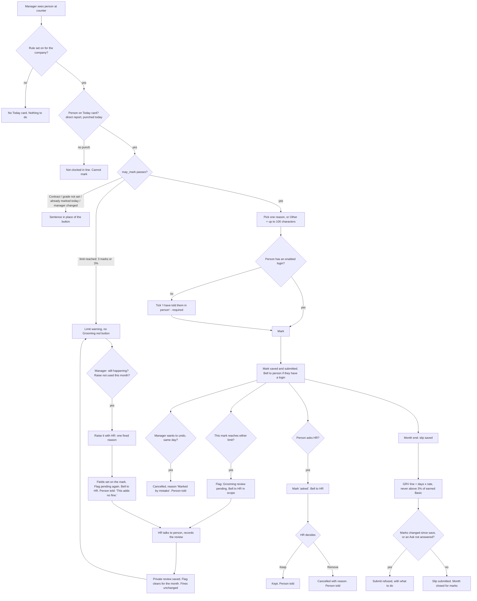

# 066 · Functional spec: the grooming red mark

**I am not a lawyer.** Every legal point here is flagged for counsel, not ruled.

## Read this first: bad news

1. **Three things Surbhi decided are not drawn in prototype v2.** (a) The **"Raise it with HR"**
   button and its sheet. (b) The **"Other" reason** with its text box. (c) The **3-mark limit**:
   v2 draws a "4th grooming red" state that can now never happen, and has no words for "3 marks,
   the most allowed". Prototype parity says each difference needs her yes. **US-17's screens, the
   "Other" box and the 3-mark wording must not be built until she says yes to the words in §14,
   or the designer draws prototype v3** (§9, D-6 to D-8). Their server rules can be built now.
2. **The "Other" box puts free text back on a mark.** 01c SEC-8 and SEC-11 forbade that, to stop
   comments about religion, health or looks. It is Surbhi's decision, and counsel has been told
   the list is now open text `[Stakeholder statement, relayed by the lead session; I have not seen
   counsel's reply]`. The guards are: 100 characters, a hint, never in any notice, locked after
   saving, and recorded. **A hint cannot stop someone typing "her headscarf".** Only HR reading
   the marks can catch it. Security must re-check this at `06`.
3. **The "raise" needs three fields on the mark, not two.** The brief says two (`raised_on`,
   `raised_by`). The manager also picks one reason, and that has to be stored somewhere. I added
   `raise_reason` (Q-11).
4. **The engineer's strategy (`04`) and the accepted prototype v2 disagree on who reads the review
   note.** `04` step 11 lets only HR read it. v2 (Y2, accepted) lets **HR in scope and the
   person's current direct manager** read it. This spec follows v2. `04` step 11 also allows one
   review per person per month; the raise needs a second. **The engineer must update step 11.**
5. **The "Grooming review pending" list is new code, not configuration** (v2 Y4, accepted). The
   flag is worked out, not stored, so Report Builder cannot filter on it. It needs one small
   script report.
6. **There is no `07-devops-inputs.md` for this slice.** So there are no `OPS` items to trace.
   The NFR numbers in §16 are mine, from `nfr-budget.md`, not DevOps'.

---

## 0 · What changed in revision 2

| # | Surbhi's decision (24 Oct 2026) | Where it lands |
|---|---|---|
| C1 | **At most 3 grooming marks per person per calendar month**, for every marker (HR's marks count too). A manager at the limit sees a warning and cannot mark more. The legal 3% stop stays as a backstop. The flag rises at the mark that reaches **either** limit, whichever comes first. Once cleared it never comes back in the same month (except through one raise, C3) | §5.3, R14, R12, US-10, US-14, AC-47 to AC-60 |
| C2 | Reasons: the fixed clothing list **plus "Other"** with a text box (100 characters at most; hint "Clothing or grooming only. Nothing about health or family."). Stored on the mark, never in a notice, recorded. Counsel told the list is now open text | §5.1, R15, US-13, AC-9a to AC-9e, §17 |
| C3 | Option A, **"Raise it with HR"**: a button on the limit warning; one reason from the fixed list (no "Other"); fields on the mark that reached the limit; bell to HR; flag back to pending; HR records the talk with the same "Record the review" sheet; HR can never add a mark beyond the limit; the employee is told in fixed words naming the manager, ending "This adds no fine."; one raise per person per month. An open employee "Ask HR" blocks the payslip submit; an unanswered raise does not | §7.7, US-17, US-8, AC-38a, AC-38b, AC-80 to AC-87 |
| C4 | The review note is **private and separate from manager notes** (ALV-216). The employee sees only "Action agreed on {date}" | §5.4, §7.6, US-15, AC-61 to AC-65 |
| C5 | **Prototype v2 accepted as drawn (Y1-Y7)** | §9 |
| Earlier, recorded in `04` §0.1 | D2 back-stop at pricing: yes. D3 HR also ticks "told in person": yes. D4 "unclean" dropped. D6 employee sees only "Action agreed on". D7 an owner with an HR role is HR. D8 no Hindi | Q-2, Q-3, Q-4, Q-7, Q-8, Q-10 closed |

---

## 1 · Reach

| App | Touched? | How |
|---|---|---|
| `alvoraa_portal` | **Yes, most of it** | Two new doctypes, `Grooming Mark` and `Grooming Review`; a new module `grooming.py` (rules, read gates, flag, notices, endpoints); `payroll_slip.py` (ENGINE_LINES, submit check); `payroll_month.py` (new figures); `attendance_correction.month()` (one call); `hooks.py` (permission hooks for both doctypes, Comment guard, Salary Slip before_submit); the workings report; one new script report "Grooming review pending"; `portal.js` |
| `hrms` | Read only | `access.py`: `permitted_employees`, `is_own_record`, `refuse_own_submit`, `refuse` reused unchanged |
| `erpnext` / `frappe` | Reused | `Additional Salary`, `Salary Slip`, `Salary Component`, `Notification Log`, `Comment` (guarded), Report Builder |
| `alvoraa_goals` | **Must not be touched** | Appraisals and goals must never read a mark or a review (PRIV-5) |
| `alvox_compensation` | No | - |

**Not changed any more:** `hr_api.py`. The review note is no longer a manager note (C4), so
`save_manager_note` and `delete_manager_note` stay as they are.

**HRMS domains:** attendance (punches, the day), payroll (one new slip line, the submit check),
org structure (`reports_to` decides the manager). Appraisals: explicitly fenced off.

**Personas:** store manager (marks, raises), HR Manager / HR User (marks, removes, answers, records
the review), employee (is marked, asks), Contract staff (never marked), CXO / owner / System
Manager (**neither marks nor reads**, unless they also hold an HR role - D7), colleagues and
skip-level managers (see nothing).

## 2 · Is this the real problem?

The brief names the cause: today a counter manager tells HR from memory at month end, and the
employee first hears of it when the salary is short. The fix is a same-day record the person is
told about. The limit and the flag answer "what happens after": at the limit, fines stop and HR
must hold a conversation. If it carries on, the manager asks HR again; that asks for a talk, never
for money. It drives a human action, not a dashboard. **Check, not a redo.**

---

## 3 · Gap analysis

| Requirement | What exists today (read in code) | Verdict | Cost |
|---|---|---|---|
| A daily record of who was marked, by whom, why | Nothing. "groom" appears in no app Python or JSON except a comment in `payroll_slip.py:62` and demo skill names | **Build new**: doctype `Grooming Mark`. Attendance cannot carry it: today's Attendance does not exist until the shift ends, and DTC deletes and rebuilds Attendance (brief §9) | M |
| Who may mark whom | `manager_scope.SCOPED_DOCTYPES` cannot say "today", "not yourself", "not Contract" and leaves the record open at DTC (01c §0.3) | **Extend**: one `may_mark` function; `has_permission` + `permission_query_conditions` hooks, same pair as Employee Checkin (`hooks.py:332-349`) | M |
| Price by grade | `month_summary` already reads `grade_field` and `mark_rates` | **Extend**: count the marks, multiply by the same rate | S |
| Contract not marked | Category `earns_marks` (`payroll_rules_apply.py`) | **Reuse** | - |
| One slip line | `ENGINE_LINES` + `_set_additional_salary` | **Extend**: one tuple row | S |
| Component `Grooming Red Value` | Exists at DTC, Deduction, ₹0 in the structure (01c §0.5, verified) | **Configure**: release check only | - |
| Workings report | Reds / Red deduction columns exist | **Extend**: two columns | S |
| Manager's Today list | `team_days` reads submitted Attendance only; `_punches_by_day` exists | **Extend**: own endpoint `grooming.today()` (04 step 5) | S |
| Employee sees it on the day | Attendance `month()`, open day box | **Extend** | S |
| Bell notices | `make_notification_logs`, already used in `leave_rules.py:239` | **Reuse**, copy built in code (01c PRIV-2) | S |
| "Ask HR to look at this" | Attendance correction: **rejected** - approving it marks the day Present | **Extend**: fields on the mark | S |
| 3 marks a month, for everyone (C1) | Nothing | **Extend**: one rule (R14) in `may_mark`, a constant 3 in code. No setting | S |
| Legal 3% stop | Nothing | **Extend**: R12 in `may_mark`, one clamp in `summarise_month` | S |
| Review flag | Nothing | **Extend**: worked out from the marks, reviews and raises; nothing stored | S |
| "Other" reason with text (C2) | Nothing | **Extend**: one option, one Data field on the mark | S |
| Private review note (C4) | Manager notes are `Info` comments on Employee, readable in the desk by the subject, all HR and System Manager (`04` bad news 1) | **Build new**: doctype `Grooming Review`. Cheaper rungs rejected in `04` §2: a manager note leaks; a permission-level field on the mark leaks through Version rows; a hidden comment type is readable through REST | S |
| "Raise it with HR" (C3) | The "asked" fields on the mark | **Extend**: three fields on the mark that reached the limit, one endpoint | S |
| "Grooming review pending" list (v2 Y4) | Report Builder cannot filter a worked-out flag | **Extend**: one small script report | S |
| HR views + export | Report Builder; DocPerm `export` | **Configure**: three saved views | S |
| Fines register export in a "prescribed form" | Unknown form | **Drop for now** - counsel (Q-C1) | - |
| Branch grooming trend for CXO | - | **Drop** (brief) | - |
| Employee Grievance for the raise (brief option B) | Frappe HR's `Employee Grievance`: desk-only, free text, a permanent "grievance against" record | **Drop**: Surbhi chose option A | - |

**Rung on the ladder: 5 (two new doctypes), plus rung 4 code and rung 2 configuration.** No new
app, page, settings page, job, cache or index.

---

## 4 · Process flow

Unhappy paths in words: network fails (sheet keeps the reason and the text, nothing saved); two
people mark the same person in the same second (pay, limit and flag count dates, not rows); a
manager leaves the page open past midnight (undo button gone on refresh; server refuses anyway); a
leave approved later covers a marked day (not charged); the person is changed to Contract before
payroll (charged ₹0); HR removes the mark that carried a raise (the raise goes with it, §5.3).

---

## 5 · Data model

### 5.1 New doctype `Grooming Mark` (module: Alvoraa Portal)

Settings: `is_submittable` 1, `track_changes` 1, `autoname` hash, `allow_import` 0,
`allow_rename` 0, `track_views` 0, no web view, no print format, no `email_append_to`, no field in
global search, `istable` 0.

| Fieldname | Label | Type | Mandatory | Default | Options / notes | Why no existing field carries it |
|---|---|---|---|---|---|---|
| `employee` | Employee | Link → Employee | Yes | - | `ignore_user_permissions` 1 (01c SEC-4) | New record |
| `employee_name` | Employee name | Data | No | - | `fetch_from employee.employee_name`, read-only. Only for HR views (PRIV-1) | Report Builder cannot show a linked name in a grouped view without it |
| `mark_date` | Date | Date | Yes | - | - | - |
| `reason` | Reason | Select | Yes | - | `Not in uniform` / `Uniform incomplete` / `No name badge` / `Wrong footwear` / `Other`. Equals the constant in code (SEC-11, D4) | - |
| `reason_other` | What was wrong | Data | When `reason` = Other | - | **Length 100.** `depends_on: eval:doc.reason=="Other"`, `mandatory_depends_on` the same. Read-only after submit. Server: required and not blank (after trimming) when Other; must be empty for any other reason; over 100 characters refused | C2: the "Other" text. Nothing else can hold a person's own words about the day |
| `marked_as` | Marked as | Select | - | - | `Manager` / `HR`, read-only, set by the server | Capacity is derived, never typed (SEC-1) |
| `told_in_person` | I have told them in person | Check | Required by the server when the subject has no enabled login (**both capacities**, D3) | 0 | Read-only after submit | Q3 / D3 |
| `asked_on` | Asked HR on | Datetime | No | - | `allow_on_submit` 1, read-only on the form | The "asked" state |
| `kept_by` | Kept by | Link → User | No | - | `allow_on_submit` 1, read-only | Employee is told who kept it |
| `kept_on` | Kept on | Datetime | No | - | `allow_on_submit` 1, read-only | "You checked it on Sat 24 Oct" |
| `raised_on` | Raised with HR on | Datetime | No | - | `allow_on_submit` 1, read-only. Set by the server only | C3: when the manager raised it |
| `raised_by` | Raised by | Link → User | No | - | `allow_on_submit` 1, read-only. Set by the server to the caller | C3: the employee and HR are told who raised it, even after the manager changes |
| `raise_reason` | Raise reason | Select | No | - | The four fixed reasons only, **never Other**. `allow_on_submit` 1, read-only | C3: the one reason the manager picks. See bad news 3, Q-11 |
| `removal_reason` | Why removed | Select | Required on cancel | - | `Marked by mistake` / `Marked on the wrong person` / `The employee showed it was wrong`. `allow_on_submit` 1 | PRIV-3 |

Who marked and when: Frappe's `owner` and `creation`. Who removed and when: `modified_by` /
`modified` on cancel, plus the Version row. **Not stored:** company, branch, grade, rupee amount,
photo.

**Deltas to 01c (security must re-check at `06`):**
- `asked_on`, `kept_by`, `kept_on`, `raised_on`, `raised_by`, `raise_reason` are written after
  submit, so the `Employee` and HR roles need `write`, narrowed by the controller (§7.4). 01c SEC-4
  said "nobody writes after submit except the removal reason".
- `reason_other` is free text on the mark. 01c SEC-8 and SEC-11 said no free text (C2).

### 5.2 Changed, not new

| Where | Change |
|---|---|
| `payroll_month.MonthSummary` | Figures `grooming_days` (int), `grooming_deduction` (float), `grooming_capped` (bool). `net` also subtracts `grooming_deduction` |
| `summarise_month(...)` | Inputs `grooming_days=0`, `grooming_rate=0` (04 step 9). Output per §8 |
| `payroll_slip.ENGINE_LINES` | Add `("Grooming Red Value", "grooming_deduction")` |
| `payroll_slip.month_summary` | Counts the subject's submitted marks in the period (§8) |
| Salary Slip `before_submit` | New check: grooming figure changed, or an "Ask HR" not answered (§8) |
| Workings report | Columns `grooming_days` "Grooming reds" (Int), `grooming_deduction` "Grooming deduction" (Currency), after "Red deduction" |
| `hr_api.py` | **Nothing** (C4) |
| Employee | **Nothing.** No field, no flag stored on the profile |

### 5.3 The limit and the review flag: worked out, not stored

For person P and calendar month M (by `mark_date`):

- **Live marks** = submitted (`docstatus` 1) marks of P in M, counted by **distinct date**.
  Marks by managers and by HR count the same (C1).
- **Marks the law allows** = the largest whole number n with n × rate ≤ 3% × `base` (§7.2).
- **The limit** = the smaller of **3** and the marks the law allows.
- **Limit reached** when live marks ≥ the limit and live marks ≥ 1.
- **Which limit:** "3 marks" when live marks = 3; otherwise "the legal limit".
- The flag is **pending** when either is true:
  1. **Limit part:** the limit is reached **and** no `Grooming Review` exists for P and M.
  2. **Raise part:** a live mark of P in M has `raised_on` set **and** no `Grooming Review` for P
     and M has `creation` later than `raised_on` **and** P is Active **and** the Employee linked to
     `raised_by` is still P's `reports_to`.
- **Once any review exists for P and M, the limit part never returns in M** - not even if a mark is
  removed and a new one brings P back to the limit (C1). Only the one raise can make it pending
  again.
- If a mark is removed before a review and P drops below the limit, the limit part goes away by
  itself. If the mark carrying the raise is removed, the raise part goes too.
- **Carry-over:** a flag still pending on the 1st is shown for last month as well (04 Q6, **not yet
  answered**; recommendation: last month only).
- The rate and `base` are read when the flag is read, so a grade change mid-month moves the legal
  limit. Live marks never exceed it at the time they are made (R12).

**Worked examples (Sample fixture, §11):**

| Person | Rate | Basic | 3% limit | Marks the law allows | The limit | Flag rises at | Which |
|---|---|---|---|---|---|---|---|
| Aman, Junior | ₹100 | ₹12,000 | ₹360 | 3 | 3 | 3rd mark | 3 marks |
| Kiran, Junior | ₹100 | ₹15,000 | ₹450 | 4 | 3 | 3rd mark | 3 marks |
| Rahul, Senior | ₹200 | ₹18,000 | ₹540 | 2 | 2 | 2nd mark | legal limit |
| A Senior | ₹200 | ₹20,000 | ₹600 | 3 | 3 | 3rd mark | 3 marks |

Why worked out: no new field, no job, and it cannot drift from the marks.

### 5.4 New doctype `Grooming Review` (module: Alvoraa Portal) - the private review note (C4)

From `04` step 11, with two changes noted below. One row each time HR records a review.

Settings: not submittable, **`track_changes` 0** (so no Version row ever holds the text),
`track_views` 0, `allow_import` 0, `allow_rename` 0, no web view, no print format, nothing in
global search, `autoname` hash.

| Fieldname | Label | Type | Mandatory | Notes |
|---|---|---|---|---|
| `employee` | Employee | Link → Employee | Yes | `ignore_user_permissions` 1 |
| `review_month` | Month | Date | Yes | The 1st of the month the flag belongs to |
| `review_note` | What you talked about and the action plan | Small Text | Yes | Not blank after trimming |

Who and when: `owner`, `creation`. **Nobody can edit or delete it** (no DocPerm write or delete).

**Changes from `04` step 11:**
- **Readers:** HR in scope (not the subject) **and the subject's current Active direct manager**
  (v2 Y2, accepted). `04` said HR only.
- **How many:** up to two for P and M - one for the limit, one after the raise. The controller
  rule "a flag is pending for P and M" is enough; drop `04`'s "no review exists yet" rule.

It does **not** appear in Team → Manager Notes (that list reads Comments). It is separate from
manager notes; the leak in existing manager notes is ALV-216, not this slice.

---

## 6 · States and transitions of a mark

| State | How it is reached | Who | Next states | Read-only | Notified |
|---|---|---|---|---|---|
| Live | Mark + submit in one action (`docstatus` 1) | Direct manager (today), HR in scope (this month) | Asked, Raised, Removed | Everything except `asked_on`, `kept_*`, `raised_*`, `raise_reason`, `removal_reason` | Subject (bell); HR in scope if this mark reaches the limit |
| Asked | Subject presses "Ask HR to look at this" (`asked_on` set) | Subject only, once | Kept, Removed | as above, less `asked_on` | HR in scope (bell) |
| Kept | HR presses "Keep it and tell [name]" (`kept_by`, `kept_on` set) | HR in scope | Removed | as above, less `kept_*` | Subject (bell) |
| Raised (a note on the mark, not a change to the fine) | Manager presses "Raise it with HR" (`raised_*`, `raise_reason` set) on the mark that reached the limit | Current direct manager, once per person per month | Stays live; can still be Asked, Kept or Removed | `raised_*`, `raise_reason` from then on | HR in scope (bell); subject (bell) |
| Removed | Cancel with a removal reason (`docstatus` 2) | Marker as manager (same day), HR in scope (until slip) | **Terminal** | All | Subject (bell) |

- A draft exists only inside the one call that marks. A draft left by a REST client is checked
  again on submit (SEC-3).
- **Terminal:** Removed. Not reversible. To mark again, make a new mark (allowed, SEC-2, within
  the limit).
- **Amend:** refused for everyone. **Delete:** no role has it.
- **Month closed:** once a submitted Salary Slip covers the date, no mark, ask, keep or remove.
  A raise is only ever made in the current month (R-R3 below).

---

## 7 · Rules

### 7.1 `may_mark(employee, date, user)` - the only definition (SEC-1)

Returns `Manager`, `HR`, or a refusal with a code and a sentence. Called by the controller on
`validate` and `before_submit`, and by every screen to set `can_mark`.

| # | Rule | Refusal sentence (manager / HR) |
|---|---|---|
| R1 | Rule set enabled for the subject's company (`rule_set_for`) | No button, no card (SEC-6). Server: "Grooming reds are not switched on for this company." |
| R2 | Caller is not `Administrator` and not the subject (`is_own_record`) | "You cannot mark yourself." |
| R3 | Subject `status` = Active and `date` ≥ `date_of_joining` | "[Name] is not an active employee on this day." |
| R4 | Subject's category has `earns_marks` (DTC: Contract has 0) | "Contract staff are not given grooming reds." |
| R5 | Subject's grade has a `mark_rates` row with amount > 0 | Manager: "[Name]'s grade is not set, so a grooming red cannot be priced. Ask HR to set it." HR: "[Name]'s grade is not set, so a grooming red would cost nothing and cannot be marked. Set [Name]'s grade on his employee record first." |
| R6 | Capacity. **Manager** if the caller's Active Employee is the subject's `reports_to`. Else **HR** if the caller holds HR Manager or HR User, the subject is in `permitted_employees(user)`, and the caller's linked Employee (if any) is Active. **System Manager alone is not HR**; an owner with an HR role is HR (D7). Else refused | "Only [Name]'s current manager or HR can mark [him/her/them]." |
| R7 | Manager: `date` = today (site time zone). HR: `date` from the 1st of the current calendar month to today | Manager: no button. HR: "Marks can be added only for days in this month." |
| R8 | At least one Employee Checkin for the subject on `date` | "[Name] has no punch on this day, so there is nothing to mark. A grooming red is only for a day somebody came to work." |
| R9 | No submitted Attendance with status `On Leave` on `date` | "[Name] was on leave all day ([leave type]), so there is nothing to mark." (HR only sees the leave type) |
| R10 | No other live or draft mark for the subject on `date` | "[Name] already has a grooming red today." |
| R11 | No submitted Salary Slip of the subject covers `date` | "[Name]'s pay slip for [Month] is submitted, so grooming reds for [Month] are closed." |
| **R14** | **3-mark limit (C1).** Live marks in the month of `date` < 3. Applies to both capacities. Checked before R12 | Manager (limit warning, §14 W1): "[Name] has had 3 grooming reds this month, the most allowed. HR has been told and will talk to [Name]. If it carries on, you can raise it with HR." HR: "[Name] has had 3 grooming reds this month, the most allowed, so this one cannot be marked." **Not drawn - D-8** |
| R12 | **Legal limit (backstop).** (live marks this month + 1) × rate ≤ 3% × `base` (§7.2) | Manager: "[Name] has reached the most grooming reds the law allows this month, so this one cannot be marked." (drawn in v2) plus " HR has been told and will talk to [Name]. If it carries on, you can raise it with HR." (**not drawn - D-7**). HR: v2's sentence plus "(limit ₹[X] = 3% of Basic ₹[B])" (drawn) |
| R13 | Subject has no enabled login: `told_in_person` = 1 (**both capacities**, D3) | "Tick the box to confirm you told [Name] in person." |
| R15 | `reason` is one of the five values. When `Other`: `reason_other` not blank, ≤ 100 characters. Otherwise `reason_other` empty | "Choose a reason first." / "Write what was wrong first." / "Keep it to 100 characters." |

`marked_as` is set from R6. Any `marked_as` in a request body is ignored. **No rule, role or
setting lets anyone, HR included, add a mark beyond R14 or R12.**

### 7.2 The legal limit

- `base` = the `base` of the subject's latest submitted Salary Structure Assignment with
  `from_date` ≤ the last day of the mark's month. The same query `month_summary` uses.
- Limit = 3% × `base`, to 2 decimals. No assignment → `base` 0 → limit 0 → every mark refused
  (R12). `[ASSUMPTION - interim figure until counsel says what "wages payable" is, Q-C1]`
- Back-stop at pricing (01c SEC-10, D2): `grooming_deduction` = min(days × rate, 3% ×
  `earning_basic`). When it bites, the report's Why says "3 grooming reds at ₹100, capped at ₹270
  by the legal limit."

### 7.3 Removal (SEC-5)

Allowed on `before_cancel` only when the caller is not the subject, a `removal_reason` is given,
no submitted slip covers the date, and either:
- the caller is the mark's `owner`, `marked_as` = Manager, and `mark_date` = today; the reason is
  set by the server to `Marked by mistake` (undo has no sheet), or
- the caller passes R6's HR branch for the subject.

### 7.4 Writes after submit (`before_update_after_submit`)

Only these changes pass. Any other changed field is refused.

| Change | Allowed when |
|---|---|
| `asked_on` blank → now | Caller is the subject; mark is live; `asked_on` blank; no submitted slip covers the date |
| `kept_by`, `kept_on` blank → caller, now | Caller is HR for the subject (R6, not self); `asked_on` set; `kept_on` blank; month open |
| `raised_on`, `raised_by`, `raise_reason` blank → now, caller, one fixed reason | §7.7 |
| `removal_reason` | Only during cancel |

### 7.5 Who sees a mark (SEC-4)

A reader passes when one holds: (1) they are the subject; (2) they are the `owner`; (3) they are
the subject's current Active direct manager and `mark_date` is today; (4) they pass R6's HR branch
for the subject. Nobody else. The list condition matches no rows, never "no condition".
`Administrator` bypasses hooks; it is our own operator login, not a tenant user (known limit,
§17.3). `reason_other` follows the same gate: subject, marker, HR in scope.

### 7.6 Who sees the flag, the raise and the review note

| Who | "Grooming review pending" | The raise line (who, when, reason) | The review note text | Records the review |
|---|---|---|---|---|
| The subject | Yes, on their own month | No. Only N8's fixed words | **No.** Only "Action agreed on {date}" (D6) | No |
| A marker (owner of a live mark in the month) who is not the direct manager | Yes, on the person's month | No | **No** (v2 Y2) | No |
| The current Active direct manager | Yes, on the person's month | Yes, their own raise | **Yes** (v2 Y2) | No |
| HR in scope (R6 HR branch, not self) | Yes, with **Record the review** | Yes | **Yes** | **Yes** |
| Skip-level manager, colleague, owner / System Manager without an HR role, org chart, directory, appraisals, goals, feedback, Team View counts | **No** | No | No | No |

Recording (`grooming.record_review(employee, month, note)`, POST): the caller passes R6's HR branch
for the subject and is not the subject; the flag is pending for that person and month; the note is
not blank. `owner` and `creation` are set by Frappe; any date sent is ignored. **Recording never
cancels, changes or reprices a mark.** It clears both parts of the flag that are pending at that
moment.

### 7.7 "Raise it with HR" (C3) - `grooming.raise_with_hr(employee, reason)`, POST

All must hold, else refused with the sentence shown:

| # | Rule | Refusal sentence |
|---|---|---|
| R-R1 | Caller passes R6 as **Manager** (current Active direct manager). HR cannot raise (it is a message to HR) | "Only [Name]'s current manager can raise this with HR." |
| R-R2 | Caller is not the subject; subject is Active | "You cannot raise this for yourself." / "[Name] is not an active employee." |
| R-R3 | The limit (§5.3) is reached for the subject in the **current** calendar month | "[Name] has not reached this month's limit, so there is nothing to raise." |
| R-R4 | No mark of the subject in the current month has `raised_on` set, whatever its state (one raise per person per month) | "You have already raised [Name]'s grooming with HR this month." |
| R-R5 | `reason` is one of the four fixed reasons. `Other` and any text are refused | "Choose a reason first." |

On success, on the subject's **latest live mark of the month** (the one that reached the limit):
`raised_on` = now, `raised_by` = caller, `raise_reason` = the reason. Saved as the caller (no
bypass). No new mark, no change to any fine, no Additional Salary touched. Then N7 to HR in scope
and N8 to the subject (if they have an enabled login and are Active).

The raise is allowed whether the flag is still pending or already cleared. If still pending, one
review clears both parts (AC-86).

---

## 8 · Pay: `ENGINE_LINES` and the slip

| Step | What happens | Agreement rule |
|---|---|---|
| Count | `month_summary` reads the subject's submitted marks in `[start_date, end_date]`, by distinct `mark_date`, excluding dates whose submitted Attendance is `On Leave` or `Absent` (full day). Half Day is charged | Same function feeds slip, workings report and the employee's tile |
| Price | `grooming_deduction` = `grooming_days` × the grade's `amount_per_mark`; 0 when `earns_marks` is 0; then the back-stop clamp (§7.2). **No free allowance**. At most 3 days can exist (R14) | Rate read at pricing, never stored |
| Line | `ENGINE_LINES` gains `("Grooming Red Value", "grooming_deduction")`. One engine-made Additional Salary per person per month; same amount: nothing written; new amount: old cancelled, new amended; 0: cancelled | One line a month |
| Net | `net` = gross − red − grooming − other | Report and slip agree |
| Failure | Existing savepoint rolls back all engine lines. Note wording: "red, green and grooming lines" | - |
| Submit check (1) | Salary Slip `before_submit` (only where the rule set is on): recompute `grooming_deduction`; if it differs from the slip's live `Grooming Red Value` row, refuse: "Grooming marks changed since this slip was saved. Save it again." | Fails closed |
| **Submit check (2) (C3)** | Same hook: if any live mark of the slip's employee in the slip period has `asked_on` set and `kept_on` blank, refuse: "[Name] asked HR to look at the grooming red on [Day]. Keep or remove it first." | A fine is not paid out with the dispute unread |
| Not a check | An unanswered raise **never** blocks a slip. It adds no money | - |
| After submit | R11 and §7.3 close the month for marks | - |
| Ceiling | `payroll_slip.py` added to the SEC-16 `ignore_permissions` ceiling list at **2**. No new bypass | 01c SEC-12 |

Payroll Entry catches a refusal per slip and submits the rest (`payroll_entry.py:1686-1690`, read
in `04`).

---

## 9 · Prototype parity table

The approved picture is now **prototype v2** (Surbhi accepted it as drawn, Y1-Y7). "Same" = build
exactly as drawn. "**D-n**" = a difference. **Open differences need Surbhi's yes, or prototype v3.**

### 9.1 Differences, closed and open

| # | Difference | State |
|---|---|---|
| D-1 | Reason list: the drawing has "Uniform incomplete or unclean"; build has "Uniform incomplete" | **Closed** - her decision D4 |
| D-2 | HR's no-login tick | **Closed** - D3, and drawn in v2 (P56) |
| D-3 | v1's employee "Legal limit reached" state shows 5 marks; with the stop and the 3-mark limit that can never exist. Kept only for the back-stop case, with real figures (at most 3 marks) | **Open, unchanged from revision 1** - needs her yes |
| D-4 | No Hindi in this slice | **Closed** - D8 |
| D-5 | Review flag, review sheet, review bell | **Closed** - drawn in v2 |
| **D-6** | **"Other" reason and its text box** in the mark sheet (manager and HR); the "Other: [text]" line on the day box; N1's wording for Other | **Open - not drawn.** Words in §14 |
| **D-7** | **"Raise it with HR"**: the button and the added sentence on the limit warning; the raise sheet; the "Raised with HR on…" row lines; the raise line on HR's review; a "Raised again" row in the review-pending list; the bells N7 and N8 | **Open - not drawn.** Words in §14 |
| **D-8** | **3-mark limit wording**: Today card warning (W1), HR box refusal (W2), manager and HR flag lines for "3 marks" (F1, F2), the employee flag line with **3** in place of v2's **4** (P62), the "Why it was raised" value in the review-pending list (P60) | **Open - not drawn.** Words in §14 |

### 9.2 Every feature in prototype v2

| # | Prototype feature (person → state) | Story | ACs | Parity |
|---|---|---|---|---|
| P1 | Manager → Today card heading, sub-heading, help line, above the filters | US-1 | AC-1, AC-2 | Same |
| P2 | Manager → Loading | US-1 | AC-3 | Same |
| P3 | Manager → Nobody clocked in | US-1 | AC-4 | Same |
| P4 | Manager → "Asha Rani and 1 other have not clocked in today…" | US-1 | AC-5 | Same |
| P5 | Manager → Nobody reports to me | US-1 | AC-6 | Same |
| P6 | Manager → count line | US-1 | AC-7 | Same |
| P7 | Manager → row button "Grooming red", spoken name | US-2 | AC-8 | Same |
| P8 | Reason sheet: heading, help, reasons, info line, buttons | US-2, US-13 | AC-9, AC-9a-e, AC-10 | D-1 closed; **D-6 open** (Other) |
| P9 | Sheet → "Choose a reason first." | US-2 | AC-11 | Same |
| P10 | Sheet → no login: sentence + required tick | US-2 | AC-12, AC-13 | Same |
| P11 | Sheet → network failure, "Try again", reason kept | US-2 | AC-14 | Same (Other text also kept) |
| P12 | Sheet → "Saving…" | US-2 | AC-15 | Same |
| P13 | Row → marked by me | US-2 | AC-16 | Same |
| P14 | Row → marked by me, no login (amber) | US-2 | AC-17 | Same |
| P15 | Row → grade not set | US-9 | AC-41 | Same |
| P16 | Row → Contract | US-9 | AC-39 | Same |
| P17 | Row → half-day leave sub-line | US-1 | AC-18 | Same |
| P18 | Row → marked by HR | US-1 | AC-19 | Same |
| P19 | Undo → removed lines | US-3 | AC-20, AC-21 | Same |
| P20 | Row → after midnight | US-3 | AC-22 | Same |
| P21 | Manager → Rahul's month: tag, box, Undo, no money | US-6 | AC-30 | Same |
| P22 | HR → day with no mark | US-4 | AC-23 | Same |
| P23 | HR → sheet "…on Wed 21 Oct?", "You are marking as HR." | US-4 | AC-24 | Same; no-login variant is P56 |
| P24 | HR → "Saved. Rahul has been told…" | US-4 | AC-25 | Same |
| P25 | HR → no reporting manager | US-4 | AC-26 | Same |
| P26 | HR → a day last month | US-4 | AC-27 | Same |
| P27 | HR → grade not set | US-9 | AC-41 | Same |
| P28 | HR → Contract | US-9 | AC-39 | Same |
| P29 | HR → month closed | US-9 | AC-44 | Same |
| P30 | HR → day on leave | US-9 | AC-43 | Same |
| P31 | HR → no punch | US-9 | AC-42 | Same |
| P32 | HR → marked: "Remove this mark" | US-5 | AC-28 | Same |
| P33 | Remove sheet | US-5 | AC-28, AC-29 | Same |
| P34 | HR → "Removed. Rahul has been told…" | US-5 | AC-28 | Same |
| P35 | HR → employee asked | US-8 | AC-35 | Same |
| P36 | Keep sheet with amount | US-8 | AC-36 | Same |
| P37 | HR → kept | US-8 | AC-36 | Same |
| P38 | HR → own record shows the employee view | US-9 | AC-45 | Same |
| P39 | HR → desk view "Marks per marker per month" | US-16 | AC-66 | Same |
| P40 | HR → desk view "Asked to look at, not yet answered" | US-16 | AC-67 | Same |
| P41 | Employee → bell notice, tap opens the day | US-7 | AC-33, AC-34 | Same (Other variant: D-6) |
| P42 | Employee → day box | US-6 | AC-31 | Same (Other variant: D-6) |
| P43 | Employee → month tile | US-6 | AC-32 | Same |
| P44 | Employee → ask sheet | US-8 | AC-37 | Same |
| P45 | Employee → "You asked HR…" | US-8 | AC-37 | Same |
| P46 | Employee → kept | US-8 | AC-36 | Same |
| P47 | Employee → removed by HR | US-5 | AC-28 | Same |
| P48 | Employee → undone by manager | US-3 | AC-20 | Same |
| P49 | Employee → "Legal limit reached": 5 marks | US-11 | AC-50 | **D-3 open** |
| P50 | Contract → nothing about grooming | US-6 | AC-40 | Same |
| P51 | Hindi | - | - | D-4 closed: English only |
| P52 | Light / dark, phone / desktop | All | AC-71 | Same |
| P53 | v2 · Manager → Today card, limit reached (legal) | US-10, US-17 | AC-48, AC-80 | Same for v2's sentence; **D-7 open** for the added sentence and the button; **D-8 open** for the 3-mark variant |
| P54 | v2 · Manager → Rahul's month, review pending | US-14 | AC-55a | Same (legal); **D-8** for the 3-mark variant |
| P55 | v2 · Manager → review recorded, reads HR's note | US-15 | AC-64 | Same |
| P56 | v2 · HR → no login: "I have told Rahul in person" tick | US-4 | AC-12a | Same |
| P57 | v2 · HR → limit reached + review pending + "Record the review" sheet | US-14, US-15 | AC-48, AC-55a, AC-61 | Same (legal); **D-8** for the 3-mark variant; **D-7** for the raise line |
| P58 | v2 · HR → review recorded | US-15 | AC-62 | Same |
| P59 | v2 · HR → view "People with grooming reds this month" | US-16 | AC-66a | Same (its sample row "Kiran 4" cannot happen now; sample only) |
| P60 | v2 · HR → view "Grooming review pending" (script report) | US-16 | AC-67a | Same, except **D-8** ("4th grooming red" becomes "3 grooming reds, the most allowed") and **D-7** ("Raised again by [Manager]") |
| P61 | v2 · Employee → review pending (legal limit) | US-14 | AC-55a | Same |
| P62 | v2 · Employee → review pending (4th grooming red) | US-14 | AC-55 | **D-8 open**: can never happen; replaced by the 3rd-mark wording |
| P63 | v2 · Employee → "Action agreed on Sat 24 Oct" | US-15 | AC-64 | Same |
| Y5 | Words only: employee and HR bells when the legal limit raises the flag | US-14 | AC-55a | Accepted (Y5) |
| Y6 | Review note guidance names religion | US-15 | AC-61 | Accepted (Y6) |
| - | **Not in v2:** the raise button and sheet, the "Other" box, the 3-mark words | US-17, US-13, US-10, US-14 | AC-80-87, AC-9a-e, AC-47, AC-55 | **D-6, D-7, D-8: need her yes or prototype v3** |

---

## 10 · Epic and user stories

Epic: **Grooming red mark, from the counter to the payslip, with a same-day notice, a monthly
limit, and a review when it keeps happening.**

| ID | Story | Pts | Prototype | Carries | ACs |
|---|---|---|---|---|---|
| US-1 | As a **store manager**, I want a Today card of my direct reports who have clocked in, so that I can mark someone on the spot | 3 | P1-P6, P17, P18 | SEC-4, SEC-6 | AC-1 to AC-7, AC-2a, AC-18, AC-19 |
| US-2 | As a **store manager**, I want to mark one direct report for today with one reason, so that the rule is applied the same way every time | 5 | P7-P14 | SEC-1, SEC-2, SEC-3, SEC-11, PRIV-2 | AC-8 to AC-17, AC-10a, AC-10b |
| US-3 | As a **store manager**, I want to undo my own mark until midnight, so that a slip of the thumb costs nobody money | 2 | P19, P20, P48 | SEC-5, PRIV-3 | AC-20 to AC-22a |
| US-4 | As an **HR Manager**, I want to mark any open day this month for anyone in my scope, so that I can enforce the rule where no manager did | 3 | P22-P26, P56 | SEC-1, SEC-3, PRIV-2 | AC-12a, AC-23 to AC-27 |
| US-5 | As an **HR Manager**, I want to remove a mark with a fixed reason until the slip is submitted, so that a wrong fine is withdrawn and the trail stays | 3 | P32-P34, P47 | SEC-5, PRIV-3 | AC-28, AC-29 |
| US-6 | As an **employee**, I want to see my own mark on that day with who, why and what it costs, so that a pay cut is never a surprise | 3 | P21, P42, P43, P50 | PRIV-2 | AC-30 to AC-32, AC-40 |
| US-7 | As an **employee with a login**, I want a bell notice the same day, so that I hear of it before payday | 2 | P41 | PRIV-2 | AC-33, AC-33a, AC-34 |
| US-8 | As an **employee**, I want to ask HR to look at a mark, hear back either way, and not be paid short while HR has not answered, so that I can contest it | 5 | P35-P37, P44-P46 | Q1, C3 | AC-35 to AC-38b |
| US-9 | As an **employee**, I must not be marked when the rules say no, so that a fine is only ever lawful under DTC's rule | 5 | P15, P16, P27-P31, P38 | SEC-1, SEC-3, SEC-6, SEC-7 | AC-39 to AC-46 |
| US-10 | As an **employee**, I must not get more than 3 grooming reds a month, or be fined above 3% of my wages, from anyone, so that the fine stays within DTC's rule and the law | 3 | P53 (D-7, D-8) | SEC-10, C1 | AC-47 to AC-49 |
| US-11 | As an **HR Manager**, I want the month's grooming total on one slip line and in the workings report, so that the slip and the register agree | 5 | P49 (D-3) | SEC-9, SEC-12 | AC-50 to AC-54 |
| US-12 | As an **employee**, I must not have my marks read by colleagues, skip-level managers or the owner, so that a judgement about my appearance stays private | 5 | - | SEC-4, SEC-8, SEC-12, PRIV-5, PRIV-7 | AC-68 to AC-70, AC-72 to AC-75 |
| US-13 | As an **employee**, I must not have a changed reason, a comment, or an "Other" text longer than 100 characters attached to my mark, and the text must never travel in a notice, so that what is written about me stays small, fixed and seen only by those who must | 3 | P8 (D-6) | SEC-8, SEC-11, PRIV-1, PRIV-3, C2 | AC-9a to AC-9e, AC-76 to AC-79 |
| US-14 | As an **HR Manager**, I want a "Grooming review pending" flag at the mark that reaches either limit, so that I know to talk to the person | 5 | P54, P57, P61, P62 (D-8), Y5 | C1 | AC-55 to AC-60 |
| US-15 | As an **HR Manager**, I want to clear the flag by writing one private review note that the manager can read and the employee sees only as "Action agreed on {date}", so that the conversation and plan are on record and the fines stay | 5 | P55, P57, P58, P63, Y6 | C4 | AC-61 to AC-65 |
| US-16 | As an **HR Manager**, I want three saved views, a "Grooming review pending" list and an export, so that I can check markers, find who needs a talk, and keep the fines register | 3 | P39, P40, P59, P60 | PRIV-6, Q-C1 | AC-66, AC-66a, AC-67, AC-67a |
| US-17 | As a **store manager**, I want to raise it with HR once a month when someone at the limit carries on, so that HR talks to them again - and the person must not be fined more for it | 5 | Not drawn (D-7) | C3 | AC-80 to AC-87 |

**Total: 65 points.** No 8s. US-17 depends on US-10 and US-14. US-15 depends on US-14. US-8's
slip block depends on US-11's submit hook.

**INVEST notes:** US-1 to US-3 and US-6/US-7 are the thin end-to-end path. US-11 is testable alone
with marks written in a fixture. US-17's server half is testable before v3; its screen waits for
D-7.

### YouTrack-ready table (do not create; Surbhi's call)

| Summary | Description | Persona | Points | ACs | Requirements |
|---|---|---|---|---|---|
| 066 US-1 Today card on Whole team | Direct reports with a punch today, above the filters | Store manager | 3 | AC-1-7, 2a, 18, 19 | SEC-4, SEC-6 |
| 066 US-2 Mark today with a reason | One mark per person per day, told tick when no login | Store manager | 5 | AC-8-17, 10a, 10b | SEC-1-3, SEC-11, PRIV-2 |
| 066 US-3 Undo own mark until midnight | Cancel with "Marked by mistake" | Store manager | 2 | AC-20-22a | SEC-5, PRIV-3 |
| 066 US-4 HR marks an open day | This calendar month, in scope, told tick | HR Manager | 3 | AC-12a, 23-27 | SEC-1, SEC-3, PRIV-2 |
| 066 US-5 HR removes a mark | Cancel with fixed reason until slip | HR Manager | 3 | AC-28-29 | SEC-5, PRIV-3 |
| 066 US-6 Employee sees own mark and amount | Tag, box, tile; Contract sees nothing | Employee | 3 | AC-30-32, 40 | PRIV-2 |
| 066 US-7 Same-day bell to the employee | Fixed copy built in code | Employee | 2 | AC-33, 33a, 34 | PRIV-2 |
| 066 US-8 Ask HR, Keep or Remove; slip waits | Asked state, bells both ways, open ask blocks slip submit | Employee, HR | 5 | AC-35-38b | Q1, C3 |
| 066 US-9 Marks the rules forbid are refused | may_mark on every door | Employee | 5 | AC-39-46 | SEC-1, 3, 6, 7 |
| 066 US-10 3 marks a month and the 3% stop | Refuse the mark past either limit, for everyone | Employee | 3 | AC-47-49 | SEC-10, C1 |
| 066 US-11 GRV slip line and report columns | ENGINE_LINES row, submit check | HR Manager | 5 | AC-50-54 | SEC-9, SEC-12 |
| 066 US-12 Read gate on the mark | Own hooks, not SCOPED_DOCTYPES | Employee | 5 | AC-68-70, 72-75 | SEC-4, 8, 12, PRIV-5, 7 |
| 066 US-13 Fixed reasons plus a short Other | 100 characters, never in notices, locked | Employee | 3 | AC-9a-e, 76-79 | SEC-8, 11, PRIV-1, 3, C2 |
| 066 US-14 Grooming review flag | At the mark that reaches either limit | HR Manager | 5 | AC-55-60 | C1 |
| 066 US-15 Private review note | Grooming Review record; employee sees the date only | HR Manager | 5 | AC-61-65 | C4 |
| 066 US-16 Views, review-pending list, export | Three saved views + one script report | HR Manager | 3 | AC-66, 66a, 67, 67a | PRIV-6 |
| 066 US-17 Raise it with HR | Three fields on the mark, once a month, no fine | Store manager | 5 | AC-80-87 | C3 |

---

## 11 · Acceptance criteria

**Fixture used below (all Sample):** company DTC Sample with an **enabled** rule set (Junior ₹100,
Senior ₹200, No leaves ₹0; Contract `earns_marks` 0); site time zone Asia/Kolkata; today Sat 24 Oct
2026. Ravi Kumar (manager, login). Reports to Ravi: Rahul Sharma (Senior, Basic ₹18,000, login),
Aman Verma (Junior, Basic ₹12,000, no login), Kiran Bala (Junior, Basic ₹15,000, login, half-day
leave this afternoon), Geeta Devi (Contract), Asha Rani (no punch today), Mohan Lal (grade blank).
Ritika Mehra (HR Manager, Employee Active, company permission DTC Sample). Neha Singh (manager of
another team). Sunil (Ravi's manager, skip-level for Rahul). Owner Om (System Manager only).

### US-1 Today card

- **AC-1** Given Ravi on a phone (390 px) opens Attendance → Whole team, when the page loads, then
  a card headed "Today · Sat 24 Oct · Grooming red" with sub-heading "Your direct reports who have
  clocked in" appears **above** the From/To/Person/Group by/Show filters.
- **AC-2** Given the card, then it lists exactly Rahul, Aman, Kiran, Geeta, Mohan, sorted by name,
  each with job title and "Clocked in HH:MM" of the first punch; Asha is not a row.
- **AC-2a** Given the company's rule set is disabled (draft) or absent, then no Today card is shown
  to anyone (SEC-6).
- **AC-3** Given the server has not answered yet, then three grey bars and "Loading today's
  people…" show within 300 ms.
- **AC-4** Given none of Ravi's reports has punched today, then the card says "None of your people
  have clocked in yet today. They appear here after their first punch."
- **AC-5** Given Asha has no punch today, then the card ends with "Asha Rani have not clocked in
  today, so they cannot be marked yet." (with "and N other(s)" when more than one).
- **AC-6** Given a login with no direct reports opens Whole team, then no Today card appears and
  "Nobody reports to you, so there is nothing to review here." is unchanged.
- **AC-7** Given Ravi has 3 live marks this month (one cancelled mark not counted), then the
  card's last line is "You have marked 3 grooming reds this month." with no name and no ₹.
- **AC-18** Given Kiran has a half-day leave this afternoon and punched in, then her row shows
  "Half-day leave this afternoon" (no leave type) and a "Grooming red" button.
- **AC-19** Given Ritika marked Rahul today at 11:05, then Rahul's row shows the tag, the reason,
  "Marked by Ritika Mehra (HR) at 11:05. Only HR can remove it." and no button.

### US-2 Manager marks

- **AC-8** Given Rahul's row, then the button reads "Grooming red" and its accessible name is
  "Mark a grooming red for Rahul Sharma".
- **AC-9** Given Ravi taps it, then a sheet opens with heading "Grooming red for Rahul Sharma
  today?", help "Choose the one reason that fits. You cannot add your own words." (**D-6**: with
  "Other" this help line is no longer true; proposed new help in §14 C-2), the five reasons as a
  radio group (48 px rows), focus on the heading; Escape/Cancel closes it and returns focus.
- **AC-10** Given Rahul has an enabled login, when Ravi chooses "Not in uniform" and presses "Mark
  grooming red", then one `Grooming Mark` exists with `employee` = Rahul, `mark_date` =
  2026-10-24, `reason` = "Not in uniform", `reason_other` empty, `marked_as` = Manager,
  `docstatus` = 1, `owner` = Ravi.
- **AC-10a** Given Ravi already marked Rahul today, when Ritika tries to mark Rahul today, then she
  is refused "Rahul already has a grooming red today." and one live mark exists (SEC-2a).
- **AC-10b** Given a request body with `marked_as: "HR"` from Ravi, then the stored value is
  Manager (SEC-1b).
- **AC-11** Given no reason chosen, when Ravi presses "Mark grooming red", then "Choose a reason
  first." shows, focus moves to the first reason, and no record is created.
- **AC-12** Given Aman has no enabled login, then the sheet shows "Aman has no login and will not
  get a notice from the app. Tell them today, and tell them they can speak to HR." and a checkbox
  "I have told Aman in person today".
- **AC-13** Given the tick is not set, when Ravi presses "Mark grooming red", then "Tick the box to
  confirm you told Aman in person." shows and nothing is saved; **and** the same body sent to
  `POST /api/resource/Grooming Mark` with `told_in_person` 0 is refused (HTTP 417 or 403).
- **AC-14** Given the network fails, then the sheet stays open, the reason (and any Other text)
  stays, "Could not save the grooming red. Nothing was saved. Check your connection and try
  again." shows, the button reads "Try again", and no record exists.
- **AC-15** Given Ravi presses "Mark grooming red", then until the answer the button reads
  "Saving…" and is disabled; a second press creates nothing.
- **AC-16** Given the mark is saved for Rahul, then his row shows the tag "Grooming red", "Not in
  uniform", an "Undo" button, and "Marked by you at 10:31. Rahul has been told. You can undo this
  until midnight."
- **AC-17** Given the mark is saved for Aman, then the line reads "Marked by you at 10:31. Aman has
  no login and will not get a notice. You confirmed you told them in person today. You can undo
  this until midnight." on an amber background, and the record has `told_in_person` = 1.

### US-13 Reasons: fixed list plus "Other" (C2)

- **AC-9a** Given the sheet, then the radio group holds exactly: Not in uniform · Uniform
  incomplete · No name badge · Wrong footwear · Other. Choosing "Other" shows a one-line text box
  labelled "What was wrong" with the hint "Clothing or grooming only. Nothing about health or
  family." under it, linked by `aria-describedby`, and focus moves into the box; choosing any
  other reason hides the box. **(D-6: label, hint place and behaviour not drawn.)**
- **AC-9b** Given "Other" with a blank or spaces-only box, when Ravi presses "Mark grooming red",
  then "Write what was wrong first." shows, focus moves to the box, and nothing is saved; the same
  through REST is refused.
- **AC-9c** Given the box, then it accepts at most 100 characters (the 101st is not typed); a REST
  body with 101 characters is refused "Keep it to 100 characters."; a REST body with
  `reason_other` set and `reason` = "Not in uniform" is refused.
- **AC-9d** Given Ravi marks Rahul with "Other" and "Shirt not tucked in, apron missing", then the
  mark has `reason` = Other and `reason_other` = that text; Rahul's day box, Ravi's day box (today)
  and Ritika's day box show "Other: Shirt not tucked in, apron missing."; Rahul's Notification Log
  row (N1) does **not** contain the text and reads "…marked a grooming red for you today (Sat 24
  Oct). Open the day in your Attendance month to read the reason. It takes ₹200 off your October
  pay…"; no N5, N6, N7 or N8 row, no Error Log row and no security log row contains the text.
- **AC-9e** Given the submitted mark, then `frappe.client.set_value` of `reason_other` (or `reason`)
  is refused by everyone, the text is unchanged after a cancel, and the record still shows `owner`
  Ravi and `creation` time. `[UNVERIFIED - engineer to confirm whether Frappe writes a Version row
  on insert; if not, the submitted, locked record is the audit trail]`
- **AC-76** `add_comment` on a Grooming Mark is refused; 0 Comment rows reference it.
- **AC-77** `frappe.share.add` is refused; `assign_to.add` to a user without read is refused; 0
  ToDo and 0 DocShare rows.
- **AC-78** A `reason` not in the constant, sent through REST, is refused; the Select options equal
  the constant; no **fixed** reason contains any word from the banned list (hair, beard, turban,
  hijab, burqa, veil, tilak, bindi, sindoor, kara, skin, weight, jewel, caste, religion). The test
  does not apply to `reason_other`; nothing in code filters it (Q-12).
- **AC-79** `frappe.client.set_value` of `reason` on a submitted mark is refused; the field list
  equals §5.1 plus Frappe's standard columns; the record name contains no part of the employee id,
  name or date.

### US-3 Undo

- **AC-20** Given Ravi's own mark on Rahul today, when he presses Undo (no confirm), then the mark
  has `docstatus` 2, `removal_reason` "Marked by mistake", `modified_by` Ravi; the row says
  "Grooming red removed. Rahul has been told." with the "Grooming red" button back; Rahul gets the
  bell "Ravi Kumar, your manager, removed the grooming red Ravi Kumar marked for you today (Sat 24
  Oct). Nothing will come off your pay for it."
- **AC-21** Given the same for Aman (no login), then the row says "Grooming red removed. Aman has no
  login, so tell them it was removed." and no Notification Log row is created.
- **AC-22** Given the mark was made on 23 Oct, when Ravi calls cancel on 24 Oct through the portal
  or `frappe.client.cancel`, then it is refused and `docstatus` stays 1; a page left open past
  midnight shows "Marked by you yesterday at 10:31. The undo closed at midnight. To remove it now,
  ask HR." with no button after refresh.
- **AC-22a** Given Ritika (HR) marked Rahul today, when Ravi tries to cancel it, then refused.

### US-4 HR marks

- **AC-12a** Given Aman has no enabled login and Ritika marks Aman for Wed 21 Oct, then the sheet
  shows "Aman has no login and will not get a notice from the app. Tell Aman in person, with the
  reason, before you mark it." and the tick "I have told Aman in person" (no "today"); without the
  tick, "Tick the box to confirm you told Aman in person." and nothing saved (REST too); with it,
  the box says "Saved. Aman has no login and will not get a notice. You confirmed you told them in
  person." (v2 P56)
- **AC-23** Given Ritika opens Rahul's month at Wed 21 Oct (punched, no mark), then the day box
  says "No grooming red on this day." with "Mark grooming red".
- **AC-24** Given she presses it, then the sheet heading is "Grooming red for Rahul Sharma on Wed
  21 Oct?" and the info line ends "You are marking as HR."; on save, `marked_as` = HR, `mark_date` =
  2026-10-21.
- **AC-25** Given the save, then the box says "Saved. Rahul has been told, with your name and the
  reason." and shows "Remove this mark".
- **AC-26** Given Kiran's `reports_to` is blank (fixture variant), then the box first says "Kiran
  has no reporting manager in Alvoraa, so only HR can mark Kiran's days."
- **AC-27** Given Ritika opens 30 Sep, then "No grooming red on this day." and "Marks can be added
  only for days in this month. A September mark that already exists can still be removed until
  September's pay slip is submitted." with no button; a REST insert for 2026-09-30 is refused.

### US-5 HR removes

- **AC-28** Given Ravi's mark on Rahul for 21 Oct, when Ritika presses "Remove this mark", chooses
  "Marked by mistake" and "Remove it", then `docstatus` 2, `removal_reason` "Marked by mistake", a
  Version row exists, **0** Deleted Document rows; the box says "Removed. Rahul has been told it was
  removed, by you: Marked by mistake."; Rahul's bell says "Ritika Mehra (HR) removed the grooming
  red on Wed 21 Oct: Marked by mistake. Nothing will come off your pay for it."; Rahul's day box
  says "No grooming red on this day."
- **AC-29** Given no reason chosen, then "Choose why you are removing it." and nothing changes;
  given a network failure, then "Could not remove the mark. Nothing changed. Check your connection
  and try again."

### US-6 Employee sees own mark

- **AC-30** Given Ravi opens Rahul's month, then 24 Oct carries the "Grooming red" tag and the open
  day shows "Marked by you on Sat 24 Oct at 10:24. Rahul has been told. You can undo this until
  midnight." with Undo, and **no ₹ figure anywhere** in the response (check the JSON). A mark
  Ritika made on 21 Oct is **not** tagged for Ravi.
- **AC-31** Given Rahul opens his own month, then 24 Oct's box shows "Not in uniform.", "Marked by
  Ravi Kumar, your manager, on Sat 24 Oct at 10:24.", "This takes **₹200** off your October pay
  (the Senior rate).", and "Ask HR to look at this".
- **AC-32** Given Rahul has 1 live mark in October and no slip yet, then a tile reads "1 · ₹200"
  labelled "Grooming red · off October pay"; given 0 live marks, no tile.
- **AC-40** Given Geeta (Contract) opens her month, then no tile, tag, box, flag or notice about
  grooming appears and the month JSON has no grooming key.

### US-7 Bell

- **AC-33** Given Ravi marks Rahul (enabled login, Active) with a fixed reason, then exactly one
  Notification Log row exists, `for_user` = Rahul's user, text "Ravi Kumar, your manager, marked a
  grooming red for you today (Sat 24 Oct): Not in uniform. It takes ₹200 off your October pay. If
  you think it is wrong, open the day and tap "Ask HR to look at this"."; no row for anyone else.
- **AC-33a** Given the subject's login is disabled or the subject is Left, then no Notification Log
  row is created.
- **AC-34** Given Rahul taps the notice, then Attendance opens at his month with 24 Oct open.
  `[UNVERIFIED - engineer to confirm the portal bell's routing; 04 bad news 2: the bell is desk-only today]`

### US-8 Ask HR

- **AC-35** Given Rahul presses "Ask HR to look at this" and "Send to HR", then `asked_on` is set;
  every HR user for whom Rahul is in scope (enabled, not Rahul) gets "Rahul Sharma asked HR to look
  at a grooming red on Sat 24 Oct."; Ritika's day box shows "Rahul asked HR to look at this on Sat
  24 Oct at 14:02." with "Remove this mark" and "Keep it and tell Rahul".
- **AC-36** Given the ask, when Ritika presses "Keep it and tell Rahul" in the sheet that says "Rahul
  will be told that HR has checked it and the mark stays. ₹200 still comes off his October pay.",
  then `kept_by` = Ritika, `kept_on` set, the mark stays live; Rahul's bell says "Ritika Mehra (HR)
  checked the grooming red on Sat 24 Oct and kept it. ₹200 still comes off your October pay.";
  Rahul's box says "HR (Ritika Mehra) checked this on Sat 24 Oct and kept it."; Ritika's box says
  "You checked it on Sat 24 Oct and kept it. Rahul has been told." and still offers "Remove this
  mark".
- **AC-37** Given the ask sheet, then it has no text box; after sending, Rahul's box says "You asked
  HR to look at this on Sat 24 Oct at 14:02. HR will decide, and you will be told on the bell."
  with no button; a second ask (portal or REST) is refused.
- **AC-38** Given Ravi or Neha writes `asked_on` through REST, then refused; given a submitted
  October slip for Rahul, then ask, keep and remove are all refused; **no Attendance Request is
  created by any of this.**
- **AC-38a** Given Rahul asked about his 21 Oct mark and HR has neither kept nor removed it, and his
  October slip is saved with the correct grooming figure, when HR submits the slip (by hand or in a
  Payroll Entry), then it is refused "Rahul Sharma asked HR to look at the grooming red on Wed 21
  Oct. Keep or remove it first." and stays draft; other slips in the same Payroll Entry submit.
  After Ritika keeps it, the submit succeeds. After she removes it, the submit is refused by check
  (1) until the slip is saved again.
- **AC-38b** Given Ravi raised Rahul with HR and HR has not recorded a review, when HR submits
  Rahul's correctly saved slip, then it succeeds.

### US-9 Refusals (every door: portal endpoint, `POST /api/resource`, `frappe.client.submit`)

- **AC-39** Geeta (Contract): row says "Contract staff are not given grooming reds." with no button;
  HR box says "Geeta is Contract staff. Contract staff are not given grooming reds, so there is
  nothing to mark."; REST insert refused.
- **AC-41** Mohan (grade blank) and a person with grade `External` or `No leaves`: manager row
  "Mohan's grade is not set, so a grooming red cannot be priced. Ask HR to set it."; HR box "Mohan's
  grade is not set, so a grooming red would cost nothing and cannot be marked. Set Mohan's grade on
  his employee record first."; REST refused.
- **AC-42** A day with no Employee Checkin: HR box "Rahul has no punch on this day, so there is
  nothing to mark. A grooming red is only for a day somebody came to work."; refused for both.
- **AC-43** A day with submitted Attendance `On Leave` (Paid Leave): HR box "Rahul was on leave all
  day (Paid Leave), so there is nothing to mark."; refused.
- **AC-44** A date covered by a submitted Salary Slip: HR box "Rahul's pay slip for September is
  submitted, so grooming reds for September are closed. They cannot be added or removed now."; mark
  and remove refused.
- **AC-45** Ritika opens her own record: she sees the employee view; marking herself (portal or
  REST) is refused "You cannot mark yourself."; Ravi marking himself likewise.
- **AC-46** Each of these is refused: Ravi marks yesterday or tomorrow; Ravi submits today a draft
  made yesterday; Sunil (skip-level) marks Rahul; Neha marks Rahul; Om (System Manager, no HR role)
  marks anyone; an HR user whose Company permission excludes the subject; an HR user with a Branch
  permission marking another branch; an HR user linked to a Left Employee; a manager whose own
  Employee is Left; any mark where the rule set is disabled or absent; a manager whose `reports_to`
  was changed earlier today. Time zone: at 00:10 IST on 25 Oct Ravi may mark 25 Oct and may not
  mark 24 Oct, with the server clock on Europe/Berlin.

### US-10 The two limits (C1)

- **AC-47** Given Kiran (Junior ₹100, Basic ₹15,000, 3% limit ₹450) has 3 live October marks - 2 by
  Ravi and 1 by Ritika - then: Ravi's Today-card row shows "Kiran has had 3 grooming reds this
  month, the most allowed. HR has been told and will talk to Kiran. If it carries on, you can raise
  it with HR." with a "Raise it with HR" button and **no** "Grooming red" button **(D-7, D-8)**;
  Ritika's day box for 23 Oct shows "Kiran has had 3 grooming reds this month, the most allowed, so
  this one cannot be marked." with no Mark button **(D-8)**; a REST insert by either is refused; the
  manager's response carries no ₹ figure.
- **AC-48** Given Rahul (Senior ₹200, Basic ₹18,000, limit ₹540) has 2 live October marks (₹400),
  then the 3rd (₹600) is refused for both: Ravi's row shows "Rahul has reached the most grooming
  reds the law allows this month, so this one cannot be marked." (v2) followed by " HR has been
  told and will talk to Rahul. If it carries on, you can raise it with HR." and the button
  **(D-7)**; Ritika's box adds "(limit ₹540 = 3% of Basic ₹18,000)" (v2).
- **AC-49** Given Kiran has 3 live marks and HR removes one, then a new mark is allowed again (by
  manager or HR); given a person with no submitted Salary Structure Assignment, every mark is
  refused. Given Aman (Junior, ₹12,000, limit ₹360) has 3 live marks, then the refusal uses the
  3-mark sentence (the 3-mark limit is checked first).

### US-11 Slip and report

- **AC-50** Given Kiran (Junior) has 3 live October marks on days she worked, when HR saves her
  October slip, then one engine-made Additional Salary on "Grooming Red Value" for ₹300 exists, the
  slip shows one "Grooming Red Value" deduction row of ₹300, and Red Value and Green Value are
  unchanged. Back-stop (D2): if her earned Basic for October is ₹9,000 (limit ₹270), the line is
  ₹270, the Why says "3 grooming reds at ₹100, capped at ₹270 by the legal limit", her tile reads
  "3 · ₹270, the legal limit" and her day box "A grooming red costs ₹100 a day (the Junior rate).
  You have 3 this month, which would be ₹300. The law limits fines to 3% of your wages, so **₹270**
  comes off your October pay." (D-3: v1 draws this with 5 marks)
- **AC-51** Given the slip is saved twice with no change, then still one Additional Salary; given a
  mark removed then a save, then the old one is cancelled and a new ₹200 one is amended from it.
- **AC-52** Given the slip was saved, then a mark was added, when HR submits without saving, then
  refused "Grooming marks changed since this slip was saved. Save it again."; after a save, submit
  succeeds. At a tenant with no rule set, both checks do nothing.
- **AC-53** Given a mark on a day later covered by an approved full-day leave, then it is not
  charged (it still counts toward the limit and the flag `[ASSUMPTION]`); given a Contract person
  with a mark written straight to the table, then ₹0; given two submitted marks for one date
  written straight to the table, then one day is charged.
- **AC-54** Given the workings report for October, then Kiran's row shows "Grooming reds" 3 and
  "Grooming deduction" ₹300 after "Red deduction", Net is lower by ₹300, and the Why includes "3
  grooming reds at ₹100".

### US-14 Review flag (C1)

- **AC-55** Given Kiran gets her 3rd live October mark (3-mark limit first), then "Grooming review
  pending" appears at the top of her October month for Kiran, Ravi and Ritika; every HR user in
  scope gets "Grooming review pending for Kiran Bala: 3 grooming reds in October, the most
  allowed."; Kiran's N1 for that mark ends "This is your 3rd grooming red this month, the most
  allowed. HR will talk to you about it."; Kiran's flag line reads "You have 3 grooming reds in
  October, the most allowed, so HR will talk to you about it. The review does not change your
  fines." **(D-8: v2 draws "4")**
- **AC-55a** Given Rahul gets his 2nd live October mark (legal limit first), then the flag appears
  for Rahul, Ravi and Ritika with v2's words (P54, P57, P61); HR's bell reads "Grooming review
  pending for Rahul Sharma: the legal limit for grooming reds in October is reached." (Y5); Rahul's
  N1 ends "You have reached this month's legal limit for grooming reds, so HR will talk to you about
  it." (Y5)
- **AC-56** Given Kiran has 2 live marks, then no flag; given 3 then one removed before any review,
  then no flag.
- **AC-57** Given the flag is pending, then Sunil, Neha, a colleague, Om (System Manager only) and
  anyone using the org chart, directory, appraisal, goals, feedback or Team View endpoints see no
  flag and no grooming key in any response.
- **AC-58** The words on screen and in every bell are exactly "Grooming review pending"; the word
  "integrity" appears in no string of the slice (code search test).
- **AC-59** Given October's flag is not cleared on 1 Nov, then it still shows on the October month
  and on the current month's top line ("Grooming review pending (October)").
- **AC-60** Given Ritika recorded a review for Kiran in October, when HR removes one of Kiran's marks
  and a new mark brings her back to 3, then no flag returns in October and no N6 is sent; given 3
  live November marks, then a new flag for November.

### US-15 Private review note (C4)

- **AC-61** Given the flag, then Ritika sees "Record the review"; it opens a sheet headed "Record the
  grooming review for Rahul Sharma" with one text box labelled "What you talked about and the action
  plan", help "Keep it to dress and the action you agreed. Do not write about health, family,
  religion or anything else personal.", the info line "Only HR and Rahul's manager can read this.
  Rahul sees only "Action agreed on Sat 24 Oct". You cannot change or delete it after saving. It
  clears the review. It does not remove any grooming red or change any fine.", and "Save and clear"
  / "Cancel". Blank → "Write what you talked about and the action plan first." and focus on the box.
- **AC-62** Given the save, then one `Grooming Review` exists with `employee` = Rahul,
  `review_month` = 2026-10-01, `review_note` = the text, `owner` = Ritika; **0** Comment rows are
  created; the flag is gone for all readers; every October mark keeps `docstatus` 1 and the slip
  figure is unchanged; Ritika sees "Review recorded. The grooming reds this month still stand.",
  then "Grooming review recorded · Recorded by you on Sat 24 Oct.", the note, "The grooming reds this
  month still stand. The review will not be raised again for Rahul in October." (v2 P58)
- **AC-63** Given the review, when anyone (Ritika included, a System Manager included) sends a REST
  update or delete, then refused and the row is unchanged; `hr_api.save_manager_note` and
  `delete_manager_note` are unchanged; the note does not appear in Team → Manager Notes.
- **AC-64** Given the review, then: Ravi (current direct manager) sees "Grooming review recorded ·
  Recorded by Ritika Mehra (HR) on Sat 24 Oct." and the note (v2 P55); Rahul sees only "Grooming
  review · Action agreed on Sat 24 Oct." and his month JSON holds no note text (P63); Neha, Sunil, a
  colleague, Om (System Manager only), an out-of-scope HR user, and a marker who is not the direct
  manager get no note text from `month()`, `/api/resource/Grooming Review`,
  `/api/resource/Grooming Review/<name>`, `getdoc("Employee", Rahul)` or `getdoc("Grooming Mark",
  …)`.
- **AC-65** Given Ravi (manager, not HR), Om (System Manager only), Rahul himself, or an HR user out
  of scope calls `record_review`, then refused; given no flag pending, then refused "There is no
  grooming review pending for Rahul."; given blank text, then refused.

### US-16 HR views, the review-pending list and export

- **AC-66** A saved view "Marks per marker per month" exists: Date = this month, docstatus = 1, group
  by Owner and Marked as, count, highest first; HR's own marks are counted; an HR user with a Branch
  permission sees only that branch's marks.
- **AC-66a** A saved view "People with grooming reds this month" exists: live marks only, this month,
  group by Employee, count highest first, no rupee column (v2 P59).
- **AC-67** A saved view "Asked to look at, not yet answered" exists: `asked_on` set, `kept_on` not
  set, docstatus 1. HR Manager can export any of the three views; HR User cannot.
- **AC-67a** A script report "Grooming review pending" lists, for HR in scope only, each person
  whose flag is pending, with columns Employee · Why it was raised · Raised on · Grooming reds this
  month, oldest first, no rupee column. "Why it was raised" is one of "Legal limit reached", "3
  grooming reds, the most allowed" **(D-8)** or "Raised again by Ravi Kumar" **(D-7)**. With nobody
  pending it says "No grooming review is pending." A person leaves the list when a review is
  recorded. A manager, the subject, Om (System Manager only) and an out-of-scope HR user cannot run
  it (HTTP 403).

### US-17 Raise it with HR (C3) - screens are D-7, not drawn

- **AC-80** Given Kiran is at the limit (AC-47) and no raise has been made for her in October, when
  Ravi presses "Raise it with HR" (accessible name "Raise Kiran Bala's grooming with HR"), then a
  sheet opens headed "Raise Kiran Bala's grooming with HR?", with help "Choose the one reason that
  fits.", the four fixed reasons as a radio group (no "Other", no text box), the info line "HR will
  be asked to talk to Kiran. This adds no fine and does not change any grooming red.", and "Raise it
  with HR" / "Cancel". No reason chosen → "Choose a reason first."
- **AC-81** Given Ravi chooses "Not in uniform" and confirms, then Kiran's latest live October mark
  has `raised_on` = now, `raised_by` = Ravi's user, `raise_reason` = "Not in uniform"; **no new
  Grooming Mark exists**, no Additional Salary is created or changed; the flag is pending again;
  every HR user in scope gets "Grooming review pending for Kiran Bala: Ravi Kumar, the manager,
  raised it with HR on Sat 24 Oct."; Kiran (login) gets exactly "Ravi Kumar, your manager, has asked
  HR to talk to you about grooming. This adds no fine."; Ravi's row now reads "Raised with HR on Sat
  24 Oct. HR will talk to Kiran." with no button.
- **AC-82** Given the raise, then Ritika's review line on Kiran's month adds "Ravi Kumar raised it
  with HR on Sat 24 Oct: Not in uniform." with "Record the review"; when she records a second review,
  then a second `Grooming Review` exists for Kiran and October, the flag clears, Ravi's row reads
  "Raised with HR on 24 Oct. HR recorded a review on 26 Oct.", and Kiran sees "Action agreed on Mon
  26 Oct." Kiran's own month and bells never show `raise_reason`.
- **AC-83** Given a raise exists for Kiran in October (on a live or a removed mark), when Ravi tries
  again (portal or REST), then refused "You have already raised Kiran's grooming with HR this
  month."
- **AC-84** Each of these is refused and writes nothing: Ritika (HR) raises; Sunil, Neha or Om
  raises; Kiran raises for herself; Ravi raises for Rahul when Rahul is below the limit ("Rahul has
  not reached this month's limit, so there is nothing to raise."); a raise with `reason` = Other or
  with any text field in the body; a REST write of `raised_on`, `raised_by` or `raise_reason` on any
  mark, by anyone, other than through the rules of §7.7; a raise for a past month.
- **AC-85** Given the raise, when Ritika (HR) tries to mark Kiran for any October day, then refused
  with the 3-mark sentence; no control on any screen lets HR add a mark beyond the limit.
- **AC-86** Given Kiran's limit flag is still pending (no review yet), when Ravi raises, then the
  flag stays pending, HR's line shows both reasons, and **one** recorded review clears it.
- **AC-87** Given an unanswered raise, then (a) Kiran's slip submits (AC-38b); (b) on 1 Nov the
  October flag still shows (AC-59); (c) if Kiran becomes Left, or her `reports_to` changes from Ravi,
  the raise part of the flag drops and she leaves the review-pending list unless the limit part is
  still pending; (d) if HR removes the mark that carries the raise, the raise part drops; (e) for
  Aman (no login), no N8 row is created and Ravi's row reads "Raised with HR on Sat 24 Oct. Aman has
  no login, so HR will tell Aman." **(D-7)**

### US-12 Read gate

- **AC-68** As each actor, `frappe.get_list`, `get_count`, `/api/resource/Grooming Mark`,
  `/api/resource/Grooming Mark/<name>` and `search_link` return: Rahul his own; Ravi his own marks
  plus today's marks on his direct reports; Ritika everyone in scope; Neha, Sunil, a colleague, Om
  (System Manager only) **nothing and HTTP 403 on one record**.
- **AC-69** Given a login with the Employee role and **no** User Permission rows (DTC's shape), then
  it reads no mark and no review other than as §7.5 and §7.6 allow.
- **AC-70** Given Ritika marked Rahul yesterday, then Ravi cannot read it today; `month()` for Sunil
  viewing Rahul has no grooming key; the DocPerm rows of both doctypes equal §13 exactly.
- **AC-72** Neither `Grooming Mark` nor `Grooming Review` is in `manager_scope.SCOPED_DOCTYPES`.
- **AC-73** The occurrence test: the strings `Grooming Mark` and `Grooming Review` appear only in
  their doctype folders, `grooming.py`, `payroll_slip.py`, `payroll_month.py`,
  `attendance_correction.py`, `hooks.py`, the workings report, the "Grooming review pending"
  report, the saved views, `portal.js` and tests; it fails when a file naming them is added
  anywhere else.
- **AC-74** SEC-16 passes with `grooming.py`, both controllers and the new report at 0
  `ignore_permissions`, `payroll_month.py` at 0, `payroll_slip.py` listed at 2.
- **AC-75** A forced refusal and a forced pricing failure leave no person name, no reason, no
  `reason_other` text and no review text in the security log or the Error Log.

### Cross-cutting

- **AC-71** Every new screen state renders at 390 px and 1440 px, light and dark, with no sideways
  scroll, no text under 12 px, no phone target under 44 px, text inputs at 16 px; colour is never
  the only signal.

---

## 12 · Edge cases

| Case | Behaviour |
|---|---|
| Manager changes mid-day | New manager may mark from the change; old manager's mark stays and they may undo it that day. An unanswered raise by the old manager drops (§5.3) |
| Manager changes mid-month at the limit | The new manager sees the limit warning and may raise only if no raise exists this month (one per person, not per manager) |
| Person has no manager | Only HR marks (AC-26). Nobody can raise; HR already holds the flag |
| Mid-month joiner | Marks from `date_of_joining`; the stop uses the full monthly Basic; the back-stop uses earned Basic |
| Leaver | Left → refused; an unanswered raise drops |
| Re-hired | New Employee id, new record set |
| Contract ↔ Permanent change in the month | Checked at marking and at pricing; if Contract at pricing, ₹0 |
| Grade or Basic changes in the month | Notice shows the rate at marking; slip uses the grade at pricing; the legal limit and the flag are read with current figures (§5.3) |
| Night shift past midnight | "Today" is the site date; a punch must exist on the mark's date `[ASSUMPTION]` |
| Half-day leave, holiday worked | Markable and charged |
| Leave approved after the mark | Not charged; still counts toward the limit and the flag `[ASSUMPTION]` |
| Two marks in the same second / two markers racing for the 3rd mark | Pay, limit and flag count distinct dates. Two different dates submitted in the same second could both pass R14 and make 4 live marks. **Risk accepted as rare**; HR removes one. No lock or index unless it happens `[ASSUMPTION]` |
| Mark, remove, mark again | Allowed within the limit; after a review the flag does not return (AC-60) |
| Bulk | `allow_import` 0; REST `insert_many` meets every rule per row |
| Slip cancelled and amended | Month reopens; marks may change; a new slip re-prices |
| Employee with no login asks HR | Cannot; they speak to HR. At DTC 438 of 445 staff (01c §0.2) |
| Person at the limit does not clock in today | Not on the Today card, so the manager cannot raise that day `[ASSUMPTION - the raise lives only on the Today card, per the brief]` |
| 1-2 Nov | HR cannot add October marks; can remove, answer asks and record October reviews until October's slip is submitted |
| "Other" text holds something personal | Nothing filters it (Q-12). HR sees it in the views; HR removes the mark with "Marked by mistake" and the marker marks again with a fixed reason. The text stays on the cancelled mark (no delete) - counsel (§17.6) |

---

## 13 · Permission matrix

### Grooming Mark

| Role | Create | Read | Write (after submit) | Submit | Cancel | Delete | Amend | Report | Export | Share / Email / Print / Import |
|---|---|---|---|---|---|---|---|---|---|---|
| Employee | Yes, narrowed by §7.1 | Yes, narrowed by §7.5 | Yes, narrowed by §7.4 | Yes, narrowed | Yes, narrowed by §7.3 | No | No | No | No | No |
| HR User | Yes, narrowed | Yes, narrowed | Yes, narrowed | Yes, narrowed | Yes, narrowed | No | No | Yes | No | No |
| HR Manager | Yes, narrowed | Yes, narrowed | Yes, narrowed | Yes, narrowed | Yes, narrowed | No | No | Yes | **Yes** | No |
| System Manager (alone) | No | No | No | No | No | No | No | No | No | No |

### Grooming Review

| Role | Create | Read | Write | Delete | Report | Export | Share / Email / Print / Import |
|---|---|---|---|---|---|---|---|
| Employee | No | Yes, narrowed to the subject's current Active direct manager, never the subject | No | No | No | No | No |
| HR User | Yes, narrowed by §7.6 | Yes, narrowed to HR in scope, not the subject | No | No | No | No | No |
| HR Manager | Yes, narrowed | Yes, narrowed | No | No | No | No | No |
| System Manager (alone) | No | No | No | No | No | No | No |

Script report "Grooming review pending": roles HR Manager and HR User; rows narrowed to HR scope.

Row level for both doctypes: own `has_permission` + `permission_query_conditions` in `hooks.py`.
`employee` link `ignore_user_permissions` 1. **Not** in `SCOPED_DOCTYPES`. `refuse_own_submit` on
Grooming Mark `before_submit`.

**Must not see (negative cases):**

| Who | Must not see |
|---|---|
| Colleagues | Any mark, count, flag, raise, review or notice |
| Skip-level managers | Any mark, flag or review, including on a month they can open |
| A manager | Marks after the day except their own; any ₹ figure; review notes of people who are not their current direct reports |
| A marker who is not the direct manager | The review note; the raise reason |
| The subject | The review note text (only its date); the raise reason |
| Owner / System Manager / CXO without an HR role | Individual marks, flags, raises or reviews. They see totals on slips and in the workings report as today |
| HR out of scope (company or branch) | Anything about people outside it |
| Contract staff | Anything about grooming |
| Appraisals, goals, PMS, feedback, org chart, directory, Attendance Insights, Team View counts, AI features | Any read of the mark, the flag, the raise or the review |

---

## 14 · Notifications and messages

All built in code with `make_notification_logs`, **not** editable Notification records (01c
PRIV-2). Sent only to an enabled user whose Employee is Active. Email is not sent. **No bell ever
carries `reason_other`, the review note or `raise_reason`.**

| # | Trigger | To | Exact words | Drawn? |
|---|---|---|---|---|
| N1 | Mark submitted, fixed reason | Subject | "[Marker], your manager, marked a grooming red for you today ([Day]): [Reason]. It takes ₹[X] off your [Month] pay. If you think it is wrong, open the day and tap "Ask HR to look at this"." HR variant: "[Name] (HR) marked a grooming red for you on [Day]: …" | Yes |
| N1-O | Mark submitted, reason Other | Subject | "[Marker], your manager, marked a grooming red for you today ([Day]). Open the day in your Attendance month to read the reason. It takes ₹[X] off your [Month] pay. If you think it is wrong, open the day and tap "Ask HR to look at this"." (HR variant likewise) | **No - D-6** |
| N1 +3 | The mark reaches the 3-mark limit: add | Subject | "This is your 3rd grooming red this month, the most allowed. HR will talk to you about it." | **No - D-8** (words from the brief) |
| N1 +L | The mark reaches the legal limit: add | Subject | "You have reached this month's legal limit for grooming reds, so HR will talk to you about it." | Y5, accepted |
| N2 | Manager undo | Subject | "[Marker], your manager, removed the grooming red [Marker] marked for you today ([Day]). Nothing will come off your pay for it." | Yes ("he" replaced by the name `[ASSUMPTION]`) |
| N3 | HR removal | Subject | "[Name] (HR) removed the grooming red on [Day]: [Removal reason]. Nothing will come off your pay for it." | Yes |
| N4 | Kept | Subject | "[Name] (HR) checked the grooming red on [Day] and kept it. ₹[X] still comes off your [Month] pay." | Yes |
| N5 | Asked | HR in scope | "[Subject] asked HR to look at a grooming red on [Day]." | Yes |
| N6-3 | Flag raised, 3-mark limit | HR in scope | "Grooming review pending for [Subject]: 3 grooming reds in [Month], the most allowed." | **No - D-8** |
| N6-L | Flag raised, legal limit | HR in scope | "Grooming review pending for [Subject]: the legal limit for grooming reds in [Month] is reached." | Y5, accepted |
| N7 | Raise | HR in scope | "Grooming review pending for [Subject]: [Manager], the manager, raised it with HR on [Day]." | **No - D-7** |
| N8 | Raise | Subject | "[Manager], your manager, has asked HR to talk to you about grooming. This adds no fine." | **No - D-7** (fixed words from C3) |

**Screen words not drawn (need her yes, or v3):**

| # | Where | Words | D |
|---|---|---|---|
| C-1 | Mark sheet, "Other" text box | Label "What was wrong"; hint under it "Clothing or grooming only. Nothing about health or family." (her words); errors "Write what was wrong first." / "Keep it to 100 characters." | D-6 |
| C-2 | Mark sheet help line | "Choose the one reason that fits. Choose Other only if none fits." (replaces "You cannot add your own words.", which is no longer true) | D-6 |
| C-3 | Day box, Other | "Other: [text]." in place of "[Reason]." | D-6 |
| W1 | Today card, 3-mark limit | "[Name] has had 3 grooming reds this month, the most allowed. HR has been told and will talk to [Name]. If it carries on, you can raise it with HR." + button "Raise it with HR" | D-7, D-8 |
| W1-L | Today card, legal limit | v2's sentence + " HR has been told and will talk to [Name]. If it carries on, you can raise it with HR." + button | D-7 |
| W2 | HR day box, 3-mark limit | "[Name] has had 3 grooming reds this month, the most allowed, so this one cannot be marked." | D-8 |
| F1 | Manager flag line, 3-mark | "[Name] has had 3 grooming reds in [Month], the most allowed, so HR will talk to [Name] about it. You do not need to do anything." | D-8 |
| F2 | HR flag line, 3-mark | "Raised on [Day]: [Name] reached 3 grooming reds in [Month], the most allowed." + v2's next line and button | D-8 |
| F3 | Employee flag line, 3-mark | "You have 3 grooming reds in [Month], the most allowed, so HR will talk to you about it." + "The review does not change your fines." | D-8 |
| R-1 | Raise sheet | Heading "Raise [Name]'s grooming with HR?"; help "Choose the one reason that fits."; four reasons; info "HR will be asked to talk to [First name]. This adds no fine and does not change any grooming red."; buttons "Raise it with HR" / "Cancel"; error "Choose a reason first."; failure "Could not raise it. Nothing was sent. Check your connection and try again." | D-7 |
| R-2 | Today card row after raise | "Raised with HR on [Day]. HR will talk to [First name]." / no login: "Raised with HR on [Day]. [First name] has no login, so HR will tell [First name]." / after review: "Raised with HR on [d Mon]. HR recorded a review on [d Mon]." | D-7 |
| R-3 | HR review line | "[Manager] raised it with HR on [Day]: [Raise reason]." | D-7 |
| R-4 | Review-pending list | "Why it was raised": "3 grooming reds, the most allowed" (D-8) / "Raised again by [Manager]" (D-7) | D-7, D-8 |

---

## 15 · Localisation and accessibility

- Every string through `_()` / `__()`. No Hindi in this slice (D8).
- Dates as "Sat 24 Oct"; money as "₹200" with Indian grouping; site time zone.
- WCAG 2.2 AA per design §8: buttons name the person; radio groups with a label; the Other box
  has a visible label and its hint linked by `aria-describedby`; focus into and back out of each
  sheet; Escape closes; 44 px targets (48 px reason rows); text inputs at 16 px; amber, not red.
- Frontline staff have no login at DTC, so they see nothing on a phone. The manager's phone is the
  main surface (AC-1, AC-71).

---

## 16 · NFR for this slice

| Item | Number |
|---|---|
| Volume | At most 3 live marks per person per month: ≤ 445 × 3 = 1,335 live rows/month at DTC (cancelled rows extra); tens in practice. Reviews ≤ 2 per person per month |
| Today card | One call, flat for 5 or 400 reports: ≤ 8 queries (04 §1.5's 7, plus the month's raise check) |
| Mark / undo / ask / keep / remove / raise / record review | One whitelisted call each, ≤ 500 ms p95 |
| Employee screens | p95 ≤ 2.5 s on 3G, skeleton within 300 ms (nfr-budget §2) |
| Month view | ≤ +5 queries for a permitted viewer, +1 for anyone else (04 §1.5) |
| Slip save | +1 grouped query |
| Slip submit check | ~6 queries (reuses `month_summary`, 04 Q8) + 1 for open asks |
| "Grooming review pending" report | Flat in headcount: ≤ 6 queries (marks for this and last month grouped, reviews, Basic, rates, scope); ≤ 3 s at 445 people |
| HR bells (N5, N6, N7) | ≤ 1 `permitted_employees` query per HR user (DTC: 7 at most) |
| Background job, cache, index | None. Add an index only if a measured query misses budget |
| Sensitive data | `reason`, `reason_other`, `raise_reason`, `employee`, `mark_date`, review note: sensitive (§17.1) |
| Retention | Follow the payslip period until counsel gives a number; no purge code |

---

## 17 · Compliance-impact sub-analysis

### 17.1 Data touched

| Field / object | Class | Purpose | Lawful basis (as recorded) | New? |
|---|---|---|---|---|
| Grooming Mark: employee, date, reason | sensitive | The fine and the register | DPDP s.7(i) employment use (01c §5, counsel to confirm) | **Yes** - the fine cannot be applied or shown without it |
| `reason_other` (≤ 100 characters, free text) | sensitive | Say what was wrong when no fixed reason fits | as above | **Yes, free text** - Surbhi's decision (C2). Counsel told `[Stakeholder statement]` |
| `marked_as`, owner, times | internal | Accountability | as above | Yes |
| `told_in_person` | sensitive | Evidence of the chance to show cause | as above | Yes |
| `asked_on`, `kept_by`, `kept_on` | sensitive | The employee's challenge and HR's answer | as above | Yes |
| `raised_on`, `raised_by`, `raise_reason` | sensitive | The manager's request for a second talk | as above | **Yes** (C3). Fixed reason, no text |
| `removal_reason` | sensitive | Why a fine was withdrawn | as above | Yes |
| Grooming Review: employee, month, note | sensitive (conversation and plan, free text) | Record the review that clears the flag | as above | **Yes, free text** - Surbhi's decision; private record (C4) |
| GRV amount on slip | sensitive (pay) | Pay | existing | No |

### 17.2 Obligations engaged

| Obligation | Source | What this slice must do | Feature |
|---|---|---|---|
| Fines: approved list, show cause, 3%, register, use of money | Code on Wages s.19 (01c §5) | 3% stop + back-stop; register export; told tick; open ask blocks the slip | R12, §8, US-16, R13, AC-38a. **DTC runs the list, show cause and use of money in its own process (Surbhi)** |
| All deductions ≤ 50% | Code on Wages s.18(4) | Nothing alone; counsel | - |
| Notice, purpose limitation | DPDP | Same-day bell; purpose fence | US-7, AC-73 |
| No indefinite soft delete | Counsel 18 Sep | Cancel, never delete; reviews never deleted either | AC-28, AC-63 - **see Q-C5** |
| Equality / religious dress | Brief §12 | Fixed clothing-only reasons; "Other" hint | AC-78, AC-9a - **weakened by C2, counsel told** |

### 17.3 Visibility delta

New: the subject sees who marked them, the reason (including Other text) and the rupee figure; the
direct manager sees today's marks on reports, their own marks after, the flag, their own raise and
the review note; HR in scope sees all marks, flags, raises and reviews; a marker who is not the
direct manager sees the flag only. **Nobody else.** Known limit: `Administrator` bypasses Frappe
permission hooks. The review note is **no longer** a desk-visible comment (C4).

### 17.4 Decision automation

The system decides nothing about a person. A manager or HR person decides each mark; the system
multiplies by a rate and stops at 3 marks or the legal limit. Stopping is a limit on fines, not a
judgement. The flag is a count that prompts a human conversation; it changes no pay and no record.
The raise asks HR for a talk; it adds no fine. The accountable human is the marker, then HR (Keep or
Remove, and the review). The employee is told, and contests through "Ask HR to look at this" or by
speaking to HR; an open ask holds back the slip.

### 17.5 Retention and deletion

Marks (live and removed, with `reason_other`) and reviews are kept. They follow the payslip
retention period until counsel gives a number (Surbhi, 24 Oct). No purge, archive or delete code in
this slice. On an erasure request, marks behind a submitted slip are decision-bearing and stay
`[counsel]`. The review note is closer to a performance record (brief: counsel's "employment + 6
months") - counsel.

### 17.6 Open compliance questions

| Question | Who decides | Blocks |
|---|---|---|
| Is "wages payable" for 3% the Basic, earned Basic or gross? | Counsel via Surbhi (Q-C1) | Switch-on |
| Is a same-day face-to-face notice plus "Ask HR" enough to be "showing cause"? | Counsel | Switch-on |
| Register form: does it need fields this record lacks? | Counsel | Switch-on |
| Reason list in DTC's words, checked for religious dress, disability, affordability | Counsel, Surbhi (Q-4) | Switch-on |
| **"Other" free text on a fine: is a hint enough, or must the text be checked or the option dropped?** Counsel has been told the list is now open text `[Stakeholder statement]`; their answer is not recorded here | Counsel, Surbhi (Q-C4) | Switch-on |
| **A removed mark keeps its Other text for ever (no delete). Acceptable?** | Counsel (Q-C5) | The retention slice |
| Retention of marks vs performance-record rule; of the review note | Counsel | The retention slice |
| Are ordinary reds also fines (no cap today)? | Counsel, Surbhi (01c §11.1) | First DTC payroll, not this slice |

### 17.7 AI

None. No AI feature. No photo, no appearance inference, no ranking.

---

## 18 · Audit

| What | Where | Rebuildable a year later? |
|---|---|---|
| Who marked, as what, when, why | `owner`, `marked_as`, `creation`, `reason`, `reason_other` | Yes (locked after submit) |
| Told in person | `told_in_person` | Yes (self-attested) |
| Asked, kept | `asked_on`, `kept_by`, `kept_on`, Version rows | Yes |
| Raised | `raised_on`, `raised_by`, `raise_reason`, Version row | Yes |
| Who removed, when, why | `modified_by`, `modified`, `removal_reason`, Version row; `docstatus` 2 | Yes |
| What the person was told | Notification Log rows | As long as Frappe keeps Notification Log `[Needs validation: Frappe's own clean-up setting]` |
| What was charged | Engine Additional Salary (cancel-and-amend trail), slip | Yes |
| Review and plan | `Grooming Review` row: `owner`, `creation`, note; no edit, no delete | Yes |
| Refusals | `refuse()` security log, ids and rule only | Per existing log retention |

---

## 19 · Data migration

**Nothing to backfill.** No existing data. `bench migrate` creates both doctypes; the three saved
views and the script report ship as standard records in the module. **Rollback:** disable the rule
set - marking stops at once; existing marks stay, unpriced (SEC-6). See `04` §3.2 for engine-made
Additional Salary before a code revert.

## 20 · Switch-on at DTC (not build blockers)

1. Counsel's answers (Q-C1 parts, Q-4 reason list, **Q-C4 the Other text**). 2. 063 SEC-17 /
**ALV-215** done: `dtc_grade` and `employment_type` HR-only. 3. Reason list checked. 4. One-page
privacy note in `docs/security/` (security engineer). 5. `Grooming Red Value` exists and is ₹0 in
the structure (verified 24 Oct). 6. HR sets a grade for the 4 people priced at ₹0. 7. ALV-216
(existing manager notes) decided - it does not block 066, but staff logins at DTC should wait for it.

---

## 21 · Traceability

| Source | Item | Story | ACs | Status |
|---|---|---|---|---|
| Brief / decision | Manager marks today | US-2 | AC-8-17 | covered |
| Decision | HR also marks | US-4 | AC-23-27 | covered |
| Decision | One mark per person per day | US-2 | AC-10a, AC-53 | covered |
| Decision | ₹200 Senior / ₹100 Junior by `dtc_grade`; no allowance | US-11 | AC-50, AC-54 | covered |
| Decision | Month total, one slip line | US-11 | AC-50, AC-51 | covered |
| Decision | Contract not marked | US-9 | AC-39, AC-40 | covered |
| Decision | Cancelled never deleted | US-5 | AC-28 | covered |
| Decision Q1 | Asked state, bell to HR, Keep/Remove, told either way | US-8 | AC-35-38 | covered |
| Decision Q3 / D3 | Told tick when no login, both capacities | US-2, US-4 | AC-12, AC-12a, AC-13, AC-17 | covered |
| Decision Q4 | No last-month add on 1-2 Nov | US-4 | AC-27 | covered |
| Decision Q5 | Rupee on own record only | US-6 | AC-30-32 | covered |
| Decision | Rs 0 grades refused | US-9 | AC-41 | covered |
| Decision D7 | Owner / System Manager neither marks nor reads; with an HR role, is HR | US-9, US-12 | AC-46, AC-68 | covered |
| Decision | No punch, no mark | US-9 | AC-42 | covered |
| Decision D2 | Back-stop at pricing | US-11 | AC-50 | covered (D-3 open) |
| Decision D4 | "Unclean" dropped | US-13 | AC-9a, AC-78 | covered |
| **C1** | Max 3 marks per person per month, everyone, HR counts | US-10 | AC-47, AC-49 | covered (**D-8 open**) |
| **C1** | Manager at the limit sees a warning, no Mark button | US-10 | AC-47, AC-48 | covered (**D-7, D-8 open**) |
| **C1** | 3% stop stays as backstop | US-10, US-11 | AC-48, AC-49, AC-50 | covered |
| **C1** | Flag at the mark reaching either limit | US-14 | AC-55, AC-55a, AC-56 | covered (**D-8 open** for the 3-mark words) |
| **C1** | Never returns in the month after clearing | US-14 | AC-60 | covered |
| **C2** | Fixed list + "Other" with text, ≤ 100 characters, hint | US-13 | AC-9a, AC-9b, AC-9c | covered (**D-6 open**) |
| **C2** | Other text stored on the mark, never in notices | US-13 | AC-9d, AC-75 | covered |
| **C2** | Other text recorded (audit) | US-13 | AC-9e | covered; Version-on-insert `[UNVERIFIED]` |
| **C2** | Counsel told the list is now open text | §17.6 | Q-C4 | recorded as a stakeholder statement; counsel's answer **not recorded** |
| **C3** | "Raise it with HR" button on the limit warning | US-17 | AC-47, AC-48, AC-80 | covered (**D-7 open**) |
| **C3** | One reason from the fixed list, no Other | US-17 | AC-80, AC-84 | covered |
| **C3** | Fields on the mark that reached the limit | US-17 | AC-81 | covered - **three fields, not two (Q-11)** |
| **C3** | HR bell; flag back to pending | US-17 | AC-81, AC-86 | covered |
| **C3** | HR records the talk with the same sheet | US-15, US-17 | AC-82 | covered |
| **C3** | HR can never add marks beyond the limit | US-10, US-17 | AC-47, AC-85 | covered |
| **C3** | Employee told in fixed words naming the manager, "This adds no fine." | US-17 | AC-81, AC-87(e) | covered |
| **C3** | One raise per person per month | US-17 | AC-83 | covered |
| **C3** | Open employee Ask blocks the payslip submit | US-8 | AC-38a | covered |
| **C3** | Unanswered raise does not block | US-8, US-17 | AC-38b, AC-87(a) | covered |
| **C4** | Review note private, separate from manager notes (ALV-216) | US-15 | AC-62, AC-63, AC-64 | covered |
| **C4** | Employee sees only "Action agreed on {date}" | US-15 | AC-64, AC-82 | covered |
| **C5** | Prototype v2 accepted as drawn (Y1-Y7) | §9 | P53-P63 | covered; D-6, D-7, D-8 open |
| Prototype | P1-P63, Y5, Y6 | §9 | §9 | covered; **D-3, D-6, D-7, D-8 need her yes** |
| SEC-1 | may_mark, every door, derived capacity | US-2, US-9 | AC-10, AC-10b, AC-45, AC-46 | covered |
| SEC-2 | One live mark a day; distinct dates | US-2, US-11 | AC-10a, AC-53 | covered |
| SEC-3 | Day rules, site time zone, punch, slip | US-4, US-9 | AC-27, AC-42-44, AC-46 | covered |
| SEC-4 | Own read hooks, fails closed | US-12 | AC-68-70, AC-72 | covered; **delta**: six after-submit fields (§5.1) - security to re-check at 06 |
| SEC-5 | Removal rules | US-3, US-5 | AC-20, AC-22, AC-22a, AC-28 | covered |
| SEC-6 | Rule set off = nothing | US-1, US-9 | AC-2a, AC-46 | covered |
| SEC-7 | ₹0 refused; grade HR-only | US-9 | AC-41; switch-on item 2 | covered |
| SEC-8 | No free text on the mark; no comments, share, assign | US-13 | AC-76, AC-77 | **changed by Surbhi's decision C2**: comments, share and assign still refused; the "Other" text (≤ 100 characters) is now allowed. Security to re-check at 06 |
| SEC-9 | Slip and marks agree | US-11 | AC-50-53 | covered |
| SEC-10 | Legal cap | US-10, US-11 | AC-48-50 | covered, as stop + back-stop (D2), now beside the 3-mark limit (C1) |
| SEC-11 | Fixed reasons in code | US-13 | AC-9a, AC-78 | **changed by C2**: the list is fixed in code and now ends with "Other"; the banned-word test covers the fixed reasons only. Counsel told the list is now open text |
| SEC-12 | No new bypass; purpose fence | US-12 | AC-73, AC-74 | covered; fence list grows by `grooming.py`, `Grooming Review`, the new report; `hr_api.py` dropped from it |
| PRIV-1 | Least fields | US-13 | AC-79 | covered; **delta**: `asked_on`, `kept_by`, `kept_on`, `raised_on`, `raised_by`, `raise_reason`, `reason_other` added |
| PRIV-2 | Told same day; honest about no login | US-2, US-4, US-7 | AC-12, AC-12a, AC-17, AC-21, AC-33, AC-33a | covered |
| PRIV-3 | Cancel, never delete | US-5, US-13 | AC-28, AC-79 | covered |
| PRIV-4 | No purge here | - | Review check at 06 | covered by review, not a test |
| PRIV-5 | One purpose | US-12, US-14 | AC-57, AC-73 | covered |
| PRIV-6 | HR views incl. HR's own marks | US-16 | AC-66, AC-66a, AC-67, AC-67a | covered |
| PRIV-7 | No personal content in logs | US-12, US-13 | AC-75, AC-9d | covered (now includes Other and review text) |
| OPS | - | - | - | **gap: no 07-devops-inputs for this slice** |

**Gaps:** OPS (no `07`). Counsel's answer on the Other text (Q-C4). Nothing else from the brief,
the prototype, 01c or the decisions is without an AC.

---

## Subtract pass - what I removed

Revision 1's removals stand (stored flag field, separate action-plan list, bell when the flag
clears, Manager Notes label, index, Hindi). In revision 2 I also removed:

- **The `save_manager_note` change, its lock and its ACs** - the review is its own record (C4).
- **A setting for the limit of 3** - a constant in code; "for everyone" means one number.
- **A text box on the raise** - her decision, and nothing about health or family can then reach HR
  through it.
- **An "age" column on the review-pending list** - v2 draws "Raised on"; that already shows age.
- **A word filter on the "Other" text** - not asked for; it would give false comfort and block real
  words. Left as Q-12 for security.
- **A lock against two markers racing for the 3rd mark** - rare; HR removes one (§12).
- **A unique rule of one review per month** - the raise needs a second.

Kept, and why: `raised_by` (the manager can change; the employee and HR are told who raised it
even then), `raise_reason` (her decision says one reason is picked), the script report (v2 Y4,
accepted, and there is no cheaper way to list a worked-out flag).

## Open questions for Surbhi

| # | Question | My recommendation | Blocks |
|---|---|---|---|
| Q-11 | The raise needs three fields (when, who, which reason), not the brief's two. Agree? | **Yes, three** | US-17 |
| Q-13 | Parity D-6, D-7, D-8: say yes to the words in §14, or ask the designer for prototype v3? | **Prototype v3** - the raise sheet is a new screen; the other two are wording | US-13 (screen), US-17 (screen), the 3-mark words in US-10 and US-14 |
| Q-14 | May the manager raise while HR has not yet held the first talk (flag still pending)? I followed the brief literally: yes, and one review clears both (AC-86) | **Yes** (as written) | US-17 |
| Q-15 | The raise lives only on the Today card, so only on a day the person clocked in. Enough? | **Yes** - that is when the manager sees the problem | US-17 |
| Q-6 (04) | An uncleared flag is carried into the next month only? | **Yes** | US-14 |
| Q-5 | Register export from "Marks per marker per month" ungrouped? | **Yes** | US-16 |
| D-3 | v1's 5-mark employee state shown only for the back-stop, with real figures (at most 3 marks)? | **Yes** | US-11 screen |
| Q-12 (security) | Filter the "Other" text against the banned-word list? | **No** - HR reads the marks; counsel decides (Q-C4) | Nothing in build |
| Q-C4 / Q-C5 | Counsel: Other free text on a fine; its retention on a removed mark | Counsel decides | Switch-on |

**Closed since revision 1:** Q-1 (replaced by C1), Q-2 (yes, D2), Q-3 (yes, D3), Q-4 (01c's list,
D4), Q-6 (once per month, now C1), Q-7 (employee sees only the date, D6), Q-8 (HR role decides,
D7), Q-9 (v2 drawn and accepted, C5), Q-10 (no Hindi, D8).

## Assumptions

- `[ASSUMPTION]` "Wages" for the stop is the full monthly Basic (`base`); the back-stop uses
  `earning_basic`. Until counsel answers.
- `[ASSUMPTION]` A punch must exist on the mark's calendar date (night shifts included).
- `[ASSUMPTION]` A mark later covered by approved leave still counts toward the limit and the flag,
  though it is not charged.
- `[ASSUMPTION]` The limit counts by `mark_date` month, so a back-dated HR mark counts in its own
  month.
- `[ASSUMPTION]` The raise lands on the subject's latest live mark of the month (the one that reached
  the limit).
- `[ASSUMPTION]` Two markers racing for the 3rd mark is rare enough to leave to HR.
- `[ASSUMPTION]` Gender is not used in copy; names replace "he".
- `[ASSUMPTION]` Counsel has been told the list is now open text - relayed by the lead session, not
  seen.

## Ready check (Definition of Ready)

| Item | State |
|---|---|
| Brief approved, decisions recorded | Yes, to "Decisions 24 Oct 2026 (3)" |
| Design and prototype agreed | **Partly**: v2 accepted as drawn; **D-3, D-6, D-7, D-8 open** |
| 01c present and traced | Yes; SEC-4, SEC-8, SEC-11, PRIV-1 **changed by her decisions** - security to re-check at 06 |
| 07 §3 OPS items | **No - missing** |
| Every story has testable ACs | Yes |
| Permission matrix with negative cases | Yes, both doctypes |
| Open questions that block build | Q-11, Q-13 (screens only) |

**Verdict:**
- **Ready to build:** US-1 to US-9, US-11 (server; the capped screen waits for D-3), US-12, US-15,
  US-16, and the server halves of US-10, US-13, US-14 and US-17.
- **Not ready:** the screens for the "Other" box (D-6), the raise (D-7) and the 3-mark wording
  (D-8), until Surbhi says yes to §14 or v3 is drawn; US-17 also waits for Q-11.
- **Nothing goes to `dev`** until all of it is done (04 bad news 4), and DevOps still owes `07` §3.

## Handoff note

To the engineer: build on `origin/dev`. One `may_mark`, with R14 before R12. Update `04` step 11:
the direct manager reads the review note; up to two reviews per person per month. Add the raise
endpoint and the second submit check. Zero new `ignore_permissions`. Do not add either doctype to
`SCOPED_DOCTYPES`. To security: re-check the six after-submit fields, the "Other" text (SEC-8,
SEC-11 changed by C2) and the review record at `06`. To the designer: D-6, D-7, D-8 for prototype
v3, if Surbhi asks for it. To the test engineer: run the read gates as logins with no User
Permission rows, every refusal through REST as well as the portal, and AC-9d's "no text in any
notice or log" against every bell.
