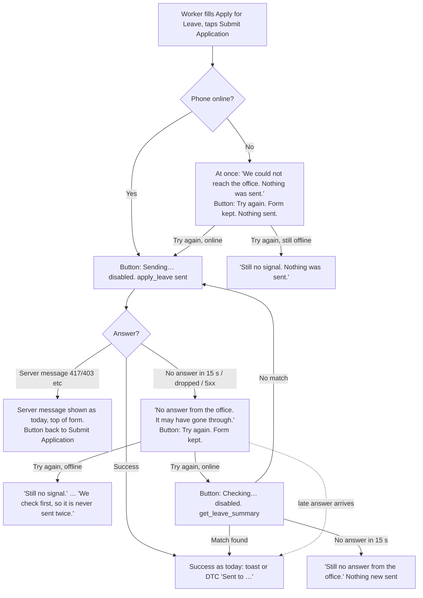

# 070 · Readable and honest on a cheap phone — functional spec

## Read this first

- **Bad news first: the brief says the 5-user baseline is "measure first, before build"
  (§9 measure 3, and a kill criterion hangs on it). DTC and Grace staff logins do not exist
  yet, so that baseline cannot be taken today.** Surbhi must say whether build waits for it.
  ⚠ DECISION A below.
- **Two inputs disagree on one line.** `01c` SEC-3 says the leave check passes `employee_id`
  on the HR on-behalf path. `07` OPS-R5 says the check takes no employee argument at all.
  The code makes both safe (a non-HR caller's `employee_id` is ignored — Confirmed fact,
  `hr_api.py:2308-2313`). I specify SEC-3 and ask DevOps to confirm. Open question Q1.
- **One code fact changes the check rule in 01b.** On every tenant except DTC,
  `get_leave_summary` removes `half_day` from each application before returning it
  (Confirmed fact, `hr_api.py:2354-2357`). So the check cannot match on half day there.
  I match on leave type, from date, to date and status. Frappe HR's own overlap check is
  the backstop. No new argument (SEC-3 forbids one).
- **Rung: new code, client side only.** CSS in `frame.css`, logic in `portal.js`, and small
  template edits. No new DocType, field, endpoint, setting, font, image, route or job.
- OPS-R8 (count nginx 499s for a week) is **⚠ DECISION B — Surbhi's**. Not assumed.
- Size check against the brief's kill rule ("above M → ship only items 2–4"): this spec
  totals **30 points**. US-4 (every "Loading…" ends) is the widest piece — 44 "Loading"
  strings in `portal.js`. The engineer sizes it in `00`; if it lands above M, the brief's
  kill rule applies, not a phase 2.

---

## 1 · Cross-module reach

| App / domain | Touched? | How |
|---|---|---|
| `alvoraa_portal` | **Yes — the only app changed** | `public/css/ess/frame.css`, `public/js/ess/portal.js`, `templates/includes/ess/parts/home.html`, `request-modals.html` and the frame template for the top-bar title `[UNVERIFIED — engineer to locate the desktop top-bar element]` |
| `hrms` | Read only | `validate_leave_overlap` (Leave Application) is the server backstop against a second request. Not changed |
| `erpnext` | Read only | `Holiday` rows (`weekly_off` flag) via existing APIs. Not changed |
| `frappe` | Read only | `frappe.call` is wrapped by `api()` (`portal.js:5`). Not changed |
| `alvoraa_goals` | Look only | The Goals card on Home gets bigger text on phones through the tokens. No code change |
| `alvox_compensation` | No | — |
| `/hrms-employee-next` | **No** | Uses `next-frame.css`, not `frame.css`; preview page, absent on production (Confirmed, `hrms_employee_next.py` docstring) |
| Six other pages sharing `design_system.html` | **Must not change** | login, admin, driver portal, field check-in, vendor portal, portal-next (01b U4) |

HRMS domains: **attendance** (weekly-off label, phone day rows), **leaves** (send, check,
dates, leave cards), **payroll** (payslip date line only — no figure), **expenses/advances**
(lost-answer message), **org structure** (holiday list read). Appraisals, goals,
compensation, learning: no change.

## 2 · Is the ask the real need?

- **Symptom vs cause.** The brief names the causes, measured on our own screens: 11 px text,
  13 px fields, 25 px buttons, a "Holiday" word on weekly offs, a wait with no end. The
  spec fixes those causes. Confirmed by the 24 Oct measurements (`report3.json`).
- **What happens after.** No report or dashboard here. Each failure message drives one action
  by the worker: tap Try again, or look in the list.
- **Not proven yet:** that workers fail today. That is ⚠ DECISION A.

## 3 · Gap analysis

| Requirement (brief item) | What the product does today (read in source) | Verdict | Cost |
|---|---|---|---|
| 1 · Phone floors 44 / 16 / 12 | Tokens `--fs-xs:11px … --fs-base:13px` in `design_system.html:11`, shared by 7 pages. `frame.css` has no phone size block. Controls 17–38 px tall | **Build new (CSS)**: one `@media (max-width:768px)` block in `frame.css` with 01b §5 values. No setting exists for text size | S |
| 2 · "Weekly off" label | `acRow()` (`portal.js:3829`) prints "Holiday" for any holiday. The day payload already carries `weekly_off` and the holiday name (`attendance_correction.py:643-648`) | **Extend (label only)**: no server change | S |
| 3 · Every wait ends by 15 s, Try again, form kept | `api()` (`portal.js:5-12`) has no time limit. Many callers have no error branch; "Loading…" stays for ever | **Build new**: a 15 s limit and an offline check in `api()`, a shared failure box, per-form send states | M |
| 3a · Try again never makes a second leave | Server refuses an overlap (Frappe HR `validate_leave_overlap`, Open/Approved). `get_leave_summary` returns the 10 newest own applications | **Extend**: reuse `get_leave_summary` unchanged for a check before resend | S |
| 3b · Expense and advance after a lost answer | `apply_expense_claim` (`hr_api.py:2429`) and `submit_advance_request` (`:2796`) insert with no duplicate guard | **Build new (copy only)**: "Look in your list…" + Close, no resend (D2, OPS-R4). A server guard was **dropped** — new code and a field where a sentence does | S |
| 3c · Server validation messages show as today | `_server_messages` already shown | **Already there** — keep | 0 |
| 4 · One date format "6 Nov 2026" | `fmtDate()` (`portal.js:28-32`) gives "06 Nov 2026" via `toLocaleDateString("en-IN")`; leave cards (`:5436`) "06 Nov"; other sites use `en-GB` or the browser locale | **Extend**: rebuild `fmtDate()` from the ISO parts; route full-date sites through it | S–M |
| 4a · Date in words under each date box | Browser date box draws its own format (`11/06/2026`) | **Build new**: one line under each date input | S |
| 5 · G1 page name in desktop top bar | Reads "Home" on every page | **Extend** `switchPanel()` (`portal.js:2757`) to set the name | S |
| 5 · G8 right-edge shadow | Cause not found (01b) | **Extend (CSS)**: engineer locates and removes | S |
| 5 · H5 past holiday hidden | Server returns holidays from the 1st of the current month (`hr_api.py` `_own_upcoming_holidays`); `_renderHolMonth()` lists them all | **Extend (client filter)**: hide dates before today | S |
| 5 · N6 day table fits at 390 px | 8-column table scrolls inside its card | **Build new (phone layout)**: two-line day blocks (D3, D11) | S–M |
| 5 · N7 one greeting, no empty Activity card | `home.html:14` "Hey there,"; `:27` clock date; Activity shows "No activity recorded yet." (`portal.js:4365`) | **Extend**: remove two lines, hide the empty card | S |
| Hindi copy | — | **Drop** for this slice — brief puts Hindi in slice E. Strings go through `__()`/`drT()` so slice E can translate | — |
| Raw-error sweep (N5) | Local bench only | **Drop** — brief subtract pass | — |
| Offline drafts, auto-retry, web fonts, skeletons | — | **Drop** — brief "will NOT copy", OPS-R2/R3 | — |
| Request key / server duplicate guard for expenses | — | **Drop** — OPS §2 subtract pass, D2 | — |
| Client timeout counter endpoint | — | **Drop** — OPS-R8 uses nginx's existing log, if Surbhi wants it | — |

**Single source of truth:** a weekly off is the ERPNext `Holiday.weekly_off` flag. The portal
never decides it.

## 4 · Process flow — sending a leave request (the only flow with branches)

Unhappy paths covered: no signal, lost answer, slow check, server refusal, 5xx, late answer,
double tap, pop-up closed mid-wait. **Panel loads** follow the same shape without the check:
offline → message at once; no answer → message at 15 s; 5xx → its own sentence; Try again
reloads only that panel.

## 5 · Data model

**Nothing.** No new DocType, field, custom field, property setter, child table or stored value.
Form values live in page memory only (PRIV-1).

## 6 · States (client screen states — no document workflow)

The Leave Application's own states (Open → Approved/Rejected, submit, cancel) do **not change**.
The pop-up's button has these states:

| Screen state | Button text | Button enabled? | Message above buttons | Next states |
|---|---|---|---|---|
| form | "Submit Application" | yes | none | sending, failA |
| sending | "Sending…" | **no** | none | success, form (server message), failB |
| checking | "Checking…" | **no** | (previous message stays) | success, sending, failB |
| failA (nothing left the phone) | "Try again" | yes | "We could not reach the office. Nothing was sent." | sending, failA ("Still…") |
| failB (may have gone through) | "Try again" | yes | "No answer from the office. It may have gone through." | checking, failA-after-send ("Still no signal."), failB ("Still…") |
| success | — | — | pop-up closes + toast (most tenants); "Sent to …" (DTC) | terminal |

Terminal: success, or the person closes the pop-up. Nothing is reversible in the client; the
leave itself is cancelled the normal Frappe HR way.

## 7 · Permission and visibility matrix

No permission changes. The only read is the existing `get_leave_summary`.

| Persona | Leave Application create (via `apply_leave`) | Leave check read (`get_leave_summary`) | Expense / advance create | Change in 070 |
|---|---|---|---|---|
| Employee / frontline | own | own only — `employee_id` never sent | own | none |
| Line manager (no HR role) | own | own only — a passed `employee_id` is ignored (Confirmed, `hr_api.py:2310-2313`) | own | none |
| HR Manager / HR User | own + on behalf, own companies **and branches** (`_leave_subject`) | own, or the on-behalf employee in own companies (`_hr_target_employee`) | own | none |
| CXO / System Manager | as HR | as HR | own | none |

**Must not (negative cases):**
- An employee or manager must not read anyone else's leave through the check (US-9).
- Nobody must see a server traceback, table name or SQL text in a failure message — HR and
  managers included, because Frappe sends `exc` to system users (01c, SEC-4; US-8).
- A typed leave reason (may be medical) must not survive in browser storage, the URL or a log
  where the next user of a shared phone could read it (PRIV-1, PRIV-2).
- **Existing gap, not 070's:** `get_leave_summary` checks HR scope by company only, not branch
  (01c W1). 070 adds no new reader, so it does not widen this. Ticket recommended (Q3).

## 8 · Epic and user stories

**Epic E-070 (ALV-217): Readable and honest on a cheap phone.** A frontline worker on a ₹8,000
Android phone can read every screen, tap the right control first time, tell a weekly off from a
festival, read one date format, and always learns within 15 s whether a request went.

| ID | Story | Persona | Pts | Prototype screen | Carries | ACs |
|---|---|---|---|---|---|---|
| US-1 | As a **frontline employee** I want text, fields and buttons big enough on my phone so that I read and tap the right thing first time without zooming | Frontline employee | 3 | After · Phone 390/360, all four screens, Markers: Show | OPS-R2 | AC-1 – AC-7, AC-64 |
| US-2 | As a **frontline employee** I want a weekly off to say "Weekly off" and a festival to show its own name so that I stop asking HR "why holiday?" | Frontline employee | 1 | Attendance, Oct and Nov | — | AC-8 – AC-10 |
| US-3 | As a **frontline employee** I want every date written one way, and the date in words under each date box, so that I never apply for 11 June when I meant 6 November | Frontline employee | 3 | Finances, Apply leave, Attendance | — | AC-11 – AC-16 |
| US-4 | As a **frontline employee** (and an **HR Manager** on the holidays card) I want every screen that is loading to stop within 15 s with plain words and one Try again so that I never stare at a dead screen | Frontline employee, HR Manager | 5 | Network: No signal / No answer → Attendance, Finances, Apply leave (leave types) | OPS-R3, SEC-4 | AC-17 – AC-24 |
| US-5 | As a **frontline employee** I want a failed leave send to tell me honestly what happened, keep what I typed, and let me try again with one tap so that I never retype and always know whether it went | Frontline employee | 5 | Apply leave, Network: all three, 15 s demo | SEC-5, OPS-R3 | AC-25 – AC-37 |
| US-6 | As an **HR Manager** I must never receive two leave requests for the same days because a worker tapped Try again, so that I do not cancel duplicates | HR Manager (must-not) | 2 | Apply leave: No answer → Submit → Normal → Try again; note "saved: 1" | SEC-1, OPS-R3 | AC-38 – AC-40 |
| US-7 | As a **frontline employee** sending an expense claim or advance I want to be told to look in my list before sending again when the answer is lost, so that I do not file a second claim | Frontline employee | 2 | Not drawn — Surbhi's D2 decision, 25 Oct | SEC-2, OPS-R4 | AC-41 – AC-44 |
| US-8 | As an **HR Manager** I must not see server internals in a failure message, so that table names and record IDs are not shown on screen | HR Manager (must-not) | 1 | Not clickable — 01b §6 5xx words | SEC-4 | AC-45 – AC-47 |
| US-9 | As an **employee** I must not be able to read a colleague's leave through the new check, and my typed reason must not stay on a shared phone, so that my leave stays private | Employee (must-not) | 1 | — | SEC-3, PRIV-1, PRIV-2, OPS-R5 | AC-48 – AC-51 |
| US-10 | As a **frontline employee** I want each attendance day on my phone as two short lines so that I see in, out, hours and lateness without sideways scrolling | Frontline employee | 3 | Attendance, phone (D3) | — | AC-52 – AC-54 |
| US-11 | As a **frontline employee** I want Home to greet me once, skip the empty Activity card and list only holidays still to come, so that I reach my task with less scrolling | Frontline employee | 2 | Home, ‹ › to November | — | AC-55 – AC-57 |
| US-12 | As an **HR Manager** on a desktop I want the top bar to name the page I am on, and no stray shadow on the right edge, so that I know where I am across tabs | HR Manager | 1 | Desktop 1440; every view (G8) | — | AC-58, AC-59 |
| US-13 | As an **HR Manager** I want staff phones to get this version on their next open, and a way back if it goes wrong, so that nobody sees last month's screen and a bad release can be undone | HR Manager | 1 | — | OPS-R1, R2, R6, R7 | AC-60 – AC-63 |
| — | All user-facing strings translatable | all | (in each story) | — | — | AC-65 |

**Total: 13 stories, 30 points.** Biggest are US-4 and US-5 (5 each); none is an 8.

**INVEST check.** Independent: US-1, 2, 3, 10, 11, 12 stand alone; US-6 and US-7 depend on
US-4's time limit in `api()` (stated, acceptable — same helper). Small: US-4 and US-5 at 5 are the
ceiling; split again only if the engineer finds the 44 "Loading" callers need per-panel work.
Valuable: each traces to a brief line. Testable: every story has an AC with an oracle below.
CXO/owner: no story — brief §1 "nothing new".

### YouTrack-ready import table (do not create — Surbhi's call)

| Summary | Description | Persona | Points | ACs | Requirements |
|---|---|---|---|---|---|
| 070 US-1 Phone size floors | Phone-only token block in frame.css; controls ≥ 44 px, fields 16 px, text ≥ 12 px | Frontline employee | 3 | AC-1–7, 64 | Brief item 1, OPS-R2 |
| 070 US-2 Weekly off label | "Weekly off" or the holiday's own name | Frontline employee | 1 | AC-8–10 | Brief item 2 |
| 070 US-3 One date format | "6 Nov 2026" everywhere; date in words under date boxes; ALV-213 leave cards match | Frontline employee | 3 | AC-11–16 | Brief item 4, D4 |
| 070 US-4 Loads end at 15 s | Failure box + Try again for every panel load | Frontline employee, HR Manager | 5 | AC-17–24 | Brief item 3, OPS-R3, SEC-4 |
| 070 US-5 Honest leave send | No signal / no answer states, form kept, check first | Frontline employee | 5 | AC-25–37 | Brief item 3, D1, SEC-5 |
| 070 US-6 No duplicate leave | Double tap and lost-answer retry → one record | HR Manager | 2 | AC-38–40 | SEC-1 |
| 070 US-7 Expense/advance lost answer | "Look in your list" + Close, no resend | Frontline employee | 2 | AC-41–44 | D2, SEC-2, OPS-R4 |
| 070 US-8 No server internals | Fixed sentences only; no traceback | HR Manager | 1 | AC-45–47 | SEC-4 |
| 070 US-9 Check stays private | No new argument; nothing in storage or logs | Employee | 1 | AC-48–51 | SEC-3, PRIV-1, PRIV-2, OPS-R5 |
| 070 US-10 Phone day rows | Two-line day blocks on phones | Frontline employee | 3 | AC-52–54 | Brief item 5 (N6), D3 |
| 070 US-11 Home clean-ups | One greeting, no empty Activity, no past holidays | Frontline employee | 2 | AC-55–57 | Brief item 5 (N7, H5) |
| 070 US-12 Desktop page name, no edge shadow | Top bar names page; G8 removed | HR Manager | 1 | AC-58–59 | Brief item 5 (G1, G8) |
| 070 US-13 Release safety | Asset stamp, no nginx/font, post-deploy check, rollback tag | HR Manager | 1 | AC-60–63 | OPS-R1, R2, R6, R7 |

## 9 · Acceptance criteria

**Test set used below.** "Phone screens" = in `/hrms-employee` at 390 × 844 and 360 × 780, signed
in as (a) an employee (Rahul Kumar, PPJ-0058, on `ppj.localhost`), (b) a line manager, (c) an HR
Manager: Home, Attendance (month), Leave page, Apply for Leave pop-up, Attendance request pop-up,
Expense claim pop-up, Advance request, My Finances (each tab), Team View, Requests/approvals, the
slide-out menu. "Measured" = the same rules as the prototype's measuring script / `report3.json`
(own-text elements for font size; `button, a, select, input, textarea, label.tap` bounding boxes).

### US-1 · Phone floors
- **AC-1** Given any phone screen, when measured, then the smallest computed font size of any
  visible element with its own text is **≥ 12 px**.
- **AC-2** Given any phone screen with a form, then every `input` (not checkbox), `select` and
  `textarea` has computed font size **16 px** and height **≥ 44 px**; every `textarea` is
  **≥ 88 px** tall.
- **AC-3** Given any phone screen, then every tappable control (button, link, select, input,
  Half Day row) has a hit box **≥ 44 × 44 px**. This includes "+ Apply Leave", month arrows,
  holiday ‹ › and "All year", "Details →", "Full Portal →", the "Powered by" footer link,
  finance tabs, slide-out menu items, the pop-up ×, the Half Day row (box drawn 20 × 20).
- **AC-4** Given any phone screen, then the page does not scroll sideways
  (`scrollWidth ≤ clientWidth + 1` on the scrolling container), at 360 and 390 px.
- **AC-5** Given a desktop at 1440 × 900, then computed `--fs-xs/sm/base/md` are 11/12/13/15 px
  and Home, Attendance and Apply for Leave match the ALV-213 screenshots except for the items
  AC-55–AC-59 change.
- **AC-6** Given each of the six other pages that include `design_system.html` (login, admin,
  driver portal, field check-in, vendor portal, portal-next) at 390 px, then computed
  `--fs-base` is still 13 px; and the diff contains no change to `design_system.html`.
- **AC-7** Given the phone header, then menu, bell and avatar each have a 44 × 44 px hit box
  while the drawn shape stays 36 px (visual match to prototype After · Phone 390).

### US-2 · Weekly off
- **AC-8** Given Rahul's holiday list "Chandigarh Store Holiday List - Off Thursday" where
  1 Oct 2026 has `weekly_off = 1`, when he opens Attendance for October 2026, then 1 Oct's chip
  reads **"Weekly off"** and no chip on the page reads "Holiday".
- **AC-9** Given 2 Oct 2026 "Gandhi Jayanti" (`weekly_off = 0`), then its chip reads
  **"Gandhi Jayanti"**; given 9 Nov 2026 "Diwali next day (store closed for stock-take)", the
  full name shows, wraps, and AC-4 still holds. A description containing HTML (e.g.
  `<b>Diwali</b>`) shows as plain text "Diwali" with no markup run. Both chips use the same grey
  `ac-tag` style (no `warn`/`ok`).
- **AC-10** Given a tenant whose holiday list has no `weekly_off = 1` rows (e.g. DTC today), then
  no day shows "Weekly off", and each holiday day shows its own name.

### US-3 · One date format
- **AC-11** Given `fmtDate("2026-11-06")`, then it returns **"6 Nov 2026"**; `"2026-09-01"` →
  **"1 Sep 2026"** (never "Sept"); `"2026-11-06 10:30:00"` → "6 Nov 2026"; empty/null → "".
- **AC-12** Given the browser time zone set to America/Los_Angeles, and again to Asia/Kolkata,
  then the date `2026-11-06` renders "6 Nov 2026" in both (built from the ISO parts, not
  `new Date(iso)` + locale).
- **AC-13** Given the Leave page, then the applications table shows "6 Nov 2026", and the ALV-213
  phone leave cards show **"6 Nov 2026"** for a one-day leave and **"6 Nov – 7 Nov 2026"** for a
  same-year range (was "06 Nov – 07 Nov 2026"; D4). A cross-year range shows
  "30 Dec 2026 – 2 Jan 2027".
- **AC-14** Given My Finances → Salary Slips, then August's date line reads
  **"1 Aug 2026 – 31 Aug 2026"**.
- **AC-15** Given the Apply for Leave pop-up, when the From box is set to 2026-11-06, then the line
  under it reads **"Friday, 6 Nov 2026"**; it is empty while the box is empty and updates on
  every change. Same for To, and for the date box in the Attendance request and Expense claim
  pop-ups.
- **AC-16** Given every phone and desktop screen in the test set, when its visible text is
  scanned, then it contains no `\d{4}-\d{2}-\d{2}`, no `\d{2}/\d{2}/\d{4}` (outside the
  browser's own date box), no "Sept", and no full date with a leading-zero day
  (`\b0\d (Jan|…|Dec) \d{4}`). Day labels in the attendance list read "1 Oct Thu" (no leading
  zero, year carried by the month heading).

### US-4 · Every load ends by 15 s
- **AC-17** Given the phone is offline (DevTools Offline), when Attendance opens, then within
  1 s the "Loading…" text is replaced, in place, by a box with `role="alert"`, an amber left edge
  (light and dark theme), heading **"We could not reach the office."**, line **"Check your
  signal, then tap Try again."** and a **"Try again"** button.
- **AC-18** Given the server holds the attendance call for 20 s, then at **15 s (±1 s)** from the
  call's start the box shows **"We could not reach the office."** / **"The office did not
  answer in 15 seconds. Tap Try again."**
- **AC-19** Given the call returns HTTP 500 with no `_server_messages`, then the box shows
  **"Something went wrong at the office."** / **"Tap Try again in a minute. If it keeps
  happening, tell HR."** / Try again.
- **AC-20** Given a failure box, when Try again is tapped, then "Loading…" shows again and the
  network log shows exactly one new request, to that panel's method only; if it fails again the
  heading reads **"Still could not reach the office."**
- **AC-21** Given the 15 s box is showing, when the held answer arrives at 18 s, then the panel's
  data replaces the box with no tap.
- **AC-22** Given the phone is offline, when each panel in the test set is opened (Home cards incl.
  the HR holidays card as HR Manager, Attendance, Leave page, My Finances each tab, Team View,
  Requests/approvals), then **16 s later no element on screen reads "Loading…"**, "Loading
  payslips..." or "Submitting…".
- **AC-23** Given Apply for Leave with the leave-type list failing, then under the select:
  **"We could not load the leave types."** + the reason line from AC-17/AC-18 + **Try again**,
  which reloads only the list; values already typed in the other fields stay.
- **AC-24** Given any failure on any screen, when nobody taps anything for 60 s, then the network
  log shows **no further request** to that method; and the diff contains no timer that calls
  `api()` after a failure (OPS-R3).

### US-5 · Honest leave send (most tenants and DTC)
- **AC-25** Given a normal network, when Submit Application is tapped, then the button reads
  **"Sending…"** and is disabled, then success shows as today: most tenants — pop-up closes and
  toast **"Leave application submitted."**; DTC — the "Sent to …" result, unchanged.
- **AC-26** Given the phone is offline, when Submit is tapped, then **no request** to
  `apply_leave` leaves the phone; within 1 s, just above the buttons, **"We could not reach the
  office. Nothing was sent."** / **"Your details are still here. When you have signal, tap Try
  again."**; the primary button reads **"Try again"**; leave type, from, to, half day and reason
  keep their values.
- **AC-27** Given the server saves the request but the answer is dropped (test proxy), then at
  15 s: **"No answer from the office. It may have gone through."** / **"Tap Try again. We check
  first, so it is never sent twice."**; button "Try again"; form values kept. A dropped
  connection or a 5xx after sending shows the same words.
- **AC-28** Given AC-27's state and the network back, when Try again is tapped, then the button
  reads **"Checking…"** (disabled), one `get_leave_summary` call is made, and if an application
  with the same leave type, from date and to date and status Open or Approved is in it, the
  same success as AC-25 shows and **no** `apply_leave` call is made.
- **AC-29** Given the check finds no match, then the button reads "Sending…", `apply_leave` is
  called once, and success shows.
- **AC-30** Given the check itself gets no answer in 15 s, then the heading reads **"Still no
  answer from the office."** and no `apply_leave` call is made.
- **AC-31** Given AC-26's state and still offline, when Try again is tapped, then **"Still no
  signal. Nothing was sent."**; given AC-27's state and now offline, then **"Still no signal."**
  / **"Your details are still here. Tap Try again when you have signal. We check first, so it is
  never sent twice."**
- **AC-32** Given the server refuses (overlap, balance, a refused `on_behalf_of`), then the
  server's own message shows exactly as today at the top of the form, the button returns to
  "Submit Application", the words "may have gone through" never appear, and no resend happens
  (SEC-5).
- **AC-33** Given AC-27's message is showing, when the late answer arrives, then success shows
  **once** (one toast, or one "Sent to …").
- **AC-34** Given the DTC path (`lpSubmit`), then AC-25 to AC-33 hold with the same words, and the
  sentence "Not sent: the connection dropped. Nothing was saved. Your choices are still here -
  try again." no longer exists in `portal.js`.
- **AC-35** Given HR applies on behalf of PPJ-0058, then the check sends `employee_id=PPJ-0058`;
  given an employee applies for themselves, the check sends no `employee_id` (network log).
- **AC-36** Given AC-27's state, when the pop-up is closed, then it closes with no extra screen;
  reopening shows an empty form; the Leave page lists the request if the office saved it.
- **AC-37** Given any failure in the pop-up, then keyboard focus stays on the primary button, its
  accessible name is "Try again", and the message has `role="alert"`.

### US-6 · Must not: no second leave
- **AC-38** Given a normal network, when Submit is tapped twice 100 ms apart, then exactly **one**
  `apply_leave` request is sent and **one** Leave Application exists.
- **AC-39** Given the server saves and the answer is dropped, when Try again is tapped with the
  network back, then the database holds exactly **one** Leave Application for that employee,
  leave type, from and to date.
- **AC-40** Given the answer is dropped three times in a row (Try again each time), then the
  network back, then still exactly **one** Leave Application.

### US-7 · Expense claim and advance
- **AC-41** Given an expense claim whose answer is lost (saved, answer dropped), then at 15 s inside
  the pop-up: **"No answer from the office. It may have gone through."** / **"Look in your list
  before you send it again."**; the footer shows only **"Close"**; no control sends again;
  the database holds **one** Expense Claim. Close closes the pop-up and reloads the expense list.
- **AC-42** Given an advance request whose answer is lost, then the same two lines show with a
  **"Close"** button; Submit is disabled while they show; Close hides them and reloads the advance
  history; the database holds **one** advance record.
- **AC-43** Given the phone is offline, when an expense claim or advance is sent, then no request
  leaves; **"We could not reach the office. Nothing was sent."** / **"Your details are still here.
  When you have signal, tap Try again."**; form kept; button "Try again" (01b D2 option a —
  see Q2).
- **AC-44** Given the server refuses an expense or advance (validation), then its message shows as
  today.

### US-8 · Must not: no server internals
- **AC-45** Given an HR Manager (System User) and a forced 500 with `exc` set to a traceback, on a
  panel load and on leave submit, then only the fixed sentence shows, and the page's DOM contains
  none of: "Traceback", the exception class name, the SQL or table text from `exc`. Applies to
  every `gpErr` caller too.
- **AC-46** Given a forced 417 from `frappe.throw("Leave dates overlap")`, then exactly that message
  shows, unchanged.
- **AC-47** Given a network failure or a 500, then no Frappe message dialog appears beside the
  portal's box (count of Frappe msgprint dialogs = 0).

### US-9 · Must not: the check stays private
- **AC-48** Given a non-HR employee, then the check never sends `employee_id`; and the existing
  server test still passes: `get_leave_summary(employee_id=<another employee>)` as a non-HR
  employee returns the caller's own record.
- **AC-49** Given the diff, then it adds no `@frappe.whitelist` and leaves `get_leave_summary`'s
  signature unchanged.
- **AC-50** Given a failed send, when the page is reloaded, then the form is empty; the diff adds 0
  uses of `localStorage`, `sessionStorage`, `indexedDB` or URL parameters for form values.
- **AC-51** Given the diff, then no new `console.*` call or `frappe.log_error` contains form values
  or response bodies, and the PII-in-logs scanner passes.

### US-10 · Phone attendance rows
- **AC-52** Given ≤ 768 px and October 2026, then each day is one block: line 1 = "5 Oct Mon" + its
  chips (status, "Missing punch", request state, as today) + "›" when it can be opened; line 2,
  only for days with attendance = **"In 09:28 · Out 18:34 · 9.1h worked · On time"** or
  "… · 17 min late" (late in the existing red style). No day-strip graphic. Each block is
  ≥ 52 px tall. An openable block is a button named "Monday, 5 Oct 2026, open the day".
- **AC-53** Given a phone day block, when tapped, then the existing "What went wrong?" opens inline
  for that day, exactly as the table row does today.
- **AC-54** Given ≥ 769 px, then the 8-column table with the day strip shows as today.

### US-11 · Home clean-ups
- **AC-55** Given Home, then the check-in card has no "Hey there," line and no date under the clock;
  name, job title and "Not checked in" remain.
- **AC-56** Given no activity items, then the Activity card is not in the page; given one or more
  items, it shows as today.
- **AC-57** Given today is 24 Oct 2026, then the holidays card does not list 2 Oct; with none left
  in October it reads **"No more holidays in October."**; › November lists "9 Nov · Diwali next
  day (store closed for stock-take)", wrapped. A holiday dated today is listed. "All year" lists
  no date before today. A later month with no holidays still reads "No public holidays in
  <Month>." (unchanged).

### US-12 · Desktop page name, no edge shadow
- **AC-58** Given desktop 1440, when the person switches panel, then the top bar reads that page's
  name ("Home", "Attendance", "My Finances", …), never "Home" on another page.
- **AC-59** Given phone 390 and desktop 1440, then there is no grey shadow down the right edge
  (screenshot: the rightmost 8 px of the page area match the page background colour).

### US-13 · Release safety
- **AC-60** Given the diff, then every changed or new `css/ess/*` or `js/ess/*` link carries
  `?v={{ asset_version }}`; `test_portal_split_034.py` and `test_panel_source_042.py` pass (OPS-R1).
- **AC-61** Given the diff, then it touches no `deploy/nginx.conf`, gunicorn setting, font, image
  file or package manifest, and adds no new file requested by the page (OPS-R2).
- **AC-62** Given Surbhi approves the dev check, when the portal page is fetched before and after the
  dev deploy, then the `?v=` value differs, the served `frame.css` contains the
  `@media (max-width:768px)` block, and the page opens on a real phone (OPS-R6).
- **AC-63** Given the diff, then it has no patch and no DocType JSON change; and `07` §5 names the
  previous tag and confirms it exists in the package dev pulls from, before any push (OPS-R7).

### Cross-cutting
- **AC-64** (manual) Given a real Android phone with system font size "Largest", then Home,
  Attendance and Apply for Leave have no sideways scroll and no clipped button label.
- **AC-65** Given the diff, then every new user-facing string passes through `__()` or `drT()`.

**Total: 65 ACs.**

## 10 · Prototype parity table

The prototype v1 (approved 25 Oct) is the design. Anything built differently needs Surbhi's yes.

| # | Prototype screen / element | Build exactly | AC |
|---|---|---|---|
| P1 | Before / After switch | Prototype-only control — not built | — |
| P2 | Phone 390 / Phone 360 frames | Phone token block ≤ 768 px | AC-1–AC-4 |
| P3 | Desktop 1440 frame | Desktop sizes unchanged | AC-5 |
| P4 | Light / Dark theme | Failure box, chips and new lines readable in both | AC-17, AC-9 |
| P5 | Markers: Show / Hide, Start again, "15 s played in 3 s" / "Real 15 s", the note under the frame | Prototype-only — not built. Real limit is 15 s | AC-18 |
| P6 | Phone header: menu, bell, avatar | 44 px hit box, 36 px drawn | AC-7 |
| P7 | Bottom tabs Home / Attendance / Finances | Unchanged except tokens | AC-1, AC-3 |
| P8 | Home page header "Good evening, Rahul!" / date / "+ Apply Leave" | Words unchanged; button 44 px | AC-3 |
| P9 | Check-in card without "Hey there," and clock date; "Check In" button | As drawn | AC-55, AC-3 |
| P10 | No Activity card when empty | As drawn | AC-56 |
| P11 | My Goals card, "Full Portal →" | Unchanged apart from 44 px link | AC-3 |
| P12 | Leave balance card, "Details →" | Unchanged apart from 44 px link | AC-3 |
| P13 | Holidays card: "No more holidays in October.", ‹ › and "All year", 9 Nov long name wrapping | As drawn | AC-57, AC-3 |
| P14 | "Powered by" footer link | 44 px | AC-3 |
| P15 | Attendance header, month arrows, month select | 44 px; select 16 px | AC-3, AC-2 |
| P16 | Attendance tiles | Unchanged apart from tokens | AC-1 |
| P17 | Day chips "Weekly off" / "Gandhi Jayanti" / "To come" / "No record" / status | As drawn | AC-8–AC-10 |
| P18 | Phone two-line day blocks, no strip; desktop table | As drawn | AC-52–AC-54 |
| P19 | Day labels "1 Oct Thu" | As drawn | AC-16 |
| P20 | Panel failure box (attendance, payslips): heading, reason line, Try again, "Still could not…" | As drawn | AC-17, AC-18, AC-20 |
| P21 | My Finances tabs (Salary Slips / Expenses / Leave Encashment) | 44 px | AC-3 |
| P22 | Payslip rows "1 Aug 2026 – 31 Aug 2026" | As drawn | AC-14 |
| P23 | Apply for Leave pop-up: title, × close 44 px, Cancel | As drawn | AC-3 |
| P24 | Leave type select 16 px; leave-types failure box under it | As drawn | AC-2, AC-23 |
| P25 | Date boxes + "Friday, 6 Nov 2026" lines | As drawn | AC-15 |
| P26 | Preview "Requesting 2 days of 5 available." | From the server as today (`preview_leave_request`); not changed | — (unchanged; prototype computes it itself) |
| P27 | Half Day row 44 px, box 20 × 20 | As drawn | AC-3 |
| P28 | Reason textarea 88 px | As drawn | AC-2 |
| P29 | Send failure above the buttons: no-signal, no-answer, "Still…" variants | As drawn | AC-26, AC-27, AC-30, AC-31 |
| P30 | Primary button: Submit Application / Sending… / Checking… / Try again, disabled while busy | As drawn | AC-25, AC-28, AC-38 |
| P31 | Server message at the top of the form (overlap) | As today | AC-32 |
| P32 | Toast "Leave application submitted." | As today | AC-25 |
| P33 | Network: Normal / No signal / No answer | Real network states, tested by the test engineer | AC-17–AC-40 |
| P34 | Desktop top bar page name; desktop sidebar | As drawn | AC-58 |
| P35 | Right-edge shadow gone (Before shows `.edge`) | As drawn | AC-59 |
| P36 | Late answer replaces message (not clickable, 01b §8 row 12) | §7 rule | AC-21, AC-33 |
| P37 | 5xx wording (not clickable, 01b §8 row 13) | Words only | AC-19 |
| P38 | Expense / advance lost answer (not drawn; Surbhi's D2) | Words decided 25 Oct | AC-41–AC-44 |

## 11 · Edge cases

| Case | What must happen | AC |
|---|---|---|
| Answer lost, then person closes the pop-up | Allowed; request may be in the list; no extra screen | AC-36 |
| Late answer after Try again already started a check | Success shows once; no second record | AC-33, AC-39 |
| Phone says online but has no real route | The call fails or times out → honest "may have gone through" words, never "Nothing was sent" | AC-27 |
| 5xx from nginx (502/504) after a send | Treated as "may have gone through"; Try again checks first | AC-27 |
| Same type and dates already applied weeks ago (Open/Approved) | Check finds it → success words; nothing new sent. Acceptable: the request does exist | AC-28 |
| Half-day vs full-day on the same date (non-DTC tenants: `half_day` not returned) | Match on type + dates + status; Frappe HR's overlap check is the backstop | AC-28, AC-32 |
| More than 10 newer applications since the lost one | Not possible in practice within a minute; overlap check backstops | AC-32 |
| HR applying on behalf | Check uses that employee; branch rule stays in `apply_leave` | AC-35 |
| Cancelled application with same dates | Status Cancelled is not a match → sent again (correct: the old one is cancelled) | AC-28 |
| Time zones and DST | Dates built from ISO parts; no shift | AC-12 |
| Cross-year leave | "30 Dec 2026 – 2 Jan 2027" | AC-13 |
| Holiday today | Listed on Home | AC-57 |
| Tenant with no weekly offs set (DTC) | No "Weekly off" shown; ALV-92 remains DTC's own policy call | AC-10 |
| Long holiday names and job titles | Wrap; no sideways scroll | AC-9, AC-4 |
| Android "Largest" font | No sideways scroll, no clipped labels | AC-64 |
| Team of 400 on Team View | Tokens only; no layout change | AC-1 |
| Concurrent approvals, back-dating, joiners/leavers, probation, balances, payroll | **No change** — this slice touches no rule, figure or document state | — |
| Multi-company / multi-branch | No change to who can see what | §7 |

## 12 · Non-functional requirements for this slice

| Dimension | Number for 070 | Source |
|---|---|---|
| Phone page load (3G profile, p95) | ≤ 2.5 s — unchanged; CSS/JS grow by an estimated 1–3 KB before gzip; no new file request (AC-61) | nfr-budget §2, 07 §2 |
| Every call ends | No signal → at once; no answer → 15 s from call start; no automatic retry | Surbhi 24 Oct; nfr-budget §3 "defined end state"; OPS-R3 |
| Server load from the check | One indexed read per user tap (`employee`, `leave_type`, `from_date`, `to_date` are indexed) | 07 §2 |
| Server timeouts | nginx 120 s, gunicorn 120 s — unchanged; 15 s is always first | 07 §2, OPS-R2 |
| Phone floors | ≥ 44 px targets, 16 px fields, ≥ 12 px text; no sideways scroll at 360 px | nfr-budget §7 |
| Skeleton within 300 ms | **Not met by design** — existing "Loading…" kept; skeletons dropped (01b) | nfr-budget §2 vs 01b subtract pass |
| EN/HI parity | **Not in this slice** — brief moves Hindi to slice E; strings translatable | nfr-budget §7 vs brief |
| Personal data | Leave reason (may be medical) in page memory only | PRIV-1 |
| Background jobs, queues, retention | None | — |
| Rollback | Redeploy previous tag, ~7 min (≤ 15 min budget) | OPS-R7, nfr-budget §3 |

## 13 · Data migration / backfill

**Nothing.** No schema, no data, no patch. Rollback = redeploy the previous tag (OPS-R7).

## 14 · Notifications and messages

No new email or system notification. All on-screen copy, exact English:

| Trigger | Where | Copy | Must never leak |
|---|---|---|---|
| Panel load, offline | in place of "Loading…" | "We could not reach the office." / "Check your signal, then tap Try again." / [Try again] | server text |
| Panel load, 15 s | same | "We could not reach the office." / "The office did not answer in 15 seconds. Tap Try again." | — |
| Panel load, 5xx | same | "Something went wrong at the office." / "Tap Try again in a minute. If it keeps happening, tell HR." | traceback, `exc` |
| Panel load, second failure | same | heading "Still could not reach the office." | — |
| Leave types failed | under the select | "We could not load the leave types." + reason line + [Try again] | — |
| Leave send, offline | above buttons | "We could not reach the office. Nothing was sent." / "Your details are still here. When you have signal, tap Try again." | — |
| Leave send, no answer | above buttons | "No answer from the office. It may have gone through." / "Tap Try again. We check first, so it is never sent twice." | — |
| Leave, second failures | above buttons | "Still no signal. Nothing was sent." · "Still no answer from the office." · "Still no signal." / "Your details are still here. Tap Try again when you have signal. We check first, so it is never sent twice." | — |
| Leave button states | primary button | "Sending…" · "Checking…" · "Try again" | — |
| Leave success | as today | "Leave application submitted." / DTC "Sent to …" | the reason is never in a toast |
| Expense / advance, lost answer | in form | "No answer from the office. It may have gone through." / "Look in your list before you send it again." / [Close] | — |
| Expense / advance, offline | in form | as leave offline | — |
| Home holidays, none left | holidays card | "No more holidays in October." (month from the card) | — |
| Weekly off | attendance chip | "Weekly off" | — |

## 15 · Localisation and accessibility

- Every new string through `__()` / `drT()` (AC-65). English only in 070.
- Dates: "6 Nov 2026"; three-letter English month; no leading zero; under date boxes
  "Friday, 6 Nov 2026". Money and number formats unchanged.
- WCAG 2.2 AA: failure boxes `role="alert"`; success stays `role="status"`; focus stays on the
  pressed button (AC-37); colour never the only signal (words on every chip); phone day blocks are
  real buttons with spoken names (AC-52); 360 px with no sideways scroll (AC-4).
- **Not automated:** Android "Largest" font on a real phone (AC-64); screen-reader pass with
  TalkBack on Apply for Leave failure states — the test engineer lists it as a human check.
- Frontline on mobile: everything in this spec is the phone view; nothing needs a laptop.

## 16 · Audit and traceability

Nothing new to record. No decision, change or document is created by this slice beyond what
`apply_leave`, `apply_expense_claim` and `submit_advance_request` already record (Frappe's own
`creation`/`owner` and version history). A duplicate, if one ever slipped through, is visible in
HR's lists.

## 17 · Compliance-impact sub-analysis

*I am not a lawyer. Nothing here is a legal ruling.* Built on `01c`; not re-derived.

**1 · Data touched**

| Field / object | Class | Purpose | Lawful basis (as recorded) | New collection? |
|---|---|---|---|---|
| Leave form values incl. reason (may be medical) | sensitive | applying for leave | as today (employment) | No — held in page memory longer, never stored (PRIV-1) |
| Leave Application rows read by the check (type, dates, status) | internal | prevent a duplicate | as today | No — existing endpoint, existing reader |
| Holiday `weekly_off`, description | internal | label a day | as today | No |
| Expense / advance form values | internal | as today | as today | No |

**2 · Obligations engaged**

| Obligation | Source | What 070 must do | Feature |
|---|---|---|---|
| DPDP reasonable security safeguards | security-compliance-baseline (verified 24 Aug 2026) | No traceback on screen; nothing in browser storage or logs | SEC-4, PRIV-1, PRIV-2 → AC-45–AC-51 |
| Nothing new | — | — | — |

**3 · Visibility delta.** **None.** Nobody sees anything after 070 they could not see before.
Negative cases: an employee must not read another's leave through the check (AC-48); HR and
managers must not see server internals (AC-45); the next person on a shared phone must not see a
typed reason (AC-50).

**4 · Decision automation.** None. No decision about a person is made or influenced.

**5 · Retention and deletion.** Nothing changes.

**6 · ⚠ Open compliance questions.** None. (01c: "nothing here depends on a point of law".)

**7 · AI.** None in this slice. No prohibited capability is touched.

## 18 · Traceability

| Source | Item | Story | ACs | Status |
|---|---|---|---|---|
| Brief §5.1 | Phone floors 44 / 16 / 12, not screen by screen | US-1 | AC-1–AC-4, AC-64 | covered |
| Brief §5.1 | No sideways scroll may return | US-1 | AC-4 | covered |
| Brief §5.2 | "Weekly off"; named holidays keep their name | US-2 | AC-8–AC-10 | covered |
| Brief §5.3 / Surbhi 24 Oct | Every wait ends — 15 s for every call | US-4, US-5 | AC-17–AC-22, AC-27 | covered |
| Brief §5.3 | Plain sentence + one Try again | US-4, US-5 | AC-17, AC-20, AC-26 | covered |
| Brief §5.3 | Form keeps what was typed | US-5, US-7 | AC-26, AC-27, AC-43 | covered |
| Brief §5.3 | Server validation messages still show | US-5, US-7 | AC-32, AC-44, AC-46 | covered |
| Brief §5.4 | One date format, in tables and beside each date field | US-3 | AC-11–AC-16 | covered |
| Brief §5.5 | G1 page name in desktop top bar | US-12 | AC-58 | covered |
| Brief §5.5 | G8 right-edge shadow gone | US-12 | AC-59 | covered |
| Brief §5.5 | H5 past holiday hidden | US-11 | AC-57 | covered |
| Brief §5.5 | N6 WORK column fits at 390 px | US-10 | AC-52–AC-54 | covered |
| Brief §5.5 | N7 one greeting, no empty Activity card | US-11 | AC-55, AC-56 | covered |
| Brief §6 | Supervisor: floors on Team View and approvals | US-1 | AC-1–AC-3 (test set incl. Team View, approvals) | covered |
| Brief §6 | HR Manager: HR holidays card ends its wait | US-4 | AC-22 | covered |
| Brief §7 | WOW: signal drops on Send → message within 15 s under the filled form → Try again → goes through, never retyped | US-5 | AC-26, AC-29 | covered (words per D1) |
| Brief §9 m1 | 0 / 0 / 0 controls, fields, text at 390 | US-1 | AC-1–AC-3 | covered |
| Brief §9 m2 | 0 screens on "Loading…" after cut; typed text kept | US-4, US-5 | AC-22, AC-26 | covered |
| Brief §9 m3 | 5-user observation, baseline before build | — | — | **⚠ DECISION A** — not an AC; a measure |
| Brief §9 m4 | HR question tally | — | — | measure, not an AC; Surbhi's (brief open question) |
| Brief §11 | Try again must not create a second leave | US-6 | AC-38–AC-40 | covered |
| Brief out of scope | Hindi, offline drafts, WhatsApp, new pages/fonts/colours, nginx/route changes | — | AC-61 (no font/nginx) | not adopted — brief decision |
| 01b D1 (Surbhi 25 Oct) | Two sentences: offline vs lost answer | US-5 | AC-26, AC-27 | covered |
| 01b D2 (Surbhi 25 Oct) | Check-then-resend on leave only; expense/advance "Look in your list" + Close | US-5, US-7 | AC-28, AC-41, AC-42 | covered |
| 01b D3 (Surbhi 25 Oct) | Two-line day blocks on phones | US-10 | AC-52 | covered |
| 01b D4 (Surbhi 25 Oct) | "6 Nov 2026"; ALV-213 leave cards "06 Nov" change to match | US-3 | AC-13 | covered |
| 01b U4 | Other six `design_system.html` pages unchanged | US-1 | AC-6 | covered |
| 01b U5 | Desktop targets under 24 px | — | — | not adopted — brief: phone floors only; backlog |
| Prototype | Every screen and element | see §10 P1–P38 | §10 | covered (P1, P5 prototype-only; P26 unchanged) |
| Security | SEC-1 no second leave; disabled while busy | US-6 | AC-38–AC-40 | covered |
| Security | SEC-2 expense/advance no resend; no auto retry | US-7, US-4 | AC-41, AC-42, AC-24 | covered |
| Security | SEC-3 reuse `get_leave_summary`, no new arg | US-9, US-5 | AC-35, AC-48, AC-49 | covered (see Q1) |
| Security | SEC-4 no `exc` / traceback text | US-8 | AC-45, AC-47 | covered |
| Security | SEC-5 refusals still show and block | US-5 | AC-32, AC-46 | covered |
| Privacy | PRIV-1 page memory only | US-9 | AC-50 | covered |
| Privacy | PRIV-2 no values in logs | US-9 | AC-51 | covered |
| DevOps | OPS-R1 `?v=` stamp | US-13 | AC-60 | covered |
| DevOps | OPS-R2 no font/image/nginx/gunicorn | US-13 | AC-61 | covered |
| DevOps | OPS-R3 no auto retry; leave check before resend | US-4, US-5 | AC-24, AC-28 | covered (see Q2) |
| DevOps | OPS-R4 expense/advance message + Close | US-7 | AC-41, AC-42 | covered |
| DevOps | OPS-R5 own-leave read, no foreign rows | US-9 | AC-48 | covered (see Q1) |
| DevOps | OPS-R6 post-deploy `?v=` check | US-13 | AC-62 | covered |
| DevOps | OPS-R7 rollback tag | US-13 | AC-63 | covered |
| DevOps | OPS-R8 count nginx 499s for a week | — | — | **⚠ DECISION B — Surbhi** |

**Untraced items: none.** Two rows wait on Surbhi (A, B). One row (U5) is not adopted by the
brief's own scope.

---

## Decisions needed (Surbhi)

**⚠ DECISION A — does build wait for the 5-user baseline?** The brief says measure first, before
build, and a kill criterion depends on it ("people already read and tap fine → drop item 1").
DTC and Grace staff have no logins yet. *Options:* (a) **recommended** — build now; observe the five
people on today's production portal (the ALV-213 build) as soon as their logins exist, and before
070 goes to `main`; if they already read and tap fine, take US-1 out before the `main` push;
(b) hold US-1 until the observation; the other stories go ahead. *Blocks:* US-1 only.

**⚠ DECISION B — OPS-R8: count nginx 499s on dev for a week after release?** It uses the access
log that already exists; no code. *Blocks:* nothing in the build; only whether we learn how often
the 15 s limit fires.

## Open questions

| # | Question | Owner | Blocks |
|---|---|---|---|
| Q1 | SEC-3 (pass `employee_id` on HR on-behalf) vs OPS-R5 ("no employee argument"). I specified SEC-3; the server already ignores the argument for non-HR callers. Confirm OPS-R5 means "no **new** argument" | `hrms-devops-engineer` with `hrms-security-privacy-engineer` | AC-35 wording only; not the first day |
| Q2 | OPS-R3 says Try again is "leave form only". 01b D2 option (a), chosen by Surbhi, also gives expense/advance a Try again when **nothing left the phone**. I specified that (AC-43). Confirm OPS-R3 meant "resend after a lost answer" | `hrms-devops-engineer` | AC-43 |
| Q3 | W1 (01c): `get_leave_summary` scopes HR by company, not branch. Raise a YouTrack ticket? | Surbhi | Nothing in 070 |
| Q4 | Does `frappe.call` raise its own dialog on a network error or 500 on this Frappe version? | `hrms-fullstack-engineer` | How AC-47 is met |
| Q5 | Where is the desktop top-bar title element, and what causes the G8 shadow? | `hrms-fullstack-engineer` | AC-58, AC-59 mechanism |
| Q6 | Which other portal date boxes exist beyond leave, attendance request and expense? | `hrms-fullstack-engineer` (grep `type="date"`) | AC-15 coverage |
| Q7 | Surbhi's 25 Oct design reaction is not yet logged in `ux-learnings.md` (row at line 180 still says "not yet reacted to") | `hrms-ux-designer` | Ready box only |

## Assumptions

- `[ASSUMPTION]` `navigator.onLine === false` is the "no signal" test; any other failure after a
  send uses the honest "may have gone through" words (01b).
- `[ASSUMPTION]` The 15 s counts from the call's start, for loads, sends and the check alike (01b).
- `[ASSUMPTION]` A 5xx with no message after a **send** is treated as "may have gone through"
  (a 502/504 from nginx may follow a commit). Not drawn; it reuses drawn words.
- `[ASSUMPTION]` Expense and advance layouts for the lost-answer message (footer shows only Close in
  the expense pop-up; Submit disabled on the advance form while the message shows) are not drawn;
  words are Surbhi's 25 Oct decision.
- `[ASSUMPTION]` The leave-card same-year range keeps ALV-213's "year once" shape:
  "6 Nov – 7 Nov 2026".
- `[ASSUMPTION]` "Past holidays hidden" applies to month and year views; other empty months keep
  today's "No public holidays in <Month>."
- `[ASSUMPTION]` ALV-112 is live, so new CSS/JS reach phones (07 §1; verified by AC-62).
- `[ASSUMPTION]` The test set in §9 is the full list of employee-portal screens; the engineer adds
  any panel found with a "Loading…" not listed.

## Ready check (Definition of Ready)

| Box | Pass? | Note |
|---|---|---|
| One named user, one complete outcome | ✔ | Frontline employee |
| Job to be done in the user's words | ✔ | Brief §1 |
| Competitive analysis incl. what not to copy | ✔ | Brief §3 |
| Kano class marked proxy, with evidence | ✔ | Brief §4 |
| Persona enhancements decided | ✔ | Brief §6 |
| WOW named and achievable | ✔ | Brief §7; AC-26/29 |
| Out of scope written | ✔ | Brief §5 |
| User approved the brief | ✔ | 24 Oct |
| Clickable prototype reviewed | ✔ | 25 Oct, v1 approved |
| Feedback logged in `ux-learnings.md` | **✘** | 25 Oct reaction not logged (Q7) |
| Every state designed | ✔ (with 3 assumptions) | 5xx-after-send and expense/advance layouts reuse drawn words |
| `01c` with SEC/PRIV | ✔ | |
| `07` §1–3 with OPS | ✔ | |
| Gap analysis against source | ✔ | §3 |
| Epic and stories incl. must-not | ✔ | 13 stories, 30 pts, 4 must-not |
| Every story has a G/W/T AC with oracle | ✔ | 65 ACs |
| Traceability complete | ✔ with 2 decisions | A, B are Surbhi's |
| Permission matrix incl. negative cases | ✔ | §7 |
| Edge cases | ✔ | §11 |
| NFR numbers | ✔ | §12 |
| Migration stated | ✔ | Nothing |
| Compliance sub-analysis | ✔ | §17 |
| ⚠ COMPLIANCE owners | ✔ | none raised |
| No prohibited capability | ✔ | |
| New-app checklist | n/a | No app installed |
| Open questions owned, none blocks day one | **✘ partly** | ⚠ DECISION A blocks US-1 if she chooses (b); the brief made the baseline a pre-build step |

**Verdict: NOT READY — two boxes fail.** The rule allows up to two failures before the slice goes
back, so it does **not** go back; but build should start only after Surbhi answers **⚠ DECISION A**
(build now vs wait for the baseline) and the UX designer logs her 25 Oct reaction (Q7, a
five-minute fix). DECISION B and Q1–Q6 do not block the first day.

## Subtract pass

Removed on this pass: a "Supervisor" story (the tokens and AC-1–AC-3's test set already cover
Team View and approvals); a separate story for the leave-types list (folded into US-4 as AC-23);
an AC asking for a byte budget on CSS growth (I would have invented the number — AC-61 checks "no
new file" instead); a data-model table (nothing changes); a state table for panel loads (the flow
in §4 says it). Kept the four must-not stories: in HR they are the feature.

## Handoff note

To `hrms-fullstack-engineer`: three traps. (1) Tokens go in **`frame.css` inside a phone
`@media` block**, never `design_system.html` — seven pages share it (AC-6). (2) Test "Try again"
against a call that **succeeds on the server but loses its answer**; a plain "network off" test
never finds a duplicate (AC-39). (3) `get_leave_summary` drops `half_day` for non-DTC tenants, so
match on type + dates + status, and add no argument (SEC-3). Size US-4 first: if making every
"Loading…" end lands above M, the brief's kill rule applies — say so in `00`, do not split into a
phase 2. The DTC path `lpSubmit` must lose its old sentence (AC-34).

## Decisions — Surbhi, 25 Oct 2026

- **⚠ DECISION A: build now.** Observe five DTC/Grace staff on the portal once their logins exist, before 070 goes to `main`; if they already read and tap fine, take the phone-size story out.
- **⚠ DECISION B (OPS-R8): yes.** Count nginx 499 responses for portal calls on dev for one week after release, from the existing access log. No new endpoint or table.
- Surbhi's 25 Oct design approval is logged in `.claude/context/ux-learnings.md`. Both Ready failures are cleared: Definition of Ready passes.
