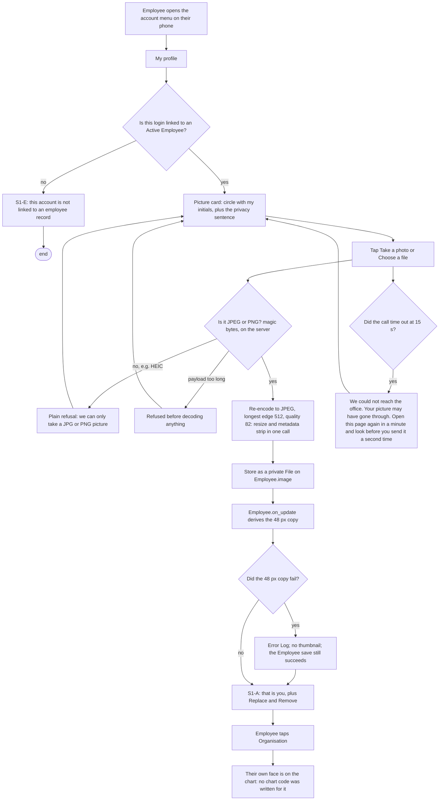
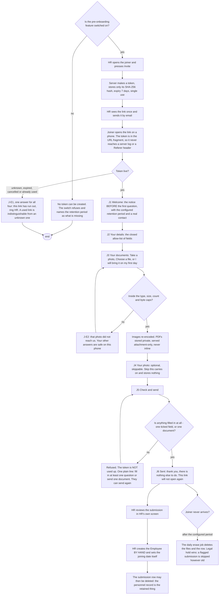

# 078 · Faces, my own profile, who is in this seat, and a joiner's first form — functional spec

## 0 · The answer first

**Most of this is already built. The honest new code is five things, and one of the eleven
fields Surbhi approved does not exist.**

The avatar already renders a photograph (`portal.js:276-279`, read today). Both chart
endpoints already send `image`. `/update-password` already works and already lands the
user back in the portal (`auth.py:99`). My Profile editing needs **no new permission
code** — permlevel 0 is already employee-writable and `refuse_own_locked_change`
(`employee_field_rights.py:140`) already refuses the rest on a person's own record.
`Employee Document Type` already exists with its own categories, verifier roles and grade
mappings. The access-granting settings mechanism — System Manager only, a refusal logged,
a `Version` row in the same transaction — already works, in
`alvoraa_org_structure/settings.py:170-231`.

**What is genuinely new: five things.**

| # | New thing | Rung | Why no cheaper rung |
|---|---|---|---|
| 1 | The photo upload endpoint, and the 48 px copy derived on the existing `Employee.on_update` chain | 4 · new code | No upload path for `Employee.image` exists outside Desk, and a frontline worker has no Desk. The 48 px copy is the measured exception (`07` §3.2: 720 KB vs 48 KB on first paint) |
| 2 | The mini-profile read endpoint, with a closed server allow-list | 4 · new code | No endpoint returns a chosen subset of Employee fields. `01a` F12 is why a permission level cannot do it: `employee_field_rights.py` locked **write**, deliberately leaving read open |
| 3 | The document streaming endpoint | 4 · new code | `Employee Document` is a child table (`istable: 1`, verified today); a rule at the row never reaches the file |
| 4 | Four settings keys and one card | 2 · configuration | `DefaultValue` keys through the existing `ACCESS_GRANTING` path. Rung 5 buys a permission surface, a migration and a list view and does nothing a key with a `Version` row does not |
| 5 | The pre-onboarding submission DocType, its Web Form, its token and its erase job | 5 · new DocType | A Web Form needs a doctype; `Employee` is refused (the absence-backfill trap); nothing shipped means "a person who has told us about themselves but is not yet an employee" |

**The one thing I am dropping, and it is a field Surbhi approved.**

> **`Employee` has no work-phone field.** `staff_api.py:69-71` says so in its own comment,
> written when slice 045 asked the same question: *"`company_email` and nothing else… there
> is no phone or extension field at all — `cell_number` is labelled 'Mobile' and is
> personal."* Verified today. So the 11th candidate field, **"Work phone"**, has nothing
> behind it. `01b` §6.3 even designs its empty state — *"where there is none, the value is
> 'Not recorded'"* — which would be **every** row, for every person, for ever. That is an
> acceptance criterion nobody can trigger, which `no-over-engineering.md` §6 calls scope
> smuggled in. **Ten fields, not eleven.** ⚠ DECISION A if Surbhi wants a work-phone field
> created; my recommendation is not to create one in this slice.

**Where the inputs disagree — what I followed.** Seven conflicts. Surbhi named the first
three; I found four more.

| # | Conflict | Followed | Why |
|---|---|---|---|
| 1 | **OPS-5 vs 078-SEC-5** on where the document-type tick lives. OPS-5 wants a Check on `Employee Document Type`; security says that doctype ships `write: 1` to HR Manager | **078-SEC-5.** A `DefaultValue` key in the access-granting set | Surbhi's instruction, and I verified the permission row today: `employee_document_type.json` grants HR Manager `write: 1`. A Check there would be editable in Desk by the exact role the card excludes — and at DTC that role is the Positions audience |
| 2 | **Lazy loading's contribution.** `01b` §5 credits it with 400 → 30 requests; `07` §3 measured first paint at **16 boxes and 16 faces**, set by `POS_OPEN_DEPTH = 1` (`portal.js:476`) and `POS_NAMES_SHOWN = 3` (`portal.js:802`) | **Operations.** Both constants verified today | Lazy loading still earns its place (it costs nothing and it helps the table), but it is not what makes this affordable. **AC-31 asserts the two constants and the face count** — OPS-21 |
| 3 | **"Cached for the rest of the session"** on the enlarged photo (`01b` §6.3.1) | **Operations.** Private files go out with `Cache-Control: no-cache` (`07` §3.1, measured), so it will not happen by itself | The spec requires the **JavaScript** to keep the loaded `` element or its blob URL in memory for the life of the page, keyed by employee. **No HTTP caching is claimed anywhere in the product's wording.** AC-47 |
| 4 | **Decision 6 (four lists behave the same) vs Decision 11 (the Web Form owns the joiner's field list)** | **Three pickers, and a fourth section that is not a picker** | A picker that writes into a Web Form's own field list is two mechanisms for one rule, and the joiner is who finds out when they disagree (`01b` §6.5.5, brief §11.1). ⚠ DECISION B — Surbhi's to overrule |
| 5 | **Decision 4 (documents follow Positions read) vs 078-SEC-3 and `01c` §0(2)**, which calls the HR-role gate *"the only control that makes the child-table trap survivable"* | **Decision 4.** The section follows Positions read | Her call, and at DTC it changes nothing — the audience is already HR Manager. **The cost is carried as named residual risk R1**, and I have asked for one wording change that costs nothing: the settings card's amber line names **the actual roles** that hold Read on `Alvoraa Position`, not only a count, so a widening is visible at the moment of the tick. AC-86 |
| 6 | **`01b` PF16 says "Company Issued" is a category value outside the doctype's own Select options.** `01c` §11 says it is inside | **`01c`, and I verified it myself today.** `employee_document_type.json` offers seven options: `Identity\nAddress\nEducation\nEmployment\nStatutory\nVerification\nCompany Issued` | PF16 is wrong. **No work follows from it.** Recorded so nobody writes a data-fix patch for a fault that is not there |
| 7 | **The photo's reach: `01`/`01b` say two surfaces, `01c` §0(1) says ten** | **`01c`.** Verified in code at nine cited call sites, the Organisation chart appearing twice | This is the whole of 078-PRIV-1. The notice must name the staff directory, which the design's draft did not. AC-8 |

**Two facts Surbhi verified herself today, used as fact and not re-derived.**

1. **Frappe's guest-upload allow-list genuinely holds.** `frappe/handler.py:132-143`: a
   non-empty `allowed_doctypes_for_guest_uploads` refuses an upload to any doctype not in
   it, with a `PermissionError`. Frappe tests both directions, and
   `test_guest_upload_for_empty_whitelist` proves an **empty** list lets a guest attach a
   file to **any** doctype. Two acceptance criteria follow and both are in: **AC-103** (the
   allow-list is set in the same change that turns the switch on, never after) and
   **AC-104** (a guest uploading to another doctype is refused).
2. **The restore proof (OPS-31) is not a gate on this slice.** It runs on dev in parallel
   during the build. It is in §17 Release, not in the acceptance criteria.

**Rule ids are slice-qualified throughout** — `078-SEC-n`, `078-PRIV-n`, `078-OPS-n`.
Plain `SEC-17` and `SEC-18` already exist in this codebase for field rights
(`employee_field_rights.py`) and access-granting settings
(`alvoraa_org_structure/settings.py`), and one grep must not conflate them.

**I am not a lawyer, and neither is any agent here.** §16 flags; it does not rule.

---

## 1 · Cross-module reach — named before anything is specified

| App | Touched how |
|---|---|
| **`alvoraa_portal`** | **Heavily.** `portal.js` (avatar, chart, table, drawer, My profile, settings card), `panels.css`, `home.html`, `org-settings.html`, `positions.html`, `drawers.html`, a new photo-upload endpoint, a new document endpoint, the pre-onboarding page and endpoints, the new submission DocType, `hooks.py` (one more `Employee.on_update` handler), `field_app_limits` reuse, `Alvoraa Photo Access Log` extended |
| **`hrms`** | `alvoraa_org_structure/register.py` (`image` on the assignment read), `alvoraa_org_structure/settings.py` (four keys join `DEFAULTS`, `LABELS` and `ACCESS_GRANTING`), `alvoraa_org_structure/api.py` (OPS-6 batching, OPS-20 the Organisation page's cap), `alvoraa_employee_documents` (read only — no change to `Employee Document` or `Employee Document Type`) |
| **`erpnext`** | **Read only.** `Employee` is read and written through the ORM. **No upstream edit.** `Employee.image`, `cell_number`, `personal_email`, `current_address`, `emergency_phone_number` are its fields |
| **`frappe`** | **Read only**, plus two **System Settings** values changed by configuration: `max_file_size = 5` (OPS-24) and `allow_guests_to_upload_files` + `allowed_doctypes_for_guest_uploads` (OPS-25). Both are site settings, not code |
| **`alvoraa_goals`** | **Not touched.** `goals_api.py:248, :1045` already selects `Employee.image`; it starts showing real faces once photos exist. No code change, and it is one of the ten surfaces 078-PRIV-1 must name |
| **`alvox_compensation`** | **Not touched.** Not installed (memory, 25 Sep 2026) |
| New app | **None.** Nothing here needs one |

**HRMS domains involved.** Org structure (the whole Positions page), **attendance**
(indirectly and importantly — the document endpoint and the table's faces draw from the
same 8 gunicorn slots as the 9 a.m. punch burst, `07` §3.3), **learning/goals and
appraisals** (they already carry `image`), **onboarding** (the joiner's form sits one step
before `Employee Onboarding`, which is untouched). **Payroll is not touched**, and
`rule_set_fields()` (`employee_field_rights.py:125`) is read only — as a deny list.

**Three personas, every surface.**

| Surface | CXO (all companies) | HR Manager (their companies) | Employee (own record) |
|---|---|---|---|
| My profile | Own record, like anybody | Own record, like anybody. **An HR login with no Employee row gets S1-E**, not a failure | **The whole point.** Their photo, their six details, their password |
| Faces on the chart | Recognise a face across six stores | Same | **Appears on it; cannot open it.** Gets faces on the Organisation page instead |
| Mini profile | Opens it | Opens it | **Never opens it** |
| Documents section | Follows Positions read (Decision 4) | At DTC, this is them | **Never.** Sees their own in My profile, as today |
| Settings card | Only if they hold System Manager | **Absent**, never greyed | Absent |
| Pre-onboarding | — | Issues the invite, reviews the submission, creates the Employee | — (they are not an employee yet) |

**The asymmetry, said plainly, because `product-context` §2 says to look at it hardest:**
the employee whose face and documents appear on the Positions page cannot open that page.
That is deliberate. It is also why 078-PRIV-1 (the notice) and 078-PRIV-5 (the access
record) exist: if a person cannot see the surface, the notice and the record are the only
ways they can ever know what happened.

---

## 2 · Questioning the ask before specifying it

This is a check, not a redo. The PM owns the problem and the priority.

| Check | Finding |
|---|---|
| **Is the stated problem the real one?** | **Yes, and the brief already traces it to a cause.** "Nobody has a photo" is not a symptom of reluctance — it is a symptom of there being no screen on which a phone-only employee can supply one (`Employee.image` is a Desk upload; frontline staff neither have nor should have Desk). The fix matches the cause. **Confirmed fact**, measured: 0 of 403 at PPJ, 0 at DTC |
| **What decision does each new screen drive?** | The mini profile answers *who is this, what do they do, since when* and saves an HR hop to Desk — a real decision shortcut, measured by the brief at 5 clicks → 2. The settings card drives one decision (what a reader may see) and is the only thing in this slice a competitor was not documented as doing. **The documents section drives no decision HR cannot already make from Desk** — that is `01a` §7's whole argument. Surbhi has decided it is in; I have carried it and asked for the one wording change in §0 conflict 5 |
| **Could the system act instead of displaying?** | For the photo: no — it cannot take a selfie for somebody. For the joiner's submission: it **could** create the Employee automatically, and **must not** — 078-SEC-12, because a back-dated joining date makes Frappe mark the person Absent for every day since and deleting the rows does not help (logged, DTC) |
| **Is anything a habit rather than a requirement?** | One thing. The "Preview what a reader sees" button survives because Zoho's own community thread proves what happens without it. The **document-open record** (078-PRIV-5) I checked hardest, because nobody asked for it: it stays, because it is the only way an employee who cannot open the page can ever ask "who looked at my Aadhaar" and get an answer that is not "we do not know" |

---

## 3 · Gap analysis — configure, extend, build new, drop

Every "today" column quotes a file I read in this worktree on **31 October 2026**.

### 3.1 My profile and the photo

| Requirement | What exists today | Verdict | Cost |
|---|---|---|---|
| Employee changes their own password | `/update-password` works, and `auth.py:99` `update_password` is registered in `hooks.py` as an `override_whitelisted_methods` so **Frappe's own endpoint already returns the user to the portal**. There is no link to it anywhere in the frame | **Configure** — a link and a line of copy | **S** |
| Employee edits their own level-0 details | Frappe HR already gives write on own record at permlevel 0. `employee_field_rights.py` LEVEL_1 (13 bank/statutory/salary) and LEVEL_2 (22 job/identity, plus every `rule_set_fields()` name) are already locked, and `refuse_own_locked_change` already refuses them on a person's own record. **No new permission machinery at all** | **Extend** — a panel and one save endpoint that intersects the tick with a closed constant | **S** |
| Employee uploads their own photo | **Nothing.** `Employee.image` is a Desk attach field. `uploadMyDocument` (`portal.js:4774`) posts to Frappe's `upload_file` for **documents**, so the browser-side plumbing exists but attaches to `Employee` with no resize, no type check and no strip | **Build new** — one endpoint, following `field_app_photos.py:84-114` exactly: length of the string first, magic bytes, re-encode, private `File` | **M** |
| Employee removes their own photo | Nothing | **Extend** — the same write, cleared, plus deleting two `File` rows | **S** |
| A bounded stored picture, metadata stripped | Frappe's uploader auto-optimises only **above 200 KB** and only in Desk (`FileUploader.vue:435`); `strip_exif_metadata_from_uploaded_images` is on but runs for `image/jpeg` **only** (`file.py:813-819`). So a PNG selfie keeps its GPS | **Build new** — one re-encode does the resize and the strip in one call (078-SEC-6, OPS-7, OPS-8, OPS-14) | **S** |
| The 48 px copy | **No image resizing anywhere in this repo** (`01a` F20). Frappe's `make_thumbnail` writes into `public/` (`file.py:561`) — wrong tool | **Build new**, in the existing `Employee.on_update` chain (`hooks.py:180-188`, which already carries four handlers) | **S** |
| The privacy sentence | Nothing | **Configure** — one translated string, rendered before the control | **S** |
| My profile when the account has no Employee row | **It throws.** Seen in a browser today (`01b` E2): `birthdays_this_month` fails for `hr@ppj.dev.alvoraa.co`, and the panel shows *"Something went wrong at the office."* `_get_employee` (`hr_api.py:300-308`) already filters `status = "Active"` — the pattern to copy | **Extend** — one state, S1-E | **S** |

### 3.2 Faces, the chart and the table

| Requirement | What exists today | Verdict | Cost |
|---|---|---|---|
| The card draws a photograph | **It already does.** `ocAvatar` (`portal.js:276-279`) returns `` when `p.image` is set and `` with two initials otherwise. `.oc-who .av` is already a 24 px circle with `object-fit:cover` | **Already there** | — |
| The Organisation page sends `image` | **It already does** — `api.py:177`, `:550` | **Already there** (but OPS-6: it is one `get_value` per person per node per expansion) | — |
| The Positions page sends `image` | **It does not.** `register.py:299-324` reads the assignment with `employee.reports_to` and `employee.status` already joined through link fields; `image` is simply not selected | **Extend** — one field on an existing read. **No extra statement** | **S** |
| Initials under the photo, not instead of it | Not today — `ocAvatar` returns one or the other | **Extend** — one circle, initials in it, the photo layered over at `opacity:0` until it loads. This single change gives the loading, failed and printed states for nothing | **S** |
| Faces in the table, names as links | The table is 120 rows, `limit_page_length=0`. `posFew` (`portal.js:816`) caps names at `POS_NAMES_SHOWN` | **Extend** — a table cell is ordinary markup, so a real `<a>` is safe. **But 215 faces over 120 rows, measured**, so the count must be bounded on purpose (OPS-19) | **M** |
| First paint stays affordable | **Measured: 16 boxes, 16 faces**, from `POS_OPEN_DEPTH = 1` and `POS_NAMES_SHOWN = 3` | **Already there** — and it must be **guarded**, because raising one constant to 2 takes first paint to 55 boxes and ~70 faces and nothing would warn anybody (OPS-21) | **S** |
| Faces off on Ctrl+P | Slice 069 already has a `@media print` block that strips flags, tags and the notice column; slice 065 already strips `.private` | **Configure** — one print rule beside them | **S** |
| Faces on the wall chart | Slice 069 built the print path | **Extend** — one tick, off by default, never remembered. ⚠ DECISION C | **S** |
| The Organisation page's own expansion | **Measured: one expansion from the root is 94 boxes and 185 people, and `ocNodeCard` has no 3-name cap.** This is the **employee-facing** page, so the ≤ 2.5 s / 3G budget binds here, not on Positions | **Extend** — apply the same cap of 3, or accept the number knowingly (OPS-20). ⚠ DECISION D | **S** |

### 3.3 The mini profile and the seat page

| Requirement | What exists today | Verdict | Cost |
|---|---|---|---|
| Somewhere for the profile to live | `.emp-drawer` exists: 480 px, slides from the right, `max-width:100vw` so full screen at 360 px. Already reused by the payslip, the scorecard and goals (`panels.css:543`) | **Already there** | — |
| The drawer behaves like a dialog | **It does not.** `drawers.html:112` — `#emp-drawer` has no `role="dialog"`, no `aria-modal`, no `aria-labelledby`, no Escape and no focus move. **The payslip drawer two lines above it has the first three** (`drawers.html:99`) | **Extend** — four attributes and two handlers, copying the drawer beside it | **S** |
| A chosen subset of Employee fields | **Nothing.** And `01a` F12 is the reason a permission cannot do it: `employee_field_rights.py` locked **write** on 35 fields and deliberately left **read** open to every role that reads Employee, so no screen would lose a field | **Build new** — one whitelisted read, a closed module constant, `register.may_view()` plus `employee_in_scope` | **M** |
| Scoping the reader | `access.py:289-301` `employee_in_scope` exists and fails closed, and its docstring records the exact trap not to re-make. `scripts/check_scope_traps.py` already fails CI on that trap | **Already there** — reuse, do not rebuild | — |
| "Change this seat" as a page | **It is a modal:** `positions.html:121` `
`, opened at `portal.js:2482`. **Three CI scripts name `#pos-editor`** — `scripts/check_portal_trays.js:79`, `scripts/check_positions_tree.js:710`, `scripts/browser_check_positions.js:180` | **Build new** — a page with its own address. **Retiring the modal changes three CI scripts**, which is a build consequence nobody has named yet | **M** |
| The photo enlarges | Nothing | **Extend** — one overlay inside the drawer, no new stored size (the 512 px JPEG is already there) | **S** |

### 3.4 Documents

| Requirement | What exists today | Verdict | Cost |
|---|---|---|---|
| A document type list with categories and scope | **`Employee Document Type` already exists**, module `Alvoraa Employee Documents`, with `category` (seven options, verified), `collect_from`, `mandatory_for_joining`, `has_expiry`, `applies_to_grades`, `applies_to_designations`, `verifier_roles`, `description` | **Already there** | — |
| Choosing which types appear | Nothing chooses | **Configure** — one `DefaultValue` key in the access-granting set. **Not** a Check on `Employee Document Type`, which ships `write: 1` to HR Manager (verified) | **S** |
| A row shape for the list | `loadMyDocuments` (`portal.js:4744-4772`) already renders type · category · mandatory · expiry · status badge · View | **Already there** — reuse the shape exactly | — |
| Serving the file safely | **Cannot be done by URL.** `Employee Document` is `istable: 1` (verified) and its `attachment` is an `Attach` field, so the file belongs to the **parent Employee** and Frappe's private-file gate falls back to the parent's read permission (`file.py:1009-1025`, per DevOps' read of the running image) | **Build new** — our own endpoint, on the payslip-PDF pattern (`hr_api.py:2184`: `frappe.local.response.filecontent / .filename / .type = "download"`) | **M** |
| Plan gating | `plan_employee_documents` already exists (`subscription.py:200`) and `loadMyDocuments` already hides its card when the feature is off | **Already there** | — |
| Recording who opened what | `Alvoraa Photo Access Log` already exists with `employee`, `employee_name`, `viewed_by`, `viewed_at`, `viewed_on_date`, read to **System Manager and HR Manager only** (verified in its JSON), and `field_app_access.log_photo_view` already applies the three narrowing rules | **Extend** — two columns (`document_type`, `source`) and `checkin` made optional. A second DocType buys a second permission surface and a second retention answer | **S** |

### 3.5 The settings card

| Requirement | What exists today | Verdict | Cost |
|---|---|---|---|
| Somewhere for the card | Organisation Settings is an existing portal page with ten `pf-card`s in one settled pattern — header, meta line, controls, hint (`org-settings.html`, verified) | **Already there** | — |
| Storing the four lists | `alvoraa_org_structure/settings.py` already holds `DEFAULTS`, `LABELS`, `get_cover_settings`, `set_cover_setting` as `DefaultValue` keys | **Configure** — four keys join the three tables | **S** |
| System Manager only, with a record | **`ACCESS_GRANTING` already does exactly this** (`settings.py:89-94`, `_set_access_setting:170-208`): System Manager only, anyone else refused and logged as a JSON line, and a `Version` row written in the same transaction naming the key, the old value and the new one | **Already there** — four keys join the frozenset | — |
| Rendering tags and a picker dialog | Nothing; `01a` F16 notes `get_cover_settings` is whitelisted and **no screen calls it today** | **Build new** — one card, three pickers | **M** |
| The audience count | Nothing counts it | **Extend** — one query for enabled users holding Read on `Alvoraa Position`. ⚠ carried from `01b` DECISION 7: **count people, not accounts** (on the PPJ copy 5 accounts hold HR Manager, of which 3 are real people) | **S** |

### 3.6 Pre-onboarding

| Requirement | What exists today | Verdict | Cost |
|---|---|---|---|
| A task list for HR after a hire | `Employee Onboarding` + `Employee Onboarding Template` ship in Frappe HR | **Already there, and not the thing** — it tracks what HR must do and never asks the joiner for anything. **Untouched by this slice** |— |
| A public login-free form | `hrms/hr/web_form/job_application/` ships with `login_required: 0` | **Configure** — a Web Form over our new doctype (Decision 11). Not `job_application` itself: it is recruitment and writes `Job Applicant` | **M** |
| A Web Form onto `Employee` | Possible | **Drop — refuse in writing.** A guest-writable Employee lets strangers create personnel records, consume the naming series, and trip the absence-backfill trap | — |
| Somewhere to hold a submission | Nothing means "told us about themselves, not yet an employee" | **Build new DocType** — the one rung-5 exception, justified above | **M** |
| A token that expires | **`Alvoraa App Invite` already does all of it** and its reasoning is written down: `status` Select `Waiting\nUsed\nCancelled\nRan out`, `token_hash`, **`retired_token_hash`**, `expires_at`, `lifetime_hours`, `cancel_reason`, and permissions to System Manager / HR Manager / HR User only (verified in its JSON) | **Extend** — copy the pattern onto the new doctype's own fields | **S** |
| A hardened public page | `www/enrol.py:12-28` already sets `no_cache`, `no_header`, `no_sidebar`, `X-Robots-Tag: noindex, nofollow`, `Cache-Control: no-store`, reads branding from site config only, and **never reads the token** — it is in the URL fragment | **Already there** — copy it | **S** |
| Rate limits that do not leak the token | `field_app_limits.py:43-48` already wraps Frappe's limiter and **hashes the argument first**, because Frappe writes the limiter's key value into Redis in clear. It also exposes `__alvoraa_limit__` on the function so a test can read every endpoint's limit | **Already there** — reuse | **S** |
| Guest uploads | `allow_guests_to_upload_files` is **0** and `allowed_doctypes_for_guest_uploads` is **empty** (measured). Frappe refuses an upload to a doctype outside a **non-empty** list (`frappe/handler.py:132-143`, Surbhi verified) | **Configure** — both in the same change, never one then the other | **S** |
| A retention period and an erase job | `field_app_photos.purge_old_checkin_photos` is the pattern — daily, legal hold wins, says what it did. **Its `0 = keep for ever` semantics must not be copied**: counsel's 18 Sep 2026 policy prohibits indefinite retention in so many words | **Extend** — one key, one daily job, `0`/unset means **off**, not "keep for ever" | **S** |
| A switch with a precondition | `ORG_SWITCH_NEEDS` / `_switch_missing` (`hr_api.py:3278-3306`) already refuses a switch whose preconditions are unmet and names what is missing | **Already there** — one more entry, whose precondition is a `Version` row on the retention key | **S** |

### 3.7 What I would drop

| # | Item | Why | Verdict |
|---|---|---|---|
| **D1** | **"Work phone" from the candidate list** | The field does not exist on `Employee` (verified). Its row would read "Not recorded" for 403 people for ever | **Drop.** Ten fields. ⚠ DECISION A |
| **D2** | **The fourth picker dialog on the settings card** | The Web Form owns the joiner's field list (Decision 11). Two pickers for one form will disagree and the joiner finds out. The section stays, as facts plus a link | **Drop the picker, keep the section.** ⚠ DECISION B |
| **D3** | **A retry on the failed enlarged picture** | `01b` already removed it. A retry is another request through 8 slots for something nobody is waiting on | **Drop** — confirmed |
| **D4** | **Any new CI gate** | `01c` 078-SEC-16 and `07` §3.11 both deleted theirs. `check_scope_traps.py`, `check_api_paths.py --max 0`, the `ignore_permissions` ceiling in `test_portal_security_010` and `run_dom_tests.js` already run and already cover the two mistakes this slice can make | **Drop** — nothing added to `ci.yml` |
| **D5** | **A monitoring alarm for the thumbnail hook** | Its symptom is "the faces are missing", which HR reports faster than a dashboard (OPS-34) | **Drop** |
| **D6** | **A backfill or patch for existing photos** | Measured 0 at PPJ, confirmed 0 at DTC. The backfill is empty, and OPS-13's fallback means it never needs one (OPS-16) | **Drop** |
| **D7** | **A data-fix for `Employee Document Type.category`** | `01b` PF16 is wrong; I verified the Select holds all seven values including "Company Issued" | **Drop** — nothing to fix |

---

## 4 · Process flow — the real sequence, unhappy paths included

### 4.1 An employee puts their face on their own record (the WOW)

**Unhappy paths that are requirements, not decoration:** no Employee row (S1-E), a HEIC
file (Decision 10), a payload larger than the ceiling, a timed-out save that **may have
succeeded**, and a 48 px copy that fails without taking an unrelated HR edit down with it
(OPS-13 — `Employee.on_update` fires on every save of 403 records, including during
payroll work).

### 4.2 HR answers "who is in this seat"

1. HR opens **Positions**. `register.may_view()` → Frappe's Read on `Alvoraa Position`.
2. The chart draws. **16 boxes, 16 faces** on first paint. Each circle carries the person's
   initials; a photograph fades in over them in 150 ms where one exists.
3. HR wants a name they do not recognise. Three routes, all in:
   - the **table** — the name is a real link;
   - the **seat tray** — opened by clicking the card. The card stays one `<button>`; a
     link inside it is invalid HTML and Chrome has already broken this page over it;
   - the **seat page** — "Change this seat", now a page with its own address.
4. The name opens the **drawer**. One component, one caller interface, from all three.
5. The drawer calls the profile endpoint — **its own call**, when the profile is opened,
   never columns on the table payload.
   - *Loading*: three grey bars, then "Getting the details…".
   - *10 s*: the `POS-PROFILE` failure with **Try again**.
   - *Out of scope*: a **refusal**, not an empty profile.
   - *Nothing ticked*: "Your organisation has not chosen any other detail to show here."
   - *A field the reader may not see*: the row is **absent** — not blank, not "hidden".
   - *The person has left*: "Kiran Sandhu left on 30 Sep 2026. You are looking at how the
     seat was, not how it is."
6. HR hovers the photograph. It enlarges to 240 px inside the drawer. **Escape closes the
   enlargement only**; a second Escape closes the drawer.
7. HR reads a document. The **View** link calls our own endpoint, which checks, in order:
   the page's own permission → the reader's scope on that employee → the row's parent is
   that employee → the row's type is ticked → the plan is on. Then it streams the file.
   **Opening it writes one row to the access record, once per viewer per document per day.**

**The unhappy path that matters most:** a reader scoped to one branch asks for an employee
in another. They get a **refusal**, and they never learn that such a person or such a
branch exists.

### 4.3 A System Manager decides what a reader sees

1. Organisation Settings → the new card, **"What people can see and change about each
   other"**. The card is **absent** for anyone who is not a System Manager — never greyed.
2. The card shows, at rest: the chosen field names as chips, the chosen document types by
   name with their category, the six My-Profile fields as chips, and the pre-onboarding
   facts. **Not counts.**
3. Above the document list, standing, in amber: "1 of these 3 is an identity, statutory,
   verification, employment or address document. The 7 people who can open the Positions
   page — HR Manager — can open the file itself, for everyone in their own companies and
   branches."
4. Press **Add or remove document types**. A dialog opens: the whole list, **grouped by
   category**, with the group name above each block, the real category as a chip on every
   row, who collects it, whether anybody has given one, and a **red line the moment a
   sensitive type is ticked**.
5. **Preview** is inside the dialog, showing what a reader sees for what is ticked *right
   now*.
6. **OK saves.** Its label names the consequence: "OK — 3 document types, seen by 7
   people". The page then says "Saved. 3 document types are now shown on the Positions
   page." and the "Last changed by…" line updates.
7. **Cancel writes nothing**, even if every box was changed.

**Unhappy paths:** an HR Manager who reaches the setter anyway is **refused and the
refusal is logged** with rule `078-SEC-5`; an off-list field posted directly is refused; a
value written straight into `DefaultValue` by any other route still produces nothing in
the profile response.

### 4.4 A joiner sends their details before day one

**Unhappy paths that are requirements:** the switch is off; the token is unknown, expired,
cancelled or used; an upload is refused on type, size, count or total bytes; **a joiner
taps through and sends nothing — refused, and the link still works afterwards (AC-110a,
AC-110b)**; nothing is stored before the token is validated; and **no joining date ever
comes from the form**.

---

## 5 · Data model — every field, and why an existing one cannot carry it

### 5.1 `Employee` (ERPNext) — read and written, never altered

**No new field on `Employee`.** This matters: 078-SEC-1's deny list exists precisely
because Employee already has roughly two hundred fields.

| Field | Used for | Note |
|---|---|---|
| `image` | The photograph | **Already there.** Attach. Private, because `Employee` does not set `make_attachments_public` |
| `cell_number`, `personal_email`, `current_address`, `emergency_phone_number` | Four of the six My-Profile write fields | **Verified in this repo** (`staff_api.py:69-73`, `test_directory_contact_045.py:85-86`). Permlevel 0 |
| `person_to_be_contacted`, `relation` | Emergency contact name and relation | `[UNVERIFIED — engineer to confirm]` these two ERPNext fieldnames. **`erpnext` is not in this worktree** — only `hrms`, `alvoraa_portal`, `alvoraa_goals` and `mobile` are. The labels come from `01b` §6.1 |
| `designation`, `department`, `branch`, `company`, `reports_to`, `grade`, `employment_type`, `date_of_joining`, `default_shift` | Nine of the ten profile fields | All already at **permlevel 2** (`employee_field_rights.py` LEVEL_2, verified today). Read is deliberately open, which is why the allow-list is the control and the permlevel is not |
| `company_email` | The tenth profile field, labelled **"Work email"** | `staff_api.py:82` already aliases it `work_email`. **The eleventh, "Work phone", has no field — dropped, D1** |
| `status` | Every "who am I" lookup filters `"Active"` | 078-SEC-8. `_get_employee` (`hr_api.py:300-308`) is the pattern to copy |

### 5.2 The derived 48 px copy

| Decision | Answer |
|---|---|
| Where | A **private `File`** row attached to the Employee, with its own `attached_to_field` |
| Why not a new field on Employee | ⚠ DECISION E. A `File` row needs no schema change and no migration; a custom field is one more column on the HR master and one more value in every `Employee` payload. **My recommendation: a `File` row, looked up by `attached_to_field`.** The engineer may find at the strategy gate that a per-person lookup defeats OPS-6's batching, in which case one Small Text custom field holding the URL is the cheaper answer — that is a measurement, not a preference |
| What reads it | Only the chart and the table. **Never the enlargement**, which uses the 512 px stored photo |
| What deletes it | Replacing or clearing the photo deletes the old row **and its bytes** (OPS-15) |
| Backfill | **None.** Zero photos exist, and the renderer falls back thumbnail → full photo → initials (OPS-13, OPS-16) |

### 5.3 Four `DefaultValue` settings keys

All four join `DEFAULTS`, `LABELS` **and `ACCESS_GRANTING`** in
`hrms/hrms/alvoraa_org_structure/settings.py`.

| Key | Type | Default | Holds |
|---|---|---|---|
| `alvoraa_positions_profile_fields` | comma-separated | **empty** | Which of the ten allow-listed fields a reader sees. Empty is the safe default, and the mini profile still opens with name and job role |
| `alvoraa_positions_document_types` | comma-separated | **empty** | Which `Employee Document Type` names appear. Empty means "No document types are shown on the Positions page. Nobody can open an employee's documents from there." — a statement of fact, not a gap to fill |
| `alvoraa_my_profile_fields` | comma-separated | **empty** | Which of the six allow-listed fields an employee may change. The photo is **not** in this list — it is always on |
| `alvoraa_joiner_retention_days` | integer | **unset** | 078-PRIV-7. **Unset or 0 means the feature is off**, never "keep for ever" |

**Why not a DocType per chosen field (rung 5):** it buys a permission surface, a migration
and a list view, and I cannot name one thing it does that a comma-separated key with a
`Version` row does not. **Why not a Check on `Employee Document Type` (rung 3):** that
doctype grants HR Manager `write: 1` (verified today), so the tick would be editable in
Desk by the role the card excludes. The reason is a permission row, not taste.

### 5.4 Two closed server constants — the real controls

| Constant | Contents |
|---|---|
| `POSITIONS_PROFILE_FIELDS` | `designation`, `department`, `branch`, `company`, `reports_to`, `grade`, `employment_type`, `date_of_joining`, `default_shift`, `company_email` — **ten** |
| `MY_PROFILE_WRITE_FIELDS` | `cell_number`, `personal_email`, `current_address`, `person_to_be_contacted`, `relation`, `emergency_phone_number` — **six**, all permlevel 0 |

**Never on either list, whatever is ticked** (078-SEC-1): pay and `ctc`, `salary_mode`,
`salary_currency`, every bank field, `pan_number`, `esi_number`,
`provident_fund_account`, `payroll_cost_center`, `employee_advance_account`,
`date_of_birth`, `cell_number` and `personal_email` *(on the Positions list)*, home and
permanent address, the emergency contact *(on the Positions list)*, `marital_status`,
`blood_group`, anything health-related, `relieving_date`, and **every field
`rule_set_fields()` names** (`employee_field_rights.py:125`).

**Blood group and marital status stay off both lists** — health and family data, and no
screen needs them (brief ⚠ DECISION 7).

### 5.5 `Alvoraa Photo Access Log` — extended, not replaced

| Change | Field | Type | Why |
|---|---|---|---|
| New | `document_type` | Link → `Employee Document Type`, read-only | Which type was opened. **Never the file, the file URL, the document number, or any value from the document** (078-PRIV-5) |
| New | `source` | Select: `Check-in photo` / `Employee document`, read-only, default `Check-in photo` | Two kinds of looking in one table. If their retention ever differs the job filters — a `WHERE` clause, not a redesign |
| Changed | `checkin` | Link, **made optional** | A document view has no check-in |

**Permissions unchanged:** read to System Manager and HR Manager only (verified in its
own JSON). **Three narrowing rules copied from `field_app_access.log_photo_view`:** only
when there is something to look at; **never a person looking at their own**; **one row per
viewer per document per day**, not one per refresh.

### 5.6 `Alvoraa Joiner Submission` — the one new DocType

The rung-5 exception, justified in §0: a Web Form needs a doctype, `Employee` is refused,
and nothing shipped means "a person who has told us about themselves but is not yet an
employee". It is also where the submission can be **reviewed**, and where it can be
**deleted** when the joiner never turns up.

| Fieldname | Type | Mandatory | Default | Notes |
|---|---|---|---|---|
| `status` | Select: `Invited` / `Submitted` / `Made an employee` / `Expired` / `Cancelled` | yes | `Invited` | §6.1 is the state table |
| `full_name` | Data | **no** | — | Inside 078-PRIV-9's closed allow-list. **Changed 31 Oct 2026 from mandatory to not mandatory**, because AC-110c says the only rule is "at least one ticked field or one document", and a `reqd` field here would be a restriction of ours on top of HR's ticked list. **⚠ If Surbhi wants the name always required, this is the one row to change** — see §21 |
| the other joiner fields | one column each | — | — | Exact list is ⚠ DECISION F. **No bank, salary, CTC or statutory identifier as a typed field.** Where an identity number is genuinely needed it arrives as one of the ticked document types, where it is a file under HR's existing verification flow rather than a searchable column on a guest-writable table |
| `employee` | Link → Employee, read-only | — | — | Set when HR creates the record. **Never set by the form** |
| `web_form_request` | Link → Web Form Request, read-only, hidden | — | — | **Corrected 31 Oct 2026.** Decision 11 chose Frappe's Web Form, so **Frappe's own `Web Form Request` row holds the key** and we hold only a link to it. The row is `autoname: hash`, so the name we store is not the key. **It is nulled when that row is destroyed**, which happens the moment the link stops working (AC-101) |
| ~~`token_hash`, `retired_token_hash`~~ | — | — | — | **Dropped 31 Oct 2026.** Both described a token of our own, from before Decision 11. There is no hash of ours to store, and `retired_token_hash` existed only to tell a dead token *"already used"* — which **AC-112 no longer allows**: a used link is answered exactly like an unknown one |
| `expires_at` | Datetime, read-only | yes | creation + 7 days | Frozen at creation |
| `submitted_at` | Datetime, read-only | — | — | |
| `legal_hold` | Check | — | 0 | The erase job skips a flagged row however old |
| `invited_by` | Link → User, read-only | yes | — | Audit: who issued the link |
| `cancel_reason` | Select | — | — | Pattern: `Alvoraa App Invite` |

**Permissions: no Guest row.** HR Manager and HR User read-only; System Manager full — the
shape `Alvoraa App Invite` uses. **No child table.** The uploads are `File` rows attached
to the submission, **never to `Employee`**.

### 5.7 System Settings — two configuration changes

| Setting | Today (measured by DevOps) | Required | Side effect, said out loud |
|---|---|---|---|
| `max_file_size` | `0` → Frappe's fallback of **25 MB per file**, while nginx allows a 50 MB body | **5** (MB) | **Site-wide.** It applies to every upload on the site, not only to documents. ⚠ DECISION G (OPS-24, DevOps Q8; their default is 5) |
| `allow_guests_to_upload_files` + `allowed_doctypes_for_guest_uploads` | off, and the allow-list **empty** | On, **with the allow-list naming only `Alvoraa Joiner Submission`, in the same change** | On with an empty list lets a guest attach a file to **any** doctype — Frappe's own `test_guest_upload_for_empty_whitelist` proves it. AC-103, AC-104 |

---

## 6 · States and transitions

### 6.1 `Alvoraa Joiner Submission` — the only workflow in this slice

| State | Who may move it | Next states | What becomes read-only | Who is notified |
|---|---|---|---|---|
| **Invited** | HR (create), the token holder (submit), the daily job (expire) | Submitted · Expired · Cancelled | Nothing yet | The joiner gets the link, sent by HR |
| **Invited, and a submission was refused** | — | **It stays `Invited`** | Nothing | Nobody. A refused submission — nothing filled in at all — **is not a state change**: the row stays `Invited` and the link keeps working (AC-110a, AC-110b) |
| **Submitted** | HR only | Made an employee · Cancelled | **Everything the joiner sent.** "You will not be able to change it here afterwards" (J5) | **Nobody automatically.** ⚠ DECISION H: I recommend no automatic notification — HR issued the invite and is watching for it, and an email naming a joiner is one more place their data travels |
| **Made an employee** | — | **terminal** | All of it. `employee` is set | — |
| **Expired** | the daily job, at 7 days | **terminal** | All of it | Nobody. The joiner is told at the door (J-E1) |
| **Cancelled** | HR | **terminal** | All of it | Nobody |

**Terminal and irreversible:** `Made an employee`, `Expired`, `Cancelled`. **Nothing here
is reversible** — a token cannot be revived, as `Alvoraa App Invite` already establishes.
Deleting the submission (by the erase job, or by HR once the Employee exists) is the only
way out, and the Employee record is the retained thing.

**No workflow is added anywhere else in this slice.** Not on `Employee`, not on
`Employee Document`, not on the settings. A status value nothing reads is banned.

### 6.2 Every UI state, with where it is drawn

`01b` §7 lists 35 states across 7 screens. All of them are requirements.
✓ = drawn in `prototype-v4.html`. **One state here is not in the prototype**: the
joiner who fills in nothing and presses Send. The designer did not draw it; the build
let it through, consumed the link and lost the joiner (D-3), so it is a requirement now.

| Area | State | Drawn | AC |
|---|---|---|---|
| Chart | Nobody has a photo — **exactly today's chart**, no placeholder, no message, no prompt | ✓ | AC-26 |
| Chart | Some have, some have not — same size circles, nothing jumps | ✓ | AC-27 |
| Chart | Photos still arriving — initials underneath, 150 ms fade | ✓ | AC-28 |
| Chart | One photo failed — initials stay, **no message, no icon, no retry** | ✓ | AC-29 |
| Chart | Print and the wall chart, faces off | ✓ | AC-38, AC-39 |
| Chart | 24 px circle vs 40 px photo | ✓ | ⚠ DECISION C |
| Chart | A 25-person seat — three names, then "+22 more in this seat" | ✓ | AC-30 |
| Seat tray | The complete list for a big seat — **every name is a control that opens the shared drawer** | ✓ | AC-33a, AC-33b |
| Table | Faces and linked names | ✓ | AC-32, AC-33 |
| Drawer | Normal | ✓ | AC-42 |
| Drawer | Loading, then the `POS-PROFILE` failure at 10 s with **Try again** | ✓ | AC-43 |
| Drawer | Nothing ticked | ✓ | AC-44 |
| Drawer | Documents off (plan off, or none ticked) — **no section at all** | ✓ | AC-45 |
| Drawer | The person has left | ✓ | AC-46 |
| Drawer | A field the reader may not see — the row is **absent** | described, §6.3 | AC-52 |
| Drawer | Picture enlarged, 240 px | ✓ | AC-47 |
| Drawer | Enlarged, then the pointer leaves — **it closes by itself**; a click **pins** it | ✓, §6.3.1 | AC-47a, AC-47b |
| Drawer | Enlarged and still arriving — the 48 px copy blurred, no spinner | ✓ | AC-48 |
| Drawer | Enlarged and the full picture failed — the blurred copy stays, no retry | ✓ | AC-49 |
| Drawer | No photo — **the photo is not a button at all** | ✓ | AC-50 |
| Seat page | The page itself, with "← Positions" | ✓ | AC-54 |
| Seat page | A name opens the drawer | ✓ | AC-57 |
| Seat page | A name opens in place | ✓ | **not adopted** — Decision 5 |
| My profile | No photo (today's state) | ✓ | AC-1 |
| My profile | Has a photo | ✓ | AC-7 |
| My profile | Sending — "You can keep using the page" | ✓ | AC-6 |
| My profile | Send failed, "may have gone through" | ✓ | AC-6, AC-19 |
| My profile | Nothing ticked to edit | ✓ | AC-17 |
| My profile | No Employee record (S1-E) | ✓ | AC-18 |
| My profile | **Four cards: picture, details, documents, password** — the documents card moved into this panel | ✓, §6.1 | AC-20 |
| My profile | Documents card hidden when the plan is off | described | AC-20a |
| Settings | At rest, showing every chosen field and type by name | ✓ | AC-82 |
| Settings | Each picker open, laptop and full-screen phone | ✓ | AC-88, AC-91 |
| Settings | The picker footer — laptop **Preview · Cancel · OK**, phone **OK first** | ✓, §6.5.4 | AC-89, AC-89a |
| Settings | Nothing chosen | ✓ | AC-85 |
| Settings | 12 document types chosen — the tall case | ✓ | AC-87 |
| Settings | "Remove on the tag" | ✓ | **not adopted** — Decision 6 |
| Settings | Saved, with the confirmation line | ✓ | AC-90 |
| Settings | Both pre-onboarding options | ✓ | ⚠ DECISION B |
| Settings | Not a System Manager — **the whole card absent**, not greyed | described, §8 | AC-96 |
| Joiner | Welcome, details, documents, photo, check, sent | ✓ | AC-105, AC-107, AC-108a, AC-108b, AC-108c, AC-109, AC-110, AC-113 |
| Joiner | **Nothing filled in at all — refused, and the link still works** | not drawn; required by D-3 | AC-110a, AC-110b, AC-110c |
| Joiner | Link expired, upload failed, already submitted — **the first and the third are the same screen** | ✓ | AC-111, AC-117, AC-125 |
| Everywhere | Hindi — Devanagari runs about 30 % longer | ✓ | AC-142 |
| Everywhere | Dark theme | ✓ | AC-133 |

---

## 7 · Permission and visibility matrix

### 7.1 Role × object × operation

`E` = Employee · `M` = line manager · `HRU` = HR User · `HRM` = HR Manager ·
`SM` = System Manager · `G` = Guest holding a live token · **—** = nothing.

| Object or path | E | M | HRU | HRM | SM | G |
|---|---|---|---|---|---|---|
| `Employee.image` — own: upload, replace, remove | **own** | own | own | own | own | — |
| The six My-Profile write fields — own | **RW own** | own | own | own | own | — |
| `Employee` locked fields, levels 1 and 2 — own record | **—** | — | — | **— refused on own record** | **— refused on own record** | — |
| Mini-profile endpoint | — | **only where the tenant granted Read on `Alvoraa Position`** | same | **yes at DTC** | yes | — |
| The document list inside the mini profile | — | **follows Positions read (Decision 4)** | same | **yes at DTC** | yes | — |
| A document file, through our endpoint | own, in My profile, as today | Positions read + scope + ticked type + plan | same | same | same | — |
| `Alvoraa Photo Access Log` | **—** | **—** | **—** | **R** | **R** | — |
| The four settings keys | — | — | **— refused and logged** | **— refused and logged** | **RW** | — |
| `Employee Document Type` in Desk | R | R | R | **RW — unchanged, and this is exactly why the tick is not there** | RW | — |
| `Alvoraa Joiner Submission` | — | — | **R** | **R** | **full** | **its own row, via the token, until submit** |
| The joiner upload endpoints | — | — | — | — | — | **token-bound only** |
| Creating the `Employee` from a submission | — | — | **by hand** | **by hand** | by hand | **never** |

**Row-level rules.** The mini profile and the document endpoint both require
`register.may_view()` **and** `employee_in_scope(employee_id)` from
`hrms/hrms/alvoraa_hr_core/access.py:289-301`. **Do not build a new scope helper**, and do
not write `dict(permitted_employee_filters(user), name=chosen_id)` —
`scripts/check_scope_traps.py` already fails CI on that, and the helper's own docstring
explains why: both `NO_EMPLOYEES` and `ALL_EMPLOYEES` are keyed on `name`, so the caller's
own `name` would replace the refusal and a user with no companies would be let in.

### 7.2 The negative cases — who must NOT see what

These are the rows that need a test. Each has a "must not" story and an AC.

| # | Must not | Who | Enforced by | AC |
|---|---|---|---|---|
| N1 | See **pay, CTC, bank, PAN, Aadhaar, ESI, PF, salary mode, date of birth, personal mobile, personal email, home address, emergency contact, marital status, blood group, relieving date, or any field a payroll rule set names** on the mini profile — **whatever is ticked, whatever their permlevel** | every Positions reader, HR Manager included | 078-SEC-1, a closed server constant | AC-51 |
| N2 | See, or learn of the existence of, **anyone outside their company and branch scope** | every Positions reader | 078-SEC-2, `employee_in_scope`, fails closed | AC-52, AC-53 |
| N3 | Change **any of the four settings lists**, anywhere — including in Desk | **HR Manager**, HR User, everyone but System Manager | 078-SEC-5, the `ACCESS_GRANTING` path; and the tick does not exist on `Employee Document Type` | AC-93, AC-94, AC-95 |
| N4 | Write a **permlevel-1 or -2 field** through the My Profile save | every employee, HR included on their own record | 078-SEC-7 plus `refuse_own_locked_change` | AC-21, AC-22 |
| N5 | Upload a photo onto **somebody else's** record | every employee | 078-SEC-6: own Active Employee only | AC-23 |
| N6 | Open My profile or upload a photo once their Employee is `Left`, even with a live session | a leaver — **ERPNext does not disable their login** | 078-SEC-8: `status = "Active"` on every lookup | AC-24 |
| N7 | Read the **document-open record** | every ordinary employee and line manager | the existing doctype permissions | AC-81 |
| N8 | **Print** a face on Ctrl+P, or a document anywhere | everyone | the print rules beside 065's and 069's | AC-38, AC-80 |
| N9 | Read, list or enumerate **any** `Alvoraa Joiner Submission`, or learn whether a token, a person or an email address exists | **Guest**, and anyone holding a dead token | 078-SEC-13, 078-SEC-14 | AC-123, AC-124, AC-126 |
| N10 | Upload to **any doctype other than `Alvoraa Joiner Submission`** | Guest | a non-empty `allowed_doctypes_for_guest_uploads` | AC-104 |
| N11 | Have a photo **matched, compared, scored, or used to confirm who checked in**, or reach a model prompt | the product itself, now and later | 078-PRIV-3, a refusal plus a static test | AC-25 |
| N12 | Have a **joiner's documents collected at a real tenant** before counsel's retention number arrives | every tenant with real joiners | 078-PRIV-7, the switch precondition | AC-118, AC-119 |

### 7.3 The visibility delta, stated plainly

| Who | Could not see before | Can see after |
|---|---|---|
| Every employee in the company | — | **Every colleague's face** — in the staff directory, the Organisation chart, team pages, Home, the Time screens, Goals and the HR people list — **from the moment the first photo is uploaded, with no further change by anybody.** The exposure is created by the upload, not by this slice's code (`01c` §0(1), nine cited call sites, ten with the chart's two) |
| Colleagues receiving a birthday email | — | **A photo URL in the email body**, where the HR Setting is on (`employee_reminders.py:180` → `birthday_reminder.html:7`). Whether it is on at any tenant **could not be checked — that is production** (`01c` S2) |
| Whoever the tenant let onto Positions | A name | **Ten work facts, and an enlarged face at 240 px** |
| Whoever the tenant let onto Positions | Documents only through Desk | **Identity, statutory, financial and background-check documents, reachable from a structure page.** This is the widening. Decision 4 declined the HR-role gate; at DTC the audience is already HR Manager, so **today it changes nothing** — and R1 is the named risk if a tenant ever widens Positions read |
| HR Manager, System Manager | — | **Who opened whose document, and when** |
| Nobody | — | **No new field joins any existing payload.** The mini profile is its own call (078-PRIV-4) |

---

## 8 · The epic and its user stories

### 8.1 The epic

> **078 · My face, my details, and who is in this seat.**
> An employee puts their own photograph and their own corrected details on their own
> record from a phone; those faces appear wherever colleagues already see their names; HR
> and the owners can open a short, deliberately chosen profile from the Positions page; a
> System Manager decides once what that profile shows; and a new joiner sends their details
> and documents before day one without an account.

**Within the epic, one thing must be built and switched on first.** Until photographs
exist, every face in this design is a pair of initials. Both the designer (`01b` §15) and
DevOps (OPS-37) say the same, and I agree: **if the build runs out of time, the thing to
cut is the chart faces, not the photo upload.**

### 8.2 Stories

Personas are from `product-context.md`. Size is story points on the YouTrack scale
(1, 2, 3, 5, 8). Every story was checked against INVEST; where it failed "small" it was
split, and the splits are named.

#### My profile — the employee's own record

| ID | Story | Pts | Screen | Carries | ACs |
|---|---|---|---|---|---|
| **US-1** | As a **frontline employee**, I want to add my own photograph from my phone camera in one tap, so that colleagues recognise me and I do not have to ask HR | 5 | My profile · S1, S1-A, S1-B | 078-SEC-6, 078-PRIV-1, OPS-7, OPS-8, OPS-14 | AC-1 … AC-9, AC-3a |
| **US-2** | As an **employee**, I want to replace or remove my own photograph at any time, so that the picture of me is one I chose and I can withdraw it | 2 | My profile · S1-A | 078-PRIV-2, OPS-15 | AC-10 … AC-13 |
| **US-3** | As an **employee**, I want to correct the details my organisation has opened to me — my mobile, my personal email, where I live and who to ring in an emergency — so that my record is right without a message to HR | 3 | My profile · S1-C | 078-SEC-7 | AC-14 … AC-16 |
| **US-4** | As an **employee**, I want to reach the password page from My profile and come straight back, so that I am not locked out and do not have to ask HR for a new password | 1 | My profile · S1-F | — | AC-17a, AC-17b |
| **US-5** | As an **administrator who is not a member of staff**, I want My profile to tell me plainly that this account has no employee record, so that I do not see a server failure on what is about to be every employee's main screen | 2 | My profile · S1-D, S1-E, S1-G | 078-SEC-8, PF13, PF17 | AC-17, AC-18, AC-19, AC-20, AC-20a |
| **US-6** | **Must not.** As an **employee**, I must not be able to change my own job title, pay, bank or identity fields, nor anything on anybody else's record, so that a self-service screen never becomes a way around ALV-215 | 2 | — | 078-SEC-7, 078-SEC-8 | AC-21 … AC-24 |

#### The stored picture

| ID | Story | Pts | Screen | Carries | ACs |
|---|---|---|---|---|---|
| **US-7** | As the **person who runs this bench**, I want one bounded JPEG and one 48 px copy made once at upload, by a handler that can never fail an Employee save, so that the chart is affordable and a bad photograph cannot break an unrelated HR edit | 5 | — | OPS-12, OPS-13, OPS-15, OPS-16, 078-SEC-6 | AC-5, AC-9, AC-13, AC-25a, AC-25b |
| **US-8** | **Must not.** As an **employee**, my photograph must never be matched, compared, scored, or used to confirm who checked in, so that a directory picture never becomes facial recognition at work | 1 | — | 078-PRIV-3 | AC-25 |

#### Faces where names already are

| ID | Story | Pts | Screen | Carries | ACs |
|---|---|---|---|---|---|
| **US-9** | As a **CXO**, I want faces on the hierarchy cards with initials where there is no photograph, so that I can recognise a person across six stores without opening anything | 3 | Chart | PF2, PF12, brief ⚠ DECISION 2 (a) | AC-26 … AC-30 |
| **US-10** | As an **HR Manager**, I want a face and a clickable name on every row of the table, so that I can go from a list to a person in one click | 3 | Table | brief Decision 2 | AC-32, AC-33 |
| **US-11** | As the **person who runs this bench**, I want first paint pinned to 16 boxes and 16 faces by an assertion, so that a later change to one constant cannot quietly multiply the request count by four | 2 | Chart | OPS-21, OPS-38 | AC-31, AC-34 |
| **US-12** | As a **driver punching in at 9 a.m.**, I want the table's faces bounded on purpose rather than left to the browser, so that HR opening a 120-row table on a phone does not put my check-in in a queue | 2 | Table | OPS-19, OPS-18 | AC-35, AC-36 |
| **US-13** | As a **frontline employee on a 3G phone**, I want the Organisation page's expansion bounded on purpose, so that the one chart I can open does not become the heaviest page in the product | 3 | Organisation page | OPS-20, OPS-6 | AC-37, AC-37a |
| **US-14** | As an **HR Manager**, I want nothing private on a printed chart, so that a sheet on a staff-room wall does not carry 55 faces past a customer | 2 | Chart · print | brief ⚠ DECISION 5 | AC-38, AC-39, AC-40 |

#### Who is in this seat

| ID | Story | Pts | Screen | Carries | ACs |
|---|---|---|---|---|---|
| **US-15** | As an **HR Manager**, I want a short profile fetched when I open it, from a closed server list and scoped to my own companies and branches, so that I learn what I need and the browser is never sent 4,030 personal values | 5 | Drawer | 078-SEC-1, 078-SEC-2, 078-PRIV-4, PF11 | AC-41, AC-51, AC-52, AC-53, AC-61 |
| **US-16** | As a **CXO**, I want one mini profile used from every place a name is clickable, with all six of its states, so that the same question always gets the same answer and the two versions cannot drift apart | 5 | Drawer | `01b` §6.3, requirement 11 | AC-42 … AC-46, AC-58 |
| **US-17** | As a **keyboard or screen-reader user**, I want the drawer to behave like a dialog — named, modal, closable by Escape, returning focus — so that I can use it at all | 3 | Drawer | PF7, WCAG 2.2 AA | AC-59, AC-60 |
| **US-18** | As a **CXO**, I want to hover, tap or press Enter on the photograph and see it at about 240 px, so that I can match a face to someone I met once at a store two months ago | 3 | Drawer | brief Decision 8 | AC-47 … AC-50, AC-62 |
| **US-19** | **Must not.** As an **employee**, a Positions reader must not see my pay, bank, identity, date of birth, home address or personal contact details, and must not learn that I exist if I am outside their branch, so that a wrong tick cannot become a disclosure | 3 | Drawer | 078-SEC-1, 078-SEC-2 | AC-51, AC-52, AC-53 |

#### The seat page

| ID | Story | Pts | Screen | Carries | ACs |
|---|---|---|---|---|---|
| **US-20** | As an **HR Manager**, I want "Change this seat" to be a page with its own address, so that I can send it to a colleague and I am not working inside a modal | 5 | Seat page | brief Decision 5, `01b` §6.4 | AC-54, AC-55, AC-56 |
| **US-21** | As an **HR Manager**, I want a name on the seat page to open the same drawer the rest of the product opens, so that I learn one behaviour for one job | 1 | Seat page | brief Decision 5, `01b` ⚠ DECISION 10 (a) | AC-57 |

#### Documents on the profile

| ID | Story | Pts | Screen | Carries | ACs |
|---|---|---|---|---|---|
| **US-22** | As an **HR Manager**, I want the document types my organisation chose listed on a person's profile, in the row shape My profile already uses, so that I can read a document where the question is asked | 3 | Drawer · S3-D | brief Decision 3, `01a` F14 | AC-63, AC-64, AC-65, AC-45 |
| **US-23** | As an **employee**, I want every document file served by our own endpoint that checks who is asking, their scope, the row's parent and the ticked type, so that the ticked list is not decoration | 5 | Drawer · S3-D | 078-SEC-4, OPS-22, OPS-23, OPS-24 | AC-66 … AC-72 |
| **US-24** | As an **employee**, I want who opened my document and when to be recorded, so that "who looked at my Aadhaar" has an answer that is not "we do not know" | 3 | — | 078-PRIV-5, OPS-23, DevOps Q9 | AC-73 … AC-77 |
| **US-25** | **Must not.** As an **employee**, nobody outside the Positions page's own audience and scope may reach my documents, and no document may ever be printed or appear in a screen share, so that a faster door for HR is not a wider one for everyone | 2 | Drawer | 078-SEC-3 **declined** → scope + plan + 065 + 069; R1 | AC-78 … AC-81 |

#### The settings card

| ID | Story | Pts | Screen | Carries | ACs |
|---|---|---|---|---|---|
| **US-26** | As a **System Manager**, I want the card to show what is actually chosen and what it means, by name and in words, so that a wrong tick made six months ago is found by the next person who scrolls past | 5 | Settings | `01b` §6.5.1-6.5.3, R7 | AC-82 … AC-87 |
| **US-27** | As a **System Manager**, I want one button, one dialog with the warning and the preview inside it, an OK that names the consequence and saves, and a Cancel that writes nothing, so that nothing is ever left unsaved and nothing is ever saved by accident | 5 | Settings | brief Decision 6, `01b` §6.5.2, §6.5.4 | AC-88 … AC-92 |
| **US-28** | As a **System Manager**, I want these four lists treated as access-granting settings — mine alone to change, with a record of every change — so that a decision about who sees whom is attributable a year later | 3 | Settings | 078-SEC-5 | AC-93, AC-94, AC-97 |
| **US-29** | As a **System Manager**, I want the audience figure to count **real enabled people** who can open the Positions page, so that "7 people" means seven people and not five accounts | 2 | Settings | `01b` ⚠ DECISION 7 | AC-98, AC-99 |
| **US-30** | **Must not.** As an **employee**, an HR Manager must not be able to change what a reader sees about me — not on the card and not in Desk — so that the System-Manager-only rule is not bypassed by a doctype permission | 2 | Settings | 078-SEC-5 | AC-95, AC-96 |

#### Pre-onboarding

| ID | Story | Pts | Screen | Carries | ACs |
|---|---|---|---|---|---|
| **US-31** | As an **HR Manager**, I want to invite one joiner with a link that runs out and works once, so that identity documents cannot be uploaded by anybody who finds or is forwarded it | 5 | — | 078-SEC-9, brief ⚠ DECISION 11 | AC-100, AC-101, AC-102, AC-111, AC-112 |
| **US-32** | As a **new joiner with no account**, I want to read what happens to my data before the first question and then fill the form in once on my phone, so that I start the job without a morning of paperwork | 5 | Joiner · J1, J2, J5, J6 | 078-PRIV-8, 078-PRIV-9 | AC-105 … AC-110, **AC-110a, AC-110b, AC-110c** |
| **US-33** | As a **new joiner**, I want to photograph a document instead of scanning it, or say "I will bring it on my first day", so that the form is not a wall when I have no scanner and a poor signal | 5 | Joiner · J3, J4, J-E2 | 078-SEC-11, OPS-24, OPS-29 | AC-113 … AC-117, **AC-108a, AC-108b, AC-108c (J4)** |
| **US-34** | As the **person who runs this bench**, I want the guest-upload allow-list set in the **same change** that turns the switch on, so that there is never a moment when a guest can attach a file to any doctype on the site | 2 | — | OPS-25, Surbhi's verified fact | AC-103, AC-104 |
| **US-35** | As the **person who runs this bench**, I want every public path rate-limited per token and per caller address, with the token hashed before it reaches Redis, so that one forwarded link cannot flood the disk and no secret is stored in clear | 3 | — | 078-SEC-10, OPS-26, OPS-30 | AC-120, AC-121, AC-122 |
| **US-36** | As an **HR Manager**, I want to read what a stranger sent and then create the Employee myself, setting the joining date, so that nothing becomes a personnel record without a human and the absence-backfill trap is never tripped | 3 | — | 078-SEC-12 | AC-127, AC-128, AC-129 |
| **US-37** | As a **data protection owner**, I want the form shipped off and impossible to switch on until somebody deliberately sets a retention period, so that no real person's documents are collected while counsel's number is outstanding | 5 | — | 078-PRIV-7, brief ⚠ DECISION 13 | AC-118, AC-119, AC-130 |
| **US-38** | As a **new joiner who never arrived**, I want everything I sent deleted after the configured period, so that my identity scans do not sit in a company's files for ever | 3 | — | 078-PRIV-6 | AC-131a … AC-131d |
| **US-39** | **Must not.** As a **stranger on the internet**, I must learn nothing — not whether a token, a person or an email address exists, not any submission, not any employee's data — so that a public page is not an existence oracle | 3 | Joiner · J-E1 | 078-SEC-13, 078-SEC-14, 078-SEC-15 | AC-123 … AC-126, AC-132 |
| **US-40** | As an **HR Manager**, I want to see that submissions never exceed links issued, so that a forwarded link used by strangers is visible before HR notices records for people they never invited | 2 | — | OPS-28, OPS-33 | AC-134, AC-135 |

#### Proving any of it

| ID | Story | Pts | Screen | Carries | ACs |
|---|---|---|---|---|---|
| **US-41** | As the **test engineer**, I want the fixture set this slice is unobservable without — photographs including a **PNG carrying GPS EXIF**, four document rows with real files, and two differently scoped HR users — so that "0 findings" means something | 3 | — | `01c` §9, slice 028 lesson 1 | AC-136 … AC-140 |
| **US-42** | As an **employee**, I want every new string translatable with a Hindi entry, so that the frontline worker this slice is for can read it | 2 | all | `product-context` §5 | AC-141, AC-142, AC-143 |

**Total: 42 stories, 128 points.** Nothing is an 8. Two stories were split to get there:
"the joiner fills in the form" became US-32 (the form and its notice) and US-33 (the
uploads); "faces on the chart" became US-9 (drawing them), US-11 (the guard) and US-12
and US-13 (the two surfaces where the count actually bites).

**INVEST notes where a story is marginal.**

- **US-4** is a 1. It is not independent of US-5 (both live in the same panel) but it is
  separately valuable and separately testable, and merging it would hide the one thing it
  carries: `01b` E3, that the page it opens is Frappe's own, in English, with "Back to
  sign in". ⚠ DECISION I.
- **US-11** fails "valuable to a user" on its face — it is an assertion. It stays a story
  because `07` §3 answer 1 is explicit that two constants, not lazy loading, are what make
  the whole design affordable, and a guard nobody wrote down is a guard that goes.
- **US-34** is two acceptance criteria and almost no code. It is a story because Surbhi
  asked for both criteria by name and because the order of two configuration changes is
  the entire control.
- **US-41** has no persona in `product-context`; its persona is the test engineer. It
  stays, because `01c` §9 is right that without it every document and photo control passes
  against nothing.

### 8.3 YouTrack-ready table

**Do not create these issues.** That is Surbhi's call.

| Summary | Description (first line) | Persona | Pts | ACs | Requirements carried |
|---|---|---|---|---|---|
| 078 · Add my own picture from my phone | As a frontline employee I want to add my own photograph in one tap | Frontline employee | 5 | AC-1–AC-9, AC-3a | 078-SEC-6, 078-PRIV-1, OPS-7/8/14 |
| 078 · Replace or remove my own picture | As an employee I want to replace or remove my photograph at any time | Employee | 2 | AC-10–AC-13 | 078-PRIV-2, OPS-15 |
| 078 · Correct my own details | As an employee I want to correct the details HR has opened to me | Employee | 3 | AC-14–AC-16 | 078-SEC-7 |
| 078 · Change my password from My profile | As an employee I want to reach the password page and come back | Employee | 1 | AC-17a/b | — |
| 078 · My profile when there is nothing to show | As an administrator who is not staff I want a plain message, not a failure | Employee / admin | 2 | AC-17–AC-20, AC-20a | 078-SEC-8 |
| 078 · Must not: self-service is not a way round field rights | As an employee I must not change my job, pay, bank or identity fields | Employee | 2 | AC-21–AC-24 | 078-SEC-7, 078-SEC-8 |
| 078 · One bounded JPEG and one 48 px copy, made once | As the bench owner I want a handler that can never fail an Employee save | Ops | 5 | AC-5, AC-9, AC-13, AC-25a/b | OPS-12/13/15/16, 078-SEC-6 |
| 078 · Must not: a photo never reaches matching or a model | As an employee my picture is never scored or matched | Employee | 1 | AC-25 | 078-PRIV-3 |
| 078 · Faces on the hierarchy cards | As a CXO I want faces with initials where there is no photo | CXO | 3 | AC-26–AC-30 | PF2, PF12 |
| 078 · Faces and linked names in the table | As an HR Manager I want a face and a clickable name on every row | HR Manager | 3 | AC-32, AC-33 | Decision 2 |
| 078 · Pin first paint to 16 boxes and 16 faces | As the bench owner I want an assertion on two constants | Ops | 2 | AC-31, AC-34 | OPS-21, OPS-38 |
| 078 · Bound the table's faces on purpose | As a driver punching in I want HR's table not to queue my check-in | Frontline employee | 2 | AC-35, AC-36 | OPS-19, OPS-18 |
| 078 · Bound the Organisation page's expansion | As a frontline employee on 3G I want the one chart I can open to stay light | Frontline employee | 3 | AC-37, AC-37a | OPS-20, OPS-6 |
| 078 · Nothing private prints | As an HR Manager I want no faces on Ctrl+P and no documents anywhere | HR Manager | 2 | AC-38–AC-40 | brief ⚠ DECISION 5 |
| 078 · One scoped profile call from a closed list | As an HR Manager I want a short profile fetched when I open it | HR Manager | 5 | AC-41, AC-51–53, AC-61 | 078-SEC-1/2, 078-PRIV-4 |
| 078 · One mini profile, six states, used everywhere | As a CXO I want the same answer from every entry point | CXO | 5 | AC-42–46, AC-58, AC-33a, AC-33b | `01b` req 11 |
| 078 · The drawer behaves like a dialog | As a keyboard user I want Escape, focus return and a name | Employee | 3 | AC-59, AC-60 | PF7 |
| 078 · The picture enlarges to recognise a face | As a CXO I want about 240 px on hover, tap or Enter | CXO | 3 | AC-47–50, AC-47a, AC-47b, AC-62 | Decision 8 |
| 078 · Must not: a reader sees no denied field and nobody out of scope | As an employee a reader must not see my pay or learn I exist | Employee | 3 | AC-51–53 | 078-SEC-1/2 |
| 078 · Change this seat becomes a page | As an HR Manager I want an address I can send to a colleague | HR Manager | 5 | AC-54–56 | Decision 5 |
| 078 · A name on the seat page opens the same drawer | As an HR Manager I want one behaviour for one job | HR Manager | 1 | AC-57 | Decision 5 |
| 078 · Documents on a person's profile | As an HR Manager I want the chosen types listed where the question is asked | HR Manager | 3 | AC-63–65, AC-45 | Decision 3 |
| 078 · Every document file comes from our own endpoint | As an employee I want five checks before a file is streamed | Employee | 5 | AC-66–72 | 078-SEC-4, OPS-22/23/24 |
| 078 · Who opened whose document is recorded | As an employee I want "who looked at my Aadhaar" answerable | Employee | 3 | AC-73–77 | 078-PRIV-5, OPS-23 |
| 078 · Must not: nobody outside the page's audience, nothing printed | As an employee a faster door for HR is not a wider one | Employee | 2 | AC-78–81 | R1, 065, 069 |
| 078 · The settings card says what is chosen and what it means | As a System Manager I want names and words, not counts | System Manager | 5 | AC-82–87 | R7, `01b` §6.5 |
| 078 · One button, one dialog, OK saves, Cancel writes nothing | As a System Manager I want nothing left unsaved and nothing saved by accident | System Manager | 5 | AC-88–92, AC-89a | Decision 6 |
| 078 · The four lists are access-granting settings | As a System Manager I want every change attributable a year later | System Manager | 3 | AC-93, 94, 97 | 078-SEC-5 |
| 078 · The audience figure counts real people | As a System Manager I want "7 people" to mean seven people | System Manager | 2 | AC-98, AC-99 | `01b` ⚠ DECISION 7 |
| 078 · Must not: an HR Manager cannot change the four lists | As an employee the System-Manager-only rule is not bypassed in Desk | Employee | 2 | AC-95, AC-96 | 078-SEC-5 |
| 078 · Invite one joiner with a link that runs out | As an HR Manager I want single use, 7 days, hash only | HR Manager | 5 | AC-100–102, AC-111, AC-112 | 078-SEC-9 |
| 078 · The joiner's form, with the notice first | As a new joiner I want to know what happens to my data before I answer | New joiner | 5 | AC-105–110, AC-110a–c | 078-PRIV-8/9 |
| 078 · The joiner's uploads are bounded and stripped | As a new joiner I want to photograph a document, or bring it on day one | New joiner | 5 | AC-113–117, AC-108a–c | 078-SEC-11, OPS-24/29 |
| 078 · The guest-upload allow-list is set in the same change | As the bench owner I want no moment when a guest can upload anywhere | Ops | 2 | AC-103, AC-104 | OPS-25 |
| 078 · Rate limits on every public path, token hashed | As the bench owner I want one forwarded link not to flood the disk | Ops | 3 | AC-120–122 | 078-SEC-10, OPS-26/30 |
| 078 · HR turns a submission into an Employee by hand | As an HR Manager I want to set the joining date myself | HR Manager | 3 | AC-127–129 | 078-SEC-12 |
| 078 · The form ships off and needs a deliberate retention period | As a data protection owner I want no real documents collected yet | System Manager | 5 | AC-118, 119, 130 | 078-PRIV-7 |
| 078 · A submission from someone who never joins is deleted | As a new joiner who never arrived I want my scans gone | New joiner | 3 | AC-131a–d | 078-PRIV-6 |
| 078 · Must not: a stranger learns nothing | As a stranger I must not be told whether a token or a person exists | Guest | 3 | AC-123–126, AC-132 | 078-SEC-13/14/15 |
| 078 · Submissions never exceed links issued | As an HR Manager I want a forwarded link visible early | HR Manager | 2 | AC-134, AC-135 | OPS-28, OPS-33 |
| 078 · The fixture set without which nothing is observable | As the test engineer I want "0 findings" to mean something | Test engineer | 3 | AC-136–140 | `01c` §9 |
| 078 · Every new string translatable, Hindi at parity | As a frontline employee I want to read it | Frontline employee | 2 | AC-141–143 | `product-context` §5 |

---

## 9 · Acceptance criteria

Every one is Given / When / Then with an **observable oracle** — a field value, a document
state, a response key, an HTTP refusal, a row count, a log line, a request count, or a
string on a prototype-matched screen. "Works correctly" appears nowhere.

**The count, stated once so nobody infers it.** There are **164 criteria**, and **the
highest id is AC-143**. The ids are **not** a run from AC-1 to AC-164: there are 142 base
numbers (AC-1 … AC-143, with **no bare AC-131** — only AC-131a to AC-131d) plus **22
suffixed ids**: AC-3a, AC-17a, AC-17b, AC-20a, AC-25a, AC-25b, AC-33a, AC-33b, AC-37a,
AC-47a, AC-47b, AC-89a, AC-108a, AC-108b, AC-108c, AC-110a, AC-110b, AC-110c, AC-131a,
AC-131b, AC-131c, AC-131d. **There is no AC-144 and above, and there is no AC-72a** — the
implementation notes used that id for the photograph's size target, which is **AC-3a**.
(Before the 31 Oct corrections the figure was 151.)

### US-1 · Add my own picture

| ID | Given | When | Then |
|---|---|---|---|
| **AC-1** | An Active employee with `Employee.image` empty, on a 390 px phone | They open My profile | The **first** card is "Your picture", showing a circle with their two initials, the heading **"Add your picture"**, the sentence **"Colleagues who can already see you on the organisation chart will see it next to your name. Nothing else changes. Nobody uses it to check who you are or when you arrived."**, then **[Take a photo]** and **[Choose a file]**, then **"We make it smaller before we keep it, so it uses almost none of your data."** Both buttons are ≥ 44 px high |
| **AC-2** | The same | They inspect the DOM order | **The privacy sentence appears before the upload control**, not after it (078-PRIV-1) |
| **AC-3** | The same, with a JPEG of 6 MB | They send it | `Employee.image` is set and the stored `File` has `is_private = 1` |
| **AC-3a** | The same photograph, and a worst case: a 4000 × 3000 detailed source | It is stored | The stored byte length is **under 120 KB** — that is the number a test asserts and a build fails on — and the **actual stored size is written to the log on every upload**. **The 50 KB figure is a target we record, not an assertion.** DevOps measured 82 KB through these exact parameters (512 px, quality 82), so a 50 KB assertion would fail a build on one employee's busy photograph (OPS-42). **Correction, 31 Oct 2026:** the p95 ≤ 50 KB clause used to sit inside AC-3 and the implementation notes argued against it under the id **AC-72a, which was never issued**. This row is that criterion, properly numbered |
| **AC-4** | The same, with a **HEIC** file | They send it | The response is a refusal whose message is the plain English **"We can only take a JPG or PNG picture. Most phones can take one — try again from the camera."**; `Employee.image` is unchanged; **no `File` row was created** (Decision 10) |
| **AC-5** | The same, with a **PNG carrying GPS EXIF** (fixture, US-41) | They send it | The stored file's format is **JPEG**; reading its EXIF returns **empty**; its longest edge is **512 px** (078-SEC-6 step 3, OPS-8, OPS-14) |
| **AC-6** | A photo upload in flight | The call has not answered yet | The card says **"Sending your picture… You can keep using the page."** and the rest of the page remains usable. At 15 s it says **"We could not reach the office. Your picture may have gone through. Open this page again in a minute and look before you send it a second time."** and **what was typed in the details card is not cleared** |
| **AC-7** | A saved photograph | They reload My profile | The circle is their picture, the line reads **"That is you. Colleagues who can see you on the organisation chart will see this picture."**, and the buttons are **[Replace]** and **[Remove]** |
| **AC-8** | 078-PRIV-1's wording | A string test reads the panel | The sentence reachable before the camera names **the staff directory, the organisation chart, team pages and birthday messages** — the ten surfaces of `01c` §0(1) — and has a Hindi entry. **A reviewer also checks by hand that the surfaces named match `01c` §0(1); if a later slice adds a surface, the sentence is wrong** |
| **AC-9** | A ZIP file renamed `.jpg` | It is posted | Refused on **magic bytes**, not on the extension and not on the browser's content type; no `File` row created |

### US-2 · Replace or remove my own picture

| ID | Given | When | Then |
|---|---|---|---|
| **AC-10** | An employee with a photograph | They press **Remove** | `Employee.image` is **empty**; the stored 512 px `File` **and** the 48 px copy are both **deleted, bytes included**; every surface in `01c` §0(1) falls back to initials with **no broken-image icon** |
| **AC-11** | The same | They press **Replace** and send a new photograph | `Employee.image` points at the new file; the **old** 512 px `File` and the **old** 48 px copy are deleted (OPS-15); exactly two `File` rows exist for that employee's picture afterwards |
| **AC-12** | A removed photograph | A chart repaint happens | The circle shows initials. **No request is made for a missing image** |
| **AC-13** | Ten replace cycles on one employee | A query counts `File` rows for that employee's picture fields | **Two**, not twenty-one. No orphan accumulates in the sites volume |

### US-3 · Correct my own details

| ID | Given | When | Then |
|---|---|---|---|
| **AC-14** | A tenant where all six My-Profile fields are ticked, and an employee whose `cell_number` is empty (the normal case — PF17) | They open My profile | The details card lists six labelled inputs, 16 px text, 48 px high on a phone, each empty one showing the placeholder **"Not given yet"**, under **"Only you can change these. HR sees the change."**, with the per-field hints of `01b` §6.1 |
| **AC-15** | The same | They change the mobile number and save | `Employee.cell_number` holds the new value; a **`Version` row exists on that Employee whose owner is the employee** (this is also the brief's instrumentation for "self-edits"); the toast confirms |
| **AC-16** | A tenant where only `cell_number` and `personal_email` are ticked | They open My profile | Exactly **two** inputs render. The other four are **absent** — not disabled, not greyed |

### US-4 · Change my password

| ID | Given | When | Then |
|---|---|---|---|
| **AC-17a** | An employee in My profile | They read the password card | It says **"Your password · You last set it on 12 Oct 2026."** (from `User.last_password_reset_date`, which `auth.py:96` already reads), a **[Change my password →]** button, and **"Opens the password page. When you have changed it you come straight back here."** |
| **AC-17b** | The same | They press it, change the password, and confirm | They land back on the portal, not on `/desk` — `auth.py`'s existing override is what does this, and **the test asserts the landing route**, because that override is the only thing standing between a frontline worker and the Frappe desk |

### US-5 · My profile when there is nothing to show

| ID | Given | When | Then |
|---|---|---|---|
| **AC-17** | A tenant with **no** My-Profile fields ticked | An employee opens My profile | The details card **stays** and says **"Your organisation has not chosen any detail for you to change here yet. To correct something on your record, tell HR."** The picture card is unaffected — the photo is always on |
| **AC-18** | A login with **no** `Employee` row (e.g. `hr@ppj.dev.alvoraa.co`, which is how `01b` E2 was found) | They open My profile | **S1-E** renders: "This account is not linked to an employee record…". The response is **not** a 500 and **not** the raw "Something went wrong at the office" the browser showed today |
| **AC-19** | A save whose server write succeeds but whose reply is lost | The employee is watching | The "may have gone through" wording appears **and what was typed is still in the inputs**. Tested with a call that succeeds on the server and loses its reply |
| **AC-20** | A tenant with the documents plan **on** | An employee opens My profile | `#panel-my-profile` holds **four** cards, in this order: **picture, details, documents, password** (`01b` §6.1). The documents card is the existing `my-docs-card`, **moved into this panel** — moved in the markup, not copied, not cloned by script: a test asserts `my-docs-card` appears **exactly once** in the whole portal HTML and that its parent is `#panel-my-profile`. **It is no longer inside `#panel-home`.** Nothing about what the card shows changes in this slice |
| **AC-20a** | A tenant where `plan_employee_documents` is **off** | An employee opens My profile | The documents card is **absent from `#panel-my-profile`**, as `loadMyDocuments` already does, and **nothing is left in its place on Home either** — no empty card, no heading, no gap. The other three cards keep their order |

### US-6 · Must not — self-service is not a way round field rights

| ID | Given | When | Then |
|---|---|---|---|
| **AC-21** | An ordinary employee | They post `designation`, `ctc` and `bank_ac_no` to the My Profile save endpoint | **Each is refused** and the stored value on `Employee` is **unchanged**. A unit test also asserts `MY_PROFILE_WRITE_FIELDS`'s exact contents |
| **AC-22** | A System Manager who adds `date_of_birth` to `alvoraa_my_profile_fields` | They save the setting | **Refused at the setting endpoint** — the key cannot contain an off-list field, because "a setting that silently does nothing is how a tenant comes to believe a field is editable" (078-SEC-7) |
| **AC-23** | Employee A, signed in | They post a photograph with Employee B's id | **Refused.** `Employee B.image` is unchanged. No `File` row created |
| **AC-24** | An employee whose status is set to **Left**, session still live | They open My profile, then post a photograph | My profile returns the designed empty state; the photo upload is **refused**. ERPNext does not disable a leaver's login, so this is the control (078-SEC-8) |

### US-7, US-8 · The stored picture, and the refusal

| ID | Given | When | Then |
|---|---|---|---|
| **AC-25** | The whole repo | A static test runs | `Employee.image`, the 48 px field and the submission's upload fields appear in **no** module under an AI or model path; **nothing reads `alvoraa_checkin_photo` into `Employee.image` or the reverse**; and no "download the chart as an image" action exists (078-PRIV-3) |
| **AC-25a** | A photograph that Pillow cannot decode, set on an Employee by any route | That Employee is saved | The save **succeeds**; a row appears in **Error Log**; **no thumbnail exists**; and the renderer falls back thumbnail → full photo → initials (OPS-13) |
| **AC-25b** | An HR user uploading a photograph in **Desk** | They save | The 48 px copy is made. The handler sits on `Employee.on_update` (`hooks.py:180-188`), guarded by `doc.has_value_changed("image")`, so **every** upload path is covered — Desk, the portal, a script (OPS-12). A portal-only hook is a test failure |

### US-9 · Faces on the hierarchy cards

| ID | Given | When | Then |
|---|---|---|---|
| **AC-26** | A tenant where **no** employee has a photograph (today, at every tenant) | An HR user opens Positions | The chart is **byte-for-byte the chart of today** in what it draws: initials only, **no placeholder shape, no silhouette, no camera icon, no message and no prompt** |
| **AC-27** | A seat with three people, one of whom has a photograph | The card renders | All three circles have the **same rendered box** — same width, same height, same border radius. A DOM test asserts the rendered box of a circle is **identical before and after** a photograph lands (nothing reflows) |
| **AC-28** | Photographs still arriving | The card renders | The circle is drawn at its final size **with the initials in it**, and the photograph fades in over them in **150 ms**. **No spinner, no skeleton, no placeholder shape, no gap** |
| **AC-29** | A photograph whose request fails | The card renders | The initials **stay**. There is **no message, no broken-image icon and no retry request** — asserted by counting network requests for that URL: exactly one |
| **AC-30** | The 25-person seat (Sales Executive, Noida Sector 18 — the real biggest seat) | The card renders | **Three** names with three circles, then **"+22 more in this seat"**. `POS_NAMES_SHOWN` is unchanged |

### US-10, US-11, US-12, US-13 · The counts

| ID | Given | When | Then |
|---|---|---|---|
| **AC-31** | The PPJ-shaped fixture in the jsdom suite that already runs in CI (`scripts/run_dom_tests.js`, `ci.yml:235-238`) | The hierarchy paints for the first time | **No more than 60 `` elements exist**, and the test **also asserts `POS_OPEN_DEPTH === 1` and `POS_NAMES_SHOWN === 3`**. Raising either is a test failure. **This is OPS-21, and it is the guard that protects the whole design** — not lazy loading, which `07` §3 measured as contributing almost nothing at first paint |
| **AC-32** | The table view, 120 rows | It renders | Each name in "Who is in it" is a real `<a>` or `<button>` in a table cell. **The chart card is still a single `<button>`** with nothing clickable inside it — asserted, because a nested button already broke this page once (`portal.js:376`) |
| **AC-33** | The same | A name is activated | The shared mini-profile drawer opens for that employee |
| **AC-33a** | The **seat tray** (`posSeatSheet`), open on any seat | A name in the tray's people list is activated | **The same shared drawer opens**, with the same content as the table and the seat page (AC-58). Each name in the tray carries `data-pos-who` and is a real control — **a name in the tray is not plain text**. `01b` §6.3 makes the tray *"the only surface that can hold a 25-person seat, so it is the complete list"*, and the handler's own comment at `portal.js:10834` already says *"the Positions table **and the seat tray**"* |
| **AC-33b** | The 25-person seat, whose card shows three names and **"+22 more in this seat"** | The tray is opened | **All 25 names are controls**, not three — a test counts the elements carrying `data-pos-who` inside the tray and asserts it equals the number of people in the seat. **This is the only route to the other 22**, so if the tray's names are not controls there is no way to open their profiles at all |
| **AC-34** | The chart on **dev**, read-only, before release | Somebody counts `` on first paint by hand | The figure matches AC-31's assertion. **Nobody has ever rendered this chart** — the local bench cannot (`Replacement Plan` not migrated) and the designer could not either. OPS-38 |
| **AC-35** | The table at 390 px with 215 faces available over 120 rows (measured) | It loads | **At most 25 rows request a photograph** before any scroll, by our own bound and **not** by `loading="lazy"` — Chrome's threshold on 3G is 2,500 px and reaches 60–70 rows (OPS-19). The remainder arrive on scroll |
| **AC-36** | A chart repaint (expand, filter or arrange — zoom does not repaint, it only sets `style.zoom`) | It happens | The number of image requests equals the number of **drawn** faces, and the spec records in one sentence that **private files go out with `Cache-Control: no-cache` so every repaint revalidates**, accepted at 16–29 faces (OPS-18). No caching is claimed in any product copy |
| **AC-37** | The Organisation page, one expansion from the root — measured at **94 boxes and 185 people**, and `ocNodeCard` has **no 3-name cap** | A frontline employee opens it on a 3G phone | ⚠ DECISION D decides which: either the same cap of 3 applies (then the test asserts ≤ 3 faces per box), **or** the number is accepted knowingly and the test pins it at 185 so a regression is visible. **This is the employee-facing page, so the ≤ 2.5 s / 3G budget binds here** |
| **AC-37a** | The chart and card endpoints | They build a payload | The photograph is read in **one batched query**, not one `frappe.db.get_value` per person per node per expansion as `api.py:177` and `api.py:550` do today. **The query count is the same for 20 people as for 400** (OPS-6, and it is also 078-PRIV-4's gate: a per-person read is how a payload quietly grows) |

### US-14 · Nothing private prints

| ID | Given | When | Then |
|---|---|---|---|
| **AC-38** | A chart with photographs | Ctrl + P | **No face prints.** The initials are already underneath (US-9 measure 3), so the printed chart is the same chart with letters — not a hole. Slice 069's existing suppression of flags, tags and the notice column **still passes** |
| **AC-39** | The wall chart path (slice 069) | HR prints it | A tick, **"Include photographs"**, **off by default and never remembered**. With it on, every face is loaded **before** `window.print()` behind the message **"Getting 55 photos ready…"** — because a lazy image prints as a blank circle. ⚠ DECISION C |
| **AC-40** | A drawer with a mini profile and documents open | Ctrl + P | **Nothing in the drawer prints**, as slices 065 and 069 already do. Slice 065's session-only "Hide before I share my screen" link covers the documents section too |

### US-15, US-19 · The profile call, and what it must refuse

| ID | Given | When | Then |
|---|---|---|---|
| **AC-41** | Ten fields ticked, a reader in scope | The drawer opens | **One** server call is made, **when the profile is opened**. The `position_table` response keys are **unchanged except for the photo URL** — ten fields for 403 people would be 4,030 personal values delivered to a browser showing ten (078-PRIV-4) |
| **AC-51** | A System Manager | They post `bank_ac_no`, `pan_number` and `date_of_birth` to the setting endpoint | **Each is refused.** Then the decisive test: one of them is written **straight into `DefaultValue`** with `frappe.db.set_default`, and the profile endpoint's response **contains no such key**. **This third test is the one that matters — it is the only one that survives a future UI** (078-SEC-1) |
| **AC-52** | An HR user with a **Branch** User Permission for Branch A | They call the profile endpoint for an employee in Branch B | A **refusal**, not an empty profile. They learn nothing about the employee and nothing about Branch B's existence |
| **AC-53** | A caller with **no companies** | They call the profile endpoint | A **refusal** — fails closed. Built on `employee_in_scope` (`access.py:289-301`), **not** on a new helper, and **not** on `dict(permitted_employee_filters(user), name=id)`, which `scripts/check_scope_traps.py` already fails CI on |
| **AC-61** | A reader scoped out of the employee's **branch** but in scope for the employee | The profile renders | The branch row is **absent** from the response and from the DOM — not blank, not the string "hidden". A label saying something is hidden tells the reader it exists |

### US-16, US-17, US-18 · The drawer

| ID | Given | When | Then |
|---|---|---|---|
| **AC-42** | Ten fields ticked, a photograph on file | The drawer opens | Header: the photograph at **40 px**, the name, then job role · branch. Body: a definition list of **only the ticked fields**, labelled as `01b` §6.3 words them — **"In the company since"**, not "Date of joining"; **"Work email"** — then **"These are the details your organisation chose to show. Pay, bank details, identity numbers, date of birth and personal contact details are never shown here."** A field with no value reads **"Not recorded"**, never blank |
| **AC-43** | The profile call is slow | 10 s pass | **"We could not reach the office. Nothing has changed about this person. Check your connection and try again. If it keeps happening, tell your administrator: code POS-PROFILE."** with **[Try again]** — the same shape as the `POS-LOAD` message seen in a browser today |
| **AC-44** | **No** fields ticked | The drawer opens | It still opens, showing name and job role, and says **"Your organisation has not chosen any other detail to show here."** A **System Manager, and only a System Manager**, also sees a link to the setting |
| **AC-45** | The plan is off, **or** no document types are ticked | The drawer opens | **No documents section at all** — not an empty heading, not a greyed tab, not a count of zero |
| **AC-46** | An employee whose `relieving_date` has passed, opened from a historical view | The drawer opens | A warning line: **"Kiran Sandhu left on 30 Sep 2026. You are looking at how the seat was, not how it is."** (The relieving **date** may appear in this one sentence; it is never a profile row — it is on the deny list) |
| **AC-47** | A photograph on file, a 480 px drawer | The reader hovers the photograph, or taps it, or Tabs to it and presses Enter or Space | It enlarges to a **240 px square** inside the drawer, with the name and job under it, and **no download, no "open in new tab" and no save action**. **Exactly one request** is made, for the 512 px stored photograph, and **the JavaScript keeps the loaded element or blob in memory for the life of the page** so a second enlargement of the same person makes no second request. **No HTTP caching is claimed anywhere** — private files go out `Cache-Control: no-cache` (`07` §3.10 point 2) |
| **AC-47a** | The enlargement open, opened by **hovering** with a mouse, and never clicked | The pointer leaves **both** the photograph and the enlargement | **It closes by itself.** No Escape, no click, no Close press. A test fires `mouseleave` (or `mouseout` to a target outside both elements) and asserts the enlargement is gone from the DOM or hidden. `01b` §6.3.1 line 441 is explicit: *"Pointer leaves both the photo and the enlargement."* **A colleague's face must not stay on screen because somebody brushed past it** — the "Hide before I share my screen" link sits inches away |
| **AC-47b** | The enlargement open from a hover | The reader **clicks** the photograph | **It pins.** The pointer then leaving both elements **does not** close it; it closes only on Escape, on the 44 px Close control, or on a tap or click outside the card. A test asserts that after a click, a `mouseleave` leaves it open. **A click must not close it** — that is the opposite of what was drawn |
| **AC-48** | The full picture has not arrived | The enlargement is open | The **48 px copy is shown scaled up and blurred**, plus **"Getting the full picture…"**. **No spinner** — the smaller thing is already underneath |
| **AC-49** | The full picture fails | The enlargement is open | The blurred copy **stays**, with **"This is the small copy. The full picture did not load."** **No retry** |
| **AC-50** | An employee with **no** photograph | The drawer opens | The avatar is **not a button**: no `role`, no `tabindex`, no accessible name, and Enter does nothing. A control that does nothing is worse than no control |
| **AC-58** | Both the Positions drawer and the seat page | A test compares them | The field list, the sentence under it and the documents section are **identical**, ideally asserted by there being **only one place in the code that builds them**. **Two copies is a test failure, not a style note** (`01b` requirement 11) |
| **AC-59** | The drawer | It opens | `#emp-drawer` carries `role="dialog"`, `aria-modal="true"` and `aria-labelledby="ed-name"`; focus moves to the drawer's name; focus is **trapped** while it is open; the close control is **44 × 44**. (The payslip drawer two lines above it in `drawers.html:99` already has the first two — copy it) |
| **AC-60** | The drawer is open | Escape is pressed | It closes and **focus returns to the name that opened it** |
| **AC-62** | The enlargement is open | Escape is pressed | The **enlargement closes and only the enlargement**; focus returns to the photograph. **A second Escape closes the drawer.** The photograph's accessible name is **"Show a bigger picture of Kiran Sandhu"**. The photograph lives in the drawer's **fixed header**, not the scrolling body, so a scroll can never open it |

### US-20, US-21 · The seat page

| ID | Given | When | Then |
|---|---|---|---|
| **AC-54** | HR on Positions | They press **Change** in the table, or **"Change this seat"** in the seat tray | A **page** opens at **its own address**, which can be sent to another person and reopened. Back is a labelled **"← Positions"** link at the top left, **not a ✕** |
| **AC-55** | The seat page | It renders | Three parts in this order: **the seat** (title, branch, department, who it reports to, "3 of 3 filled"); **who is in it** (every person, with their face, any leaving flag, and **Take out**); **the seat itself** (the form that was in the dialog, unchanged) |
| **AC-56** | The release | A grep runs | **The `#pos-editor` backdrop is retired, not left beside it** (`01b` requirement 10), and the **three CI scripts that name it are updated in the same change**: `scripts/check_portal_trays.js:79`, `scripts/check_positions_tree.js:710`, `scripts/browser_check_positions.js:180`. All three still pass |
| **AC-57** | The seat page, a name in "who is in it" | It is activated | **The same right-hand drawer** opens as on Positions, with identical content (AC-58), and Escape returns focus to that name. **"Open in place" is not built** (Decision 5) |

### US-22, US-23, US-24, US-25 · Documents

| ID | Given | When | Then |
|---|---|---|---|
| **AC-63** | Three document types ticked, a reader who can open Positions, the plan on | The drawer opens | A **Documents** section: **"The 3 types your organisation chose to show here. Opening one is recorded."**, slice 065's **[Hide before I share my screen]** link, then one row per type in the row shape `loadMyDocuments` already uses — type · status badge · **View**. **No inline preview, no thumbnail, no download-all** |
| **AC-64** | A ticked type with **no file** on that employee | The section renders | The row says who collects it — **"Vault access authorisation · Not given · collected by Manager"** — read from `Employee Document Type.collect_from`. A dead row becomes an action |
| **AC-65** | Eighteen types exist, three are ticked | The section renders | Exactly the **three** ticked types appear. **And no product copy anywhere says or implies that the other fifteen are protected** — a string test asserts the words "hidden", "protected" and "secure" do not appear about un-ticked types (078-SEC-4's honest half) |
| **AC-66** | A reader in scope, a ticked type with a file | They press **View** | The file is returned by **our own whitelisted endpoint** using the payslip-PDF pattern (`frappe.local.response.filecontent / .filename / .type = "download"`, `hr_api.py:2184`). **The browser is never handed a `/private/files/…` URL for a document** — asserted on the rendered HTML |
| **AC-67** | The same endpoint | It is called | It checks, **in this order**: `register.may_view()` → `employee_in_scope(employee_id)` → the row's **`parent` is that employee** → the row's `document_type` is in the ticked list → `plan_employee_documents` is on. **One file per request. There is no "all documents" call** |
| **AC-68** | A reader in scope | They request a **non-ticked** type through the endpoint | **Refused**, and the refusal is logged with rule `078-SEC-4` |
| **AC-69** | An HR reader holding a `/private/files/…` URL for a **non-ticked** file | They GET it directly | **The test is executed and its actual result is recorded in the test as the documented behaviour.** This is not an assertion that it is refused — `01c` §0(2) and OPS-4 both say Frappe's private-file gate falls back to the **parent Employee's** read permission, so the URL route stays open. **The test must be written against the parent permission, because a child-table rule never reaches the file** (ALV-256 was the same shape two days before this spec) |
| **AC-70** | The strategy gate | The engineer spends **half a day** reading `frappe/core/doctype/file/file.py` and `frappe/permissions.py` **in the running image** | The strategy note records, in writing, whether Frappe consults a `has_permission` hook on `File` on the `download_private_file` path. **If it does, the hook is added and AC-69 becomes a real boundary. If it does not, the answer is written down once and nobody re-litigates it.** Security could not check this: **Frappe's source is not in this worktree** |
| **AC-71** | The document endpoint | A table test reads it | It carries `@rate_limit(limit=60, seconds=3600)` **per user** (the pattern at `field_checkin.py:512`), and the limit is readable off the function so the test pins it (OPS-23) |
| **AC-72** | System Settings | The release checks them | `max_file_size` is **5** (MB), down from the measured `0` which means Frappe's 25 MB fallback. **The side effect is recorded in the release notes: this is site-wide and applies to every upload on the site.** It also bounds the endpoint's memory cost to seconds rather than the ~8 minutes a 25 MB scan would hold one of eight slots on a 3G phone (OPS-24, OPS-22) |
| **AC-73** | A reader opens a document | The call succeeds | **One** row is written to `Alvoraa Photo Access Log` holding: `viewed_by`, `employee`, `employee_name`, `document_type`, `viewed_at`, `viewed_on_date`, `source = "Employee document"` |
| **AC-74** | The same row | A test inspects it | It holds **no file, no file URL, no document number and no field value from the document** (078-PRIV-5) |
| **AC-75** | The same reader opens the same document **twice in one day** | A count runs | **Exactly one row.** One per viewer per document per day, not one per refresh — the rule `field_app_access.log_photo_view` already applies |
| **AC-76** | An employee opens **their own** document in My profile | A count runs | **No row.** Never a person looking at their own |
| **AC-77** | The log | An ordinary employee and a line manager try to read it | **Refused** for both. Read is System Manager and HR Manager only, unchanged from the existing doctype permissions |
| **AC-78** | A user who can **not** open Positions | They call the document endpoint directly | **Refused**, logged with rule `078-SEC-4`, and **the response carries no document type names and no employee name** |
| **AC-79** | A reader in scope for employee X but **not** for employee Y | They call the document endpoint for Y's row | **Refused** — the scope check runs before the ticked-type check, so the refusal does not reveal whether the type was ticked |
| **AC-80** | The documents section | Ctrl + P, and slice 065's hide link | **Nothing prints, ever** (the 069 rule), and the section is hidden by 065's session-only screen-share link, which is **never remembered** |
| **AC-81** | 078-SEC-3 **declined** by Surbhi (Decision 4) | A reviewer reads the spec | **R1 is recorded as accepted residual risk with her name and the date**, and §16.6 carries the tripwire: if any tenant grants Positions read to a non-HR role, this decision is revisited before that tenant goes live. **At DTC today the audience is already HR Manager, so nothing changes** |

### US-26, US-27, US-28, US-29, US-30 · The settings card

| ID | Given | When | Then |
|---|---|---|---|
| **AC-82** | A System Manager, three document types and ten fields chosen | They open Organisation Settings | **One new card** after the ten already there, titled **"What people can see and change about each other"**, with **"Only a System Manager can change these, and every change is recorded with who made it and when."** Each of the four lists shows **the real names** — field chips, document types by name with their category. **Not a count, not "and 8 more"** |
| **AC-83** | The Positions field list at rest | It renders | The chosen details as chips, above **"These 10 details are visible to the 7 people who can open the Positions page, for everyone in their own companies and branches. [See who]"** |
| **AC-84** | Three document types chosen, one of them sensitive | The card renders | A standing **amber** sentence, on the page, without opening anything: **"1 of these 3 is an identity, statutory, verification, employment or address document. The 7 people who can open the Positions page — HR Manager — can open the file itself, for everyone in their own companies and branches."** **The roles are named, not only the count** — this is the one wording change I have asked for against Decision 4, and it is what makes a later widening visible at the moment of the tick (R7) |
| **AC-85** | **No** document types chosen | The card renders | **"No document types are shown on the Positions page. Nobody can open an employee's documents from there."** Read as a statement of fact: **no prompt, no "add your first", no empty-state picture** |
| **AC-86** | The My-Profile list at rest | It renders | The chosen details as chips, plus **"A photo is always on. Every employee may add or replace their own picture, and they are told who sees it before they do."** |
| **AC-87** | **Twelve** document types chosen | The card renders at 390 px | Every one is listed by name with its category. **Nothing is paginated and nothing is truncated** — a long list of exposed identity documents should look like a lot. The card is about two screens tall and that is correct |
| **AC-88** | The card | **[Add or remove document types]** is pressed | A dialog opens: **620 px centred on a laptop, a full-screen sheet on a phone**; the whole list **grouped by category** with the group name above each block (Identity, Address, Education, Employment, Statutory, Verification, Company Issued — all seven verified in `employee_document_type.json`); the real category as a chip on every row; who collects it; whether anybody has given one; a **red line the moment a sensitive type is ticked**; a running **"What you are about to share"** summary; and **Preview** inside the dialog showing what a reader sees for what is ticked *right now* |
| **AC-89** | Three types ticked in the dialog | The footer renders | The confirm button reads **"OK — 3 document types, seen by 7 people"**. Footer order: laptop **Preview, Cancel, OK**; phone, stacked full width, **OK first, then Preview, then Cancel** |
| **AC-89a** | Any of the pickers, on a **laptop** (the 620 px centred box) | The footer renders | Left to right the buttons read **Preview · Cancel · OK** (`01b` line 604). **The test asserts rendered position, not DOM order** — the footer is a flex row with `justify-content:flex-end` (`panels.css:2910`), so DOM order is what the reader sees: a test reads each button's left offset, or asserts the DOM order inside `.ocs-ft-b` is Preview, then Cancel, then OK. **OK must not be the leftmost button**, which is where the saving action sits today. On a **phone** the stack is unchanged and already correct: OK first, then Preview, then Cancel (AC-89) |
| **AC-90** | The dialog, with changes made | **OK** is pressed | It **saves**. There is **no page Save button and no unsaved state anywhere on the page afterwards.** The page says **"Saved. 3 document types are now shown on the Positions page."**, the "Last changed by…" line updates, and **the `Version` row is written at that moment** |
| **AC-91** | The dialog | It opens and closes | `role="dialog"`, `aria-modal="true"`, `aria-labelledby`; **Escape cancels**; focus moves to the dialog's heading on open and **returns to the button that opened it** on close; focus trapped while open; close control **44 × 44**. Measured at 390, 360 and 195 px as full-screen sheets |
| **AC-92** | A dialog in which **every box was changed** | **Cancel** is pressed | **Zero `Version` rows** are written and **no `DefaultValue` changed.** This is the test `01b` requirement 13 asks for by name |
| **AC-93** | An **HR Manager** | They call the setter for any of the four keys | **Refused**, and the refusal line is asserted — the JSON shape `_set_access_setting` already writes, with rule `078-SEC-5`. The message is the plain one that mechanism already produces: *"Only a System Manager can change who may see the org chart…"* |
| **AC-94** | A **System Manager** changes one key | It saves | **Exactly one `Version` row** exists, `ref_doctype = "DefaultValue"`, `docname` = the key, naming the **old value and the new one**, written in the same transaction; plus one structured security log line. All four keys are in `ACCESS_GRANTING` (`settings.py:89-94`) — asserted by a test that reads the frozenset |
| **AC-95** | An HR Manager in **Desk** | They open `/app/employee-document-type/Aadhaar card` | **There is no `show_in_positions` field to tick.** A test asserts `Employee Document Type` **has no such field**. This is the whole of conflict 1: that doctype grants HR Manager `write: 1` (verified today), so a Check there would be editable by exactly the role the card excludes — and at DTC that role is the Positions audience (078-SEC-5, against OPS-5) |
| **AC-96** | Anyone who is **not** a System Manager | They open Organisation Settings | **The whole card is absent** — not greyed, not disabled, not showing a "you cannot change this" message |
| **AC-97** | A value written straight into `DefaultValue` by `frappe.db.set_default`, bypassing the setter | A reviewer asks "who changed this?" | **No `Version` row exists** — which is precisely what 078-PRIV-7 relies on (AC-119). A change made through the proper endpoint always has one |
| **AC-98** | The PPJ copy, where **5 accounts hold HR Manager of which 3 are real people** | The card renders its audience figure | The figure counts **enabled Users holding Read on `Alvoraa Position`**, excluding `Administrator` and `Guest`, and the figure comes **from the server**, never from the browser. The prototype's "7 people" is a sample |
| **AC-99** | The same | **[See who]** is pressed | The names of those people are listed. ⚠ DECISION J — I recommend names, because "7 people" with no way to see who is the exact Zoho failure the card exists to avoid |

### US-31 to US-40 · Pre-onboarding

| ID | Given | When | Then |
|---|---|---|---|
| **AC-100** | The feature on, and a joiner HR expects | HR presses **Invite** | A token is made with `secrets.token_urlsafe(32)` or longer; **only its SHA-256 hash is stored**; `expires_at` is creation + **7 days** and frozen; `status = "Invited"`; `invited_by` is set. **HR sees the link once** |
| **AC-101** | A submission row, and Frappe's own `Web Form Request` row behind it | A test queries both | **No field of ours holds the token in any form** — a test asserts the token string appears nowhere in `doc.as_dict()`, and that the only related field, `web_form_request`, is a `Link` holding a **row name** (the row is `autoname: hash`, so its name is not the key) and is nulled when that row dies. **Frappe's own `Web Form Request.key` is a plain `Data` field and does hold the token in clear — and that row is deleted the moment the link stops working**, on submit, on cancel, by the daily job and by the erase button, all through one `_drop_request`. A test asserts the row is gone after each of those **four** paths. **Reworded 31 Oct 2026.** The old wording — *"no field equals the token in plain text"* — read as a claim about the whole database and was not true of Frappe's row; the behaviour was always right, the sentence was not. The limiter's Redis key does not contain the token either — `field_app_limits._hash` hashes first, because Frappe writes the limiter's key value into Redis in clear (`field_app_limits.py:43-48`) |
| **AC-102** | The link | The joiner opens it | The token travels in the **URL fragment** (`#t=…`), exactly as `www/enrol.html` does, and the page **POSTs it in a request body**. A test greps the request log of a call and asserts **the token is absent**. **It must never appear in a query string.** The address bar is cleaned with `history.replaceState` without the page reading it |
| **AC-103** | `allow_guests_to_upload_files` is off and `allowed_doctypes_for_guest_uploads` is empty (measured today) | The switch is turned on | **`allowed_doctypes_for_guest_uploads` is set naming only `Alvoraa Joiner Submission`, in the same change — never after.** The release step is a single change, and the test asserts that with the switch on the allow-list is non-empty. **Surbhi asked for this criterion by name** |
| **AC-104** | The switch on, the allow-list set | A Guest posts an upload targeting **any other doctype** | **Refused** with a `PermissionError` — `frappe/handler.py:132-143`, which Surbhi verified, and which Frappe's own `test_guest_upload_for_empty_whitelist` proves fails open when the list is empty. **Surbhi asked for this criterion by name** |
| **AC-105** | A live token | The joiner opens the link | **J1** renders **before the first question**: the welcome, **"What we will ask for"**, **"What happens to it"** naming the tenant's HR as the only reader and **rendering the configured retention number**, **"You do not need an account and you will not be asked for a password"**, **[Start]**, and **"This link is for you. Please do not pass it on."** |
| **AC-106** | 078-PRIV-8 | A test reads J1 | The notice appears **before the first input in the DOM**; it renders **the setting's value and not a literal 90**; the contact details come **from the tenant's own settings**; and **the screen refuses to render with a blank contact** |
| **AC-107** | J2 | It renders | One field per row, 48 px controls, 16 px text, nothing wider than the screen, a hint where a joiner hesitates ("As it appears on your PAN card"), and the footer **"Your answers are kept on this phone as you go, so you can stop and come back."** |
| **AC-108** | 078-PRIV-9 | A test posts an **off-list** field name | It is **not stored**. A unit test asserts the joiner field constant's exact contents, and asserts the stored row has **no column holding a bank or salary value** |
| **AC-108a** | A live token, J3 finished | The joiner goes forward | **J4 · Your photo renders.** It exists as its own screen with its own id (`j4`), between J3 and J5 — `01b` §6.4 draws six joiner screens and this is the fourth. It says: **"This is the picture colleagues will see next to your name on the organisation chart once you join. It is not used for anything else — nobody checks your face against it. You can skip it and add one later."** then **[Take a photo] [Choose a file] [Skip this]**, all three ≥ 44 px. **A test asserts the screen is reachable**, because today it does not exist at all |
| **AC-108b** | J4 | **[Skip this]** is pressed | J5 opens, **nothing is stored**, and **no refusal and no warning appears** — it is optional and the screen says so. A later submit succeeds with no photograph. The joiner is **never** asked for it again |
| **AC-108c** | J4, a JPEG or PNG from the camera, **carrying GPS EXIF** | It is sent | It gets **exactly the treatment an employee's own photograph gets**: re-encoded to JPEG, longest edge **512 px**, **EXIF empty**, stored `is_private = 1` (AC-5, AC-115 — the same code path, not a second one). It is held **on the submission row, never on an `Employee`** — no `Employee` exists yet (AC-127). A **HEIC** file is refused with the plain message of AC-4 |
| **AC-109** | J5 | It renders | A summary of everything, then **"When you send this, PP Jewellers HR reads it and makes your staff record. You will not be able to change it here afterwards — ring HR if something is wrong."** and **[Send to … HR]** |
| **AC-110** | **Send** is pressed | It succeeds | **J6**: "Thank you. There is nothing else to do.", who they will hear from, **"Bring on your first day: …"** listing anything deferred, a **real telephone number** from tenant settings, and **"This link will not open again."** `status` becomes `Submitted`, `submitted_at` is set, and **the joiner's own fields become read-only to them** |
| **AC-110a** | A live token. The joiner taps **Start → Next → Next → Send** and has **typed nothing and sent no document** | **Send** is pressed | **It is refused.** No row reaches `Submitted`; `submitted_at` stays empty; **J6 does not render**. The joiner reads one plain line: **"We have not received anything yet. Fill in at least one of the questions above, or send one document, and then press Send."** They stay on J5 with every input still holding what they typed |
| **AC-110b** | The same refusal | The joiner presses **Send** again, or closes the page and **opens the same link again** | **The token still works.** A test asserts, after the refusal: `status` is still **`Invited`**, the `Web Form Request` row holding the key **still exists**, `_drop_request` **was not called**, and reopening the link renders the form — **not J-E1 and not "this link will not open again"**. Then a second attempt **with something filled in succeeds**. **This is the whole defect:** today an empty tap-through consumes the link and the joiner has no way back in (D-3) |
| **AC-110c** | The same endpoint | A test reads the rule | **The only rule is "at least one of the fields HR ticked has a value, or at least one document was sent."** **We impose no mandatory-field list of our own** — Surbhi's Decision 3 stands: HR ticks the field list and we add no restriction on top. A test asserts that a submission with **exactly one** field filled in and nothing else is **accepted**, and that **no field name appears in any "required" list in our code** |
| **AC-111** | A token that is **unknown**, **expired** or **cancelled** | The page is opened | **One answer for all three** — **J-E1**: "This link has run out. Links last 7 days so your details cannot be opened by anybody else. Nothing you sent is lost. What to do: ring or message … and ask for a new link." A test calls with an empty, a malformed and a random token and asserts **byte-identical responses**; and calls with a cancelled token and asserts it is **not distinguishable from unknown** (078-SEC-13) |
| **AC-112** | A token that was genuinely **used** | It is reused | **It gives the same answer as an unknown token — J-E1, byte for byte** — because the row holding its key was destroyed on use, so afterwards a used key is simply a key nobody knows. A test calls with a used, a cancelled, an expired, an empty, a malformed and a random token and asserts **one byte-identical response and one exception class** for all of them. `Submitted`, `Cancelled` and `Expired` are **final** and cannot change again. **Reworded 31 Oct 2026.** The old wording allowed *"already used"* — a deliberate narrower disclosure, copied from `Alvoraa App Invite`. **The intent was wrong, not just the words**: the build cannot say it and should not, because saying it confirms to a stranger that a link once existed. The stronger behaviour is what ships, and 078-SEC-13 is met without an exception |
| **AC-113** | J3 | It renders | One block per ticked type, each with **three equal-width buttons**: **[Take a photo] [Choose a file] [I will bring it on my first day]**, plus "A clear photograph of the document is fine. You do not need a scanner." **The third button is a valid answer to every upload** — a joiner may not own the document yet, may be on somebody else's phone, or may not be able to scan anything |
| **AC-114** | An upload | It is posted | Accepted types are **JPEG, PNG, PDF and nothing else**, checked on **magic bytes** — not the extension, not the browser's content type. An `.exe` renamed `.pdf` is **refused**; a 40 MB file is **refused before the body is stored** |
| **AC-115** | An uploaded **image** of a document, carrying GPS EXIF | It is stored | It is **re-encoded**, so the stored copy has **no metadata**. A photograph of a document taken at home carries the location of somebody's home |
| **AC-116** | An uploaded **PDF** | It is stored and later fetched | It is **not** re-encoded, so it gets the narrower treatment: stored **private**, served **only** through our own endpoint with **`Content-Disposition: attachment`**, and **never rendered inline in a browser** — asserted on the response headers. **We do not scan for malware and no product copy or questionnaire answer may claim we do** (R3) |
| **AC-117** | An upload that fails | The joiner is watching | **J-E2**: "That photo did not reach us. It may be too big, or the signal dropped. Your other answers are safe on this phone — nothing is lost. Try again, or choose **I will bring it on my first day** and carry on." **A failure never discards what was typed, and always offers a way forward that is not "try again"** |
| **AC-118** | A fresh install, and `alvoraa_joiner_retention_days` **unset** | Somebody tries to switch the form on | **Refused**, naming what is missing in the plain shape `_switch_missing` already uses: **"Set how long a joiner's details are kept before you turn this on."** With the feature off, **token creation and every guest endpoint refuse** |
| **AC-119** | The key set by a route that writes **no `Version` row** — `frappe.db.set_default` directly | The switch is tried | **It still refuses.** The precondition is *a `Version` row exists for the retention key **and** the current value is a positive number.* That is attributable (the row names its owner), dated (its `creation`), checkable in one query, and **impossible to satisfy by leaving a default alone, because a default writes no `Version` row.** Set through the proper endpoint, the switch is allowed (078-PRIV-7) |
| **AC-120** | Every new guest endpoint | A table test reads `__alvoraa_limit__` off each function | It pins **what each is keyed on and how many**, in the shape slice 013's US-25 test already uses. Suggested numbers, all adjustable: open the link **20/hour per token**; submit **3 per 24 hours per token**; upload **12/hour per token**; **at most 6 files and 20 MB in total per token**; plus a limit **per caller address** (OPS-26, 078-SEC-10) |
| **AC-121** | A limit exceeded | The caller is refused | The refusal **carries a retry time** |
| **AC-122** | The rate limiter | A test inspects Redis | The key is the **hash**, never the token. **No new limiter, no CAPTCHA and no new dependency** — `field_app_limits` already exists |
| **AC-123** | **Guest** | They call `frappe.client.get_list` and `frappe.client.get` on `Alvoraa Joiner Submission` | **Refused** for both. A test asserts the doctype JSON has **no Guest permission row** |
| **AC-124** | Any guest response in the whole flow | A test reads them all | **No employee name, no count, no email address, no tenant data beyond the public brand** appears in any of them. The tenant's name and colour may appear — they are already public on the login page |
| **AC-125** | A token already submitted | It is opened again | **The generic J-E1 answer**, the same one an unknown token gets (AC-112) — which still says *"Nothing you sent is lost."* **Nothing the joiner sent is shown back to them.** The sentence **"This link will not open again"** is said **on J6, at the moment they send** (AC-110), which is where it is useful; it is **not** repeated on a second visit, because repeating it would confirm that a link existed. **Reworded 31 Oct 2026** — the old wording put the sentence on the second visit, which the single answer to all probing makes impossible |
| **AC-126** | The new `allow_guest` endpoints | A registry test runs | **Only the named pre-onboarding endpoints** are new `allow_guest` endpoints — the shape `test_endpoint_guards_045.py` already uses. **No User is created by any path in this slice; there is no self sign-up; no new role is created** (078-SEC-14, and the new-Frappe-app checklist rows answered) |
| **AC-127** | A submission in `Submitted` | A test checks the database | **No `Employee` row was created and the naming series did not move.** Creating the Employee is an HR action, in HR's own screen, by a signed-in HR user |
| **AC-128** | HR creating the Employee | They set the record up | **No joining date comes from the form or from the submission's own dates.** HR sets it on the Employee. The absence-backfill trap is the reason: a back-dated joining date makes Frappe mark the person Absent for every day since **and deleting the rows does not help** |
| **AC-129** | The Employee is created | The submission is checked | `employee` is set, `status` is `Made an employee`, and **the submission row may then be deleted** — the personnel record is the retained thing |
| **AC-130** | **Any real tenant with real joiners**, before ⚠ COMPLIANCE 2 is answered | A reviewer checks | **The switch is off.** Local and demo tenants may turn it on with **invented** data to prove the controls. **If this form is switched on at a real tenant before counsel answers, that is a P1 finding at review, not a P2** |
| **AC-131a** | The retention period set to 1 day, two aged submissions that never became an Employee, **one flagged for legal hold** | The daily erase job runs | The unflagged one's **row and its files are gone**; **the flagged one is untouched however old**; and the log line **carries a count** |
| **AC-131b** | The retention key **unset or 0** | The job runs | **It returns without deleting anything**, because unset or 0 means the feature is **off** — **not** "keep for ever". **The `field_app_photos` semantics where `0` means never delete must not be copied here**: counsel's 18 Sep 2026 policy prohibits indefinite retention in so many words and says any setting we build must not offer it |
| **AC-131c** | A submission that **did** become an Employee | The job runs | It is out of the job's way — the Employee record is the retained thing |
| **AC-131d** | The retention setting UI | A test tries to save a "keep for ever" value | **There is no such value to save** |
| **AC-132** | The public page | It is fetched as Guest | The response carries **`X-Robots-Tag: noindex, nofollow`** (header **and** meta tag), **`Cache-Control: no-store`**, `no_cache = 1`, `referrer: no-referrer`; and a static check asserts the page **references no external host** — no script, style, font or image from anywhere else, everything inline. Copy `www/enrol.py:12-28` and `www/enrol.html:1-20`; **do not reinvent it**, and extend the nearest existing `scripts/check_*` text check rather than adding a gate |
| **AC-133** | Every screen and state | A sweep runs in the dark theme | No fault. From the design-system dark tokens, as the prototype does |
| **AC-134** | A day's traffic | Two numbers are counted | **Submissions and links issued**, plus refusals. **The alert is the invariant: submissions > links issued, or one token uploading more than 6 files** (OPS-28). **No new tool** — one comparison between two numbers we already have |
| **AC-135** | Each release | The files-tree size per tenant is read | Recorded. **Not continuously** — the hourly disk check already catches the dangerous case (`scripts/check_workers.sh`, fail below 20 GB, warn below 40 GB, run by `worker-health.yml`), so nothing new is built for disk (OPS-33) |

### US-41 · The fixture set

**Without this, every photo and document control in this spec passes against nothing.**
Measured: **0 of 403 employees have a photograph**, the whole site has **2 `File` rows**,
and **6,469 `Employee Document` rows exist with 0 files attached.** This is lesson 1 from
slice 028 exactly, and it is worse here because the numbers are already known.

| ID | Given | When | Then |
|---|---|---|---|
| **AC-136** | The test fixtures | They are built | **At least four `Employee Document` rows with real files**: one of a **ticked** type and one of a **non-ticked** type on an employee **inside** the reader's scope; **and the same pair** on an employee **outside** it. Made as test fixtures — **never with a real person's scan** |
| **AC-137** | The test fixtures | They are built | **At least three employees for photographs**: one **with** a photo, one **with none** (so the initials fallback is exercised), and one with a **PNG carrying GPS EXIF** — **which is the only way 078-SEC-6's metadata strip is ever proved** |
| **AC-138** | The test fixtures | They are built | **Two HR users**: one who is HR Manager **with a Branch User Permission**, and one with **none**. The two behave differently and **only the second is the common demo shape** — so only testing that one proves the easy half |
| **AC-139** | A pre-onboarding tenant | It is built | The feature **on**, with **invented** joiner data. **Never a real joiner's documents** until ⚠ COMPLIANCE 2 is answered |
| **AC-140** | A test run reporting **0 findings** | The report is written | **It says in the test engineer's own notes whether these fixtures existed. Without them, "0 findings" has proved nothing** — that sentence belongs in `04-test-report.md` |

### US-42 · Language

| ID | Given | When | Then |
|---|---|---|---|
| **AC-141** | Every new user-facing string in this slice | A string test runs | Each goes through the existing **`drT()`** wrapper (`portal.js:10191`) and **has a Hindi entry** |
| **AC-142** | Hindi | Every screen renders | Nothing overflows at 390, 360 or 195 px. **Devanagari runs about 30 % longer**, so the settings card's chips and the document type names are checked in the long case |
| **AC-143** | Hindi | A reviewer reads it | **Hindi is a machine draft throughout, as it has been since slice 008.** That is recorded, not hidden, and a native reviewer remains a standing open item |

---

### 9a · What changed on 31 Oct 2026, and why

The test engineer's report found four things wrong with this section: three criteria that
cannot pass as worded, one that cannot be checked at all, an id that was never issued, and
five behaviours the prototype draws that **no criterion covered — which is why no test
could fail**. Surbhi has decided every one is to be fixed, including the parity gaps, so
this spec now describes the feature **as the prototype draws it**, not as it was built.

| ID | Change | Why |
|---|---|---|
| **AC-3** | The p95 clause taken out; it now asserts only that the photograph is stored and private | It was three oracles in one row. Not atomic |
| **AC-3a** | **New.** The stored size: **under 120 KB asserted**, the real size logged, 50 KB a recorded target | This is the criterion the implementation notes argued about under **AC-72a, an id that was never issued**. It is AC-3a now. DevOps measured 82 KB in the worst case (OPS-42), so a 50 KB assertion would fail a build on one employee's busy photograph |
| **AC-20** | **Rewritten.** The documents card is the **third of four** cards inside `#panel-my-profile` | It said "an employee opens My profile → the documents card is absent", which could never be checked because the card was never on that page. The engineer is moving `my-docs-card` into the panel as `01b` S1-G drew it |
| **AC-20a** | **New.** The plan-off case, which is what the old AC-20 was trying to say | Split out so each row has one oracle |
| **AC-33a, AC-33b** | **New.** The **seat tray** opens the mini profile, and **all 25** names in a big seat are controls | `01b` §6.3 makes the tray the complete list for a large seat, and the handler's own comment already names it. It was never wired up, and **no criterion covered the tray as an entry point**, so the other 22 people in the biggest seat had no route to a profile at all |
| **AC-47a, AC-47b** | **New.** The enlarged photograph **closes when the pointer leaves** both elements; a **click pins** it | `01b` §6.3.1 line 441 is explicit and the build does the opposite: a click closes it and nothing closes on leaving. A colleague's face that will not go away works against the "Hide before I share my screen" link sitting inches from it |
| **AC-89a** | **New.** The laptop picker footer renders **Preview · Cancel · OK** left to right, asserted on position, not DOM order | `01b` line 604. AC-89 names the order but was read as a label criterion; nothing asserted what the reader sees. Today OK is the leftmost button |
| **AC-101** | **Reworded.** No field **of ours** holds the token in any form; Frappe's own request row, which holds it in clear, is **destroyed the moment the link stops working** — on all four paths | The old wording read as a claim about the whole database and was untrue of Frappe's row. **The behaviour was always right; the sentence was not** |
| **AC-108a, AC-108b, AC-108c** | **New.** **J4 · Your photo** — it exists, it is skippable, and a photograph gets the same treatment as an employee's own | `01b` draws six joiner screens. `j4` was never built, §4.4 still lists it, J1 still promises it, and **no criterion covered it** |
| **AC-110a, AC-110b, AC-110c** | **New.** An **empty** submission is refused, **the link is not used up**, the joiner is told in plain words, and they can send again. **The rule is "at least something", never a mandatory-field list of ours** | D-3. Today a joiner can tap through and send nothing; the link then burns itself and cannot be reopened, and HR gets a blank record. **Decision 3 stands: HR ticks the field list and we add no restriction on top** |
| **AC-112** | **Reworded, and the intent was wrong too.** A used link gives the **same answer as an unknown one**, byte for byte | The old wording allowed *"already used"*. The build cannot say it, because the row holding the key is gone — and **it should not say it**, because saying it confirms to a stranger that a link once existed. The build is stronger than the spec asked for |
| **AC-125** | **Reworded.** A second visit gets the generic answer; **"This link will not open again" is said on J6, at the moment it matters** | Same reason as AC-112 |
| **AC-142** | No change to the row. The §6.2 state table pointed Hindi at **AC-131**, which has no bare row. It now points at AC-142 | A pointer to an id that does not exist |
| Data model §5.6 | `token_hash` and `retired_token_hash` **dropped**; `web_form_request` described instead; `full_name` **no longer mandatory** | The two hash fields were from before Decision 11 chose Frappe's Web Form, and `retired_token_hash` existed only to say *"already used"*, which AC-112 no longer allows. A mandatory `full_name` would be a restriction of ours on top of HR's ticked list, which AC-110c forbids — **⚠ this one is Surbhi's to overrule if she wants the name always required** |

**Nothing was re-pointed quietly.** Every reworded row says in the row that it was
reworded and on what date.

## 10 · Edge cases and boundaries

The ones that actually bite. Each has an owner in the code.

| # | Case | Required behaviour |
|---|---|---|
| E1 | **An employee with no manager** (`reports_to` empty) | The mini profile's "Reports to" row is **absent**, not "None". The chart already handles the root |
| E2 | **A circular reporting line** | Not introduced by this slice. The mini profile reads `reports_to` as a value, never walks it, so a cycle cannot hang it |
| E3 | **A re-hired employee** | Their old `Employee` may be `Left` and a new one `Active`. Every lookup filters `"Active"`, so My profile and the upload act on the new record only. Two Employee rows for one person is normal and must not be de-duplicated |
| E4 | **A mid-period joiner** | No effect: nothing here is period-based |
| E5 | **A leaver whose login was never disabled** | 078-SEC-8. ERPNext does **not** disable it, so the `"Active"` filter is the whole control (AC-24) |
| E6 | **A leaver still seated** | The mini profile shows the leaving warning (AC-46). `register.py` already computes "working their notice" from `status = Active` plus a known last day; nothing new is stored |
| E7 | **Multi-company** | Every read is scoped by `permitted_companies`. A CXO holding System Manager sees all companies; HR Manager sees theirs; nobody sees a company they hold no permission for, **nor learns it exists** |
| E8 | **Multi-branch** | `permitted_branches` narrows it further where the reader holds a Branch User Permission. **A reader with none sees their whole company** — the common demo shape, and the reason AC-138 exists |
| E9 | **One person in two seats** (slice 072 copies) | **One request per person, not per box.** The same URL is used wherever they are drawn, and the browser dedupes it. 403 people is at most 403 photographs however many boxes exist |
| E10 | **The 25-person seat** | Three names and a count on the card; the **tray** holds all 25. The tray is the only surface that can (AC-30) |
| E11 | **Concurrent photo uploads by the same person** from two devices | Last write wins on `Employee.image`; **both old files are deleted**; exactly two `File` rows remain (AC-13). No locking is specified — this is one person's own picture, and a lock for a problem nobody has is banned |
| E12 | **Two System Managers editing the settings at once** | Last OK wins, and **both `Version` rows exist**, each naming its own old and new value. That is the record, and it is enough |
| E13 | **The same token opened on two phones** | Single use. The first **successful** submit destroys the row holding the key; the second phone then gets **J-E1, the same answer an unknown link gets** (AC-112). A **refused** empty submit does not count as a use — the link still works on both phones (AC-110b) |
| E14 | **A bulk Employee import carrying an `image` column** | `refuse_import_of_locked_columns` already exists for locked fields. `image` is permlevel 0, so an import may set it — and the 48 px handler fires per row on `on_update`. **At 403 rows that is 403 Pillow calls inside one import.** ⚠ DECISION K: I recommend the handler stay as it is (it is tens of milliseconds and bounded), and that the release notes say an import of photographs will be slow rather than that it be moved to a queue, which is banned without a measured number |
| E15 | **Back-dated anything** | The only back-dating risk here is the joiner's joining date, and **no joining date ever comes from the form** (AC-128) |
| E16 | **A cancelled or amended document** | `Employee Document` is a child table with no submit/cancel lifecycle. Nothing to handle |
| E17 | **A document type deleted after being ticked** | The ticked list holds names. A name with no type is **skipped silently** in the list and **refused** by the endpoint. The settings card shows it as unknown rather than crashing |
| E18 | **A ticked field whose Employee field no longer exists** (a future Frappe upgrade) | The closed constant is the allow-list, so the profile endpoint returns the keys it can read and **omits** the rest. No crash, no blank row |
| E19 | **An employee with no photograph in a seat where everybody else has one** | Same-size circle with initials. **No prompt, no "ask them to upload", no completeness badge** |
| E20 | **Time zones and DST** | Only the access record and the token's expiry carry a time. Both use Frappe's site time zone, as every other record in this product does. **No new time handling is specified** |
| E21 | **Negative or carry-forward balances, half-days, holiday lists** | **Not touched.** Nothing in this slice reads leave, attendance or payroll. Said explicitly so nobody looks for it |
| E22 | **The chart does not load at all** (today's state on `ppj.localhost`: `Replacement Plan` not migrated) | The existing `POS-LOAD` failure stands, unchanged. **Whoever builds this will lose an hour to it** — and the permission tests do not need the chart to render, though any browser check does |

---

## 11 · Non-functional requirements, made specific to this slice

From `nfr-budget.md` and the `OPS` rows, with the measured numbers rather than the budget's
general ones.

| Dimension | The number for this slice | Where it came from |
|---|---|---|
| **Record volume** | 403 employees, 120 seats, 403 assignments, 6,469 `Employee Document` rows, 18 document types. DTC is assumed similar at ~442 people — `[ASSUMPTION]`, its seat count was never read | measured on `ppj.localhost`, 31 Oct 2026 |
| **First paint, Positions hierarchy** | **16 boxes, 16 faces.** ~48 KB of images at 48 px, about **1 s on slow 3G** | `07` §3.1, §3.2 |
| **The worst-case query** | `position_table` is **2 queries for 403 people** and must stay 2 with the photo included. The chart and card endpoints must be **batched** — today they are one `get_value` per person per node per expansion | OPS-6, `01b` requirement 5 |
| **Query-count gate** | **The same number of queries for 20 seats as for 400.** This is also a privacy gate: a per-person read is how a payload quietly grows | `nfr-budget.md` §2, 078-PRIV-4 |
| **Response-time budget** | **≤ 1.5 s broadband, ≤ 2.5 s p95 on a 3G phone, skeleton within 300 ms.** It binds the **Organisation page and My profile**, which employees open — **not** Positions, which is HR and CXO. `[Constraint]` the Positions page is **already over** the 3G first-load budget because `portal.js` is 1.12 MB / 284 KB gzipped for the whole portal. **That is existing debt (OPS-11) and not this slice's to fix** | `nfr-budget.md` §2, `07` §1.2, §3.3 |
| **Concurrency ceiling** | **8** — gunicorn, 4 workers × 2 threads, for the whole site. A `/private/files/` request costs **~31 ms of Python measured as a floor**, estimated 40–80 ms with the permission check. **The table's ~125 simultaneous requests are the one number to bound** (AC-35), because they draw from the same slots as the 9 a.m. punch burst | `07` §3.1, §3.3 |
| **Stored photo size** | **Longest edge 512 px, quality ~82** → about 30–60 KB. **Guard: p95 ≤ 50 KB, and no stored original above 200 KB.** The 48 px copy is 2–3 KB | `01b` §5 row 4b, brief §7 |
| **Per-file upload ceiling** | **5 MB**, site-wide (`max_file_size`), down from the measured `0` meaning Frappe's 25 MB. Per token: **6 files, 20 MB total** | OPS-24, OPS-26 |
| **Background jobs** | **One**, and only one: the **daily** pre-onboarding erase job. **Nothing else in this slice goes on a queue, and the spec says so explicitly so nobody adds one later "for safety."** The 48 px copy is made **inside the request**, in the existing `on_update` chain | OPS-12, `07` §3.16, 078-PRIV-6 |
| **Queue used** | The existing **daily** scheduler hook. **No new queue, no new worker, no cache, no bucket, no CDN, no new container** — and none is proposed (OPS-10) | `07` §1.6 |
| **Route rules** | **None. No change to `deploy/nginx.conf`, and that is a requirement in itself.** `location /api/` already carries `limit_req zone=kinexus_api` at 120 r/m per IP with burst 30. The public page falls through to `location /`, which **deliberately does not gzip HTML** (the BREACH rule) — **leave it there and do not add it to the compressed-HTML list.** One nginx container serves dev *and* production from one file, so a dev push carrying it restarts the live proxy | OPS-17, OPS-27 |
| **Storage growth** | Photographs: **~16 MB per tenant** (+10 % on a 169 MB volume). **Documents are the unbounded part: 6,469 rows × 500 KB ≈ 3.2 GB per tenant**, plus a second full copy written by `bench --site all backup --with-files` at **every deploy**. The deploy gate fails below **25 GB** free and warns below **45 GB**; the last figure written into that file was "43 GB free", about 23 Sep. **3.2 GB live plus 3.2 GB of tarball is inside that headroom for one or two tenants and not for five** | OPS-32, `07` §1.4 |
| **Retention** | Photograph: the life of the Employee record; **removed by the employee at will.** The 48 px copy: deleted with it. The 11 profile fields: not stored by this slice. The document-open record: **keep** — ⚠ open, §16.6 S1. The joiner's submission: **a setting, shipped unset**, no "keep for ever" value | `01c` §2, 078-PRIV-6 |
| **Personal and sensitive data** | `Employee.image` and its 48 px copy are **Sensitive** (a face). `Employee Document.attachment` is **Sensitive**, and PAN, Aadhaar, bank proof and police verification are **Restricted**. The joiner's uploads are **Restricted**. The token is **Restricted** (it is a bearer credential for a Restricted payload). Protected by: private `File` storage, our own streaming endpoint, closed allow-lists, scope checks, hash-only token storage, attachment-only PDFs, and the print and screen-share suppression | `01c` §2 |
| **Observability** | The thumbnail hook's failures land in **Error Log**, and **no alarm is added** — its symptom is "the faces are missing", which HR reports within a day, and an alarm on a self-announcing cosmetic failure trains people to ignore alarms. The two new numbers are **submissions vs links issued** and **files-tree size per release**. Disk is **already watched hourly** | OPS-33, OPS-34 |

---

## 12 · Data migration and backfill

| Item | What has to happen for an existing tenant | Rollback |
|---|---|---|
| **Existing photographs** | **Nothing.** Measured 0 at PPJ; Surbhi confirmed 0 at DTC. There is nothing to convert, and OPS-13's fallback means there never will be: a photograph without a thumbnail simply shows the full photograph. **No backfill and no patch** (OPS-16) | — |
| **The 48 px copies** | **Nothing.** Derived on the next save of any Employee whose `image` changes | Delete the `File` rows; the renderer falls back |
| **The four settings keys** | **Nothing. `DefaultValue` keys need no migration**, and all four ship **empty or unset**, which is the safest setting at every existing tenant. Nothing a tenant sees changes until a System Manager ticks something | Clear the keys; the mini profile falls back to name and job role, and the documents section disappears |
| **`Alvoraa Photo Access Log`** | **Two new columns and one field made optional.** Existing rows keep `source` at its default, `Check-in photo`, which is correct — every existing row is a check-in photo view | The columns are additive; dropping them loses only document-view rows |
| **`Alvoraa Joiner Submission`** | **A new doctype. No data exists to migrate.** The feature ships **off** at every tenant | Uninstall the doctype; nothing depends on it |
| **`max_file_size = 5`** | **One System Settings value.** It is **site-wide and applies to every upload on the site** — the only thing in this slice that changes behaviour a tenant did not ask for | Set it back to `0`. Instant, no data effect |
| **Guest uploads** | **Two System Settings values, in one change** (AC-103). **Only at a tenant where the pre-onboarding feature is being switched on** | Turn the switch off; clear the allow-list. Instant |
| **`#pos-editor`** | **Retired.** Three CI scripts that name it are updated in the same change (AC-56) | Revert the commit — the page and the modal must not coexist, so there is no partial rollback |
| **Assets** | `portal.js` and `panels.css` change, and the sites volume shadows them. **Good news, and it downgrades the brief's own warning:** `scripts/refresh_bench_files.sh` copies the bundles first and **`assets.json` last**, and `?v=` comes from `get_build_version()` reading that file's timestamp. **A real deploy bumps the version by itself.** The trap bites only a manual `docker cp` or a hotfix | — |

**Migration verdict: nothing is irreversible except retiring the seat modal**, and that is
a code revert, not a data problem.

---

## 13 · Notifications and messages

**There are no new emails and no new notifications in this slice**, and that is a
deliberate answer rather than an omission. Every message below is on-screen.

| # | Message | Trigger | Who sees it | What it must never leak |
|---|---|---|---|---|
| M1 | **"Colleagues who can already see you on the organisation chart will see it next to your name. Nothing else changes. Nobody uses it to check who you are or when you arrived."** → replaced by 078-PRIV-1's fuller wording naming **the staff directory, the organisation chart, team pages and birthday messages** | My profile, before the camera opens | The employee | Nothing. It is the notice. **But it must be true** — a notice that understates the audience is worse than none, because the employee relies on it |
| M2 | **"That is you. Colleagues who can see you on the organisation chart will see this picture."** | After a photograph saves | The employee | — |
| M3 | **"Sending your picture… You can keep using the page."** | Upload in flight | The employee | — |
| M4 | **"We could not reach the office. Your picture may have gone through. Open this page again in a minute and look before you send it a second time."** | 15 s timeout | The employee | Never "check your connection" when the server may have succeeded |
| M5 | **"We can only take a JPG or PNG picture. Most phones can take one — try again from the camera."** | A HEIC or other refused type | The employee | No technical words. **No "unsupported MIME type"** |
| M6 | **"Only you can change these. HR sees the change."** | The details card | The employee | — |
| M7 | **"Your organisation has not chosen any detail for you to change here yet. To correct something on your record, tell HR."** | No fields ticked | The employee | — |
| M8 | **"This account is not linked to an employee record… ask HR to link it to this account."** | No Active Employee row | An administrator | Never somebody else's record, never a 500 |
| M9 | **"We could not reach the office. Nothing has changed about this person… code POS-PROFILE."** + **Try again** | The profile call fails or passes 10 s | The Positions reader | — |
| M10 | **"Your organisation has not chosen any other detail to show here."** | No fields ticked | The Positions reader. **Only a System Manager also sees a link to the setting** | — |
| M11 | **"Kiran Sandhu left on 30 Sep 2026. You are looking at how the seat was, not how it is."** | A leaver in a historical view | The Positions reader | The **reason** for leaving. Never |
| M12 | **"The 3 types your organisation chose to show here. Opening one is recorded."** | The documents section | The Positions reader | **It must not say the other fifteen are hidden or protected** (AC-65, 078-SEC-4) |
| M13 | **"Vault access authorisation · Not given · collected by Manager"** | A ticked type with no file | The Positions reader | — |
| M14 | **"1 of these 3 is an identity, statutory, verification, employment or address document. The 7 people who can open the Positions page — HR Manager — can open the file itself, for everyone in their own companies and branches."** | Standing, on the settings card | System Manager | — |
| M15 | **"OK — 3 document types, seen by 7 people"** | The dialog's confirm button | System Manager | — |
| M16 | **"Saved. 3 document types are now shown on the Positions page."** + "Last changed by … " | After OK | System Manager | — |
| M17 | **"No document types are shown on the Positions page. Nobody can open an employee's documents from there."** | Nothing ticked | System Manager | — |
| M18 | **"Only a System Manager can change who may see the org chart. Ask your System Manager to make this change."** | An HR Manager reaches the setter | The HR Manager | **Neither the key nor the value is logged** — the rule id says enough, as `_refuse_org_setting` already does |
| M19 | **"Set how long a joiner's details are kept before you turn this on."** | The switch, with no deliberate retention period | System Manager | — |
| M20 | **J1's whole notice**, rendering the **configured** period and a **real** contact from tenant settings | Before the joiner's first question | The joiner | **Never a number we invented.** The prototype's 90 days is ours, not counsel's, and must not reach a real joiner |
| M21 | **"This link has run out. Links last 7 days so your details cannot be opened by anybody else. Nothing you sent is lost. What to do: ring or message … and ask for a new link."** | Unknown, expired **or** cancelled token — **one answer for all three** | Whoever holds the link | **Whether a token, a person or an email address exists** (078-SEC-13) |
| M22 | **"That photo did not reach us… Your other answers are safe on this phone — nothing is lost. Try again, or choose I will bring it on my first day and carry on."** | An upload fails | The joiner | — |
| M23 | **"Thank you. There is nothing else to do."** + who will contact them + **"Bring on your first day: …"** + a real telephone number + **"This link will not open again."** | After Send | The joiner | — |
| M24 | **"Getting 55 photos ready…"** | Before the wall chart prints with photographs | HR | — |

**⚠ DECISION H, restated here because it is a notification decision:** I recommend **no
automatic notification to HR when a joiner submits.** HR issued the invite and is watching
for it, and an email naming a joiner is one more place a non-employee's personal data
travels. Surbhi may want one; it is one line of work either way.

**One thing the existing product already does that this slice makes real.** The birthday
and anniversary reminder puts the photograph's **URL in an email body** to colleagues
(`employee_reminders.py:180` → `birthday_reminder.html:7`). **Nothing in this slice
changes that code.** But 078-PRIV-1's wording must name it, because from the first upload
it becomes true. **Whether that reminder is on at any tenant could not be checked — that
is production** (`01c` S2).

---

## 14 · Localisation and accessibility

**Localisation.**

- Every new string goes through the existing **`drT()`** wrapper (`portal.js:10191`,
  verified) and has a **Hindi** entry. AC-141.
- **Hindi is a machine draft throughout, as it has been since slice 008.** A native
  reviewer is a standing open item, not a gap in this slice. AC-143.
- **Devanagari runs about 30 % longer.** The settings card's chips, the eighteen document
  type names ("Police verification acknowledgement" is the worst) and the dialog's grouped
  headings are all checked in the long case. AC-142.
- Dates render through the existing `fmtDate` / `drDay` helpers — no new date format.
  **"In the company since"** is a deliberate wording choice over "Date of joining": it is
  the fact a reader wants and it does not read like a payroll field.
- Numbers and currency: **none appear anywhere in this slice.**

**Accessibility — WCAG 2.2 AA.** The prototype measured **0 faults at 390, 360 and 195 px
across all 7 screens and all 35 states — 735 renders**. These are the items that are
**specification**, not prototype, and therefore must be built and tested:

| # | Requirement | AC |
|---|---|---|
| A1 | `#emp-drawer` gets `role="dialog"`, `aria-modal="true"`, `aria-labelledby="ed-name"` — copying the payslip drawer two lines above it in `drawers.html:99`, which already has the first two | AC-59 |
| A2 | Escape closes the drawer; focus moves in on open and **returns to the name that opened it** on close; focus is trapped while open; the close control is **44 × 44** | AC-59, AC-60 |
| A3 | The enlarged photograph is **a `<button>` first**, with the spoken name "Show a bigger picture of Kiran Sandhu", reachable by Tab, opened by Enter or Space. **Escape closes the enlargement only**; a second Escape closes the drawer | AC-62 |
| A4 | **No photograph means no button** — no `role`, no `tabindex`, no accessible name | AC-50 |
| A5 | The same four dialog conditions on each picker dialog, and **Escape cancels** | AC-91 |
| A6 | Tap targets **≥ 44 px on a phone**. The checkbox inputs themselves are 20 px; **the real target is the whole 44 px label row, and clicking anywhere on it toggles** | AC-88 |
| A7 | **No text under 12 px.** This forces PF15: the chart avatar's initials render at about **10 px** today and must be raised to **12 px inside the same 24 px circle** — which fits | AC-27 |
| A8 | Fixed `width` and `height` **attributes** on every photograph, not only CSS, so nothing reflows as photographs land | AC-27 |
| A9 | Focus visible: a 3 px outline on every new control, in **both themes** | AC-133 |
| A10 | **Colour is never the only signal.** Every chip carries a word; the sensitive-document warning is a **sentence**, not a red row | AC-84 |
| A11 | Every fixed layer is pinned to the **app frame**, not the browser viewport. The prototype learned this twice; a `position:fixed` sheet sized in `vw` is sized to the browser | AC-91 |

**The frontline bar.** My profile must be completable **in under two minutes on a cheap
Android at 390 px, in Hindi, on a poor network**: 48 px controls, 16 px text, one primary
action per card, and **one upload under a minute**. The joiner's form must work on a
borrowed phone — which is why **"I will bring it on my first day" is a valid answer to
every upload** (AC-113) and why **document bytes must never be kept in `localStorage`**
(OPS-29): a joiner may be on somebody else's phone, and an image in `localStorage` also
blows the quota and fails silently. **"Your answers are kept on this phone" means the
typed answers only.**

---

## 15 · Audit and traceability — what can be reconstructed a year later

| What | Recorded where | Reconstructable? |
|---|---|---|
| **Who changed what a reader sees, when, from what to what** | A **`Version`** row per real change — `ref_doctype = "DefaultValue"`, `docname` = the key, holding **the old value and the new one**, written in the same transaction, plus a structured security log line. `Version` rows are **not cleared by Log Settings** and only a System Manager can read them | **Yes, fully.** AC-94 |
| **A refused attempt to change it** | A JSON security log line in the shape `refuse()` already writes: event, time, user, endpoint, doctype, name, **rule `078-SEC-5`**. **Neither the key nor the value is logged** | **Yes** — that somebody tried. AC-93 |
| **Who opened whose document, when, and which type** | `Alvoraa Photo Access Log`, one row per viewer per document per day, `source = "Employee document"`. **No file, no URL, no document number, no field value** | **Yes.** AC-73 to AC-76. This is the one answer an employee who cannot open the page can ever get to "who looked at my Aadhaar" |
| **Who looked at a profile** | **Nothing.** Deliberately not recorded — `01b` §16 removed it and I agree: reading a short list of work facts about a colleague is ordinary, and a log of every profile open is one nobody reads. **The documents are the sensitive thing, and they are recorded** | **No, by decision** |
| **An employee's own edit to their own record** | Frappe's own `Version` row, **whose owner is the employee**. This is also the brief's instrumentation for "self-edits in the first 30 days" | **Yes.** AC-15 |
| **A photograph uploaded, replaced or removed** | Frappe's `Version` row on `Employee.image`, plus the `File` row's own `owner` and `creation` | **Yes** — who and when. **Not what the old picture was**, because it is deleted. That is correct: 078-PRIV-2 is an erasure right, and keeping the old file would defeat it |
| **Who issued a joiner's invite** | `invited_by` and `creation` on the submission | **Yes** |
| **What a joiner sent** | The submission row and its `File` rows, until the erase job or HR deletes them | **Yes, until the retention period ends** — which is the point |
| **That the erase job ran and what it did** | A **count** to the log, so "are these actually being deleted" has an answer that is not "look in the files folder and guess" | **Yes.** AC-131a |
| **A refused guest call** | The rate limiter already writes a refusal line (`field_app_limits`) | **Yes** |

**Two honest gaps, both named as residual risk in §16.6:** the document-open record has
**no retention** (like the photo access log beside it), and **nobody has ever drilled the
breach runbook** while CERT-In's clock is 6 hours from awareness.

---

## 16 · Compliance-impact sub-analysis

Built on `01c`. **I have not re-derived it and I do not contradict it silently** — where
Surbhi's decisions depart from it, §0 and §16.6 say so by name. **I am not a lawyer, and
neither is any agent here.**

### 16.1 Data touched

| Field or object | Sensitivity | Purpose it was collected for | Lawful basis as recorded | New collection? |
|---|---|---|---|---|
| `Employee.image` | **Sensitive** — a face; the only thing in the product that identifies a person visually | **Recognise a colleague. Nothing else, ever** (078-PRIV-3) | **Employment relationship** — ⚠ COMPLIANCE 1 confirms | **Yes.** The product's first employee-supplied photograph |
| The 48 px derived copy | **Sensitive** — the same face | Draw the chart inside the page budget | Same | Derived, not collected |
| The ten Positions profile fields | **Ordinary** — work facts, routinely visible inside a company | Answer "who is this, what do they do, since when" | Employment relationship | **No.** Existing fields read on a new screen |
| The six My-Profile fields | **Personal**, and the emergency contact is **a third party's data** | Keep the employee's own record correct | Employment relationship | **No.** Already on Employee. **They are not on the Positions profile** |
| `Employee Document.attachment` | **Sensitive**; PAN, Aadhaar, bank proof and police verification are **Restricted** | HR verification of a staff record | Employment relationship | **No.** Existing files reachable from a new screen — but see 16.3, this is the widening |
| The document-open record | **Personal** — about the reader | Answer "who looked at my documents" in a grievance | Legitimate interest in security — my reading, not counsel's | **Yes**, two columns on an existing table |
| The joiner's submission | **Personal** | Make a staff record without HR retyping it from paper | **Almost certainly notice-and-consent** — there is no employment relationship yet. ⚠ COMPLIANCE 2 | **Yes.** The product's first data from a non-employee |
| The joiner's uploads | **Restricted** | Same | Same | **Yes** |
| The pre-onboarding token | **Restricted** — a bearer credential for a Restricted payload | Open the form for one joiner | — | **Hash only.** Nobody sees it twice |
| The four settings keys | **Ordinary**, but **access-granting** | Decide what readers see | — | **Yes** |

**What is new that could not have been collected before, and why the outcome is impossible
without it.** Exactly two things. **The photograph** — there is no configuration, default,
sort order or filter that lets a phone-only employee put their face on their own record,
and the whole slice's visible payoff depends on it. **The joiner's submission** — the
alternative is HR typing it from paper, which is the pain the feature exists to remove.
Everything else in this slice is an existing field read on a new screen, and **no new
field is added to `Employee` at all.**

### 16.2 Obligations engaged

Sources from `security-compliance-baseline.md`, **verified 24 Aug 2026** — 68 days old,
inside the 90-day window, so `01c` relied on it without re-verification and so do I.
**`compliance-feature-map.md` was checked first**: the features below that already exist
are named as existing, not respecified.

| Obligation | Source, dated | What this slice must do | Feature that does it |
|---|---|---|---|
| **Notice** — clear, itemised, in a language the workforce reads | DPDP Act 2023 s.5; Rules notified 14 Nov 2025, duties phased to ~May 2027 | Name **every** surface that will show the photograph, before the camera opens, Hindi at parity | 078-PRIV-1 → **US-1, AC-2, AC-8**; 078-PRIV-8 → **US-32, AC-105, AC-106** |
| **Lawful basis** | DPDP s.4 and the legitimate-uses schedule. **Not mine to decide** | Employment relationship for the photograph and the profile; **notice-and-consent, almost certainly, for the joiner** | ⚠ COMPLIANCE 1 and 2, §16.6 |
| **Purpose limitation** | DPDP s.6(1) | A photograph collected to recognise a colleague is **never** matched, scored or used for attendance | 078-PRIV-3 → **US-8, AC-25** |
| **Data minimisation** | DPDP s.6(1) | **Closed allow-lists, not free picks**, and the profile is its own call | 078-SEC-1, 078-SEC-7, 078-PRIV-4, 078-PRIV-9 → **AC-41, AC-51, AC-21, AC-108** |
| **Erasure when the purpose ends** | DPDP s.8(7) | A submission from somebody who never joins has no purpose left | 078-PRIV-6 → **US-38, AC-131a–d** |
| **Correction and erasure on request** | DPDP s.12 | The employee removes their own photograph; the employee corrects their own details | 078-PRIV-2 → **US-2, AC-10**; 078-SEC-7 → **US-3, AC-15** |
| **Reasonable security safeguards** | DPDP s.8(5) | Private storage, our own streaming endpoint, magic-byte checks, re-encoding, hash-only tokens, rate limits, a hardened public page | 078-SEC-6, 078-SEC-9 to 078-SEC-15 → **AC-3 to AC-9, AC-100 to AC-104, AC-114 to AC-116, AC-120 to AC-126, AC-132** |
| **Breach reporting, 6 hours from awareness** | CERT-In Directions 28 Apr 2022, s.70B(6) IT Act. Baseline verified 24 Aug 2026, **with a ⚠ to re-confirm the current text** | A public upload endpoint makes "unauthorised access" more plausible. **The clock is unchanged.** `compliance-feature-map.md` already holds the runbook | **Existing** — and **R5: it has never been drilled**, §16.6 |
| **EU AI Act Article 5** — emotion inference at work, untargeted facial scraping | In force **2 Feb 2025** | A refusal written down now so it cannot arrive later | 078-PRIV-3 → **AC-25** |
| **Counsel's retention policy, 18 Sep 2026** | `legal-retention-rules-2026-09.md` | **"Indefinite soft deletion is prohibited"** and *"any retention setting we build must not offer 'keep for ever'"* | 078-PRIV-6, 078-PRIV-7 → **AC-131b, AC-131d.** And it is why the `field_app_photos` semantics where `0` means never delete **must not be copied here** |

**Does counsel's existing policy answer the joiner's retention period? No.** `01c` §4
checked, and I agree with its reasoning: counsel's two periods are both **anchored to a
relationship** — a delivery, an employment — and a joiner who never arrives has neither,
so neither period transfers by analogy. What the policy **does** give us, without asking
again: "keep for ever" is already refused, and **90 days is our invention and must never
be presented to a joiner as a decided period.**

### 16.3 Visibility delta

**Full table in §7.3.** The four lines that matter, with the negative cases stated:

1. **Every employee in the company can see every colleague's face**, across ten surfaces
   including a **company-wide staff directory** and **birthday emails**, from the moment
   the first photograph is uploaded, **with no further change by anybody**. The widest
   audience was authorised in slice 045 — **when the field was always empty.** Surbhi has
   accepted this on purpose (Decision 9) and 078-PRIV-1 is the condition.
2. **Identity, statutory, financial and background-check documents become reachable from a
   structure page**, to whoever the tenant let onto Positions. **At DTC that is HR Manager,
   who already holds plain read on Employee and can already open every one of those files
   from Desk — so today this adds a faster door, not a disclosure.** R1 is the named risk
   for the day a tenant widens Positions read.
3. **Nobody must see** pay, CTC, bank, PAN, Aadhaar, ESI, PF, salary mode, date of birth,
   personal mobile, personal email, home address, emergency contact, marital status, blood
   group, the relieving date, or any field a payroll rule set names — **whatever is ticked,
   whatever their permlevel**, because HR Manager holds read at level 1 and HR Manager is
   the DTC audience. AC-51.
4. **Nobody must learn that a person outside their company or branch exists**, including
   through an empty profile or a blank row. AC-52, AC-61.

**And one deliberate non-delta:** **no new field joins any existing payload.** The staff
directory, the Organisation chart, the team list, Home, Time, Goals and the HR people list
all gain exactly what they already selected — a photograph that now has a value.

### 16.4 Decision automation

**No.** Nothing in this slice automates or materially influences a decision about a person.

- The chart draws structure; it does not score anyone.
- The mini profile displays ten work facts; it ranks nothing.
- The settings card is a human choosing what other humans see.
- **The one place a decision could have been automated is the joiner's submission becoming
  an Employee, and it is refused by requirement**: 078-SEC-12, **AC-127**. The accountable
  human is the **HR user who creates the record**, they intervene **before any personnel
  record exists**, the joiner is told at **J5** that HR reads it and makes their record,
  and the route to contest is the **real telephone number on J6**.
- **There is no AI feature in this slice**, so §7 of the compliance template does not
  apply. **And the obvious one is refused in writing** (078-PRIV-3, AC-25): a photograph
  collected here is never matched, compared, scored, or used to confirm who checked in; the
  field app's check-in photographs are never reused as profile photographs and the reverse;
  no emotion or facial analysis, ever; no photograph or document reaches a model prompt; no
  "download the chart as an image".

**If a requirement ever arrives that needs any of those, it is refused on the baseline and
the EU AI Act Article 5, in force since 2 Feb 2025 — not softened into a spec.**

### 16.5 Retention and deletion

| What | Kept how long | On whose instruction | What survives an erasure request |
|---|---|---|---|
| `Employee.image` and its 48 px copy | The life of the Employee record | The employee removes it at will (078-PRIV-2) | **Nothing.** Both files are deleted, bytes included |
| The ten profile fields | **Not stored by this slice** — read from Employee | — | The Employee record, which is decision-bearing |
| The six My-Profile fields | Already on Employee; unchanged | — | The Employee record |
| `Employee Document.attachment` | **Unchanged by this slice.** Already on Employee | — | Unchanged |
| The document-open record | **⚠ Open.** Counsel's 18 Sep policy does not cover access logs, and the existing photo access log has **no retention at all**. **Fail-closed default: keep it** — the record exists to defend an employee in a grievance, and deleting it early destroys the only evidence that anybody looked | Surbhi, §16.6 S1 | It is **about the reader**, not the subject, and it is decision-bearing in a grievance. **My reading is that it survives the subject's erasure request; counsel's view is not on record** |
| The joiner's submission and its uploads | **A setting, shipped unset.** No "keep for ever" value exists. A daily job deletes the row and the files after the period, and **legal hold wins** | Counsel, via Surbhi (⚠ COMPLIANCE 2) | **A submission flagged for legal hold is skipped however old.** Once it became an Employee, the **personnel record** is the retained thing and the submission row may be deleted |
| The pre-onboarding token | Hash only; retired on use, expiry or cancellation; the row is deleted with the submission | — | Nothing |
| The four settings keys and their `Version` rows | **Kept.** `Version` rows are not cleared by Log Settings | — | They are **about the System Manager's decision**, not about the employee, and they are the audit trail |

### 16.6 ⚠ Open compliance questions

**Flag, do not rule. I am not a lawyer.** Both are carried from `01c` §8 unchanged, and
both are stated so a lawyer can answer in one line.

| # | Question | Who must decide | What it blocks |
|---|---|---|---|
| **⚠ COMPLIANCE 1** | *"Is the employment relationship the lawful basis for collecting and showing an employee's photograph to colleagues across the company, or is consent required — and is 078-PRIV-1's sentence a sufficient notice?"* | **Surbhi, with counsel** | **Switching the photo upload on at a tenant. Not the build.** *Fail-closed meanwhile:* 078-PRIV-1's wording is shown, 078-PRIV-2's removal is built so the employee has a working route out, and the upload is not switched on at a real tenant without an answer |
| **⚠ COMPLIANCE 2** | *"A person we invited to a job sends us their name, contact details and scans of their PAN card, Aadhaar, bank proof and police verification before they have any relationship with the employer. They never join. How many days may the employer keep that, and does the answer change if the employer is still considering them?"* | **Counsel, via Surbhi. Still open** | **Switching the form on at a tenant with real joiners — no longer the build** (Surbhi, 31 Oct 2026). *Fail-closed meanwhile:* 078-PRIV-7. **If this form is switched on at a real tenant before this is answered, that is a P1 finding at review** |

**Note on the record:** counsel is "OK with our approaches" **orally, per Surbhi,
25 Oct 2026, with no retention number and nothing in writing** — which is exactly the gap
⚠ COMPLIANCE 2 names.

**One question deliberately not escalated as a third compliance item, because the answer
does not change what we build:** **S1 — how long the document-open record is kept.**
Fail-closed default: **keep it.** Owner: Surbhi.

**Residual risk carried forward from `01c` §12, with Surbhi's decisions applied.** An
accepted risk with a name and a date is governance; an unnamed one is an accident waiting
for an owner.

| # | Risk | Severity | Owner | Accepted | Label |
|---|---|---|---|---|---|
| **R1** | **A private file URL fetched directly still asks only the parent Employee's read permission, and Decision 4 declined the HR-role gate (078-SEC-3).** The ticked-type check is defence in depth, not a boundary | **P1 if a tenant ever widens Positions read without revisiting this** | Surbhi | 31 Oct 2026 | **Intentional trade-off.** The tripwire: **if any tenant grants Positions read to a non-HR role, this decision is revisited before that tenant goes live.** AC-84's named roles on the settings card are the cheap detection |
| **R2** | **Faces appear on ten surfaces, including a company-wide directory and birthday emails, the moment the first photograph is uploaded** | P2 — authorised in slice 045, but nobody has looked at it since the data became real | Surbhi | 31 Oct 2026 (Decision 9) | **Acceptable simplification**, on the condition that 078-PRIV-1's wording names those surfaces. AC-8 |
| **R3** | **No malware scanning on an upload from an unauthenticated caller.** The controls are a type allow-list, magic bytes, a size ceiling, private storage and attachment-only serving | P2 | Surbhi | 31 Oct 2026 | **Intentional trade-off.** **Do not claim scanning in a questionnaire.** AC-116 |
| **R4** | **The joiner's retention period is unknown.** Built, switched off, guarded by 078-PRIV-7 | **P1 if the form is ever switched on at a real tenant before counsel answers** | Surbhi, with counsel | open | **Dangerous debt — escalate now.** ⚠ COMPLIANCE 2. AC-130 |
| **R5** | **The breach runbook has never been drilled**, and this slice adds the first inbound public write path. CERT-In's clock is **6 hours from awareness** | P1 on the day it matters | Surbhi | standing | **Temporary debt.** Removed by one drill. A runbook that has never been exercised is a document, not a capability |
| **R6** | **No break-glass control over the sites volume.** Anybody with bench access reads every photograph and every scan | P2 | Surbhi | standing, unchanged by this slice | **Intentional trade-off** at this size |
| **R7** | **A wrong tick on the settings card is found only by somebody reading the page.** One-click removal was refused (Decision 6), so the standing amber warning is the **sole** detection | P2 | Surbhi | 31 Oct 2026 | **Intentional trade-off.** The warning therefore names **the count, the categories, the audience and the roles**, on the page, every time — AC-84 |
| **R8** | **The document-open record has no retention**, like the photo access log beside it | P3 | Surbhi | 31 Oct 2026 | **Temporary debt**, removed by S1's answer |
| **R9** | **`BACKUP_BUCKET` is not set** (DevOps checked: `gh secret list` returns three secrets and no environment has its own). **There is no scheduled backup anywhere** — the only copy of an uploaded document is on one server disk, with a backup at most one deploy old, on the same disk, and `bench backup` deletes anything older than 23 hours. **This slice is the first to invite 442 people to upload identity documents into that single copy** | **P1 for documents at volume** | Surbhi | **open** | **Dangerous debt.** Decision 13 ships documents anyway and moves the restore proof to the release section. **DevOps' recommendation is explicitly not to set `BACKUP_BUCKET` as part of this slice** — setting it quietly would move identity documents to a second place without a privacy decision, which is worse than leaving it off |

---

## 17 · Prototype parity

**Surbhi's rule, 21 Oct 2026: build every feature in the approved prototype exactly as
drawn; any difference needs her yes first.** The prototype is
`C:/Surbhi-Git/hrlocal-data/prototypes/078-positions-faces/prototype-v4.html`, published
at `https://claude.ai/artifact/BPRXMnUmpCi3wGBRcrVdN6` — **7 screens, 35 states**.

`01b` §12 numbers screens 4, 5 and 6 explicitly; the remaining three I have inferred from
§7's areas. `[ASSUMPTION]` on the ordering of screens 1–3 only.

| # | Screen | States | Built as drawn? | Difference, and its decision |
|---|---|---|---|---|
| 1 | **Chart — faces** | 7 | **Yes**, except one open choice | **⚠ DECISION C**: 24 px circle or 40 px photograph. Both drawn. My recommendation and `01b`'s: **24 px**, with the big picture one click away |
| 2 | **Table — faces and linked names** | 1 | **Yes, with one addition** | **The table's faces are bounded by our own rule (first 25 rows, or an IntersectionObserver), not by `loading="lazy"`.** `01b` §5.6 says "about 15 of 120"; that is the desktop figure, and on a 3G phone it is 60–70 rows and ~125 photographs. **Operations followed.** AC-35 |
| 3 | **My profile** | 7 | **Yes — now that the documents card is being moved** | **The build had three cards, not four**: `my-docs-card` stayed inside `#panel-home` instead of moving into `#panel-my-profile` as S1-G drew it (D-5(c)). **Surbhi's decision, 31 Oct 2026: fix it.** The card moves, and AC-20 is written against the four-card panel. **One subtraction remains**: the password card's copy gains `01b` ⚠ DECISION 6 option (b)'s single line, "You will come back here afterwards" — my recommendation, because the page it opens is Frappe's own, in English, with "Back to sign in". ⚠ DECISION I |
| 4 | **Mini profile drawer** | 10 | **Yes, once two gaps are closed** | **Two differences found at test, both being fixed (Surbhi, 31 Oct 2026).** First, **the seat tray never opened the mini profile** — `data-pos-who` was emitted in the table and on the seat page but not in the tray, so the other 22 people in a 25-person seat had no route to a profile (AC-33a, AC-33b). Second, **the enlarged photograph did not close when the pointer left, and a click closed it instead of pinning it** — the opposite of `01b` §6.3.1 line 441 (AC-47a, AC-47b). And the field count: **ten details, not eleven. "Work phone" has no field on `Employee`** (verified). ⚠ DECISION A. And **"cached for the rest of the session" is built as a JavaScript in-memory hold, not an HTTP cache** — AC-47 |
| 5 | **Seat page** | 3 drawn, 1 not built | **Yes** | **"Open in place" is not built** — Decision 5 chose the drawer. The content is identical either way, so nothing is lost |
| 6 | **Organisation Settings card** | 7 | **Yes for three lists; the fourth differs** | **⚠ DECISION B: the fourth section states the facts and links to the Web Form's own builder, rather than being a fourth picker.** Decision 11 put the joiner's field list in the Web Form. And **"Remove on the tag" is not built** — Decision 6 refused it. **One difference found at test and being fixed:** the picker footer on a laptop rendered **OK · Preview · Cancel**, not the drawn **Preview · Cancel · OK** (AC-89a) |
| 7 | **Pre-onboarding, the joiner** | 8 | **Not yet — one screen of six was missing** | **`J4 · Your photo` was never built** (D-5(b)): the design draws six screens and `joiner.html` had `j1, j2, j3, j5, j6`. **Surbhi's decision, 31 Oct 2026: build it** — AC-108a, AC-108b, AC-108c. And **J1 renders the configured retention period, never the prototype's literal 90** — 078-PRIV-7, AC-106. The prototype's 90 is ours, not counsel's |
| 7a | **Pre-onboarding — one state the prototype does not draw** | — | **Being added** | **A joiner who fills in nothing and presses Send.** The design never drew it, and the build accepted it, used the link up and lost the joiner (D-3). Refused now, with the link still working: AC-110a, AC-110b, AC-110c |

**Everything else is built exactly as drawn.** The four differences above were found at
test, not raised at build; **Surbhi decided on 31 Oct 2026 that all four are to be fixed**,
so this spec now describes the drawing, not the build. That includes the sample photograph being a
tinted disc rather than an invented face, which is correct: nobody at PP Jewellers has a
photograph and drawing one would be inventing data.

**One honest gap carried from `01b` §15, which is a build risk and not a design one:**
**the chart, the seat tray and the old seat dialog were never rendered in a browser.** The
local bench cannot load `position_table` (`Replacement Plan` not migrated). Every layout
claim about those three is read from `portal.js` and `panels.css`. **Somebody should open
Positions on dev before this is built** — now a one-line job, because the login works. It
is also AC-34 and OPS-38.

---

## 18 · Release — what belongs here rather than in the acceptance criteria

**OPS-31's restore proof is not a gate on this slice** (Surbhi, 31 Oct 2026). It runs on
dev **in parallel during the build**. It belongs in `07` §5 and in this section:

| # | Before the release | Owner | Why it is here, not an AC |
|---|---|---|---|
| 1 | **One restore proved** from a backup set that includes `--with-files`, on dev, written down | DevOps | "A backup you have not proved you can restore is not a backup." **Decision 13 ships documents anyway**, so this runs alongside the build rather than blocking it |
| 2 | **A dated reading of free disk on the server** | Surbhi — it is production, and DevOps cannot look | The last figure in `deploy.yml` is "43 GB free", about 23 Sep. The gate fails below 25 GB and warns below 45 GB |
| 3 | **A decision on `BACKUP_BUCKET`, yes or no, recorded** | Surbhi | DevOps' recommendation: **not as part of this slice.** Setting it quietly moves identity documents to a second place without a privacy decision. R9 |
| 4 | **Open Positions on dev and count `` on first paint** | Engineer | The whole design rests on a count nobody has observed in a browser. OPS-38, AC-34 |
| 5 | **Switch the photo upload on first**, and not before 078-PRIV-1's notice exists | Surbhi | Until photographs exist, every face is a pair of initials. OPS-37, ⚠ COMPLIANCE 1 |
| 6 | **Keep the pre-onboarding form off at every real tenant** until ⚠ COMPLIANCE 2 is answered | Surbhi | AC-130. Switching it on early is a **P1 finding at review** |
| 7 | **Nothing to do about `assets.json`** | — | `scripts/refresh_bench_files.sh` copies `assets.json` last and `?v=` reads its timestamp, so a real deploy bumps the version by itself. **This removes a step the brief had listed** (OPS-36 downgrades OPS-9). The trap bites only a manual `docker cp` or a hotfix |

---

## 19 · Traceability

Every brief line, prototype screen, `SEC`, `PRIV` and `OPS` item maps to an acceptance
criterion, or is marked **not adopted** with whose decision it was.

### 19.1 The brief

| Source | Line | Story | AC | Status |
|---|---|---|---|---|
| Brief | "employees supply their own photo" (§0, §7 078A) | US-1 | AC-1 … AC-9 | covered |
| Brief | "the ticked level-0 fields, editable in place" (§7) | US-3 | AC-14 … AC-16 | covered |
| Brief | "a link to `/update-password`" (§7) | US-4 | AC-17a, AC-17b | covered |
| Brief | "resize-and-convert on upload" (§7) | US-1, US-7 | AC-3, AC-5 | covered |
| Brief | "the privacy sentence beside the upload" (§7) | US-1 | AC-2, AC-8 | covered |
| Brief | "the Organisation chart showing whatever photos now exist" (§7, ⚠ DECISION 4) | US-13 | AC-37, AC-37a | covered |
| Brief | "`employee.image` added to the existing Positions query" (§7 078B) | US-9 | AC-26 | covered |
| Brief | "the mini profile in the existing drawer, opened from a name in the table, in the seat tray and in the seat dialog" | US-16, US-10, US-21 | AC-33, AC-42, AC-57 | covered |
| Brief | "one Org Settings card with the two lists and a preview" | US-26, US-27 | AC-82, AC-88 | covered — **four lists, per Decision 1** |
| Brief | "the drawer's missing accessibility" | US-17 | AC-59, AC-60 | covered |
| Brief | **"faces on the chart cards"** — ⚠ DECISION 2, PM recommended (a) | US-9 | AC-26 … AC-30 | **adopted (Decision 2): faces are in.** The 48 px copy is how it is afforded |
| Brief | **"faces in the table"** — PM listed as out of scope | US-10 | AC-32, AC-33 | **adopted against the PM's recommendation (Decision 2).** Bounded by AC-35 |
| Brief | ⚠ DECISION 3 — documents, PM recommended Company Issued only, HR-only, after `01c` | US-22 … US-25 | AC-63 … AC-81 | **adopted as all 18 types, HR ticks the list (Decision 3), audience follows Positions read (Decision 4)**. R1 named |
| Brief | ⚠ DECISION 5 — faces in print | US-14 | AC-38, AC-39 | **Ctrl+P off, covered. The wall chart tick is ⚠ DECISION C** |
| Brief | ⚠ DECISION 6 — the eleven candidate fields | US-15 | AC-42, AC-51 | **ten of eleven covered. "Work phone" dropped — D1, ⚠ DECISION A** |
| Brief | ⚠ DECISION 7 — the six My Profile fields | US-3 | AC-14 | covered |
| Brief | ⚠ DECISION 9 — who may change the lists | US-28 | AC-93, AC-94 | covered |
| Brief | ⚠ DECISION 10 — a photo opt-out | — | — | **not adopted. Decision 7 gave the employee removal (078-PRIV-2, AC-10), which is a right, not the per-person visibility toggle.** That toggle stays refused — ⚠ DECISION L |
| Brief | ⚠ DECISION 11 — a tokenised invite | US-31 | AC-100 … AC-102 | covered |
| Brief | ⚠ DECISION 12 — the joiner's field list on the card or in the Web Form | US-32 | AC-108 | **the Web Form (Decision 11). The card's fourth section is ⚠ DECISION B** |
| Brief | ⚠ DECISION 13 — the joiner's retention period | US-37, US-38 | AC-118, AC-119, AC-131a–d | **covered as a setting shipped unset (Decision 12). The number is ⚠ COMPLIANCE 2** |
| Brief | §8 refusals — never matched, scored or used for check-in | US-8 | AC-25 | covered |
| Brief | §9 "a phone photo is 3–8 MB" | US-1, US-7 | AC-3, AC-3a, AC-72 | covered |
| Brief | §9 "a PNG or HEIC selfie keeps its GPS" | US-1 | AC-4, AC-5 | covered |
| Brief | §9 "an unsuitable photo is uploaded" | — | — | **not adopted, deliberately. No moderation queue.** HR can already replace or clear `Employee.image` in Desk, and the chart says whose it is |
| Brief | §9 "the child-table trap, again" (ALV-256) | US-23 | AC-66 … AC-70 | covered |
| Brief | §9 "the employee leaves mid-flow" | US-16 | AC-46 | covered |
| Brief | §9 "a submission becomes an Employee with a back-dated joining date" | US-36 | AC-127, AC-128 | covered |
| Brief | §9 "the release serves the old file" | §18 item 7 | — | **covered, and downgraded**: the pipeline bumps `assets.json` by itself (OPS-36) |
| Brief | §7 measures — photo count, self-edits, password resets, stored photo size | US-1, US-3, US-7 | AC-3, AC-15, AC-17a | **instrumentation named.** The weekly counts themselves are not built — ⚠ DECISION M |
| Brief | §11 the pre-onboarding link | US-31 … US-40 | AC-100 … AC-135 | **adopted into this slice (Decision 1), not slice 079** |

### 19.2 The prototype — 7 screens

| Screen | Story | AC | Status |
|---|---|---|---|
| 1 · Chart, faces | US-9, US-11, US-14 | AC-26 … AC-31, AC-38 … AC-40 | covered |
| 2 · Table, faces and links | US-10, US-12 | AC-32, AC-33, AC-35, AC-36 | covered |
| 3 · My profile | US-1 … US-5 | AC-1 … AC-20, **AC-3a, AC-20a** | covered. **S1-G, the documents card moved into the panel, is AC-20** — it was the one screen clause with no checkable criterion |
| 4 · Mini profile drawer | US-15 … US-19 | AC-41 … AC-53, AC-58 … AC-62, **AC-33a, AC-33b, AC-47a, AC-47b** | covered. **The tray as an entry point and the enlargement's close-on-leave were the two clauses with no criterion** |
| 5 · Seat page | US-20, US-21 | AC-54 … AC-57 | covered |
| 6 · Organisation Settings card | US-26 … US-30 | AC-82 … AC-99, **AC-89a** | covered |
| 7 · Pre-onboarding, the joiner | US-31 … US-40 | AC-100 … AC-135, **AC-108a … AC-108c (J4), AC-110a … AC-110c (nothing filled in)** | covered. **J4 was the one screen of six with no criterion**, which is why no test could fail |
| All 35 states | — | §6.2 maps every one | **covered. Two are marked "not adopted"** ("open in place", "remove on the tag"), both by Surbhi's decisions. **One state is added that the prototype does not draw**: the joiner who sends nothing |

### 19.3 `01c` — 16 SEC and 9 PRIV

| ID | Requirement | Story | AC | Status |
|---|---|---|---|---|
| **078-SEC-1** | The profile field set is a closed server allow-list | US-15, US-19 | **AC-51**, AC-22 | covered |
| **078-SEC-2** | The profile endpoint is scoped; a field the reader may not see is absent | US-15, US-19 | **AC-52, AC-53, AC-61** | covered |
| **078-SEC-3** | The documents section gated on HR roles, independently of Positions read | US-25 | **AC-81** | **not adopted — Surbhi's Decision 4, 31 Oct 2026.** The section follows Positions read. **R1 is the accepted residual risk, with her name and the date, plus a tripwire and AC-84's named roles as the cheap detection** |
| **078-SEC-4** | The ticked-type check exists, and nothing claims it is a boundary | US-23 | **AC-66 … AC-70**, AC-65 | covered. AC-70 is the half-day read at the strategy gate |
| **078-SEC-5** | The four lists are access-granting: System Manager only, with a record | US-28, US-30 | **AC-93, AC-94, AC-95, AC-96, AC-97** | covered. **This is the one that contradicts OPS-5** |
| **078-SEC-6** | Photo upload: own record, size before decode, magic bytes, re-encoded, private, 48 px derived | US-1, US-7 | **AC-3, AC-5, AC-9, AC-23, AC-25b** | covered |
| **078-SEC-7** | The My Profile write list is permlevel 0 and a closed allow-list | US-3, US-6 | **AC-21, AC-22** | covered. **This answers brief Q5 and DevOps Q4: no, a permlevel-1 or -2 field may never be on it** |
| **078-SEC-8** | Every new "who am I" lookup filters on Active | US-5, US-6 | **AC-18, AC-24** | covered |
| **078-SEC-9** | The pre-onboarding token | US-31 | **AC-100, AC-101, AC-102, AC-111, AC-112** | covered |
| **078-SEC-10** | Rate limits on every public endpoint, using the limiter that exists | US-35 | **AC-120, AC-121, AC-122** | covered |
| **078-SEC-11** | Pre-onboarding uploads: types, magic bytes, ceilings, re-encode, PDFs attachment-only, attached to the new doctype | US-33 | **AC-114, AC-115, AC-116** | covered |
| **078-SEC-12** | A submission never becomes an Employee by itself | US-36 | **AC-127, AC-128, AC-129** | covered |
| **078-SEC-13** | One answer to probing — no existence oracle | US-39 | **AC-111, AC-112, AC-124** | covered |
| **078-SEC-14** | Guest reads nothing but its own submission and cannot enumerate | US-39 | **AC-123, AC-126** | covered. **And the new-Frappe-app checklist rows are answered in AC-126**: one public page, token-bound POST endpoints only, no self sign-up, no new role |
| **078-SEC-15** | The public page is hardened the way `enrol.html` already is | US-39 | **AC-132** | covered |
| **078-SEC-16** | No new `ignore_permissions`, and no new CI gate | — | **AC-25, AC-31, AC-132 ride existing suites** | covered. **D4: nothing is added to `ci.yml`.** The only justified `ignore_permissions` are the `File` insert and the `Version` insert, both already-established patterns |
| **078-PRIV-1** | The notice names every surface that will show the photograph | US-1 | **AC-2, AC-8** | covered |
| **078-PRIV-2** | The employee can remove their own photograph | US-2 | **AC-10, AC-11, AC-12, AC-13** | covered — **Decision 7** |
| **078-PRIV-3** | Purpose limitation, written as a refusal | US-8 | **AC-25** | covered |
| **078-PRIV-4** | Minimisation on the Positions surfaces | US-15, US-13 | **AC-41, AC-37a, AC-47** | covered |
| **078-PRIV-5** | The document-open record: narrow, holding no document | US-24 | **AC-73 … AC-77** | covered. **This also answers DevOps Q9: yes, document views are logged, reusing the existing table** |
| **078-PRIV-6** | Pre-onboarding retention is a setting, and the job reads it | US-38 | **AC-131a … AC-131d** | covered |
| **078-PRIV-7** | The form ships off; switching it on requires a deliberately set period | US-37 | **AC-118, AC-119, AC-130** | covered — **Decision 12** |
| **078-PRIV-8** | The joiner's notice is before the first question, and honest | US-32 | **AC-105, AC-106** | covered |
| **078-PRIV-9** | The public form asks for the fewest fields that make a staff record | US-32 | **AC-108** | covered |

### 19.4 `07` — 38 OPS rows

| ID | Story | AC | Status |
|---|---|---|---|
| OPS-1 · faces in the profile only, initials on cards | — | — | **not adopted — Decision 2.** Faces are on the cards. Afforded by OPS-2's 48 px copy and OPS-21's guard |
| OPS-2 · a stored 48 px thumbnail, not Frappe's `make_thumbnail` | US-7 | AC-25b, AC-31 | covered |
| OPS-3 · name `/private/files/` in nginx only with X-Accel-Redirect | — | — | **not adopted, on DevOps' own advice (OPS-17).** §11 "Route rules" |
| OPS-4 · stream documents through our own endpoint | US-23 | AC-66, AC-67 | covered |
| OPS-5 · a `show_in_positions` Check on `Employee Document Type` | — | **AC-95** | **not adopted — 078-SEC-5 followed, on Surbhi's instruction.** The reason is a permission row: that doctype grants HR Manager `write: 1`, verified |
| OPS-6 · batch the photo read | US-13 | AC-37a | covered |
| OPS-7 · cap and resize server-side | US-1 | AC-3, AC-3a, AC-72 | covered |
| OPS-8 · strip metadata for every image type | US-1 | AC-5 | covered |
| OPS-9 · asset refresh and an `assets.json` bump | §18 item 7 | — | **superseded by OPS-36, by DevOps' own downgrade.** The pipeline does it |
| OPS-10 · no new container, queue, worker, cache, CDN or bucket | §11 | — | covered — **stated as a requirement so nobody adds one later** |
| OPS-11 · `portal.js` is 1.12 MB, existing debt | §11 | — | **not adopted — not this slice's to fix**, recorded as a `Constraint` |
| OPS-12 · the 48 px copy on `Employee.on_update` | US-7 | AC-25b | covered |
| OPS-13 · the handler must never fail an Employee save | US-7 | AC-25a | covered |
| OPS-14 · accept jpeg, png, webp; store JPEG 512/82; no `pillow-heif` | US-1 | AC-4, AC-5 | **covered, with one conflict: 078-SEC-6 names JPEG and PNG only. ⚠ DECISION N** — I recommend **accepting webp too**, because all three are re-encoded to JPEG so the stored artefact is identical and security's concern (a format we cannot strip) does not apply to webp; Pillow 12.3.0 in the image handles it, measured |
| OPS-15 · replacing or clearing deletes the old thumbnail and its bytes | US-2 | AC-11, AC-13 | covered |
| OPS-16 · no backfill and no patch | §12 | — | covered |
| OPS-17 · no change to `deploy/nginx.conf` | §11 | — | covered — **as a requirement in itself** |
| OPS-18 · a repaint re-requests every visible face; accept it at this size | US-12 | AC-36 | covered |
| OPS-19 · bound the table's faces explicitly | US-12 | AC-35 | covered |
| OPS-20 · decide the Organisation page's expansion count on purpose | US-13 | AC-37 | covered — **⚠ DECISION D** |
| OPS-21 · keep the two constants and assert the face count | US-11 | **AC-31** | covered — **Surbhi asked for this as an AC by name** |
| OPS-22 · the streaming endpoint on the payslip-PDF pattern | US-23 | AC-66, AC-67, AC-72 | covered |
| OPS-23 · limits on that endpoint, and log document views | US-23, US-24 | AC-71, AC-73 | covered |
| OPS-24 · `max_file_size = 5`, side effect said out loud | US-23, US-33 | AC-72, AC-114 | covered — **⚠ DECISION G** |
| OPS-25 · never turn the guest switch on without the allow-list | US-34 | **AC-103, AC-104** | covered — **both criteria Surbhi asked for by name** |
| OPS-26 · per-token limits using `field_app_limits` | US-35 | AC-120, AC-122 | covered |
| OPS-27 · no nginx change for the form; not in the compressed-HTML list | §11 | — | covered |
| OPS-28 · the invariant: submissions ≤ links issued | US-40 | AC-134 | covered |
| OPS-29 · nothing stored before the token is validated; no document bytes in `localStorage` | US-33 | AC-117, §14 | covered |
| OPS-30 · what stops someone filling the disk, in one place | US-35 | AC-120, AC-72, AC-135 | covered |
| OPS-31 · three things before the documents part ships | §18 items 1–3 | — | **adopted into the release section, not an AC — Surbhi, 31 Oct 2026 (Decision 13)** |
| OPS-32 · the arithmetic beside the disk reading | §11 "Storage growth" | — | covered |
| OPS-33 · two new numbers, no new tool | US-40 | AC-134, AC-135 | covered |
| OPS-34 · do not build monitoring for the thumbnail hook | D5, §11 | — | covered — **not adopted deliberately** |
| OPS-35 · migrations, nothing special | §12 | — | covered. **And smaller than DevOps expected: no Check field on `Employee Document Type` at all** |
| OPS-36 · the `assets.json` trap does not apply to the pipeline | §18 item 7 | — | covered |
| OPS-37 · switch the photo upload on first | §18 item 5 | — | covered |
| OPS-38 · count `` on dev before release | US-11 | AC-34 | covered |

**Gaps: none.** Every brief line, prototype screen, `SEC`, `PRIV` and `OPS` item is either
covered by an AC or marked **not adopted** with the decision recorded. **Four items are not
adopted on Surbhi's own decisions** (078-SEC-3, OPS-1, OPS-5, OPS-31's gating), **three on
DevOps' own advice** (OPS-3, OPS-9, OPS-34), **one as existing debt** (OPS-11), and **one
because the field does not exist** (brief ⚠ DECISION 6's eleventh field — D1).

---

### 19.5 The criteria added or reworded on 31 Oct 2026 — and the named test for each

**Every one lands in a test that exists, or in a named new test in a file that exists.**
Nothing here is left to "the suite covers it".

| AC | Story | Named test | File | New? |
|---|---|---|---|---|
| **AC-3** | US-1 | `test_the_photo_is_stored_private` | `alvoraa_portal/tests/test_my_photo_078.py` | reword only — the existing test already asserts the private flag |
| **AC-3a** | US-1, US-7 | `test_the_stored_size_is_inside_the_build_ceiling` | `alvoraa_portal/tests/test_my_photo_078.py` | **exists already** — written by the engineer under the phantom id. It now has a real id, and gains one assertion: **the size is written to the log** |
| **AC-20** | US-5 | `test_my_profile_holds_four_cards_in_order` | `alvoraa_portal/tests/portal_faces_078_test.js` | **new.** Asserts `my-docs-card` appears **once** in the HTML and its parent is `#panel-my-profile`, in third place |
| **AC-20a** | US-5 | `test_the_documents_card_is_absent_when_the_plan_is_off` | `alvoraa_portal/tests/portal_faces_078_test.js` | **new.** This is what the old AC-20 was trying to say, and it is checkable now the card is on the page |
| **AC-33a** | US-16 | `test_a_name_in_the_seat_tray_opens_the_one_mini_profile` | `alvoraa_portal/tests/portal_faces_078_test.js` | **new** |
| **AC-33b** | US-16 | `test_all_25_names_in_a_big_seat_are_controls` | `alvoraa_portal/tests/portal_faces_078_test.js` | **new.** Counts `data-pos-who` inside the tray against the seat's people count |
| **AC-47a** | US-18 | `test_the_enlargement_closes_when_the_pointer_leaves` | `alvoraa_portal/tests/portal_faces_078_test.js` | **new.** The file already drives the enlargement for Escape (AC-62), so the fixture is there |
| **AC-47b** | US-18 | `test_a_click_pins_the_enlargement` | `alvoraa_portal/tests/portal_faces_078_test.js` | **new** |
| **AC-89a** | US-29 | `test_the_laptop_picker_footer_reads_preview_cancel_ok` | `alvoraa_portal/tests/portal_faces_078_test.js` | **new.** Asserts the order inside `.ocs-ft-b`, not the labels |
| **AC-101** | US-31 | `test_our_own_row_never_holds_the_key` **plus a new** `test_frappes_request_row_dies_on_all_four_paths` | `alvoraa_portal/tests/test_joiner_078.py` | the first exists; **the second is new** and covers the fourth caller, `purge_submission`, which had no test |
| **AC-108a, AC-108b, AC-108c** | US-33 | `test_j4_renders_and_can_be_skipped` (DOM) and `test_a_joiner_photo_is_stripped_and_resized` (Python) | `alvoraa_portal/tests/portal_faces_078_test.js` · `alvoraa_portal/tests/test_joiner_078.py` | **both new.** The Python one reuses the GPS-carrying PNG fixture in `fixtures_078.py:60` |
| **AC-110a, AC-110b, AC-110c** | US-32 | `test_an_empty_submission_is_refused`, `test_a_refused_submission_does_not_use_the_link_up`, `test_one_field_is_enough` | `alvoraa_portal/tests/test_joiner_078.py` | **all three new.** The second is the one that matters: it asserts `status` is still `Invited`, the `Web Form Request` row still exists, and the link reopens |
| **AC-112** | US-31, US-39 | `test_seven_wrong_inputs_one_answer` — **extended to eight**, adding a genuinely used token | `alvoraa_portal/tests/test_joiner_078.py` | the test exists; **the used-token case is new** |
| **AC-125** | US-39 | `test_a_second_visit_gets_the_generic_screen` and the J6 clause in the browser walk | `alvoraa_portal/tests/test_joiner_078.py` · `alvoraa_portal/tests/portal_faces_078_test.js` | **the second-visit test is new**; J6's own wording is already proved in a browser (`04` §5.3) |

**One count to raise with these:** `scripts/run_dom_tests.js` carries
`EXPECTED_BROWSER_TESTS = 20`. Nothing here adds a **file**, so the number does not move —
every new DOM test goes inside `portal_faces_078_test.js`. **Said here so nobody raises it
by accident.**

## 20 · ⚠ DECISIONS — Surbhi's, with my recommendation beside each

**None of her thirteen settled decisions is reopened.** These are the things still open,
plus the ones her decisions created.

| # | Decision | My recommendation | Blocks |
|---|---|---|---|
| **⚠ A** | **"Work phone" has no field on `Employee`** (verified). Create one, or ship ten fields? | **Ten fields.** Creating a field so a row can say "Not recorded" for 403 people is scope smuggled in. If a tenant genuinely needs a work extension, that is a separate requirement with a separate reason | The profile constant and the settings card's chips |
| **⚠ B** | **Decision 6 (four identical lists) vs Decision 11 (the Web Form owns the joiner's field list).** They conflict | **Three pickers that behave identically, and a fourth section that states the facts and links to the Web Form's own builder.** Two pickers for one form will disagree and the joiner is who finds out | The settings card's fourth section |
| **⚠ C** | **How big is a face on a chart card, and do faces print on the wall chart?** (`01b` ⚠ DECISION 1 and 2) | **24 px**, with the big picture one click away in the drawer. **Wall chart: a tick, off by default, never remembered.** Ctrl+P stays off either way | The CSS, the wall-chart paper sizes, and slice 069's dialog |
| **⚠ D** | **The Organisation page's expansion: apply the 3-name cap, or accept 185 people knowingly?** (OPS-20) | **Apply the cap of 3.** This is the only chart a frontline employee can open, so it is where the 2.5 s / 3G budget actually binds — and `ocNodeCard` listing every person is a pre-existing choice nobody made on purpose | AC-37 |
| **⚠ E** | **Where the 48 px copy's URL lives: a `File` row found by `attached_to_field`, or one Small Text custom field on Employee?** | **A `File` row** — no schema change, no migration. **If the engineer measures that a per-person lookup defeats OPS-6's batching, the custom field is the cheaper answer.** A measurement, not a preference | The thumbnail handler and the batched read |
| **⚠ F** | **Exactly which fields the joiner is asked for** (078-PRIV-9's closed allow-list) | **The fewest that make a staff record**: name, mobile, personal email, current address, emergency contact name, relation and phone — **the seven `01b` J1 promises.** No bank, salary, CTC or statutory identifier as a typed field | US-32, the Web Form's field list |
| **⚠ G** | **Is the 5 MB site-wide file limit acceptable?** (OPS-24, DevOps Q8) | **Yes, 5 MB.** It is a generous photograph of a document and a fifth of what is allowed today. **The side effect is real and must be in the release notes: it applies to every upload on the site** | AC-72 |
| **⚠ H** | **Does HR get an email when a joiner submits?** | **No.** HR issued the invite and is watching for it, and an email naming a joiner is one more place a non-employee's personal data travels | The notification list |
| **⚠ I** | **The password page** (`01b` ⚠ DECISION 6) | **Option (b): ship the link and add the one line "You will come back here afterwards."** Option (c), restyling Frappe's page, is a slice of its own and not this one | AC-17a's copy |
| **⚠ J** | **Does [See who] list the names of the people who can open Positions?** | **Yes, names.** "7 people" with no way to see who is the exact Zoho failure this card exists to avoid | AC-99 |
| **⚠ K** | **A bulk Employee import with 403 photographs fires 403 Pillow calls inside one import** | **Leave the handler as it is** and say in the release notes that an import of photographs will be slow. Moving it to a queue is banned without a measured number, and there is no measurement | E14 |
| **⚠ L** | **A per-person photo visibility toggle** ("show me on the chart but not in the directory") — brief ⚠ DECISION 10, `01b` ⚠ DECISION 4 | **Still no.** Decision 7 gave the employee **removal**, which is the right. A patchy chart helps nobody. **But the precedent exists in slice 076 and the DPO view may differ, so it is her call with security, not mine** | 078-PRIV-1's wording |
| **⚠ M** | **The brief's four success measures** (photo count, self-edits, password resets, stored photo size) — **are the weekly counts built, or read by hand?** | **By hand, this slice.** Each is one query, and a dashboard for four numbers nobody has baselined yet is a surface before an answer. The **instrumentation** each needs is already in the ACs | Nothing blocks |
| **⚠ N** | **Accepted image types: 078-SEC-6 says JPEG and PNG; OPS-14 says JPEG, PNG and WEBP** | **Accept webp too.** All three are re-encoded to JPEG, so the stored artefact is identical and security's concern — a format we cannot strip — does not apply. Pillow 12.3.0 handles webp, measured; it handles **no HEIC**, which is why Decision 10's refusal is the right answer there | AC-4, AC-5 |
| **⚠ O** | **One extra mitigation on documents** (`01b` ⚠ DECISION 3): one line on the employee's own My profile documents card — *"HR has chosen 3 of these to show on the organisation chart. [Which ones]"* | **Build it.** About an hour of work, and **it is the difference between a policy and a secret.** It narrows Decision 3 in no way at all, and it is the only thing in this slice that tells the employee — who cannot open the Positions page — what is visible about them | Nothing blocks; it gets harder to add later |

---

## 21 · Open questions

| # | Question | Owner | What it blocks |
|---|---|---|---|
| **Q1** | ⚠ DECISIONS A to O above | **Surbhi** | A to D and N block code; the rest do not block the first day of work |
| **Q2** | ⚠ COMPLIANCE 1 — the lawful basis and the notice for an employee's photograph | **Surbhi, with counsel** | **Switching the photo upload on at a tenant. Not the build** |
| **Q3** | ⚠ COMPLIANCE 2 — the retention period for a joiner who never joins | **Counsel, via Surbhi** | **Switching the form on at a tenant with real joiners. Not the build** (Decision 12) |
| **Q4** | **Do `person_to_be_contacted` and `relation` exist on `Employee` with those exact fieldnames?** `erpnext` is not in this worktree, so I could not verify them | **Engineer**, at the strategy gate | `MY_PROFILE_WRITE_FIELDS`. The other four are verified |
| **Q5** | **Does Frappe consult a `has_permission` hook on `File` on the `download_private_file` path?** | **Engineer**, half a day in the running image (AC-70) | Whether AC-69 becomes a real boundary or a documented limit. **Nobody should re-litigate it after it is written down once** |
| **Q6** | **Can a `login_required: 0` Web Form route be gated on a one-time token at all without editing Frappe?** Decision 11 chose the Web Form; 078-SEC-14's own default was our own guest POST endpoints "because that is where the token check provably runs" | **Engineer, with security**, at the strategy gate | US-31 and US-32's mechanism. **My recommendation: if the engineer cannot prove the token gate runs before the form renders, fall back to our own guest-allowed POST endpoints.** An ungated public form accepting Aadhaar scans is the thing the brief refused |
| **Q7** | **Is the birthday and anniversary reminder on at any tenant?** It puts a photograph URL in an email body to colleagues. **Security could not check — that is production** | **Surbhi** | Nothing in the build. 078-PRIV-1's wording names birthday messages, **so the notice is true either way** |
| **Q8** | **Who sends the joiner's invite, and over what — email, or WhatsApp?** | **Surbhi** | Nothing blocks. **Email is the only channel this product has**, and a copyable link covers the rest |
| **Q9** | **How long is the document-open record kept?** Counsel's 18 Sep policy does not cover access logs | **Surbhi** | Nothing blocks. **Fail-closed default: keep it.** R8 |
| **Q10** | **Somebody should open Positions on `dev` and count the faces on first paint.** Nobody has ever rendered this chart | **Engineer**, before the build (AC-34, OPS-38) | Nothing blocks, but **the whole design rests on a count nobody has seen** |

| **Q11** | **Must a joiner's name always be filled in?** AC-110c's rule is "at least one ticked field, or one document", which honours Decision 3 — HR ticks the list and we add no restriction. **That means a joiner could send only a document and no name.** Making `full_name` mandatory would be the one restriction of ours, and it is arguably the one worth having, because HR cannot do much with an unnamed scan | **Surbhi** | Nothing blocks — AC-110c is buildable as written. **My recommendation: leave it as "at least something", as Decision 3 says, and let HR tick `full_name` if they want it asked for.** One row in §5.6 changes if she says otherwise |

**Nice to know, noted and moved past:** whether the ~16 MB of photographs per tenant
changes the deploy disk gate (DevOps says no: +10 % on a 169 MB volume); and whether a
phone really hands over a JPEG rather than HEIC when the page asks for `image/jpeg`
(usually it does, and AC-4's server-side refusal is what makes it safe either way).

---

## 22 · Assumptions

- `[ASSUMPTION]` **DTC is roughly PPJ's shape** — about 400–442 seated people. **DTC's own
  seat count was never read**, and its `Custom DocPerm` rows are on production. The
  reassuring part: **the 3-name cap means DTC's face count per box is capped at 3 whatever
  its headcount.**
- `[ASSUMPTION]` **`person_to_be_contacted` and `relation`** are the ERPNext fieldnames for
  the emergency contact's name and relation. Q4.
- `[ASSUMPTION]` **The prototype's screens 1 to 3 are Chart, Table and My profile**, in that
  order. `01b` §12 numbers 4, 5 and 6 explicitly; I inferred the rest from §7's areas.
- `[ASSUMPTION]` **~40 KB per stored photograph after resize**; the true spread is 20–200 KB,
  and **no photograph exists anywhere to measure.** The 48 px copy at 2–3 KB and the 512 px
  at 30–60 KB are both estimates from the design.
- `[ASSUMPTION]` **Most DTC staff have a phone with a working camera.** If a large share do
  not, the brief's 60 % target is wrong and initials carry more of the chart than planned.
- `[ASSUMPTION]` **Positions is a laptop page for HR and the owners**, so the 3G budget binds
  My profile and the Organisation page, not Positions.
- `[ASSUMPTION]` **The joiner volume is small** — a handful a month per tenant, not hundreds.
  If a tenant onboards 50 people in a week, HR's review step needs rethinking.
- `[ASSUMPTION]` **Chrome's lazy-load threshold on 3G is 2,500 px** — read from web.dev on
  31 Oct 2026, and the page itself says the value is hardcoded and may change. This is why
  AC-35 bounds the table with our own rule rather than trusting it.
- `[ASSUMPTION]` **The concurrency arithmetic is arithmetic, not a measurement.** The local
  bench runs `frappe serve`, a single-process development server, so the ~31 ms figure is a
  per-request floor. Everything said about 8 slots under load rests on a 40–80 ms estimate.

---

## 23 · Subtract pass — what I removed

Read back once, asking only *what can I delete and still meet the requirement?*

**Removed:**

- **The eleventh profile field, "Work phone".** The largest subtraction, and it is a
  requirement Surbhi approved: `Employee` has no such field, so its row would read "Not
  recorded" for every person for ever. **An acceptance criterion nobody can trigger is
  scope smuggled in.** D1.
- **The fourth picker dialog** on the settings card. The Web Form owns the joiner's field
  list; a second picker for one form is two mechanisms for one rule. The **section** stays.
  D2.
- **My first instinct: a separate "document access" DocType.** Deleted — 078-PRIV-5 extends
  `Alvoraa Photo Access Log` with two columns. A second doctype buys a second permission
  surface and a second retention answer.
- **My first instinct: a `has_permission` hook on `File` specified as a requirement.**
  Deleted down to **AC-70**, a half-day read whose outcome is written down once. Specifying
  a hook before anybody has read the code it hooks is how a wrong explanation sends the next
  person to the wrong file.
- **A "profile open" audit record.** `01b` already removed it; I checked whether to put it
  back and did not. Reading ten work facts about a colleague is ordinary. **The documents are
  the sensitive thing, and they are recorded.**
- **A dashboard for the brief's four success measures.** Each is one query. ⚠ DECISION M.
- **An explicit lock on concurrent photo uploads.** It is one person's own picture; last
  write wins and both old files are deleted. A lock for a problem nobody has is banned.
- **A data-fix story for `Employee Document Type.category`.** `01b` PF16 is wrong — I
  verified all seven Select options myself, "Company Issued" included. **Nothing to fix.** D7.
- **A backfill story.** The backfill is empty: 0 photographs at PPJ, 0 at DTC. D6.
- **Any new CI gate, scanner or log pipeline.** Four existing gates already cover the two
  mistakes this slice can make, and a fifth nobody reads is worse than four that fail
  honestly. D4.
- **A monitoring alarm for the thumbnail hook.** Its symptom announces itself. D5.
- **A story for "an unsuitable photograph is uploaded".** No moderation queue. HR can
  already clear `Employee.image` in Desk, and the chart says whose it is.
- **Eight edge cases I had written and could not trigger**: negative leave balances,
  half-days, holiday lists, carry-forward, cancelled and amended documents on a child table
  with no submit lifecycle, time zones beyond the two places a time is stored, and
  back-dating anything other than the one joining date that is already refused. **E21 and E16
  now say "not touched" in one line each, which is the honest version.**
- **A "phase 2" anywhere.** There is none, and the spec says so: if the build runs out of
  time, the thing to cut is **chart faces**, not the photo upload — and that is a cut, not a
  phase.

**The second subtract pass, 31 Oct 2026, over the 13 criteria I added.** Adding criteria is
the easiest way to smuggle scope in, so I read them back once asking only what can go.
**Removed:**

- **A "nothing filled in" warning on J5 before Send is pressed.** I had written it, and
  deleted it. The refusal already says what is needed, in one line, at the moment it
  matters. A pre-emptive warning on a form somebody has not finished is nagging.
- **A mandatory-field list of our own for the joiner.** Written, then deleted on Decision 3:
  HR ticks the list and we impose nothing. **The rule is "at least something".** This is the
  single biggest subtraction in the batch and it is why AC-110c exists — to stop the next
  reader putting the list back.
- **An attempt counter on a refused submission** (how many empty sends before we stop
  answering). Deleted. The per-token rate limits in AC-120 already bound it; a second
  counter for the same problem is banned.
- **A "you skipped your photo" reminder after joining.** Deleted. J4 says *"You can skip it
  and add one later"*, and My profile is where later happens.
- **`token_hash` and `retired_token_hash`** from the data model — two fields with no reader
  once Decision 11 chose Frappe's Web Form, one of them existing only to say *"already
  used"*, which AC-112 no longer allows.
- **A criterion for the tray's layout.** AC-33a and AC-33b assert the names are **controls
  and complete**. What they look like is `01b`'s job and nothing changed about it.

**Nothing else came out.** Four of the five new behaviours are prototype parity — the
prototype is the approved picture, so they are not scope, they are the requirement — and the
fifth, the empty form, is a defect with a joiner locked out at the end of it.

**Not removed, and the measured reason each survived:**

- **The 48 px copy** — 720 KB vs 48 KB on first paint, against a 2.5 s / 3G budget. Two
  orders of magnitude, which is exactly the number `no-over-engineering.md` §5 asks for.
- **AC-31's assertion on two constants** — because `07` §3 is explicit that these, not lazy
  loading, are what make the whole design affordable, and a guard nobody wrote down is a
  guard that goes.
- **AC-69, the test that records Frappe's actual behaviour rather than asserting a refusal** —
  because the alternative is an assumption that reads as a fact, and ALV-256 was that exact
  shape two days before this spec.
- **US-41, the fixture story** — because 0 photographs and 6,469 document rows with 0 files
  means every photo and document control would pass against nothing.
- **⚠ DECISION O's one line on the employee's own documents card** — because the employee
  cannot open the page their documents are now on, and one hour of work is the difference
  between a policy and a secret.

---

## 24 · Ready check — Definition of Ready

**The brief**

- [x] One named user gets one complete outcome — **with a caveat I must state plainly.
      This is four outcomes in one slice, by Surbhi's Decision 1.** The PM recommended three
      slices plus one; she chose one. Each part is independently complete and none needs a
      phase 2, which is the test that matters, but **the slice is large: 42 stories,
      128 points.**
- [x] The job to be done is in the user's own words
- [x] Competitive analysis across whole products, labelled and dated, including what we will not copy
- [x] Kano class stated and marked **proxy**, with the demand evidence — which is honestly weak and said to be
- [x] Persona enhancements decided, each marked in / later / no with a reason
- [x] The WOW moment named, specific, achievable inside this slice
- [x] Out of scope written down
- [x] **The user approved the brief**

**The design**

- [x] A clickable prototype exists — `prototype-v4.html`, published, 7 screens, 35 states
- [x] The user reviewed it at the design check, and her decisions are the thirteen in the header
- [x] Her feedback is logged in `.claude/context/ux-learnings.md`
- [x] Every state designed: empty, loading, error, no permission, first-time — §6.2 maps all 35

**The requirements**

- [x] `01c` written, 16 `SEC` and 9 `PRIV`, each with how it will be tested
- [x] `07` §1 and §3 written, 38 `OPS` items
- [x] Gap analysis done against what Frappe HR **actually** ships, verified in source — §3
- [x] Epic and user stories written: named personas, INVEST-checked, sized, linked to screens, **including twelve "must not" stories**
- [x] Every story has at least one Given/When/Then AC with an observable oracle
- [x] **Traceability complete** — §19. Every brief line, prototype screen, `SEC`, `PRIV` and `OPS` item maps to an AC or is marked not adopted with the decision recorded. **No gaps**
- [x] Permission matrix written, **including twelve negative cases** — §7
- [x] Edge cases listed — §10, 22 of them, and the ones that do not apply say so
- [x] NFR numbers pulled from the budget and made specific — §11
- [x] Migration and backfill stated — §12, and the answer is mostly "nothing", written down
- [x] Compliance-impact sub-analysis present, all six parts plus the AI section — §16
- [x] Every ⚠ COMPLIANCE question names a human and what it blocks — §16.6
- [x] **Nothing requires a prohibited capability.** No AI, and the obvious one refused in writing with a test
- [x] When the slice installs an existing Frappe app — **it does not install one.** The new-Frappe-app checklist rows that apply to a new public surface are answered in AC-126

**The one box I cannot tick.**

- [ ] **"Open questions have owners and none of them blocks the first day of work."**
      Owners: yes, all ten. **But ⚠ DECISIONS A, B, C, D and N block code on day one**:
      A decides the profile constant, B decides the settings card's fourth section, C
      decides the chart CSS and the wall-chart print, D decides the Organisation page's
      renderer, and N decides the upload's accepted types. **Each is one sentence from
      Surbhi, and all five have my recommendation beside them in §20.**

**Revision 2, 31 Oct 2026.** Every box above still holds, with one addition: **13 criteria
were added and three reworded after the test report** (§9a). Four of the additions are
prototype parity — the seat tray, J4, the enlargement's close-on-leave and the picker
footer — and **Surbhi decided on 31 Oct 2026 that all four are to be built as drawn**. The
fifth is the joiner who sends nothing. **The traceability box is ticked again on the new
numbers**: every one lands in a named test in a file that already exists (§19.5). Nothing
in this revision is a new requirement; each one closes a gap between the approved drawing
and what a test could check.

**Verdict: one box fails, and the rule is that more than two sends the slice back.
This slice is ready to start once ⚠ DECISIONS A to D and N are answered** — and the
honest second sentence is that **it is a large slice, and the order inside it matters:
build and switch on the photo upload first, because until photographs exist every face
in this design is a pair of initials.**

---

## 25 · Handoff note

**To `hrms-fullstack-engineer`, for the impact analysis and the strategy gate — six things
to watch.**

1. **Re-measure two numbers on dev before you design anything**: the ``
   count on a first paint of Positions, and the same count on the table view. DevOps' figures
   are **16** and **215**, computed from real data and the drawing rules, **never rendered in
   a browser by anybody**. If either is wrong, AC-31 and AC-35 change and nothing else does.
2. **You will lose an hour to the local bench.** `register.position_table` raises on
   `ppj.localhost` because `Replacement Plan` is not migrated on that site, and `bench
   execute` reports it as `NameError: name 'hrms' is not defined` on stdout. That is lesson 8
   exactly. The permission tests do not need the chart to render; any browser check does.
3. **AC-70 is half a day of your time and it is a requirement.** Read
   `frappe/core/doctype/file/file.py` and `frappe/permissions.py` **in the running image** and
   record in the strategy note whether Frappe consults a `has_permission` hook on `File` on
   the `download_private_file` path. **Security could not check this — Frappe's source is not
   in this worktree.** If it does, add the hook and AC-69 becomes a real boundary. If not,
   write the answer down once so nobody re-litigates it.
4. **Retiring `#pos-editor` breaks three CI scripts** —
   `scripts/check_portal_trays.js:79`, `scripts/check_positions_tree.js:710` and
   `scripts/browser_check_positions.js:180`. They must be updated in the same change (AC-56).
   Nobody had named this.
5. **Q6 is the one open question that could change the shape of the build.** Decision 11
   chose Frappe's Web Form, and 078-SEC-14's own default was our own guest POST endpoints
   "because that is where the token check provably runs". **If you cannot prove the token gate
   runs before a `login_required: 0` Web Form renders, say so at the strategy gate and
   recommend the fallback** rather than shipping a public form a forwarded link opens.
6. **Two things are not permission problems, and treating them as such will waste a week.**
   My Profile editing needs **no new permission code** — permlevel 0 is already
   employee-writable and `refuse_own_locked_change` already refuses the rest on a person's own
   record. And **Frappe's permission levels cannot protect the mini profile's reads**:
   `employee_field_rights.py` locked **write** on purpose and left read open so no screen would
   lose a field. **The closed constant is the control, and `employee_in_scope` is the scope. Do
   not build a new scope helper.**

**To `hrms-test-automation-engineer`.** Read `01c` §9 and **US-41 first**. Measured: **0 of
403 employees have a photograph, the whole site has 2 `File` rows, and 6,469
`Employee Document` rows exist with 0 files attached.** Without the fixtures — especially
**a PNG carrying GPS EXIF**, which is the only way the metadata strip is ever proved, and
**an HR Manager with a Branch User Permission**, because the common demo shape is the one
*without* one — every photo and document control in this spec passes against nothing. **If
your run reports "0 findings", say in your own notes whether those fixtures existed.**
Three tests matter more than the rest: **AC-51's third case** (a denied field written
straight into `DefaultValue` still produces nothing), **AC-92** (Cancel writes zero
`Version` rows after changing every box), and **AC-69**, which is not an assertion but a
recording of Frappe's actual behaviour.

**To `hrms-security-privacy-engineer`, for `06`.** Two of your own requirements changed
shape on Surbhi's decisions, and both deserve a second pair of eyes that is not mine.
**078-SEC-3 is not adopted** — the documents section follows Positions read, so your
reasoning that the HR-role gate is "the only control that makes the child-table trap
survivable" is now carried as accepted residual risk **R1** with her name and the date,
plus a tripwire and AC-84's named-roles wording as the cheap detection. And **078-SEC-6
versus OPS-14 on webp** is ⚠ DECISION N, where I have recommended against your narrower
list with a reason you should check. You also wrote, correctly, that **078-SEC-3's
reasoning and 078-PRIV-7's proof-of-deliberate-setting are arguments rather than
measurements** — AC-119 is my attempt to make the second one testable, and it is the one to
read hardest.

**Where I disagree with my inputs, said once and not quietly built differently.** Three
places. **The brief's eleventh profile field does not exist** and I have dropped it (D1,
⚠ DECISION A). **`01b` PF16 is wrong** about `Employee Document Type.category` — I verified
all seven options myself, and `01c` had already corrected it. And **`01b` credits lazy
loading with the saving that two constants actually make**, which matters because it moves
the guard: AC-31 protects `POS_OPEN_DEPTH` and `POS_NAMES_SHOWN`, not an on-screen box
count. **On everything else I have carried Surbhi's thirteen decisions as given**, and where
one departs from a security or operational recommendation, §0 and §19 name which requirement
was not adopted, whose decision it was, and what risk is accepted in its place.
