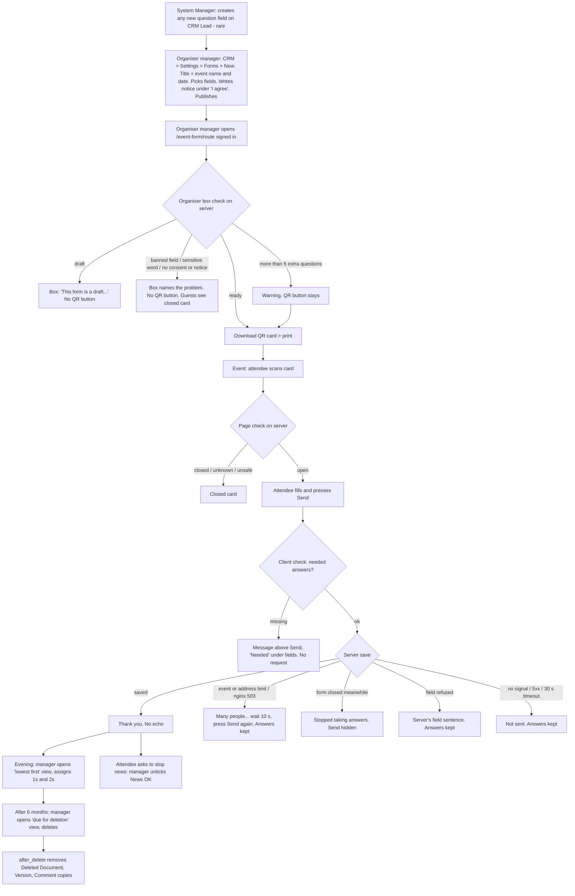

# 082 · Event attendee QR form · Functional spec

I recommend. Surbhi decides. I am not a lawyer: every ⚠ COMPLIANCE item goes to counsel.

## 0. The answer first

**Bad news first.**

1. **⚠ DECISION R1 — DevOps and security disagree on the rate limit, and the agreed
   "wait 10 s" message is only true under one of them.** DevOps (OPS-19/20): 300 saves per
   60 s per event, no address limit in our code. Security (SEC-5): 1,000 per hour per event
   and 400 per hour per address, both on a fixed one-hour window. I have not chosen. §8.3
   shows what each does to a 300-person hall. The load test OPS-32 settles it.
2. **Whether a stock Sales User can read every CRM Lead is still unknown.** Slice 057's setup
   guide says a Sales User sees only leads they own or are assigned (stakeholder statement,
   not tested here). AC-61 decides it on a fresh site. If it fails, the slice cannot ship
   until Surbhi decides (R3).
3. **Security's "`request_guard.py` does not exist" is a stale-checkout reading, not a
   product gap.** Confirmed fact: the file is on `origin/dev` and `origin/main` (commit
   `36e60bc2`, 31 Oct 2026) and runs as the first `before_request` hook. The shared main
   checkout at `C:/Surbhi-Git/hr-app` sits at `5aa654d2` (27 Oct), **446 commits behind
   `origin/dev`**, which is why it was not found. I record it as the gap security named,
   with this evidence, and AC-60 proves the guard is on the build base. Security owns the
   final word.
4. **Persona correction (Q-UX2).** The brief says Sales Users build forms. They cannot:
   only a Sales Manager or System Manager can (fact per 01b, `crm/api/form.py`
   `_check_manager`). **Door staff need no login.** This spec uses that.
5. **I could not read CRM's source today** (Docker Desktop not running). Every CRM fact here
   comes from 01b and 07, which read CRM v1.84.0 in `hrlocal-328`. CRM field names are
   marked `[UNVERIFIED — engineer to confirm]`.

**Verdict:** mostly configuration and customisation, plus **one new guest page and one
guest save call** (rung 4, agreed as D6). No new DocType, app, job, queue or nginx change.

| | Count |
|---|---|
| User stories | 14 (4 of them "must not") |
| Story points | 36 |
| Acceptance criteria | 72 |
| SEC / PRIV / OPS items not traced to an AC | 0 untraced. 7 OPS items "not adopted" by the approved brief or conditional; 1 (OPS-27) waits for Surbhi |

**Recommended drops** (§19): a counts-only view for a CXO without Sales Manager (needs new
code, not worth it); a separate erasure audit table (one log line does it); a fixture for the
saved views (the guide does it).

---

## 1. Inputs, scope and cross-module reach

| App | Touched? | How |
|---|---|---|
| `alvoraa_portal` | **Yes** | New `www` page `/event-form/<route>`; one new module with one guest save call; a `website_route_rules` entry; a `Custom DocPerm` validate hook (SEC-6); a `CRM Lead` `after_delete` hook (PRIV-5); five Custom Fields created on CRM install and by a patch; two new refusal codes in `field_app_errors.CODES`; possibly a window argument in `field_app_limits._limited` (R1); one new row in `test_portal_security_010` CEILINGS |
| `crm` (Frappe CRM v1.84.0) | **Read only, never edited** | Its Web Form record (the form builder output) and CRM Lead. CRM's own `/crm-form/<route>` stays as it ships (W3) |
| `frappe` | Config only | Custom Field, Property Setter, Web Form, Custom DocPerm, Version, Deleted Document |
| `hrms` | **Indirect only** | HRMS ships its own Web Forms (e.g. job application). Our page must refuse any Web Form that is not a CRM Lead form (AC-21). The SEC-6 hook also stops Guest read on `Employee`: a door closed, nothing opened |
| `erpnext`, `alvoraa_goals`, `alvox_compensation` | No | — |
| Slice 057 code on CRM Lead | **Yes, shared** | `crm_steps.on_status_change` runs on every CRM Lead insert (fact, `crm_steps.py:32-49` on `origin/dev`). It does nothing unless `custom_lead_type` is set. If an organiser puts that field on an event form, every attendee could trigger a task and an email (edge case E-16) |
| Slice 013 code | **Yes, if R1 = option A** | `field_app_limits._limited` gains a window argument whose default stays 3,600 s |

**HRMS domains:** none (leaves, attendance, payroll, appraisals, goals, compensation, org
structure, learning are not touched). The data is about members of the public, not employees.

**Personas** (the three-persona check, mapped to CRM):

| Slot | Persona in this slice | Login and role |
|---|---|---|
| Employee slot | **Attendee** | None (Guest) |
| HR Manager slot | **Organiser manager** — builds forms, prints the QR, reads results | Sales Manager (or System Manager) |
| CXO | **CXO** | Sees results only if they hold Sales Manager (§19 drop) |
| — | **Door staff** | **No login needed.** If they have a Sales User login, they see only leads assigned to them (if AC-61 passes) |
| — | **System Manager** at the organiser | Creates new question fields (D8-A) |
| — | **Tenant staff with only Employee** | Nothing on CRM Lead |
| — | **Operator** (Alvora, on request) | Reads refusal log lines; no lead data |

---

## 2. Question the ask

- **Symptom vs cause.** The brief's problem is "300 people leave at once; paper and Google
  Forms lose numbers and split feedback from the contact." The spec solves exactly that:
  one entry per person per event, in CRM, surviving a crowd. No reminder engine or survey
  product is smuggled in.
- **What happens after.** The two saved views drive one named decision: *the organiser
  manager calls the people who rated 1 or 2 first, and assigns them.* The count view tells
  them which events drew people. The "average rating per event" was not asked and needs code:
  dropped (01b §12).
- **Could the system act instead of display?** It could auto-assign low ratings. Not asked;
  CRM's own assignment rules can do it as configuration if the organiser wants. Not specified.

---

## 3. Gap analysis

| # | Requirement | What exists today (source) | Verdict | Cost |
|---|---|---|---|---|
| G-1 | Public no-login form whose entries become CRM Leads | CRM's form builder + `/crm-form/<route>` (fact per 01b/07). Frappe Web Form doctype holds `title`, `route`, `doc_type`, `published`, `login_required`, `web_form_fields`, `button_label`, `success_message`, `introduction_text` (fact, Frappe 16.22 `web_form.json`, read today; image pins 16.35 — engineer re-checks) | **Configure** (the form) + **Build new** (our page, G-2) | S |
| G-2 | Survive 300 people on one Wi-Fi | Stock save `accept` has `@rate_limit(key="web_form", limit=10, seconds=60)` per address (fact, 07 §1; also seen in Frappe 16.22 today, `web_form.py:636`) | **Build new**: one guest save call with an event-keyed limit, reusing `field_app_limits._limited` (fact, `origin/dev`). Rejected cheaper rungs: stock form refuses ~250 of 300 | M |
| G-3 | Phone floors, rating rows, bilingual fixed words, closed card | Stock page: 14 px inputs, Discard button, error at top, English 404, Google Fonts (fact per 01b/07). `web_include_css/js` do not load on it (fact per 07 §2) | **Build new**: our page `/event-form/<route>` (D6, OPS-12). Options B, C, F in 07 §2 rejected (fail silently or touch live nginx) | M |
| G-4 | Event stamped on each lead | No field on CRM Lead names the form (fact per 01b). CRM Lead `source` is a Link to a source master: one source record per event, set by a guest — more steps, and a Link is banned on the form | **Configure**: Custom Field `custom_event_form` (Link → Web Form), set by the server | S |
| G-5 | Rating, comment, two consents | None on CRM Lead `[UNVERIFIED — engineer to confirm]`. CRM notes are a separate record type; writing one from a guest is a second insert | **Configure**: four Custom Fields | S |
| G-6 | Extra questions per event | CRM's builder offers every visible, editable CRM Lead field, custom ones included; skips hidden ones (fact per 01b §13.1, `form.py` 127-151) | **Configure** (D7-A): System Manager adds Custom Fields | S |
| G-7 | Download QR | Nothing in CRM (fact per 01b). PyQRCode 1.2.1 already installed with Frappe for 2FA (fact per 07 §1) | **Extend**: our page draws the card for Sales Manager / System Manager only; QR matrix from PyQRCode on the server, card drawn in the browser. **No new npm or pip package** | S |
| G-8 | Close the staff-name leak (G2) | `grant_guest_link_access` adds a site-wide Guest row on any Link target, User included (fact per 07 §2) | **Extend**: validate hook on `Custom DocPerm` (SEC-6) | S |
| G-9 | Manager: lowest ratings first; entries per event | CRM View Settings: saved views with filter, sort, columns, group-by, pin (fact per 01b EF12) | **Configure**: two views, made from the setup guide | S |
| G-10 | Erasure that removes the person | Frappe keeps a Deleted Document copy and Version rows on delete (inference per 01c, not re-read on 16.35) | **Extend**: `after_delete` on CRM Lead, only for leads with `custom_event_form` | S |
| G-11 | Withdrawal of "news" consent | Untick the box; Version row if track changes is on for CRM Lead `[UNVERIFIED]` | **Configure**: Property Setter `track_changes = 1` on CRM Lead only if not already on | S |
| G-12 | Notice text at time of consent provable | Web Form `track_changes = 1` (fact, Frappe 16.22 `web_form.json`, read today) | **Already there** — re-check on 16.35 | — |
| G-13 | Retention 6 months | No retention engine (compliance-map A6 not built) | **Configure**: a saved "due for deletion" view; manual delete. Scheduled job banned until counsel sets a number (01c) | S |
| G-14 | Spam control by date window (OPS-2), honeypot / captcha (OPS-3) | — | **Drop** — the approved brief moved them to later / not doing | — |
| G-15 | Live count for door staff (S5, C1) | — | **Drop** — C1 narrow option in force | — |
| G-16 | CXO counts without rows (C5) | Group-by needs read on CRM Lead | **Drop** (recommended, ⚠ R5): would need a new report that reads around permissions | — |
| G-17 | Every export logged (C2) | Unknown whether Frappe logs a CRM Lead report export (W2) | **Configure-or-accept**: AC-62 records the fact; if not logged, Surbhi decides (R6). No log of our own | — |

**Single source of truth:** the CRM **Web Form record** is the event (its title is the event
name and date). There is no Event record. A lead's event is `custom_event_form`. Extra
questions live only as CRM Lead columns (D7-A); nothing else stores them.

---

## 4. Process flow

Unhappy paths in words: a draft or broken form never reaches a printed QR (D1, D2); a closed
link explains itself (G1); every failed send keeps the answers (I1, J1-J4); an organiser who
unpublishes mid-event stops new saves cleanly (J2).

---

## 5. Epic and user stories

**Epic E-082 · Event attendee QR form.** One phone form per event, entries become CRM Leads
stamped with the event, a printable QR card, two saved views, and every data door shut.

| ID | Story | Pts | Prototype | Carries | ACs |
|---|---|---|---|---|---|
| US-1 | *As an* **attendee** *I want* to leave my details and a rating from my own phone in about a minute *so that* the organiser can follow up | 5 | Screen 1 · Form, Save → Thank you; 360/390; Nashik and Pune | OPS-13, OPS-17, OPS-18, OPS-22, OPS-31, OPS-33, PRIV-1, PRIV-6 | AC-1 – AC-11 |
| US-2 | *As an* **attendee** *I want* my answers kept and a plain next step when sending fails *so that* I do not type them again | 3 | Screen 1 · Fail: no signal, too many, closed meanwhile; missing fields | OPS-20 (mapping), D2-A, D4-A | AC-12 – AC-18 |
| US-3 | *As an* **attendee** *I want* a closed or unknown link to say so in my language *so that* I ask at the desk instead of retrying | 1 | Screen 1 · Closed / unknown link | SEC-4 (sameness), D5-A | AC-19 – AC-20 |
| US-4 | *As an* **organiser manager** *I want* a 300-person hall on one Wi-Fi to get through *so that* no entry is lost at the busiest minute | 3 | Screen 1 · Fail: too many | SEC-5, OPS-19, OPS-20, OPS-21, OPS-27, OPS-29, OPS-32, R1 = A | AC-24 – AC-30, AC-73 |
| US-5 | *As an* **organiser manager** *I want* to download a QR card from the live form *so that* I print a code that never expires and opens our own address | 3 | Screen 2 · organiser box Ready; QR card dialog | SEC-7, SEC-8, OPS-7, OPS-15 | AC-31 – AC-35 |
| US-6 | *As an* **organiser manager** *I want* the page to tell me what is wrong before I print *so that* attendees never meet a broken form | 2 | Screen 2 · box states "Has a field we cannot show", "8 extra questions" | D9-A, SEC-4, PRIV-2, PRIV-3(b) | AC-36 – AC-38 |
| US-7 | *As a* **System Manager** at the organiser *I want* to add a question as a CRM Lead field once *so that* any event form can ask it and managers can filter by it | 2 | Screen 2 · Option A steps 1-2; Screen 3 · Nashik answers | D7-A, D8-A | AC-39 – AC-42 |
| US-8 | *As an* **organiser manager** *I want* one view per event with the lowest ratings first *so that* I call the unhappy people before lunch | 2 | Screen 3 · Pune lowest first; All events | Brief WOW, M1, M2 | AC-43 – AC-45 |
| US-9 | *As an* **organiser manager** *I want* to stop news for a person and erase old entries fully *so that* the organiser keeps its promise in the notice | 3 | — (Desk/CRM actions) | PRIV-3(c), PRIV-4, PRIV-5, OPS-25 | AC-46 – AC-51 |
| US-10 | **Must not.** *As an* **attendee** I must not be able to write anything except the form's own fields, or read anything back, *so that* the lead list stays private | 3 | Screen 1 · Thank you (no echo) | SEC-1, SEC-2, SEC-3, SEC-9, PRIV-3(a), PRIV-6, OPS-5, OPS-8, OPS-24, OPS-28 | AC-52 – AC-59, AC-76 |
| US-11 | **Must not.** *As the* **organiser**, a form that asks sensitive data, lacks the notice, uses an unsafe field type or is not a CRM Lead form must not open for the public, *so that* the notice stays true and no other record is writable | 3 | Screen 2 · "Has a field we cannot show" | SEC-4, PRIV-2, PRIV-3(b) | AC-21 – AC-23, AC-74, AC-75 |
| US-12 | **Must not.** *As a* **tenant staff member with only Employee, or a Sales User**, I must not read event leads beyond my role through any Frappe door, *so that* attendees' details reach only the organiser's managers | 3 | Screen 3 note "the view is not the protection" | SEC-10, C1, C2, data-doors 1-6, OPS-23, request guard | AC-60 – AC-64 |
| US-13 | **Must not.** *As a* **member of the public** I must not be able to see the tenant's staff names *so that* a poster link does not publish the staff list | 2 | — | SEC-6, OPS-14, OPS-30 | AC-65 – AC-67 |
| US-14 | *As the* **operator** *I want* one log line per refused save *so that* I can tell during a live event whether people are being turned away | 1 | — | OPS-26, OPS-28 | AC-68 |

Total **36 points**. No 8s. US-1 is the largest (5): it is the core send and its budgets;
splitting it would leave a story with no outcome.

**INVEST notes:** US-3 is small (1) but independent and testable. US-6 depends on US-5's box
existing; acceptable (same page, built together). US-12 and US-13 are mostly tests on a
fresh site plus one hook; they are valuable because they are the brief's "Must" rows.

### YouTrack-ready table (do not create; Surbhi's call)

| Summary | Description | Persona | Pts | ACs | Requirements |
|---|---|---|---|---|---|
| 082 US-1 Attendee sends details from phone | Our page `/event-form/<route>` draws a published CRM Lead form at phone floors and saves one stamped lead | Attendee | 5 | AC-1–11 | OPS-13/17/18/22/31/33, PRIV-1, PRIV-6 |
| 082 US-2 Answers kept on failure | Every failure maps to its §6.2 sentence; answers stay | Attendee | 3 | AC-12–18 | OPS-20, D2-A, D4-A |
| 082 US-3 Closed link explains itself | One bilingual card for closed and unknown | Attendee | 1 | AC-19–20 | SEC-4, D5-A |
| 082 US-4 A full hall gets through | Event-keyed limit; numbers per decision R1; load test | Organiser manager | 3 | AC-24–30 | SEC-5, OPS-19/20/21/29/32 |
| 082 US-5 Download QR card | Server-decided organiser box; card with tenant's own address | Organiser manager | 3 | AC-31–35 | SEC-7, SEC-8, OPS-7, OPS-15 |
| 082 US-6 Pre-print checks | Box states: banned field, no notice, >5 extras | Organiser manager | 2 | AC-36–38 | D9-A, SEC-4, PRIV-2, PRIV-3 |
| 082 US-7 Extra questions as fields | System Manager adds Custom Field; builder and page pick it up | System Manager | 2 | AC-39–42 | D7-A, D8-A |
| 082 US-8 Lowest-first view | Two saved views from the setup guide | Organiser manager | 2 | AC-43–45 | M1, M2, WOW |
| 082 US-9 Withdrawal and full erasure | Untick News OK; delete removes copies | Organiser manager | 3 | AC-46–51 | PRIV-3/4/5, OPS-25 |
| 082 US-10 Guest writes only form fields, reads nothing | Allow-list, fixed answers, one counted bypass | Attendee (must not) | 3 | AC-52–59 | SEC-1/2/3/9, PRIV-3/6, OPS-5/8/24/28 |
| 082 US-11 Unsafe forms never open | Allowed types, sensitive words, notice, CRM-only | Organiser (must not) | 3 | AC-21–23 | SEC-4, PRIV-2, PRIV-3 |
| 082 US-12 Staff doors stay shut | Door tests on a fresh CRM site | Employee-only, Sales User (must not) | 3 | AC-60–64 | SEC-10, OPS-23 |
| 082 US-13 No staff names to the public | Custom DocPerm hook; Guest-row check | Public (must not) | 2 | AC-65–67 | SEC-6, OPS-14, OPS-30 |
| 082 US-14 Refusal log line | One line per refusal, no personal data | Operator | 1 | AC-68 | OPS-26 |

---

## 6. Data model

### 6.1 CRM Lead — five new Custom Fields (the only new fields)

Fieldnames follow Frappe's `custom_` prefix. Created by code that runs safely twice
(`create_custom_fields`), from **both** a patch guarded on `frappe.db.exists("DocType",
"CRM Lead")` **and** the existing `after_app_install` hook when `app_name == "crm"` — the
pattern slice 057 already uses (fact, `hooks.py:702` and `crm_steps.on_app_install` on
`origin/dev`). **Never as a fixture**: a fixture on CRM Lead breaks `migrate` on every tenant
without CRM.

| Fieldname | Label (staff) | Type | Mandatory | Default | Options | Other properties | Why no existing field carries it |
|---|---|---|---|---|---|---|---|
| `custom_event_form` | Event form | Link | No | — | `Web Form` | `read_only = 1`, `in_standard_filter = 1`. Set by the server from the route; never from the request | No CRM Lead field names the form; `source` would need a source record per event (G-4). `read_only` also keeps it out of CRM's builder `[UNVERIFIED: builder skips read-only fields — 01b says "visible, editable"]` |
| `custom_event_rating` | Event rating | Select | No | blank | blank line, then exactly: `5 · Very good · बहुत अच्छा` / `4 · Good · अच्छा` / `3 · OK · ठीक-ठाक` / `2 · Poor · खराब` / `1 · Very poor · बहुत खराब` | — | None exists. Number first so ascending text sort = lowest first (01b) |
| `custom_event_comment` | Event comment | Small Text | No | — | — | Server caps at 2,000 characters (SEC-9) | CRM notes are a second record type |
| `custom_consent_event` | Consent: this event | Check | No at DocType level; **required by our save** | 0 | — | `set_only_once = 1` `[ASSUMPTION — engineer to confirm CRM's builder still offers a set-only-once field; if not, drop the property and rely on Version history]` | No consent field exists |
| `custom_consent_news` | News OK | Check | No | 0 | — | — | Separate marketing consent (C3); label "News OK" answers 01b §6.5 |

The attendee never sees these labels. The attendee sees the **Web Form Field label** the
organiser types in CRM's builder (e.g. "Send me news of future events. (optional) / मुझे
आगे के कार्यक्रमों की जानकारी भेजें। (वैकल्पिक)").

**Property Setter on CRM Lead:** `track_changes = 1`, only if CRM does not already ship it
on `[UNVERIFIED]`.

**Standard CRM Lead fields used** (organiser picks them in the builder):
`first_name`, `mobile_no`, `email` `[UNVERIFIED — engineer to confirm names on CRM v1.84.0;
01b names them]`. `lead_owner`, `status`, `_assign` are never accepted from a guest (SEC-1).

**"Standard seven"** (for the D9 count): `first_name`, `mobile_no`, `email`,
`custom_event_rating`, `custom_event_comment`, `custom_consent_event`,
`custom_consent_news`. Every other field on the form counts as an extra question.

### 6.2 Extra questions (D7-A, D8-A)

A System Manager adds a Custom Field on CRM Lead of an allowed type (§8.1). Nothing else is
built. Retiring a question = tick **Hidden** on the Custom Field; answers stay. Our page does
not draw or accept a field whose CRM Lead DocField is hidden.

### 6.3 Web Form — what our page reads (read only, never written)

| Web Form field | Use | Label |
|---|---|---|
| `name`, `route`, `title` | Find the form; title is the event; stamp `custom_event_form = name` | Fact (16.22) |
| `doc_type` | Must equal `CRM Lead` | Fact (16.22) |
| CRM's published flag (`published` and/or `crm_published`) | Open or closed | Per 07 §2; `[UNVERIFIED — engineer to confirm which flag CRM v1.84 uses]` |
| `login_required` | Must be 0, else closed | Fact (16.22). **BA addition** — a login-only form must not get a guest door |
| `introduction_text`, `button_label`, `success_message` | Intro, Send label, Thank-you text | Fact (16.22) |
| `web_form_fields` rows: `fieldname`, `fieldtype`, `label`, `reqd`, `options`, `description`, `hidden`, `read_only` | Draw and validate | Fact (16.22 `web_form_field.json`) |
| `web_form_fields.default` | **Ignored for both consent fields** (always unticked) | Fact the column exists |
| `depends_on`, `mandatory_depends_on`, `allow_edit`, `show_list`, `list_columns`, `client_script`, `custom_css` | **Ignored.** Our page never shows a list, never runs the form's script or CSS | — |

**Not added:** an Event DocType, an event date field, a field for notice text on the lead
(Version history on Web Form does it), an IP or user-agent field, an age field.

---

## 7. States

There is **no workflow** and no `docstatus` on CRM Lead. The form has three states, all CRM's
own; we add none.

| Form state (CRM's flag) | Guest GET | Guest POST | Sales Manager / System Manager GET |
|---|---|---|---|
| Draft / unpublished | Closed card | `FORM_CLOSED` | Form + box "This form is a draft…" + no QR button; Send refused `FORM_CLOSED` |
| Published, clean | Form | Saves | Form + box "Ready" + Download QR card |
| Published, unsafe (§8.1) | Closed card | `FORM_CLOSED` | Box names the problem; no QR button |

Reversible: publish ↔ unpublish at any time. Terminal: a deleted lead (PRIV-5 removes its copies).

---

## 8. Server rules for the page and the save

### 8.1 What makes a form "open" (checked on GET and on POST — SEC-4)

All must hold, else the closed card (GET) or `FORM_CLOSED` (POST):

1. A Web Form with that route exists, `doc_type = "CRM Lead"`, published per CRM's flag,
   `login_required = 0`.
2. Every non-hidden row's `fieldtype` is in the **allowed list**: Data (incl. options Email /
   Phone), Phone, Small Text, Text, Long Text, Int, Float, Select, Check, Date. Anything else
   — including Link, Attach, Attach Image, Text Editor, HTML Editor, Markdown Editor,
   Datetime, Time, Currency, Percent, Color, and any type not on this list — closes the form.
   Layout rows (Section Break, Column Break) carry no value; whether CRM's builder emits them
   is `[UNVERIFIED]` — if it does, they are drawn as nothing and accepted.
3. No row's label or fieldname contains a word from the PRIV-2 list (case-insensitive):
   aadhaar, aadhar, pan, passport, voter, bank, ifsc, account no, health, medical, disease,
   disability, religion, caste, sexual, आधार, धर्म, जाति, स्वास्थ्य. **Risk:** "pan" also
   matches "company", "Japan", "panel". Recommendation: match "pan" only as a whole word.
   Security owns the list (O-6).
4. The form has both `custom_consent_event` and `custom_consent_news`, and the
   `custom_consent_event` row has a non-empty `description` (the notice).
5. No row is a field whose CRM Lead DocField is hidden.

The closed answer is **the same** for every reason, so a guest cannot probe why.

### 8.2 The save call (SEC-1, SEC-2, SEC-3, SEC-9, PRIV-3, PRIV-6, OPS-8, OPS-18, OPS-21)

- One whitelisted function, `allow_guest=True`, `methods=["POST"]`, in a new file in
  `alvoraa_portal` (name is the engineer's). Arguments: `route` and the values, **in the POST
  body only**.
- Writable keys = the open form's non-hidden, non-read-only rows of allowed types. **Any other
  key → refuse the whole save** (`INVALID_REQUEST`, 400). Never accepted: `lead_owner`,
  `status`, `owner`, `name`, `naming_series`, `_assign`, `docstatus`, `custom_event_form`.
  (Frappe's own `cmd` and CSRF token are not data keys.)
- `custom_event_form = <Web Form name>` set on the server.
- Server validation, each refusal → `FIELD_INVALID` (422) with the field's label only:
  required rows filled; `custom_consent_event = 1`; Check is 0/1; Select value is one of the
  options exactly; Int/Float parse; Date is `YYYY-MM-DD`; Email/Phone pass Frappe's own
  validators; Data ≤ 140 characters; Small Text / Text / Long Text ≤ 2,000 characters. Text
  is stored as typed (no HTML is made from it).
- One insert, `ignore_permissions=True`, **the only bypass**, counted in CEILINGS at 1. If
  CRM Lead needs `ignore_mandatory` for a field not on the form, that is a second flag and
  must also be counted `[UNVERIFIED]`.
- Synchronous. No `frappe.enqueue` from this path.
- Answers:

| Outcome | HTTP | Body code | Page shows |
|---|---|---|---|
| Saved | 200 | one fixed body, same for every save, no lead name, no value | Thank you |
| Not a key on the form | 400 | `INVALID_REQUEST` (exists) | Not sent |
| A field refused | 422 | `FIELD_INVALID` **new**, value: `label` | The server's sentence |
| Form closed / unsafe / unknown | 404 | `FORM_CLOSED` **new** | Closed while filling; Send hidden |
| Our limit | 429 | `TOO_MANY_TRIES` (exists) | Many people… (D2-A) |
| nginx `kinexus_api` limit | 503 (nginx default, fact 07 §3) | — | Many people… (D2-A) |
| Anything else, or no answer in 30 s | 5xx / none | `SERVER_ERROR` or none | Not sent |

New codes are **added** to `field_app_errors.CODES` (its rule: added, never renamed), or the
engineer says why not in `00`.

### 8.3 ⚠ DECISION R1 — the rate limit (not resolved here)

**What the two sources say:**

| | **Option A — DevOps (OPS-19, OPS-20)** | **Option B — Security (SEC-5)** |
|---|---|---|
| Per event | 300 per **60 s**, keyed on hashed route | 1,000 per **hour** (fixed window), keyed on hashed route |
| Per address in our code | None | 400 per **hour** (fixed window) |
| In front of both | nginx `/api/` zone `kinexus_api`: 120 a minute per address, burst 30, answers 503 (fact, `deploy/nginx.conf` 489-490, per 07 §3) | same |
| Code change | `_limited` gains a `window` argument, default 3,600 s, so slice 013's endpoints are unchanged | None to the limiter (both decorators exist with a 1 h window — fact, `field_app_limits.py` line 45 on `origin/dev`) |

**At the OPS-32 profile — 300 saves in 5 minutes from one address, 60 in the first 10 s,
one retry after 10 s for anyone refused** (my arithmetic, not measured):

| | Option A | Option B |
|---|---|---|
| nginx (both) | First 10 s: about 30 burst + about 20 refill = ~50 pass, **~10 get 503**, retry after 10 s and pass | same |
| Our event limit | Busiest minute ~70 saves, far under 300. Never hit | ~310 calls an hour, under 1,000. Not hit |
| Our address limit | none | ~300-310 of 400. Not hit |
| Result | **All 300 saved; ~10 people press Send twice** | **All 300 saved; ~10 people press Send twice** |

**Where they differ** (beyond the 300 test):

| Situation | Option A | Option B |
|---|---|---|
| 500 people on one Wi-Fi within an hour | All pass our limits (nginx paces them) | **About 100 refused for the rest of the hour** (address cap 400). "Wait 10 seconds" becomes untrue |
| Event limit reached | Shut for **≤ 60 s** | Shut **up to 60 minutes** |
| Two sessions of one event in the same hour, 600 people | Pass | Pass (under 1,000) unless one Wi-Fi (then address cap bites at 400) |
| Bot, one address | ≤ 120 junk leads a minute (nginx) | ≤ 400 an hour, then shut for that address |
| Bot, many addresses | ≤ 300 junk leads a minute per event, ~18,000 an hour | ≤ 1,000 an hour per event; **3 addresses can shut the event for up to an hour** (AB2) |
| D2-A words ("wait 10 seconds") | True at worst within 60 s | Untrue once any hourly cap is hit |

A middle option exists (event 300 per 60 s plus an address cap with a short window); I list
it so it is not lost, and do not recommend it.

**What settles it: OPS-32** on dev, with the CRM settings the customer will use. To tell the
options apart, the run needs **a second leg: 450 saves from one address within 10 minutes**
(shows B's address lockout). Also needs validation on the OPS-23 site: whether Frappe counts
a refused call towards the window (if it does, retries make lockouts longer).

**Blocks:** AC-24, AC-25, AC-26 values; the D2-A message's truth. **Owner:** Surbhi, with
the security engineer (who said "numbers are mine, to be confirmed by OPS-9/OPS-32").

---

## 9. Permission and visibility matrix

Enforced by CRM Lead's role permissions and CRM's owner/assignee rule — **not by our page**
(data-doors). Our page adds no permission rows.

### 9.1 Role × record type

| Role | CRM Lead (C/R/W/D/Export/Share) | Web Form | Custom Field on CRM Lead | Custom DocPerm |
|---|---|---|---|---|
| Guest | **None** — only our save inserts one, by the counted bypass | None (our page reads it on the server) | None | None |
| Employee only | **None** | None | None | None |
| Sales User | R/W **only leads owned or assigned** `[UNVERIFIED → AC-61 decides]`; no export | Cannot build forms (fact per 01b) | No | No |
| Sales Manager | All: C R W D, export, share `[export/share rights UNVERIFIED → AC-61/62]` | Build, publish, unpublish (CRM) | **No** (D8-A) | **No Guest rows** (SEC-6 hook refuses, AC-65) |
| System Manager | All | All | **Yes** (D8-A) | Yes, except Guest read/select on User, Employee, CRM Lead |
| CXO | As whatever role they hold. Without Sales Manager: nothing (⚠ R5) | — | — | — |

Row-level: CRM Lead has no company field used here `[UNVERIFIED]`; a tenant is one site, so
"in-company" (C2) means "inside this tenant's site". A tenant with two companies cannot keep
one company's managers from the other's event leads without new rules (E-12).

### 9.2 Field-level, per persona

| Field | Guest | Employee only | Sales User | Sales Manager | System Manager |
|---|---|---|---|---|---|
| Name, mobile, email | Write once, while filling; never read | — | R/W if assigned | R/W | R/W |
| `custom_event_form` | Never sent; set by server | — | R if assigned | R (read-only field) | R |
| `custom_event_rating`, `custom_event_comment` | Write once | — | R/W if assigned | R/W (correct) | R/W |
| `custom_consent_event` | Write once (must be 1) | — | R | R; set-only-once | R |
| `custom_consent_news` | Write once | — | R/W if assigned | R/W (untick on request; ticking for someone is not allowed by the guide — not enforced, Version records it) | R/W |
| Extra question columns | Write once if on the form | — | R/W if assigned | R/W | R/W; creates the field |
| Web Form notice text | Read (on the page) | — | — | R/W | R/W |

### 9.3 Must NOT (negative cases)

| Who | Must not | Door that stops it | AC |
|---|---|---|---|
| Guest | Read any lead, count, lead name, own answers after send | No Guest DocPerm on CRM Lead; fixed save answer | AC-53, AC-55, AC-56 |
| Guest | Write `lead_owner`, `status`, `_assign` or any key not on the form | Allow-list in the save | AC-52 |
| Guest | See staff names | SEC-6 hook; Link banned | AC-65, AC-66 |
| Guest | See the organiser box or tell closed from never-existed | Server-side box; one closed answer | AC-20, AC-35 |
| Guest | Write a Job Applicant or any non-CRM-Lead record via our page | `doc_type` check | AC-21 |
| Employee only | Any CRM Lead row or field, through doors 1-6 | CRM Lead role permissions | AC-61 |
| Sales User | Unassigned event leads; export | CRM rule (to be proven) | AC-61, AC-62 |
| Sales Manager | Create Custom Fields; add Guest rows on User/Employee/CRM Lead | Frappe default; SEC-6 hook | AC-42, AC-65 |
| Speaker (C4) | Any feedback | No access built (narrow option) | — (nothing built) |
| Outside party / sponsor | Any list | Nothing built; share is a Sales Manager act (W, C2) | AC-61 records share |

---

## 10. Acceptance criteria

Test data used below: tenant `sharmaevents`, published CRM form "Pune Dealer Meet, 14 Nov",
route `pune-dealer-meet-14-nov`, the seven standard fields; and "Nashik Retailer Day, 2 Nov"
with three extras (Shop name · Data, Shops · Int, Products of interest · Select, 4 choices).
"Fresh site" = OPS-23: Frappe v16.35.0, CRM v1.84.0, ERPNext, our apps, setup wizard done,
then `install-app crm`.

### US-1 · Attendee sends details

- **AC-1** Given the Pune form is published, When a Guest GETs `/event-form/pune-dealer-meet-14-nov`, Then HTTP 200; the page shows the title "Pune Dealer Meet, 14 Nov", the intro, the fields in the builder's order, and a Send button whose text is the form's button label; **no element's text is "Discard"**.
- **AC-2** Given the page at 360 px and 390 px wide, When measured, Then every input and textarea has computed font-size ≥ 16 px and height ≥ 48 px; Send is the full content width and ≥ 48 px tall; field labels are 15 px in the ink colour with contrast ≥ 4.5:1; `document.documentElement.scrollWidth ≤ clientWidth`.
- **AC-3** Given the rating field, When drawn, Then it is a `fieldset` with a `legend` and five native radio inputs in the order 5, 4, 3, 2, 1, each row ≥ 48 px tall; any Select with ≤ 6 options draws the same way; a Select with 7 options draws as a native `<select>`.
- **AC-4** Given fields of each allowed type, When drawn, Then Phone and Data(Phone) use `type="tel"`, Data(Email) `type="email"`, Int `inputmode="numeric"`, Float `inputmode="decimal"`, Date `type="date"`, Check a 24 px box inside a ≥ 48 px row whose whole area toggles it.
- **AC-5** Given name "Rakesh Kulkarni", mobile "9822041012", rating "2 · Poor · खराब", comment "Could not hear the speaker", consent ticked, news not ticked, When Send is pressed, Then exactly one new CRM Lead exists with those values, `custom_event_form` = the Pune Web Form's name, `custom_consent_event = 1`, `custom_consent_news = 0`, `lead_owner` empty; and the page shows the form's success message plus "You can close this page. · आप यह पेज बंद कर सकते हैं।"
- **AC-6** Given AC-5's Thank-you screen, When its HTML is searched, Then none of the typed values ("Rakesh", "9822041012", "Could not hear") appears, and no lead name appears.
- **AC-7** Given Send was pressed, When the request is in flight, Then Send is disabled and reads "Sending… / भेजा जा रहा है…", and a second tap sends no second request (request count = 1).
- **AC-8** (OPS-31) Given a 10-field form (7 + 3 extras) and a custom throttle of 1.6 Mbps down, 750 kbps up, 562.5 ms latency, cache disabled, When the page is loaded five times, Then the slowest load finishes within 2.5 s; bytes and first-draw time are recorded in `04` — first on the OPS-23 site, then on dev.
- **AC-9** (OPS-13, OPS-17, PRIV-6) Given the page HTML for a Guest, When scanned, Then it contains no `http://` or `https://` host other than the site's own, no `fonts.googleapis.com`, no ``, and the network log of a load shows zero requests to another host.
- **AC-10** (OPS-22) Given the page GET, the save POST and the closed card, When their headers are read, Then each `Cache-Control` contains `no-store`.
- **AC-11** (OPS-18, OPS-33) Given a successful save, When the 200 answer returns, Then the lead already exists in the database (read in the same test right after the call), and the save code path contains no `frappe.enqueue`; and a test asserts the CRM Web Form fields our page reads (§6.3) exist on the installed CRM, so a CRM pin change that renames one fails CI.

### US-2 · Answers kept on failure

- **AC-12** Given name empty and "I agree" not ticked, When Send is pressed, Then no request is sent; above Send the message reads "Please fill these in: Your name, I agree." followed by "कृपया ये भरें — ऊपर “ज़रूरी” लिखे खाने।"; "Needed · ज़रूरी" shows under each of the two fields; each has `aria-invalid="true"` and a 2 px border; the message has `role="alert"` and receives focus. (Each name in the English message is the label's text up to the first " / " or line break `[ASSUMPTION]`.)
- **AC-13** Given the network is off, When Send is pressed, Then the message above Send reads "**Not sent.** Your answers are still here. Check your signal, then press Send again." plus its Hindi line; every field still holds what was typed; When the network returns and Send is pressed, Then the stored lead holds exactly the typed values (assert the lead, not the screen).
- **AC-14** Given the server answers 500, or gives no answer within 30 s, When Send was pressed, Then the "Not sent." message shows and every answer remains.
- **AC-15** Given the server answers 429 **or** 503, When Send was pressed, Then the amber message reads "**Many people are sending at the same moment.** Your answers are still here. Wait 10 seconds, then press Send again." plus Hindi; answers remain; Send is enabled; after 15 s no request has been sent by itself (count stays 1) — D2-A.
- **AC-16** Given the form is unpublished between the GET and the POST, When Send is pressed, Then the POST answers 404 `FORM_CLOSED`, no lead is created, the message reads "**This form has stopped taking answers**, so your details were not saved. Please give them at the organiser's desk." plus Hindi, and Send is hidden.
- **AC-17** Given email "rakesh@", When sent, Then the server answers 422 `FIELD_INVALID` naming the email field's label, the page shows that one sentence above Send, answers remain, and no traceback, field value or server path text is ever shown.
- **AC-18** (D4-A, translatable) Given the fixed strings in 01b §6.2, When the page source is checked, Then each English string is wrapped for translation (`_()` server side or `__()` client side), and each Hindi line appears exactly as in 01b §6.2 (pending the native reviewer).

### US-3 · Closed link

- **AC-19** Given a route that never existed and the Pune route while unpublished, When a Guest GETs each, Then both show "**This form is not taking answers.** It may have closed after the event. If you are at the event, please ask at the organiser's desk." plus Hindi; both answer the same HTTP status; and the two bodies are identical once the session's CSRF token is removed.
- **AC-20** Given AC-19's closed card, When searched, Then it contains no event title and no organiser name.

### US-11 · Unsafe forms never open (must not)

- **AC-21** Given (a) an HRMS Web Form such as the job-application form, (b) a CRM Lead form with `login_required = 1`, When a Guest GETs `/event-form/<its route>` and POSTs to the save with valid-looking values, Then the closed card shows, the POST answers `FORM_CLOSED`, and no Job Applicant, CRM Lead or other record is created.
- **AC-22** Given a published CRM Lead form holding one field of each banned type in turn (Link, Attach, Attach Image, Text Editor, HTML Editor, Markdown Editor, Datetime, Time, Currency, Percent, Color) and one test with an invented type name, When a Guest GETs and POSTs, Then each case shows the closed card and answers `FORM_CLOSED`.
- **AC-23** Given (a) a field labelled "Aadhaar number", (b) a form without `custom_consent_news`, (c) the "I agree" row with an empty description, When a Guest GETs, Then each shows the closed card; and a field labelled "Company name" does **not** close the form (whole-word rule for "pan", pending O-6).

### US-4 · A full hall gets through (values per ⚠ R1)

- **AC-24** Given the save function, When a test reads the limit attributes off it (`__alvoraa_limit__`, and `__alvoraa_address_limit__` if option B), Then it is keyed on the hashed route, `ip_based` is off, and limit and window equal the values Surbhi chose in R1 (A: 300 / 60 s; B: 1,000 / 3,600 s plus 400 / 3,600 s per address).
- **AC-25** Given the event limit is N in window W, When the (N+1)th POST for one form arrives inside W, Then it answers 429 `TOO_MANY_TRIES` and no lead is created; and When W has passed, Then the next POST saves. (If B: the 401st POST from one address in the hour answers 429.)
- **AC-26** Given slice 013's limited endpoints, When the existing pin test runs, Then each still reports a 3,600 s window and its old limit (applies if R1 = A changes `_limited`).
- **AC-27** Given a save has run, When Redis keys are listed, Then the event limiter's key contains the route's hash and not the route text.
- **AC-28** (OPS-32, release gate, on dev **with Surbhi's word**) Given one dev tenant with CRM, one published form, and the customer's CRM assignment and email settings, When a script sends 300 saves in 5 minutes from one machine (60 in the first 10 s, a refused save retried once after 10 s), plus the R1 second leg (450 from one address in 10 minutes), Then: ≥ 297 stamped leads from the first leg; save p95 ≤ 500 ms; no 5xx other than 429/503; no new Error Log rows; both queues have live workers after (`scripts/check_workers.sh`); the test leads are deleted by their event stamp after.
- **AC-29** (OPS-21, OPS-29) Given the slice's diff, When checked, Then `git diff origin/dev -- deploy/nginx.conf` is empty, and nothing is added to `server.env` or any compose file.
- **AC-30** (OPS-8, OPS-21) Given the page sends a save, When the request is inspected, Then it is a POST to `/api/method/alvoraa_portal.<module>.<function>` with every value in the body and none in the URL; and a GET to that method is refused.
- **AC-73** (OPS-27, decided R7 13 Nov; added by the engineer at the strategy step) Given the hourly `worker-health.yml` run, When any site on either stack has **30 or more** `event_form` refusal lines for one hashed route in the last 60 minutes (reasons `limit` and `closed` counted; `banned_field` and `invalid` listed but not counted), Then the run fails with one line per such site naming the site, the hashed route and the count per reason, and no name, mobile, email, answer or route text; below 30 it passes with a one-line count; the check is read-only (changes nothing on any container) and a test feeds it a sample log of 29 and 30 lines to prove both answers. *Note: GitHub runs a scheduled workflow from `main`'s copy, so the alert is live only after a release to `main`.*
- **AC-74** (rule added at the strategy gate, approved 13 Nov) Given a published CRM Lead form whose `module` is not `FCRM` (a Web Form CRM did not make), When a Guest GETs `/event-form/<route>` and POSTs to the save, Then the closed card shows, the POST answers 404 `FORM_CLOSED`, and no record is created.
- **AC-75** (rule added at the strategy gate, approved 13 Nov) Given a published CRM form that lacks a question for a field CRM Lead requires (today `first_name`; `status` and `naming_series` are filled by CRM itself), When a Guest GETs and POSTs, Then the closed card shows and the POST answers `FORM_CLOSED` with no lead created; When a Sales Manager GETs, Then the box reads "This form cannot open for attendees yet. It has no “<label>” question, and CRM needs one to save a lead. Add it in CRM, then open this page again. Until then attendees see “This form is not taking answers”." and there is no QR button.
- **AC-76** (PRIV-6, OPS-28; rule approved 13 Nov) Given the CRM Lead insert inside the save raises an unexpected error carrying attendee values in its message, When the save answers, Then it answers 500 `SERVER_ERROR`, and the one Error Log row written holds only the hashed route (16 characters) and the error type - no submitted value, no route text, no local variables.

### US-5 · Download QR card

- **AC-31** Given a Sales Manager is signed in, When they GET the published Pune page, Then above the form the box reads "You are signed in as an organiser. Attendees do not see this box.", shows "This form's address: <get_url()>/event-form/pune-dealer-meet-14-nov", "Extra questions: 0.", and a "Download QR card" button. Same for a System Manager.
- **AC-32** Given AC-31, When "Download QR card" is pressed, Then a dialog shows the card: event title, organiser name, the QR, "Scan to leave your details and feedback" and "अपनी जानकारी और राय देने के लिए स्कैन करें", the band "This is not a payment. · यह भुगतान नहीं है।", and the address in plain text; "Download PNG" saves one PNG whose decoded QR text equals `get_url()` + `/event-form/pune-dealer-meet-14-nov`. "Close" and Escape close the dialog.
- **AC-33** (SEC-8, OPS-7) Given the page is requested with `?site=other.alvoraa.co` or `?host=…`, When the QR is decoded, Then it still equals the current site's `get_url()` + route; the save call ignores the same parameters.
- **AC-34** (draft) Given the Pune form is a draft, When a Sales Manager GETs the page, Then the box reads "This form is a draft. Publish it in CRM before printing a QR — a QR for a draft opens a page attendees cannot use." and there is no Download button.
- **AC-35** (SEC-7, OPS-15) Given the same published and draft forms, When a Guest, an Employee-only login and a Sales User GET the page, Then the HTML contains no organiser-box region, no QR data, no draft wording and no "Download QR card" text.

### US-6 · Pre-print checks

- **AC-36** Given the form holds a Link field labelled "Lead owner", When a Sales Manager GETs the page, Then the box reads "This form cannot open for attendees yet. It has a field this page cannot show safely: “Lead owner” (it picks from a list of your staff). Remove it in CRM, then open this page again. Until then attendees see “This form is not taking answers”." with no QR button. For a banned type other than Link, the bracketed reason is left out `[ASSUMPTION — parity: only the Link case is drawn]`.
- **AC-37** Given the form has 8 extra questions, When a Sales Manager GETs the page, Then the box shows "This form has 8 extra questions. In a hall, most people stop after about 5. Consider removing some." and the QR button is present; with exactly 5 extras no warning shows.
- **AC-38** Given a sensitive-word label, or a missing consent field or empty notice, When a Sales Manager GETs the page, Then the box uses AC-36's wording with the label (sensitive word) or "The “I agree” question is missing, or has no notice under it." `[ASSUMPTION — copy not in the prototype; UX to confirm]` and no QR button.

### US-7 · Extra questions

- **AC-39** Given a System Manager adds a Custom Field "Shop name" (Data) on CRM Lead, When a Sales Manager opens CRM's form builder "Add Field", Then "Shop name" is offered; once added after Email and published, the page draws it after Email, and a saved answer lands in that column.
- **AC-40** Given "Shop name" is then marked Hidden, When the builder is opened, Then it is no longer offered; existing leads keep their values; and a form that still lists it shows the closed card (rule §8.1-5).
- **AC-41** Given "Products of interest" (Select, 4 choices "Air coolers · एयर कूलर" etc.), When saved with "Air coolers · एयर कूलर", Then the lead stores that exact text; a value not among the options answers `FIELD_INVALID`.
- **AC-42** (D8-A) Given a Sales Manager without System Manager on the fresh site, When they try to insert a Custom Field on CRM Lead (Desk or `/api/resource/Custom Field`), Then it is refused with a permission error.

### US-8 · Lowest first

- **AC-43** Given 20 Pune leads with mixed ratings and 5 without a rating, When a view filters Event form = Pune and Event rating **is set**, sorted Event rating ascending then Created on ascending, Then every "1 · …" row comes before every "2 · …" row, and so on, and the 5 unrated leads are absent; and the same sort **without** "is set" shows where blanks fall (records 01b's EF13 assumption as fact).
- **AC-44** Given leads from three event forms, When a view filters Event form is set and groups by Event form, Then each group's count equals the number of leads stamped with that form.
- **AC-45** Given the setup guide, When reviewed, Then it covers: building the form with the event as title; the notice template under "I agree"; allowed question types and the "no sensitive questions" rule; only a System Manager adds question fields; publish, test from your phone, unpublish after the event; the three saved views (lowest first, entries per form, due for deletion); "reload after a failed send on a staff phone"; "not for events with under-18s"; "only email people with News OK"; "never rename a tenant with QR codes in print"; "do not put Lead type on an event form" (E-16).

### US-9 · Withdrawal and erasure

- **AC-46** (PRIV-4) Given a lead with News OK ticked, When a Sales Manager unticks it, Then a Version row records the user, the time and 1 → 0, and the lead leaves a view filtered News OK = 1.
- **AC-47** (PRIV-5) Given an event lead with one comment and one edit, When a Sales Manager deletes it, Then zero rows reference its name in CRM Lead, Deleted Document (`deleted_name`), Version (`docname`), Comment (`reference_name`), and in each CRM activity record type the engineer lists in `03`.
- **AC-48** Given a CRM Lead without `custom_event_form` (e.g. one from slice 057's email intake), When deleted, Then Frappe's normal behaviour is unchanged (a Deleted Document row exists).
- **AC-49** Given leads created 7 months ago and 5 months ago, none with News OK, When the "due for deletion" view (Event form is set, News OK not ticked, Created on before today minus 6 months) is opened, Then it lists the 7-month leads only.
- **AC-50** Given a saved lead, When anyone tries to change `custom_consent_event`, Then the change is refused (set-only-once), or, if O-3 drops that property, a Version row records it.
- **AC-51** (PRIV-3c) Given a published form, When the notice (description of the "I agree" row) is edited, Then a Version row on the Web Form holds the old text and its time.

### US-10 · Guest writes only the form, reads nothing (must not)

- **AC-52** (SEC-1) Given a valid entry, When a POST also carries any one of `lead_owner`, `status`, `owner`, `name`, `naming_series`, `_assign`, `docstatus`, `custom_event_form`, or `unknown_key`, Then each answers 400 `INVALID_REQUEST` and the CRM Lead count is unchanged.
- **AC-53** (SEC-2) Given two different successful saves, When their bodies are compared, Then they are byte-identical and contain no lead name; each failure body holds only its code (and a label for `FIELD_INVALID`) and no traceback.
- **AC-54** (SEC-3) Given the security suite, When `TestSec16IgnorePermissionsCeiling` runs, Then the new file is listed at 1 and passes.
- **AC-55** (SEC-3) Given the fresh site after install, When `tabCustom DocPerm` and `tabDocPerm` are read, Then no Guest row exists on CRM Lead or Web Form; and Guest calls to `/api/resource/CRM Lead` and `frappe.client.get_list` for CRM Lead answer 403.
- **AC-56** (SEC-9) Given a comment `` and one with ``, When saved and the lead is opened in CRM's lead page and list view, Then the text shows literally and no dialog or script runs; a 141-character Data value and a 2,001-character comment answer `FIELD_INVALID`.
- **AC-57** (PRIV-3a) Given a POST with `custom_consent_event = 0`, Then 422 `FIELD_INVALID` and no lead; Given the page is opened with `?custom_consent_news=1` and the Web Form Field default for both consents set to 1, Then both boxes load unticked.
- **AC-58** (PRIV-6, OPS-28) Given the save is forced to fail with an exception on the OPS-23 site, When the Error Log and the `event_form` log are read, Then neither contains any submitted value (name, mobile, email, comment, answers).
- **AC-59** (OPS-24) Given the OPS-23 site, When the engineer inserts one lead through the save, Then `03` lists every `doc_events` hook and enqueue on CRM Lead insert with its queue, the email count for 300 leads, and a test asserts no job enqueued by an insert carries attendee values in its arguments.

### US-12 · Staff doors stay shut (must not)

- **AC-60** (request guard) Given the build base, When a POST to the save carries `ignore_permissions=1` and `ignore_user_permissions=1`, Then both are absent from `frappe.form_dict` inside the call (proves `request_guard.drop_permission_skips` runs; it is on `origin/dev`, not in the stale main checkout).
- **AC-61** (SEC-10, data-doors 1-6) Given the fresh site with three event leads L1-L3, L1 assigned to Sales User S1, When each of Guest, Employee-only E1, Sales User S1 and Sales Manager M1 tries doors 1-6 (`/api/resource/CRM Lead` list/get/put/delete; `frappe.desk.reportview.get` / `get_count`; `frappe.client.get` / `get_list` / `get_value`; `search_link` on `custom_event_form`; report view and export; share and assign on L2), Then: Guest and E1 get 403 or zero rows on every door; M1 gets all three; **S1 gets exactly L1 and nothing of L2 or L3** — the test **decides SEC-10**: if S1 sees L2 or L3, this AC fails and the slice does not ship until Surbhi decides R3.
- **AC-62** (C2, W2; corrected 13 Nov - a stock Sales User holds `export` on CRM Lead, limited by CRM's own row rule) Given AC-61, When S1 exports from report view, Then S1's export holds only L1 (never L2 or L3); When M1 exports, Then the file holds all three, and the test report records whether an Access Log row was written (yes / no). "No" opens R6; it is not a test failure.
- **AC-63** Given extra-question columns (Shop name, Shops), When E1 and S1 (unassigned) use doors 1-5, Then those columns are unreadable exactly like the rest of the lead.
- **AC-64** (OPS-23) Given the test report, When read, Then it names the site's Frappe, CRM and app versions and confirms AC-55, AC-61 to AC-63 and AC-65 ran on a site built in the OPS-23 order, not a copied site.

### US-13 · No staff names to the public (must not)

- **AC-65** (SEC-6) Given the fresh site, When M1 calls CRM's `grant_guest_link_access` for User, and a System Manager inserts a Custom DocPerm giving Guest read or select on User, Employee or CRM Lead, Then each is refused with a validation error; a Guest row on another doctype (e.g. read on "Web Page") is still allowed.
- **AC-66** Given AC-65, When a Guest calls `search_link` / `search_widget` on User, Then no row returns.
- **AC-67** (OPS-30) Given the read-only check (two `select` statements through `bench --site <site> mariadb`), When run on the OPS-23 site, Then it prints PASS with zero Guest rows on User, Employee and CRM Lead, and lists roles with read / export / share on CRM Lead; When one Guest row is added on purpose by direct SQL, Then it prints FAIL. On real tenants it runs only with Surbhi's word; any row found is reported, removed only on her word.

### US-14 · Refusal log

- **AC-68** (OPS-26) Given one refusal of each reason (limit, closed, banned_field, invalid), When the `event_form` log is read, Then there is one line each holding time, hashed route and reason, and no name, mobile, email or answer.

### Cross-cutting

- **AC-69** (PRIV-1) Given the setup guide's default form, When built, Then it holds exactly the seven standard fields and no upload, age or address field.
- **AC-70** (OPS-5) Given any Web Form flags `allow_edit` or `show_list` set to 1, When a Guest uses our page, Then no list, edit or "your entries" view exists on it.
- **AC-71** (OPS-6) Given the fresh site, When System Settings is read, Then "Allow guests to upload files" is off; the slice does not change it.
- **AC-72** (accessibility) Given the page, When tabbed through, Then every control has a visible 3 px focus outline, every input has a `<label for>`, and one TalkBack pass on Android completes AC-5's task; results recorded in `04`.

---

## 11. Edge cases

| # | Case | Rule | AC |
|---|---|---|---|
| E-1 | Reply lost after the save landed; attendee presses again | Two leads. Accepted (Q3: each entry is its own lead); manager deletes | — |
| E-2 | Same person at three events | Three leads (Q3 default) | — |
| E-3 | Double tap | Send disabled while sending | AC-7 |
| E-4 | Form unpublished mid-event | `FORM_CLOSED`, Send hidden | AC-16 |
| E-5 | Poster used after the event | Closed card once unpublished; while published, the limit caps spam | AC-19, AC-25 |
| E-6 | Organiser edits the notice mid-event | Leads before and after map to their version by creation time | AC-51 |
| E-7 | Question field hidden while a form still lists it | Form closes until fixed | AC-40 |
| E-8 | Hindi-only typing in name / comment | Stored as typed; no transliteration | AC-5 |
| E-9 | Shared staff phone after a failed send | Next person sees last answers; guide says reload | AC-45 |
| E-10 | Time zones | `creation` is the site's time zone (IST for Indian tenants); "6 months" counted on it | AC-49 |
| E-11 | Bulk deletion of 300+ leads | Frappe's bulk delete runs in the background above a size limit (memory: "bulk delete dies at 750"); guide says delete one event at a time | AC-47 |
| E-12 | Tenant with two companies | Both companies' Sales Managers see all event leads (no company scoping) — accepted, one organiser per tenant `[ASSUMPTION]` | — |
| E-13 | A lead converted to a Deal | Leaves the event retention rule? Counsel (C-6) | — |
| E-14 | Attendee under 18 | Notice says 18+; guide forbids events with minors (C-1) | AC-45 |
| E-15 | CRM pin change renames Web Form fields | CI fails | AC-11 |
| E-16 | Organiser adds slice 057's `custom_lead_type` to an event form | 057's status steps could create a task and email per attendee (fact, `crm_steps.py`). Guide forbids it; OPS-24 list shows it | AC-45, AC-59 |
| E-17 | Very long Select options / >6 choices | Native dropdown | AC-3 |
| E-18 | Two forms with similar titles | Stamp is the Web Form name, unique | AC-5 |
| E-19 | Tenant renamed after QR printed | Every QR breaks; guide forbids | AC-45 |
| E-20 | Mid-period joiners, payroll periods, half-days, holidays, amendments | **Not applicable**: no HR record, no `docstatus` | — |

---

## 12. Non-functional requirements (from nfr-budget and `07` §3)

| Item | Number for this slice | Source | AC |
|---|---|---|---|
| Page load, 3G | Slowest of 5 ≤ 2.5 s with the stated throttle | nfr-budget §2; OPS-31 | AC-8 |
| Save call | p95 ≤ 500 ms under the OPS-32 profile | nfr-budget; OPS-32 | AC-28 |
| Volume | ~300 leads per event; ~1-2 MB database per event (estimate, 07 §1) | 07 | — |
| Manager list | CRM's own paging; 287 rows is one paged list | 01b | AC-43 |
| Background jobs | None. Synchronous save | OPS-18 | AC-11 |
| Caching | None; `no-store` on page, save, closed card | OPS-22 | AC-10 |
| Personal data | Name, mobile, email, free text: sensitive (contact). Never in logs, Redis keys, URLs, job arguments | PRIV-6, OPS-8, OPS-28 | AC-27, AC-30, AC-58, AC-59, AC-68 |
| Retention | 6 months after the event, manual (pending counsel) | 01c PRIV-5 | AC-49 |
| Workers | Shares 4 workers × 2 threads on production with every tenant (fact per 07 §1) | 07 | AC-28 |

---

## 13. Migration / backfill

- **Create** the five Custom Fields (and the CRM Lead track-changes Property Setter if
  needed) on every tenant **that has CRM**, by a patch guarded on CRM Lead existing, and on
  later CRM installs by `after_app_install`. Tenants without CRM: nothing.
- **Backfill:** nothing. No existing lead gets an event stamp.
- **Existing Guest rows:** read-only count first (AC-67); none removed without Surbhi's word.
- **Rollback:** revert the code. The Custom Fields stay (empty columns harm nothing); dropping
  them would delete answers, so never automatic.

## 14. Notifications and messages

- **Emails / system notifications sent by this slice: none.** CRM's own assignment or
  notification settings may send per lead; OPS-24 counts them (AC-59). Nothing this slice
  sends may contain an attendee's answers.
- **Page messages:** exactly the 01b §6.2 table (EN + HI), plus the organiser-box texts in
  AC-31, AC-34, AC-36, AC-37, AC-38. Organiser-typed words (title, labels, notice, button,
  success message) are configuration.
- **Must never leak:** a lead name, a count, any typed value, a staff name, an event name on
  the closed card.

## 15. Localisation and accessibility

- Every fixed string translatable (AC-18); Hindi is a machine draft — **a native reviewer must
  pass ~25 strings before switch-on** (O-8).
- Dates shown to staff in CRM's own format; the page shows no dates except a Date answer
  field (phone's own picker).
- WCAG 2.2 AA: labels, fieldset/legend, `role="alert"`, focus, 48 px targets, contrast
  (AC-2, AC-3, AC-12, AC-72). The low-rating "!" chip in 01b §5.3 is a CRM view and
  **cannot be built without code in CRM** — see parity table.
- Frontline: the attendee is on their own phone, no app, no login; the page is one HTML file
  with no external fonts.

## 16. Audit and traceability

| What | Where it is recorded | Reconstructable a year later? |
|---|---|---|
| Consent given, and when | `custom_consent_event = 1`, lead `creation` | Yes, while the lead exists |
| Notice shown at that time | Web Form Version history (AC-51) | Yes |
| News withdrawn | CRM Lead Version (AC-46) | Yes, while the lead exists |
| Lead edits by staff | CRM Lead Version | Yes |
| Refused saves | `event_form` log line (AC-68) | As long as log files are kept `[UNVERIFIED — retention of app logs]` |
| Erasure | **Recommendation:** one `event_form` log line per erased lead: lead id, user, time, form; no personal data. Without it, PRIV-5 removes every trace of who deleted | Only with this line |
| Exports | Access Log, if Frappe writes one (AC-62) | Unknown (R6) |

---

## 17. Compliance-impact sub-analysis

Built on `01c`. I am not a lawyer.

### 1 · Data touched

| Field / object | Class | Purpose | Lawful basis (as recorded) | New collection? |
|---|---|---|---|---|
| Name, mobile, email | sensitive (contact) | Follow up this event | Consent: this event (C-4 open) | **Yes** — from the public |
| Event rating, comment | internal | Judge the event; call unhappy people | Same | Yes |
| Consent: this event / News OK | internal | Proof of consent; marketing permission | — | Yes |
| Extra answers | set at field creation; never statutory ID, health, religion, caste, bank | Per question, in the notice | Same | Yes, per event |
| Event form stamp | internal | Which event | — | Yes |
| Caller IP | internal | Rate limit only (hashed key, 1 h or 60 s) / nginx log | — | No new store |

Why each is needed: without name and mobile there is nothing to follow up; without the stamp
there is no "per event"; without the rating the WOW does not exist; without the two consents
the collection has no basis and marketing has no permission.

### 2 · Obligations engaged

| Obligation | Source | What this slice must do | Feature that does it |
|---|---|---|---|
| Notice before collection | DPDP s.5 | Notice under the tick, EN + HI | PRIV-3b; AC-23, AC-38 |
| Consent free, unticked, withdrawable | DPDP s.6 | Two unticked ticks; server requires the first; untick path | AC-46, AC-57 |
| Erasure when purpose served | DPDP s.8(7); counsel "no soft-delete for ever" | Delete removes copies | AC-47 (map A6 not built — manual) |
| Children | DPDP s.9 | 18+ notice; no minors' events | C-1 |
| Processor contract | DPDP s.8(2) `[recall]` | DPA before first live event | C-2 |
| Minimisation | DPDP; map A1 | Seven fields default; sensitive words refused | AC-23, AC-69 |
| `ignore_permissions` register | Map B4 | One counted bypass | AC-54 |
| Breach readiness | CERT-In 6 h | No new control; ALV-249 runbook applies | — |

### 3 · Visibility delta

| Before | After |
|---|---|
| No attendee data | Sales Manager and System Manager read all event leads |
| — | Sales User reads assigned event leads **only if AC-61 passes** |
| — | **Must not:** Guest (anything), Employee-only (anything), speakers, sponsors, CXO without Sales Manager |
| Any Sales Manager could publish up to 500 staff names with one click | **Closed** for User, Employee, CRM Lead (SEC-6) |

### 4 · Decision automation

None. The rating is the attendee's own opinion of an event. "Lowest first" is a sort; the
organiser manager decides whom to call. No AI.

### 5 · Retention and deletion

Kept: the lead and its answers, 6 months after the event unless News OK (`[ASSUMPTION —
counsel C-3]`). Deleted by the Sales Manager from a saved view; copies removed (PRIV-5).
Survives: database backups until they age out (period unknown, OPS-25); the notice must say
so. News OK leads: until withdrawn. Converted to a Deal: C-6.

### 6 · ⚠ Open compliance questions — owner for all: **counsel via Surbhi**

| # | Question | What it blocks |
|---|---|---|
| ⚠ C-1 | Minors: is "for attendees aged 18 or over" in the notice enough, before and after DPDP Rule 10 (13 May 2027)? | Switch-on for any event with minors |
| ⚠ C-2 | Are we the organiser's processor, and is a signed DPA needed before the first live event? | First live event |
| ⚠ C-3 | Is 6 months after the event right, and must the backup tail be in the notice? | Notice wording; PRIV-5 |
| ⚠ C-4 | Is a tick on a public no-login page valid consent; is consent the right basis? | Switch-on |
| ⚠ C-5 | For people with no login, is the organiser's email in the notice enough for their rights? | Switch-on |
| ⚠ C-6 (BA, from PRIV-5) | Does a lead converted to a Deal leave the 6-month rule? | Deletion view rule |

### 7 · AI features

None in this slice.

### Prohibitions

None engaged. The rating is given by a person about an event, not set by AI about a person.

---

## 18. Prototype parity table

| Prototype item (v2) | Built as drawn? | Note |
|---|---|---|
| Screen 1 · Form (Pune standard; Nashik with 3 extras) | Yes | AC-1 – AC-5, AC-39 – AC-41 |
| Screen 1 · 360 / 390 widths | Yes | AC-2 |
| Screen 1 · Missing-fields message | Yes | AC-12 |
| Screen 1 · Fail: no signal | Yes | AC-13 |
| Screen 1 · Fail: too many (D2-A) | Yes | AC-15 |
| Screen 1 · Fail: form closed meanwhile | Yes | AC-16 |
| Screen 1 · Closed / unknown link | Yes | AC-19 |
| Screen 1 · Thank you | Yes | AC-5, AC-6 |
| Screen 2 · Option A step 1 (New Custom Field) and step 2 (CRM builder) | Yes — **both are Frappe/CRM as shipped**; nothing built | AC-39 |
| Screen 2 · Option B | **Not built** — D7-A chosen | — |
| Screen 2 · Box "Ready" | Yes | AC-31 |
| Screen 2 · Box "Has a field we cannot show" | Yes (Link wording); other types omit the bracket | AC-36 — **difference, needs Surbhi's yes** (P-1) |
| Screen 2 · Box "8 extra questions" | Yes | AC-37 |
| Screen 2 · Box "draft" | **Not drawn** in v2; text from 01b §5.2 | AC-34 — difference (P-2) |
| Screen 2 · Box "missing notice / sensitive word" | **Not drawn**; new copy | AC-38 — difference (P-3) |
| QR card dialog, Close, Download PNG | Yes | AC-32 |
| Screen 3 · Pune lowest first, columns and chips | Yes as a saved view; **the tinted "!" chip on ratings 1-2 cannot be shown in CRM's list without code inside CRM** — the number "1 · Very poor" carries the meaning in text | AC-43 — difference (P-4) |
| Screen 3 · Nashik answers (filter, sort Shops ↓) | Yes as a saved view | AC-39, AC-43 |
| Screen 3 · All events (count per form) | Yes as a saved view | AC-44 |
| Review bar, "Note for review" boxes, "Sample" tags | Not built (not product) | — |

---

## 19. Recommended drops

| Drop | Why | Status |
|---|---|---|
| CXO counts-only view without Sales Manager (C5) | Group-by needs read on CRM Lead; a counts-only path is a new report reading around permissions — a new bypass for a nice-to-have | ⚠ R5, Surbhi |
| A fixture for the saved views | Each view holds an event value; the guide is enough | Dropped (01b leaned this way) |
| An erasure audit table or an export log of our own | One log line covers erasure; exports use Frappe's own log if it exists | Dropped |
| The tinted "!" chip in CRM | Code inside CRM; the rating text already says "Very poor" | P-4, Surbhi |

---

## 20. Everything waiting for Surbhi's decision

| # | Decision | Source | Blocks |
|---|---|---|---|
| ~~⚠ R1~~ **Decided 13 Nov: A** | Rate limit: option A (OPS-19/20) — 300 / 60 s per event | §8.3 | AC-24 – AC-26 values; D2-A truth |
| R2 | Run OPS-32 on dev (changes dev tenant data) | OPS-32, CLAUDE.md §1 | Release |
| ⚠ R3 | If AC-61 shows a Sales User reads all leads: change CRM Lead permissions for Sales User, or give no door staff logins | SEC-10 | Release |
| R4 | Run OPS-30 counts on real tenants; remove any Guest row found | SEC-6, OPS-30 | Switch-on per tenant |
| ⚠ R5 | Drop the CXO counts-only view | C5, §19 | Nothing in build |
| R6 | If Frappe does not log exports: accept, or ask for something | C2, W2 | Brief's "every export logged" claim |
| R7 **Decided 13 Nov: yes** | OPS-27 automatic alert: in this slice | OPS-27 | One AC added to US-4 at strategy |
| R8 | Accept the four residual risks in 01c §11 (public write door; manual erasure; reword-able sensitive filter; spam ceiling — its size depends on R1) | 01c §11 | Release |
| R9 **Decided 13 Nov: accepted for now** | Parity differences P-1 to P-4 | §18 | The box texts and the view |
| R10 | Backup retention period N for the notice | OPS-25 | Notice wording |
| R11 | Name the CRM tenant and native Hindi reviewer | Brief MK1, O-8 | Release |
| C-1 – C-6 | Counsel via Surbhi | §17.6 | Switch-on / first event |

---

## 21. Traceability

| Source | ID or line | Story | ACs | Status |
|---|---|---|---|---|
| Brief §7.1 | Per-event limit | US-4 | AC-24 – AC-28 | covered (values ⚠ R1) |
| Brief §7.2 | Event stamp, rating, comment, two consents | US-1, US-10 | AC-5, AC-52, AC-57 | covered |
| Brief §7.3 | Phone floors, no Discard, keep on error | US-1, US-2 | AC-1, AC-2, AC-13 | covered |
| Brief §7.4 | Close staff-name leak (G2) | US-13 | AC-65 – AC-67 | covered |
| Brief §7.5 | Download QR, tenant's own address | US-5 | AC-32, AC-33 | covered |
| Brief "before ship" | Retention, notice, minors, load test, door tests, Hindi reviewer | US-4, US-12 | AC-28, AC-61, AC-18 | covered; C-1, C-3, O-8 open |
| Brief §8 | WOW: lowest-first view | US-8 | AC-43 | covered |
| Brief §8 | WOW: Thank you names the event | US-1 | AC-5 | covered |
| Brief §6 | A1 one screen | US-1 | AC-1 | covered |
| Brief §6 | A2 16 px / 48 px / no Discard | US-1 | AC-2 | covered |
| Brief §6 | A3 bilingual labels (config) | US-1 | AC-1 | covered |
| Brief §6 | A4 keep answers on error | US-2 | AC-13 – AC-16 | covered |
| Brief §6 | A5 link works after the event | US-3 | AC-19 | covered (closed card once unpublished) |
| Brief §6 | A6 "This is not a payment" | US-5 | AC-32 | covered |
| Brief §6 | A7 thanks names event, no echo | US-1 | AC-5, AC-6 | covered |
| Brief §6 | S1 Download QR | US-5 | AC-31, AC-32 | covered |
| Brief §6 | S2 one form per event | US-1 | AC-5 | covered |
| Brief §6 | S3 test from your phone; S4 walk-in | US-8 | AC-45 | covered (guide) |
| Brief §6 | S5 live count | — | — | not adopted — brief "later", C1 (approved brief) |
| Brief §6 | M1, M2 | US-8 | AC-43, AC-44 | covered |
| Brief §6 | M3 repeat attendees | — | — | not adopted — brief "later" |
| Brief §9 | Access table rows (attendee, staff, manager, Employee-only, sponsor, Alvora staff, public) | US-10, US-12, US-13 | AC-53, AC-61, AC-65 | covered; Alvora-staff row is practice, not code |
| Brief §9 | C1 / C2 / C3 / C4 / C5 | US-12, US-8 | AC-61, AC-62, AC-45 | C1-C4 narrow in force; C5 ⚠ R5 |
| Brief §12 | Success: Submit presses → leads ≥ 99% | US-4, US-14 | AC-28, AC-68 | covered (instrumented) |
| Brief §12 | Fill time ≤ 60 s | US-1 | AC-72 (usability pass in 04) | partial — measured by the 5-person test, not automated |
| Brief Q1-Q3, Q6 | One scan; no Event record; three leads; CRM Lead | — | AC-5 | defaults in force (approved brief) |
| Brief Q4, Q7, Q8 | Retention, minors, DPA | — | — | open → C-3, C-1, C-2 |
| 01b D1-D9 | Agreed options | US-1 – US-7 | AC-31, AC-15, AC-3, AC-18, AC-19, AC-1, AC-39, AC-42, AC-37 | covered |
| Prototype | Every screen and state | — | §18 table | covered; P-1 – P-4 need Surbhi |
| SEC-1 | Writes only form fields | US-10 | AC-52 | covered |
| SEC-2 | Nothing read back | US-10 | AC-6, AC-53 | covered |
| SEC-3 | One counted bypass, no Guest DocPerm | US-10 | AC-54, AC-55 | covered |
| SEC-4 | Only published, clean form; same closed answer | US-3, US-11 | AC-19, AC-21, AC-22 | covered |
| SEC-5 | Limits 1,000/h event, 400/h address | US-4 | AC-24, AC-25, AC-28 | **⚠ R1** |
| SEC-6 | No Guest read/select on User, Employee, CRM Lead | US-13 | AC-65, AC-66, AC-67 | covered |
| SEC-7 | Organiser box decided on server | US-5 | AC-35 | covered |
| SEC-8 | Stays inside its own site | US-5 | AC-33 | covered |
| SEC-9 | Guest text cannot run | US-10 | AC-56 | covered |
| SEC-10 | CRM Lead read doors | US-12 | AC-61 – AC-63 | covered; outcome decides ⚠ R3 |
| PRIV-1 | Seven fields default | US-1 | AC-69 | covered |
| PRIV-2 | Sensitive words refused | US-11 | AC-23, AC-38 | covered (list owner O-6) |
| PRIV-3 | Consent server-side; notice required; Web Form history | US-10, US-11, US-9 | AC-57, AC-23, AC-51 | covered |
| PRIV-4 | Withdrawal | US-9 | AC-46 | covered |
| PRIV-5 | Erasure removes copies | US-9 | AC-47 – AC-49 | covered (C-3, C-6 open) |
| PRIV-6 | No data out through page or logs | US-1, US-10 | AC-9, AC-58 | covered |
| OPS-1 | Own save call, event-keyed | US-4 | AC-24 | covered |
| OPS-2 | Date window | — | — | not adopted — approved brief §7 "later" |
| OPS-3 | Honeypot / no captcha | — | — | honeypot not adopted (brief subtract pass); no captcha: AC-29 (no keys added) |
| OPS-4 | Own nginx location | — | AC-29 | not adopted now — only if OPS-32 fails, as its own change |
| OPS-5 | No echo, no list | US-10 | AC-6, AC-70 | covered |
| OPS-6 | No uploads | US-11 | AC-22, AC-71 | covered |
| OPS-7 | Tenant's own address | US-5 | AC-32, AC-33 | covered |
| OPS-8 | Notice; data in body | US-10 | AC-23, AC-30 | covered |
| OPS-9 | Load test | US-4 | AC-28 | covered (as OPS-32) |
| OPS-10 | CRM Lead | — | AC-5 | covered (default in force) |
| OPS-11 | Email volume | US-10 | AC-59 | covered (as OPS-24) |
| OPS-12 | Our own page | US-1 | AC-1 | covered |
| OPS-13 | No Google Fonts | US-1 | AC-9 | covered |
| OPS-14 | No Link; Guest-row check | US-11, US-13 | AC-22, AC-67 | covered |
| OPS-15 | Box decided on server | US-5 | AC-35 | covered |
| OPS-16 | Measure page weight | US-1 | AC-8 | covered (as OPS-31) |
| OPS-17 | No images | US-1 | AC-9 | covered |
| OPS-18 | Synchronous save | US-1 | AC-11 | covered |
| OPS-19 | 300 / 60 s per event | US-4 | AC-24 – AC-26 | **⚠ R1** |
| OPS-20 | No app address limit; 429 + 503 → "too many" | US-2, US-4 | AC-15 | mapping covered; address part **⚠ R1** |
| OPS-21 | Route rules; no nginx change | US-4 | AC-29, AC-30 | covered |
| OPS-22 | Never cached | US-1 | AC-10 | covered |
| OPS-23 | Fresh local site with CRM | US-12 | AC-64 | covered |
| OPS-24 | List insert side effects | US-10 | AC-59 | covered |
| OPS-25 | Backups in the notice | US-9 | — | open → R10, C-3 |
| OPS-26 | Refusal log line | US-14 | AC-68 | covered |
| OPS-27 | Automatic alert | US-4 | AC-73 | covered (R7 = yes, 13 Nov) |
| OPS-28 | No personal data in logs / Redis | US-10 | AC-27, AC-58 | covered |
| OPS-29 | No new secrets | US-4 | AC-29 | covered |
| OPS-30 | Guest-row gate | US-13 | AC-67 | covered; real tenants ⚠ R4 |
| OPS-31 | Page speed gate | US-1 | AC-8 | covered |
| OPS-32 | 300-in-5-min release gate | US-4 | AC-28 | covered; run needs R2 |
| OPS-33 | CRM fields still exist | US-1 | AC-11 | covered |
| Security §9 | `request_guard.py` "missing" | US-12 | AC-60 | resolved by evidence (on `origin/dev`); security to confirm |

**Gaps:** none untraced. Items not adopted rest on the approved brief (13 Nov), except OPS-27
(R7) and the R1 values.

---

## 22. Quality test and closing questions

- **Clear / Unambiguous:** the rate-limit numbers are the one place two readers would differ;
  that is R1, not a soft word.
- **Consistent:** SEC-5 and OPS-19/20 contradict; left open on purpose. 01c's "request_guard
  missing" contradicts the repo; evidence given.
- **Feasible:** every rule rests on Frappe and CRM as installed, except three CRM facts
  marked `[UNVERIFIED]` (field names, published flag, builder treatment of read-only /
  set-only-once).
- **Human test:** the organiser manager does less than today (no third-party QR, one view).
  The attendee does one page. Yes.
- **AI test:** no AI. A sort order does the "who to call" job.
- **Automation test:** the process is sound (one entry per person, one list per event). We
  automate capture, not judgement.

## 23. Subtract pass

Removed on this pass: an "Event date" field (creation date does it for the 6-month view); a
fixture for saved views; an export log of our own; a counts-only CXO report (moved to R5); a
separate story for bilingual strings (folded into US-2); an AC for CRM's own "Sales User
cannot build forms" (CRM's behaviour, not ours); a per-type reason text in the organiser box
for every banned type (one generic line). Kept, though cuttable: the erasure log line
(§16) — without it nothing records who erased a lead.

## 24. Definition of Ready

| Box | Result |
|---|---|
| Brief: named user, JTBD, competition, Kano, persona ideas, WOW, out of scope | ✓ |
| User approved the brief | ✓ ("build it", 13 Nov) |
| Clickable prototype reviewed at design check | ✓ (v1, then v2 agreed) |
| Feedback logged in `ux-learnings.md` | ✓ (rows dated 13 Nov 2026) |
| Every state designed | ✓ — draft box and missing-notice box not drawn (P-2, P-3); Surbhi accepted P-1 to P-4 as differences "for now" (13 Nov). Draft-box copy from 01b screen 2; missing-notice copy written in the same style by the engineer, shown at review |
| `01c` with SEC/PRIV | ✓ |
| `07` §1-3 with OPS | ✓ |
| Gap analysis verified in source | **Partial** — Frappe and our code read; CRM facts carried from 01b/07 (Docker down) |
| Stories, INVEST, sized, linked, incl. must-not | ✓ |
| Every story has a G/W/T AC with an oracle | ✓ |
| Traceability complete or "not adopted" with the user's decision | ✓ — Surbhi, 13 Nov: R1 = option A (DevOps: 300 / 60 s per event, no app address limit; SEC-5's numbers not adopted); OPS-27 alert = yes, in this slice |
| Permission matrix incl. negatives | ✓ (Sales User row decided by AC-61) |
| Edge cases | ✓ |
| NFR numbers | ✓ |
| Migration stated | ✓ |
| Compliance sub-analysis | ✓ |
| ⚠ COMPLIANCE questions have an owner | ✓ (counsel via Surbhi) |
| No prohibited capability | ✓ |
| new-frappe-app-checklist (analyst rows) | ✓ — no app installed by this slice; source of truth named (§3); CRM features: form builder configure, `/crm-form` page left as is |
| Open questions block day one? | No — R1 blocks only the limiter numbers, not the start |

**Verdict (updated 13 Nov after Surbhi's decisions): READY, with one box partial.** R1, R7
(OPS-27) and R9 (P-1 to P-4) are decided — see §20. The one partial box is "gap analysis
verified in source": the engineer must confirm the three CRM `[UNVERIFIED]` facts on the
OPS-23 site as the first step of `/slice-build`, before the strategy is presented. OPS-27 now
needs an AC: the engineer adds it to US-4 at the strategy step (alert when an event's
refusals pass the threshold in `07` OPS-27).

---

## Open questions

| # | Question | Owner | Blocks |
|---|---|---|---|
| R1 – R11 | §20 | Surbhi | As listed |
| C-1 – C-6 | §17.6 | Counsel via Surbhi | Switch-on / first event |
| O-1 | CRM Lead field names (`first_name`, `mobile_no`, `email`), CRM's published flag, and whether the builder skips `read_only` / offers `set_only_once` fields | `hrms-fullstack-engineer` on the OPS-23 site | §6.1 properties; AC-5, AC-50 |
| O-2 | Does CRM's builder emit layout rows in `web_form_fields`? | Engineer | §8.1-2 |
| O-3 | Keep `set_only_once` on Consent: this event? | Engineer → Surbhi if it breaks the builder | AC-50 |
| O-4 | Does CRM Lead insert need `ignore_mandatory` from a guest? If so, count it | Engineer | AC-54 ceiling value |
| O-5 | Does Frappe count a refused call towards the limit window? | Engineer (OPS-23 site) | R1 analysis |
| O-6 | Sensitive-word list: "pan" as whole word only? | `hrms-security-privacy-engineer` | AC-23 |
| O-7 | Organiser name on the QR card: default Company? | Surbhi (nice to know) | AC-32 card line |
| O-8 | Native Hindi reviewer (~25 strings) | Surbhi | Switch-on |
| O-9 | `request_guard.py`: confirm the stale-checkout reading | Security engineer | Closes 01c §9 item |

## Assumptions

- `[ASSUMPTION]` The organiser name on the card is the tenant's default Company.
- `[ASSUMPTION]` The missing-fields message uses each label's text up to " / " or a line break.
- `[ASSUMPTION]` Only the Link case gets the bracketed reason in the organiser box.
- `[ASSUMPTION]` A tenant runs one organiser; no company scoping of event leads (E-12).
- `[ASSUMPTION]` 6 months after the event is measured from the lead's creation date.
- `[ASSUMPTION]` Blank ratings sort first ascending (AC-43 turns it into a fact).
- `[ASSUMPTION]` 30 s timeout; a rare duplicate lead is acceptable (01b).
- `[ASSUMPTION]` `set_only_once` does not hide the field from CRM's builder.
- `[ASSUMPTION]` The organiser is the Data Fiduciary and Alvora the processor (C-2).

## Handoff note

To `hrms-fullstack-engineer`: **build from a worktree on current `origin/dev`** — the shared
main checkout is 446 commits behind and lacks `request_guard.py`. Start by building the OPS-23
site and closing O-1, O-2, O-4, O-5; they change field properties and the ceiling number. Do
not pick the rate-limit numbers yourself: R1 is Surbhi's. Create the Custom Fields by patch
plus `after_app_install`, never a fixture. Watch slice 057's `on_status_change` on CRM Lead
insert (E-16). To the test engineer: AC-61 is the one test whose result changes the product;
run it on the fresh site before anything else, and write its result up plainly. To security:
I disagree with 01c §9 on `request_guard.py` — evidence in §0 item 3; please confirm (O-9).
