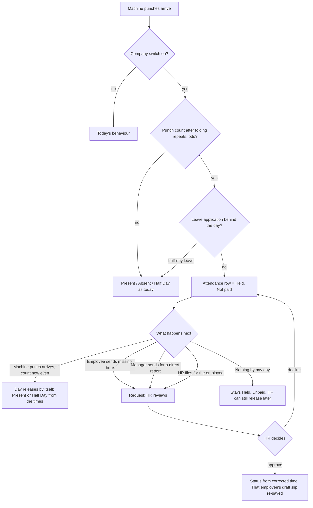

# 085 A day with a missing punch is Held: functional spec (ALV-392)

## 0 · Bad news first, and what I read

1. **This is not a thin slice. It is 65 points** and touches pay, permissions and a bulk write. Most of the size is not the Held feature. It is the six "close the door" items from 01c (SEC-2, 3, 4, 6, 7 and the 12 pay readers). I recommend two releases (section 14).
2. **Stock Frappe pays a Held day.** `salary_slip.py:824` reads only Absent, Half Day and On Leave. Held falls through as a paid day. Our code must deduct it on every pay reader (US-2).
3. **Two things I could not settle from code**, and the build must not guess them: how Grace's hidden Server Script counts its "3 a month" (site data, not in the repo) and what a release does when the corrected time is below the shift's absent threshold (Q2, Q3).
4. **Grace's HR login will be locked out** by the fail-closed scope fix until it has a Company User Permission (Q1, from 01c).

**Read (proven), in this worktree at `fd658eff`:** `attendance.json:96` (status options), `salary_slip.py:818-828`, `shift_type.py:266-300` and `:376-390`, `payroll_fields.py:1-120`, `payroll_rules_apply.py:448-500` and `:562-600`, `hooks.py:150-185` and `:649-665`, `attendance_correction.py:1380-1400` and `:1105-1125`, `payroll_slip.py:164`, the file list of every `alvoraa_portal` module that contains the word "Absent". **Taken from 01c or 07 and not re-read by me** (labelled "per 01c" or "per 07"): the `access.py`, `field_app_access.py`, `branch_geofence.py` lines, `attendance_analytics.py:351`, `monthly_attendance_sheet.py:28-31`, `salary_slip.py:619-664`. **Not checked:** any site, any tenant's Custom DocPerm, production, the Grace Server Script text, whether `ux-learnings.md` holds the design-gate feedback.

**Cross-module reach.** `alvoraa_portal` (almost all of it), `hrms` (Attendance status option; read-only for the slip; `alvoraa_hr_core` access helpers), `erpnext` (Company custom fields). Not touched: `alvoraa_goals`, `alvox_compensation`. HRMS domains: attendance, payroll (pay), leaves (a Held day with a leave application is not held: see edge cases), org structure (company and branch scope). Personas: Employee, line manager, HR Manager and HR User in scope. CXO: nothing changes.

## 1 · Gap analysis

| # | Requirement | What exists today (read) | Verdict | Cost |
|---|---|---|---|---|
| G1 | A true "Held" status | Options are `\nPresent\nAbsent\nOn Leave\nHalf Day\nWork From Home` (`attendance.json:96`). Property Setters from `payroll_fields.py` / `after_migrate` is the existing pattern (`hooks.py:649-665`). | **Configure** (a Property Setter) | S |
| G2 | Held is unpaid on the slip | `salary_slip.py:824` ignores it. `payroll_slip.py:164` counts only On Leave / Absent as "not charged". | **Extend** (our code on every pay reader, list in US-2) | M |
| G3 | Write odd-punch days as Held for a company with the switch on | The "held" verdict exists only behind a rule set: `judge()` and `attendance_onload` (`payroll_rules_apply.py:448-500`, `:562-590`), and `attendance_onload` returns early if the company has no Alvoraa Payroll Rule Set. Grace has none. | **Extend**: reuse the punch counter (`_punches`) and the same folded count; new small hook. No new DocType | M |
| G4 | Release by regularisation (HR decision, employee's request, manager's request) | Employee `raise_correction` (`attendance_correction.py:1105`), manager `raise_for_report` (`:2143`), HR `decide` (`:1734`), all exist. The 3 existing fields `alvoraa_held`, `alvoraa_held_confirmed`, `alvoraa_confirmed_out_time` exist (`payroll_fields.py:42-65`) | **Extend**: on approval of a request for a Held day, set the status | M |
| G5 | Present or Half Day from the corrected time | Frappe's own rule: below `working_hours_threshold_for_absent` is Absent, below `..._for_half_day` is Half Day, else Present (`shift_type.py:266-300`). | **Reuse the Shift Type thresholds**; no new rule | S |
| G6 | Late machine punch releases the day | Auto-attendance counts any row with docstatus < 2 as marked (`shift_type.py:380-390`), so it will not touch Held, and will not release it either. | **Extend**: a hook on Employee Checkin insert, machine account only (SEC-5) | M |
| G7 | Slip refresh on release, one employee | Grace's batch job is dead since 18 Nov (per 07 OPS-3). | **Extend**: re-save that employee's draft slip, in its own try | S |
| G8 | Per-company switch, limit, exempt roles | Settings today are site defaults (`attendance_correction.py:1383-1400`, `MANAGER_ON_BEHALF_KEY`). The "3 a month" is a Server Script on Grace's site, not in the repo. | **Configure**: three Custom Fields on Company (rung 2). Enforcement is **Extend** | M |
| G9 | Backfill Grace November only | None. | **Build new**: one script file, dry run first | M |
| G10 | Close the HR self-release doors, raiser rule, fail-closed scope | `refuse_own_submit` exists on Attendance Request (`hooks.py:183`); Attendance has no such hook (`hooks.py:160-164`); raiser check is portal-only (`attendance_correction.py:1591`); `_scope_conditions` fails open (per 01c `:323-329`) | **Extend**: reuse the existing helpers, no new layer | M |
| G11 | Manager on-behalf route "where allowed" | A site default, unset means on (`attendance_correction.py:1383-1400`). | **Nothing to build.** The brief said "per company"; 01c corrected it. Held follows the site default | none |
| G12 | New screens | Month, day sheet, HR card, register filter, slip line exist as screens (`acPaint`, `acRow`, `acDetail` per 01b). Settings card is new. | **Extend** (strings, a tag, a tile) + one new card | M |

**New DocType: none. New app: none. New queue or container: none** (07 run cost).

**Recommend dropping or deferring (subtract pass, section 15):**
1. **Hindi strings: ship English first.** 01b says the Hindi is a machine draft needing native review. Ship it only after a native speaker has read it. A wrong Hindi sentence about pay is worse than English.
2. **The "Sent to HR" second tag and the exempt-roles tag picker.** Keep the sentence "Sent to HR at 17:40" in the sheet, which carries the same fact. Store exempt roles as a comma list in one Small Text field, validated against `Role`, edited in the card. A tag chooser is polish.
3. **OPS-21 monitoring beyond one hand-run count** (held per site per day). No scheduled job.
4. **Do not fix Grace's dead slip batch in this slice** (OPS-19; it is a different bug).
5. **Split into two releases** (section 14): the safety doors first, because they stand on their own and protect pay today; the Held feature second.

## 2 · Process flow

Unhappy paths: submitted slip (Q4); late punch is a phone punch or HR-added punch (stays Held, SEC-5); a request for a day that is no longer Held (refused with a sentence); switch turned off (Held stays, section 6); two HR approving the same request (second is refused, the first stands); HR deciding their own day (refused, SEC-2).

## 3 · Epic and stories

**Epic E-085: A person with one punch is neither paid nor refused until a human has looked.** Personas: Employee (shift staff on a phone), line manager, HR Manager and HR User (Grace Drinks first), Sales Executive (exempt from the limit).

| Story | As a / I want / so that | Pts | INVEST note |
|---|---|---|---|
| **US-1** | **HR system** (as the HR Manager) I want "Held" to be a real Attendance status on every tenant so a Held row can be saved and read everywhere | 2 | Small, testable. OPS-10, 14 |
| **US-2** | **HR Manager** I want a Held day to cost a day's pay on the slip and on every pay reader, so nobody is paid for an unchecked day | 8 | **An 8: split warning.** Kept whole because the readers share one rule and one test. If the engineer finds more than 6 readers, split by reader |
| **US-3** | **HR Manager** I want a day with an odd number of punches to be written as Held, once, for a company with the switch on, so it is neither paid nor penalised by chance | 5 | |
| **US-4** | **HR Manager** I want approving a request for a Held day to set Present or Half Day from the corrected time and refresh that one employee's slip, so pay is restored the same day | 5 | |
| **US-5** | **Employee** I want a late machine punch to release my day by itself, so I do not have to ask when the machine has the answer | 5 | |
| **US-6** | **Employee** I want my month and day sheet to say "Held", why, that it is unpaid, and to ask only for the missing time, so I know what to do | 5 | Prototype screens 1-3 |
| **US-7** | **Line manager** I want to send the missing time for a direct report from their sheet, so my team's pay is fixed without an HR call | 2 | Existing route; wording only |
| **US-8** | **HR User** I want the request card, the register filter and the slip to show Held in the same words, so I can decide in one look | 3 | |
| **US-9** | **HR Manager** I want a per-company switch with a live count and an honest Save button, so I know what I am switching on | 3 | |
| **US-10** | **HR Manager** I want a per-company monthly limit and exempt roles that replace Grace's hidden script, so the rule is visible and held days never count against it | 5 | |
| **US-11** | **HR User / HR Manager (must not)** I must not be able to release my own Held day on any door, so a gate that decides pay cannot be skipped by its operator | 3 | SEC-2 |
| **US-12** | **HR User (must not)** I must not decide a request I raised, on any door | 2 | SEC-3 |
| **US-13** | **HR User (must not)** I must not act outside my company or branch, and an HR login with no company sees nobody | 3 | SEC-4 |
| **US-14** | **HR User / Accounts Manager (must not)** I must not change the switch, limit or exempt roles; only HR Manager in scope may, and the change is recorded | 2 | SEC-6 |
| **US-15** | **Employee / colleague (must not)** I must not see a colleague's held days, and nobody gets a new list | 2 | PRIV-1. Mostly tests |
| **US-16** | **Operator (Surbhi)** I want a November backfill for Grace only: dry run first, an undo list, harmless to re-run | 5 | SEC-7, OPS-15..17 |
| **US-17** | **Operator** I want the release order, rollback, script retirement and checks written as a runbook that I can follow without the engineer | 3 | OPS-7, 8, 18, 20-23. A document plus two checks, no code |
| **US-18** | **Employee** I want a held day to be raisable even when the 084 days-back window or the monthly limit would refuse an ordinary day, so a day I worked is never lost for ever | 2 | Design gate D6 |

**Total: 18 stories, 65 points.**

### YouTrack-ready table (not created; Surbhi's call)

| Summary | Persona | Pts | Linked AC | Linked reqs |
|---|---|---|---|---|
| Held is an Attendance status on every tenant | HR | 2 | AC-1, 2 | OPS-10, 14 |
| Held costs a day on every pay reader | HR Manager | 8 | AC-3 to AC-8 | SEC-1, OPS-9 |
| Odd-punch days written as Held | HR Manager | 5 | AC-9 to AC-13 | OPS-2, 11 |
| Release on HR approval, slip refresh | HR Manager | 5 | AC-14 to AC-19 | SEC-1, OPS-3, 4, 19 |
| Late machine punch releases the day | Employee | 5 | AC-20 to AC-24 | SEC-5, OPS-2, 11 |
| Employee month and day sheet | Employee | 5 | AC-25 to AC-31 | PRIV-2, 3 |
| Manager sends for a report | Line manager | 2 | AC-32, 33 | PRIV-1 |
| HR card, register, slip wording | HR User | 3 | AC-34 to AC-36 | PRIV-1 |
| Switch, live count, Save | HR Manager | 3 | AC-37 to AC-39 | SEC-4, 6 |
| Limit and exempt roles | HR Manager | 5 | AC-40 to AC-44 | SEC-6, OPS-5, 20 |
| Own-day doors closed | HR (must not) | 3 | AC-45 to AC-48 | SEC-2 |
| Raiser cannot decide | HR (must not) | 2 | AC-49 | SEC-3 |
| Scope fails closed | HR (must not) | 3 | AC-50 to AC-52 | SEC-4 |
| Settings write rights and audit | HR (must not) | 2 | AC-53, 54 | SEC-6 |
| No new reader | Employee (must not) | 2 | AC-55 to AC-57 | PRIV-1 |
| Grace November backfill | Operator | 5 | AC-58 to AC-63 | SEC-7, OPS-1, 8, 15-17 |
| Release runbook and checks | Operator | 3 | AC-64 to AC-67 | OPS-7, 8, 12, 13, 18, 20-23 |
| Held day never lost to a window or limit | Employee | 2 | AC-68, 69 | Design D6 |

## 4 · Data model

**No new DocType. No new child table.**

| DocType | Field | Type | Detail | Why an existing field cannot carry it |
|---|---|---|---|---|
| Attendance | `status` | existing Select | Add option `Held` by Property Setter, created in `payroll_fields.py` and wired to `after_migrate` and `after_install` (the file's own pattern: new tenants do not get a migrate) | The brief's decision is a true status |
| Attendance | `alvoraa_held` (exists, Check), `alvoraa_held_confirmed`, `alvoraa_confirmed_out_time` (exist) | existing | Kept as they are (rule-set path). **For this slice, `status = Held` is the one truth the pay readers read.** On the rule-set path, the engine's `alvoraa_held` is unchanged; a rule-set company with the switch on has both, and `status` wins. [ASSUMPTION: engineer confirms the rule-set path (DTC, set to off) is not broken by a Held status. 01b says DTC can turn the switch on later] | |
| Attendance | `alvoraa_release_how` | Select: `HR decision` / `Machine punch`, read-only, `allow_on_submit` | PRIV-3: the person must see how a day was released | Nothing on Attendance records how |
| Attendance | `alvoraa_release_by` | Data (user id or checkin name), read-only, `allow_on_submit` | PRIV-3, SEC-7: who or which checkin, a year later | same |
| Attendance | `alvoraa_release_on` | Datetime, read-only, `allow_on_submit` | when | same |
| Company | `alvoraa_hold_odd_punch_days` | Check, default 0 | per-company switch. Permlevel for HR Manager and System Manager only (SEC-6) | Settings today are site defaults; the brief wants per company (Q5, confirmed fits) |
| Company | `alvoraa_monthly_request_limit` | Int, default 0, **0 means no limit** | permlevel as above. **Parity difference:** prototype says "empty = no limit"; an Int field cannot be empty. See parity table, needs Surbhi's yes | The Grace Server Script is site data |
| Company | `alvoraa_limit_exempt_roles` | Small Text, comma-separated Role names, validated on save against `Role` | permlevel as above. Default for Grace set by migration step in US-10 | A child table would be a new DocType; rejected |

Release fields are three, not one: **I could not make one field carry "how, who, when"** and PRIV-3 wants all three. If Surbhi prefers fewer, the Attendance Version row (`track_changes: 1`, `attendance.json:327`) holds from/to/who/when for normal saves, but **`db_set` writes skip Version** (per 01c), so the engineer's release must write these fields or a Comment. Recommendation: keep the three fields; they are read-only and nobody types in them.

## 5 · States and transitions (Attendance.status, one new value)

| State | Entered by | Left by | Who | Read-only / pay | Notified |
|---|---|---|---|---|---|
| Held | the hold hook (US-3) or the backfill (US-16) | release (below) | n/a | **Unpaid.** Employee cannot edit the row | Nothing is sent. The employee sees it in the portal on opening (PRIV-3). **No email, no push** (brief: not doing) |
| Present / Half Day (released) | HR approval (HR in scope, not own day, not raiser) or a machine-account punch insert | back to Held? **No.** Terminal for this slice, except HR can cancel and amend by their normal rights (outside own day) | HR in scope; Machine account | Paid | Employee sees the green line on opening |
| Absent (released) | only if corrected time is below the shift's absent threshold; **Q3** | | | Unpaid | |
| Held (after decline) | HR declines | | | Unpaid | The decline reason is shown (today's behaviour) |
| Held (switch off) | already Held when the switch goes off | release only | | Unpaid | Stays Held: Design gate D3 |

No other states. Terminal: released. Reversible: only by HR cancelling and amending, never by the system.

## 6 · Permission and visibility matrix

Roles verified from 01c's stock-role statements; **no tenant's Custom DocPerm was checked**.

| Role | Held day: see | Send missing time | Decide (release) | Change switch / limit / roles | Read settings |
|---|---|---|---|---|---|
| Employee | own days only | own days | **never** | no | Company read (stock) |
| Line manager (direct reports only) | Held tag and punch times, no reason | yes, direct reports, if the site's manager route is on (unset = on) | **no** | no | read |
| HR User in scope | in-scope register | yes (files for an employee) | yes, except **own day** and **a request they raised** | **no** | read |
| HR Manager in scope | in-scope register | yes | same as HR User | **yes, own companies only** | read |
| HR login with no company and no branch | **nobody** (ALV-385, Q1) | no | **no** | no | read |
| Accounts Manager | none | no | no | **no** (stock Company write is closed by permlevel) | read |
| Machine sync account (Biometric Sync role, no Employee record) | n/a | n/a | its punch may release a day, nothing else | no | no |
| System Manager / Administrator | all | yes | yes | yes | yes |
| CXO | no change | no | no | no | no |
| Guest | **nothing, no new route** | no | no | no | no |

**Negative cases, explicitly:** a colleague never sees a peer's Held day or punches; a manager never sees a non-report; company-A HR never sees company B; the settings count returns only an integer; no manager or CXO list or ranking of held days exists; no reason is collected or shown. Count of roles that can change the three settings: **2** (HR Manager in scope, System Manager).

## 7 · Acceptance criteria

Oracle in every row is a field value, a document state, an HTTP response or text on a screen. "Fresh CI site" means one built by migrate alone (OPS-6, 10).

**US-1 · Held exists**
- **AC-1** Given a fresh CI site, when an Attendance is inserted with status Held, then it saves and reads back `Held`. (Break the Property Setter: the test fails.)
- **AC-2** Given each tenant after migrate, when Attendance.status options are read, then they contain `Held`. Oracle: the operator states the value read per site and the count of sites migrated against sites that exist (OPS-14).

**US-2 · Held is unpaid**
- **AC-3** Given an employee with two Held days and the same employee in a control with the days Present, when a draft Salary Slip is created, then the first slip's payment days are 2 lower.
- **AC-4** Same as AC-3 with `consider_unmarked_attendance_as` set to Present, and again set to Absent: still 2 lower both times. (A cancelled or deleted Held row must not fall back to unmarked and pay.)
- **AC-5** Given a Held day, when each pay reader in this list runs, then the day is counted as unpaid. The list is every module that holds "Absent" today: `payroll_slip.py:164`, `attendance_analytics.py`, `org_figures.py`, `home_api.py`, `hr_api.py`, `payroll_rules_apply.py`, `alv291_attendance_fix.py`, `data_review.py`, `leave_rules.py`, the two reports `daily_attendance_workings` and `salary_components_and_workings`, the Monthly Attendance Sheet abbreviation map, and Frappe's slip at `salary_slip.py:619-664` and `:824`. **The engineer opens each and records the verdict "reads Held correctly / fixed / not a pay reader" in the PR.** An item left unrecorded is a failing AC.
- **AC-6** Given the slip, when a Held day exists in the period, then the slip shows "Held days, not paid: 2" and "12 Nov, 17 Nov. Paid when HR releases them; this slip updates by itself."
- **AC-7** Given the Monthly Attendance Sheet, when a Held day is shown, then it shows an abbreviation for Held, not blank.
- **AC-8** Given the register's status filter, when Held is chosen, then only Held rows in the HR login's scope are listed and the chip is amber with an icon and the word.

**US-3 · The hold**
- **AC-9** Given company Grace Drinks with the switch on and a day with 1, 3 or 5 punches (after repeat-scan folding), when the day is marked, then the Attendance row has status Held.
- **AC-10** Given the switch is off for a company, when the same day is marked, then it is marked as today and no Held row exists.
- **AC-11** Given a Held row, when the auto-attendance job ticks 3 times, then the row's `creation` and `name` are unchanged and no second row exists. (Break it: delete the row and the job re-creates it as Absent, so the test must fail.)
- **AC-12** Given a day with a half-day leave application, when it has one punch, then it is **not** Held (the existing rule, `payroll_rules_apply.py:581`).
- **AC-13** Given a day with an even count, when marked, then Present/Absent/Half Day as today.

**US-4 · Release by HR**
- **AC-14** Given a Held day and an approved request giving a missing time, when HR approves, then status becomes Present if the hours meet the shift's half-day threshold, Half Day if they meet only the absent threshold, using `shift_type.py:266-300`'s mapping. Oracle: the row's status and a fixture with three times.
- **AC-15** Given HR approval, then the row's `alvoraa_release_how` = `HR decision`, `alvoraa_release_by` = HR user id, `alvoraa_release_on` is set.
- **AC-16** Given a release, when it lands, then that employee's draft slip is re-saved and its payment days rise by 1 (or 0.5), and another employee's draft slip keeps the same `modified`.
- **AC-17** Given a re-save raises an error, then the error is written to Error Log, the release still stands, and no other employee's release is rolled back.
- **AC-18** Given the day sits inside a **submitted** slip, when HR releases, then the slip is untouched and HR sees "This day is in a slip that is already final. The slip was not changed." The employee's sheet does **not** say "your salary slip is updated" (Q4 default).
- **AC-19** Given HR declines, then the day stays Held, the decline reason is shown on the employee's sheet.

**US-5 · Late machine punch**
- **AC-20** Given a Held day with 1 punch and a new Employee Checkin inserted by the machine account (passes `is_machine_account`, `field_app_access.py:47-56` per 01c), when the count becomes even, then the day is released as AC-14 and `alvoraa_release_how` = `Machine punch` and `alvoraa_release_by` = that checkin's name.
- **AC-21** Given the same Held day, when the punch comes from `do_checkin` in the portal, a REST insert with a machine's `device_id` by a staff login, an HR-added punch, or a repeat scan inside the dedupe window, then the day stays Held. Five tests, five oracles.
- **AC-22** Given a 3-punch day, when HR deletes one punch, then the day stays Held.
- **AC-23** Given a punch flagged `skip_auto_attendance`, then the day stays Held.
- **AC-24** Given the released day, then the employee's sheet shows "The missing punch arrived from the machine at 18:41, so the day released itself."

**US-6 · Employee screens (parity table in section 12)**
- **AC-25** Given 2 Held days, when the employee opens the month, then the banner reads "2 days are Held. Not paid until fixed. Tap a held day and send the missing time to HR." and the tile "Held days" is amber. With none: "No held days. Every day this month is paid."
- **AC-26** Given one punch, when the sheet opens, then it shows "Held. One punch on this day.", the punch, "Not paid until fixed.", "HR looks at held days at the end of the month, before pay.", the field "What time did you leave?" (or "arrive" if the punch is an Out) and "Send to HR".
- **AC-27** Given 3 or 5 punches, then the sheet shows the three-punch sentence and the field "What time was the missing punch?" with an In / Out choice.
- **AC-28** Given a held day, when the form opens, then there is **no reason box and no explanation box**. Test: press Send and assert the payload's keys are date, time, In/Out and nothing else (PRIV-2).
- **AC-29** Given a request sent, then the sheet shows "Sent to HR at 17:40 by you. The day stays Held and is not paid until HR decides." and no Send button.
- **AC-30** Given a failed send, then the typed time is kept and the sheet says "Not sent. Your time is saved on this phone. Try again."; given a timeout it says "It may have gone through" and checks the server first.
- **AC-31** Given the switch is on, when the month page loads, then the strings "Missing punch" and "Missing punches" appear nowhere on it. Given 360 px width and 200% text, nothing scrolls sideways and tag text wraps; targets are 44 px; field text is 16 px.

**US-7 · Manager**
- **AC-32** Given a direct report's Held day, when the manager opens the report's month, then the same sheet shows, with the button "Send to HR for Rohit", and no reason is shown.
- **AC-33** Given the site's manager route is off or the person is not a direct report, then today's existing refusal sentences show. No team-wide held list exists.

**US-8 · HR card**
- **AC-34** Given a request for a Held day, when HR opens it, then it shows the Held tag, the punches, "the missing punch was 18:30" and "If you approve: this day becomes Present, 9h 28m, and is paid on the slip." with buttons "Approve: day becomes Present" and "Decline: stays Held".
- **AC-35** Given the computed result is Half Day, then the line and button say Half Day.
- **AC-36** Given a Held day nobody asked about, then it is not in the review queue.

**US-9 · Switch and count**
- **AC-37** Given Grace Drinks with the switch off, when HR Manager opens its settings card, then the Save button reads "Save for Grace Drinks: N days will be held" with N the live count, and the count response is an integer only.
- **AC-38** Given the switch is turned off, then days already Held remain Held and the card says "days already Held stay Held until HR releases them."
- **AC-39** Given the switch is on for Grace Drinks, then no other company's days are held.

**US-10 · Limit and exempt roles**
- **AC-40** Given limit 3 and an employee with 3 requests in the month, when a 4th is inserted through the portal, **REST or Desk**, then it is refused with "You have used your 3 requests this month. Held days do not count. For another day, ask HR."
- **AC-41** Given the same employee, when the request is for a Held day, then it is accepted at any count and does not add to the count.
- **AC-42** Given a user holding an exempt role (Sales Executive at Grace), then they are accepted at any count, **and a Sales Executive's odd-punch day is still Held** (exempt from the limit only).
- **AC-43** Given limit 0, then no request is ever refused by the limit.
- **AC-44** Given the setting saved at Grace and read back live, when the Server Script is disabled, then a test day proves the same refusal once, not twice. Script disabled, not deleted (OPS-20). **Blocked on Q2 (how Grace's script counts).**

**US-11 · Own-day doors**
- **AC-45** Given an HR Manager and an HR User, each with a Held day of their own, when each tries `decide`, ticking `alvoraa_held_confirmed`, setting `alvoraa_confirmed_out_time`, cancel, amend, delete or REST PUT on the row, then each is refused with `refuse` and a security log line with ids only.
- **AC-46** Given the same two logins, when they add, change or delete an Employee Checkin on their own record, then it is refused; an ordinary new punch "now" by the same person is allowed and does not release the day.
- **AC-47** Given the same acts on a colleague in scope, then they succeed.
- **AC-48** Given the auto-attendance tick, then it still marks and leaves Held rows alone (it runs as Administrator).

**US-12 · Raiser**
- **AC-49** Given a login holding a manager role and HR User raises a request for a direct report, when that login submits it through `decide`, REST submit, or Desk submit, then all three are refused; a different HR login in scope succeeds.

**US-13 · Scope**
- **AC-50** Given an HR login with no company and no branch, when it calls `decide`, the settings endpoint or the live count, then it is refused for every employee.
- **AC-51** Given company-A HR, then a company-B employee's request and company B's settings are refused; given branch HR, outside the branch is refused.
- **AC-52** Given `hr@grace.alvoraa.co`, then it has a Company User Permission for Grace Drinks **before** the switch is turned on (Q1). Oracle: a read-back of the permission row.

**US-14 · Settings write rights**
- **AC-53** Given HR User, Accounts Manager, and an HR Manager of another company, when each changes a setting through the endpoint or REST `PUT /api/resource/Company`, then each is refused.
- **AC-54** Given an in-scope HR Manager saves, then a Version or Comment row records who, when, from and to.

**US-15 · No new reader**
- **AC-55** A colleague asking for a peer's month is refused; a manager asking for a non-report is refused.
- **AC-56** Company-A HR's register filtered to Held shows no company-B row.
- **AC-57** The diff adds no `allow_guest` and no new `ignore_permissions`; the ceilings in `test_portal_security_010` hold.

**US-16 · Backfill**
- **AC-58** Given a copy of Grace's data, when the dry run runs, then nothing is written: row counts and `modified` are unchanged, and the output is counts and Attendance ids only, with no `employee_name`.
- **AC-59** Given the real run, then the changed count equals the dry-run count, the undo list is written before the first change and read back to the same count, and each changed row has an audit entry (run id, from, to, when, who ran it).
- **AC-60** Given a second run, then 0 rows change.
- **AC-61** Given the undo, then every row returns to its prior status exactly.
- **AC-62** Given a row inside a submitted slip, then it is skipped and listed.
- **AC-63** Given another company or October, then the script refuses; given live counts that differ from the dry run, it stops. Expected Grace figures, **kill criterion**: 86 one-punch (now Absent) and 80 three- or five-punch (now Present) days from 1-18 Nov. If the dry run touches any other kind of day, stop.

**US-17 · Runbook and checks**
- **AC-64** Given the written order (deploy proved by pin file, container and file; migrate on all sites; AC-2 read back; dry run; real run; count read back), then the operator can follow it without asking. Oracle: Surbhi's read-through (checklist in section 9).
- **AC-65** Given rollback, then the runbook states that Held rows are restored from the undo list **before** the old image runs, and that the Property Setter may stay.
- **AC-66** Given a Held-day response, then it carries no `Cache-Control` that allows storing; **[ASSUMPTION per 07 OPS-12: not read from nginx.conf; engineer reads it]**.
- **AC-67** Given release steps, then they run between 00:30 and 05:30 IST, after a disk and queue read (OPS-18, 23), and `sites/assets/assets.json` is bumped after any `docker cp` (OPS-13).

**US-18 · Windows and limit exemption**
- **AC-68** Given a Held day older than the manager filing window (`manager_filing_window_days`, `attendance_correction.py:1380-1400`), when a manager files, then it is accepted.
- **AC-69** Given the same for an employee's own request under 084's window (if 084 has landed), then accepted; given an ordinary non-held old day, then refused as today.

**Total acceptance criteria: 69.**

## 8 · Edge cases that can happen here

| Case | Rule |
|---|---|
| Joiner or leaver mid-month | Held only on days the employee is Active and has an attendance row; a leaver cannot raise a request (`_employee_for` filters Active, per 01c) so HR files for them |
| No shift on the day and none on the employee | Today's engine holds the day (`payroll_rules_apply.py:458-466`). Under the switch: the day is Held, and release by HR with no shift cannot compute Present/Half Day; **HR sees "No shift on this day. Choose Present or Half Day."** **This is a different rule from D2 and needs Surbhi's yes (Q3).** |
| Half-day leave with one punch | Never Held (AC-12) |
| Back-dated filing | Held days are exempt from the days-back window and the monthly limit (US-18) |
| Release lands after the slip is submitted | Q4 default: no change, HR is told |
| Two HR users approve at once | The second sees the day already released and is refused; one status change, one slip re-save |
| Request raised for a day that is no longer Held (late machine punch released it first) | Refused: "This day is already paid." No second change |
| Hourly machine lag (Grace) | A day can be odd at 14:00 and even by 15:00. Held days are written at day end by auto-attendance; the late punch path releases (US-5) |
| Employee re-hired | Same rules; no special case |
| Concurrent backfill and 3-minute tick | Backfill writes rows once and never deletes; AC-11 proves the tick leaves them |
| Multi-company site | Switch is per company; scope per SEC-4 |
| Switch on, then off | Already Held stay Held (D3) |
| Amended or cancelled Held row | Cancel/amend of one's own row refused; an HR doing it for a colleague is allowed, and the day must not fall back to unmarked (AC-4) |

## 9 · Non-functional requirements (from `nfr-budget.md` and 07)

| Item | Number for this slice |
|---|---|
| Volume | Grace about 166 held days in November (stakeholder statement, not measured). DTC unknown (up to about 8,000 rows if ever backfilled; not in this slice) |
| Month and day sheet | no new request beyond today's; skeleton shown within 300 ms |
| Live count | one small call, HR on desktop only; not on the phone path |
| Release | one employee's slip re-saved on release only; **no slip rebuild in any Attendance hook** (OPS-4) |
| Backfill | chunks of 50 days per commit (OPS-15), re-runnable, one site, one run id |
| Queue | no new queue; the late-punch release runs inside the checkin insert hook, wrapped so it can never block a machine punch (same stance as `on_attendance_submit`) |
| Page weight | under 3 KB gzipped added to `portal.js` (07 estimate, not measured). Cold 3G first load of `portal.js` already misses 2.5 s; not caused by 085 |
| Retention | no new clock. Release fields live with the Attendance row. Undo list deleted when Surbhi says Grace's November pay is final |
| Personal data | Held state is sensitive (pay-deciding). No new collection |

**Runbook checklist (US-17):** disk and queue read; deploy proved; migrate on every site; AC-2 value read per site; Company User Permission read back; dry run saved; undo list read back; real run; count read back; first two daily runs checked in Error Log; the Grace script disabled last.

## 10 · Data migration and backfill

- **After migrate, on every tenant:** the `Held` option, the three release fields, the three Company fields. Defaults: switch 0 (off), limit 0 (none), exempt roles empty. DTC and every other site: nothing is held until a company switch is turned on.
- **Grace only:** (a) set the three Company values: switch on, limit 3, exempt roles `Sales Executive`; (b) read them back; (c) prove one test day; (d) disable the Server Script; (e) November backfill. Limit 3 and role Sales Executive are from the brief; **how the script counts is Q2**.
- **Rollback:** code by previous image tag with migrations off; data from the undo list, **restored before** the old code runs (old code pays Held rows as normal days, OPS-22). The Property Setter and fields may stay.
- **Nothing** is created or changed for October, for DTC, or for any company with the switch off.

## 11 · Notifications and messages

**No email, no push, no SMS is sent. None is built.** The employee is told by what they see on opening the portal (PRIV-3). Strings are exactly those in `01b` section 3 and quoted in the ACs above. Rules: a message never carries another person's name or a punch time the reader cannot already see; log lines carry ids only. HR is told "The slip was not changed" only in the HR view (AC-18). Notice for the 80 Grace people is Grace HR's job, from the register (Held filter); we do not export or email it.

## 12 · Prototype parity table

Prototype `prototype-v1.html` (published artifact AAb1hryHeyKQfj1XhUPkvi). Surbhi's design gate: "go with this design (prototype v1)". Rows marked **needs her yes** differ from the prototype or the code.

| Prototype element | Built as | Same? |
|---|---|---|
| Month banner, amber "Held days" tile, row tag "Held" | AC-25 | Same |
| Tag "Sent to HR" beside the Held tag | Sentence in the sheet only (AC-29) | **Different, needs her yes** (my recommendation to drop the second tag) |
| Day sheet, one punch / three or five punches / sent / released by HR / released by machine / declined | AC-26 to AC-30, AC-24, AC-19 | Same |
| Hindi switch with "रोका गया" | Ship English first, Hindi after native review | **Different, needs her yes** |
| Time-only form, no reason box | AC-28 | Same (D1 decided) |
| Manager "Send to HR for Rohit" | AC-32 | Same |
| HR card text and two buttons | AC-34, 35 | Same; Half Day wording added |
| Register filter value Held (amber) | AC-8 | Same |
| Slip line "Held days, not paid: 2" | AC-6 | Same |
| Settings card: switch, live count on Save | AC-37 | Same |
| Limit field, "empty = no limit" | Int, `0` = no limit | **Different, needs her yes** |
| Exempt roles as tags with "Change roles" | Comma list in one field, edited in the card | **Different, needs her yes** |
| After save: "This replaces the old hidden rule of 3 requests a month." | on Grace only, shown once | Same (copy kept) |
| Not in prototype: no-shift Held day release | HR chooses Present or Half Day | **New, needs her yes** (Q3) |

## 13 · Compliance-impact sub-analysis (I am not a lawyer. Nothing here is a legal ruling.)

**1 · Data touched**

| Field / object | Class | Purpose | Lawful basis (recorded) | New? |
|---|---|---|---|---|
| Attendance `status = Held`, punches | sensitive | pay accuracy | employment contract / employer's payroll duty; not re-derived by me | no, derived from punches already held |
| Release how / by / on | internal | defend a pay decision | same | **yes, three fields.** Impossible to defend a year-old release without them |
| Missing time sent by employee | sensitive | the correction | as today | no |
| Company switch, limit, roles | internal | configuration | n/a | yes, not personal |
| Undo list (ids only) | personal by reference | rollback | n/a | outside the repo, deleted at the date Surbhi names |

**2 · Obligations engaged** (from 01c section 7; baseline checked there on 24 Aug 2026, which goes **stale from 22 Nov 2026**; I did not re-check `security-compliance-baseline.md` or `compliance-feature-map.md` for this spec, only 01c's reading of them)

| Obligation | What 085 must do | Feature |
|---|---|---|
| DPDP: safeguards, accuracy, correction, grievance | scope, self-release doors closed, person sees and can contest | US-11 to US-15, US-6, PRIV-3 |
| Wage law on deductions | see ⚠ below | none; a decision, not a feature |

**3 · Visibility delta:** no one sees more. The register filter gains a value in the same scope; settings count is an integer. Negatives in section 6.

**4 · Decision automation:** **yes. The hold is automatic and it changes pay; the release (Present or Half Day from the times) is also automatic, by the shift's thresholds.** Accountable human: the HR Manager of the company, who owns the switch. Human intervenes: on any release by HR, and at month end before pay. The employee is told on opening the portal, and contests by sending the missing time, which HR reviews. A late machine punch releases without a human, and this is the one place "the system decides" in a pay-increasing direction only; it never lowers pay. **If Surbhi wants no automatic release at all, AC-20 to AC-24 are removed and US-5 goes.**

**5 · Retention and deletion:** nothing changes for Attendance. Release fields live with the row. Undo list is deleted on Surbhi's word. Counsel's retention rules (memory: 18 Sep) are not engaged by a new clock.

**6 · ⚠ Open compliance questions**

| Question | Who decides | Blocks |
|---|---|---|
| ⚠ COMPLIANCE: may Grace withhold a day's pay at cut-off for a one-punch day, pending correction (Code on Wages 2019 and Grace's state rules)? Brief gate Q1 is Surbhi's decision; **no written counsel view that I can see**. 01c records it as accepted risk R1 | Surbhi, with counsel if she wants it closed | **Nothing.** Surbhi accepted the risk on 19 Nov 2026 |
| Does the 80 "Present to Held" change need notice to the people before pay? Brief decision (a): HR tells them from the register | Surbhi, Grace HR | Nothing in the build |

**7 · AI features:** none. No AI sets any rating, emotion or inference. Present/Half Day is a fixed threshold rule on a human-corrected time.

**Prohibitions:** nothing here needs passive monitoring or surveillance. Punches are already collected for attendance.

## 14 · Release shape, recommended (rung check)

Rungs: Property Setter and Custom Fields are rung 2; hooks, readers and the script are rung 4; no rung 5 or 6. Rejected cheaper: (rung 1) nothing there holds a pay day; (rung 2 only) the slip ignores Held, so code is unavoidable.

- **Release A (stands alone, protects today's pay):** US-11, US-12, US-13, US-14. These close doors that are open today and fix `_scope_conditions` failing open. Cost: Grace HR needs the Company User Permission first (Q1).
- **Release B:** US-1 to US-10, US-15 to US-18.

This is a recommendation. The brief and gates did not ask for it. Surbhi decides.

## 15 · Subtract pass

Removed from this spec: a separate story for Hindi; a held-day email (not built); a monitoring alert beyond one hand-run count; a notice date setting (D4); an exempt-roles child table; fixing Grace's slip batch; a team held list. Removed from 01c's wording: nothing. **Not removed but flagged big:** US-2 (8 points) and the 12-reader sweep. I could not cut it: Held is a true status and every reader must be told.

## 16 · Open questions

| # | Question | Owner | Blocks |
|---|---|---|---|
| Q1 | Give `hr@grace.alvoraa.co` a Company User Permission for Grace Drinks before the switch is on? Recommended yes | Surbhi | Grace HR being able to release (AC-52) |
| Q2 | What exactly does Grace's Server Script count (requests by creation month or by day month? do rejected ones count?) Someone must read the script on Grace's site. Default [ASSUMPTION]: this employee's Attendance Requests created in the calendar month, not cancelled or rejected, for days that are not Held | Engineer (read-only read of the script) then Surbhi | AC-44 only |
| Q3 | Corrected time below the shift's absent threshold: Absent (Frappe's own rule, my default) or refuse the approval? And a no-shift Held day: HR picks Present or Half Day? Her D2 said "Present or Half Day" only | Surbhi | AC-14, section 8 row |
| Q4 | Release after the slip is submitted: no change and HR is told (default), or arrears next month | Surbhi | AC-18 |
| Q5 | Is the whole slice one release or two (section 14)? | Surbhi | release planning |
| Q6 | Which portal page hosts the settings card (the page for `alvoraa_manager_on_behalf_enabled` in `hr_api.py:3327` is the likely neighbour) [UNVERIFIED: engineer to confirm] | Engineer | none |

## 17 · Assumptions

- [ASSUMPTION] The rule-set company path (DTC, off) is unharmed by a Held status; engineer to prove.
- [ASSUMPTION] Grace November payroll is not yet run, so nothing paid is clawed back (brief Q4 not answered).
- [ASSUMPTION] The pay readers beyond those I opened behave as 07 says; AC-5 makes the engineer open each.
- [ASSUMPTION] A Company custom field at a restricted permlevel is writable only by the roles I listed; to be proved on a two-company site.

## 18 · Traceability

"Test" is the proposed test; **none exists yet**, so every row's status is "AC written, test to build". No row is an unmarked gap.

| Source | ID / line | Story | AC | Status |
|---|---|---|---|---|
| Brief | true Held status (gate 2) | US-1, US-2 | AC-1..8 | covered |
| Brief | held until regularised by HR / employee / manager | US-4, 6, 7 | AC-14..19, 25..36 | covered |
| Brief | Present or Half Day automatic (D2) | US-4 | AC-14, 35 | covered; below-threshold and no-shift cases need Q3 |
| Brief | payroll pays nothing for a held day; release refreshes that employee's slip | US-2, 4 | AC-3..6, 16, 17 | covered |
| Brief | per-company switch | US-9 | AC-37..39 | covered |
| Brief | monthly limit; Sales Executive exempt; replaces Grace script | US-10 | AC-40..44 | covered; AC-44 blocked on Q2 |
| Brief | days already held stay Held when switched off (D3) | US-9 | AC-38 | covered |
| Brief | no reason box, no fix-by date (D1, D4) | US-6 | AC-28; D4: no date appears in any AC string, AC-26 | covered |
| Brief | exempt from 084 window (D6) | US-18 | AC-68, 69 | covered |
| Brief | backfill Grace November only; October untouched | US-16 | AC-58..63 | covered |
| Brief | compliance: Surbhi's accepted risk | section 13 | none (a decision, not behaviour) | not adopted as a feature; **user decision recorded 19 Nov 2026** |
| Brief | not doing: new DocType, rules engine, email, push | section 1, 11 | none (absence) | covered by absence |
| Brief | success measures (held at cut-off, slips that paid a held day) | US-17 | AC-64 (the checklist reads the counts) | covered |
| Brief | kill criteria 1-4 | US-16, 3, 4 | AC-63, 11, 3, 16 | covered |
| Prototype | Month banner and tile | US-6 | AC-25 | covered |
| Prototype | Day sheet, six states | US-6 | AC-24, 26..30, 19 | covered |
| Prototype | Manager sheet | US-7 | AC-32, 33 | covered |
| Prototype | HR request card | US-8 | AC-34..36 | covered |
| Prototype | Register filter, slip line | US-8 | AC-6..8 | covered |
| Prototype | Settings card | US-9, 10 | AC-37..44, 53, 54 | covered |
| Prototype | 360 px, 200% text, 44 px | US-6 | AC-31 | covered |
| Prototype | Hindi | none | none | **not adopted this slice, needs her decision** (section 12) |
| SEC-1 | pay, release, submitted slip | US-2, 4 | AC-3, 4, 16, 18 | covered |
| SEC-2 | own-day doors | US-11 | AC-45..48 | covered |
| SEC-3 | raiser | US-12 | AC-49 | covered |
| SEC-4 | scope fails closed | US-13 | AC-50..52 | covered |
| SEC-5 | machine punch only | US-5 | AC-20..23 | covered |
| SEC-6 | settings rights, limit on the document | US-10, 14 | AC-40, 53, 54 | covered |
| SEC-7 | backfill | US-16 | AC-58..63 | covered |
| PRIV-1 | no new reader | US-15 | AC-55..57 | covered |
| PRIV-2 | time only, nothing in logs | US-6 | AC-28, AC-58 (no `employee_name`), AC-45 (log ids only) | covered |
| PRIV-3 | person sees state, reason, pay effect, release source | US-4, 5, 6 | AC-15, 20, 24, 26, 29 | covered; a year-old release traceable from AC-15 and AC-20 fields |
| OPS-1 | chunked, dry run | US-16 | AC-58, 59 | covered |
| OPS-2 | write once, tick leaves it | US-3, 5 | AC-11 | covered |
| OPS-3 | do not rely on the batch | US-4 | AC-16, 17 | covered |
| OPS-4 | no slip rebuild in a hook | US-4 | AC-16 (one slip changes) | covered; no separate perf AC |
| OPS-5 | setting on an existing doctype; script retired after read-back | US-10 | AC-44 | covered |
| OPS-6 | fields in `payroll_fields.py`, fresh CI site | US-1 | AC-1 | covered |
| OPS-7 | window, backfill after deploy | US-17 | AC-64, 67 | covered |
| OPS-8 | rollback and undo | US-16, 17 | AC-59, 61, 65 | covered |
| OPS-9 | readers list | US-2 | AC-3..7 | covered |
| OPS-10 | Property Setter | US-1 | AC-1 | covered |
| OPS-11 | auto-attendance leaves Held; late punch needs our code | US-3, 5 | AC-11, 20, 48 | covered |
| OPS-12 | no guest route, no cache | US-15, 17 | AC-57, 66 | covered; AC-66 assumption unread |
| OPS-13 | assets.json | US-17 | AC-67 | covered |
| OPS-14 | setter read back per tenant | US-1 | AC-2 | covered |
| OPS-15 | backfill script refuses other sites | US-16 | AC-63 | covered |
| OPS-16 | undo list read back | US-16 | AC-59 | covered |
| OPS-17 | order | US-17 | AC-64 | covered |
| OPS-18 | window until 05:30, slip job | US-17 | AC-67 | covered |
| OPS-19 | do not fix batch here | US-4 | AC-17 | covered; **user decision outstanding** |
| OPS-20 | script retired last | US-10 | AC-44 | covered; **user decision outstanding** (disable, not delete) |
| OPS-21 | one hand count, Error Log after two runs | US-17 | AC-64 (checklist) | covered thinly; recommend dropping |
| OPS-22 | rollback order | US-17 | AC-65 | covered |
| OPS-23 | disk and queue gate | US-17 | AC-67 | covered |

**Items with no AC: none.** Items covered only by a checklist read, not a machine test: OPS-21, OPS-17, OPS-18, OPS-23 (runbook, tested by Surbhi's read-through).

## 19 · Ready check (Definition of Ready, `definition-of-ready-done.md`)

- [x] Brief approved (Brief gate, 19 Nov 2026) and design agreed (Design gate, 19 Nov 2026)
- [x] Clickable prototype exists and was reviewed
- [ ] **Design feedback logged in `ux-learnings.md`: not checked by me.** Orchestrator to confirm
- [x] 01c and 07 §1-3 written, numbered
- [x] Gap analysis, each row against code I read (section 1)
- [x] Epic, 18 stories, sized, INVEST noted, four "must not" stories plus one for no new reader
- [x] Every story has ACs with observable oracles
- [x] Traceability complete, no unmarked gap
- [x] Permission matrix with negatives
- [x] Edge cases, NFRs, migration, compliance section present
- [x] Every ⚠ COMPLIANCE question names an owner and what it blocks
- [x] No prohibited capability
- [ ] **Usability test (5 shift staff, 360 px) is not run.** Planned in 01b section 9; before release, not before build

**Result: Ready to build with conditions.** Build can start now on US-1, 2, 3, 11, 12, 13, 14, 15, 16. Four things need Surbhi first: Q3 (below-threshold and no-shift release; blocks AC-14 edge cases and US-4's final form), Q2 (blocks AC-44 only), Q4 (blocks AC-18's wording), and the five "needs her yes" parity rows. Q1 blocks switching on at Grace, not the build.

---

## Spec gate: Surbhi (19 Nov 2026): START THE BUILD, TAKE THE ANALYST'S CUTS

- Cuts accepted: Hindi strings deferred; no second "Sent to HR" tag; exempt roles as a comma list; one hand count for monitoring; Grace's dead slip batch is not fixed here (OPS-19).
- **Two releases:** the safety doors (US-11 to US-14) first, then Held.
- Still open, not answered at this gate: the five prototype-parity rows; the OPS decision columns; Q1 (Company User Permission for hr@grace before switch-on); Q3 and Q4.
