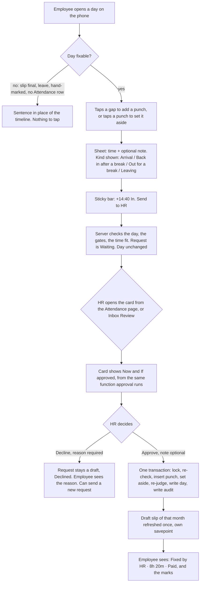

# 087 Attendance follows the punches: functional spec

## 0 · Bad news first, and what I read

1. **This is 64 points in 17 stories.** It is not small. Most of it is not the screen: it is the closed doors (SEC-1 to SEC-8), the engine change and the dry run. I recommend it ships as two pull requests on `dev` (server first, screens second), but one release to main, and main waits for counsel (Q1, decided).
2. **Stock Frappe HR blocks the flow in three places, and none of them is on a screen.** All three are in the vendored `hrms/hrms/hr/doctype/attendance_request/attendance_request.py` and run before any hook of ours:
   - `validate_request_overlap` (lines 109-132) refuses a second request for a day while any request that is not cancelled exists. A **Declined** request stays a draft (`docstatus 0`), and an **Approved** one is `docstatus 1`. So "send the next one after HR decides" and "Declined: editable again" both fail today with "Overlapping Attendance Request".
   - `validate_no_attendance_to_create` (lines 57-77), through `status_unchanged`, refuses a request whose day already has the status the request would write. A **Present** day (case (a): 11:15 portal punch, evening out) is refused as "Attendance status unchanged". Only a Held or Absent day gets through.
   - `create_or_update_attendance` writes `Present` with `db_set` (no history) before our hook runs.
   I settle all three in one place (section 1, G6 and section 2.3): a small subclass of the stock class, for punch-fix requests only.
3. **The "hand-marked day" guard (OPS-7) has no field to stand on.** I give a rule from code (section 4.4). It is `[ASSUMPTION]` until the engineer proves it on ppj.dev. One test (AC-25) cannot pass before that.
4. **The pay engine says "paid" in its own way.** At a company with a rule set, the engine can hold a day for reasons `worked_out` does not know (no shift, the 13 Nov no-threshold rule). I make the approval fail closed if the two disagree (AC-54). The dry run (AC-59) tells us whether that ever happens on real data.
5. **Decided by Surbhi on 20 Nov 2026** (recorded in section 14, no longer pending): Q1 (release to main waits for counsel), Q2 (punch fixes count against the monthly limit and the filing window), Q3 (the note label says HR and the manager read it). Everything else open is marked ⚠ PENDING DECISION with its default.

**What I read (proven):** worktree `087-attendance-follows-punches`, HEAD `2e31151f`. I was told `origin/dev` `7de630df` differs only by ALV-394 joiner sign-in commits; I did **not** re-run the diff. Files read in this worktree: all of `01`, `01a` (headings), `01b`, `01c`, `07`, `prototype-v2.html` (text, not opened in a browser), 085 `02-functional-spec.md` (sections 0-7, 12, 16-19); `alvoraa_portal/alvoraa_portal/held_day.py` (all); `attendance_correction.py` (`raise_correction` 1169, `_held_request_fields` 1229-1249, `withdraw` 1252, `refuse_own_day_outside_window` 1579-1625, `to_review` 1894, `decide` 1930-2020, `_state` 1073, `_me` 289, month punch reader 545-575); `payroll_rules_apply.py` (`_punches` 365-391, `judge` 448-478); `punch_dedupe.py` (header, `skip_repeat_scan`); `attendance_doors.py` (`refuse_raiser_submit`, `refuse_outside_company`); `field_app_access.py` (`checkin_has_permission` 296-350); `hooks.py` (150-290); `hrms/.../attendance_request.py` (40-420); `employee_checkin.json` and `attendance_request.json` (fields, permissions). **Not read by me, taken from 01c:** `access.py`, the Inbox JS, `portal.js` line numbers, the other pay readers in SEC-8's table, `hr_api.py`. **Not run:** any test, any site, any tenant's Custom DocPerm.

**Cross-module reach.** `alvoraa_portal` (almost all of it). `hrms` vendored tree: read-only, **no file edited** (Employee Checkin, Attendance Request, Shift Type, Attendance, Salary Slip are touched only through hooks, Custom Fields and one subclass). `erpnext`: Employee (read). `frappe`: nothing. **Not touched:** `alvoraa_goals`, `alvox_compensation`, `alvoraa_hr_core` (used: `refuse`, `refuse_own_decision`, `permitted_companies`). HRMS domains: attendance (the day), payroll (engine, draft slip), leaves (the leave guard), org structure (company and branch scope). Personas: Employee (phone, main), HR User / HR Manager in scope, line manager (sees marks only), CXO (nothing changes).

## 1 · Gap analysis

| # | Requirement | What exists today (read) | Verdict | Cost |
|---|---|---|---|---|
| G1 | Approval adds the missing punch | Stock `on_submit` → `create_attendance_records` changes only the **status** of the Attendance (`attendance_request.py` `create_or_update_attendance`, `db_set`). 085's `release_by_hr` (`held_day.py:380`) re-judges a Held day with the typed time as an "extra" and adds no punch | **Extend**: a new `on_submit` step that inserts one real Employee Checkin as the approver, then re-judges | M |
| G2 | Set a wrong punch aside, keep it on record | Employee Checkin has `skip_auto_attendance` (Check) only, and it already means three things: Frappe's "day already made", the ALV-337 repeat scan (`punch_dedupe.py`), and ALV-302's filed-out-of-window punch. Reusing it would make repeat scans and ALV-302 punches vanish from pay | **Configure + Extend**: Custom Fields on Employee Checkin (section 4); `skip_auto_attendance` is also set on a set-aside punch so Frappe's job and 085 skip it, but the **new field is what the engine reads** (decision 1) | M |
| G3 | Re-judge the day from the punches | `worked_out` (`held_day.py:287`) calls the Shift Type's own `get_attendance` and takes no thresholds of our own. Today Held days only | **Reuse**, widened to any fixable day and to "leave these punches out" | S |
| G4 | The request carries the time and In/Out | `alvoraa_missing_time` (Time) and `alvoraa_missing_log` (Select IN/OUT) exist on Attendance Request (`held_day.py:57-62`). `validate_missing_time` (`held_day.py:240-249`) refuses a time on a day that is not Held | **Reuse the two fields; Extend** the validate so an ordinary day may carry a time | S |
| G5 | The request carries which punch to set aside | No field | **Configure**: one Custom Field `alvoraa_set_aside` (Small Text) | S |
| G6 | "Send the next one after HR decides"; "Declined: editable again"; a Present day can be fixed | Stock refuses all three (section 0, point 2). `override_doctype_class` is used once in this app, for CRM Invitation (`hooks.py:895`); `hrms/hooks.py:197` overrides only Payment Entry and Project, so Attendance Request is free | **Extend** (rung 4): subclass `AttendanceRequest`, override **only** `validate_request_overlap`, `validate_no_attendance_to_create` and `create_attendance_records`, and only act differently when the request is a punch fix. Rejected cheaper rungs: editing the vendored file (clashes on every rebase); a `doc_events` hook (stock `validate` runs first and has already thrown); deleting declined drafts (destroys the record) | M |
| G7 | Pay engine ignores set-aside punches | `_punches` (`payroll_rules_apply.py:378`) has no skip filter at all | **Extend**: filter on the new set-aside field only. Dry run is the gate (OPS-R8) | M |
| G8 | HR approves only through the card, on what they saw | `decide` (`attendance_correction.py:1930`) submits by name only; the Inbox calls it the same way (01c, `next-inbox.js:64-68`, not re-read by me); Desk Submit is approve (`hooks.py:208ff`) | **Extend**: a `before_submit` flag set by `decide`, plus a "seen" check | M |
| G9 | Before-and-after record of the day | Stock writes a Comment with old and new **status** only (`attendance_request.py` `add_comment(... "Changed the status from ...")`). No hours | **Configure**: two Custom Fields on the request, written at approval | S |
| G10 | Screens: timeline, sheet, send bar, before/after card | Day sheet `acDetail`, `acForm`, `acHeldForm`, `acReviewQueue` exist (01b §1, read by the designer; line numbers not re-read by me). The 085 held form is replaced | **Extend** `portal.js`: one new form body replaces `acHeldForm`; the strip is the one new component | M |
| G11 | A month limit that does not count held days | `enforce_monthly_limit` returns at once when `_has_time` (`held_day.py:204`) and counts only `alvoraa_missing_log is not set` (`held_day.py:227`). With 087 every punch fix carries a time, so both would let punch fixes dodge the limit (01c point 1) | **Extend + one Custom Field** `alvoraa_for_held_day` (Check), stamped at raise, because the day's Held status disappears once it is released and cannot be asked again later | S |
| G12 | Draft slip refreshed | `refresh_draft_slip` (`held_day.py:432`) re-saves one employee's draft slip, own savepoint, never fails the approval | **Reuse as is** | none |
| G13 | Email / push to the employee | None exists for 085. Stock only publishes a realtime refetch (`attendance_request.py` `publish_update`) | **Drop**: no notification is built (section 11) | none |
| G14 | Part 1 (late machine punch re-works any day), part 2 (Recalculate button), a backfill | Held / dropped by Surbhi (Decisions 4) | **Drop** | none |

**New DocType: none. New app: none. New queue, container or schedule: none. New file: `alvoraa_portal/alvoraa_portal/punch_fix.py` and `overrides/attendance_request.py`** (the engineer may keep `punch_fix` inside `held_day.py`; I prefer a new file so the Held feature stays readable). **Verdict: Configure 4 rows, Extend 9 rows, Reuse 2, Build new 0, Drop 2 (G13, G14).**

## 2 · Process flow

### 2.1 Sunny day

### 2.2 Unhappy paths

| Where | What happens |
|---|---|
| Employee edits the draft after HR opened the card, or a machine punch arrives | HR's Approve is refused: "This day changed after you opened it. Open it again." Nothing written (SEC-1) |
| Day went onto a final slip, or onto approved leave, between send and approve | Approve refused in words, nothing written. Card offers Decline only (AC-33) |
| The result would still be an odd count | Allowed (decision ⚠6). Day stays Held. Card says so in amber words |
| Two HR people approve at once, or a double click | One punch. The second is told "This one has already been decided." (SEC-7) |
| An error after the punch insert | The whole approval rolls back: no punch, no mark, no status change (AC-56) |
| Draft slip refresh fails | Approval stands. Error Log row by slip name, no note text (AC-53) |
| HR person's own day | They can send it. Another HR person decides. The owner sees "This is your own day, so you cannot approve it." |
| Employee has left | Approval refused; card says "This person has left, so no punch can be added. Decline it and say why." |

### 2.3 The three stock blocks, resolved (the analyst note in 01c §13)

A request is a **punch fix** when it has `alvoraa_missing_time` or a non-empty `alvoraa_set_aside`. For a punch fix only, the subclass:

| Stock method | What it does today | What the subclass does |
|---|---|---|
| `validate_request_overlap` | Refuses if any other request of that employee with `docstatus < 2` overlaps the days | Looks only at other requests for that day that are **Waiting** (draft, `alvoraa_review_status` not Declined or Withdrawn) or an **Approved non-punch-fix** request. If one exists it refuses with our own sentence: "You already have a request for this day that HR has not decided. Withdraw it or wait for HR." Declined and Withdrawn drafts, and Approved **punch fixes**, are ignored. So: "Declined: editable again" = a **new request**; the old declined one stays as the record. "Send the next one after HR decides" = a new request after the first is Approved |
| `validate_no_attendance_to_create` | Throws when the only warning is "status unchanged", "holiday" or "on leave" | Does nothing. Our own guards (section 4.4) decide whether the day can be fixed, and say why in words |
| `create_attendance_records` (via `on_submit`) | Writes `Present` with `db_set` and a Comment | Does nothing. The new approval step is the only writer of the day. The Attendance never flickers to Present, and the day's `attendance_request` link is set by our write |

An ordinary request (no time, no set-aside) is **untouched**: stock behaviour, including a Declined draft still blocking an ordinary re-raise. That is existing behaviour and not part of this slice (⚠ PENDING DECISION Q11, default: leave).

## 3 · Epic and stories

**Epic E-087: When HR approves a punch fix, the punches, the day and the pay agree, and nobody cancels and rebuilds an attendance.**

Personas from the brief: Employee on a phone (frontline), HR User / HR Manager (the decider), line manager (sees marks only; files for a report only on 085's held-day route), operator (Surbhi). INVEST is checked in the last column; an 8 would be a warning, and the one 8-sized story was split (US-6/US-7).

| Story | As a / I want / so that | Pts | Prototype | INVEST note |
|---|---|---|---|---|
| **US-1** | **Employee (shop floor, phone)** I want to tap the gap where a punch is missing, type the time and send it, so I say the real time in two minutes | 5 | P1, P2, P4, P13 | Small enough. Needs server `kind` rule |
| **US-2** | **Employee** I want to tap a wrong punch and ask HR to set it aside (with or without adding one), so a late portal press does not stand | 3 | P3, P4 | Case (a). Lone set-aside is decision ⚠4 |
| **US-3** | **Employee** I want my day to say Waiting, Fixed or Declined with the reason, and to see what HR added or set aside, so I know what happened to my hours | 5 | P5, P6, P7 | |
| **US-4** | **Employee** I want a day that cannot be fixed to say why up front, so I never fill a form that cannot work | 3 | P8 | Decision ⚠3 |
| **US-5** | **HR Manager** I want a card that shows Now and If approved, and one short Approve / Decline, so I know the result before I press | 5 | P9, P10, P11, P12 | |
| **US-6** | **HR Manager** I want Approve to add exactly one punch and set aside only the ticked ones, marked and linked to the request, so the record says what happened | 5 | P6 (result) | Split from an 8 |
| **US-7** | **HR Manager** I want the day re-judged from the real punches in the same transaction, the draft slip refreshed, and the before and after kept, so pay follows the punches (ALV-410) | 5 | P9, P6 | Split from an 8. Decision 5 |
| **US-8** | **Payroll owner** I want the pay engine and every pay-visible reader to skip set-aside punches, and only those, so case (a) changes pay and nothing else moves | 5 | none | Dry run gate |
| **US-9** | **HR (must not)** I must not be able to approve a punch fix except through the card, on exactly what the card showed, so a pay change is never decided blind | 5 | P9, Inbox "Review" | SEC-1, SEC-2 |
| **US-10** | **HR (must not)** I must not approve my own day, a request I raised, or a person outside my companies, whatever door I use | 3 | P10 | SEC-3 |
| **US-11** | **Employee / manager (must not)** I must not name another person's punch, dodge the monthly limit or filing window, or file an ordinary-day fix as a manager | 3 | none | SEC-4, OPS-R2 |
| **US-12** | **HR / System Manager (must not)** I must not be able to write, clear, edit or delete a fix mark outside an approval, or cancel an approved fix | 3 | none | SEC-6, SEC-7 |
| **US-13** | **HR Manager** I want a fix to happen exactly once, whatever the timing, including against Frappe's auto-attendance job | 3 | none | SEC-7, OPS-R6 |
| **US-14** | **Employee / colleague (must not)** I must not see a peer's request, note or punch, and no photo, location or note leaks into a screen, log or cache | 2 | none | PRIV-2, OPS-R3, R4 |
| **US-15** | **Operator** I want fields added on every tenant, a dry run, a rollback and a landing proof, with no backfill over attendance | 3 | none | OPS-R8 to R12 |
| **US-16** | **Employee (frontline)** I want the new screens to work at 360 px, with a screen reader and in Hindi when a native reader has checked it | 3 | P13, P14 | 01b criteria 7 and 9 |
| **US-17** | **Employee** I want to send the next fix after HR decides, and a fresh one after a decline, so a stock block does not stop me | 3 | P5, P7 | The three stock blocks |

**Total: 17 stories, 64 points.** US-8 and US-9 are the two I would build and review first.

### YouTrack-ready table (not created; Surbhi's call)

| Summary | Persona | Pts | Linked AC | Linked reqs |
|---|---|---|---|---|
| Tap a gap, type the time, send | Employee | 5 | AC-1 to AC-9 | PRIV-1, OPS-R2 |
| Set a wrong punch aside | Employee | 3 | AC-10 to AC-13 | SEC-4 |
| Day says Waiting, Fixed, Declined | Employee | 5 | AC-14, AC-15 | PRIV-3 |
| Unfixable day says why | Employee | 3 | AC-20 to AC-25 | SEC-5 |
| HR card: Now and If approved | HR Manager | 5 | AC-26 to AC-36 | SEC-8 |
| Approve adds one punch, sets aside ticked | HR Manager | 5 | AC-37 to AC-44 | SEC-3, SEC-6, OPS-9, OPS-R5, R7 |
| Re-judge the day, slip, before/after (ALV-410) | HR Manager | 5 | AC-45 to AC-56 | SEC-8, PRIV-3, OPS-R1 |
| Engine skips set-aside punches only | Payroll owner | 5 | AC-57 to AC-59 | SEC-8, OPS-R8 |
| One door, stale preview, POST only | HR (must not) | 5 | AC-60 to AC-66 | SEC-1, SEC-2 |
| Own day, raiser, scope | HR (must not) | 3 | AC-67 to AC-71 | SEC-3 |
| Own day only, gates count | Employee (must not) | 3 | AC-72 to AC-77 | SEC-4, OPS-R2 |
| Marks written only by approval, no cancel | HR (must not) | 3 | AC-78, AC-79 | SEC-6, SEC-7 |
| Exactly once, race test | HR Manager | 3 | AC-80, AC-81 | SEC-7, OPS-R6 |
| No new reader, ids only, no cache | Employee (must not) | 2 | AC-82 to AC-89 | PRIV-2, OPS-R3, R4 |
| Fields, patch, rollback, landing | Operator | 3 | AC-90 to AC-95 | OPS-R8 to R12, OPS-13 |
| Phone, accessibility, Hindi | Employee | 3 | AC-96 to AC-99 | 01b |
| Next fix after a decision | Employee | 3 | AC-16 to AC-19 | Stock blocks |

## 4 · Data model

**No new DocType. No new child table. Eight new Custom Fields, all created by one function wired to `after_migrate` and `after_install` (the pattern at `held_day.py:68-88`: a site built by `bench install-app` never runs a migrate).**

### 4.1 Employee Checkin (4 new fields)

Read: `employee_checkin.json` has `skip_auto_attendance`, `attendance` (read-only Link), `time` at permlevel 1, `track_changes: 1`.

| fieldname | Label | Type | Detail | Why an existing field cannot carry it |
|---|---|---|---|---|
| `alvoraa_fix_added_request` | Added By Fix Request | Link → Attendance Request, read-only | Set on the punch the approval inserts. The **approver is the punch's `owner` and the time is its `creation`**, both set by the framework when the approval inserts as the approver (SEC-3 test, AC-71). So no separate approver or time field | Nothing on a punch says "this one was typed by HR on a person's word" |
| `alvoraa_fix_aside_request` | Set Aside By Fix Request | Link → Attendance Request, read-only | **The one field the pay engine reads** (SEC-8). Non-empty = does not count | `skip_auto_attendance` has three meanings already |
| `alvoraa_fix_aside_by` | Set Aside By | Link → User, read-only | An update has no `owner`, so the approver needs its own field | no existing field |
| `alvoraa_fix_aside_on` | Set Aside On | Datetime, read-only | same | no existing field |

`depends_on`: none. Default: empty. **None of the four is writable except by the approval code** (a document flag, SEC-6, AC-78); `read_only` alone does not stop an API write.

### 4.2 Attendance Request (4 new fields)

| fieldname | Label | Type | Detail | Why |
|---|---|---|---|---|
| `alvoraa_set_aside` | Punches To Set Aside | Small Text | Employee Checkin names, comma separated, **ids only, no times** (01c §3). Validated on every save (AC-13) | A child table would be a new DocType. Rejected |
| `alvoraa_for_held_day` | Raised For A Held Day | Check, read-only, default 0 | Stamped by the server when the request is **created** and the day is then Held. Read by the monthly-limit count and the filing-window check | Once the day is released it is no longer Held, so "was it Held when sent?" cannot be asked again. **Q2 is decided: only Held-day requests stay exempt** |
| `alvoraa_fix_before` | Day Before The Fix | Small Text, read-only | JSON `{"status","working_hours","late_entry","early_exit","punches":["10:30",...]}` written at approval. Counted punches only, times only, no names | PRIV-3 |
| `alvoraa_fix_after` | Day After The Fix | Small Text, read-only | same shape, written at approval, **from the real read-back after the writes** | Stock Comment holds status only |

**Reused as they are (verified in code):** `alvoraa_missing_time`, `alvoraa_missing_log` (`held_day.py:57-62`); `explanation` (the employee's note, `attendance_request.json`); `alvoraa_review_status`, `alvoraa_review_note`, `alvoraa_reviewed_by`, `alvoraa_reviewed_on`, `alvoraa_decided_as` (`attendance_correction.py:190-225`); on Attendance: `alvoraa_release_how` = "HR decision", `alvoraa_release_by`, `alvoraa_release_on` (`held_day.py:47-56`) and stock `attendance_request` link; on Employee Checkin: stock `attendance` link (set at insert so Frappe's job never takes the punch).

**Reason value on the request** (stock `reason` is a Select): derived by the server, never sent by the client. Added In → "Forgot to Punch In"; added Out → "Forgot to Punch Out" (the 085 pattern, `attendance_correction.py:1247`); set-aside only → "Other" `[ASSUMPTION: engineer confirms "Other" is accepted with an empty explanation on the document; the "Other needs an explanation" rule is in `raise_correction` only, `attendance_correction.py:1189`, and the new endpoint does not use it]`.

### 4.3 Request payload (PRIV-1)

The employee's send carries exactly: `date`, `time` (or none), `set_aside` (list of checkin names, or none), `note`. **Not** `log_type`, not `employee`, not `reason`. A forged `log_type` is ignored (AC-4).

### 4.4 Which days can be fixed (SEC-5), the rule

A day is fixable only if **all** are true, at raise **and** again at approval:

| Guard | Rule | Source |
|---|---|---|
| Has a day to change | An Attendance row exists with `docstatus 1` (no row yet: refused, Q5 default) | `held_day.py:271` pattern |
| Not on a final slip | `is_in_final_slip` is false | `held_day.py:333` |
| Not on approved leave | No submitted Leave Application with `status Approved` covering the date, **half-day leave included** | stock check used in `attendance_request.py` `has_leave_record` |
| Not hand-marked | **Not** (Attendance `in_time` empty **and** its `owner` is a named user, not `Administrator` **and** `attendance_request` empty **and** `leave_application` empty). Reason: only auto-attendance sets `in_time` (`held_day.py:254-256`), the scheduler creates rows as Administrator, and a request-made row carries `attendance_request`. **`[ASSUMPTION]`: the engineer proves the scheduler's `owner` value on ppj.dev before AC-25 is written green.** "Marked by hand on {date}" uses the row's `creation` date | OPS-7 |
| Employee is Active | `Employee.status = "Active"` | `_me` filters Active, `attendance_correction.py:289` |
| Has a shift | The Attendance row has a `shift` (085 refuses a Held day without one, `held_day.py:371`) | |

## 5 · States and transitions

**No new status value, no new workflow.** The request keeps the four values it has (`alvoraa_review_status`: Waiting, Approved, Declined, Withdrawn, `attendance_correction.py:195`). The Attendance keeps its statuses (Held exists from 085).

| State | Entered by | Who | Next states | Read-only after | Employee told |
|---|---|---|---|---|---|
| Waiting (draft) | Employee's send | Employee (own day only) | Approved, Declined, Withdrawn | Nothing is read-only to the employee until HR opens it; any edit makes HR's open card stale (SEC-1) | Status line "Sent to HR at 09:12 · Waiting" |
| Approved (`docstatus 1`) | `decide(approve)` only | HR User / HR Manager / System Manager in scope, not own day, not raiser | **Terminal.** Cancel refused (Q7 default). Reversal = a **new** request that sets the added punch aside | Everything | Green line; "Added by HR on 21 Nov, from your request." |
| Declined (draft) | `decide(decline, reason)` | same | Terminal for that document. The employee may send a **new** request | The document | "HR did not add this. Reason from HR: ..." |
| Withdrawn (draft) | `withdraw` | Employee, while Waiting | Terminal. A new request may follow | The document | "You withdrew this" (existing) |

Nothing is notified by email, push or SMS (section 11).

## 6 · Permission and visibility matrix

Roles are from the stock role rows I read (`attendance_request.json`: System Manager, HR Manager, HR User write+submit; **Employee write, no owner limit**) and from 01c. **No tenant's Custom DocPerm was checked.**

| Actor (count of roles) | Raise a fix | Decide (approve / decline) | See the request, note | See a set-aside or HR-added mark | Write or delete a fix mark |
|---|---|---|---|---|---|
| Employee, active (1 role) | Own day only | **Never** | Own | Own day sheet: every mark, in words, set-aside time still shown | **No** |
| Employee who has left | No (`_me` filters Active) | n/a | Own, read | n/a | No |
| Line manager (Employee role only) | **No** (086 owns it). 085's `raise_for_report` on a **Held** day keeps working | **No** | A direct report's request (as today, through User Permission) | The words "Added by HR" / "Set aside" only. **Never** the note, HR's note, or who approved | No |
| Login with the submit right but no HR role (e.g. Shift Supervisor) | n/a | **No** for a punch fix (SEC-3). Ordinary requests: as today | n/a | n/a | No |
| HR User in scope (1 role) | For employees in scope, 085 held-day route only | Yes, except own day and a request they raised, and not outside company/branch | In scope | In scope | **No**, only the approval code |
| HR Manager in scope (1 role) | same | same | In scope | In scope | **No** |
| HR login with no company and no branch | No | **No** (085 SEC-4 fail-closed, `_scope_conditions`) | Nobody | Nobody | No |
| System Manager (1 role) | yes | yes, every company, **not own day** | all | all | **No.** Administrator is the one exception, and every such change is logged (SEC-6) |
| Machine sync account (Biometric Sync, no Employee) | n/a | n/a | n/a | n/a | **No** |
| CXO | no change | no | no | no | no |
| Guest | nothing; no `allow_guest` route | | | | |

**Negative cases, explicitly:** a colleague never reads a peer's request, note or punch by name (AC-82). A manager's team view returns the mark words and no `explanation` or `alvoraa_review_note` (AC-83). No 087 payload has a photo URL, latitude or longitude (AC-84). Count of roles that may approve a punch fix: **3** (HR User, HR Manager, System Manager), each only in scope and never for their own day.

**Own day, three locks (A5):** `decide` (`refuse_own_decision`), `before_submit` (`refuse_own_submit`, `hooks.py` Attendance Request block), and the punch insert as the approver (`checkin_has_permission` F1: HR may not **create** a punch on their own record, `field_app_access.py:325-336`). The insert runs as the approver with **no `ignore_permissions`**.

## 7 · Acceptance criteria

Oracle in every row is a field value, a document state, an HTTP response or text on a screen. "Fresh CI site" means one built the way CI builds one. Every security AC below **must be seen to fail once** with its control removed (verify rule 5); the test engineer records that.

**Fixtures every AC assumes (01c §9):** one company with a pay rule set (ppj.dev has DTC's on) and one without; employee A with a Held day (punches 10:30, 14:00, 19:30), an ordinary day with a portal punch 11:15 and a machine punch 19:30, a leave day, a hand-marked day, a day in a **submitted** slip, a day with **no Attendance row**, and a **draft** slip; two HR logins in one company, one in a second company, a no-company HR login, a submit-only login, a leaver with an active HR login, a machine account; the employee filing window and the monthly limit **both set** (both blank/0 turns SEC-4's gates off). Shift 10:30 to 19:30, Present from 8 h, 40-minute allowance are **Sample** figures from the prototype; a test sets its own Shift Type thresholds. **Do not touch** the ppj.dev rows with `device_id alv085-test`.

### US-1 · Tap a gap, type the time, send

- **AC-1** Given a fixable Held day with 3 punches, when the employee opens it, then the sheet shows one status line, one muted line "Shift 10:30–19:30 · Expected 9h 00m", a strip, and a timeline with a gap row before the first punch, between each pair, and after the last; the hint "Something missing? Tap a gap. Something wrong? Tap that punch." is present. Browser test measures punch rows ≥ 56 px and gap rows ≥ 44 px.
- **AC-2** Kind rule (01b v2.2). Count the punches that still count before the gap. None before = **Arrival** (IN). Otherwise even before = IN, odd before = OUT; an OUT with nothing after = **Leaving**; an IN in the middle = **Back in after a break**; an OUT in the middle = **Out for a break**. Table test, run against **both** the server and the client function, with these rows: (10:30, 14:00, 19:30) gap after 14:00 → Back in after a break, IN; (11:15, 19:30) gap before 11:15 → Arrival, IN; (11:15, 19:30) gap before 11:15 **after 11:15 is set aside** → still Arrival, IN; (10:30, 19:30) gap after 19:30 → Leaving, OUT; (10:30, 14:00, 19:30) gap after 10:30 → Out for a break, OUT; (19:30) gap before 19:30 → Arrival. The kind is shown **before** the time is typed ("It will be added as: Back in after a break.") and recomputed when a set-aside is chosen. The server's result is the one stored.
- **AC-3** Time-fit sentences, from the prototype: before the first counted punch "{t} is not before {first}. Check the time."; after the last "{t} is not after {last}. Check the time."; between two "{t} is not between {a} and {b}. Check the time."; empty "Enter the time first.". Each shown in the sheet with `role="alert"` **and** refused by the server with the same sentence when the client is bypassed.
- **AC-4** Press Send in a browser test and capture the call. The body has exactly the keys `date`, `time`, `set_aside`, `note`. Send a forged `log_type` that disagrees with the position: the stored `alvoraa_missing_log` is the derived one.
- **AC-5** Given one punch is already added in the sheet, then the gap rows disappear and the line "One punch per request. If another is missing, send this first and add the next after HR decides." shows. Given a direct API call with two times, then it is refused and no request is created.
- **AC-6** Given a valid send, then one Attendance Request exists with `alvoraa_review_status = Waiting`, `alvoraa_missing_time`, `alvoraa_missing_log` (derived), `reason` "Forgot to Punch In" or "Forgot to Punch Out", `explanation` = the note, `alvoraa_for_held_day` = 1 if the day was Held else 0, and `employee` = the caller's own record (never taken from the body).
- **AC-7** The sticky bar reads "+10:30 In · 11:15 set aside" (as staged) with "Nothing changes until HR approves." and **Send to HR**. The employee never sees a predicted result (⚠9): the page contains no "would be Present" text.
- **AC-8** Given the server refuses (any AC below), then the server's own sentence shows beside the button, stays after the toast goes, the typed time and ticks are kept, and the text "check your connection" appears nowhere (28 Oct lesson, 01b criterion 8). Given the network drops mid-send, then "It may have gone through. Checking with the office." shows and the sheet reloads.
- **AC-9** The time field is empty (no prefill), 16 px, and takes focus when the sheet opens. One press sends one call (existing `acSending` guard): a double tap creates one request.

### US-2 · Set a wrong punch aside

- **AC-10** Given a punch row is tapped, then the sheet "This punch is wrong" opens with the words "It stays on record, crossed out, and stops counting once HR approves." and the button "Set 11:15 aside". Given the same row is tapped again, "Keep this punch" appears.
- **AC-11** Given a lone set-aside (decision ⚠4), when sent, then a request exists with `alvoraa_set_aside` = that checkin name, no `alvoraa_missing_time`, and `reason` "Other".
- **AC-12** Case (a). Given the day 11:15 (portal) and 19:30, when the employee adds a punch before 11:15 and sets 11:15 aside, then the kind is Arrival and the request carries both. Given a set-aside that would leave **zero** counted punches with nothing added, then it is refused: "A day cannot be left with no punches. Add a punch too."
- **AC-13** Server checks on every save of the draft (validate), and the refusal is logged with ids only (SEC-4): every name in `alvoraa_set_aside` must belong to the request's employee, fall on the request's one day, and not already be set aside or flagged `skip_auto_attendance` (a repeat scan is not counted already). A checkin of another employee, of the next day, already set aside, or a repeat scan: each refused in words with no other person's data in the sentence.

### US-3 · The day says what happened

- **AC-14** Waiting: the status line reads "Sent to HR at 09:12 · Waiting" with "The day stays as it is until HR decides. You will see the answer here.", the asked-for punch is drawn dashed ("Asked for · waiting for HR"), the employee's note is shown, and **Withdraw** is offered. The Attendance row is unchanged (read back by name). Withdraw sets `alvoraa_review_status = Withdrawn`, adds no punch, and a withdrawn or declined request cannot be withdrawn again (existing, `attendance_correction.py:1252-1290`).
- **AC-15** Approved: the status line reads "Fixed by HR · 8h 20m · Paid" (figures from the real row). The added punch row reads "Added by HR on 21 Nov, from your request." The set-aside row keeps its **time on screen**, struck through, with the words "Set aside by HR on 21 Nov, from your request. It stays on record but no longer counts." and the employee's note. Never colour or strike-through alone. The screen says "HR", not a name (⚠7). Declined: "HR did not add this" and "Reason from HR: ..." and the timeline is tappable again.

### US-17 · The three stock blocks

- **AC-16** Given a Declined punch-fix draft for day D, when the employee sends a new fix for D, then a second request is created (no "Overlapping Attendance Request"), and both exist afterwards. Same for a Withdrawn one.
- **AC-17** Given an Approved punch fix for D, when the employee sends another punch fix for D, then it is accepted; after HR approves, the day holds both added punches and is judged from all counted punches.
- **AC-18** Given a Waiting punch fix for D, when a second punch fix for D is sent, then it is refused with "You already have a request for this day that HR has not decided. Withdraw it or wait for HR." and no request is created. Given an **ordinary** request (no time, no set-aside), then stock overlap behaviour is unchanged: a regression test asserts a Declined ordinary draft still blocks a new ordinary request for the same day.
- **AC-19** Given a **Present** day (case (a)), when a punch fix is saved, then it saves (no "Attendance status unchanged" refusal). When it is approved, then the Attendance never holds `Present` written by stock: no Comment "Changed the status ... via Attendance Request" exists on that row, and the row changes once, by the approval step.

### US-4 · A day that cannot be fixed says why

- **AC-20** For a day on a **final slip**, on **approved leave**, or **hand-marked**, the day sheet shows the status line "This day cannot be fixed here" and exactly the three prototype sentences: "It is on a salary slip that is already final, so its punches cannot be changed here. Tell HR which day it was and what happened. HR can pay the difference with an Additional Salary." / "It is covered by approved leave, so punches do not change it. If you worked that day, ask HR to cancel the leave first." / "HR marked this day by hand on {date}, so punches do not change it. If it is wrong, ask HR to look at it." The punches show read-only; no gap row, no button. The leave sentence says "approved leave", **never the leave type**.
- **AC-21** Given the same three days, when a send is forced by API, then it is refused with the same sentence and **no request document is created**.
- **AC-22** Given a day with **no Attendance row yet** (Q5 default), then the sheet shows "This day has not been marked yet. You can fix it once it has." `[new wording, needs Surbhi's yes, section 12]` and a forced send is refused.
- **AC-23** The per-day blocked state reaches the sheet as a code (`slip`, `leave`, `hand`, `unmarked`), with no leave type, no approver name and no reason (decision ⚠3).
- **AC-24** A day covered by **half-day** approved leave is refused as leave.
- **AC-25** `[blocked until the engineer proves the hand-marked rule, 4.4]` Given a row created in the Desk by a named HR user with no `in_time`, no request and no leave, then it is hand-marked. Given a row made by auto-attendance (Administrator, `in_time` set), and a row made by a status-only request (owner HR, `attendance_request` set, no `in_time`), then neither is hand-marked and both are fixable.

### US-5 · HR card

- **AC-26** Case (b). Given Ravi's Held day with the request "Back in after a break at 14:40", the card on the Attendance page reads "Ravi Sample · Missing punch", the date, "Ravi says: Back in after a break at 14:40.", the note as a quote, then **Now** "Held · 3 punches" beside **If approved** "Present · 8h 20m · paid", each with a strip and a times line (added in bold with +, set-aside struck through), then **Approve**, **Decline**, "Add a note for Ravi", "See their month". On a held day no In/Out is written beside the machine punches (the machine gave none).
- **AC-27** Case (a). The card title is "Missing punch" (it adds one) and the "says" line is followed by "Also says 11:15 is wrong."; the After side shows 11:15 struck through. A request that only sets aside is titled "Wrong punch" and says "{name} says the punch at 11:15 is wrong."
- **AC-28** If the result is still odd, After reads "Still held · 3 punches · not paid" (amber icon plus words). Approve is allowed (⚠6).
- **AC-29** Preview equals result. For case (a), case (b) and "stays Held", the card's After status, hours and late minutes equal the Attendance row read back after approval. The preview and the approval call the **same function** (`outcome(row, add, set_aside)`); a test patches the function and watches both change (kind criterion 2).
- **AC-30** Decline with no reason does not send: the note opens, focus lands in it, text "Write a reason so Ravi knows what to do next." The **server also** refuses a decline with no note ("Please say why, so the employee knows what to do next.", `decide`, `attendance_correction.py:2018`). With a reason: `alvoraa_review_status = Declined`, `alvoraa_review_note` set, the employee sees it.
- **AC-31** Approve with an optional note stores it in `alvoraa_review_note`. Approve is tied to the After line with `aria-describedby`.
- **AC-32** Own day: the owner HR sees the Now side only, a lock status line "This is your own day, so you cannot approve it. Another HR person will decide it." and no buttons. A second HR in the same company sees normal buttons on that day.
- **AC-33** Day went onto a final slip after sending: the card shows Now only and "Since this was sent, the day went onto a salary slip that is final. Its punches cannot be changed. Decline it and say why, or add an Additional Salary." with **Decline only**; the server refuses Approve.
- **AC-34** Employee has left: "This person has left, so no punch can be added. Decline it and say why." Decline only; the server refuses Approve and writes nothing.
- **AC-35** With 50 pending punch fixes, `to_review` computes all previews in one request and returns within 1.5 s p95 `[TARGET, nfr-budget core view]`; the number is measured on dev and recorded (OPS-5 narrowed). If it misses, the previews are computed when a card is opened. **Never cached** (AC-87).
- **AC-36** One caption under the buttons: "Approving adds 14:40 (In), marked “added by HR”. It is never deleted."

### US-6 · Approval adds one punch and sets aside the ticked ones

- **AC-37** Approve inserts **exactly one** Employee Checkin: `employee`, `time` on the request's day, `log_type` = the stored kind, `attendance` = the day's row, `alvoraa_fix_added_request` = the request, `skip_auto_attendance` = 0, `device_id` empty, and `owner` = the **approver** (not Administrator). A set-aside-only request inserts none.
- **AC-38** Each ticked punch is saved with `doc.save()` (not `db.set_value`): `alvoraa_fix_aside_request`, `alvoraa_fix_aside_by` = approver, `alvoraa_fix_aside_on` = now, `skip_auto_attendance` = 1. A Version row names the approver.
- **AC-39** Only the ticked punches change. Every other punch of the day, its fields and `skip_auto_attendance` value are identical before and after.
- **AC-40** **Dedupe (ALV-337).** Given an added time within 2 minutes (inclusive, `DUPLICATE_PUNCH_MINUTES`) of any **counted** punch, before **or** after it, then the raise is refused: "There is already a punch at {nearest} (within 2 minutes). Check the time." `[wording differs from the prototype's exact-match "There is already a punch at {0}", section 12]`. At approval the same check runs again; and after the insert the approval asserts the new punch's `skip_auto_attendance` is still 0, else it rolls back. A punch must never be stored but not counted.
- **AC-41** The added punch's date is the request's day. For a night shift whose Out is earlier than the first punch, it is the **next** calendar day, by the same rule `worked_out` uses (`held_day.py:296-298`), through one shared helper used by the preview and the insert.
- **AC-42** An HR-added punch fires no second release: after the insert, no "Held day not released by punch" Error Log row, no `refresh_slip_job` is enqueued by the punch hook, and `release_on_machine_punch` returns at its machine-account test (`held_day.py:400`). Test as a non-machine approver.
- **AC-43** `[UNVERIFIED: engineer confirms what stock `fetch_shift` does with a punch outside every shift window]` If the inserted punch gets no `shift`, the approval refuses in words ("14:40 is outside the shift's punch window. Check the time.") and writes nothing.
- **AC-44** The approval is run by `decide` as the approver and calls `insert()`/`save()` **without** `ignore_permissions` (grep test on the new module).

### US-7 · Re-judge, slip, before and after (ALV-410)

- **AC-45** After the writes, one function judges the day from the real counted punches and `_write_release` writes `status`, `working_hours`, `late_entry`, `early_exit`, `in_time`, `out_time`, `alvoraa_release_how = "HR decision"`, `alvoraa_release_by` = approver, `alvoraa_release_on`; the Attendance's `attendance_request` link = the request.
- **AC-46** Case (a) (shift thresholds set by the test): 10:30 added, 11:15 set aside, 19:30 → 9 h 00 m, Present, not late. The three punches 10:30, 11:15 (set aside), 19:30 give a count of 2.
- **AC-47** Case (b): 10:30, 14:00, **14:40 (added, IN)**, 19:30 → 3 h 30 m + 4 h 50 m = **8 h 20 m**, Present.
- **AC-48** Result still odd (e.g. one punch + an unrelated time that leaves 3): the day is `Held` if it was Held or the company's `alvoraa_hold_odd_punch_days` switch is on, otherwise the Shift Type's own status; hours are written either way. `[ASSUMPTION: this is how a switch-off company behaves; engineer confirms with 085's `hold_odd_punch_day`]`.
- **AC-49** Result below the Shift Type's absent threshold: the day is written **Absent** (Frappe's own rule; the 085 Q3 default, still pending with Surbhi) and the After line reads "Absent · {h} · not paid" `[new line, section 12]`.
- **AC-50** **ALV-410.** At a company with a pay rule set, a Held day (one punch) gets a fix that adds the missing punch: after approval `judge(...)` (`payroll_rules_apply.py:448`) is **not held** and the day is priced. Before the change the same fixture is held. (This test fails first on `dev` HEAD.)
- **AC-51** **No double count.** Day with 1 punch + a fix that adds 1: `worked_out` counts 2, not 3. `release_by_hr` no longer passes the typed time as an "extra" into `worked_out` (`held_day.py:387`): after the real punch exists, grep shows no `extra` argument on that path. (`preview` may still pass it, because nothing is inserted there.)
- **AC-52** `alvoraa_fix_before` is written from the day **before** any write, `alvoraa_fix_after` from the real read-back **after**; later edits of the Attendance never change either. A query over Employee Checkin and Attendance Request alone answers every question in section 10.
- **AC-53** The draft slip for that employee-month is refreshed once (`refresh_draft_slip`, `held_day.py:432`). If it raises, the approval still stands and the Error Log row is titled with the slip name and contains no note text. If one slip save measures over ~2 s on dev, the call moves to `refresh_slip_job` on `short` with `enqueue_after_commit=True` and employee and date only (OPS-R1). If the slip is final at approval: refused, nothing written (AC-33).
- **AC-54** **Fail closed.** At a rule-set company, after the writes `judge(...).held` must agree with "status is Held". If not, the approval is rolled back with "The pay engine would still hold this day ({engine reason}). Decline it and ask HR to look at it in the Desk." and an id-only log line. `[the engine reason text carries no personal data; engineer confirms]`
- **AC-55** `[removed, merged into AC-45]` (number kept so references hold).
- **AC-56** **One transaction.** Force an error after the punch insert: no punch, no set-aside mark, no status change and no `alvoraa_fix_*` text remains (OPS-8).

### US-8 · The engine and every pay reader skip set-aside punches only

- **AC-57** `_punches` (`payroll_rules_apply.py:378`) excludes punches with `alvoraa_fix_aside_request` set and reads **no other new field**. Day with 3 punches, one set aside: count 2. The same day with a repeat scan inside 2 minutes: the count is exactly what it is today (the repeat scan is **not** newly dropped). Fails first: remove the filter and AC-50 goes red.
- **AC-58** Every reader in SEC-8's table is opened by the engineer and listed in the notes with the file and line: honouring set-aside = `_punches` (also feeds the hold, the machine release and `attendance_onload`), `_day_logs` (already filters `skip_auto_attendance`, which the set-aside carries), the month-view break and `times_by_date` (`attendance_correction.py:559-575`: **still shows the punch, marked**, but the break counts 2), `attendance_analytics.py:653-659`. Decide-by-default `[ASSUMPTION, Surbhi may overrule]`: team-days manager flags (`attendance_correction.py:2100-2106`) and the grooming first punch (`grooming.py:332-337`) **also** honour a set-aside, so a manager is not told "no clock-out" about a fixed day and a set-aside late punch cannot become a grooming fine. The Salary Workings report (`salary_components_and_workings.py`) was **not read by me**: the engineer reads where it gets its punches and states it. Today's-status readers (`hr_api.py`, `home_api.py`) are not changed.
- **AC-59** **Dry run (OPS-R8, PRIV-4).** On ppj.dev and on a fresh CI site, with the new field set on **no row**, every day's verdict before and after the reader change is compared: **0 days moved**. Output is counts and Attendance ids only (no `employee_name`, no times); a second run prints the same counts; the file is kept in the slice folder. Any moved day stops the release (kill criterion 1). Run against DTC's own data only on Surbhi's word, read-only.

### US-9 · One door, on exactly what HR saw

A **punch fix** = a request with `alvoraa_missing_time` or `alvoraa_set_aside`. An ordinary request keeps today's behaviour, Inbox included.

- **AC-60** `decide(name, approve=1)` with no "seen" data is refused for a punch fix ("This day changed after you opened it. Open it again.") and still works for an ordinary request.
- **AC-61** Desk Submit, `POST /api/resource/Attendance Request/<name>` with `docstatus: 1`, and a data import of a punch fix are all refused by `before_submit` (the document flag set only by `decide` is missing). Remove the check and the Desk test goes green when it should not.
- **AC-62** Stale preview. Open the card, then (a) the employee edits `alvoraa_missing_time` or the ticks, or (b) a machine punch is inserted for that day, then approve with the old "seen" data: refused as in AC-60, nothing written. "Seen" = the request's `modified` plus the ids of the day's punches; the server works the preview out again inside the approval.
- **AC-63** Happy path: the card's "seen" data is sent, the approval is accepted, and the result equals the card's If-approved line.
- **AC-64** `decide`, `raise_correction`, `raise_for_report`, `withdraw` and every new 087 endpoint are `methods=["POST"]` (SEC-2). A GET to each as a signed-in HR user is refused and changes nothing. Portal and Inbox browser tests still pass. Remove `methods` on `decide` and the GET test changes a request.
- **AC-65** The Inbox row for a punch fix shows **Review** (no inline Approve) and opens the card; its payload gains only a "this is a punch fix" flag (no note, no times). For an ordinary request the Inbox is unchanged.
- **AC-66** Decline is allowed without "seen" data (it changes no punch), still needs a reason (AC-30), and still passes scope and own-day checks.

### US-10 · Only HR in scope, never their own day

- **AC-67** An HR User and an HR Manager each approving a fix for their **own** day are refused at `decide`, at `before_submit` and at the punch insert (`checkin_has_permission(ptype="create")` called directly). The same for a leaver whose HR login is active. Patch `refuse_own_decision` to do nothing and the insert lock still refuses (proves the second lock is real).
- **AC-68** The raiser cannot approve (`refuse_raiser_submit`), including a System Manager who raised it. Administrator is exempt, as today.
- **AC-69** A login holding the submit right and **no** HR role is refused for a punch fix. An HR person who is also the line manager **may** approve, as HR.
- **AC-70** Company-A HR on a company-B employee is refused and logged (rule R5/SEC-17); a no-company HR login is refused; both at `decide` and `before_submit`.
- **AC-71** Another HR in scope succeeds, and the added punch's `owner` is that HR user, not Administrator.

### US-11 · Own day only; the gates still count

- **AC-72** The employee's send is for their own record only (SEC-4). A manager's `raise_for_report` with a time on an **ordinary** day, or with any set-aside, is refused; with a time on a **Held** day it is accepted as in 085.
- **AC-73** **Q2, decided.** With a monthly limit of 3, the 4th punch fix on **ordinary** days in a month is refused with the existing limit sentence; a fix on a **Held** day is accepted at any count. The count excludes only requests with `alvoraa_for_held_day = 1`, **not** "carries a time" (restore the `_has_time` early return at `held_day.py:204` and watch the 4th request pass: fails first).
- **AC-74** With an employee filing window of 5 working days, a punch fix for a day 10 working days back is refused with the existing sentence; a fix for a **Held** day at any age is accepted (`refuse_own_day_outside_window` keyed on `alvoraa_for_held_day`, not on the time).
- **AC-75** `[ASSUMPTION: cap 10]` The 11th punch-fix request by one employee created on one calendar day is refused: "You have sent 10 fixes today. Try again tomorrow, or ask HR." The 10th is accepted. The refusal writes an id-only log line.
- **AC-76** The added time must be on the request's day and fit between its neighbours (AC-3), at most one per request, and be checked again at approval.
- **AC-77** An employee who has left cannot raise (`_me` filters Active); a request raised before they left is refused at approval, nothing written.

### US-12 · Marks only by approval; an approved fix is not cancelled

- **AC-78** Each of these is refused and nothing is stored as sent: an employee's REST insert of an own punch with `alvoraa_fix_added_request` set; HR in the Desk setting `alvoraa_fix_aside_*` on a colleague's punch with no request; deleting a punch carrying either mark; changing its `time`, `employee` or `log_type`; clearing `skip_auto_attendance` on a set-aside punch. A System Manager doing each: refused. Administrator is the one exception and the change is logged. Remove the document-flag check and the Desk-tick test writes the field.
- **AC-79** Cancelling an approved punch fix, from the Desk and from REST, is refused: "Raise a new request to change this day." (Q7 default). A cancel of a declined or waiting draft behaves as today.

### US-13 · Exactly once

- **AC-80** `decide` reads the request and the day's Attendance `for_update` before the "already decided" check. Called twice in a row: one punch. Two sessions with a forced wait between the read and the submit: one punch, one clear refusal ("This one has already been decided.").
- **AC-81** Run Frappe's `process_auto_attendance` and the approval **in both orders** on one day, on a fresh CI site: exactly one Attendance row, the same count on the day sheet, the row and the engine, and no new Error Log row. The added punch has its `attendance` link set in the same transaction. Remove the link line and the test must fail first (OPS-R6).

### US-14 · No new reader, ids only, no cache

- **AC-82** A colleague is refused a peer's request and a peer's punch by name (User Permissions and `checkin_has_permission` unchanged).
- **AC-83** The manager's team view returns "Added by HR" / "Set aside" and **no** `explanation`, no `alvoraa_review_note`, no approver.
- **AC-84** The card, day sheet, Inbox row and preview responses contain no key ending in `photo` and no latitude or longitude. Opening the photo stays in the Desk where `log_photo_view` records it.
- **AC-85** Send a note containing a marker string. Run send, approve, decline and a forced approval error. The marker is in **no** Error Log row, no `security.log` line and no refusal sentence (OPS-R4). Log lines hold ids only: request, checkin, employee, approver user id, date, outcome code.
- **AC-86** A refusal sentence names no leave type and no other person.
- **AC-87** No new endpoint has `allow_guest`; a guest call to each is refused. No `frappe.cache` use for the preview, the result line or the punch lists (grep). The test engineer confirms no API response is held by a service worker or browser cache (the only service worker found is `hrms/frontend/public/sw.js`, 07 §2).
- **AC-88** The per-file `ignore_permissions` ceilings in `test_portal_security_010` are unchanged; `git diff` shows **no change** to `deploy/nginx.conf`.
- **AC-89** **Q3, decided.** The note field's label says who reads it, using the existing sentence about the manager reading the request (01c cites `portal.js:11369`; **I did not re-read that line**). The prototype's bare "Note for HR (optional)" is replaced; see section 12.

### US-15 · Fields, patch, rollback, landing

- **AC-90** On a fresh CI site, after migrate **and** after a bare `install-app`, all 8 Custom Fields exist.
- **AC-91** On every tenant after migrate the operator states the sites migrated against the sites that exist (a count, never "all migrated"); the migrate queue is checked first (5 Nov); a failed tenant is listed by name and re-run (OPS-R12).
- **AC-92** One small patch sets `alvoraa_for_held_day = 1` on existing Attendance Requests that carry `alvoraa_missing_log` (085 requests; `validate_missing_time` allowed a time on no other day, `held_day.py:246`). Runs safely twice. **No patch over Attendance or Employee Checkin.** The row count per tenant is read first; if over 500 it runs in batches (OPS-6).
- **AC-93** Rollback. A test sets aside an HR-added punch through a new request and the day is re-judged; the added punch is never deleted (OPS-R11).
- **AC-94** Release plan (not code) names the exact previous tag, proves it is in the package production pulls from, records the real rollback time from the run log, and proves `assets.json` in the sites volume matches the image's after deploy (OPS-R9, OPS-13). Record the new `portal.js` size (1,297,945 bytes today, 07 §2).
- **AC-95** The diff shows the machine sync path untouched: `release_on_machine_punch` and the Employee Checkin machine hooks are unchanged.

### US-16 · Phone, accessibility, Hindi

- **AC-96** At 360 px and 390 px: no horizontal scroll; rows 52 px or more; buttons 48 px (44 px in the HR card); field text 16 px; nothing under 12 px in new parts; the existing 11 px `.ac-punch` chip (D3) is raised to 12 px or more. Measured by a browser script (the designer did **not** measure).
- **AC-97** The sheet is `role="dialog"` with `aria-modal`; focus lands on the time field and Escape closes it; every input has a label; errors are `role="alert"`; the strip is `aria-hidden`; every state has words and an icon, never colour alone; dark theme text passes contrast (`--on-primary`).
- **AC-98** Default: Hindi strings do **not** ship until a native reader has checked them (01b criterion 9; the 085 precedent). The bundle contains the English strings only until Surbhi says otherwise (section 12).
- **AC-99** Usability test before release (not before build): 5 people, 3 on a 360 px phone and 2 HR. Success: employees finish case (b) in under 2 minutes with no help; each HR person states the result before pressing Approve. Changes the design if two pick the wrong gap or HR presses Approve without reading the line.

**Count: 99 numbered criteria; AC-55 is a placeholder (merged), so 98 live criteria.**

## 8 · Edge cases that can happen here

| Case | What the spec does |
|---|---|
| Joiner mid-month, day before joining | No Attendance row, so not fixable (AC-22). Absence-backfill trap: the approval never creates a row |
| Leaver after sending | Approval refused (AC-34, AC-77) |
| Back-dated request | Filing window and monthly limit count it unless the day was Held (AC-73, AC-74) |
| Half-day leave on the day | Refused as leave (AC-24) |
| A Half Day by short hours (no leave) | Fixable; judged by Shift Type thresholds |
| Night shift | The Out can be on the next calendar day; one shared helper (AC-41) |
| Holiday / weekly off with a worked Attendance row | Stock's holiday skip is bypassed by the subclass; the day is fixable if it has a row. A day with no row is refused (AC-22) |
| Employee with no Shift Assignment (DTC has none, `attendance_request.py` ALV-346 comment) | Works: the subclass does not use stock's shift match; the day row's own `shift` is used. A row with no `shift` is refused with 085's sentence (`held_day.py:371`) |
| Added time exactly on or within 2 min of another punch | Refused up front (AC-40) |
| Added punch outside the shift's punch window | Refused if stock gives it no shift (AC-43, unverified) |
| Set-aside of the only punch, no add | Refused (AC-12) |
| Set-aside of a punch that is already a repeat scan | Refused: already not counted (AC-13) |
| Multi-company / multi-branch | Scope by `permitted_companies`; no-company HR sees nobody (AC-70) |
| Employee with no manager | Nothing changes: HR decides; no manager step exists |
| Re-hired employee | `_me` uses the Active record; old punches stay on the old days |
| Duplicate request on one day | AC-16 to AC-18 |
| Cancel then amend | Cancel refused (AC-79), so no second added punch (A11) |
| Bulk import of requests | `before_submit` refuses a submitted punch fix (AC-61) |
| Concurrent approvals | AC-80 |
| Slip becomes final between send and approve | AC-33, AC-53 |
| Auto-attendance job runs the same minute | AC-81 |
| Time zones / DST | The site's own time zone for all punches; no conversion in 087. India has no DST. `[ASSUMPTION]` for any tenant outside India: none today |
| Day already Held and the switch is later turned off | The day stays Held until fixed; a fix result follows AC-48 |
| Two punches missing | One per request; send the second after the first is decided (AC-17) |

## 9 · Non-functional requirements (from `nfr-budget.md` and 07 §2, §3)

| Item | Number for this slice | Source |
|---|---|---|
| Volume | One approval = one day, one employee. Expected: tens a month per company `[ASSUMPTION; brief says no count exists, success measure 4 records it]`. No burst, no background load | brief §9, 07 §2 |
| Employee self-service action, p95 | ≤ 1.5 s; 3G phone ≤ 2.5 s with skeleton inside 300 ms (the 1.3 MB `portal.js` first load is existing debt, not this slice's) | nfr-budget §2; 07 §2 |
| Whitelisted call, p95 | ≤ 500 ms for send, decide, withdraw. `to_review` with 50 cards ≤ 1.5 s `[TARGET]` (AC-35) | nfr-budget §2 |
| Payload | Send under 1 KB `[ESTIMATE]` | 07 §2 |
| Queue | None. Day work inline in the approval's transaction; slip refresh inline with its own savepoint, moves to `short` only if one save exceeds ~2 s (AC-53) | OPS-R1, OPS-8 |
| List page size | `to_review` limit stays 50 (existing) | `attendance_correction.py:1894` |
| Retention | **Nothing changes** (section 13). 087 adds no delete path | 01c §3 |
| Sensitive data | The note and HR's note are sensitive free text: HR, the employee and (today) the line manager only; never in a log, error, Inbox row or notification | PRIV-2 |
| Rate | App-level: one open fix per employee-day, 10 per employee per day (`[ASSUMPTION]`), no bulk-approve endpoint. Nothing in nginx | OPS-R2 |

## 10 · Audit trail (what can be answered a year later, from the database)

| Question in a grievance | Answer from |
|---|---|
| Who asked, when | Attendance Request `owner`, `creation` |
| What they said | `alvoraa_missing_time`, `alvoraa_missing_log`, `alvoraa_set_aside`, `explanation` |
| Who approved, when, as what | `alvoraa_reviewed_by`, `alvoraa_reviewed_on`, `alvoraa_decided_as` |
| What HR told them | `alvoraa_review_note` |
| Which punch was added, by whom, when | Employee Checkin where `alvoraa_fix_added_request` is set: that row's `owner` and `creation` |
| Which punch was set aside, by whom, when | Employee Checkin `alvoraa_fix_aside_request`, `_by`, `_on`, plus its Version row |
| The day before and after | `alvoraa_fix_before`, `alvoraa_fix_after` on the request, and the stock status Comment (which `create_attendance_records` no longer writes for a punch fix, so the two fields are the record) |
| Every refusal, including probes | `security.log`, rule and ids. **Recent only (~2 MB).** The durable trail is the fields, not the log |

**Difference from 07 OPS-R5, on purpose:** the added punch carries one field, not three, because its `owner` and `creation` already say who and when and are set by the framework (AC-71 proves `owner` is the approver). The set-aside punch carries three, because an update has no owner of its own. If Surbhi wants three on both for symmetry, it is two more fields and no other change.

**Not checked:** whether any role on a tenant can delete a Version row (01c §7). **Detection of HR collusion (R1)** is a Report Builder view on Employee Checkin grouped by approver and employee per month: configuration, not code, not in this slice's stories. Whether anyone looks at it is Surbhi's process question.

## 11 · Notifications and messages

**No email, push or SMS is sent and none is built (G13).** The employee learns from the day sheet and the status line when they open the portal; HR learns from the Attendance page and the Inbox "Review" row. Stock realtime refetch (`publish_update`) is unchanged. Strings (English, from the prototype's `T` table, which is the approved copy):

| Where | Exact copy | Must never carry |
|---|---|---|
| Sent toast | "Sent to HR." | |
| Waiting | "Sent to HR at 09:12 · Waiting" / "The day stays as it is until HR decides. You will see the answer here." | the HR person's name |
| Approved (employee) | "Fixed by HR · 8h 20m · Paid" / "Added by HR on 21 Nov, from your request." / "Set aside by HR on 21 Nov, from your request. It stays on record but no longer counts." | the approver's name (⚠7) |
| Declined (employee) | "HR did not add this" / "Reason from HR: {note}" | |
| HR toast, add | "Approved. 14:40 was added. The day is now Present." | |
| HR toast, set aside | "Approved. 11:15 was set aside. The day is now Present." | |
| HR toast, still held | "Approved. The day stays Held." | |
| HR toast, decline | "Declined. The employee will see your reason." | |
| Queue empty | "Nothing waiting for you." | |
| Refusals | Section 7 sentences; new ones in section 12 | a leave type, a person's name, a note |

Where the day's result is not Present (Held or Absent), the toast says the real status. `[the prototype's toast_ap and toast_ap2 say "Present" always; the build uses the real status, section 12]`.

## 12 · Prototype parity table

Prototype: `prototype-v2.html`, published at https://claude.ai/artifact/FWLLW4sa9UmAYKccSHYGpz (version 2), approved at the design gate on 20 Nov 2026 ("go with this design, all recommendations"). House rule: **build exactly as drawn; anything marked "needs her yes" differs and waits for Surbhi.** I read the prototype as text and did not open it in a browser; the screens below are named from its source.

| ID | Prototype element | Built as | Same? |
|---|---|---|---|
| P1 | Employee day sheet: one status line, muted shift line, 28 px strip, timeline with gap rows (44 px) and punch rows (56 px), hint | AC-1 | Same |
| P2 | Bottom sheet "Add the missing punch": time (empty), "It will be added as: …", note, "Add to request" | AC-2, AC-3, AC-6, AC-9 | Same, except the note label (P2a) |
| P2a | Note label "Note for HR (optional)" | The existing sentence that HR **and the manager** read the request (AC-89) | **Different; Surbhi decided it on 20 Nov (Q3)** |
| P3 | Bottom sheet "This punch is wrong" / "Keep this punch" | AC-10 | Same |
| P4 | Sticky bar "+10:30 In · 11:15 set aside", "Nothing changes until HR approves.", Send to HR | AC-7 | Same |
| P5 | Waiting: "Sent to HR at 09:12 · Waiting", dashed asked-for punch, Withdraw | AC-14 | Same |
| P6 | Approved: "Fixed by HR · 8h 20m · Paid", added line, set-aside line with the person's note | AC-15 | Same |
| P7 | Declined: "HR did not add this", reason, timeline editable | AC-15, AC-16 | Same |
| P8 | Locked days: final slip, leave, hand-marked | AC-20, AC-21 | Same. Not drawn: "no row yet" (AC-22) |
| P9 | HR card: before → after strips, Approve, Decline, inline note, "See their month", caption | AC-26 to AC-31, AC-36 | Same |
| P10 | HR card, own day (lock line, no buttons) | AC-32 | Same |
| P11 | HR card, final slip (Decline only) | AC-33 | Same |
| P12 | HR queue empty / Decided | AC-26 (queue), AC-30 | Same |
| P13 | The strip (shift band, dots, worked bars, `aria-hidden`) | AC-1, AC-97 | Same |
| P14 | Hindi switch, dark theme, phone and desktop frames | AC-96, AC-97, AC-98 | Dark and frames same. **Hindi: shipped only after native review: different, needs her yes** (recommended; 085 precedent) |
| P15 | Link "Not about a punch? Something else went wrong" opens today's reason form | Kept (decision ⚠5); not given an AC of its own: **covered by AC-19's regression of ordinary requests** | Same |
| P16 | Inbox "Review" (⚠1) | AC-65 | **Not drawn in the prototype; decided at the gate (⚠1)**. Same intent |
| N1 | Prototype error `e_dup`: exact-match "There is already a punch at {0}. Check the time." | AC-40: also within 2 minutes, with the nearest time and "(within 2 minutes)" | **Different, needs her yes** (ALV-337 reason) |
| N2 | Prototype result lines: Held, Present, Still held | AC-49 adds "Absent · {h} · not paid" | **New, needs her yes** (085 Q3 default) |
| N3 | Prototype toasts always say "Present" | The real status is said (AC-48, AC-49) | **Different, needs her yes** |
| N4 | New refusal sentences not drawn: "This day has not been marked yet. You can fix it once it has." (AC-22); "You already have a request for this day that HR has not decided. Withdraw it or wait for HR." (AC-18); "You have sent 10 fixes today…" (AC-75); "This day changed after you opened it. Open it again." (AC-60); "A day cannot be left with no punches. Add a punch too." (AC-12); "Raise a new request to change this day." (AC-79); "This person has left…" (AC-34, in 01b v1 §7, not v2) | as written | **New, needs her yes** (each is one sentence) |

## 13 · Compliance-impact sub-analysis (I am not a lawyer. Nothing here is a legal ruling.)

Built on `01c`; I do not re-derive it and I contradict nothing in it.

### 13.1 Data touched

| Field / object | Class | Purpose | Lawful basis (as recorded) | New collection? |
|---|---|---|---|---|
| Added time and In/Out (`alvoraa_missing_time`, `_log`) | sensitive (decides pay) | the correction | the employer's wage-record duty; we are the processor (01c §8, counsel 31 Oct relayed) | Reused fields; **new use** on ordinary days |
| `alvoraa_set_aside` (checkin ids) | sensitive, by reference | the correction | same | **New** field, ids only |
| `explanation` (the note) | sensitive free text | context for HR | same | **No** (reused) |
| Fix marks on Employee Checkin | internal | audit; the engine's filter | same | **New**, ids and a time |
| `alvoraa_fix_before` / `_after` | sensitive (pay) | audit | same | **New**; times and status only |

Why the new items cannot be avoided: a correction that changes pay must say what it changed, and a set-aside needs to say which punch. Nothing about location, face or device is collected; no photo or GPS travels in any 087 payload.

### 13.2 Obligations engaged

| Obligation | Source | What 087 does | Feature |
|---|---|---|---|
| Accuracy and correction route, with an audit trail | `security-compliance-baseline.md` §2 (verified 24 Aug 2026; **stale from 22 Nov 2026**, re-verify before quoting) and `compliance-feature-map.md` A8 | This slice is such a route for attendance | SEC-1, SEC-3, section 10 |
| Wage records / attendance register (Code on Wages 2019; Wages (Central) Rules 2026, per secondary sources in 01c §8, gazette not read) | 01c §8 | The record must show an HR-added punch plainly, never as a machine read | `alvoraa_fix_added_request`, "Added by HR", AC-15 |
| Security safeguards | baseline | One door, scope, own-day locks | SEC-1 to SEC-7 |

### 13.3 Visibility delta

Who sees something new? The **employee** sees marks on their own punches (their own data). **HR in scope** sees the before/after card (their own scope, as today). The **line manager** sees the words "Added by HR" and "Set aside" in today's line view, and **not** the note, HR's note or the approver. **Nobody gets a new list, report or export.** Negative cases: a colleague, a manager of a non-report, company-B HR, a no-company HR login and any guest see nothing (AC-82 to AC-84, AC-70, AC-87).

### 13.4 Decision automation

No automatic decision. A named HR person decides every fix. The system works out and **shows** the result; the human presses Approve or Decline. The employee is told the result and, on a decline, the reason; they contest it by sending a new request or asking HR (AC-16). The accountable human is the approver recorded on the request and the punch. No AI is used; no emotion, voice, face, passive behaviour monitoring or surveillance is specified. Nothing prohibited.

### 13.5 Retention and deletion

**Nothing changes.** Employee Checkin, Attendance and Attendance Request keep whatever they keep today. 087 adds no deletion path and forbids one for a marked punch (AC-78). Counsel's retention period for attendance and wage records is still not given (the 18 Sep 2026 conflict between counsel's 6-month post-exit erasure and wage-record minimums is open, 01c §3). A marked punch is decision-bearing and survives an erasure request until counsel rules.

### 13.6 ⚠ Open compliance questions

| Question | Who must decide | What it blocks |
|---|---|---|
| ⚠ COMPLIANCE: is a punch entered by a named HR person on the employee's word, and a device punch marked "not counted" while kept on record, acceptable attendance evidence at DTC (Delhi, Haryana) and Grace? The draft question for counsel is in 01c §8 | Surbhi with counsel | **The release to main** (Q1, decided: main waits). Build and dev testing continue |
| Does a written counsel line "log every change" exist? (01c §7) | Surbhi | Nothing in the build; only how the audit section is worded |
| Is showing "HR", not the HR person's name, acceptable when the person can read `alvoraa_reviewed_by` through the API? (Q8, screen only) | Surbhi with counsel | Nothing |

### 13.7 AI features

None.

## 14 · Open questions and decisions

### Decided by Surbhi, 20 Nov 2026

| # | Decision | Effect in this spec |
|---|---|---|
| Q1 | The release to main **waits for counsel's answer** on HR-added punches as evidence. Build and dev testing continue | AC list unchanged; release plan gate (AC-94); section 13.6 |
| Q2 | Punch-fix requests **count against the monthly request limit and the employee filing window**. Only requests for a Held day stay exempt, as in 085 | AC-73, AC-74; field `alvoraa_for_held_day` |
| Q3 | The note label **says it is seen by HR and the employee's manager** | AC-89; parity row P2a |

### ⚠ PENDING DECISION (default used until Surbhi answers)

| # | Question | Default used | Owner | Blocks |
|---|---|---|---|---|
| ⚠ Q4 | Should HR keep adding punches for a colleague directly in the Desk with no request (01c R3)? | **Leave it open.** The sentence we use stays the smaller one: "every punch added **through a fix request** is linked to it" | Surbhi | Nothing in the build |
| ⚠ Q5 | Should a day with no Attendance row yet be fixable? | **No** (AC-22); it removes the job-creates-a-second-row race | Surbhi | AC-22 only |
| ⚠ Q6 | May an employee ask to set aside a **machine** punch? | **Yes**, and the HR card says so in words: "This asks to set aside a punch from the machine." `[new line, section 12 N4 group]` | Surbhi | AC-27 wording |
| ⚠ Q7 | Should cancelling an approved punch fix be refused, with a new request as the only reversal? | **Yes** (AC-79) | Surbhi | AC-79, AC-93 |
| ⚠ Q8 | Is "HR, not a name" acceptable on screen when the API shows `alvoraa_reviewed_by`? | **Screen says "HR"** | Surbhi with counsel | Nothing |
| ⚠ Cap | DevOps's daily cap of 10 punch-fix requests per employee per day | **10, `[ASSUMPTION]`** (AC-75). First thing to drop if sizing hurts: one-open-request-per-day already limits it | Surbhi | AC-75 only |
| ⚠ Q9 | A result below the Shift Type's absent threshold: Absent (Frappe's rule) or refuse? (085 Q3, still open) | **Absent**, with a new After line (AC-49) | Surbhi | AC-49 |
| ⚠ Q10 | Which field marks a hand-marked day (OPS-7)? | The rule in 4.4, `[ASSUMPTION]`, proved by the engineer on ppj.dev | Engineer | AC-25 |
| ⚠ Q11 | Should a Declined or Withdrawn **ordinary** request stop blocking a new ordinary request for the same day (the product already tells employees "Raise it again", `attendance_correction.py` `withdraw`)? | **No change** in this slice; only punch fixes are relaxed | Surbhi | Nothing |
| ⚠ Q12 | Ship Hindi now, or after native review? | **After review** (AC-98) | Surbhi | AC-98 |
| ⚠ Q13 | Do team-days flags and the grooming first punch honour a set-aside? | **Yes** (AC-58) | Surbhi | AC-58 |

## 15 · Assumptions

- `[ASSUMPTION]` Subclassing `hrms.hr.doctype.attendance_request.attendance_request.AttendanceRequest` through `override_doctype_class` works for Attendance Request (the class and the three method names were read in the vendored file; the override mechanism is already used once in this app, `hooks.py:895`). Engineer confirms that no other installed app overrides the same DocType (I read `hrms/hooks.py` and this app's hooks only).
- `[ASSUMPTION]` The scheduler creates auto-attendance rows as `Administrator` (4.4).
- `[ASSUMPTION]` "Other" is accepted as the reason for a lone set-aside without an explanation on the document.
- `[ASSUMPTION]` Odd-result behaviour for a switch-off company (AC-48).
- `[ASSUMPTION]` The pay engine can hold a day for reasons `worked_out` does not know (AC-54), which is why the approval fails closed.
- `[ASSUMPTION]` No tenant relies on Frappe's `skip_auto_attendance` meaning for the new field.
- Sample figures (shift 10:30-19:30, thresholds) come from the prototype, not from any tenant.

## 16 · Traceability

Every row names the acceptance criteria that prove it. A row that says **gap** has no test; there are none unmarked.

### 16.1 Brief (`01-product-brief.md`)

| Source | Line | Story | AC | Status |
|---|---|---|---|---|
| Brief | Bottom line 1: build part 3 plus "ignore a wrong punch"; no part 2; hold part 1 | US-1 to US-7 | AC-37 to AC-47 | covered |
| Brief | Bottom line 2: case (a) needs the wrong punch set aside; the engine must skip it | US-2, US-8 | AC-12, AC-46, AC-57 | covered |
| Brief | Bottom line 3 / Decision 5: ALV-410 fixed in this slice | US-7 | AC-50, AC-51 | covered |
| Brief | Bottom line 4: order 087 then 086; 086's form is the same punch | US-11 | AC-72 (manager route stays held-day only) | covered (086 is later) |
| Brief | Job to be done: HR approves once, day, punches and pay agree | US-5, US-7 | AC-29, AC-45, AC-50 | covered |
| Brief | Job to be done: the employee says the real time and sees HR add it | US-1, US-3 | AC-6, AC-15 | covered |
| Brief | WOW: "This day becomes Present, 8h 20m, and is paid"; "HR added 14:40 (In) on 21 Nov, from your request" | US-5, US-3 | AC-26, AC-15 | covered (words follow the approved v2) |
| Brief | Thin slice: add the punch marked regularised and linked to the request | US-6 | AC-37 | covered |
| Brief | Thin slice: set the wrong punch aside with a reason | US-2, US-6 | AC-10, AC-38 | covered |
| Brief | Thin slice: re-judge the day with `worked_out` | US-7 | AC-45 | covered |
| Brief | Thin slice: the result line; the engine reads the same punches | US-5, US-8 | AC-29, AC-57 | covered |
| Brief | Thin slice: guards (leave, final slip, hand-marked) each tested to fail first | US-4 | AC-20 to AC-25 | covered; AC-25 blocked on Q10 |
| Brief | Thin slice: HR cannot approve their own day | US-10 | AC-67 | covered |
| Brief | Thin slice: draft slip refreshed for that employee-month | US-7 | AC-53 | covered |
| Brief | Thin slice: dry run on a copy, no other day changes | US-8 | AC-59 | covered |
| Brief | Not doing: part 2, bulk recalculate, late-punch list, reminders, backfill, edit/delete a punch, past-time Check In | none | AC-78 (no edit or delete), AC-90 to AC-92 (no backfill over attendance) | covered; nothing built for the rest |
| Brief | Persona table: HR sentence "a day the system will not touch says why" | US-4, US-5 | AC-20, AC-33 | covered |
| Brief | Persona table: line manager "later, in 086" | US-11 | AC-72 | covered |
| Brief | Persona table: DPO "HR cannot approve their own day; who, when, which request" | US-10, section 10 | AC-52, AC-67 | covered |
| Brief | Risk: double count | US-7 | AC-51 | covered |
| Brief | Risk: two readers disagree (`_punches` vs `_day_logs`) | US-8 | AC-58 | covered |
| Brief | Risk: changing `_punches` moves unrelated days | US-8 | AC-57, AC-59 | covered |
| Brief | Risk: a day on a submitted slip | US-4, US-7 | AC-20, AC-33, AC-53 | covered |
| Brief | Risk: employee leaves or manager changes mid-flow | US-5, US-11 | AC-34, AC-77 | covered |
| Brief | Risk: wrong fix approved; set-aside never deleted; reversible by a new fix | US-12, US-15 | AC-78, AC-93 | covered |
| Brief | Risk: "why did my 11:15 disappear?" answered on the day sheet | US-3 | AC-15 | covered |
| Brief | Success measure 1: screens HR uses (target 1) | US-5 | AC-99 (walk-through), AC-26 | covered by usability test |
| Brief | Success measure 2: approvals after which the engine still holds or misprices (target 0) | US-7 | AC-50, AC-54 | covered |
| Brief | Success measure 3: fixes needing the Desk or a cancel (target 0) | US-17 | AC-16, AC-17, AC-19 | covered |
| Brief | Success measure 4: fix requests per month recorded | US-15 | counted from `alvoraa_set_aside` / `alvoraa_missing_time` by a query; **no AC** | **gap: a count query, no test.** Recorded by OPS-R10's saved query; a measure, not behaviour |
| Brief | Kill criteria 1 to 4 | US-8, US-7, section 13.6, US-15 | AC-59 (1), AC-29 and AC-54 (2), release gate AC-94 (3), measure 4 (4) | covered |
| Brief | Regulatory read 4: ⚠ COMPLIANCE, owner Surbhi with counsel | section 13.6 | AC-94 (release gate) | covered as a release gate (Q1 decided) |
| Brief | Decision 1: engine honours set-aside via a new field, not `skip_auto_attendance`; dry run first | US-8 | AC-57, AC-59 | covered |
| Brief | Decision 2: employee names the time, HR approves, HR never approves their own day | US-1, US-10 | AC-6, AC-67 | covered |
| Brief | Decision 3: on for every company, a person approves each fix | US-9 | AC-60 to AC-63 | covered |
| Brief | Decision 4: part 2 dropped, part 1 held | none | **not built; no AC by design** | covered (Surbhi's decision) |
| Brief | Open Q2 "does the request already carry a time for a non-held day?" | US-1 | Answered here: the two fields exist, the validate refuses (G4); AC-6, AC-76 | covered |
| Brief | Open Q3 "does DTC pay change when only the status changes?" | US-7 | AC-50 (engine verdict after the fix) | covered; the status-only test is the engineer's measure |
| Brief | Open Q4 counsel | section 13.6 | AC-94 | covered |
| Brief | Open Q5 "is the checkout current?" | n/a | answered in section 0: worktree read, `origin/dev` diff not re-run | covered |
| Brief | 085 note: add a punch for a missing IN **and** a missing OUT | US-1, US-7 | AC-2, AC-47 | covered |
| Brief | 085 note: HR-added punch must not trigger a second release | US-6 | AC-42 | covered |
| Brief | 085 note: F1/R4 checks; insert as the approver | US-10 | AC-44, AC-67, AC-71 | covered |
| Brief | 085 note: `release_by_hr` typed time counted twice | US-7 | AC-51 | covered |
| Brief | 085 note: do not touch ppj.dev `alv085-test` rows | section 7 fixtures | operator instruction; **no AC** | covered as a fixture rule |
| **ALV-410** | Approved fix at a rule-set company still held / misprices | US-7 | AC-50 | covered |

### 16.2 Prototype (`prototype-v2.html`) and 01b

| Source | Screen / line | Story | AC | Status |
|---|---|---|---|---|
| Prototype | P1 day sheet, timeline, strip | US-1 | AC-1 | covered |
| Prototype | P2 / P2a add sheet | US-1 | AC-2, AC-3, AC-89 | covered |
| Prototype | P3 wrong-punch sheet | US-2 | AC-10 | covered |
| Prototype | P4 sticky bar | US-1 | AC-7 | covered |
| Prototype | P5 waiting | US-3 | AC-14 | covered |
| Prototype | P6 approved | US-3 | AC-15 | covered |
| Prototype | P7 declined | US-3, US-17 | AC-15, AC-16 | covered |
| Prototype | P8 locked days | US-4 | AC-20 | covered |
| Prototype | P9 HR card | US-5 | AC-26 to AC-31, AC-36 | covered |
| Prototype | P10 own day | US-5 | AC-32 | covered |
| Prototype | P11 final slip | US-5 | AC-33 | covered |
| Prototype | P12 queue empty / decided | US-5 | AC-26, AC-30 | covered |
| Prototype | P13 strip | US-1, US-16 | AC-1, AC-97 | covered |
| Prototype | P14 Hindi, dark, frames | US-16 | AC-96 to AC-98 | covered (Hindi deferred, Q12) |
| Prototype | P15 "Not about a punch" link | US-17 | AC-19 (ordinary requests untouched) | covered |
| 01b | ⚠1 Inbox Review | US-9 | AC-65 | covered |
| 01b | ⚠2 one punch per request | US-1 | AC-5 | covered |
| 01b | ⚠3 pre-empt refusals | US-4 | AC-20, AC-23 | covered |
| 01b | ⚠4 lone set-aside | US-2 | AC-11 | covered |
| 01b | ⚠5 reason form stays behind a link | US-17 | AC-19 | covered |
| 01b | ⚠6 approve even if still Held | US-5 | AC-28 | covered |
| 01b | ⚠7 "HR", not a name | US-3 | AC-15 | covered |
| 01b | ⚠8 kind inferred from position and parity | US-1 | AC-2 | covered |
| 01b | ⚠9 employee sees no predicted result | US-1 | AC-7 | covered |
| 01b | ⚠10 decline needs a reason, approve does not | US-5 | AC-30, AC-31 | covered |
| 01b | ⚠11 timeline in event order | US-1 | AC-1 | covered |
| 01b | §14 criteria 2, 3, 4, 5, 6 | US-5, US-6, US-10, US-9, US-3 | AC-29, AC-37 to AC-39, AC-51, AC-67, AC-65, AC-15 | covered |
| 01b | §14 criterion 7 (phone checks, D3 11 px chip) | US-16 | AC-96 | covered |
| 01b | §14 criterion 8 (test what is sent; server sentence not "check your connection") | US-1 | AC-4, AC-8 | covered |
| 01b | §14 criterion 9 (Hindi reviewed) | US-16 | AC-98 | covered |
| 01b | v2.9: Decline with no reason refused at the server too | US-5 | AC-30 | covered |
| 01b | §13 usability test | US-16 | AC-99 | covered |
| 01b | D1 Inbox blind approve; D6 marks in words | US-9, US-3 | AC-65, AC-15 | covered |

### 16.3 Security, privacy, DevOps

| Source | ID | Story | AC | Status |
|---|---|---|---|---|
| Security | SEC-1 one door, what HR saw, source of each punch named | US-9 | AC-60 to AC-63, AC-65 | covered. "The card names the source of every punch (machine, portal, field app, added by HR)" has **no separate AC**: gap, folded into AC-26 (the card's times line) **as an addition**: the card must say each punch's source in words and says "from the machine" when a machine punch is set aside (Q6) |
| Security | SEC-2 POST only | US-9 | AC-64 | covered |
| Security | SEC-3 only HR in scope, never own day, leaver refused | US-10 | AC-67 to AC-71, AC-77 | covered |
| Security | SEC-4 own day, ids, gates, who may raise | US-11, US-2 | AC-13, AC-72 to AC-76 | covered |
| Security | SEC-5 unfixable days refused at the server on every door | US-4 | AC-20 to AC-25, AC-33 | covered; AC-25 blocked on Q10 |
| Security | SEC-6 marks written only by approval; marked punch never removed | US-12 | AC-78 | covered |
| Security | SEC-7 exactly once; lock; link; no second release; no cancel; one transaction | US-13, US-12, US-6 | AC-80, AC-81, AC-42, AC-79, AC-56 | covered |
| Security | SEC-8 one list of punches for pay; dry run moves 0 | US-8 | AC-57 to AC-59, AC-29 | covered |
| Privacy | PRIV-1 payload is time, ticks, note only | US-1 | AC-4 | covered |
| Privacy | PRIV-2 no new reader, no photo/GPS, note label | US-14 | AC-82 to AC-89 | covered |
| Privacy | PRIV-3 person sees every change; rebuild from the database | US-3, US-7 | AC-15, AC-52 | covered |
| Privacy | PRIV-4 dry run copies no data | US-8 | AC-59 | covered |
| Security | 01c Q1 to Q3 (decided) | US-15, US-11, US-14 | AC-94, AC-73, AC-74, AC-89 | covered |
| Security | 01c Q4 to Q8 (pending, defaults) | n/a | AC-22 (Q5), AC-27 (Q6), AC-79 (Q7) | covered as defaults; Q4 and Q8 need no AC |
| Security | 01c R1 to R6 residual risks | n/a | section 10 (R1 detection), 13.6; R4 (Desk list scope) is **not ours: 01c asks it be ticketed** | **gap: R4 needs a ticket, no AC in this slice** |
| DevOps | OPS-1, OPS-2, OPS-4 (standing), per-punch cost | n/a | **Out of scope** by 07 §2 table; AC-95 proves the sync path is untouched | not adopted, by DevOps' own scope change, Surbhi's decision 4 |
| DevOps | OPS-3 one writer, link, lock | US-13 | AC-80, AC-81 | covered |
| DevOps | OPS-5 measure (narrowed to a slip save and 50 cards) | US-7, US-5 | AC-53, AC-35 | covered |
| DevOps | OPS-6 no backfill | US-15 | AC-92 | covered |
| DevOps | OPS-7 hand-marked day | US-4 | AC-25 | covered; blocked on Q10 |
| DevOps | OPS-8 inline transaction | US-7 | AC-56, AC-53 | covered |
| DevOps | OPS-9 link at insert; set-aside field plus flag | US-6, US-13 | AC-37, AC-38, AC-81 | covered |
| DevOps | OPS-10 audit fields; ids only in logs | US-6, US-14 | AC-38, AC-52, AC-85 | covered |
| DevOps | OPS-11 no cache, no guest | US-14 | AC-87 | covered |
| DevOps | OPS-12 engine dry run | US-8 | AC-59 | covered |
| DevOps | OPS-13 assets landed | US-15 | AC-94 | covered (a release-plan check) |
| DevOps | OPS-R1 queues / slip refresh | US-7 | AC-53 | covered |
| DevOps | OPS-R2 rate limits | US-11, US-17 | AC-18, AC-75, AC-80 | covered; cap is `[ASSUMPTION]` |
| DevOps | OPS-R3 routes and caching | US-14 | AC-87, AC-88 | covered |
| DevOps | OPS-R4 logs ids only | US-14 | AC-85 | covered |
| DevOps | OPS-R5 audit on the punch | US-6 | AC-37, AC-38, AC-71 | covered, with the one-field difference in section 10 |
| DevOps | OPS-R6 race test | US-13 | AC-81 | covered |
| DevOps | OPS-R7 no second release; no double count | US-6, US-7 | AC-42, AC-51 | covered |
| DevOps | OPS-R8 dry run on a DTC copy | US-8 | AC-59 | covered (ppj.dev and CI; DTC copy only on Surbhi's word) |
| DevOps | OPS-R9 assets landed | US-15 | AC-94 | covered |
| DevOps | OPS-R10 monitoring | US-15 | saved count query; **no AC** | **gap: a saved query, a release-notes item, not behaviour** |
| DevOps | OPS-R11 rollback | US-15 | AC-93, AC-94 | covered |
| DevOps | OPS-R12 migration | US-15 | AC-90 to AC-92 | covered |

**Untraced, honestly listed:** (1) brief success measure 4 (count of fix requests) and OPS-R10 (the saved query) have no test; they are measurements. (2) 01c R4 (HR Desk list scope across companies) is pre-existing and needs a ticket. (3) SEC-1's "card names the source of every punch" is added to AC-26's required content rather than given its own number (I add it here so it is not lost): **AC-26a** *Given a punch list on the card, then each time carries its source in words ("Machine", "Check In on this portal", "Added by HR"), and when a machine punch is set aside the card says "This asks to set aside a punch from the machine."* Nothing else is untraced.

## 17 · Subtract pass

Deleted from my own draft, and why: a "kind" field on the client payload (the server derives it, 01b v2.2); a separate approver and time field on the **added** punch (`owner` and `creation` already carry them, section 10); a child table for the set-aside list (one Small Text of ids); a second request state or workflow (the four existing values suffice); an email or push on approval (none for 085, none asked); a collusion report (Report Builder view, configuration); a settings card or per-company switch (decision 3); a "seen" token separate from `modified` plus punch ids; a backfill over Attendance or Employee Checkin. **Kept though I looked hard at it:** `alvoraa_for_held_day` (a limit that cannot tell held days apart is wrong, Q2); the subclass (stock blocks three things that cannot be hooked); the fail-closed engine check (AC-54; if the dry run shows it never fires, it can go).

**Recommend dropping or deferring** (for Surbhi, not decided by me):
1. **Hindi strings: ship English first** (Q12, as 085), pending a native reader.
2. **The daily cap of 10** (AC-75): one open request per day plus the limit and window already bound volume. Cheapest thing to drop if sizing hurts.
3. **Making team-days flags and the grooming first punch honour a set-aside** (Q13, part of AC-58) if she wants the smallest first release; the risk is a "no clock-out" flag on a fixed day and a grooming fine from a set-aside late punch, so I would **not** drop it unless she accepts that.

## 18 · Ready check (Definition of Ready, `definition-of-ready-done.md`)

- [x] Brief approved ("build it, go with all recommendations", 20 Nov 2026) and design agreed (v2 approved at the design gate, 20 Nov 2026)
- [x] A clickable prototype exists and was reviewed (`prototype-v2.html`, published artifact above)
- [ ] **Design feedback logged in `ux-learnings.md`: not checked by me.** `git status` shows that file modified in the shared checkout but uncommitted; 01b says it is logged. The orchestrator confirms
- [x] Every state designed (empty, loading, error, no permission, first-time): 01b §5 and v2.3 to v2.5
- [x] `01c` written with SEC-1 to SEC-8, PRIV-1 to PRIV-4; `07` §1 to §3 written with OPS and OPS-R items
- [x] Gap analysis done, each row against code I read (section 1)
- [x] Epic and 17 stories, sized, INVEST noted, "must not" stories included (US-9 to US-14)
- [x] Every story has Given/When/Then criteria with an observable oracle (98 live criteria)
- [x] Traceability: every brief line, prototype screen, SEC, PRIV, OPS and OPS-R item and ALV-410 maps to an AC, or is listed as a gap with a reason (section 16). **Two measurement items and one pre-existing risk (01c R4) have no test**
- [x] Permission matrix with negatives (section 6)
- [x] Edge cases (section 8), NFRs (section 9), migration (AC-90 to AC-92, no backfill over attendance), compliance sub-analysis (section 13)
- [x] Every ⚠ COMPLIANCE question names an owner and what it blocks (Surbhi with counsel; the release to main)
- [x] Nothing prohibited is required
- [x] Open questions have owners and **none blocks the first day of work** (Q1 blocks the release, not the build; Q10 blocks one test)
- [ ] **Usability test (5 people, 360 px) not run.** Planned (AC-99); needed before release, not before build

**Result: passes, with conditions. Ready to build.** Conditions: (1) Surbhi's yes on the "needs her yes" parity rows N1 to N4 and Hindi (P14) before the screens are finished; (2) the engineer proves the hand-marked rule (Q10) before AC-25 is written green; (3) AC-59 (the dry run) passes before anything goes toward main; (4) counsel answers before the release to main (Q1, decided).

---

## Surbhi's decisions at the spec report (20 Nov 2026)

"yes to both, start slice-build 087"

1. **Parity differences accepted:** the within-2-minutes sentence, the "Absent · not paid" line, the real-status toasts, the new refusal sentences, and Hindi shipped only after native review.
2. **The daily cap of 10 per employee per day (AC-75) is dropped.** Volume stays bounded by one open request per day, the monthly limit and the filing window.

3. **OPS-R10 kept (Surbhi, 20 Nov 2026, at the build preflight).** It is traced to a new criterion:
   - **AC-100:** Given punch-fix requests exist, when HR opens the saved report "Punch fixes this month" (Report Builder on Attendance Request, filtered to punch fixes, grouped by company and status: Approved / Declined / Waiting), then the counts match the requests. The report is shipped as configuration (a fixture), and a test proves it exists and counts correctly.
   - It also gives the brief's success measure 4 its number.
