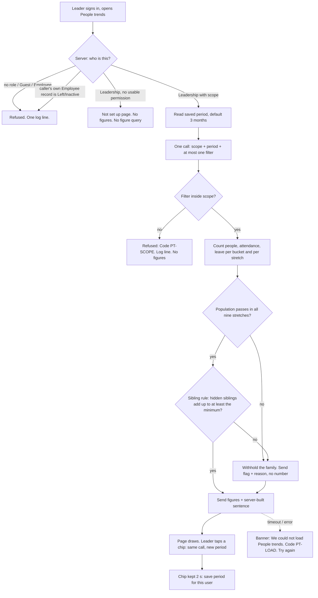

# 090 · People trends: functional spec

I recommend. You decide. No code was written, no command was run that changes anything. I am not a lawyer.

## Read this first

**Bad news first.**

1. **The page cannot give HR roles access yet.** 01c SEC-8 says HR roles stay off the page until the "narrowed Branch permission" fault (R6, ALV-359) is fixed. I confirmed the fault is real in code: `hr_scope()` (`org_figures.py` lines 76-79) and `permitted_branches()` (`access.py` lines 278-279) both ignore a Branch permission that is narrowed to one record type. So the first release serves **Leadership only**. HR is the last story (US-19), switched on by one line when the fix lands. Your call: land the fix in this slice, or wait for ALV-359 (BQ-2).
2. **Amended 23 Nov after the production measure.** My first draft applied the nine-stretch rule to Early leavers, and the measure showed it would hide the row at every live company. Your decision, with 01c "SQ-1 after the production measure": Early leavers are **whole company only**, checked over **four** cohort stretches (7-30, 30-90, 90-180, 180-365 days back). DTC and Grace Drinks show it on every chip except 1 week; Grace Sales and Grace Enterprises stay Not shared (correct: one joiner in a stretch is a named person). Also changed: **leave trends now read Attendance "On Leave" rows, not Leave Application** (DTC has 3 Leave Applications in a year and pays from Attendance).
3. **Two numbers can differ from the old HR Analytics card.** My headcount counts a person with status Left and a *future* relieving date as still on the roll (brief: "not yet Left"). The old card counts status Active only (`org_figures.people_figures`, line 378). They differ only for that rare case. AC-37 pins it.
4. **The brief's measuring step is now done (EQ-1 passes).** Leavers with no relieving date: DTC 0 of 69, Grace Drinks 0 of 6, Grace Sales 0 of 1. Kill criterion 1 does not apply.
5. **The design feedback is now logged** in `ux-learnings.md` (line 419, 23 Nov). That Definition of Ready box now passes.

**What I read (proven, this session):** `org_figures.py` (whole), `alvoraa_leader_view_settings.py` and `.json`, `access.py` lines 26-262, `attendance.json` (`leave_type` field, lines 100-110), `hr_api.py` `get_hr_analytics` (819-910) and `get_portal_context` (316-396), `attendance_analytics.py` line 81 and 385, `data_review.py` 283-315, `leave_rules.py` 100-150, `salary_slip.py` 2552, `payroll_settings.json` 37-43, `leave_application.json` (field lines), `www/hrms_employee.py`, `team.html` 124, `portal.js` 25-75 and 13440-13545, `nginx.conf` 344, `hooks.py` 769. Briefs, 01a, 01b, 01c, 07 and the prototype in full.
**Not found in this worktree:** the Employee JSON (it lives in the erpnext app). Employee fields below are proven by *use in our code*, not by the JSON. I name the line each time. **Not checked:** any tenant's data, any running system, the `Alvoraa Data Review Item` table, DTC's User Permission rows.

Labels: **Confirmed** (read), **Assumption** (`[ASSUMPTION]`), **Recommendation**, **Open question**, `[UNVERIFIED]` (engineer to confirm in the impact analysis).

---

## 1 · Cross-module reach and personas

| Area | Touched? | How |
|---|---|---|
| `alvoraa_portal` | **Yes, all new code** | New module `people_trends.py` (one read endpoint, one save-period endpoint), a new panel in the existing portal page, a role created at migrate. Extends `org_figures.py` (one grouped attendance query with a department/type join, same `rate()`) |
| `hrms` (the app folder `hrms/hrms`) | Read only, plus (if you choose BQ-2) a change to `permitted_branches()` in `alvoraa_hr_core/access.py` | That helper has other callers; the engineer's impact analysis must grep them |
| `erpnext`, `frappe` | Read only | Employee, Attendance, Leave Application, Company, Branch, Department, User Permission, Payroll Settings |
| `alvoraa_goals`, `alvox_compensation`, `alvoraa_portal` goals | **Not touched.** PRIV-12 forbids them importing the new module | |
| HRMS domains | Org structure (headcount, joiners, leavers), attendance, leaves. **Not** payroll, appraisals, goals, compensation, learning | Leave counting must match what payroll reads (OPS-10, section 6.7) |

| Persona | In this slice |
|---|---|
| **CXO / leader (Leadership role)** | The page. One or many companies, or a branch set inside one company |
| **HR Manager / HR User** | The same page for their companies, plus the "no relieving date" fix link. **Gated** (SEC-8, US-19) |
| **Employee, line manager, frontline** | Nothing on screen; no endpoint. Their data sits inside totals that pass the rules |

## 2 · Questions about the ask (symptom or cause)

- **Decision the page drives:** a leader hears "three drivers quit in week one" and can check it in a minute, then decide whether to ask HR about onboarding. Evidence is thin (one request, 23 Nov; brief §5). It is a Kano proxy. I did not redo it.
- **Could the system act instead of display?** No. The page does not decide anything about a person (section 17.4).
- **Symptom or cause?** The brief names the cause: no leaver or early-leaver view exists, so a leader depends on HR to open a Desk report. The ask matches it.
- **Is a page the right thing at all?** Kill criterion 4 (leaders do not open it) is already in the brief. I kept it. Success measure S1 needs the log line in SEC-9 (AC-19).

## 3 · Gap analysis (what exists, what to configure, what to build)

| # | Requirement | What exists today (where I looked) | Verdict | Cost |
|---|---|---|---|---|
| G1 | Leavers, joiners, attrition, early leavers over five windows | Frappe HR Desk: report folder `hrms/hrms/hr/report/employee_exits`; number cards `employee_exits_(this_year)`, `new_hires_(this_year)`, `early_exit_(this_month)` in `hr/number_card`. Month and year only; no small-group rule; Desk only, not on the portal. Our `get_hr_analytics` (`hr_api.py` 821) has headcount and "joiners this month" only (`people_figures`, `org_figures.py` 368-384) | **Build new** (one grouped Employee query) | M |
| G2 | Attendance trend | `of.attendance_figures` (`org_figures.py` 143-195) and `of.rate` (129-136) already exist; open doubtful days already left out; `data_up_to` (236). They have no department or employment-type filter and no per-bucket grouping | **Extend** (same `COUNTED`, same `_OPEN_DOUBTFUL`, same `rate()`; add the Employee join and a bucket group). No second formula | M |
| G3 | Leave days by window | **Amended.** `of.attendance_figures` already returns `on_leave` (the count of `status = 'On Leave'` rows, `org_figures.py` 183) with the same exclusions as the absence rate. One Attendance row per day, so a leave across a window edge needs no day-splitting (OPS-10). `Attendance.leave_type` is a standard Link to Leave Type, mandatory for On Leave and Half Day (`attendance.json` 100-110). `of.leave_figures` (278-335) is by leave year and Leave Application: not used. DTC and Grace run `payroll_based_on = Attendance` and DTC has 3 Leave Applications a year (production measure) | **Extend** (group the same query by bin and by `leave_type`). Not Leave Application, not Leave Ledger Entry (OPS-7 now concerns Attendance) | S |
| G4 | Minimum group size setting | `Alvoraa Leader View Settings.min_group_size`, 3-10, default 5, a bad value reads as 10 (`min_group_size()`) | **Configure / reuse as is.** No new setting | S |
| G5 | Scope for a leader | `hr_scope()` (60-80) serves HR roles only: `permitted_companies` returns `[]` for anyone without an HR role (`access.py` 251-252). "Leadership" is not a role anywhere; it appears only in `NEVER_ORG_ROLES` (`attendance_analytics.py` 81) | **Build new** `leader_scope()` + create the Role | M |
| G6 | Refusal logging | `log_refusal` / `security_logger()` (`access.py` 29-96), fixed to write (ALV-391). `log_if_slow` (`org_figures.py` 343-363) logs at info to a logger that is probably thrown away (01c item 3) | **Reuse** `security_logger()`; do **not** use `log_if_slow` for S1 | S |
| G7 | "Left, no relieving date" count | `data_review.py` 294-297 already counts `status = 'Left' and relieving_date is null` per company and branch (rule D18-1, an existing finding for HR) | **Reuse the query shape.** The Desk link is a filtered Employee list | S |
| G8 | The page | Portal is one page, `/hrms-employee`, with panels (`team.html` 124 `panel-analytics`). `/hrms-employee` is in nginx's compressed list (`nginx.conf` 344) | **Extend:** a new panel in the same page. **No new route, no nginx edit** (settles OPS-19's route question) | M |
| G9 | Remembered period | No existing per-user store found by grep of `alvoraa_portal/alvoraa_portal/*.py` other than `frappe.defaults.get_user_default("Company")` reads | **Configure-level:** a Frappe user default (DefaultValue). **No new DocType** (OPS-25). `[UNVERIFIED]` exact call; engineer confirms | S |
| G10 | Frappe Insights | Not installed; a second permission model that ignores branch scope (07 §1) | **Drop** (OPS-1) | — |
| G11 | Export, email digest, named leaver lists, grade filter, reasons, pay, rankings | Brief §6 out-of-scope table | **Drop / later** as the brief says | — |
| G12 | A "Build nothing" option (Desk Employee Exits for HR) | Works for HR names today; no leader phone view; no small-group rule | Rejected in the brief. HR keeps it | — |

**Single source of truth.** Employee for people figures; Attendance for attendance and leave days; Leave Application only for the waiting-approval count. One calculation module: `org_figures.py` for the shared counts; the new module only groups, hides and words them.

**Rung on the ladder:** new code in the existing app (one module, one panel), plus one Role created at migrate and User Permissions set by a person. Cheaper rungs rejected: Desk number cards cannot hide small groups; Insights is a new app. **No new DocType, no new field, no scheduled job, no new index, no cache** (OPS-17, OPS-25, OPS-27).

**Recommend dropping or shrinking (for the PM):**
- The "count under 5" rule is already dropped by your decision (Q3).
- Early leavers by branch, department or type: dropped by your decision (whole company only), so part C is not needed for that row.
- PRIV-7 (shown figures must not rebuild a hidden one) can never fire alone: with the PRIV-2 populations, Left, Headcount and Joined are hidden together. I kept it as a one-line guard tested at function level (AC-51), because 01c made it a requirement. **Recommend** you let me mark it "guard only, no screen case".
- If the build runs long, the brief's cut order stands: leave first, then attendance, then filters. People comes first.

---

## 4 · Process flow

Unhappy paths: not set up (leader with no scope), refused filter, Left leader, timeout, offline, nobody in the cut, filter matches nobody, a group too small, a group hidden to protect a smaller one. Each has a state in section 8.

## 5 · The rules the engineer builds (definitions)

All dates are in the site's time zone. All counts are exact unless a rule below withholds them.

### 5.1 Windows and the last data day

- **END** = yesterday (the last complete day), computed **once per call**. `[ASSUMPTION]` The brief says "ending today"; 01b (approved) says "last full day of data" and the prototype uses 22 Nov for 23 Nov. I follow 01b. Confirm: BQ-3.
- Window for a chip of `d` days (d = 7, 30, 90, 180, 365 for 1 week, 1 month, 3 months, 6 months, 1 year): **start = END − d + 1, end = END**, both days included.
- Comparison window: the `d` days before: **start − d … start − 1**.
- **Records start (R)** = the earliest `date_of_joining` among Employees in the cut's company scope. `[ASSUMPTION]` (the prototype's "your records start on 14 Jan 2026"). If start < R the window is clipped to R and says so. Comparison exists only if start − d ≥ R.
- Chips are rolling, not calendar months.

### 5.2 People figures (Employee: `status`, `date_of_joining`, `relieving_date`, `company`, `branch`, `department`, `employment_type`)

*Fields proven by use:* status, date_of_joining, company, branch `org_figures.py` 378-382; department `hr_api.py` 862; relieving_date `data_review.py` 296; employment_type `alv291_attendance_fix.py` 123. Employee JSON not read.

| Term | Definition |
|---|---|
| **Counted person** | `status = 'Active'`, or `status = 'Left'` with a `relieving_date`. **Not counted:** Inactive, Suspended, and Left **without** a relieving date. `[ASSUMPTION]` Keeps Headcount equal to the old card's Active count |
| **On the roll on day t** | Counted, `date_of_joining ≤ t`, and not (status Left and `relieving_date ≤ t`). A person with status Left and a *future* relieving date is still on the roll |
| **Headcount** | People on the roll on END |
| **Joined** | Counted people with `date_of_joining` between start and END |
| **Left** | People with status Left and `relieving_date` between start and END. A person still serving notice (status Active with a relieving date, or Left with a future date) is not Left |
| **Net change** | Joined − Left |
| **Headcount at start** | On the roll on start − 1 |
| **Attrition %** | Left ÷ ((Headcount at start + Headcount) ÷ 2) × 100, one decimal. Average 0 → shown as "–" |
| **Identity** | Headcount = Headcount at start + Joined − Left, for every cut and window (AC-33) |
| **No relieving date** | Status Left and `relieving_date` empty. Never in any figure above. Counted in the data-quality line (US-15) |

### 5.3 Early leavers (amended 23 Nov: whole company only, 4 stretches)

For X in 7, 30, 90 days ("1 week", "1 month", "3 months"):
- **Finished cohort** = Joined people in the window whose `date_of_joining ≤ END − X` (they have had their whole X days).
- **Left early** = of the cohort, those with `relieving_date − date_of_joining ≤ X` and status Left.
- **Still inside** = Joined people with `date_of_joining > END − X`.
- Cell shows "E of M" and "joiners left within {X} ({pct}%)", plus "Too early to tell for {n} more who joined in the last {X}." when n > 0. When M = 0: "Too early to tell" and "Everyone who joined in this period is still inside their first {X}." **Never a number that will grow** (UX-2a). The **1-week chip always reads "Too early to tell"**: nobody who joined in a 7-day window has finished 7 days by END.
- No comparison on this row.
- **Whole company only (your decision, 01c "SQ-1 after the production measure").** The row is worked out only when the cut is one whole company: one company in scope or chosen, no branch, department or type filter, and the caller's scope is not a branch set. In every other case (any filter, "All companies" with several companies, a branch head's set) the row reads "Early leavers are shown for the whole company only." and carries no figure. A multi-company leader sees the row per company by choosing a company, never for "All companies".
- **Group rule for this row (four cohort stretches):** the row is shown only if each of the cohort stretches **7-30, 30-90, 90-180 and 180-365 days back** holds 0 joiners or at least the minimum (joiners = people whose `date_of_joining` falls in that stretch). Otherwise "Not shared" on all five chips. Measured at the minimum of 5: DTC (21, 297, 163, 46) shown; Grace Drinks (0, 11, 11, 9) shown; Grace Sales (1, 4, 1, 3) and Grace Enterprises (1, 0, 3, 1) not shared. No sibling rule for this row. Residual R10 (a lower limit such as "at least 2 of the 21 joiners left within a week" is never about fewer than 5 people): proposed owner Surbhi, not yet accepted.

### 5.4 Attendance (Attendance: `status`, `attendance_date`, `docstatus`, `company`, `alvoraa_branch`, `employee`; `org_figures.py` 159-191)

- Same rows and same formula as `of.attendance_figures` (the same query also yields leave days, 5.5): submitted rows, `COUNTED = Present, Work From Home, Half Day, Absent`; On Leave in neither part; rows on a branch's **Open** doubtful day left out, a Confirmed one counts again.
- **Absent %** = `100 − of.rate(counts)`, one decimal (so "4.6%" means absent days, with half a day for each Half Day, as a share of expected days). No second formula (AC-76).
- Expected = 0 → "No attendance recorded for this period", no number.
- **Data up to** = `of.data_up_to(scope)`, the last day with submitted attendance in scope.
- "N days left out; HR is checking" = the number of attendance rows left out by Open doubtful days in the cut (`of.open_doubtful_counts`, 198-224, summed). Shown only when N ≥ 1 and the attendance family is shown. HR sees a link to the existing Data to review panel; a leader sees the words only.
- **Branch and department filters:** attendance and leave rows use the row's own `alvoraa_branch` (as `of.condition` does today); department and employment type come from the **Employee's current value** (a join). `[ASSUMPTION]` 01c Q5: a person who moved branch appears under the old branch in attendance and the new one in people figures. Part C counts distinct people, never adds cells.

### 5.5 Leave (amended 23 Nov: read from Attendance "On Leave" rows)

- **Source.** Attendance (`status`, `leave_type`, `attendance_date`, `docstatus`, `company`, `alvoraa_branch`, `employee`). `Attendance.leave_type` is a standard Link to Leave Type, shown and mandatory when status is On Leave or Half Day (`attendance.json` 100-110, read). `on_leave` is already computed by `of.attendance_figures` (`org_figures.py` 183).
- **Leave days taken** = the number of submitted Attendance rows with `status = 'On Leave'` in the window or bin, with the same exclusions as the absence rate (submitted only; rows on a branch's Open doubtful day left out). One row is one day. **A leave across a window or bin edge counts only the rows inside it, with no day-splitting code** (OPS-10). Never Leave Application, never Leave Ledger Entry (OPS-7).
- **Matches payroll:** DTC and Grace both run `payroll_based_on = Attendance` (production measure, EQ-2), and payroll then counts On Leave rows (`salary_slip.py` 586, 833-875). A tenant set to "Leave" would count Leave Applications instead and could differ; neither live tenant is.
- **Half-day leave is not counted** in leave days: a half-day leave is a Half Day row, which stays in the attendance rate at half weight. `[ASSUMPTION]` you asked for "On Leave" rows; note in "How counted".
- **By leave type** = On Leave rows grouped by `leave_type`, only where the row carries one. Rows with no leave type are counted in the total and fall into "Other" (never named). **Not checked:** whether DTC's On Leave rows carry a leave type. If they do not, "By leave type" shows only "Other" at DTC and nothing leaks. Only at the top of scope (part D).
- **Waiting for approval** = Leave Applications with `status = 'Open'`, `docstatus = 0` in the cut (`hr_api.py` 903-906 shape). A count only, as of now, not tied to the chip. This is the only Leave Application read left. At DTC, which has few Leave Applications, it will usually be 0 or small and follows the people-family rule.
- The new SQL never selects Leave Application `description`.

### 5.6 The small-group rule (01c section 5, as you accepted it)

**Words.** *Minimum* = `min_group_size()` read fresh on every call (5 today; 10 if the stored value is bad). *Cut* = the caller's scope narrowed by at most one filter. *Population of a figure* = distinct employees the figure is counted over, as in the table below. *Passes* = population is **0** or **at least the minimum**. *Stretch* = the days between neighbouring edges of the list 0, 7, 14, 30, 60, 90, 180, 360, 365, 730 days back from END (nine stretches).

| Figure family | Population (distinct people, inside the cut, for the stretch's own days) |
|---|---|
| People (Headcount, Joined, Left, Net, Attrition, chart, leave days, pending requests) | On the roll on any day of the stretch |
| Early leavers "within X" | Joiners whose joining date falls in each of the four cohort stretches 7-30, 30-90, 90-180, 180-365 days back (5.3). Whole company only |
| Attendance | Distinct people with a counted attendance row in the stretch |
| One leave type | Distinct people with an On Leave Attendance row of that type inside the stretch |

The caller's own Active Employee record, if inside the cut, is left out of every population **for the pass test only**. Shown totals stay exact. `[ASSUMPTION]` SQ-2.

- **Part A. One filter at a time, inside one company.** Below company the caller picks at most one of Branch, Department, Employment type. "All companies" shows company totals only.
- **Part B. Decide once over time.** (Early leavers use their own four-stretch check, 5.3.) A family is shown for a cut only if its population passes in all nine stretches. Then it is on all five chips, or on none. A chart series is sent whole or not at all; the window total may still be sent.
- **Part C. Siblings, including the blank one.** (Does not apply to the Early leavers row, which has no filter.) Along the chosen dimension the siblings are every value in the parent, **including "none set"** (nobody can pick it, but it is counted), and, under "All companies", every company. If any sibling fails part B it is hidden; keep hiding the next-smallest (by headcount at END, ties by name) until at least two are hidden and the hidden ones **together** pass in all nine stretches. A parent with one child: the child is hidden exactly when the parent is.
- **Part D. Leave types only at the top.** Named only when no filter is applied and the scope is one company (or a branch head's set). A type is named only if the people who took it pass in each of the five window stretches (0-7, 7-30, 30-90, 90-180, 180-365 days). Others join "Other". Other must pass; if not, the next-smallest named type joins it; if Other still fails, show the total only.
- **Hidden means not sent** (OPS-11): the key is missing; a flag `shared: false` and a reason `few` ("Not shared: too few people in this group for a fair picture") or `subtraction` ("Not shared: it would let someone work out a smaller group's figures", UX-1b). A group that passes today but failed a past stretch uses `subtraction`, which is true.
- **If the people family is hidden for the cut** the whole page is replaced by the banner, as the prototype draws. If only another family is hidden (attendance, leave days, leave types), that section shows "Not shared" in its own cell.

### 5.7 Chart buckets (bins count back from END; the sum of the bins equals the window)

| Chip | Bins (oldest first) | Label |
|---|---|---|
| 1 week | 7 × 1 day | start date, "16 Nov" |
| 1 month | 4: 8, 8, 7, 7 days | "w/c 24 Oct" (first day of the bin) |
| 3 months | 13: 6 days, then 12 × 7 | "w/c 25 Aug" |
| 6 months | 6 × 30 days | month name of the bin's first day |
| 1 year | 12: five of 31 days, then seven of 30 | month name of the bin's first day |

Example (END = 22 Nov 2026, 3 months): window 25 Aug to 22 Nov; oldest bin 25-30 Aug; comparison window 27 May to 24 Aug (01b). **Differs from the prototype in one respect** (the odd-length bin sits at the old end, not the new end): BQ-4.

### 5.8 The server response (proposed shape; names are the engineer's to settle)

`{ period, window{start,end,days,clipped}, data_up_to, scope_label, filters{lists}, people{...}, early{...}, chart{...}, attendance{...}, leave{...}, by_company[...], data_quality{...}, headline[...] }`. Each figure is either a value or `{shared:false, reason}`. No names, ids, dates of a person, reasons, pay, gender, age, manager, grade (PRIV-1).

---

## 6 · Epic and user stories

**Epic: People trends.** One page where a leader sees, in a minute on a phone, how many people joined and left over five windows, whether attendance and leave are getting worse, without any figure that points at a person. **19 stories, 66 points.** That is big for one slice. The cut order is in section 3.

| US | As a | I want | So that | Pts | Screen | Carries |
|---|---|---|---|---|---|---|
| US-1 | Leader (company head) | to be given the Leadership role and see only my linked company or branches, or a "not set up" page | I see my part of the business and nothing else | 5 | Not set up | SEC-1, 5, 6; PRIV-5 |
| US-2 | Leader | one safe call behind the page (POST, signed-in, token, role, plan, logged) | no one reads figures by hand-made requests | 5 | all | SEC-2, 4, 7, 9, 10; PRIV-11, 12; OPS-12, 17-22, 26 |
| US-3 | Leader | five period chips that change every figure at once, with the equal window before for comparison, remembered for me | I read the same question across 1 week to 1 year | 3 | Period bar | OPS-8 |
| US-4 | Leader | Headcount, Joined, Left, Net change, Attrition % | I know if people are leaving | 5 | People | PRIV-2 |
| US-5 | Leader | early leavers within 1 week, 1 month, 3 months, for the whole company only, counting only people who have finished that stretch | I know if onboarding is losing people | 3 | Early leavers | UX-2, SQ-1 amended |
| US-6 | Employee (must-not) | my data to appear only inside groups that pass the minimum, and never to be worked out across time or by the caller's own knowledge | a total never points at me | 5 | Banners, cells | SEC-10 (setting), PRIV-2, 3, 4, 7 |
| US-7 | Employee (must-not) | the siblings rule, including the "none set" group and companies | company minus the shown groups never reveals a hidden small group | 5 | Not shared banners | PRIV-6, 13; OPS-14 |
| US-8 | Leader | to pick at most one filter inside one company, from lists that contain only my scope | I narrow the view without leaking others | 3 | Filters | SEC-2, 3; PRIV-5; OPS-3 |
| US-9 | Leader | one chart of joined, left and running net, with a table version | I see the cumulative picture | 3 | Chart | OPS-8; PT7 |
| US-10 | Leader | an absence trend using the same formula as the rest of the portal | one number for one thing | 3 | Attendance | PT8, PT9 |
| US-11 | Leader | leave days (Attendance On Leave rows) inside the window, by type only at the top where rows carry a type, and the count of requests waiting | I see leave pressure without health detail | 3 | Leave | PRIV-8; OPS-7, 9, 10 |
| US-12 | Leader | a headline sentence built by rules | I get the answer in 30 seconds | 2 | Headline | PRIV-3 |
| US-13 | Leader of two or more companies | a "By company" block, alphabetical | I see the split without a ranking | 2 | By company | PRIV-6, 11 |
| US-14 | Leader | clear states: loading, error, offline, nobody, no match, late records | I am never left with a blank or a raw error | 3 | All states | 01b section 4 |
| US-15 | HR Manager / Leader | a count of leavers without a relieving date (HR: with a working link; leader: count at the top of scope when 5 or more) | the numbers become believable | 2 | People note | PRIV-10 |
| US-16 | Leader on a 360 px phone | the page as a portal panel with nav, no sideways scroll, accessible controls | I can use it on the floor | 5 | Shell | OPS-18, 19 route |
| US-17 | Employee (must-not) | no name, id, reason, pay or personal detail ever on the page | the page stays totals-only | 3 | all | PRIV-1; OPS-2, 6 |
| US-18 | Surbhi | proof of the budgets: same query count and size for small and large tenants; 3G timing at DTC size | the page is not slow or growing | 3 | all | OPS-5, 13, 16, 22-24 |
| US-19 | HR Manager / HR User | the same page for my companies, narrowed to my branches if I am store HR, **after ALV-359** | I can fix the data behind it | 3 | HR variant | SEC-8; SEC-1 |

INVEST: US-6 and US-7 cannot ship without each other (both are the rule); they are kept separate to stay small and testable. US-19 is last on purpose. All stories pass "valuable"; none is 8.

### YouTrack-ready table (import by you; I did not create issues)

| Summary | Persona | Pts | Linked ACs | Linked requirements |
|---|---|---|---|---|
| Leadership role and leader scope, fail closed | Leader | 5 | AC-1 to AC-10, AC-121 | SEC-1, 5, 6 |
| People trends endpoint: POST, token, role, plan, log | Leader | 5 | AC-11 to AC-24 | SEC-2, 4, 7, 9, 10; OPS-12, 17-22 |
| Period chips, windows, comparison, remembered period | Leader | 3 | AC-25 to AC-31 | OPS-8 |
| People figures | Leader | 5 | AC-32 to AC-39 | PRIV-2 |
| Early leavers (whole company only) | Leader | 3 | AC-40 to AC-44, AC-53 | UX-2, SQ-1 amended |
| Small-group rule A+B, hidden = not sent | Employee | 5 | AC-45 to AC-52, AC-54 | PRIV-2, 3, 4, 7 |
| Sibling rule C and property test | Employee | 5 | AC-55 to AC-62 | PRIV-6, 13; OPS-14 |
| Filters, one at a time | Leader | 3 | AC-63 to AC-71 | SEC-2, 3; PRIV-5 |
| Chart and bins | Leader | 3 | AC-72 to AC-75 | OPS-8 |
| Attendance card | Leader | 3 | AC-76 to AC-81 | PT8, PT9 |
| Leave card (from Attendance) | Leader | 3 | AC-82 to AC-90, AC-122, AC-123 | PRIV-8; OPS-7, 9, 10 |
| Headline sentence | Leader | 2 | AC-91, AC-92 | PRIV-3 |
| By company block | Leader | 2 | AC-93, AC-94 | PRIV-6, 11 |
| States and copy | Leader | 3 | AC-95 to AC-100 | 01b §4 |
| Data-quality line | HR / Leader | 2 | AC-101 to AC-103 | PRIV-10 |
| Page shell, nav, phone, accessibility | Leader | 5 | AC-104 to AC-110 | OPS-18, 19 |
| Totals only (must-not) | Employee | 3 | AC-111 to AC-113 | PRIV-1; OPS-2, 6 |
| Budgets proven | Surbhi | 3 | AC-114 to AC-117 | OPS-5, 13, 16, 22-24 |
| HR access (after ALV-359) | HR | 3 | AC-118 to AC-120 | SEC-8 |

---

## 7 · Data model

**New DocTypes: none. New fields: none. New indexes: none. Schema change: none** (OPS-25, OPS-27). A field would need a reason an existing field cannot carry; none is needed.

| Item | Where | Why nothing existing is not enough |
|---|---|---|
| Role **"Leadership"** | Frappe `Role`, created by an `after_migrate` hook (list at `hooks.py` 769). `[UNVERIFIED]` how `Biometric Sync` is created; engineer copies that pattern. Created once, runs safely twice, no DocPerm rows | No role fits: "Alvoraa CXO" collides with the policy library (brief §6 item 11); System Manager is wide |
| Saved period | A Frappe user default, key `alvoraa_people_trends_period`, value one of 7/30/90/180/365 `[UNVERIFIED call; engineer confirms]` | A User field would be a schema change |
| Minimum | `Alvoraa Leader View Settings.min_group_size` (Int, `reqd`, default 5, 3-10, System Manager writes, HR Manager reads) | Reused as is |

**Reads (all proven by use, section 5):** Employee (company, branch, department, employment_type, status, date_of_joining, relieving_date); Attendance (docstatus, attendance_date, status, company, alvoraa_branch, employee); Attendance also `leave_type` (Link to Leave Type, `attendance.json` 100-110); Leave Application only for the pending count (docstatus, status, company, alvoraa_branch); User Permission (via `get_user_permissions`); Payroll Settings (read only for the EQ-2 check). `alvoraa_branch` on Attendance and Leave Application is a custom field created by `branch_scope.py` (line 19 `FIELD`); which doctypes it covers I did not open. **Never read:** `reason_for_leaving`, Leave Application `description`, Salary Slip, Employee Checkin (OPS-2, OPS-6).

## 8 · States and transitions

No workflow, no document status, nothing is written except the saved period. Page states:

| State | Trigger | Shown | Leaves by |
|---|---|---|---|
| Loading | call in flight | grey blocks within 300 ms; chips usable | answer or error |
| Normal | answer | the page | tap, filter |
| Not set up | Leadership, no usable scope | Setup page only | an admin links the user; next load |
| Refused filter | value outside scope | "That view is not available to you" | pick from the lists |
| No people | no Employee in the company scope | banner | records added |
| No match | filter matches nobody | banner + Clear filters | clear |
| Not shared (whole page) | people family hidden | banner + why sheet | wider group |
| Records start late | R after window start | note, comparison off | longer history |
| Error / offline | server or network | banner + Try again | retry |

Terminal: none. Reversible: all.

## 9 · Permission and visibility matrix

"Scope" = companies and branches the server works out (SEC-1). Nothing in this slice adds a document permission.

| Who | Opens the page | Endpoint | Sees | Must NOT see |
|---|---|---|---|---|
| **Leadership + Company permission(s)** (applicable to all types or Employee) | Yes | Yes | Totals for those companies; By company if more than one; one filter at a time inside one company | Names, ids, dates of a person, leave reasons, pay; hidden figures; any other company, even in filter lists; the HR link |
| **Leadership + Company + Branch permission(s)** (branch head) | Yes | Yes | Their branches together and each, inside the company | Other branches; company total; the rest by subtraction |
| **Leadership, no usable permission** | Setup page | Returns "not set up", no figures, no figure query | Nothing | Any figure, including headcount |
| **Leadership whose own Employee record is not Active** | Refused | Refused | Nothing | Everything (SEC-6) |
| **HR Manager / HR User** | **Not yet (SEC-8).** Then yes | **Not yet.** Then yes | `hr_scope()` companies, branches if store HR; the Desk link | Other companies/branches; figures the rule hides |
| **HR + Leadership** | as HR | as HR | HR scope, never the union | |
| **System Manager with no HR role and no Leadership** | Nothing | Refused (as `get_hr_analytics` 826 today) | Nothing | Everything |
| **System Manager + HR role** | as HR; `permitted_companies` returns every company (`access.py` 249-250) | | Every company in the tenant | Carried risk R9 |
| **Administrator** | Yes | Yes (every company) | as today's HR Analytics | |
| **Line manager, Employee, frontline, Guest** | No | Refused (Guest also by role) | Nothing | Everything |

Row-level rules: scope in the SQL (`of.condition`), company always with branch; the caller's own record out of the pass test; the minimum read fresh. DocType rows: **Role Leadership: zero DocPerm and zero Custom DocPerm rows** (AC-8).

---

## 10 · Acceptance criteria

**Fixture tenant "K"** (01c section 7, names fixed here). Company **Kavya Retail**: branches Civil Lines 88, Market Yard 59, Hilltop Kiosk 4, Station Road 38 people; departments Stores, Production, Security (4), and people with no department; employment type filled for 3 (Contract) and blank for the rest; a branch "New Kiosk" that grew from 3 to 12 people four months ago. Company **Kavya Foods**: a branch also named "Civil Lines"; records start 14 Jan 2026. Users: company head (one company) `lead.retail`, company head (two companies) `lead.both`, branch head (Civil Lines + Market Yard) `lead.bh2`, branch head (Civil Lines) `lead.bh1`, `lead.none` (no permissions), `lead.narrow` (Branch permission narrowed to Attendance only), `lead.left` (own Employee record Left), central HR `hr.central`, store HR `hr.store`, store HR narrowed `hr.narrow`, `sm.only` (System Manager, no HR role), line manager, plain employee, Guest. END in examples = 22 Nov 2026. "Minimum" = 5 unless stated.

Every AC has an oracle: a JSON key, a log line read from the log file, a screen text, a count.

### US-1 · Leadership role and scope

- **AC-1** Given `lead.retail` (Leadership + Company permission Kavya Retail, applicable to all types), when scope is resolved, then companies = (Kavya Retail) and branches = None (every branch).
- **AC-2** Given `lead.bh2` (Company Kavya Retail + Branch permissions Civil Lines and Market Yard, applicable to Employee), when scope is resolved, then branches = (Civil Lines, Market Yard) and every query carries company and branch together.
- **AC-3** Given a Leadership user with a Branch permission but no Company permission, when scope is resolved, then the answer is "not set up" (a branch counts only together with its company: BQ-1).
- **AC-4** Given `lead.none`, when the page calls, then the response is `{not_set_up: true}` with no figure, and a query-count assertion shows no figure query ran.
- **AC-5** Given a Leadership user whose only Company permission is applicable to Leave Application, then "not set up".
- **AC-6** Given `lead.narrow` (Company permission plus a Branch permission narrowed to Attendance only), then "not set up" (strict default; SQ-3 asks you to confirm).
- **AC-7** Given a user with HR Manager and Leadership, then the scope equals `hr_scope()` and is never the union.
- **AC-8** The Role "Leadership" has zero rows in DocPerm and Custom DocPerm. For `lead.retail`, `frappe.get_list` row counts on Employee, Attendance, Leave Application, Salary Slip and Employee Checkin are equal or lower after adding the role and permissions than before.
- **AC-9** Given the stored org-roles setting lists Leadership, a Leadership-only user is still refused by `attendance_analytics.summary(view="organisation")` (`NEVER_ORG_ROLES`, line 81; `summary` at 385 `[UNVERIFIED: engineer confirms the call name]`).
- **AC-10** (SEC-6) Given `lead.bh1` loads (200), when their Employee record is set to Left, the next call is refused; restored → 200; remove the Branch permission → "not set up"; remove the role → refused. Scope is never cached.
- **AC-121** Running the migrate hook twice leaves exactly one Role "Leadership" and no error.

### US-2 · The endpoint

- **AC-11** A GET to the endpoint over real HTTP is refused.
- **AC-12** A Guest POST is refused; the response holds no figure.
- **AC-13** A signed-in POST **without** a valid CSRF token is refused over real HTTP; the rendered `/hrms-employee` page carries a non-empty token (`www/hrms_employee.py` line 21 calls `get_csrf_token()` before the page is built).
- **AC-14** The response carries `Cache-Control: private, no-store` (today's `get_hr_analytics` sets only `no-store`, line 839).
- **AC-15** On a tenant whose plan lacks `analytics`, the call is refused by `requires_feature("analytics")`.
- **AC-16** `sm.only`, a line manager and a plain employee each get PermissionError, and each refusal writes one log line.
- **AC-17** Extra parameters (`min_group=1`, `raw=1`, `sort=name`, `start`, `end`) have no effect: the response is identical to one without them.
- **AC-18** A period other than 7, 30, 90, 180, 365 (for example 45, "abc", 0) is refused, not defaulted.
- **AC-19** (SEC-9, S1) After each call the **log file** (not a patched logger) holds one line with endpoint, user, role class (HR or Leadership), period, duration, outcome (shown, not set up, refused). No figure, name, company, branch or filter value in it.
- **AC-20** When an exception is forced inside the endpoint, the response is the generic message with Code PT-LOAD, and the Error Log and the response hold no figure, name or branch name.
- **AC-21** The count of `ignore_permissions` lines does not rise (compare like with like against 392 at 412d5361 by 01c's grep; I did not check the CI counter). A branch name containing a quote gets a normal refusal. The reviewer reads every new SQL statement; filter values reach SQL only as parameters.
- **AC-22** The endpoint makes no cache write. (The saved period is a user default, not a cache.)
- **AC-23** No new whitelisted method returns a file; a sort parameter has no effect.
- **AC-24** An import check fails if `alvoraa_goals` or appraisal code imports `people_trends` (PRIV-12; `org_figures.PURPOSE = "operational-oversight-only"`, line 34).

### US-3 · Periods

- **AC-25** Five chips labelled "1 week", "1 month", "3 months", "6 months", "1 year", in a radiogroup. One tap sends **one** request and changes every figure, chart and sentence. The chip keeps focus; the live region reads "Showing {chip}. All figures updated."
- **AC-26** Given END = 22 Nov 2026 and chip "3 months", the window is 25 Aug to 22 Nov 2026 and the comparison text reads "the 3 months before, 27 May to 24 Aug 2026".
- **AC-27** Given `lead.both` with Kavya Foods (records start 14 Jan 2026) and chip "1 year", the page says "No earlier window to compare with: your records start on 14 Jan 2026. This window shows 313 days, from the start of your records." and the window length in the response is 313.
- **AC-28** Given Kavya Foods and chip "6 months" (2 × 180 > 313), comparisons are absent and the note says there is no earlier window.
- **AC-29** The saved period: three taps within 1 s produce one save (saved after the chip is kept 2 s `[ASSUMPTION]`); reloading opens on the saved chip; a user with none opens on "3 months". The value is held on the server for that user.
- **AC-30** User A's saved period does not change user B's. A save of any value outside the five is refused.
- **AC-31** If two taps are answered out of order, the page shows the answer to the **last** tap.

### US-4 · People figures (calculation layer, before the hiding rule)

Mini fixture "M" (one cut, END 22 Nov, window 3 months): E1 Active, joined 1 Jan 2025. E2 Active, joined 10 Nov 2026. E3 Left, relieving 5 Nov 2026. E4 Left, relieving 23 Nov 2026. E5 Left, no relieving date. E6 Inactive. E7 Active, joined 25 Nov 2026.

- **AC-32** In M: Headcount = 3 (E1, E2, E4); Joined = 1 (E2); Left = 1 (E3); Net = 0; the data-quality count = 1 (E5). E6 and E7 appear nowhere.
- **AC-33** For every fixture cut and chip, Headcount = Headcount at start + Joined − Left.
- **AC-34** Edges: relieving 22 Nov counts as Left; relieving 23 Nov does not. Joined 25 Aug (window start) counts; joined 23 Nov does not. A person who joins and leaves inside the window counts in both.
- **AC-35** A person with status Left and no relieving date is in no People figure and no early-leaver figure.
- **AC-36** Attrition = Left ÷ average(Headcount at start, Headcount) × 100, one decimal. With average 0 the tile reads "–" and nothing throws.
- **AC-37** For the same scope and date, Headcount equals `of.people_figures(scope, as_of=END)["active"]` **except** people with status Left and a future relieving date; the test pins E4 as the one difference.
- **AC-38** Changes read "Up 3", "Down 0.4 points" or "Same as before" in the panel's normal text colour. No element in the panel uses the portal's success/danger/warning classes `[engineer names them]`.
- **AC-39** The note under the tiles reads exactly: "Left means status Left and a relieving date on or before 22 Nov. Someone serving notice is not counted yet. Attrition is people who left divided by average headcount in this window, not a yearly rate." (date = END).

### US-5 · Early leavers (calculation layer)

- **AC-40** Given a 90-day window, X = 30: J1 joined 1 Sep, relieving 20 Sep; J2 joined 5 Sep, no relieving; J3 joined 1 Nov. Then M = 2 (J1, J2), E = 1, still inside = 1. The cell reads "1 of 2" with "joiners left within 1 month (50%)" and "Too early to tell for 1 more who joined in the last 1 month." (calculation layer; display is subject to US-6). X is 7, 30, 90 days, labelled "1 week", "1 month", "3 months".
- **AC-41** A joiner whose `date_of_joining` = END − X is in the cohort; one day later is not. A joiner who left exactly X days after joining counts as left early; X + 1 does not.
- **AC-42** Where M = 0 the cell reads "Too early to tell" and "Everyone who joined in this period is still inside their first 1 week." Never "0 of 0". On the 1-week chip every cell reads "Too early to tell".
- **AC-43** The row carries no up/down comparison.
- **AC-44** (whole company only) With any branch, department or employment-type filter, with "All companies" for a leader of two or more companies, or for a branch head, the Early leavers row carries no figure and reads "Early leavers are shown for the whole company only." Choosing one company with no filter shows the row.

### US-6 · The group rule, parts A and B

- **AC-45** Populations are as in 5.6. Given the Security department of 5 that includes the caller, at minimum 5 the department is hidden (4 after the caller is left out).
- **AC-46** The minimum is read on every call: change it 5 → 7 and the next call hides groups of 5 and 6. A stored value of 1 or 12 behaves as 10 (`min_group_size()`).
- **AC-47** A cut whose population is 0 in all nine stretches returns "no match", not "Not shared".
- **AC-48** (part B) Branch "New Kiosk" (3 → 12 people four months ago): its people figures are hidden on all five chips with reason `subtraction`. Market Yard (59, stable) is shown on all five chips.
- **AC-49** (PRIV-3) For every hidden figure in the fixture, the response has no key for it, carries `shared: false` and a reason, and a recursive scan finds no number equal to it in its place. Same oracle for the network response as for the screen.
- **AC-50** A chart series with one failing bucket is not sent at all; the window total is sent. Each shown window total equals the sum of its own buckets.
- **AC-51** (PRIV-7 guard, function level) When Left is forced withheld, Net change, the headcount-change line, headcount at start, Attrition and the net line are withheld; Headcount and Joined may be sent.
- **AC-52** One figure is in the same state in the tile, the sentence, the chart, the table fold, the By company block and the change line.
- **AC-53** (SQ-1 amended, four stretches) The row is shown only when each of the cohort stretches 7-30, 30-90, 90-180, 180-365 days back holds 0 joiners or at least the minimum. Fixed cases from the production measure at minimum 5: counts (21, 297, 163, 46) show the row on the 1-month, 3-month, 6-month and 1-year chips; counts (1, 4, 1, 3) give "Not shared" on all five chips. Stretches 0-7, 7-14, 360-365 and 365-730 are not checked for this row: given 3 joiners in 0-7 and counts (21, 297, 163, 46) the row is still shown.
- **AC-54** When the people family is hidden for the cut, the whole page is replaced by the banner: for `few`, "Not shared: too few people in this group for a fair picture" and "Try a wider group, such as the whole company."; for `subtraction`, "Not shared: it would let someone work out a smaller group's figures". Both offer "Why is this not shared?" and "Clear filters".

### US-7 · Siblings

- **AC-55** Kavya Retail, branch dimension: Hilltop Kiosk (4) fails, so the next-smallest (Station Road, 38) is also hidden, since one hidden group of 4 would be company minus the others. Civil Lines and Market Yard are shown. "Kavya Retail + Hilltop Kiosk" shows the `few` banner; "Kavya Retail + Station Road" shows the `subtraction` banner. (01c's example names Market Yard for the prototype's data; in this fixture the next-smallest is Station Road.)
- **AC-56** Given branches of 3, 1 and 50 people, the two small ones (4 together, below 5) are hidden **and** the third is hidden too, until the hidden ones together pass in all nine stretches.
- **AC-57** Employment type filled for 3 (Contract) and blank for the rest: Contract is hidden and the blank group ("none set") is hidden as the next-smallest sibling. The blank group is never offered in a list.
- **AC-58** A company with one department value hides that child exactly when the company is hidden.
- **AC-59** Under "All companies" (`lead.both`), a company with 4 people is hidden and the next-smallest company is hidden with it.
- **AC-60** The same request returns the same answer every time; ties are broken by name; the answer does not depend on earlier requests.
- **AC-61** (OPS-14, OPS-24) The number of SQL statements for the endpoint is the same with 3 and with 30 branches, and with 20 and with 2,000 people. The ceiling is set at the first measure (I propose 30 statements `[ASSUMPTION]`).
- **AC-62** (PRIV-13) A property test over generated tenants, as each fixture user, collects every allowed response (5 chips × every allowed filter), works out every figure that can be subtracted (parent minus sent siblings; every difference between sent windows, comparisons and buckets of one cut) and asserts each one's population passes. **It must fail when the "together they pass" check in part C is removed** (break it, watch it fail, restore it; the result goes in `04-test-report.md`).

### US-8 · Filters

- **AC-63** A request with two of branch, department, employment type is refused with one log line.
- **AC-64** A request for branch, department or type with no company chosen under "All companies" is refused. The "All companies" response has no branch, department or type figures or lists.
- **AC-65** `lead.retail` posting `company="Kavya Foods"`, or `company="Kavya Foods"` with `branch="Civil Lines"`, is refused (PermissionError), writes one log line with the rule id and no value, and the response has no figure. A filter is never trimmed to the allowed part.
- **AC-66** `lead.bh1` posting Market Yard, or a branch not used by employees of the chosen company, is refused. `lead.bh1`'s response has no company total, no other branch figures and no value of another branch.
- **AC-67** A scan of `lead.retail`'s whole response finds no "Kavya Foods" and no Foods-only branch name; `lead.bh2`'s lists hold only Civil Lines and Market Yard.
- **AC-68** A department that no employee of the chosen company holds, and an employment type that does not exist, are refused.
- **AC-69** The scope line reads "Showing: Kavya Retail, Civil Lines, 1 year" followed by the dates and "Data up to 22 Nov 2026". The fold reads "Filters · 1 applied". "Clear filters" appears only when a filter applies. Changing the company clears the other filter. A leader with one company sees Company as fixed text.
- **AC-70** A hidden branch appears in the list as "Station Road (Not shared)"; choosing it opens the banner.
- **AC-71** A refused filter shows: "That view is not available to you" / "Choose from the lists on this page. If you think this is wrong, tell HR and quote Code PT-SCOPE." It never says whether the value exists. (Proposed copy; 01b left it to this spec.)

### US-9 · Chart

- **AC-72** The bins are as in 5.7: for each chip the number and lengths of bins match the table, counting back from END, and they sum to the window.
- **AC-73** The net line is the running total of joined minus left from the window start; its last point equals the Net change tile.
- **AC-74** The chart has `role="img"` and a text label with the totals; a "Show as a table" fold holds the same numbers as the series; chart text is 12 px or larger.
- **AC-75** The legend reads "Joined (bars up)", "Left (bars down)", "Running net change (line)". Colour is never the only signal.

### US-10 · Attendance

- **AC-76** With no filter, for the same window, Absent % = `100 − of.attendance_figures(...)["rate"]`. A test compares the two. No second formula.
- **AC-77** Open doubtful days are left out; Confirmed ones count; On Leave rows are in neither part (as `attendance_figures`).
- **AC-78** The tile reads "Data up to {last attendance day in scope}"; with Open doubtful rows ≥ 1 it adds "{N} days left out; HR is checking". HR sees a link to Data to review; a leader does not.
- **AC-79** Where expected days = 0, the card reads "No attendance recorded for this period".
- **AC-80** A department cut equals the sum over employees whose Employee `department` is that value (the join).
- **AC-81** The note reads "Days that look wrong (for example, everyone absent on one day) are left out of this rate until HR has checked them." The trend has one point per bin and a table fold.

### US-11 · Leave

- **AC-82** Given On Leave Attendance rows for 20 Aug to 27 Aug 2026, the 3-month window (from 25 Aug) counts only the rows for 25, 26 and 27 Aug (3 days). No day-splitting code runs. The days in the bins add up to the window total.
- **AC-83** Leave days count only submitted (`docstatus` 1) Attendance rows with `status = 'On Leave'`, with the same Open doubtful-day exclusion as `of.attendance_figures`. For the same scope and window the figure equals `of.attendance_figures(...)["on_leave"]`. Draft and cancelled rows, and Leave Applications, never add to it.
- **AC-84** Leave days carry a comparison with the window before.
- **AC-85** "By leave type" appears only for one company or a branch set with no filter. With any filter applied, or under "All companies", the response has the leave total and **no type names**.
- **AC-86** A type is named only if the people who have On Leave rows of that type pass in each of the five stretches (0-7, 7-30, 30-90, 90-180, 180-365); others join "Other"; Other must pass else the next-smallest named type joins it; if it still fails, only the total is sent. A type taken by 1 person is never named, at any level. The named list is the same on all five chips. The note reads "Small leave types are grouped under Other so no one can be picked out."
- **AC-87** "Casual the most" names only a type that was sent. If the top is "Other", the clause is left out.
- **AC-88** "Waiting for approval: N requests (count only)" counts Leave Applications with `status Open`, `docstatus 0` in the cut. It carries no name, date, type or reason. It is hidden with the people family.
- **AC-89** The new SQL does not name Leave Application `description` or Employee `reason_for_leaving` (static check on the SQL text).
- **AC-90** The leave trend has one bar per bin (On Leave rows per bin); it is sent whole or not at all; a table fold holds the same numbers.
- **AC-122** On Leave rows with an empty `leave_type` are counted in Leave days taken and fall into "Other"; they are never named. Where no On Leave row in scope carries a type, "By leave type" shows only the total and no type names.
- **AC-123** A Half Day row, with or without a `leave_type`, adds nothing to Leave days taken (it stays in the absence rate at half weight), and "How these figures are counted" says so.

### US-12 · Headline

- **AC-91** The sentence is built on the **server** from sent figures only. Template (01b): "**Headcount {H}, {up|down} {n} in {chip}.** {J} joined, {L} left. Of those who joined and have passed their first month, {E} of {M} left within it. Absent on {a}% of expected days, {up|down} {x} points on {the chip before}. {V} leave days taken, {type} the most." A clause whose figure is withheld is left out and the sentence says "Joiners and leavers are not shared for this group in this period."
- **AC-92** No number in the sentence equals a hidden figure; the clause for early leavers appears only when M ≥ the minimum and it is shown.

### US-13 · By company

- **AC-93** For a user with two or more companies and no filter, one block per company in alphabetical order with "In alphabetical order. This is not a ranking." No sort control or parameter. A hidden company shows "Not shared".
- **AC-94** A single-company user has no By company block.

### US-14 · States

- **AC-95** Loading: skeleton blocks within 300 ms on a throttled profile, with the words "Loading People trends. The period bar stays usable; figures fill in as they arrive."
- **AC-96** Error or timeout: "We could not load People trends" / "Your data is safe. The page did not get an answer from the server in time." / "Try again. If it keeps happening, tell HR and quote Code PT-LOAD." with a "Try again" button that re-sends. No raw server message.
- **AC-97** Network drops on a chip tap: the old figures stay and a line reads "The new figures did not load. These figures are still for {previous chip}." with "Try again". (Proposed copy.)
- **AC-98** A company with no Employee records: "No people records in this view yet" with the 01b body; HR sees "Go to Employees"; a leader sees "Ask your HR team to add the employee records."
- **AC-99** A filter that matches nobody: "No one matches these filters" with "Clear filters".
- **AC-100** Not set up: "People trends is not set up for you yet" / "You have the Leadership role, but no company or branch is linked to your account. We show nothing rather than guess." / the copyable message "Please link my user to a Company so I can open People trends." / button "Copy message" that reads "Copied" after a click. Nothing else is on the page.

### US-15 · Data-quality line

- **AC-101** (HR, after US-19) "{N} leaver(s) have no relieving date, so they cannot be placed in a window." with "Open the list in Employees" opening the Desk Employee list filtered to `status = Left`, `relieving_date` not set, and the user's company (and branch if store HR). Shown only when N ≥ 1. The link grants nothing: Desk permissions apply.
- **AC-102** (Leader) "{N} leavers have no relieving date. HR is asked to fix this." only at the top of scope and only when N ≥ the minimum.
- **AC-103** A leader with any filter applied gets no data-quality count in the response.

### US-16 · Page shell

- **AC-104** The page is a panel in `/hrms-employee`. The diff contains no change to `deploy/nginx.conf` and no new page route.
- **AC-105** Leadership and (once enabled) HR see "People trends" in the Company group on desktop and "Trends" in the phone bottom bar; others do not. The nav flag comes from `get_portal_context`, which is cached per user for 1 hour (`hr_api.py` 396): a newly assigned leader may wait up to an hour unless the engineer clears `portal_ctx_<user>` on role change. The endpoint is the real gate (AC-16).
- **AC-106** At 360 px and at 200% text: no sideways scroll of the page; chips scroll sideways; every target is at least 44 px; text at least 12 px; form fields 16 px. Checked in a browser at 360 and 390 px (the designer looked at about 390 once; target sizes by script were not measured).
- **AC-107** Chips are `role=radio` in a `radiogroup`; every filter has a visible label; the focus ring is visible; the "why" sheet moves focus in, closes on Escape and returns focus; every chart has a text label and a table; a screen reader hears the live region on a chip change.
- **AC-108** The page stores nothing in the browser: `localStorage`, `sessionStorage` and cookies are unchanged after use.
- **AC-109** "How these figures are counted" and the "Why is this not shared?" sheet carry the 01b words, the number in them is the live minimum, and the sheet adds the sentence "A group that has had fewer than {minimum} people at any time in the last two years stays hidden." (a copy addition forced by part B; BQ-4).
- **AC-110** The old HR Analytics panel and `get_hr_analytics` return the same payload as before (its existing tests pass unchanged).

### US-17 · Totals only

- **AC-111** A scan of every fixture response for every fixture employee's name and employee id finds nothing.
- **AC-112** Every response's keys match an allowlist; no gender, birth date, age, grade, designation, manager or reason appears.
- **AC-113** A capture of the SQL run by the endpoint shows no read of `tabSalary Slip` or `tabEmployee Checkin`.

### US-18 · Budgets

- **AC-114** The response is no larger for 2,000 people than for 20 (within 10%) and at most 10 KB uncompressed for the fixture. It grows with the number of branches and departments, never with headcount. `[ASSUMPTION]` 10 KB from 07's 3-6 KB estimate plus lists.
- **AC-115** On a dev copy seeded to DTC size (about 600 staff, a year of attendance; never production data) for each of the five periods, with `lead.retail` and (after US-19) an HR login, cold and warm, on a throttled 3G profile: skeleton within 300 ms, figures within 2.5 s, server time at most 3 s. Numbers go in `04-test-report.md`.
- **AC-116** A call above 2 s writes a warning line (endpoint, period, duration, statement count, outcome). No personal data.
- **AC-117** The diff has no new `scheduler_events` entry, no new DocType JSON, no new custom field, no patch that writes data, no new queue (OPS-17, 25, 27).

### US-19 · HR (after ALV-359)

- **AC-118** Until the R6 fix lands, a user holding only HR roles is refused by the endpoint and the nav item is hidden.
- **AC-119** After the fix: `hr.narrow` (Branch permission narrowed to Attendance only) sees only that branch; `hr.store` sees only their branches; `hr.central` sees the whole company; none sees the other company.
- **AC-120** HR sees Company as fixed text; the data-quality link works (AC-101); the page otherwise equals the leader's, including the same hidden figures.

---

## 11 · Edge cases and boundaries

| Case | Rule | AC |
|---|---|---|
| Leaver with no relieving date | In no figure; counted in the data-quality line | AC-32, 35, 101, 102 |
| Notice period (Active with relieving date; Left with future date) | Not Left yet; on the roll | AC-32, 37 |
| Joiner after END; joiner on the window's first day | Excluded; included | AC-34 |
| Joined and left in the same window | In both Joined and Left | AC-34 |
| Records start late | Window clipped, comparison off, words | AC-27, 28 |
| Window edges (END yesterday, inclusive both ends) | Fixed | AC-26 |
| Leave across a window or bucket edge | One Attendance On Leave row per day, so only rows inside count; no splitting | AC-82 |
| Leave cancelled, rejected, pending, draft; half-day leave | Only submitted On Leave Attendance rows count; Half Day rows do not; Leave Applications never | AC-83, 123 |
| Rehire on a new Employee record; transfer to another company by a new ID | Counted as one leaver and one joiner. Not de-duplicated `[ASSUMPTION]` (`grooming.py` already knows `_transferred`, I did not reuse it) | none: known limit, noted in "How counted" `[UNVERIFIED wording]` |
| Late or back-dated attendance | Figures move; "Data up to" shows the last day; no cache | AC-22, 78 |
| Zero expected days; zero average headcount; no cohort | "No attendance recorded", "–", "Too early to tell" | AC-36, 42, 79 |
| Employees with no branch or no department | A sibling "none set", counted, never listed; a branch head never sees them (D-8, `org_figures.py` 65-66) | AC-57 |
| Same branch name in two companies | Branch is always used with its company; "All companies" has no branch figures | AC-64, 65 |
| Caller inside a small group | Caller left out of the pass test | AC-45 |
| Leader is also line manager | Gets only this page from the Leadership role | AC-8 |
| Leader's Employee record Left; login still on | Refused on next call | AC-10 |
| Minimum changed between two views | Read fresh; residual risk R5 | AC-46 |
| Scope changes while the page is open | Next call decides; old figures stay on screen until then | AC-10, 31 |
| Two quick taps; concurrent save | Last tap wins; last save wins | AC-29, 31 |
| Bulk import mid-day | Next call shows it; no cache | AC-22 |
| Time zone, DST | Site time zone, END fixed once per call. India has no DST; not tested further | AC-26 |
| Tenant whose Payroll Settings reads Leave (not DTC or Grace) | Leave figure counts Attendance rows while payroll counts Leave Applications; may differ | AC-83 |
| Leave rows with no leave type | Counted in the total, folded into Other | AC-122 |
| Inactive or Suspended employee | Not counted anywhere on this page | 5.2 |
| 60 branches | One select, no type-ahead | AC-69 |
| Employment type mostly blank | Filter works; the blank group is a hidden sibling | AC-57 |
| Multi-company leader | By company block, no ranking | AC-93 |
| Concurrent approval of the same leave | Not applicable; page is read-only | — |
| Negative or carry-forward balances | Not applicable; no balances (out of scope) | — |

## 12 · Non-functional requirements (from `nfr-budget.md` §2 via 07; specific to this slice)

| Item | Number | Source |
|---|---|---|
| Skeleton | within 300 ms | 07 §2, AC-95 |
| Page content on 3G | within 2.5 s | 07 §2, AC-115 |
| Report budget | 3 s on a DTC-size copy | brief S4, AC-115 |
| Volume | Employee about 600 at DTC; Attendance about 110,000 rows per 6 months, 220,000 per year (estimates, not counted) | 07 §1 |
| Payload | 3-6 KB per period, bounded by branches not headcount; ceiling 10 KB | AC-114 |
| Queries | One grouped query per family and cut; fixed count | AC-61 |
| Jobs and queues | None | OPS-17, AC-117 |
| Cache | None in v1; if later added: key = site + user + resolved scope + minimum + period + filter + today's date, 5 minutes, only the answer after hiding | OPS-15, SEC-10 |
| Rate limit | Existing `kinexus_api` 120 per minute per address, burst 30 (`nginx.conf` 292-298 per 07); no new rule | OPS-20 |
| Repeat call guard | Reject a second identical call from the same user within 1 s **only if** the 3G test shows repeated heavy calls | OPS-20 |
| Retention | Nothing new stored. Saved period lives with the user. Log lines rotate (about 2 MB) | OPS-25 |
| Sensitive data | Aggregates only; leave type is the sensitive item and is gated by part D | PRIV-8 |
| Indexes | None added without a measured miss | OPS-5 |
| Employee Checkin | Never read | OPS-2 |

## 13 · Migration and backfill

**Nothing to backfill.** On each tenant: the migrate hook creates the Role "Leadership" if missing. A person (tenant admin) then gives named leaders the role and a Company (and Branch) User Permission that applies to Employee. Surbhi names the first leaders (brief Q7). No data is created, defaulted or recomputed. **Rollback:** revert the code; delete the Role (removes it from users). No schema change, so no migrate risk expected (OPS-27). Deploy needs no `nginx` edit (AC-104).

## 14 · Notifications and messages

**No email, no push, no toast, no digest** (digest is out of scope, Q4). All messages are on the page and are listed in section 10 (AC-54, 71, 95-100, 102) and 01b section 5. Nothing leaks: no message names a person, a company outside scope, a figure that is withheld, or whether a refused value exists.

## 15 · Localisation and accessibility

- English only in v1 (brief). Every user-facing string, including the server-built sentence, goes through the portal's translation mechanism `[UNVERIFIED: engineer follows the portal's pattern]` so Hindi can be added later without rewriting.
- Dates "22 Nov 2026" (full) and "22 Nov" (short), as the prototype. Percent: one decimal. Numbers plain. `[ASSUMPTION]` no Indian digit grouping needed below 1,00,000.
- Accessibility and 360 px: AC-106, AC-107. Leader on a low-end phone: numbers only, a few KB, no chart library, charts drawn as plain SVG with a table fold.
- Frontline staff: see nothing. This page is for leaders.

## 16 · Audit and traceability of the data

- The page changes no personal record. The only write is the saved period.
- One log line per call (AC-19): who, when, period, outcome. That is what a year-later question can use, with a **2 MB rotating file, not a year of history** (`access.py` 49-53, 01c R8). ⚠ counsel (012 CQ3, open).
- Who was given the Leadership role: Frappe's own change tracking on User / User Permission `[UNVERIFIED: not checked whether `track_changes` is on]`.

## 17 · Compliance-impact sub-analysis (built on 01c; I am not a lawyer)

### 17.1 Data touched

| Field / object | Class | Purpose collected for | Lawful basis (as recorded) | New collection? |
|---|---|---|---|---|
| Employee company, branch, department, employment_type, status, date_of_joining, relieving_date | internal | People records | None recorded in code. 01c names DPDP s.7(i) as the likely basis, unconfirmed | No |
| Attendance status, date, company, branch, employee (distinct count) | sensitive | Attendance records | as above | No |
| Attendance On Leave rows: `leave_type`, date, company, branch, employee (distinct count); Leave Application status/company/branch for the pending count | sensitive (type can point at health or pregnancy) | Attendance and leave records | as above | No |
| Leave `description`, Employee `reason_for_leaving`, gender, birth date, grade, manager | sensitive / internal | — | — | **Never read** |
| Saved period | internal | Convenience | — | **Yes**, one of five values per user. Needed so the page opens where the leader left it (brief item 2). Impossible-without: it could be dropped (the default 3 months works). **Recommend you decide:** keep (brief asked "remembered per person") |
| Log line per call | internal | Detection, adoption (S1) | — | Yes, no personal data in it |

### 17.2 Obligations engaged (from 01c section 4 and the baseline; feature map checked)

| Obligation | Source | What this slice must do | Feature that does it |
|---|---|---|---|
| Purpose limitation, minimisation | DPDP; baseline §2 | Totals only; never used to rate people or managers | PRIV-1, PRIV-12; feature map **C4** (purpose tag) is **not built**: AC-24 is a test, not the C4 feature |
| Reasonable security, access control | DPDP; ASVS L2 | Server-side scope, deny by default, refusals logged | SEC-1, 2; feature map **B4** (`ignore_permissions` counter): AC-21 |
| Access visible in logs | DPDP Rules 6(1)(c)/(e) as quoted in 012 01c | One line per call | SEC-9; file is 2 MB: feature map **A3** not built |
| Breach clocks | CERT-In, DPDP | None added; a leak through this page is a breach in one tenant | Feature map **A5** (workbench) not built |
| DPDP notice | DPDP | The employer's notice may need to say leaders see totals | Later privacy-page line; ⚠ CQ3 |
| EU AI Act / GDPR Art 22 | baseline §4 | Not engaged (no AI, no decision) | — |

### 17.3 Visibility delta

**Who can see something they could not before:** Leadership users see company or branch totals (headcount, joined, left, early leavers, absence %, leave days, leave types at the top). HR roles see more in the portal than before (leavers and leave days; the old card showed none of those). **Negative cases:** nobody sees a name, an id, a person's dates, a reason, pay, a figure under the minimum, a figure that would let a smaller group be worked out across branches, departments, types, periods or companies, or another company's values in any list. A leader with no scope sees nothing. **Residual (not stopped by counting):** what a leader already knows (their own team, who is absent on the floor), range inference across separate filters, day-to-day visits, two leaders pooling views (01c R1-R5). None is accepted yet; I propose you as owner.

### 17.4 Decision automation

**None.** The page decides nothing about a person. No score, no ranking, no per-person risk, no alert to a manager. The accountable human for any action is the leader or HR reading it. Nothing to contest.

### 17.5 Retention and deletion

Nothing changes. The page stores nothing but the saved period (life of the user). No cache. There is no retention engine (feature map A6); nothing here needs purging. An erasure request leaves aggregates unchanged because they hold no person.

### 17.6 ⚠ Open compliance questions

| Question | Who must decide | What it blocks |
|---|---|---|
| ⚠ CQ1 Does DPDP s.7(i) cover showing aggregate leaver, absence and leave figures to leaders, with groups under the minimum hidden? Only an oral "OK" exists (25 Oct) | Counsel | Whether a notice or consent step is needed. Not the build |
| ⚠ CQ2 May a leave type that points at health or pregnancy be **named** in an aggregate of 5 or more? Part D folds rare types meanwhile | Counsel | PRIV-8 wording. Not the build |
| ⚠ CQ3 Must the employer's privacy notice say leaders see totals? | Counsel | The privacy-page line (later) |
| SQ-1 (resolved 23 Nov by your decision): early leavers whole company only, four stretches. Residual R10, owner proposed Surbhi, not accepted | Surbhi | — |
| ⚠ SQ-2 Caller left out of the pass test only, shown totals exact | Security engineer | AC-45 |
| ⚠ SQ-3 Leadership with a Company permission plus a Branch permission narrowed to another record type: I default to "not set up", not company-wide | Security engineer, Surbhi | AC-6 |
| ⚠ SQ-4 `permitted_companies()` counts an HR user's Company permission whatever it applies to (01c worry 1) | Security engineer, engineer | US-19 (HR) |
| ⚠ BQ-2 R6 (ALV-359): fix in this slice, or HR roles stay off? | Surbhi | US-19, AC-118-120 |

### 17.7 AI features

**None.** No AI, no model, no prediction. The headline sentence is a fixed template filled with numbers. The prohibitions are not engaged: no rating, no emotion or voice or face inference, no passive monitoring, no per-person score. Reasons for leaving, named leaver lists, per-person attrition risk and manager rankings are refused in the brief and stay out.

---

## 18 · Prototype parity table

Rule (Surbhi, 21 Oct): build every element as drawn; any difference needs her yes first. "Decision" = a recorded decision of yours; "needs yes" = a difference I introduce, for you to confirm (BQ-4).

| # | Prototype element | Built | Reason |
|---|---|---|---|
| P1 | Sidebar item "People trends" under Company; HR also sees HR Analytics, Data to review | As drawn, inside the portal's real nav | |
| P2 | Phone bottom bar "Home Inbox Trends Menu" | "Trends" item as drawn; other items are the portal's own `[UNVERIFIED: real bar not read]` | |
| P3 | Top bar title "People trends"; "Sample" tag; persona/phone/state/theme dark bar; "who" line | **Not built.** Prototype scaffolding, not features | yes, 23 Nov |
| P4 | Scope line "Showing: …, 3 months" + dates + "Data up to" | As drawn | |
| P5 | Five chips, radiogroup, 44 px, 3 months default | As drawn | |
| P6 | Filters fold: Company, Branch, Department, Employment type; "Filters · N applied"; Clear filters; HR sees Company as text | As drawn **except** several filters at once | **Decision:** one at a time, inside one company (01c Q1, accepted) |
| P7 | Branch option "(Not shared)" for small or subtraction-hidden branches | As drawn, using part C | Decision (UX-3, SEC) |
| P8 | Whole-page banner for small group; second sentence for subtraction | As drawn | Decision UX-1b |
| P9 | Headline sentence, clauses dropped when hidden | As drawn, server-built | |
| P10 | Early-leaver clause hidden when `narrowed and E < min` | **Removed** | Decision: "count under 5" dropped (Q3) |
| P11 | Tiles hidden when a narrowed count `< min` (Joined, Left, Net, Attrition, chart) | **Removed.** They hide only through parts B and C | Decision Q3 |
| P12 | People tiles: Headcount, Joined, Left, Net change, Attrition; comparison words; the sub-text with comparison dates | As drawn | |
| P13 | Note "Left means status Left…" | As drawn | |
| P14 | Data-quality line (HR with link; leader at 5 or more) | As drawn; leader only at the top of scope | Decision (01c PRIV-10) |
| P15 | Early leavers: three tiles, "Too early to tell" | As drawn, closed cohorts; 1-week chip always "Too early to tell" | Decision UX-2a |
| P16 | Early-leaver cell hidden when `M < min` | Replaced: shown only for a whole company with no filter, and only if the four cohort stretches pass; with a filter it reads "Early leavers are shown for the whole company only." | **Decision:** SQ-1 after the production measure, 23 Nov |
| P17 | Chart 1 with legend, role=img, table fold; day buckets for 1 week | As drawn | Decision UX-4 |
| P18 | Chart bins: 1 month = 4 bins; 3 months = 13 bins with the short bin at the new end | 4 bins as drawn; the odd bin is at the **old** end | yes, 23 Nov (counting back from END, PRIV-4) |
| P19 | Attendance: two tiles, chart, table fold, note | As drawn | |
| P20 | Leave: tile, "By leave type" under any filter, fold by days/2.4 stand-in | As drawn **except** types only at the top, folded by people who took them; figures come from Attendance On Leave rows | **Decisions:** 01c Q2; leave from Attendance, 23 Nov |
| P21 | "Waiting for approval: N requests (count only)" | As drawn | |
| P22 | By company block (CXO, All, no filter) | As drawn; companies follow part C | Decision |
| P23 | "How these figures are counted" fold | As drawn, live minimum | |
| P24 | "Why is this not shared?" sheet | As drawn **plus** one sentence about the last two years | yes, 23 Nov (AC-109) |
| P25 | States: loading, error with Code PT-LOAD, not set up with Copy message, no people, no match | As drawn | |
| P26 | Late-records note and comparison off | As drawn | |
| P27 | Refused filter, network drop | Not drawn; copy proposed here | yes, 23 Nov |
| P28 | "No attendance recorded" | Not drawn; copy proposed here | yes, 23 Nov |
| P29 | "Go to Employees" (HR, no people) and "Open the list in Employees" | Desk Employee list | |
| P30 | Light and dark themes | The portal's own tokens | |

## 19 · Traceability

Every row below is "AC written, test not yet written". No test exists for this slice yet, so every Status is a claim about the spec, not about code. A row marked **gap** has no AC.

| Source | Item | Story | AC | Status |
|---|---|---|---|---|
| Brief | §6.1 page, one call, numbers only, no Checkin/Salary Slip | US-2, 17 | AC-11-24, 113 | covered |
| Brief | §6.2 five chips, rolling, remembered, comparison, buckets | US-3, 9 | AC-25-31, 72 | covered |
| Brief | §6.3 People figures; "Left" in words | US-4 | AC-32-39 | covered |
| Brief | §6.4 Early leavers; "Too early to tell" | US-5 | AC-40-44, 53 | covered (changed by UX-2a and the 23 Nov whole-company decision) |
| Brief | §6.5 one chart | US-9 | AC-72-75 | covered |
| Brief | §6.6 Attendance, shared `rate()`, Data up to, Needs review | US-10 | AC-76-81 | covered |
| Brief | §6.7 Leave days, by type, pending count, edge rule, Other fold | US-11 | AC-82-90, 122, 123 | covered (source changed to Attendance, 23 Nov) |
| Brief | §6.8 Filters Company, Branch, Department, Employment type; "Showing"; refused not ignored | US-8 | AC-63-71 | covered (changed by Q1) |
| Brief | §6.9 Small-group rule | US-6, 7 | AC-45-62 | covered |
| Brief | §6.10 Data-quality line with working link | US-15 | AC-101-103 | covered |
| Brief | §6.11 Leadership role + Company/Branch permission; none = nothing; HR also | US-1, 19 | AC-1-10, 118-121 | covered (HR gated by SEC-8) |
| Brief | §8 WOW: sentence, tap 1 month, "Not shared" shown | US-12, 3, 6 | AC-91, 25, 54 | covered |
| Brief | §6 out of scope (named lists, voluntary split, grade, gender/age/manager, custom range, digest, export, pay, held days, exception strip, Hindi, old Leave card) | none | AC-23, 112, 113, 110 | not built, approved 23 Nov |
| Brief | §13 S1 adoption (log line) | US-2 | AC-19, 116 | covered |
| Brief | §13 S2 times HR is asked | none | none | **gap by design:** a two-question check-in with DTC/Grace HR, not a system test; your call to keep |
| Brief | §13 S3 leavers without date | US-15 | AC-32, 101 | covered (count only) |
| Brief | §13 S4 3 s | US-18 | AC-115 | covered |
| Brief | Kill criteria 1-4 | US-18 | AC-115 (2); 1 cleared by the production measure; 3, 4 are decisions | covered |
| Brief | Q1 cumulative; Q2 minimum 5; Q3 role; Q4 digest out; Q5 leave edge; Q6 measure; Q7 role | US-9, 6, 1 | AC-73, 45, 1, 82 | covered; Q5 and Q6 closed by the production measure |
| 01b | PT1 page order | US-16 | AC-104-107 | covered |
| 01b | PT2 chips | US-3 | AC-25 | covered |
| 01b | PT3 comparison dates once | US-3 | AC-26 | covered |
| 01b | PT4 early leavers | US-5 | AC-40-44, 53 | covered |
| 01b | PT5 Not shared + sheet | US-6, 16 | AC-54, 109 | covered |
| 01b | PT6 no colour meaning | US-4, 9 | AC-38, 75 | covered |
| 01b | PT7 table fold, 12 px | US-9, 16 | AC-74, 106 | covered |
| 01b | PT8 Data up to / left out | US-10 | AC-78 | covered |
| 01b | PT9 same formula | US-10 | AC-76, 77 | covered |
| 01b | §4 states (loading, normal, no people, no match, too small, subtraction, error, no scope, late, refused, network) | US-14, 6, 8 | AC-95-100, 54, 71, 97, 27 | covered |
| 01b | §10 items 1-11 | all | AC-25-28, 32-39, 40-44, 45-62, 65-68, 95-100, 82, 101-103, 106, 108, 115 | covered |
| 01b | UX-1 (b) wording | US-6, 7 | AC-54, 55 | covered |
| 01b | UX-2 (a) closed cohorts | US-5 | AC-40-42 | covered |
| 01b | UX-3 "Not shared" wording and subtraction rule | US-6, 7 | AC-54-62 | covered |
| 01b | UX-4 day buckets | US-9 | AC-72 | covered |
| Prototype | Every element P1-P30 | see section 18 | listed there | P3, P18, P24, P27, P28 approved 23 Nov |
| 01c | SEC-1 scope resolver | US-1 | AC-1-7 | covered |
| 01c | SEC-2 filters refused not trimmed | US-8 | AC-63-68 | covered |
| 01c | SEC-3 lists from scope | US-8 | AC-67 | covered |
| 01c | SEC-4 endpoint hygiene | US-2 | AC-11-14 | covered |
| 01c | SEC-5 role has no permissions | US-1 | AC-8, 9 | covered |
| 01c | SEC-6 access ends next request | US-1 | AC-10 | covered |
| 01c | SEC-7 SQL parameterised, no new ignore_permissions | US-2 | AC-21 | covered |
| 01c | SEC-8 narrowed Branch permission | US-19 | AC-118-120 | covered, **blocked on BQ-2 / ALV-359** |
| 01c | SEC-9 one log line, proven | US-2 | AC-19, 20 | covered |
| 01c | SEC-10 no cache | US-2 | AC-22 | covered |
| 01c | PRIV-1 totals only | US-17 | AC-89, 111, 112 | covered |
| 01c | PRIV-2 populations, caller left out | US-6 | AC-45, 46 | covered |
| 01c | PRIV-3 hidden = not sent | US-6 | AC-49, 52, 92 | covered |
| 01c | PRIV-4 time rule (early leavers: four stretches) | US-6, 5 | AC-48, 50, 53 | covered |
| 01c | PRIV-5 one filter at a time | US-8 | AC-63, 64 | covered |
| 01c | PRIV-6 siblings, blank included (not applied to early leavers) | US-7 | AC-55-60 | covered |
| 01c | PRIV-7 shown figures must not rebuild hidden | US-6 | AC-51 | covered (guard, function level) |
| 01c | PRIV-8 leave types top only | US-11 | AC-85-87, 122 | covered |
| 01c | PRIV-9 count-under-5 removed | US-6 | AC-52 and parity P10, P11 | covered (Q3 decision) |
| 01c | PRIV-10 data-quality line not a side door | US-15 | AC-101-103 | covered |
| 01c | PRIV-11 no export, ranking, named lists | US-2, 13 | AC-23, 93 | covered |
| 01c | PRIV-12 purpose limitation | US-2 | AC-24 | covered |
| 01c | PRIV-13 property test | US-7 | AC-62 | covered |
| 01c | Residual R1-R9 | none | none | **gap by design:** risks, not features; none accepted yet (your call) |
| 01c | Q1, Q2, Q3 decisions | US-8, 11, 6 | AC-63, 85, 52 | covered |
| 07 | OPS-1 no Insights | US-2 | AC-117 | covered |
| 07 | OPS-2 no Checkin | US-17 | AC-113 | covered |
| 07 | OPS-3 scope in query, other-company test | US-8 | AC-65, 66 | covered |
| 07 | OPS-4 minimum group | US-6 | AC-45, 46 | covered |
| 07 | OPS-5 measure first, cache by time only if a miss | US-18 | AC-115, 22 | covered |
| 07 | OPS-6 no Salary Slip | US-17 | AC-113 | covered |
| 07 | OPS-7 leave trends: no Leave Ledger Entry; now Attendance rows, not Leave Application | US-11 | AC-82, 83 | covered (re-read as Attendance, 23 Nov) |
| 07 | OPS-8 buckets | US-9 | AC-72 | covered |
| 07 | OPS-9 count-only for types in small groups | US-11 | AC-85, 86, 122 | covered |
| 07 | OPS-10 edge rule matches payroll | US-11 | AC-82, 83 | covered (one row per day; payroll at DTC and Grace is Attendance-based) |
| 07 | OPS-11 not shared = absent | US-6 | AC-49 | covered |
| 07 | OPS-12 POST, role, scope, no-store | US-2 | AC-11-16 | covered |
| 07 | OPS-13 one call; size does not grow | US-18 | AC-25, 114 | covered |
| 07 | OPS-14 fixed query count | US-7 | AC-61 | covered |
| 07 | OPS-15 no cache v1 | US-2 | AC-22 | covered |
| 07 | OPS-16 3G timing | US-18 | AC-115 | covered |
| 07 | OPS-17 no queues or workers | US-18 | AC-117 | covered |
| 07 | OPS-18 route, fetch to /api/method | US-2, 16 | AC-11-13, 104 | covered |
| 07 | OPS-19 CSRF; route choice | US-2, 16 | AC-13, 104 | covered (route settled: inside `/hrms-employee`) |
| 07 | OPS-20 no new rate rule; save after dwell | US-3, 18 | AC-29, 114 | covered |
| 07 | OPS-21 refusals logged in a proven log | US-2 | AC-16, 19, 65 | covered |
| 07 | OPS-22 timing line | US-18 | AC-116 | covered |
| 07 | OPS-23 3G on dev copy, DTC size | US-18 | AC-115 | covered; needs your word for a dev tenant |
| 07 | OPS-24 query count and size, 20 vs 2,000 and 3 vs 30 | US-7, 18 | AC-61, 114 | covered |
| 07 | OPS-25 backups, nothing new | US-18 | AC-117 | covered |
| 07 | OPS-26 no secrets | US-2 | AC-19, 20 | covered |
| 07 | OPS-27 image, no schema change | US-18 | AC-117, 104 | covered |

## 20 · Open questions

Decided by Surbhi on 23 Nov ("go with your recommendations", recorded at the end of this file): BQ-1 (branch head needs a Company and a Branch permission), BQ-3 (END = yesterday), BQ-4 (parity differences as written), OPS-23 (3G timing on a dev copy). EQ-1 and EQ-2 were measured on production (EQ-1 passes; both tenants pay from Attendance). SQ-1 was decided: whole company only, four stretches.

| # | Question | Owner | Blocks | My default |
|---|---|---|---|---|
| BQ-2 | Land the R6 fix (`permitted_branches()` and `hr_scope()`) in this slice, or keep HR off until ALV-359? May someone read DTC's and Grace's Branch User Permission rows on a dev copy? | Surbhi | US-19 | HR off. Recommend landing the fix |
| SQ-2 | Caller left out of the pass test only | Security engineer | AC-45 | As written |
| SQ-3 | Company + narrowed Branch permission for a leader | Security engineer | AC-6 | Not set up |
| SQ-4 | HR Company permission narrowed to another record type | Security engineer, engineer | US-19 | Not decided; not specified |
| EQ-3 | `[UNVERIFIED]` items: role-creation pattern, user-default call, translation pattern, `summary` call name, `track_changes` on User Permission, who else calls `permitted_branches()`, whether DTC's On Leave rows carry a `leave_type` | Engineer (impact analysis) | None | — |
| CQ1-3 | Counsel questions, section 17.6 | Counsel | Notice, naming health-type leave types | Rule stands |

**Needs validation:** the usability test in 01b section 7 (5 leaders; change the design if two read "Too early to tell" as zero). Not an AC.

## 21 · Assumptions

`[ASSUMPTION]` END = yesterday; records start = earliest joining date in the company scope; counted people = Active, or Left with a date; attendance and leave rows use their own branch, department and type come from Employee; half-day leave not counted in leave days; save-period dwell 2 s; ceilings of 30 statements and 10 KB; no Indian digit grouping; rehire not de-duplicated; ~5 leaders exist (brief S1).

## 22 · Subtract pass

Removed from my own first draft: a "dashboard settings" story, a separate story for the saved period (folded into US-3), a story for the dark theme (portal tokens), a per-bucket small-group rule (part B covers it), a data-retention section beyond one line, a separate AC per copy string (grouped by screen), an AC for "concurrent approval" (read-only page), and a unit-of-work for the old Leave utilisation card (brief: separate). **Kept though thin:** PRIV-7 (guard only) and PRIV-9 (a parity note, no code). **Recommend dropping:** the "(Not shared)" label on hidden filter options is useful but costs a list per request; keep unless the 3G test objects.

Amendment pass (23 Nov): removed the day-split code for leave and the sibling rule for early leavers; both got smaller.

## 23 · Ready check (Definition of Ready)

| Box | Result |
|---|---|
| One named user, one complete outcome | Pass |
| Job in the user's words; competitor table labelled; Kano with proxy; persona enhancements; WOW; out of scope; brief approved | Pass (brief approved 23 Nov) |
| Clickable prototype exists and was reviewed | Pass (approved 23 Nov) |
| Feedback logged in `ux-learnings.md` | Pass (line 419, 23 Nov) |
| Every state designed | Pass (01b §4; two copy gaps filled in this spec, P27, P28) |
| `01c` with numbered SEC and PRIV | Pass |
| `07` §1-3 with OPS items | Pass |
| Gap analysis done and verified in source | Pass (section 3; Employee JSON not read, labelled) |
| Epic, stories, INVEST, sized, linked, must-not stories | Pass (19 stories, 66 points) |
| Every story has an AC with an oracle | Pass (123 ACs) |
| Traceability complete | Pass, with two deliberate gaps named (S2; residual R1-R10); the five parity differences were approved 23 Nov |
| Permission matrix with negative cases | Pass |
| Edge cases | Pass |
| NFR numbers | Pass |
| Migration stated | Pass ("nothing") |
| Compliance sub-analysis; every ⚠ names a human | Pass |
| No prohibited capability | Pass |
| New Frappe app checklist | Not engaged |
| Open questions have owners and none blocks day one | Pass. BQ-2 blocks only US-19; EQ-1 and EQ-2 were measured |

**Verdict (re-run after the amendment): PASS, no box fails.** US-19 (HR) is still not ready until BQ-2 is decided. Two small `[UNVERIFIED]` facts remain for the engineer's impact analysis (EQ-3), including whether DTC's On Leave rows carry a leave type.

---

## Decisions after the spec

**Surbhi, 23 Nov 2026 ("go with your recommendations"):**
- Parity P3, P18, P24, P27, P28: yes, as written in the parity table.
- BQ-1: a branch head needs a Company and a Branch User Permission.
- BQ-3: the last data day is yesterday.
- OPS-23: the 3G and DTC-size timing check runs on a dev copy.
- EQ-1 and SQ-1: measured before build with the read-only script `~/hrlocal-data/slice090/step01_data_quality_all_sites.py` (counts only, no names), which Surbhi runs on production. EQ-2 (payroll_based_on) is read by the same script. Kill criterion 1 is decided on its output.

### Production measure, 23 Nov 2026 (step01, run by Surbhi; counts only)

- **EQ-1 passes.** Leavers with no relieving date: DTC 0 of 69, Grace Drinks 0 of 6, Grace Sales 0 of 1. Kill criterion 1 does not apply.
- **SQ-1 fails as specified.** Under 01c part B (a group is shown only if every stretch has 0 or ≥5 joiners), Early leavers is Not shared on every period for every live company: DTC (0-7: 1, 7-14: 2), Grace Drinks (60-90: 4), Grace Sales and Grace Enterprises (several stretches of 1-4). Sent back to the security engineer for the smallest safe alternative.
- **EQ-2:** DTC and Grace both use payroll_based_on = Attendance. Leave Applications in the last 365 days: DTC 3, Grace 198. Leave trends at DTC would be near-empty if read from Leave Application.

### Decisions after the production measure — Surbhi, 23 Nov 2026 ("go with your recommendations")

- **Early leavers: whole company only**, with the 4-stretch check (7-30, 30-90, 90-180, 180-365 days back; see 01c "SQ-1 after the production measure"). With any filter on, the row reads "shown for the whole company only". The 1-week chip says "Too early to tell".
- **Leave trends read Attendance "On Leave" rows**, not Leave Application (DTC and Grace run payroll from Attendance; DTC has 3 Leave Applications in a year). Leave type split shown only where the rows carry a leave type (not checked for DTC).
- Residual risk R10 (lower-limit guesses for groups of 5 or more): owner Surbhi, proposed, not formally accepted.
