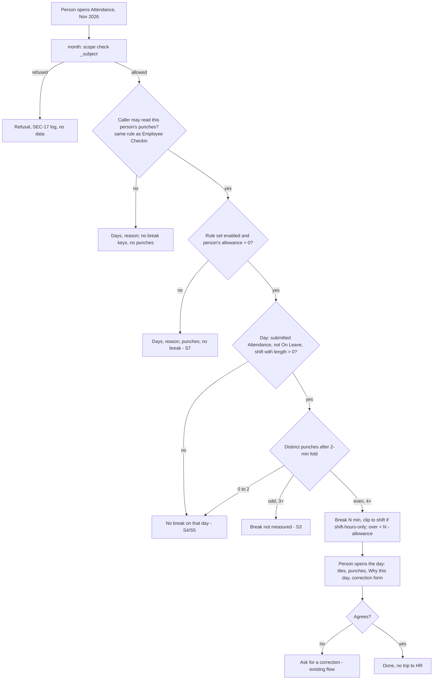

# ALV-328 - Functional spec: break time per day, and the reason for a day

**Bad news first.**

1. **Surbhi's Q-1 answer adds a setting, and that changes three agreed inputs.** OPS-6 said
   "no migrate" - there is now one Custom Field on HR Settings, so a migrate runs and DevOps
   must re-look. OPS-9 said "stop if the diff touches the permission layer" - it now does: the
   punch rule in `field_app_access.py` widens when the switch is on. SEC-3 and PRIV-2 change
   too. **The security engineer must verify the widened rule before the build is reviewed.**
2. **Switching it on shows more than times.** A punch record (Employee Checkin) carries the
   punch photo and the GPS location. Frappe opens a record, not a field. So when the switch is
   on, a manager sees the photo and the place of every punch in their whole line, not only the
   break. Hiding photo and place only would need new field-level permission rows - a bigger
   change. Question Q-A below.
3. **The reason text already contains the break minutes.** The engine writes "Breaks: 55
   minutes. The first 40 are allowed, so 15 deducted." into `alvoraa_rules_why`. A manager two
   levels up already reads that day's reason (Frappe and `month()` both give them the whole
   line's Attendance). So with the switch **off**, "no break for indirect reports" means *no
   break figure worked out from punches, and no punches* - it does not hide the minutes inside
   the reason. Question Q-B below.
4. **Design state S10 ("back within the same minute", Break 0 min) cannot happen as drawn.**
   The 2-minute merge folds a gap that short into one punch, so the day becomes an odd count.
   "Break 0 min" does happen another way: every break falls outside the shift when only shift
   hours count. The spec uses that case (AC-15).
5. **Hindi words are in the prototype, but the portal ships no Hindi for its own strings.**
   `alvoraa_portal/translations/` holds only `en.csv`. Showing seven Hindi strings on an
   otherwise English page is a half-translated screen. Question Q-C.

---

## 0 · Reach across the apps

| App | Touched? | How |
|---|---|---|
| `alvoraa_portal` | **Yes** | `attendance_correction.month()`, `attendance_analytics.person()`, `payroll_rules.py` / `payroll_rules_apply.py` (one shared helper split out), `field_app_access.py` (punch rule reads the switch), `portal.js` (`acRow`, `acPaint`, `acDetail`, `aiPerson`), `panels.css` (a few lines), one Custom Field on HR Settings, the existing HR Settings `validate` hook |
| `hrms` | Read only | `Attendance`, `Employee Checkin`, `Shift Type`, `HR Settings` (a Custom Field on it; no upstream edit) |
| `erpnext` | No | Employee is read as today |
| `frappe` | No | |
| `alvoraa_goals`, `alvox_compensation` | No | |

HRMS domains: **attendance** (direct), **payroll** (the break and reason explain pay; no pay
figure changes), **org structure** (the reporting line decides who sees what). Leaves: only
in that a leave day shows no break.

Personas: Employee (incl. frontline, phone-first), direct line manager, indirect manager
(two or more levels up), HR Manager / HR User (their companies), CXO / System Manager.

## 1 · Is the ask the real need?

**Confirmed fact:** the engine already writes a reason per day and no screen shows it (brief §2,
grep). **Confirmed fact:** the Attendance page draws every punch but adds nothing up. The
brief's cause ("people cannot see why and must ask HR") is the actual cause, not a symptom.
The screen drives a decision: *do I ask for a correction?* The page already has that button,
and the reason is placed above it on purpose (design §4). Nothing here needs automating.

## 2 · Gap analysis

| # | Requirement | Standard behaviour today (read in source) | Verdict | Cost |
|---|---|---|---|---|
| G1 | Break per day on the Attendance page | Frappe HR's `Attendance` has `working_hours`, `in_time`, `out_time`; no break field. `Shift Type` has no break. `month()` already reads every punch of the month in one `get_list` (`attendance_correction.py` ~516) | **Extend** - add per-day keys to `month()` from rows it already reads | S |
| G2 | "(N over)" against the person's allowance | `Alvoraa Payroll Rule Set.break_allowance_minutes` and the category override; `_employee_flags` returns `break_allowance_minutes` (`payroll_rules_apply.py` ~295) | **Extend** - read once per request (OPS-2) | S |
| G3 | "Break not measured" on an odd day | Engine: `punch_count % 2 == 1` after the fold means no break deducted (`payroll_rules.py` 197-200) | **Extend** | S |
| G4 | Same break as the engine | Engine: `_punches` (calendar date, whole minutes, `collapse_duplicate_punches`, `break_gaps`) then `_worked_percent` (clip to the shift when `count_shift_hours_only`) | **Extend** - split the post-query part and the break sum into one pure helper both use | S |
| G5 | "Why this day" | `alvoraa_rules_why` (Small Text) and `alvoraa_evaluated_on` (Datetime) on Attendance, permlevel 0, created on every site by `payroll_fields.after_migrate` | **Extend** - add 2 fields to `month()`'s existing Attendance `get_list`; draw them | S |
| G6 | Break on Insights, one person | `person()` reads no punches today (`attendance_analytics.py` 602-658) | **Extend** - one Checkin `get_list` for the whole range | S |
| G7 | Direct manager sees a report's break | `checkin_query_conditions` / `checkin_has_permission` already give direct reports' punches (`field_app_access.py` 190-231); `_subject` already opens them | **Already there** | 0 |
| G8 | Org switch: managers see break and punches for the whole line | Nothing. Punch rule is direct-only, hard-coded | **Configure + Extend** - one Custom Field on HR Settings (rung 3), read inside the existing punch hooks (rung 4, edit of existing code) | M |
| G9 | No break on any group view | `summary`, `filter_options`, `team_days` carry no break key today (grep, 12 Nov 2026) | **Already there** - prove it with a test, build nothing | 0 |
| G10 | Hindi for the new words | No portal Hindi file exists | **Drop for this slice** - pending Q-C | 0 |
| G11 | "Missing punch" tag should fold repeats (design A4) | Tag counts raw punches | **Drop** - out of scope (design Q1, PM owns) | 0 |

**Ladder for G8, the only non-trivial row.** I am on rung 3 (one Custom Field) plus a small
edit to existing rung-4 code. Cheaper rungs, and why each fails:

| Candidate home | Why rejected |
|---|---|
| Already there | No standard setting widens a punch rule. |
| Frappe Defaults via `hr_api.set_org_setting` (`ALLOWED_ORG_SETTINGS`) - where `manager_on_behalf` lives | **Ruled out in the code itself** (`hr_api.py` ~3285): "A key that grants visibility must never be added here - it needs System Manager and a change record." That endpoint lets HR Manager change values and keeps no history. |
| `Alvoraa Payroll Rule Set` | It is one record **per company** and holds pay rules. The ask is organisation-wide and about who sees whose data. A per-company switch makes the punch rule ask "which company's rule set governs this viewer and this report?" - and a manager can have reports in another company. More logic, wrong purpose. |
| `Alvoraa Leader View Settings` (Single, System Manager writes, change reason, history) | It already does "System Manager plus a change record", but its name and purpose are the leader view's group sizes. Nobody would look there for a manager's punch access. |
| **HR Settings Custom Field** - **Recommendation** | `CLAUDE.md` §4 puts organisation settings here. HR Settings keeps a Version row on every save (`track_changes: 1`, confirmed). Precedents: `alvoraa_birthdays_on_home` (ships off, System Manager only, `home_people.py`) and the field-app switches (`field_app_settings.py`), which already validate on every door through the existing `validate_hr_settings` hook. The one gap: HR Manager has write on HR Settings, so a guard is needed to keep it System Manager only (US-8). |

**Single source of truth.** Break minutes are never stored. The engine's helper is the only
calculation; both screens call it. The punch-visibility rule lives only in
`field_app_access.py`; both screens ask it rather than copying it.

## 3 · Process flow

Switch flow: System Manager opens HR Settings in Desk → ticks the box → saves → Version row
written → on the next request every manager's punch rule, and so their break, covers the
whole line. HR Manager trying the same save is refused.

## 4 · Epic and user stories

**Epic ALV-328:** *A person can see how long their breaks were each day and why a day cost
them, and their manager sees the same facts.*

| ID | Story | Pts | Prototype | Reqs | ACs |
|---|---|---|---|---|---|
| US-1 | As an **employee** I want each day of my month to show my break time, so that I do not add up punches in my head | 3 | Attendance, row (phone `.ac-l2`, desktop Break column) | OPS-1, OPS-3, OPS-4 | AC-1-AC-6 |
| US-2 | As an **employee** I want a break over my allowance said in words, so that I see which days cost me | 2 | Row S2, tiles | OPS-2 | AC-7-AC-10 |
| US-3 | As an **employee** I want a day with a missing middle punch to say the break was not measured, so that I am not shown a wrong number | 1 | Row S3, help line | - | AC-11, AC-12 |
| US-4 | As an **employee** I want the break I see to be the one my pay used, so that I can trust it | 3 | - | OPS-1 | AC-13-AC-17 |
| US-5 | As an **employee** I want to open a day and read why it cost what it did, and when that was worked out, so that I decide whether to ask for a correction | 3 | Opened day: tiles, Why this day | SEC-5 | AC-18-AC-23 |
| US-6 | As a **line manager** I want to see a direct report's break and reason exactly as they see them, so that we talk about one set of facts | 2 | Viewer "Kavita Rao" | - | AC-24 |
| US-7 | As an **employee**, my **manager's manager must not** see my punches or a break worked out from them unless my organisation has switched that on, so that my movements stay with the people who act on them | 2 | - | SEC-3 | AC-25-AC-27 |
| US-8 | As a **System Manager** I want one organisation switch that lets managers see punches and break for their whole line, so that an organisation that runs skip-level reviews can choose it | 3 | none (Desk HR Settings form) | SEC-3 (changed) | AC-28-AC-35 |
| US-9 | As an **employee**, an **HR Manager without System Manager must not** be able to switch that on, so that wider access to my punches needs the highest role and leaves a record | 1 | - | SEC-3 (changed) | AC-36 |
| US-10 | As an **HR Manager** I want the break beside each day on one person's Insights list, so that I can answer "why was I cut" without the Desk form | 2 | Insights, one person | OPS-1, OPS-3, SEC-2 | AC-37-AC-39 |
| US-11 | As an **employee**, my break **must not** appear on any team, company or organisation list, sort, filter, export or print, so that nobody ranks people on time away | 2 | Group tables have no Break column | PRIV-1 | AC-40 |
| US-12 | As an **employee**, a **colleague must not** read my break or my reason through the portal or any Frappe door, so that my pay day stays private | 2 | - | SEC-1, SEC-2, SEC-4, PRIV-2, PRIV-3 | AC-41-AC-45 |
| US-13 | As an **employee on a phone in pay week** I want the page to open as fast as it does today, so that the new figures cost me nothing | 2 | - | OPS-1-OPS-5 | AC-46-AC-48 |

Total 28 points. **INVEST:** every story is testable and small (none above 3). US-4 depends
on the helper US-1 uses; it is kept separate because it is the kill criterion and has its own
test. US-9 is a "must not" pair to US-8 and could merge into it if the backlog prefers fewer
cards.

**YouTrack-ready table** (import by hand; I created nothing):

| Summary | Description | Persona | Pts | ACs | Linked reqs |
|---|---|---|---|---|---|
| ALV-328 Break per day on the Attendance page | US-1 | Employee | 3 | AC-1-6 | OPS-1,3,4 |
| ALV-328 Over-allowance in words | US-2 | Employee | 2 | AC-7-10 | OPS-2 |
| ALV-328 "Break not measured" on odd days | US-3 | Employee | 1 | AC-11-12 | - |
| ALV-328 Screen break equals engine break (shared helper) | US-4 | Employee | 3 | AC-13-17 | OPS-1 |
| ALV-328 "Why this day" on the opened day | US-5 | Employee | 3 | AC-18-23 | SEC-5 |
| ALV-328 Direct manager sees the same break and reason | US-6 | Line manager | 2 | AC-24 | - |
| ALV-328 No punches or break for skip-level by default | US-7 | Employee (must not) | 2 | AC-25-27 | SEC-3 |
| ALV-328 Org switch: whole-line punches and break | US-8 | System Manager | 3 | AC-28-35 | SEC-3 |
| ALV-328 Only System Manager may flip the switch | US-9 | Employee (must not) | 1 | AC-36 | SEC-3 |
| ALV-328 Break on Insights one-person list | US-10 | HR Manager | 2 | AC-37-39 | OPS-1,3; SEC-2 |
| ALV-328 Break never on group views | US-11 | Employee (must not) | 2 | AC-40 | PRIV-1 |
| ALV-328 Colleague cannot read break or reason | US-12 | Employee (must not) | 2 | AC-41-45 | SEC-1,2,4; PRIV-2,3 |
| ALV-328 Query count and payload held | US-13 | Employee | 2 | AC-46-48 | OPS-1-5 |

## 5 · The break rule, stated once

This is the engine's rule (`payroll_rules.py`, `payroll_rules_apply.py` at `4ae8499a`),
written as a requirement. **Confirmed fact** for every line.

| Step | Rule |
|---|---|
| R1 Punches | Every Employee Checkin of the person whose `time` falls on the **calendar date** (00:00:00-23:59:59), whatever Attendance row it is linked to, flagged or not. |
| R2 Whole minutes | Each time becomes `hour × 60 + minute`; seconds are dropped. |
| R3 Fold | Sorted; a punch within **2 minutes** (`DUPLICATE_PUNCH_MINUTES`) of the last *kept* punch is dropped (`collapse_duplicate_punches`). |
| R4 Gaps | Pairs (punch 2, 3), (4, 5) ... of the folded list (`break_gaps`). |
| R5 Window | Shift-hours-only **on**: each gap is clipped to `[max(counted_from, shift start), min(last punch, shift end)]`, where `counted_from` is the shift start unless the person arrived past grace. Off: clipped to `[first punch, last punch]` (no effect). Shift = the Attendance row's `shift`, else Employee `default_shift`; times from Shift Type `start_time` / `end_time`. |
| R6 Sum | `break = Σ max(0, min(back, end) − max(out, start))`, whole minutes. |
| R7 Allowance | Category override if > 0, else the rule set's `break_allowance_minutes` (`_employee_flags`). |
| R8 Over | `over = max(0, break − allowance)`. |

When a day gets a break at all (all must hold): the subject's company has an **enabled** rule
set; the person's allowance (R7) is **> 0**; the day has a **submitted** Attendance row whose
status is **not "On Leave"** (a half-day leave, "Half Day", is measured, as the engine does);
the shift is known and its length is **> 0** (a night shift crossing midnight has length ≤ 0
and is held by the engine); and the caller **may read this person's punches** (§7).

| Folded punch count | Result |
|---|---|
| 0, 1 or 2 | no break (S4) |
| odd, 3 or more | `not_measured` (S3) |
| even, 4 or more | minutes (S1, S2, S10) |

**Requirement:** R1-R6 run in **one** pure function that the engine's `_punches` /
`_worked_percent` and both screens call. The engine keeps its own query. A second copy of the
fold or the sum anywhere is a defect (AC-17).

## 6 · Data model

**Nothing new on Attendance or Employee Checkin.** Break is worked out per request (PRIV-2).

**One new Custom Field** (G8, US-8):

| DocType | fieldname | label | fieldtype | mandatory | default | description (shown in Desk) |
|---|---|---|---|---|---|---|
| HR Settings | `alvoraa_manager_sees_whole_line_punches` | Managers see punches and breaks for their whole reporting line | Check | no | 0 | "Off: a manager sees punches, and the break worked out from them, for their direct reports only. On: also for everyone further down their reporting line. A punch includes its photo and location. Only a System Manager can change this." |

*Why no existing field can carry it:* no HR Settings, Attendance Settings or rule-set field
governs punch visibility (searched HR Settings JSON and all `alvoraa_*` Singles). Placement
(`insert_after`) is the engineer's choice; created in `after_migrate` and `after_install`
like `home_people.FIELDS`. The wording depends on Q-A.

**New response keys** (not fields):

| Endpoint | Level | Key | Type | Sent when |
|---|---|---|---|---|
| `month()` | month | `break_allowance_minutes` | int | at least one day carries `break_state` |
| `month()`, `person()` | day | `break_state` | `"measured"` \| `"not_measured"` | the day gets a break (§5) |
| `month()`, `person()` | day | `break_minutes` | int ≥ 0 | `break_state == "measured"` |
| `month()`, `person()` | day | `break_over` | int > 0 | `break_over > 0` |
| `month()` only | day | `rules_why` | string | `alvoraa_rules_why` is set |
| `month()` only | day | `evaluated_on` | `"YYYY-MM-DD HH:MM:SS"` | `alvoraa_evaluated_on` is set |

Key names follow design §8 ("names are the analyst's to settle"); this table settles them.

## 7 · Who may read and write what

### Per field or value, per persona, and the Frappe door that enforces it

| Data | Employee (self) | Colleague | Direct manager | Indirect manager, switch **off** | Indirect manager, switch **on** | HR Manager / HR User (own companies) | System Manager / CXO | Enforced by |
|---|---|---|---|---|---|---|---|---|
| Break per day (computed) | Read | **None** | Read | **None** | Read | Read | Read | `month()` `_subject` / `person()` `allowed` check, **then** the punch-read rule below. Never stored, so no other door exists |
| Employee Checkin rows (punch, photo, place) | Read (own-record User Permission + `checkin_query_conditions`) | **None** | Read | **None** | **Read** | Read (all, `_HR_ROLES`) | Read | `checkin_query_conditions` (lists, reports, `get_list`), `checkin_has_permission` (one record) |
| Employee Checkin write | Unchanged by this slice | Unchanged | Unchanged | Unchanged | **Not widened** - `has_permission` widens for `ptype == "read"` only | Unchanged | Unchanged | `checkin_has_permission` |
| `alvoraa_rules_why`, `alvoraa_evaluated_on` | Read | **None** | Read | Read (already, see Q-B) | Read | Read | Read | Attendance read: own-record User Permission on the Employee tree; HR roles. `month()` reads them in its existing `get_list` |
| Those two fields, write | Engine only (`read_only`, written with `db_set`). This slice adds no write path. Whether HR can overwrite them through REST is pre-existing and **not tested here** | | | | | | | - |
| HR Settings switch, read | Read (Employee role reads HR Settings; the value names nobody) | Read | Read | Read | Read | Read | Read | HR Settings DocPerm |
| HR Settings switch, write | **None** | **None** | **None** | **None** | **None** | **None** - refused by the guard even though HR Manager writes HR Settings | **Write**, recorded in Version | existing `validate_hr_settings` hook (or a sibling on the same event) - every door: Desk, REST, `frappe.client.set_value` |

**Punch-read rule, the one definition (SEC-3 as changed by Q-1).** May caller C read person
P's punches?

- C holds an `_HR_ROLES` role → yes (unchanged).
- C has no Active Employee record → no (unchanged).
- P is C → yes.
- P's `reports_to` is C and P is Active → yes (unchanged).
- Switch **on** and P is in `_reports_to(C, deep=True)` → yes. Same set `month()` already
  opens: Active at every level, so a report under a Left manager is not reached.
- Otherwise → no.

**Worry for security, pre-existing, not this slice's to fix:** the Employee role has `write`
on Employee Checkin at permlevel 0 (`employee_checkin.json`), and `checkin_has_permission`
returns True for a direct report whatever `ptype` is asked. So a direct manager can probably
edit a report's punch fields other than `time` (log type, device, latitude) through REST today.
*Needs validation* by one API call. This slice must not widen it (AC-31).

`checkin_query_conditions`, `checkin_has_permission` (read) and the break check in both
screens all use this one rule. The screens must not keep a second copy. `[ASSUMPTION]` the
engineer moves `_reports_to` or calls it from `field_app_access`; where it lives is theirs to
choose.

### Who must NOT see this

- A colleague who is not P's manager, nor HR: no break, no reason, no punches, on any door.
- An indirect manager with the switch off: no break figure, no punches.
- A manager outside P's line: nothing (refused by `_subject` / `person()`).
- HR outside their companies and branches: nothing through `month()` (`_refuse_outside_scope`).
  **Pre-existing gap, not widened here:** an HR login with no Company, Branch or Employee row
  is not narrowed (security W2).
- Anyone looking at a team, department, branch, company or organisation view: no break, ever
  (PRIV-1).
- A non-HR org role (for example DTC's Location Manager) opening `person()` through the
  organisation view: they hold no `_HR_ROLES` role, so the punch rule refuses and they get no
  break. **Confirmed fact** in code; their Attendance read is security's W1, pre-existing.

## 8 · Acceptance criteria

Fixture used throughout (made-up): **Rohan Mehta** HR-EMP-00412 reports to **Kavita Rao**
HR-EMP-00077, who reports to **Arjun Sethi** HR-EMP-00010. Company "Demo Retail" has an
enabled rule set: `break_allowance_minutes` 40, `count_shift_hours_only` on, grace 6.
Rohan's shift "General" is 10:00-19:00. **Priya Nair** HR-EMP-00500 is a colleague with no
reports. **Meena Joshi** is HR Manager for Demo Retail, not System Manager. **Admin Sys** is
System Manager. Switch off unless stated.

### US-1 - break per day

- **AC-1** Given Rohan's submitted Attendance on 3 Nov with punches 09:58, 13:00, 13:40, 19:05,
  when Rohan calls `month(2026, 11)`, then day 3 Nov has `break_state: "measured"`,
  `break_minutes: 40`, and no `break_over` key; the phone `.ac-l2` line ends with
  "Break 40 min"; the desktop Break cell reads "40 min".
- **AC-2** Given the desktop page at 1440 px with at least one day carrying a break, then a
  "Break" header sits between "Worked" and "Expected", days without a figure show "—", and
  the opened day's cell spans 10 columns.
- **AC-3** Given a day with 1 punch, or with 2 punches (09:58, 19:05), then the day has no
  `break_*` key; phone shows no break item; desktop cell "—".
- **AC-4** Given a day with status "On Leave", a holiday, a weekly off, a future day, or a date
  with no submitted Attendance, then the day has no `break_*` key.
- **AC-5** Given the rule set is disabled, or its allowance is 0 and Rohan's category sets no
  override, then no day has a `break_*` key, there is no `break_allowance_minutes` key, the
  desktop Break column is not drawn, and the Insights Break column is not drawn.
- **AC-6** Given a 360 px phone, when the month draws, then `document.documentElement.scrollWidth`
  ≤ 360, the "Break ..." item never splits across two lines, and its font size is ≥ 12 px.

### US-2 - over in words

- **AC-7** Given punches 09:58, 13:00, 13:40, 16:10, 16:25, 19:05 on 4 Nov, then `break_minutes:
  55`, `break_over: 15`; the row reads "Break 55 min (15 over)" and "(15 over)" carries the
  `hi` class (bold, `--red`).
- **AC-8** Given a break of 105 minutes, then the row reads "Break 1h 45m (1h 5m over)".
- **AC-9** Given a break of exactly 40 minutes, then there is no `break_over` key and no
  "(over)" text.
- **AC-10** Given Rohan's category "Contract" overrides the allowance to 60 and the 4 Nov
  punches of AC-7, then `break_allowance_minutes: 60`, `break_minutes: 55`, no `break_over`,
  and the Allowed tile reads "60 min".

### US-3 - not measured

- **AC-11** Given punches 09:58, 13:00, 19:05, then `break_state: "not_measured"` and no
  `break_minutes`; the row reads "Break not measured" (desktop "Not measured"); the opened day
  shows the help line "Break not measured. A punch is missing from the middle of the day, so
  nobody can tell which gap was a break. No break is deducted."; no Break or Allowed tile.
- **AC-12** Given punches 09:58, 09:59, 13:00, 13:40, 19:05 (a repeat scan), then
  `break_state: "measured"`, `break_minutes: 40`. (The existing "Missing punch" tag may still
  show - design A4, out of scope.)

### US-4 - same as the engine

- **AC-13** Given a fixture month for Rohan containing the days of AC-1, AC-7, AC-11, AC-12,
  AC-14 and AC-15, when `evaluate_attendance` runs on each and then `month()` runs, then for
  every day whose stored reason contains "Breaks: N minutes", `break_minutes == N`; for every
  day whose reason contains "A punch is missing from the middle of the day",
  `break_state == "not_measured"`; for every measured day with no "Breaks:" sentence,
  `break_minutes == 0`.
- **AC-14** Given shift 10:00-19:00 and punches 09:00, 09:20, 09:45, 13:00, 13:30, 19:02, then
  with shift-hours-only **on** `break_minutes: 30`; with it **off** `break_minutes: 55`.
- **AC-15** Given shift-hours-only on and punches 08:00, 08:20, 08:50, 19:02 (the only gap is
  before the shift), then `break_minutes: 0` and the row reads "Break 0 min" (design S10, as
  corrected).
- **AC-16** Given a punch at 13:00:59 and the return at 13:40:00, then `break_minutes: 40`, not 39.
- **AC-17** Given the diff, then `collapse_duplicate_punches` and the break-sum expression each
  exist once outside tests, and the engine and both endpoints call that one function.
  (Reviewer check plus `test_payroll_rules` and `test_shift_hours_alv326` still green.)
- **AC-17a** Given a punch at 00:30 on 5 Nov linked to Rohan's 4 Nov Attendance (night-shift
  link), then the 00:30 punch is **not** counted in 4 Nov's break (calendar date, R1), even
  though `month()` still draws it among 4 Nov's punch chips.

### US-5 - why this day

- **AC-18** Given 4 Nov's Attendance has `alvoraa_rules_why` "Breaks: 55 minutes. The first 40
  are allowed, so 15 deducted. Slab 90-97%: 0 quarter(s) off, 1 red.", when Rohan opens 4 Nov,
  then a `<section>` labelled by an `<h3>` "Why this day" shows that text exactly, with line
  breaks kept (`white-space: pre-line`), placed after the punches and the missing-punch help
  and before the correction form.
- **AC-19** Given `alvoraa_evaluated_on` 2026-11-04 23:40:12, then below the text reads
  "Worked out on 4 Nov 2026 at 23:40".
- **AC-20** Given a day with no stored reason, then the day has no `rules_why` and no
  `evaluated_on` key, and no "Why this day" section is drawn. No "not worked out yet" message.
- **AC-21** (SEC-5) Given a stored reason ``, then the page shows
  those characters and `document.querySelectorAll('.ac-detail img').length` is 0.
- **AC-22** Given a measured day, then the fact tiles show "Break" (same words as the row,
  e.g. "55 min (15 over)") and "Allowed" ("40 min") right after "Worked"; and `month()` sends
  `break_allowance_minutes` once at month level, not per day.
- **AC-23** Given a reason worked out on 4 Nov and a correction approved on 6 Nov that was not
  re-judged, then the reason still shows with "Worked out on 4 Nov 2026 at 23:40" and no other
  warning (design S8).

### US-6 - direct manager

- **AC-24** Given Kavita is Rohan's direct manager, when Kavita calls `month(2026, 11,
  "HR-EMP-00412")`, then every day's `break_*`, `rules_why` and `evaluated_on` values equal
  those in Rohan's own call, and `break_allowance_minutes` is equal.

### US-7 - skip-level, switch off (must not)

- **AC-25** Given the switch is off, when Arjun calls `month(2026, 11, "HR-EMP-00412")`, then
  the call succeeds, days carry `rules_why` where stored, and **no day has any `break_*` key**
  and there is no `break_allowance_minutes` key; the screen draws no Break column, no Break or
  Allowed tile and no "Break not measured" line.
- **AC-26** Given the switch is off, when Arjun calls `person("HR-EMP-00412")`, then no day has
  a `break_*` key.
- **AC-27** Given the switch is off, when Arjun calls `/api/resource/Employee Checkin` with
  `filters=[["employee","=","HR-EMP-00412"]]`, then the list is empty; and `GET` of one of
  Rohan's checkins by name returns 403.

### US-8 - the switch

- **AC-28** Given a freshly created site after migrate, then HR Settings has the Check field
  `alvoraa_manager_sees_whole_line_punches` with value 0.
- **AC-29** Given Admin Sys ticks it and saves HR Settings, then a Version row on HR Settings
  records the field going 0 → 1 with owner Admin Sys.
- **AC-30** Given the switch is on, when Arjun calls `month(2026, 11, "HR-EMP-00412")`, then the
  `break_*` values equal Kavita's (AC-24) and the punches are listed.
- **AC-31** Given the switch is on, when Arjun lists `/api/resource/Employee Checkin` for
  Rohan, then Rohan's rows come back; `GET` by name returns 200; `PUT` on that checkin returns
  403 (read widened, write not).
- **AC-32** Given a 3-level fixture where a middle manager is Left, then for every manager in
  it the set of employees whose checkins `checkin_query_conditions` admits equals
  `{self} ∪ _reports_to(me, deep=True)` with the switch on, and `{self} ∪ direct reports`
  with it off.
- **AC-33** Given the field does not exist yet (before migrate) or cannot be read, then the
  punch rule behaves as switch off.
- **AC-34** Given the switch goes on → off, then on the very next request Arjun's checkin list
  for Rohan is empty and `month()` gives him no `break_*` key.
- **AC-35** Given the switch is on and one of Rohan's checkins has a photo, when Arjun opens it
  in Desk, then an `Alvoraa Photo Access Log` row with `viewed_by` = Arjun exists for that day.

### US-9 - only System Manager flips it (must not)

- **AC-36** Given Meena (HR Manager, not System Manager), when she changes the field through
  the Desk form, through `PUT /api/resource/HR Settings/HR Settings`, or through
  `frappe.client.set_value`, then each is refused with "Only a System Manager can change who
  sees punches across the reporting line." and the value stays 0; when she saves another HR
  Settings field without touching this one, the save succeeds.

### US-10 - Insights, one person

- **AC-37** Given Meena opens Rohan on Insights, then `person()` days carry the same
  `break_state`, `break_minutes`, `break_over` as `month()` for the same dates; the table shows
  a Break column after "Worked" with the same cell words; the table sits inside `.tbl-wrap`;
  at 390 px the page `scrollWidth` ≤ 390.
- **AC-38** Given any caller, then `person()` returns no `rules_why` or `evaluated_on` key.
- **AC-39** (SEC-2) Given the diff, then `person()` reads punches with `frappe.get_list` on
  Employee Checkin, never `get_all` or SQL.

### US-11 - never on group views (must not)

- **AC-40** (PRIV-1) Given Kavita (manager) and Meena (HR), when each calls
  `attendance_analytics.summary` for view `mine`, `team` and `organisation`, depth `direct` and
  `deep`, plus `filter_options` and `attendance_correction.team_days`, then no key containing
  "break" appears anywhere in any JSON response; the group tables draw no Break column; no
  sort or filter option mentions break; no export or print built by the portal carries it.

### US-12 - colleague (must not)

- **AC-41** (SEC-1) Given Priya, when she calls `month(employee="HR-EMP-00412")` and
  `person("HR-EMP-00412")`, then each raises `PermissionError` and the response body contains
  no `break_` or `rules_why` text. The diff adds 0 `@frappe.whitelist` functions and 0 new
  parameters.
- **AC-42** (SEC-4) Given a **freshly created site** and Priya with the Employee role only, then
  `/api/resource/Attendance` list with `fields=["alvoraa_rules_why"]`, `GET` of Rohan's
  Attendance by name, `frappe.client.get_value("Attendance", <Rohan's>, "alvoraa_rules_why")`
  and `frappe.desk.reportview.get` each return nothing of Rohan's. **Negative control:** with
  Priya's own-record User Permission deleted in the test, the same list call does return
  Rohan's row; if it does not, the test is invalid.
- **AC-43** (SEC-2) Given the diff, then `test_portal_security_010.CEILINGS` is unchanged and
  green, and there is no new `ignore_permissions`, `get_all` or `frappe.db.sql` on Attendance or
  Employee Checkin in a function a user can call.
- **AC-44** (PRIV-2, as changed) Given migrate, then Attendance's Custom Field count is
  unchanged, Employee Checkin's is unchanged, HR Settings gains exactly one field, and the diff
  contains no `set_value`, `db_set` or cache key for break values.
- **AC-45** (PRIV-3) Given the SEC-17 refusal of AC-41, then its log row carries the employee
  ID and no break figure or reason text; the diff adds no `log_error`, logger call or
  `frappe.throw` that formats a break value or `rules_why`.

### US-13 - speed (OPS)

- **AC-46** (OPS-1, OPS-3) Given Rohan's month with 2 punches a day and again with 6 punches a
  day, then `month()` runs the **same** number of queries both times, and exactly one of them
  reads Employee Checkin (the existing one). The before/after numbers are written in the
  implementation notes.
- **AC-47** (OPS-1, OPS-2, OPS-3) Given `person()` over 1 month and over 12 months, then the
  query count is the same, exactly one query reads Employee Checkin, and the rule set and
  allowance are read once per request, not per day.
- **AC-48** (OPS-4) Given a month where 10 days have breaks and 5 have reasons, then exactly 10
  days carry `break_state` and exactly 5 carry `rules_why`; no key is sent empty or null.

## 9 · Edge cases

| Case | What happens | AC |
|---|---|---|
| Repeat scan inside 2 min | Folded first; never "not measured" for that alone | AC-12 |
| Break before shift start, shift-hours-only on | Clipped to 0 | AC-14, AC-15 |
| Late arrival past grace | Window starts at first punch; breaks are after it anyway, so no change | §5 R5 |
| Night shift (end before start) | Engine holds the day; shift length ≤ 0 → no break | §5 |
| Punch after midnight linked to yesterday | Counted on its own calendar date, as the engine does | AC-17a |
| Half-day leave ("Half Day" + leave application) | Break measured, as the engine does | §5 |
| Absent row that has 4+ punches | Break measured, as the engine does | §5 |
| Held day (1 punch), later confirmed out | 1 punch → no break; engine has no gaps either | AC-3 |
| Category changed after the day was judged | Screen uses today's category allowance; the stored reason shows what the engine used, with its date. **Risk:** "(N over)" can differ from the reason's figure on such a day. Accepted as rare; the reason is the record | AC-23 |
| Rule set allowance changed after judging | Same as above | AC-23 |
| Mid-month joiner | Days before joining have no Attendance → no break | AC-4 |
| Leaver | Own login inactive → gets nothing (existing). HR may still open a leaver in `person()` (decision D-7); break shows | existing |
| Employee with no manager | Only self and HR see break | §7 |
| Circular `reports_to` | `_reports_to` keeps a `seen` set, so the walk ends | existing code |
| Manager with a Left middle manager, switch on | Reports under the Left manager are not reached (Active at each level) | AC-32 |
| Multi-company: manager's report is in another company | Punch rule follows the reporting line, not company (unchanged); the allowance comes from the **report's** company rule set | §5 |
| Cancelled and amended Attendance | `month()` reads `docstatus 1` only, so the amended row and its reason | existing |
| October at DTC (muster upload, 2 punches a day) | No break shown - correct, not "0 min" | AC-3 |
| Concurrent switch change | Last save wins; each save writes a Version row | AC-29 |
| Time zones | Punch times and `evaluated_on` shown as stored (site time zone, Asia/Kolkata); no conversion | AC-19 |

## 10 · Non-functional requirements for this slice

| Item | Number | Source |
|---|---|---|
| Records per request | `month()`: ≤ ~190 punches (DTC estimate, 4-6 a day); `person()`: ≤ ~2,200 (12 months) | OPS-5 |
| Queries | Same count regardless of days or punches; 1 Checkin query per endpoint | OPS-1, OPS-3, nfr-budget §2 |
| Extra queries for the switch | Read once per request (Frappe single-value cache, cleared on save). With it on, the deep-tree walk costs one query per level of the line - constant for a page, not per day | engineer to record |
| Response time | Whitelisted call p95 ≤ 500 ms; employee screen on 3G p95 ≤ 2.5 s | nfr-budget §2 |
| Payload | +~3 KB gzipped `month()` worst case; +~1 KB `person()` default 30 days | OPS-4 |
| Background job / queue | None | - |
| Index | None (indexes on `employee`, `time` exist) | OPS-5 |
| Personal data | Break minutes: personal, work-behaviour, not stored. Reason: personal, pay-related, already stored | 03-security §2 |
| Retention | Unchanged | §13 |

## 11 · Migration and backfill

- **Data:** nothing created, defaulted or recomputed. Reasons appear only on days the engine
  has judged.
- **Schema:** **one Custom Field on HR Settings**, default 0, created on migrate and install.
  This changes OPS-6 - DevOps to re-look and say whether a dry run is needed.
- **Release count (read-only, DTC), from 03-security:** (a)-(d) as written there, plus (e) the
  switch value - must read 0 after deploy.
- **Rollback:** revert the ALV-328 commits on `dev` and redeploy (OPS-8). The leftover Custom
  Field is harmless: with the code gone nothing reads it, and the punch rule is direct-only
  again. If someone switched it on, the revert alone restores direct-only.

## 12 · Notifications and messages

No email, no notification, no toast. New on-screen words, all wrapped in `drT()` (JS) or
`_()` (Python):

| Where | English |
|---|---|
| Row item | `Break {0}` |
| Over | `({0} over)` |
| Row, odd | `Break not measured` / desktop `Not measured` |
| Column, tile | `Break` · `Allowed` |
| Help, odd | `Break not measured. A punch is missing from the middle of the day, so nobody can tell which gap was a break. No break is deducted.` |
| Heading | `Why this day` |
| Under the reason | `Worked out on {date} at {time}` |
| Refusal (AC-36) | `Only a System Manager can change who sees punches across the reporting line.` |

Must never leak: no break figure or reason text in a log, error or refusal (PRIV-3).

## 13 · Localisation and accessibility

- Minutes through `acMins` ("55 min", "1h 25m"); dates through `acNice` ("4 Nov 2026"); times
  24-hour.
- The reason text stays English as stored (Surbhi's decision 3).
- Hindi for the new words: **not in this slice** pending Q-C. The design's Hindi drafts stay in
  `02-design.md` §6 for the language ticket.
- WCAG 2.2 AA: "over" is said in words, colour is extra (1.4.1); the reason is a `<section
  aria-labelledby>` with an `<h3>`; no new controls; text at the existing 12-13 px floor.
- Frontline phone (360 px): the break item wraps to its own line inside `.ac-l2`; the Insights
  table scrolls inside `.tbl-wrap`; the page never scrolls sideways (AC-6, AC-37).

## 14 · Audit and traceability

- Break: nothing to audit; it is worked out from punches already held and can be reproduced
  from them a year later with the same helper.
- Reason: already stored with `alvoraa_evaluated_on`.
- The switch: every change is a Version row on HR Settings (who, when, 0 → 1). That answers
  "who widened punch access, and when" in an audit.
- A photo opened by a skip-level manager is logged by the existing `log_photo_view`.

## 15 · Compliance-impact sub-analysis

**I am not a lawyer. Nothing below is a legal ruling.**

### 1 · Data touched

| Field / object | Class | Purpose | Lawful basis (as recorded) | New collection? |
|---|---|---|---|---|
| Break minutes per day | sensitive (work behaviour) | explain the person's pay for a day | employment / attendance, as for punches | **No** - derived per request, not stored |
| `alvoraa_rules_why`, `alvoraa_evaluated_on` | sensitive (pay-related) / internal | same | same | No - already stored |
| HR Settings switch | internal (config, names nobody) | org choice on manager visibility | - | New config value, no personal data |

### 2 · Obligations engaged

| Obligation | Source | What this slice must do | Feature |
|---|---|---|---|
| Access to own data; transparency | DPDP Act 2023 (baseline §2, last checked 24 Aug 2026 - stale on 22 Nov 2026) | show the person their own break and reason | US-1, US-5 |
| Access and grievance for automated pay decisions | counsel, 18 Sep 2026 | the person sees why; the correction route is next to it | US-5 (+ existing correction flow; compliance map E4/G3 not built - not this slice) |
| Purpose limitation, minimisation | DPDP | compute, do not store; no group view | PRIV-1, PRIV-2 |
| No passive behavioural monitoring as a performance input | product-context §6 item 4, FR-H7 | no break on any list, sort, export | US-11 |
| Reasonable safeguards | DPDP | limits in the permission layer, not the portal | §7, US-12 |

### 3 · Visibility delta

- **Employee:** sees their own break and reason on screen (reason was API-readable before).
- **Direct manager:** sees a break figure for direct reports - new as a figure, derived from
  punches they already see.
- **Indirect manager, switch off:** **nothing new.** No punches, no break figure. They still
  read the reason text, which they could already read (Q-B).
- **Indirect manager, switch on:** **new access to punches, punch photos and locations, and
  the break, for the whole line.** This is the largest delta in the slice and the reason
  security must verify it.
- **HR:** a break figure on screens; no new records.
- **Must not, stated again:** colleagues; managers outside the line; HR outside their scope;
  every group view.

### 4 · Decision automation

The engine already decides quarters and reds. This slice decides nothing; it **shows** the
decision. Accountable human: HR, who approves corrections. The person is told on the day's
screen; they contest through "Ask for a correction" beside the reason. The system does not
decide anything new.

### 5 · Retention and deletion

Nothing changes. No break figure is kept. Attendance and Checkin keep their current periods
(counsel has not set a number; open elsewhere). The switch value is config, kept with HR
Settings' Version history.

### 6 · Open compliance questions

| Question | Who decides | What it blocks |
|---|---|---|
| With the switch on, may skip-level managers see punch **photos and locations**, not only times? (Q-A) | Surbhi, advised by security | The switch's description text and whether "on" is offered as built; not the first day of work |
| Is it acceptable that a skip-level manager reads the break minutes inside the reason while the switch is off? (Q-B) | Surbhi | AC-25 wording; nothing else |

### 7 · AI features

None.

**Prohibitions check:** nothing here sets a rating, infers emotion or voice, or monitors
passively. PRIV-1 is what keeps break from becoming a ranking signal.

## 16 · Prototype parity table (carried forward from design §8, updated)

| Prototype element | Code home | New / existing | Spec | Difference from prototype |
|---|---|---|---|---|
| Title "Attendance", sub "Your record · November 2026" | `policies.html` `#panel-att-record`, `acPaint` | existing | - | none |
| Six tiles | `acPaint` `.ac-tiles` | existing, unchanged | - | none |
| Day row phone block, new `.ac-l2` item "Break ..." | `acRow` | new item | AC-1, AC-7, AC-11 | none |
| Desktop Break column | `acRow` + header in `acPaint` | new | AC-2, AC-5 | none |
| "(15 over)" red bold | `.hi` | existing class | AC-7 | none |
| Opened day Break and Allowed tiles | `acDetail` `.ac-facts` | new | AC-22 | none |
| Punch chips | `acDetail` | existing | - | none |
| "Break not measured..." help | `acDetail` `.ac-help` | new | AC-11 | none |
| "Missing punch" tag | `acRow` | existing, unchanged | AC-12 note | none (A4 out of scope) |
| Why this day + "Worked out on..." | `acDetail`, CSS in `panels.css` | new | AC-18-AC-20 | none |
| Correction form | `acForm` | existing | - | none |
| Insights one-person Break column in `.tbl-wrap` | `aiPerson` | new column, new wrapper | AC-37 | none |
| "← Back to the list" | `aiPerson` | existing | - | none |
| Per-day values | `month()`, `person()` | new keys | §6 | key names settled here |
| Viewer "Kavita Rao (his manager)" | - | - | AC-24 | the prototype shows a direct manager only; **skip-level gets no break by default** (Surbhi's Q-1) - no prototype change needed, the screen simply has no figure |
| Language switch English/Hindi | prototype only | - | §13 | **Hindi not shipped in this slice - needs Surbhi's yes (Q-C)** |
| State S10 "0 min, back within the same minute" | - | - | AC-15 | **reached through the clip, not a same-minute return** (that case is folded); same words on screen |
| Review bar (device, theme, state jump) | prototype only | not in product | - | - |

## 17 · Traceability

| Source | ID or line | Story | ACs | Status |
|---|---|---|---|---|
| Brief §5 | "Break 52 min" beside the hours | US-1 | AC-1, AC-2 | covered |
| Brief §5 | odd count → not a number | US-3 | AC-11 | covered |
| Brief §5 | "Why this day" + date | US-5 | AC-18, AC-19 | covered |
| Brief §5 | no reason → nothing | US-5 | AC-20 | covered |
| Brief §5 | Insights break, one Checkin read | US-10, US-13 | AC-37, AC-47 | covered |
| Brief §5 | no reason on Insights | US-10 | AC-38 | covered |
| Brief out-of-scope | no team/org list, no sort | US-11 | AC-40 | covered |
| Brief decision 1 | per day only, no month total | - | - | not built, by decision |
| Brief decision 2 | over in words | US-2 | AC-7-AC-9 | covered |
| Brief decision 3 | reason as written | US-5 | AC-18 | covered |
| Brief decision 4 | managers see break and reason | US-6 | AC-24 | covered (direct; skip-level per Q-1) |
| Brief §9 | screen = engine, 100% of DTC November | US-4 | AC-13; release count | covered (DTC check is a release step) |
| Brief R1 | October 0/nothing | US-1 | AC-3 | covered |
| Brief R2 | night shift | US-4 | AC-17a, §9 | covered |
| Brief R3 | stale reason | US-5 | AC-23 | covered |
| Design S1-S7, S10 | states | US-1-3, 5 | AC-1, 3, 4, 5, 7, 11, 15, 20 | covered |
| Design S8 | corrected later | US-5 | AC-23 | covered |
| Design S9 | loading/failed | - | existing states | unchanged, no AC needed |
| Design §10 item 7 | manager sees direct **and indirect** | US-6, 7, 8 | AC-24-AC-32 | **superseded by Surbhi's Q-1** |
| Design §10 item 10 | 360 px | US-1 | AC-6 | covered |
| Design §6 Hindi | Hindi drafts | - | - | **open, Q-C** |
| Prototype | Attendance row, column, tiles, help, Why | US-1-5 | AC-1-AC-22 | covered |
| Prototype | Insights one person | US-10 | AC-37 | covered |
| Security | SEC-1 | US-12 | AC-41 | covered |
| Security | SEC-2 | US-10, US-12 | AC-39, AC-43 | covered |
| Security | SEC-3 (changed by Q-1) | US-7, US-8, US-9 | AC-25-AC-36 | covered; **security to verify the widened rule** |
| Security | SEC-4 | US-12 | AC-42 | covered |
| Security | SEC-5 | US-5 | AC-21 | covered |
| Privacy | PRIV-1 | US-11 | AC-40 | covered |
| Privacy | PRIV-2 (changed: one config field) | US-12 | AC-44 | covered |
| Privacy | PRIV-3 | US-12 | AC-45 | covered |
| Security Q-2 | HR export of reasons = HR's payroll record | - | - | **accepted by Surbhi, 12 Nov 2026**; residual R1 closed |
| Security release check | counts (a)-(d) | - | §11 | release step, DevOps |
| DevOps | OPS-1 | US-1, US-4, US-10, US-13 | AC-46, AC-47 | covered |
| DevOps | OPS-2 | US-2, US-13 | AC-22, AC-47 | covered |
| DevOps | OPS-3 | US-13 | AC-46, AC-47 | covered |
| DevOps | OPS-4 | US-13 | AC-48 | covered |
| DevOps | OPS-5 | - | - | FYI, no index; nothing to test |
| DevOps | OPS-6 | - | AC-28 | **changed: one Custom Field, migrate needed - DevOps to re-look** |
| DevOps | OPS-7 | - | release check: `?v=` changed and served `portal.js` contains "Break not measured" | release step, DevOps |
| DevOps | OPS-8 | - | §11 rollback | release step, DevOps |
| DevOps | OPS-9 | - | - | **triggered: the punch permission hook changes** - DevOps and security re-check |

Gaps: none unmapped. Items not adopted carry Surbhi's decision or an open question.

## Open questions

| # | Question | My recommendation | Owner | Blocks |
|---|---|---|---|---|
| Q-A | With the switch on, a skip-level manager sees each punch's **photo and location**, not only its time - Frappe opens the whole record. Accept that? | **Accept**, and say so in the field's description. Photo views are already logged per viewer per day. Hiding photo and place only needs new field-level permission rows on Employee Checkin - a bigger change for a switch that ships off. | Surbhi (security advises) | The description text and offering "on"; not the first day of work |
| Q-B | With the switch off, the reason text still tells a skip-level manager "Breaks: 55 minutes". OK? | **Accept.** They can already read it through the API; hiding it on screen only would be a portal-only rule, which the data-doors rule says is not a rule. Making it truly hidden means narrowing their Attendance read - a different slice. | Surbhi | AC-25 wording |
| Q-C | Ship the seven new words in Hindi now, on a page that is otherwise English? | **No.** Wrap them for translation; ship Hindi with the staff-wording ticket (decision 3) after native review. This differs from the prototype's language switch, so it needs your yes. | Surbhi | Parity only |
| Q-D | Should only System Manager flip the switch (as for birthdays on Home, 29 Oct), or may HR Manager? | **System Manager only**, enforced on every door, as the `hr_api` rule for visibility keys already says. | Surbhi | US-9 |

Nice to know (does not change the build): the brief's success measure needs DTC HR's
baseline count of "why was I cut?" questions; the PM owns asking.

## Assumptions

- [ASSUMPTION] The engineer can move or import `_reports_to` into `field_app_access.py` without
  a circular import; if not, the shared rule lives where both can import it.
- [ASSUMPTION] Frappe's single-value cache on HR Settings is cleared on save, so AC-34 holds
  without extra code. AC-34 tests it.
- [ASSUMPTION] "Organisation-level" means the whole site (one tenant per site), not per company.
- [ASSUMPTION] A non-HR role in `alvoraa_attendance_org_roles` opening `person()` should get
  no break (no punch access). That is what the one rule gives.

## Ready check (Definition of Ready)

| Box | Status |
|---|---|
| Brief: one user, one outcome, job in their words, WOW, out of scope, approved | yes |
| Competitive analysis across whole products | **partial** - two lines, `[recall - verify]`; accepted as a thin brief |
| Kano class marked survey or proxy | **partial** - "Must" stated, not marked survey/proxy |
| UX opportunities scan decided | **no** - no `01a` (brief bad news 1, accepted) |
| Clickable prototype reviewed at the design check | yes (agreed 12 Nov 2026) |
| Feedback in `ux-learnings.md` | yes (rows 97, 98) |
| Every state designed | yes (S1-S10) |
| Security and privacy requirements | yes |
| DevOps §3 requirements | yes; §1 first look absent (accepted); **OPS-6 and OPS-9 need a re-look** |
| Gap analysis against real source | yes |
| Stories with personas, INVEST, sized, must-nots | yes |
| Every story has a G/W/T AC with an oracle | yes |
| Traceability complete | yes |
| Permission matrix with negative cases | yes |
| Edge cases | yes |
| NFR numbers made specific | yes |
| Migration stated | yes - one Custom Field |
| Compliance sub-analysis | yes |
| Compliance questions name a decider | yes |
| No prohibited capability | yes |
| Open questions do not block day one | yes - Q-A to Q-D default to the recommendation; Q-A affects only the "on" path |

**Verdict: Ready, with conditions.** Three boxes are partial or missing, all from the thin
brief Surbhi accepted. Before the strategy gate: (1) the security engineer verifies the
widened punch rule (§7) and the HR Settings guard; (2) DevOps re-looks at OPS-6 and OPS-9;
(3) Surbhi answers Q-A to Q-D, or accepts the recommendations.

## Subtract pass

Removed on this pass:
- A portal screen for the switch (Desk HR Settings already does it, with history).
- A "reason for change" field on the switch (the Version row gives who and when; nothing asks
  for why).
- A per-company version of the switch.
- Sending `break_allowance_minutes` on every day (once per month is enough).
- `break_allowance_minutes` in `person()` (no Allowed tile there).
- An AC for design S9 loading/failed (unchanged existing states).
- Hindi strings (pending Q-C).

Kept on purpose: AC-17a (night-shift link) - it is the brief's R2 and a real way the two sums
could differ.

## Handoff note

To `hrms-fullstack-engineer` (and security, DevOps). The whole slice rests on one helper and
one rule. Split R1-R6 out of `_punches` / `_worked_percent` into a pure function, and make the
engine call it too; do not write a second sum beside the screen. Put the "may read punches"
decision in `field_app_access.py`, used by the query condition, `has_permission` (read only)
and both screens. In `month()`, group the punches for break by calendar date, not by the
Attendance link the chips use. Skip the rule-set lookup entirely when the caller may not read
the punches. Read the switch fail-closed. Before you build, security must look at §7 - this is
now a permission change, not only a display change - and DevOps must re-look at OPS-6 and OPS-9.

## Surbhi's answers (12 Nov 2026)

All four recommendations accepted:

- **Q-A:** Accepted. With the setting on, managers see the whole punch record (times, photos, locations) for the whole line. The setting's description says so.
- **Q-B:** Accepted. With the setting off, the break minutes inside the reason text stay readable through the API to whoever may already read the Attendance day.
- **Q-C:** Ship English first, with strings ready for translation. Hindi comes with the later staff-wording ticket. This is an agreed difference from the prototype.
- **Q-D:** System Manager only may change the setting.
